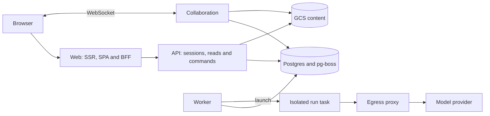

# Rhēma

A writing workspace for developing, reviewing, and revising long-form prose.

Rhema brings the manuscript, editorial feedback, and supporting research into one place. A Review
produces a dossier with an editorial letter, a claims ledger, and findings attached to the draft.
Writers can inspect the evidence, decide how to address each finding, and carry those decisions into
the next revision.

The repository contains the web application, collaborative editor, run orchestration, and deployment
infrastructure behind [rhema.tools](https://rhema.tools).

## What is here

- **Writing and revision:** a ProseMirror editor with Yjs collaboration, Markdown source mode,
  versioned drafts, outlines, and import/export workflows.
- **Editorial review:** dossiers, source-linked claims, finding dispositions, and revision
  obligations that keep feedback connected to the text.
- **Controlled agent runs:** explicit approval gates, live run events, budget caps, and a separate
  execution environment for model-driven work.
- **A TypeScript application stack:** React, Hono, TanStack Router/Query, PostgreSQL, and a pnpm
  workspace built with Turborepo. Infrastructure is defined in TypeScript with Pulumi for GCP.

These describe the application source. Hosted availability and configured entitlements can differ;
the [hosted service](https://rhema.tools) presents its current terms. The mobile app is a skeleton.
Review output still requires editorial judgment; the repository does not establish a benchmarked
quality advantage.

## Release status

**Public source release (MIT), 2026-11-03.** The tree publishes as-is — including the editorial
protocols in `packages/protocols` — after a full-history secrets and personal-data audit
(disposition table + procedure: [docs/ops/open-source-readiness.md](docs/ops/open-source-readiness.md)).
Private evaluation content stays outside the repository (`RHEMA_EVALS_PATH`; `evals-stub` supplies
the fallback), and is not required for the checkout below.

The hosted service runs at [rhema.tools](https://rhema.tools). Deployed provenance, launch state,
and the live verification record live in [docs/build](docs/build/README.md); GitHub Actions runs
CI and the scheduled browser-journey suite against production.

## Architecture



- **Web** serves HTML and keeps session cookies on the app origin, proxying auth and exposing a
  backend-for-frontend under `/bff/*`.
- **API** authenticates and persists; run creation enters the orchestration state machine on
  Postgres + pg-boss.
- **Worker** advances the lifecycle — consumes jobs, launches an isolated Kubernetes task, and
  performs background maintenance.
- **Run task** executes model work under a privileged-harness / unprivileged-agent split; all
  provider traffic passes through the egress proxy, which authorizes, meters, and enforces caps.
- Tenant data is isolated by **row-level security**; budgets are enforced server-side.

The [architecture guide](docs/architecture.md) walks each boundary in depth, and the package
table below maps it to code.

## Start developing

Use **Node.js 22.12 or later in the 22.x line** and **pnpm 10.32.1**, matching the repository's CI
major version and pinned package manager. From the repository root:

```bash
pnpm install --frozen-lockfile
pnpm turbo build lint typecheck
pnpm exec vitest run packages/contracts/src/notes.test.ts
```

This installs the workspace, checks the build, and runs a small contract test. For the full test suite,
browser prerequisites, focused development, and a local web-server preview, follow the
[development guide](docs/development.md). Running the complete service requires additional
[configuration and infrastructure](docs/configuration.md).

## Find your way around

| Area                                                     | Start here                                                                                                                 |
| -------------------------------------------------------- | -------------------------------------------------------------------------------------------------------------------------- |
| Browser application, SSR host, and same-origin API layer | [`apps/web`](apps/web/README.md)                                                                                           |
| HTTP API, background jobs, and collaboration service     | [`apps/api`](apps/api), [`apps/worker`](apps/worker), [`apps/collab`](apps/collab)                                         |
| Editor and reusable interface components                 | [`packages/editor`](packages/editor), [`packages/ui`](packages/ui), [`packages/ide`](packages/ide)                         |
| Contracts, database, and run lifecycle                   | [`packages/contracts`](packages/contracts), [`packages/db`](packages/db), [`packages/orchestrator`](packages/orchestrator) |
| Run isolation and provider traffic                       | [`apps/run-task`](apps/run-task), [`apps/egress-proxy`](apps/egress-proxy)                                                 |
| Integration tests and browser journeys                   | [`integration`](integration/README.md), [`packages/journeys`](packages/journeys/README.md)                                 |
| Deployment infrastructure                                | [`infra`](infra/pulumi/README.md)                                                                                          |

The [documentation index](docs/README.md) separates maintained guidance from the project's design and
build history.

## Contribute

Start with [CONTRIBUTING](CONTRIBUTING.md) for the development and review workflow. Reproducible bug
reports, documentation corrections, and focused improvements are useful contributions. Agents should
read [AGENTS.md](AGENTS.md) and the instructions for the area they change.

For questions, see [SUPPORT](SUPPORT.md). Report vulnerabilities privately through the
[security policy](SECURITY.md).

## License

The repository's license is [MIT](LICENSE). Third-party components have their own terms; see
[LICENSES](LICENSES.md), including the separately licensed runtime dependencies and public-export
boundary.
