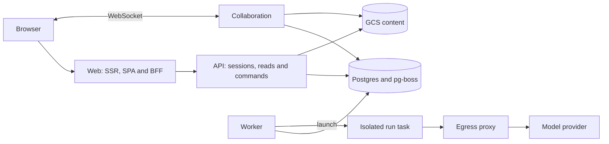

# Architecture

Rhema separates the writing interface, durable run coordination, and model execution. A browser
request can read a document or submit a run; the work itself continues through a queue and an
isolated task. This guide maps those boundaries to the code you will edit.

It describes the checked-in implementation. A deployment may run an earlier revision; deployed
behavior requires the provenance and browser checks in the [journey guide](../packages/journeys/README.md).

## A request and a run

The diagram shows the main paths; Redis carries run-event delivery and heartbeats, and separate
services fetch remote content, convert imports, and render exports.

1. **The web host handles the browser boundary.** It serves HTML and assets, keeps session cookies
   on the app origin, proxies authentication, and exposes a backend-for-frontend (BFF) under
   `/bff/*`. Its data source calls the API on the server.
2. **The API authenticates and persists the request.** Run creation validates the requested work
   and enters the orchestration state machine. Durable jobs use pg-boss in Postgres.
3. **The worker advances the lifecycle.** It consumes jobs, launches a Kubernetes task, handles
   cancellation and recovery, and performs background maintenance.
4. **A run task executes the model work.** The privileged harness controls the run while a
   separate user executes the agent. Its allowed provider traffic passes through the egress
   proxy, which checks authorization, meters usage, and enforces caps.
5. **The UI observes persisted results.** API reads and server-sent events expose run progress;
   document collaboration has its own WebSocket service and persistence path.

The composition roots are [web](../apps/web/src/main.ts), [API](../apps/api/src/server.ts),
[worker](../apps/worker/src/main.ts), and [collaboration](../apps/collab/src/server.ts).
Their dependencies are injected into route and domain code, which lets tests exercise most
behavior without starting the deployed services.

## Where to make a change

| Concern                                                     | Start here                                                                                                                                                         |
| ----------------------------------------------------------- | ------------------------------------------------------------------------------------------------------------------------------------------------------------------ |
| Browser routes, forms, BFF and server rendering             | [`apps/web`](../apps/web/README.md)                                                                                                                                |
| API endpoints and authentication                            | [`apps/api/src`](../apps/api/src/)                                                                                                                                 |
| Background jobs and run launch                              | [`apps/worker/src`](../apps/worker/src/)                                                                                                                           |
| Collaborative documents, materialization and restore points | [`apps/collab/src`](../apps/collab/src/)                                                                                                                           |
| Shared wire schemas and product vocabulary                  | [`packages/contracts`](../packages/contracts/src/index.ts)                                                                                                         |
| SQL schema, migrations and tenant context                   | [`packages/db`](../packages/db/src/index.ts)                                                                                                                       |
| Run state, gates, cancellation and recovery                 | [`packages/orchestrator`](../packages/orchestrator/src/index.ts)                                                                                                   |
| Model engine interface, SDK adapter and test engine         | [`packages/engine`](../packages/engine/src/index.ts)                                                                                                               |
| Agent process and filesystem isolation                      | [`apps/run-task`](../apps/run-task/src/) and [`packages/harness`](../packages/harness/src/)                                                                        |
| Provider request enforcement and metering                   | [`apps/egress-proxy`](../apps/egress-proxy/src/)                                                                                                                   |
| Credit accounting and cost calculation                      | [`packages/ledger`](../packages/ledger/src/)                                                                                                                       |
| Markdown, editor schema, citations and source editing       | [`packages/markdown`](../packages/markdown/src/) and [`packages/editor`](../packages/editor/src/index.ts)                                                          |
| Shared UI, IDE layout and run controls                      | [`packages/ui`](../packages/ui/src/), [`packages/ide`](../packages/ide/src/), [`packages/run-sheet`](../packages/run-sheet/src/)                                   |
| Remote ingestion, conversion and export                     | [`packages/ingest`](../packages/ingest/src/), [`apps/fetcher`](../apps/fetcher/src/), [`apps/convert`](../apps/convert/src/), [`apps/export`](../apps/export/src/) |
| GCP client adapters                                         | [`packages/live-clients`](../packages/live-clients/src/)                                                                                                           |
| Composed deterministic tests                                | [`integration`](../integration/README.md)                                                                                                                          |
| Deployed browser acceptance                                 | [`packages/journeys`](../packages/journeys/README.md)                                                                                                              |
| Infrastructure and stage configuration                      | [`infra/config`](../infra/config/) and [`infra/pulumi`](../infra/pulumi/README.md)                                                                                 |

`apps/mobile` is a skeleton, not a completed mobile client. `apps/turbo-cache` is build
infrastructure, separate from the product's request path.

## The web application is a permanent hybrid

The public funnel, legal pages, and the `/demo` hub render on the server. Authenticated
application documents normally receive the Vite-built TanStack Router/Query SPA shell, which
mounts one persistent `AppShell` chrome (sidebar, right panel, in-shell pending/error states).
The Page family's only server exception is a phone request, which receives a read-only SSR
view; showcase projects render inside the SPA through `ReadOnlyProject`, the single client
read-only mechanism whose `demo`/`showcase`/`run_lock` reasons hide write controls before any
request is made.

React Router remains a server-side route manifest and matching dependency; it is not the browser
router. Small browser entry points also remain for SSR documents: `ide`, `page`, and `landing`.
Their source and output layout is documented in the [web package guide](../apps/web/README.md).

Within the SPA, one delegated link handler owns client navigation, and
[`bffFetch`](../apps/web/src/spa/bff.ts) owns JSON transport. Read queries use typed BFF endpoints.
Writes use the same server paths as the no-JavaScript forms, with JSON or redirect responses
selected by request headers. A leaf that receives a server SSR verdict hands off to a document
navigation. There is no renderer feature flag or query-string override to restore.

The editor uses ProseMirror for document state and Yjs for collaboration. Markdown conversion,
citations, provenance and source-edit merging live in `packages/editor`; browser mounting lives
in `apps/web`. Hocuspocus in `apps/collab` coordinates live documents and persists materialized
content and restore points. Shared interface controls come from `@rhema/ui` — Radix/Lucide/cmdk
primitives styled by a generated `uiCss()` — and a lint rule (`rhema/no-raw-controls`) keeps raw
form controls out of surfaces.

The public demo is a separate read path, not a tenant. A guard in
[`apps/web/src/demo.ts`](../apps/web/src/demo.ts) claims `/demo*` and the reserved `demo~<essay>`
slug namespace before any authenticated route; document GETs receive the outer shell with a demo
boot, and JSON twin GETs forward to a nested app backed by
[`demoDataSource`](../apps/web/src/demo-data.ts), which answers every read from committed
snapshot files exported by `packages/demo-corpus`. Demo requests carry no session and perform no
database reads; non-GET requests fail `demo_read_only`, and the anonymous-metrics beacon
(`POST /a/demo` → `POST /analytics/demo`, insert-only) is the one sanctioned write. Twin
responses are edge-cacheable and keyed by the build SHA, so a deploy ends with a recorded CDN
invalidation of `/bff/p/demo~*`.

## Boundaries worth preserving

**Tenant isolation:** user-serving database access uses a role that cannot bypass row-level
security and binds the workspace in a transaction. System maintenance has a separate pool.
Using that elevated pool to satisfy a user request would bypass the intended isolation. See
[`packages/db/src/rls.ts`](../packages/db/src/rls.ts) and the
[two-tenant probe](../integration/src/two-tenant-probe.ts).

**Agent isolation:** the harness and model agent run as different users. The agent receives a
constructed, scrubbed environment; run tokens, proxy credentials and real provider keys are
excluded. The harness owns the privileged credentials, and the proxy supplies the upstream
provider credential. The boundary is defined in
[`scrubbed-env.ts`](../packages/engine/src/scrubbed-env.ts) and the
[run-task image](../apps/run-task/Dockerfile).

**Package boundaries:** pnpm workspace dependencies and TypeScript project references define the
build graph. Import other packages through declared `@rhema/*` dependencies, and keep `.js`
extensions on relative imports in NodeNext source. Shared contracts belong in the contracts
package rather than being copied into each service. [Agent guidance](../AGENTS.md) records the
enforced conventions.

## Buildable source and a running deployment

The local build compiles the TypeScript graph and browser bundles. Most tests replace external
adapters with in-process implementations, including PGlite and `FakeEngine`; this is the normal
contributor loop in [Development](./development.md).

The deployed architecture requires managed Postgres, Redis, GCS, Secret Manager, Cloud Run,
Kubernetes run tasks, and service identities. The separate Pulumi project provisions those
resources from the checked-in [stage facts](../infra/config/stages.ts). It is not part of the
root TypeScript build.

The current tree includes the protocol package and a public fallback, while private evaluations
are optional. Live model execution also requires build-time SDK material outside Git. A green
local build therefore establishes neither a complete public export nor a runnable hosted
installation. See [Configuration](./configuration.md) and
[open-source release preparation](./open-source-readiness.md) for those boundaries.
