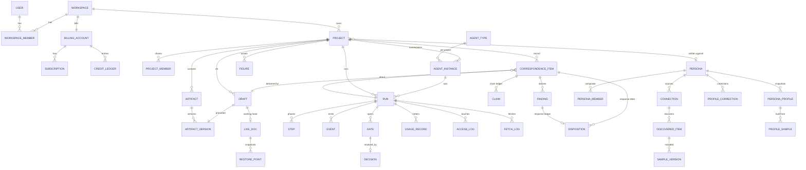
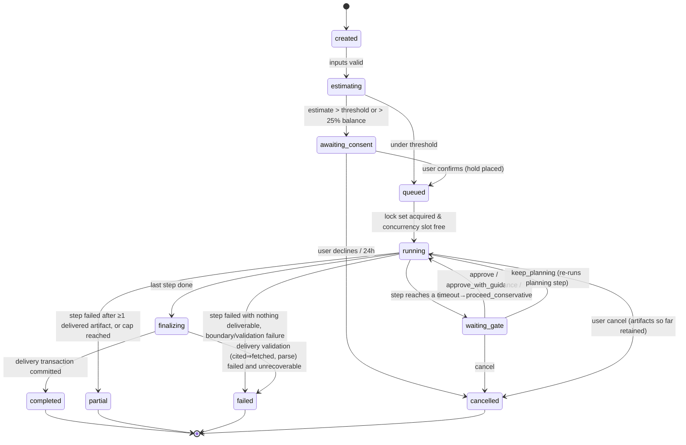

# Artifact visibility policy, data model, boundary enforcement, and run model

- Scope: ledger rows **E1–E6** (visibility & editability), **F1–F8** (data model), **C13** (sharing roles), **K1–K3** (run state machine, event schema, concurrency), **N1–N3** alignment · Date: 2026-08-27
- Evidence base read in full: `docs/research/2_source-system-extraction.md` (39-artifact inventory §2, state machine §4, 21-rule enforcement table §5, harness requirements §6), `8_editor-technology.md` (§3.2 anchoring, §5 autosave/versioning tiers), `7_execution-harness-options.md` (§3.1 hooks/mounts, §5 input-scoped subagents, §8.3 cost meter, §11 migration path), `10_pricing-billing-auth.md` (§5.5 estimate/cap, §7 attribution pipeline and ledger), `4_coding-agent-ux-part2.md` (§4.2 typed artifacts with review policies, §5 run grammar, §6 gates/steering); `5_writing-products-and-substack.md` §1.4 and §2.3 (span provenance, ICMJE/COPE); `9_ingestion-export-visualization.md` §4–§6 (canonical markdown front-matter, sync model, hash-based staleness); `~/agent-discourse/conventions/{project-memory,personas}.md`.
- Requirement numbering: `REQ-VIS-n` (visibility/editability), `REQ-DATA-n` (data model, storage, enforcement, versioning, drift, runs, sharing).

## Summary of decisions (≤300 words)

1. **Visibility is a function of artifact *kind*, computed in code, never stored per row as opinion.** Four levels — Surfaced-editable (SE), Surfaced-read-only (SR), Inspectable-on-demand (I), Hidden (H) — with four reason classes: *UX simplicity*, *integrity-boundary*, *secret-sauce*, *immutability*. Of 39 source artifact types plus 7 Rhema additions: 7 SE, 19 SR, 13 I, 7 H. The user is the author, so the author agent's memory is the user's own notebook (I); only editor memory, persona hold-outs, and process residue are H (§2).
2. **Protocols are never text; outputs always are.** Rubric caps, verdict vocabularies, hazard lists, disposition taxonomies, and every `SKILL.md`/`references/*.md` stay server-side. The *results* they produce (verdicts with URLs, rubric scores, findings, calibration reports) are fully surfaced. Transparency floor: every fetched URL, every claim verdict, the model tier per run, a machine-generated boundary attestation, span-level provenance, and an exportable AI-use statement (§2.6).
3. **Canonical text is markdown in S3, content-addressed by SHA-256; Postgres holds every relation.** The harness reads a per-run *materialized mirror* of project memory, mounted per role; the mirror is a cache with a signed sync contract, never a second source of truth (§3.5).
4. **Boundaries are enforced by the runtime, logged per path, and rendered as a verifiable attestation** — mounts + `PreToolUse` allowlist hook + per-run URL policy + input-scoped subagent definitions; the attestation paragraph in the skills becomes a generated access report (§4).
5. **Immutability is a state, not a flag the agent remembers.** A draft version freezes the moment a run reads it or a dossier references it; a human edit to a frozen version *is* `v(N+1)` with `origin=human_revision` and auto-flagged unverified claims; concurrent edits during a run fork to a working copy reconciled as suggestion marks (§5).
6. **Runs are a nine-state machine with durable gates (approve-with-deadline), a typed event schema with an explicit no-prompt-leakage rule, and lock sets computed from the run's read/write namespaces** (§7). **Sharing is viewer/editor/admin on the project**, with spend and gates governed by role (§8).

## 1. Framing, principles, and how this document decides

Three facts from the evidence shape everything below.

**The user is the author** (note 2 §3; ledger change log turn 4). Every design statement in the source system puts the human in the author's chair: `guidance` outranks the charter, escalations go "to the human author", the outline is the human's document. So the strong form of thesis T3 ("private agent memory hidden by default") is refuted for `agents/author/*` and retained for `agents/editor/*` and the persona hold-out. The boundary with product value is **editor ↔ author**, not **agent ↔ user**.

**Files are the interface, and the conventions already say enforcement belongs to the OS layer** (`project-memory.md` §"What this is and isn't": "operators who want hard enforcement should apply it at the OS layer … per-role sandboxes whose mounts exclude the other roles' directories"). Note 7 §3.1 shows the Claude Agent SDK gives exactly this (per-role `cwd` mounts + `PreToolUse` hooks that deny/rewrite paths and log every allowed one). So the 21 normative rules in note 2 §5 become runtime mechanisms here, and the attestation becomes data.

**Every product in the inspiration set has converged on one run grammar** (note 4 §5): transcript with collapsed tool calls + a gating plan artifact + a "what changed" surface + a run list grouped by state, with typed artifacts carrying per-type review policies (Antigravity) and gates that are soft (auto-proceed timers). The data model below is built so those surfaces are *projections of tables*, not prose parsed at render time.

Decision rule used throughout (Q-20): the operator's ⚑ requirements are presumed; departures are marked **Departure** with reasoning. Alternatives are stated briefly and one is chosen.

## 2. Artifact visibility & editability policy (E1–E6)

### 2.1 Levels and reason classes

| Level | Meaning in the IDE | Editability |
|---|---|---|
| **SE** Surfaced-editable | First-class object with its own view in the artifact browser or timeline; the user can change it | Direct edit (live doc, autosave) or structured edit (form) |
| **SR** Surfaced-read-only | First-class object, rendered (often as data, not prose); no edit affordance; user intent enters through *guidance*, *dispositions*, or *corrections* recorded as separate objects | None in place |
| **I** Inspectable-on-demand | Not in the default tree; reachable from a provenance link, an "Advanced"/"Show working" disclosure, or the run detail; rendered read-only | None |
| **H** Hidden | Exists only in the harness mirror and the object store; no UI route; surfaces at most as counts, hashes, or URLs | None |

| Reason class | Definition | Test |
|---|---|---|
| **UX** UX simplicity | Showing it by default adds noise without a decision the user can make | "Would a writer act on this?" |
| **IB** Integrity-boundary | Exposing it contaminates a later round (editor sees author rationalizations or vice versa) or defeats a hold-out | "Does reading this change what a future agent should know?" |
| **SS** Secret-sauce | Competitive IP: protocol text, rubric machinery, prompts, measured-feature internals (Q-19; note 2 §9 item 13) | "Would a competitor copy this file?" |
| **IM** Immutability | The artifact is part of the delivered record; editing it in place would falsify history (`project-memory.md` §boundary "Delivered artifacts are immutable") | "Is this what a later round reads as the past?" |

**REQ-VIS-1.** The visibility level and reason class of every artifact kind is defined once in a code-owned policy table (`artifactPolicy: Record<ArtifactKind, {level, reasons, editMode}>`); the API refuses reads of kinds with level `H` for any principal other than the run engine, and refuses writes to kinds with `editMode: none` regardless of role. Acceptance: a contract test enumerates every `ArtifactKind` and asserts a policy entry exists (no default).

**REQ-VIS-2.** Visibility is never stored per artifact row; a kind's level may be *narrowed* per project by policy (e.g. a share link that exposes only SR kinds) but never widened.

### 2.2 The per-artifact visibility table

Numbering follows note 2 §2 (1–39); R1–R7 are Rhema additions. "Producer" H human, A author agent, E editor agent, B persona builder, S system. `ArtifactKind` is the enum name used in §3.

**Project memory — shared record**

| # | Artifact (source path) | Kind | Level | Reason | Edit mode / notes |
|---|---|---|---|---|---|
| 1 | `manifest.md` | *(derived; not an artifact)* | **SR** | UX, IM | Rendered as the **round timeline** from `run`, `draft`, `correspondence_item`, `event`. The "next-round agenda" free text becomes `backlog_item` rows (note 2 §4.4 item 6). Never a file the user edits; regenerated into the mirror. |
| 2 | `drafts/vN.md` | `draft` | **SE** while unfrozen → **SR** when frozen | IM | Live Yjs doc while `state=working`; freezes on first run read or dossier reference (§5). Frozen shows lock + "Edit → creates v(N+1)". |
| 3 | `drafts/figures/*`, companion sheets | `figure`, `companion_doc` | **SE** | — | Figures are spec + data + provenance rendered to SVG (note 9); inserted as suggestion marks (note 8 §3.3a). Companion docs are ordinary SE documents. |
| 4 | `correspondence/vN-drafting-note.md` | `drafting_note` | **SR** | IM | The first thing shown after a draft run; sections (decisions, verified/unverified counts, open questions) rendered as cards. |
| 5 | `…/vN-review/editors-letter.md` | `editors_letter` | **SR** | IM | The review hub (T2). Sections map to UI: verdict, the one thing, majors, strengths, roadmap, considered-and-rejected. |
| 6 | `…/00-piece-brief.md` | `piece_brief` | **I** | UX | "What the editor thought you were writing." Linked from the letter's header. Shown at the *review-scope gate* as SR (it is that gate's plan artifact). |
| 7 | `…/01-claim-ledger.md` | `claim_ledger` | **SR** as data | IM | Parsed into `claim` rows: text, tier, verdict (6-value enum), URL, accessed-at, note. Rendered as a filterable table and as anchored chips in the editor. The **transparency floor** artifact (E6). |
| 8 | `…/02-discourse-report.md` | `discourse_report` | **SR** | IM | Originality verdict, counterargument, reception forecast; round-stamped (recompute rule). |
| 9 | `…/03-argument-notes.md`, `…/04-craft-notes.md` | `argument_notes`, `craft_notes` | **I** | UX | Working notes folded into the letter; kept because the response ledger enumerates them as finding sources. Schema fixed in code (note 2 §2.3 item 1). |
| 10 | `…/05-second-read.md` | `second_read` | **SR** | IM | "Independent second opinion" trust feature; reconciliation shows what the editor rejected. |
| 11 | `correspondence/vN-response.md` | `response_letter` | **SR**; flags → decisions inbox | IM | Read-only view of the disposition record; escalations become `decision_request` rows (note 2 new row C18). |

**Project memory — author agent namespace (`agents/author/*`) — the user's own assistant's notebook**

| # | Artifact | Kind | Level | Reason | Notes |
|---|---|---|---|---|---|
| 12 | `outline/*` | `outline` | **SE** (versioned) | — | User-supplied. Editing after v1 exists creates `outline` version 2 with a timeline event; the drafting note refers to the version it used. |
| 13 | `drafting/vN/00-commissioning-brief.md` | `commissioning_brief` | **I**; **SR** at the structure gate | UX | Commitments/refusals/open questions; the gate card quotes it. |
| 14 | `…/01-voice-brief.md` | `voice_brief` | **I** | UX | Shows which persona member and targets were bound. |
| 15 | `…/02-structure-plan.md` | `structure_plan` | **SR** at the gate with *guidance* input; **I** after | UX, IM | **Decision:** the user does not edit the plan text (the skill reads `guidance`, not an edited plan); the gate offers "Approve / Approve with guidance / Keep planning". Editable-plan-mid-run (note 4 K7) is delivered as *guidance queued to the next phase*, which the skill's re-plan loop already consumes. Alternative rejected: direct plan editing — it blurs agent/human provenance and the skill would re-derive the plan anyway. |
| 16 | `…/03-claim-ledger.md` (author's) | `claim_ledger` (namespace author) | **I** as data | UX | Same `claim` rows as #7; surfaced in the editor when the user asks "was this verified?". |
| 17 | `…/04-draft-ledger.md` | `draft_ledger` | **I** (progress rows) / **H** (deviation log) | UX; SS | `Phase status` and section rows feed the live run card via events; the deviation log is process residue. |
| 18 | `…/05-consolidation-notes.md` | `consolidation_notes` | **H** | UX | Nothing actionable beyond the drafting note. |
| 19 | `…/06-fidelity-audit.md` | `fidelity_audit` | **I** | UX | "Checks passed" chip on the run card; full text on demand. |
| 20 | `research/index.md` + `sources/*.md` | `source_note` (namespace author) | **I** as a source library | UX | E6: the user's own research record, with URL + accessed-at per note; hidden by default for simplicity, not secrecy. |
| 21 | `ledgers/vN-response-ledger.md` | `response_ledger` | **SR** via disposition UI | IM | Parsed into `finding` + `disposition` rows; frozen at delivery (DB-enforced — note 2 §2.3 item 3 shows freezing gets forgotten otherwise). |
| 22 | `voice-charter.md` | `voice_charter` | **I** + "Add guidance" | UX, IB (author↔editor) | **E3 decision:** the user may *read* the charter; the user does not edit it in place. Intent enters as `guidance` (precedence human guidance > charter > persona > default). Rationale: a hand-edited charter loses the "protected strengths" provenance the skill seeds from the editor's letter; guidance is already the supported channel. |

**Project memory — editor agent namespace (`agents/editor/*`) — the boundary's other half**

| # | Artifact | Kind | Level | Reason | Notes |
|---|---|---|---|---|---|
| 23 | `research/index.md` + `sources/*.md` | `source_note` (namespace editor) | **H**; URLs + accessed-at → **SR** in the claim ledger | IB | The deliberations stay hidden; the *fetch log* (§4.5) exposes every URL, satisfying E6 without exposing notes. |
| 24 | `notes.md` | — | dropped | — | Never used in any real project (note 2 §2.3 item 5). |

**Persona library**

| # | Artifact | Kind | Level | Reason | Notes |
|---|---|---|---|---|---|
| 25 | `PERSONA.md` seed | `persona_seed` (user prose) + `persona_builder_note` (agent-appended) | **SE** / **SR** | —; IM | Split the mixed-authorship file (J3): seed is a form + free prose; the builder's note is a separate SR object; the "pieces in progress" list is derived from `project.persona_id`. |
| 26 | `docs/*` | `sample` | **SE** (samples manager) | — | Ingestion pipeline (note 9); include/omit per item; never agent-written. |
| 27 | `profile/index.md` | `profile_index` | **SR** as the persona detail header | UX | Staleness verdict is *computed* (§6), not read from the prose; the hub's one-paragraph voice summary is shown. |
| 28 | `profile/voice-print.md` | `voice_print` | **I** ("Advanced") | SS, UX | Measured rates and rations are secret-sauce-adjacent; the detail page shows three summary numbers (sentence length band, paragraph length band, first-person rate) and hides the rest behind Advanced. Editor role never loads it (B5). |
| 29 | `profile/structure-repertoire.md` | `structure_repertoire` | **I** | SS, UX | Same. |
| 30 | `profile/lexicon.md` | `lexicon` | **I** | SS, UX | Same; "words you avoid" list is shown as a chip row. |
| 31 | `profile/exemplars.md` | `exemplars` | **SR** | — | ≤12 quotes ≤40 words from the user's own work; "what the system learned". |
| 32 | `profile/positions.md` | `positions` | **SR** | — | "What you've argued", each with piece + citation; open tensions shown. |
| 33 | `profile/continuity.md` | `continuity` | **SR** | — | Same. |
| 34 | `profile/audience-and-venue.md` | `audience_venue` | **I** | UX | Mostly derivable from the connection. |
| 35 | `profile/calibration.md` | `calibration_report` | **SR** | — | The honesty artifact: prediction vs actual, corrections logged. Hold-out identity becomes visible *here*, after calibration. |
| 36 | `profile/provenance.md` | `profile_provenance` | **I** | UX | Rendered as the drift explanation (§6); census → `sample` rows. |
| 37 | `profile/corpus/*.md`, `HOLDOUT-*.md` | `corpus_note`, `holdout_note` | **H** | IB (hold-out), SS (distillation method) | Hold-out identity is hidden from every consumer *and the UI* until calibration completes (B9); corpus notes are the distillation the "notes not corpora" rule exists for. |
| 38 | Composite extras (`register-map.md`, `shared-lexicon.md`, unioned positions/continuity) | `register_map`, `shared_lexicon` | **SR** (register map as overridable routing rules) / **I** (shared lexicon) | — | Register override is the `register` run input. |
| 39 | Legacy flat `<id>.md` | — | dropped | — | Import path only. |

**Rhema additions**

| # | Artifact | Kind | Level | Reason | Notes |
|---|---|---|---|---|---|
| R1 | Run transcript (SDK JSONL, mirrored to S3) | `run_transcript` | **H** | SS, IB | Contains prompts, protocol text, and private-namespace content. Replay UI (note 7 §9) reads the *event stream* and artifact diffs, never the transcript. Retained 30 days for support/evals, then deleted. |
| R2 | Access report (per run) | `access_report` | **SR** as a trust chip; detail on demand | — | "Editor read 214 paths, 0 denied; never touched `agents/author/`." Generated from `access_log` (§4.5). |
| R3 | Fetch log (per run) | `fetch_log` | **SR** as source cards | — | Every `WebFetch`/`WebSearch` call with URL, status, retrieved-at; joins to `claim.url` for the "cited ⇒ fetched" invariant (B11). |
| R4 | Run report + round walkthrough | `run_report`, `walkthrough` | **SR** | — | Cost by phase × role, timings, unmet targets, suggested guidance (Devin insights / Antigravity walkthrough, note 4 §4.6). |
| R5 | Chat session (in-IDE assistant) | `chat_session` | **SE** (user's own messages) / **SR** (assistant turns) | — | Assistant role's namespace `agents/assistant/`; reads shared record only (note 7 §7). Outline export from chat creates an `outline` artifact. |
| R6 | Span provenance sidecar (per draft version) | `provenance_map` | **SR** (colour overlay toggle; provenance appendix on export) | — | Human / author-agent vN / pasted / research-chat spans (note 5 §1.4). |
| R7 | AI-use statement (per project, generated) | `ai_use_statement` | **SR**, exportable | — | ICMJE/COPE-shaped disclosure derived from `run` rows (tool, model tier, phases, dates). |

Counts: SE 7 (2-unfrozen, 3, 12, 25-seed, 26, R5-user, plus 15's guidance channel), SR 19, I 13, H 7 (18, 23, 37×2, R1, 17-deviation log, plus hold-out identity pre-calibration).

**REQ-VIS-3.** The artifact browser's default tree shows exactly the SE and SR kinds grouped **Drafts / Correspondence / Research / Persona**; I kinds are reachable only through provenance links and a per-section "Show working" disclosure; H kinds have no route. Acceptance: snapshot test of the tree for the three seeded real projects.

### 2.3 Shared record edit rules (E2)

**REQ-VIS-4.** `draft` is editable only while `state=working`; the first of (a) a run opening it for read, (b) a `correspondence_item` referencing it, (c) an explicit "Promote", transitions it to `frozen`, after which the only edit path is fork-to-`v(N+1)` (§5).
**REQ-VIS-5.** Every `correspondence_item` kind is write-once at delivery; the API has no update endpoint for their content, only for *annotations* (comments, dispositions, decisions) stored in separate tables.
**REQ-VIS-6.** The manifest is derived. The mirror writes `manifest.md` from the tables before every run (§3.5); nothing reads a user-edited manifest.

### 2.4 Private memory (E3): what the user may see, and whether the user edits the charter

Decision, restated from the table: **author namespace = inspectable; editor namespace = hidden with URLs exposed; charter = read + guidance, not edit.**

Alternatives considered: (a) hide both namespaces (strong T3) — rejected because the outline, the research library, and the response ledger are the user's own work product and the transparency floor needs the claim ledger; (b) expose both namespaces — rejected because editor deliberations read by the author defeat the boundary the product markets ("the editor never saw your rationalizations" is symmetric: the author must not read the editor's undelivered notes either, or the next round's response is written against the editor's private doubts rather than the delivered letter); (c) let the user edit the charter — rejected per row 22.

**REQ-VIS-7.** A project member with any role can read `agents/author/*` kinds at their policy level; no principal can read `agents/editor/*` content via the API; the only editor-namespace projection is the fetch log (URL, title, retrieved-at, status).

### 2.5 Persona profile files (E4): corrections belong in the seed

The convention's rule ("Corrections belong in `PERSONA.md` … hand-editing a derived file silently is how a profile starts lying about its own provenance") becomes a UI rule:

**REQ-VIS-8.** Derived profile kinds (#27–#38) have `editMode: none`. The persona detail page offers exactly two correction channels: (1) edit the seed (SE; bumps `seed_hash` → drift state `seed_changed`); (2) "Correct this" on a profile statement, which creates a `profile_correction` row (statement id, user text, date) that the next refresh run consumes and that renders inline as "Corrected by you on …" until then. Calibration-phase corrections written by the builder are `profile_correction` rows with `source=calibration`, so the source system's inline "Corrected after calibration" markers become structured (note 2 §9 item 3).

### 2.6 Secret sauce (E5) and the transparency floor (E6)

**What is never shown as text (SS):** `SKILL.md` bodies and `references/*.md` (verification protocol, rubric with entailment caps, prose standards, provenance rules, calibration protocol, corpus-note template, voice-print method); prompts and subagent definitions; hazard-word lists and signature-move rations inside `voice_print`; the six-verdict vocabulary's *decision rules* (the verdict labels themselves are shown — they are outputs); disposition taxonomy rationale; phase→artifact manifest; run transcripts. Genre protocol variants (C5) are exposed as *names and toggles* (rigor dial notches, phase on/off with credit deltas — note 4 implication 4, note 10 §5.5), never as rubric text.

**What is always shown (E6, the floor):**

| Floor item | Source of truth | Surface |
|---|---|---|
| Every source actually fetched (URL, title, retrieved-at, HTTP status) | `fetch_log` from the hook layer | Source cards on the run; claim table links |
| Every claim verdict with its URL and accessed date; unverified claims marked | `claim` rows | Claim table; anchored chips in the editor; export appendix |
| Rubric scores per dimension (no aggregate — the rubric forbids one) | `review.rubric` | Letter header |
| Which phases ran / were opted out (each declared in the letter) | `run.config`, `step` rows | Run card, letter header |
| Model tier and effort per run (curated name, e.g. "Frontier"), provider | `run.model_profile` | Run card, usage page |
| Boundary attestation: paths allowed/denied per namespace; subagent input scoping | `access_report` | Trust chip on every delivered dossier |
| Which persona member and profile snapshot were used; staleness at run time | `run.persona_profile_id`, `voice_brief` | Drafting note header; persona pill |
| Span-level provenance for the current draft | `provenance_map` | Overlay toggle; export appendix |
| AI-use statement | generated from `run` rows | Export dialog; project settings |

**REQ-VIS-9 (cited ⇒ fetched invariant).** A delivered claim ledger whose `url` does not appear in the run's `fetch_log` (after normalisation) fails delivery validation; the run enters `failed(validation)` with the artifact retained as partial. This is the mechanical form of rule B11.
**REQ-VIS-10.** The AI-use statement is generated, not hand-written: template + `run` facts (workflow names, model tiers, dates, phases, human gates approved, human-revision versions); user may append but not remove generated sentences in the exported copy.
**REQ-VIS-11.** Production telemetry never carries prompt or tool content (`OTEL_LOG_*` content flags off, note 7 §9); support access to transcripts (R1) is logged and time-limited.

**Departure noted:** none from an operator ⚑ requirement. The founding prompt asks which artifacts should be hidden "to maximize simplicity … or to hide the secret sauce … or both"; the answer above is *both*, with the split made explicit per row.

## 3. Data model (F1–F3, F7, F8)

### 3.1 Entity overview



Design choices worth stating:

- **`artifact` is the one typed-document table; `draft`, `correspondence_item`, and persona profile files are *roles* an artifact version plays,** not separate content stores. This keeps content-addressing, provenance, and visibility policy in one place while giving the timeline and the disposition UI their own keyed tables. Alternative rejected: one table per artifact kind (39 tables, no shared policy enforcement).
- **`review` is keyed by `(draft_id, run_id)`**, adopting note 2's proposed row F9: one version may carry several reviews (genre variants, partial re-reviews, re-runs after cancellation). The mirror path becomes `correspondence/vN-review-<k>/` with `k` = review ordinal; `k=1` writes the legacy `vN-review/` name for skill compatibility.
- **Claims, findings, and dispositions are rows, not prose.** The skills still write markdown; a deterministic parser (owned by Rhema, tested against the three real dossiers) populates the rows at delivery, and the markdown remains the immutable source artifact. If parsing fails the run still completes; the UI falls back to rendering the markdown and flags `parse_status=partial`.
- **Namespaces are first-class.** `namespace ∈ {shared, agent:author, agent:editor, agent:assistant, agent:<future>, persona:<id>}` on every artifact; enforcement (§4) and visibility (§2) both key on it.

### 3.2 TypeScript types (domain layer)

```ts
// ---------- identity & tenancy ----------
type Id<T extends string> = string & { __brand: T };          // ULIDs
type UserId = Id<'user'>; type WorkspaceId = Id<'ws'>; type ProjectId = Id<'proj'>;
type ArtifactId = Id<'art'>; type ArtifactVersionId = Id<'artv'>; type DraftId = Id<'draft'>;
type RunId = Id<'run'>; type StepId = Id<'step'>; type GateId = Id<'gate'>;
type PersonaId = Id<'persona'>; type ProfileId = Id<'prof'>; type SampleId = Id<'smp'>;
type Sha256 = string & { __brand: 'sha256' };

interface User { id: UserId; email: string; name: string; createdAt: Date; }
/** Minimal org (Q-6): every user has a personal workspace; Team plans add shared ones. */
interface Workspace { id: WorkspaceId; kind: 'personal' | 'team'; name: string; billingAccountId: Id<'bill'>; }
type WorkspaceRole = 'member' | 'admin';
interface WorkspaceMember { workspaceId: WorkspaceId; userId: UserId; role: WorkspaceRole; }

// ---------- projects & sharing (C13) ----------
type ProjectState = 'empty' | 'outline_only' | 'draft_unreviewed' | 'draft_reviewed_unanswered'
  | 'human_revised' | 'accepted' | 'exported' | 'archived';   // derived; see §7.4
type ProjectRole = 'viewer' | 'editor' | 'admin';
interface Project {
  id: ProjectId; workspaceId: WorkspaceId; ownerId: UserId;
  title: string; slug: string; genre: GenreId; venue?: string;
  personaId?: PersonaId; personaLockedAt?: Date;               // J5: locked once v1 exists
  gatePolicy: 'every_phase' | 'named_gates' | 'run_to_completion';  // default named_gates (Q-7)
  gateDeadlineMinutes: number;                                  // approve-with-deadline default
  monthlyCreditCap?: number; createdAt: Date; archivedAt?: Date;
}
interface ProjectMember { projectId: ProjectId; userId: UserId; role: ProjectRole; invitedBy: UserId; runCreditCap?: number; }

// ---------- artifacts (F1) ----------
type Namespace = 'shared' | `agent:${AgentTypeKey}` | `persona:${PersonaId}`;
type ArtifactKind =
  | 'draft' | 'outline' | 'figure' | 'companion_doc'
  | 'drafting_note' | 'editors_letter' | 'piece_brief' | 'claim_ledger' | 'discourse_report'
  | 'argument_notes' | 'craft_notes' | 'second_read' | 'response_letter'
  | 'commissioning_brief' | 'voice_brief' | 'structure_plan' | 'draft_ledger'
  | 'consolidation_notes' | 'fidelity_audit' | 'source_note' | 'response_ledger' | 'voice_charter'
  | 'persona_seed' | 'persona_builder_note' | 'sample' | 'profile_index' | 'voice_print'
  | 'structure_repertoire' | 'lexicon' | 'exemplars' | 'positions' | 'continuity'
  | 'audience_venue' | 'calibration_report' | 'profile_provenance' | 'corpus_note' | 'holdout_note'
  | 'register_map' | 'shared_lexicon'
  | 'run_transcript' | 'access_report' | 'fetch_log' | 'run_report' | 'walkthrough'
  | 'chat_session' | 'provenance_map' | 'ai_use_statement';
type Visibility = 'SE' | 'SR' | 'I' | 'H';
type ReasonClass = 'ux' | 'integrity_boundary' | 'secret_sauce' | 'immutability';
interface ArtifactPolicy { level: Visibility; reasons: ReasonClass[]; editMode: 'live_doc' | 'form' | 'guidance_only' | 'none'; }
declare const artifactPolicy: Record<ArtifactKind, ArtifactPolicy>;   // REQ-VIS-1

interface Artifact {
  id: ArtifactId; projectId?: ProjectId; personaId?: PersonaId;     // exactly one set
  kind: ArtifactKind; namespace: Namespace;
  mirrorPath: string;            // path inside the project/persona mirror, e.g. "correspondence/v2-review/01-claim-ledger.md"
  headVersionId?: ArtifactVersionId; createdAt: Date;
}
type Actor = { kind: 'user'; userId: UserId } | { kind: 'agent'; runId: RunId; agentInstanceId: Id<'agi'> } | { kind: 'system' };
interface ArtifactVersion {
  id: ArtifactVersionId; artifactId: ArtifactId; ordinal: number;
  contentSha256: Sha256; s3Key: string; bytes: number; wordCount?: number;
  mediaType: 'text/markdown' | 'image/svg+xml' | 'application/json' | string;
  createdBy: Actor; createdAt: Date;
  immutable: boolean;            // set true at delivery / freeze; DB trigger forbids content change thereafter
  parseStatus?: 'ok' | 'partial' | 'failed';   // for ledger-shaped kinds
}

// ---------- drafts: three tiers (N3) ----------
type DraftOrigin = 'drafted_from_outline' | 'response_to_review' | 'human_upload' | 'human_revision' | 'imported';
type DraftState = 'working' | 'frozen';
interface Draft {
  id: DraftId; projectId: ProjectId; n: number;                   // vN; need not start at 1 (imports)
  origin: DraftOrigin; state: DraftState;
  promotedVersionId?: ArtifactVersionId;   // set at promotion (immutable markdown snapshot)
  liveDocId?: Id<'ydoc'>;                  // present while working
  frozenAt?: Date; frozenBy?: { reason: 'run_read' | 'dossier_ref' | 'promote'; runId?: RunId };
  baseDraftId?: DraftId;                    // for human_revision / response: the vN it forked from
  createdAt: Date;
}
interface LiveDoc { id: Id<'ydoc'>; draftId: DraftId; yState: Uint8Array; stateVector: Uint8Array; mdSha256?: Sha256; materializedAt?: Date; }
interface RestorePoint { id: Id<'rp'>; liveDocId: Id<'ydoc'>; s3Key: string; cause: 'auto' | 'blur' | 'named' | 'workflow'; label?: string; createdAt: Date; }
interface WorkingCopy { id: Id<'wc'>; baseDraftId: DraftId; liveDocId: Id<'ydoc'>; reconciledInto?: DraftId; createdAt: Date; }  // §5.3

// ---------- correspondence ----------
type CorrespondenceKind = 'drafting_note' | 'review' | 'response' | 'walkthrough';
interface CorrespondenceItem {
  id: Id<'corr'>; projectId: ProjectId; kind: CorrespondenceKind;
  draftId: DraftId; runId: RunId; ordinal: number;                // review ordinal k for (draft, kind)
  deliveredAt: Date; artifactIds: ArtifactId[];                    // dossier files
  rubric?: Record<RubricDimension, 1 | 2 | 3 | 4 | 5>; verdict?: 'accept' | 'minor' | 'major' | 'reject';
  optedOut: Array<'verification' | 'discourse' | 'second_read' | 'grounding' | 'audit' | 'research' | 'gap_analysis'>;
}
type ClaimVerdict = 'verified' | 'substantially_accurate' | 'misleading_in_context' | 'unsupported' | 'contradicted' | 'unverifiable';
interface Claim {
  id: Id<'claim'>; correspondenceId: Id<'corr'>; draftId: DraftId; ordinal: number;
  text: string; tier: 1 | 2 | 3; verdict: ClaimVerdict; url?: string; accessedAt?: Date; note?: string;
  anchor?: Anchor; humanAdded: boolean;                           // humanAdded: flagged unverified on human revisions
}
interface Anchor { relStart: string; relEnd: string; quote: string; confidence: number; unanchored?: true; }  // Yjs relative positions + quote (note 8 §3.2)
type Severity = 'major' | 'minor' | 'note'; type FindingClass = 'claim' | 'argument' | 'structure' | 'craft' | 'voice' | 'continuity' | 'discourse';
interface Finding {
  id: Id<'find'>; correspondenceId: Id<'corr'>; draftId: DraftId; ordinal: number;
  cls: FindingClass; severity: Severity; confidence?: number; title: string; body: string;
  evidenceUrl?: string; anchor?: Anchor; secondReadStatus?: 'confirmed' | 'rejected_by_editor' | 'added_by_second_read';
  projections: Array<{ draftId: DraftId; anchor: Anchor }>;      // where it landed in later versions
}
type DispositionKind = 'accept' | 'adapt' | 'rebut' | 'defer' | 'escalate';
type DispositionStatus = 'open' | 'done' | 'verified' | 'mooted' | 'deferred' | 'escalated' | 'honored';
interface Disposition {
  id: Id<'disp'>; findingId: Id<'find'>; responseId: Id<'corr'>; kind: DispositionKind; status: DispositionStatus;
  rationale: string; moveOrdinal?: number; by: Actor; frozenAt?: Date;
}
interface DecisionRequest { id: Id<'dreq'>; projectId: ProjectId; sourceRunId: RunId; text: string; options: string[]; state: 'open' | 'answered' | 'dismissed'; answer?: string; }  // C18 standing escalations
interface BacklogItem { id: Id<'bl'>; projectId: ProjectId; fromCorrespondenceId: Id<'corr'>; text: string; consumedByRunId?: RunId; }

// ---------- agent types & instances (F2) ----------
type AgentTypeKey = 'author' | 'editor' | 'assistant' | 'persona_builder' | 'steelman' | 'discourse_mapper';
interface AgentType {
  key: AgentTypeKey; displayName: string;
  readable: Namespace[]; writable: Namespace[];                  // B1/B2 as data
  personaView: Array<'voice_print' | 'structure_repertoire' | 'lexicon' | 'exemplars' | 'audience_venue' | 'positions' | 'continuity' | 'register_map'>;  // B5
  tools: Array<'read' | 'write' | 'web_search' | 'web_fetch' | 'subagent' | 'measure' | 'start_workflow' | 'read_artifact' | 'create_outline'>;
  skills: string[]; defaultModelProfile: ModelProfileId;
  subagents: Record<string, SubagentDef>;                         // second_reader, fidelity_auditor, gap_analyst, holdout_calibrator, researcher
}
interface SubagentDef { inputs: 'explicit_files' | 'inherit'; files?: string[]; tools: AgentType['tools']; web: boolean; model?: ModelProfileId; }
interface AgentInstance { id: Id<'agi'>; projectId?: ProjectId; personaId?: PersonaId; typeKey: AgentTypeKey; namespace: Namespace; createdAt: Date; }

// ---------- runs (K1–K3) ----------
type WorkflowKey = 'draft_from_outline' | 'editorial_review' | 'respond_to_review' | 'bootstrap_persona' | 'compose_persona' | 'refresh_persona' | 'discourse_map' | 'outline_from_chat' | 'steelman' | 'visualize' | 'loop_to_convergence' | 'deep_research';
type RunState = 'created' | 'estimating' | 'awaiting_consent' | 'queued' | 'running' | 'waiting_gate' | 'finalizing' | 'completed' | 'partial' | 'failed' | 'cancelled';
interface Run {
  id: RunId; projectId?: ProjectId; personaId?: PersonaId; workflow: WorkflowKey; agentInstanceId: Id<'agi'>;
  state: RunState; stateSince: Date; currentStepId?: StepId;
  inputs: { draftId?: DraftId; reviewId?: Id<'corr'>; outlineVersionId?: ArtifactVersionId; personaProfileId?: ProfileId; register?: string; guidance?: string; stage?: 'early' | 'near_final'; phases: Record<string, boolean>; };
  modelProfile: ModelProfileId; rigor: 'low' | 'standard' | 'elite';
  estimateCredits: number; capCredits: number; holdLedgerId?: Id<'led'>; spentCredits: number;
  lockSet: LockKey[];                                             // §7.5
  requestedBy: UserId; parentRunId?: RunId; failure?: { code: string; message: string; retryable: boolean };
  createdAt: Date; startedAt?: Date; endedAt?: Date;
}
type StepState = 'pending' | 'running' | 'done' | 'skipped' | 'failed';
interface Step { id: StepId; runId: RunId; phase: string; ordinal: number; state: StepState; expectedArtifacts: string[]; producedVersionIds: ArtifactVersionId[]; startedAt?: Date; endedAt?: Date; credits: number; checks?: Array<{ name: string; passed: boolean; iterations: number }>; }
type GateKind = 'structure_plan' | 'review_scope' | 'triage' | 'escalation' | 'spend';
interface Gate { id: GateId; runId: RunId; stepId: StepId; kind: GateKind; artifactVersionId?: ArtifactVersionId; openedAt: Date; deadlineAt?: Date; onTimeout: 'proceed_conservative' | 'wait'; }
interface Decision { gateId: GateId; by: UserId | 'timeout'; action: 'approve' | 'approve_with_guidance' | 'keep_planning' | 'cancel'; guidance?: string; at: Date; }

// ---------- usage & billing (F7; note 10 §7) ----------
interface UsageRecord {
  id: Id<'use'>; ts: Date; billingAccountId: Id<'bill'>; userId: UserId; projectId?: ProjectId; personaId?: PersonaId;
  runId: RunId; stepId?: StepId; role: AgentTypeKey; agentInstanceId: Id<'agi'>; subagentLabel?: string;
  provider: 'anthropic' | 'openai' | 'google'; model: string; rateTableVersion: number;
  tokens: { input: number; cacheWrite: number; cacheRead: number; output: number }; searches: number; fetches: number;
  listCostUsd: number; credits: number; reconciled?: boolean;
}
type LedgerEntryKind = 'grant' | 'hold' | 'debit' | 'release' | 'expire' | 'refund';
interface CreditLedgerEntry { id: Id<'led'>; billingAccountId: Id<'bill'>; kind: LedgerEntryKind; credits: number; runId?: RunId; source: 'subscription' | 'topup' | 'promo' | 'usage' | 'failed_run' | 'system'; expiresAt?: Date; idempotencyKey: string; at: Date; }
interface Subscription { id: Id<'sub'>; billingAccountId: Id<'bill'>; tier: 'trial' | 'pro' | 'max5' | 'max20' | 'team'; stripeSubscriptionId?: string; periodStart: Date; periodEnd: Date; includedCredits: number; concurrency: number; status: 'active' | 'past_due' | 'cancelled'; }

// ---------- personas (F6; notes 2, 9) ----------
type PersonaMode = 'self' | 'consented' | 'house' | 'study';    // metadata only (Q-11)
interface Persona { id: PersonaId; workspaceId: WorkspaceId; slug: string; byline: string; mode: PersonaMode; kind: 'leaf' | 'composite'; seedArtifactId: ArtifactId; seedSha256: Sha256; seedUpdatedAt: Date; currentProfileId?: ProfileId; }
interface PersonaMember { compositeId: PersonaId; memberId: PersonaId; }   // DB constraint: member.kind = 'leaf'
interface Connection { id: Id<'con'>; personaId: PersonaId; provider: 'substack' | 'medium' | 'ghost' | 'wordpress' | 'rss' | 'url' | 'upload' | 'gdoc' | 'notion' | 'paste'; handle?: string; status: 'ok' | 'error' | 'disconnected'; lastSyncAt?: Date; schedule?: 'manual' | 'daily'; }
interface DiscoveredItem { id: Id<'ditem'>; connectionId: Id<'con'>; externalId: string; title: string; url?: string; date?: Date; wordCount?: number; access: 'free' | 'paid' | 'unknown'; remoteChangeKey?: string; state: 'new' | 'included' | 'omitted' | 'removed_remote' | 'failed'; }
interface SampleVersion { id: SampleId; discoveredItemId: Id<'ditem'>; n: number; contentSha256: Sha256; artifactVersionId: ArtifactVersionId; quality: 'clean' | 'reconstructed' | 'partial' | 'unreadable'; }
interface PersonaProfile {
  id: ProfileId; personaId: PersonaId; builtByRunId: RunId; builtAt: Date;
  seedSha256: Sha256; sampleSet: Array<{ discoveredItemId: Id<'ditem'>; contentSha256: Sha256; role: 'sampled' | 'held_out' | 'skipped' }>;
  sampleSetHash: Sha256;                                         // hash of sorted (item, sha) pairs
  corpusSizeAtBuild: number; artifactIds: ArtifactId[]; memberProfileIds?: ProfileId[];   // composite
  calibration?: { predicted: string; actual: string; corrections: number; verdict: string };
}
interface ProfileCorrection { id: Id<'pc'>; personaId: PersonaId; profileId: ProfileId; targetArtifactId: ArtifactId; statementRef: string; text: string; source: 'user' | 'calibration'; consumedByProfileId?: ProfileId; at: Date; }
type DriftReason = 'seed_changed' | 'samples_changed' | 'aged' | 'never_built' | 'member_stale';
interface DriftStatus { fresh: boolean; reasons: DriftReason[]; samplesAdded: number; samplesRemoved: number; samplesChanged: number; ageDays: number; growthPct: number; refreshEstimateCredits: number; }   // computed, never stored (§6)

// ---------- figures (C12) ----------
interface Figure { id: Id<'fig'>; projectId: ProjectId; artifactId: ArtifactId; specKind: 'vega_lite' | 'mermaid' | 'table' | 'image'; specVersionId: ArtifactVersionId; dataVersionId?: ArtifactVersionId; renderedVersionId: ArtifactVersionId; caption: string; alt: string; sourceLine?: string; insertedInDraftId?: DraftId; }

// ---------- enforcement & provenance (F4, E6) ----------
interface AccessLogEntry { runId: RunId; ts: Date; agentLabel: 'main' | string; tool: 'Read' | 'Write' | 'Edit' | 'Glob' | 'Grep' | 'Bash'; path: string; namespace?: Namespace; decision: 'allow' | 'deny' | 'rewrite'; }
interface FetchLogEntry { runId: RunId; ts: Date; agentLabel: string; kind: 'search' | 'fetch'; query?: string; url?: string; normalizedUrl?: string; status?: number; bytes?: number; decision: 'allow' | 'deny'; denyReason?: 'holdout' | 'paywall' | 'robots' | 'policy'; }
interface AccessReport { runId: RunId; namespaceCounts: Record<Namespace, { allowed: number; denied: number }>; subagentScoping: Array<{ label: string; inputs: 'explicit_files' | 'inherit'; files: number }>; deniedPaths: string[]; verdict: 'clean' | 'violations'; }
type ProvenanceSource = { kind: 'human' } | { kind: 'agent'; runId: RunId; draftN: number } | { kind: 'pasted' } | { kind: 'chat'; sessionId: Id<'chat'> } | { kind: 'suggestion_accepted'; runId: RunId };
interface ProvenanceMap { draftVersionId: ArtifactVersionId; spans: Array<{ from: number; to: number; source: ProvenanceSource }>; }  // offsets into the materialized markdown
```

### 3.3 SQL DDL sketch (Postgres 16)

Only load-bearing tables, constraints, and indexes are shown; audit columns (`created_at`, `updated_at`) are implied. IDs are ULIDs stored as `text` (sortable, no sequence contention).

```sql
-- tenancy
create table users (id text primary key, email citext unique not null, name text, created_at timestamptz default now());
create table workspaces (id text primary key, kind text check (kind in ('personal','team')), name text, billing_account_id text not null);
create table workspace_members (workspace_id text references workspaces, user_id text references users, role text check (role in ('member','admin')), primary key (workspace_id, user_id));

-- projects & sharing
create table projects (
  id text primary key, workspace_id text not null references workspaces, owner_id text not null references users,
  title text not null, slug text not null, genre text not null, venue text,
  persona_id text, persona_locked_at timestamptz,
  gate_policy text not null default 'named_gates', gate_deadline_minutes int not null default 30,
  monthly_credit_cap int, archived_at timestamptz, created_at timestamptz default now(),
  unique (workspace_id, slug));
create table project_members (project_id text references projects on delete cascade, user_id text references users, role text check (role in ('viewer','editor','admin')), invited_by text, run_credit_cap int, primary key (project_id, user_id));
create index on project_members (user_id);

-- artifacts
create table artifacts (
  id text primary key, project_id text references projects on delete cascade, persona_id text,
  kind text not null, namespace text not null, mirror_path text not null, head_version_id text,
  check ((project_id is null) <> (persona_id is null)),
  unique (project_id, mirror_path), unique (persona_id, mirror_path));
create index on artifacts (project_id, namespace, kind);
create table artifact_versions (
  id text primary key, artifact_id text not null references artifacts on delete cascade, ordinal int not null,
  content_sha256 bytea not null, s3_key text not null, bytes int not null, word_count int, media_type text not null,
  created_by jsonb not null, created_at timestamptz default now(), immutable boolean not null default false, parse_status text,
  unique (artifact_id, ordinal));
create index on artifact_versions (content_sha256);
-- immutability trigger: once immutable=true, any UPDATE touching content columns raises
create function forbid_immutable_change() returns trigger language plpgsql as $$
begin if old.immutable and (new.content_sha256 <> old.content_sha256 or new.s3_key <> old.s3_key) then raise exception 'artifact_version % is immutable', old.id; end if; return new; end $$;
create trigger t_immutable before update on artifact_versions for each row execute function forbid_immutable_change();

-- drafts (three tiers)
create table drafts (
  id text primary key, project_id text not null references projects on delete cascade, n int not null,
  origin text not null, state text not null default 'working', promoted_version_id text references artifact_versions,
  live_doc_id text, frozen_at timestamptz, frozen_by jsonb, base_draft_id text references drafts, created_at timestamptz default now(),
  unique (project_id, n),
  check (state <> 'frozen' or promoted_version_id is not null));
create unique index one_working_head_per_project on drafts (project_id) where state = 'working';   -- REQ-DATA-14
create table live_docs (id text primary key, draft_id text references drafts, y_state bytea not null, state_vector bytea not null, md_sha256 bytea, materialized_at timestamptz);
create table restore_points (id text primary key, live_doc_id text references live_docs on delete cascade, s3_key text not null, cause text not null, label text, created_at timestamptz default now());
create index on restore_points (live_doc_id, created_at desc);
create table working_copies (id text primary key, base_draft_id text references drafts, live_doc_id text references live_docs, reconciled_into text references drafts, created_at timestamptz default now());

-- correspondence, claims, findings, dispositions
create table correspondence_items (
  id text primary key, project_id text not null references projects on delete cascade, kind text not null,
  draft_id text not null references drafts, run_id text not null, ordinal int not null default 1,
  delivered_at timestamptz not null, artifact_ids text[] not null, rubric jsonb, verdict text, opted_out text[] not null default '{}',
  unique (draft_id, kind, ordinal));
create index on correspondence_items (project_id, delivered_at);
create table claims (
  id text primary key, correspondence_id text not null references correspondence_items on delete cascade, draft_id text not null references drafts,
  ordinal int not null, text text not null, tier smallint, verdict text not null, url text, normalized_url text, accessed_at timestamptz, note text,
  anchor jsonb, human_added boolean not null default false);
create index on claims (draft_id, verdict); create index on claims (normalized_url);
create table findings (
  id text primary key, correspondence_id text not null references correspondence_items on delete cascade, draft_id text not null references drafts,
  ordinal int not null, cls text not null, severity text not null, confidence real, title text not null, body text not null,
  evidence_url text, anchor jsonb, second_read_status text, projections jsonb not null default '[]');
create index on findings (draft_id, severity);
create table dispositions (
  id text primary key, finding_id text not null references findings on delete cascade, response_id text references correspondence_items,
  kind text not null, status text not null default 'open', rationale text not null, move_ordinal int, by_actor jsonb not null,
  frozen_at timestamptz, created_at timestamptz default now(),
  unique (finding_id, response_id));
-- append-only after freeze: updates to frozen dispositions raise; reversals are new rows (B14)
create table decision_requests (id text primary key, project_id text references projects on delete cascade, source_run_id text, text text not null, options text[] not null, state text not null default 'open', answer text);
create table backlog_items (id text primary key, project_id text references projects on delete cascade, from_correspondence_id text, text text not null, consumed_by_run_id text);

-- agents
create table agent_types (key text primary key, display_name text, readable text[] not null, writable text[] not null, persona_view text[] not null, tools text[] not null, skills text[] not null, default_model_profile text not null, subagents jsonb not null);
create table agent_instances (id text primary key, project_id text references projects on delete cascade, persona_id text, type_key text references agent_types, namespace text not null, unique (project_id, type_key), unique (persona_id, type_key));

-- runs, steps, gates, events
create table runs (
  id text primary key, project_id text references projects on delete cascade, persona_id text, workflow text not null, agent_instance_id text references agent_instances,
  state text not null, state_since timestamptz not null default now(), current_step_id text,
  inputs jsonb not null, model_profile text not null, rigor text not null,
  estimate_credits int not null, cap_credits int not null, hold_ledger_id text, spent_credits int not null default 0,
  lock_set text[] not null, requested_by text references users, parent_run_id text references runs, failure jsonb,
  created_at timestamptz default now(), started_at timestamptz, ended_at timestamptz);
create index on runs (project_id, created_at desc); create index on runs (state) where state in ('queued','running','waiting_gate');
create index on runs using gin (lock_set);                                   -- conflict detection (§7.5)
create table steps (id text primary key, run_id text references runs on delete cascade, phase text not null, ordinal int not null, state text not null, expected_artifacts text[] not null, produced_version_ids text[] not null default '{}', started_at timestamptz, ended_at timestamptz, credits int not null default 0, checks jsonb, unique (run_id, ordinal));
create table gates (id text primary key, run_id text references runs on delete cascade, step_id text references steps, kind text not null, artifact_version_id text, opened_at timestamptz not null, deadline_at timestamptz, on_timeout text not null);
create table decisions (gate_id text primary key references gates, by_user text, action text not null, guidance text, at timestamptz not null);
create table events (
  seq bigserial primary key, run_id text not null references runs on delete cascade, ts timestamptz not null default now(),
  type text not null, step_id text, payload jsonb not null,      -- payload schema per type, §7.3
  unique (run_id, seq));
create index on events (run_id, seq);
-- retention: events partitioned monthly; payloads never contain prompt text (REQ-DATA-31)

-- enforcement & provenance
create table access_log (run_id text references runs on delete cascade, ts timestamptz not null, agent_label text not null, tool text not null, path text not null, namespace text, decision text not null);
create index on access_log (run_id, decision);
create table fetch_log (run_id text references runs on delete cascade, ts timestamptz not null, agent_label text not null, kind text not null, query text, url text, normalized_url text, status int, bytes int, decision text not null, deny_reason text);
create index on fetch_log (run_id, normalized_url);
create table provenance_maps (draft_version_id text primary key references artifact_versions, spans jsonb not null);

-- usage & billing (note 10 §7)
create table usage_records (
  id text primary key, ts timestamptz not null, billing_account_id text not null, user_id text, project_id text, persona_id text,
  run_id text not null, step_id text, role text not null, agent_instance_id text, subagent_label text,
  provider text not null, model text not null, rate_table_version int not null,
  input_tokens bigint, cache_write_tokens bigint, cache_read_tokens bigint, output_tokens bigint, searches int, fetches int,
  list_cost_usd numeric(12,6) not null, credits int not null, reconciled boolean default false);
create index on usage_records (run_id, step_id, role); create index on usage_records (billing_account_id, ts);
create table credit_ledger (id text primary key, billing_account_id text not null, kind text not null, credits int not null, run_id text, source text not null, expires_at timestamptz, idempotency_key text unique not null, at timestamptz not null default now());
create index on credit_ledger (billing_account_id, at);
create materialized view credit_balances as select billing_account_id, sum(credits) as balance from credit_ledger group by 1;   -- refreshed transactionally per write
create table subscriptions (id text primary key, billing_account_id text not null, tier text not null, stripe_subscription_id text, period_start timestamptz, period_end timestamptz, included_credits int, concurrency int, status text);

-- personas
create table personas (id text primary key, workspace_id text references workspaces, slug text, byline text, mode text not null, kind text not null, seed_artifact_id text, seed_sha256 bytea not null, seed_updated_at timestamptz not null, current_profile_id text, unique (workspace_id, slug));
create table persona_members (composite_id text references personas, member_id text references personas, primary key (composite_id, member_id));
-- constraint: members are leaves (trigger checks personas.kind = 'leaf' for member_id) — B17
create table connections (id text primary key, persona_id text references personas on delete cascade, provider text not null, handle text, status text, last_sync_at timestamptz, schedule text);
create table discovered_items (id text primary key, connection_id text references connections on delete cascade, external_id text, title text, url text, date date, word_count int, access text, remote_change_key text, state text not null, unique (connection_id, external_id));
create table sample_versions (id text primary key, discovered_item_id text references discovered_items on delete cascade, n int not null, content_sha256 bytea not null, artifact_version_id text references artifact_versions, quality text, unique (discovered_item_id, n));
create table persona_profiles (id text primary key, persona_id text references personas on delete cascade, built_by_run_id text, built_at timestamptz not null, seed_sha256 bytea not null, sample_set jsonb not null, sample_set_hash bytea not null, corpus_size_at_build int, artifact_ids text[] not null, member_profile_ids text[], calibration jsonb);
create index on persona_profiles (persona_id, built_at desc);
create table profile_corrections (id text primary key, persona_id text references personas on delete cascade, profile_id text, target_artifact_id text, statement_ref text, text text not null, source text not null, consumed_by_profile_id text, at timestamptz default now());

-- figures
create table figures (id text primary key, project_id text references projects on delete cascade, artifact_id text, spec_kind text, spec_version_id text, data_version_id text, rendered_version_id text, caption text, alt text, source_line text, inserted_in_draft_id text);
```

**REQ-DATA-1.** Every content-bearing row references an `artifact_version` whose bytes live in S3 under `content/<sha256[0:2]>/<sha256>`; Postgres never stores markdown bodies except `live_docs.y_state` (the CRDT for the working head) and short structured fields (claim text, finding body ≤ 4 kB).
**REQ-DATA-2.** `artifact_versions.immutable` is set by the delivering run (all correspondence kinds, ledgers, dossier files) or by draft freeze; the trigger `t_immutable` is the only enforcement needed because content is content-addressed — a "change" would be a new version.
**REQ-DATA-3.** Migrations are forward-only SQL files applied by a TypeScript migrator (e.g. `node-pg-migrate`) in CI against a seed built from the three real projects (M6); the `artifactPolicy` table and `agent_types` rows are seeded from code on deploy, versioned with the schema.
**REQ-DATA-4.** Row-level tenancy: every table reachable from `projects` or `personas` is filtered through `workspace_id` in the API layer; Postgres RLS is enabled on `projects`, `personas`, `artifacts`, `runs`, `usage_records`, `credit_ledger` keyed by a `current_setting('rhema.workspace_id')` session variable as defence in depth.

### 3.4 Storage strategy (F3)

| Class | Store | Key | Notes |
|---|---|---|---|
| Canonical text (all artifact versions, samples, profile files, figures) | S3, SSE-KMS, per-workspace prefix for lifecycle/deletion | `content/<sha>` + `workspace/<ws>/refs/...` symlink-style index objects | Content-addressed dedup: an unchanged `vN` re-promoted costs nothing |
| Working head | Postgres `live_docs.y_state` (+ Hocuspocus Redis for fan-out) | draft id | Materialized to markdown on debounce/restore point (note 8 §5.1) |
| Restore points | S3 `restore/<ydoc>/<ts>` | | Per-plan retention (N4 proposal) |
| Relations, ledgers, logs | Postgres (RDS) | | Events partitioned monthly; access/fetch logs 90 days then summarized into `access_report` |
| Run transcripts (R1) | S3 `transcripts/<run>/…` via SDK `SessionStore` | | 30-day lifecycle; never served to the UI |
| Search index | Postgres `tsvector` on materialized markdown + claim/finding text | | Sufficient at MVP; OpenSearch later |

Alternative rejected: storing markdown in Postgres `text` columns — simpler joins but 250k words per mature project (note 2 §2.2) × versions × restore points makes the DB the bottleneck, and the harness needs bytes on disk anyway.

### 3.5 The on-disk project-memory mirror and its sync contract

The skills speak files (note 2 §6, note 7 §6). Each run receives a **mirror**: a directory tree materialized from Postgres + S3 immediately before the run's first step, mounted per role (§4.1), and harvested after each step.

```
<mirror>/                       (author-role mount shown; editor mount omits agents/author/)
  manifest.md                   ← generated from tables (REQ-VIS-6)
  drafts/v1.md … vN.md          ← promoted versions only (never the live head)
  drafts/figures/*.svg
  correspondence/…              ← all delivered items; vN-review-<k>/ with k=1 also linked as vN-review/
  agents/author/…               ← this role's namespace only
  .rhema/inputs.json            ← run inputs (persona profile snapshot id, register, guidance, phase)
personas/<slug>/                (read-only; files filtered by agent_types.persona_view)
  PERSONA.md                    ← seed + builder note concatenated with a marker
  profile/…                     ← from the pinned persona_profile snapshot, not "current"
  docs/…                        ← included samples as canonical markdown (never PDFs — note 7 §4)
```

**Sync contract (REQ-DATA-5 … REQ-DATA-9):**

- **REQ-DATA-5 (materialize).** Materialization is a pure function of `(project_id, role, persona_profile_id, run inputs)` → tree; it writes a `.rhema/manifest.json` listing every path with its `artifact_version_id` and sha256. Materialization happens before step 1 and, for multi-step runs, only *adds* files written by earlier steps of the same run (never re-materializes from tables mid-run, so a concurrent human edit can never change what the run sees).
- **REQ-DATA-6 (harvest).** After each step, the harvester walks the role's *writable* namespaces only, computes sha256 per file, and for each changed/new path creates an `artifact_version` (kind resolved from a path→kind map; unknown paths under a writable namespace get kind `source_note`/`companion_doc` by directory, or fail the step if outside the map). A file identical to its manifest sha is not versioned. Writes outside writable namespaces cannot occur (denied by the hook, §4.2) but are still checked and would fail the run.
- **REQ-DATA-7 (delivery = transaction).** The final harvest of a delivering step creates the `correspondence_item`, parses ledgers into rows, sets `immutable=true`, freezes the input draft if not already frozen, and appends the timeline event — all in one Postgres transaction; on failure the files remain as a `partial` run's versions (K6) and nothing is marked immutable.
- **REQ-DATA-8 (mirror is a cache).** The mirror is deleted with the container; nothing is ever read *from* a mirror except by the run that owns it. Support tooling that wants a project tree materializes a fresh one.
- **REQ-DATA-9 (round-trip fidelity).** A golden test materializes each of the three real projects, harvests with no changes, and asserts zero new versions; and the markdown emitted by the editor serializer for every promoted draft round-trips byte-stable modulo whitespace through the Rhema Markdown profile (note 8 H9).

Migration path (note 7 §11 stage 3): when the mirror is replaced by an artifact-store MCP server, REQ-DATA-5/6 become the `read_artifact`/`write_artifact` tool semantics; the tables do not change.

## 4. Boundary enforcement in the runtime (F4)

Each of note 2's 21 rules maps to one of five mechanisms. The skills' normative paragraphs stay in the (public) skill text; Rhema does not rely on them.

### 4.1 Mounts (rules B1, B2, B3, B12)

**REQ-DATA-10.** A run container's filesystem contains only: the role's mirror (§3.5) with *only* the role's readable namespaces present, the persona view filtered per `agent_types.persona_view`, the skill bundle, and a scratch dir. The project root as such does not exist; recursive search over "the project" cannot inhale another role's files because they are absent. `docs/` (samples) and `drafts/v*.md` for frozen versions are mounted read-only.

### 4.2 Scoped file API: the `PreToolUse` hook (rules B1–B4, B12, B21)

**REQ-DATA-11.** A `PreToolUse` hook (note 7 §3.1) runs for `Read/Write/Edit/Glob/Grep/Bash`: it resolves the target path (or, for Bash, each path-like token after the same normalisation the SDK uses), classifies it against the role's `readable`/`writable` namespaces, returns `deny` for out-of-namespace reads, `deny` for writes to read-only paths (frozen drafts, `docs/`, `correspondence/` of prior rounds, persona profile), and records an `access_log` row for every decision. Denials return a one-line reason so the agent can adapt; three denials of the same path abort the step as `failed(boundary)`.
**REQ-DATA-12.** The hook is injected by the orchestrator for every `query()` and inherited by subagents (same process tree); the roster of `AgentDefinition`s is generated from `agent_types.subagents`, never read from files the agent can modify.
**REQ-DATA-13.** Rule B4 (allowlist propagated to subagent prompts) remains in the skill text as belt-and-braces; the orchestrator additionally appends the allowed-path set to every subagent's system prompt from data.

### 4.3 URL allow/deny (rules B9, B10, B11)

**REQ-DATA-15.** Every run carries a `urlPolicy = {deny: NormalizedUrl[]; denyReasons; allowDomains?}`. For persona runs, `deny` contains the hold-out URLs chosen in Phase 0 (recorded in `persona_profiles.sample_set` with `role='held_out'` but *not* exposed via the API until calibration). The policy is applied twice: as `blocked_domains`/URL checks in the `PreToolUse` hook for `WebFetch`/`WebSearch` (denied calls are logged with `deny_reason='holdout'`), and at the egress proxy (domain-level) for defence in depth. Paywall/robots denials come from the fetch tool itself (`url_not_allowed`) and are logged as `deny_reason='robots'`.
**REQ-DATA-16.** `fetch_log` is the source for the E6 source cards and for REQ-VIS-9 (cited ⇒ fetched).

### 4.4 Input-scoped subagents (rules B6, B7, B8, B18)

Isolation is not enough; the second read must receive *only the draft*. **REQ-DATA-17.** Subagents with `inputs: 'explicit_files'` are launched as separate `query()` calls by the orchestrator (not by the parent agent's `Agent` tool) with a `cwd` containing exactly the listed files, `tools` restricted to `Read` (+ `WebFetch` only where the definition says `web: true`), and their output harvested from the file they write. The orchestrator, not the model, decides what enters. Definitions seeded from note 2: `second_reader` → `[draft]`, no web; `fidelity_auditor` → `[draft, commissioning_brief, structure_plan, claim_ledger, voice_brief, outline]`; `gap_analyst` → `[editors_letter + dossier, guidance, response_ledger, vN, v(N+1)]`; `holdout_calibrator` → `[profile/*]` + web with the hold-out URL *allowed only for this subagent*. Research fan-out subagents use `inputs: 'inherit'` with the role's mounts and hook.
**REQ-DATA-18.** Drafting (Phase 4 of draft-from-outline) is never fanned out: `agent_types.author.subagents` has no drafting subagent and the orchestrator rejects `Agent` tool calls during that step (B18).

### 4.5 Access log → verifiable attestation (rule B21)

**REQ-DATA-19.** At delivery the orchestrator builds `access_report` from `access_log` + the subagent launch records and attaches it to the correspondence item. The UI shows a trust chip: *"Editor boundary held — 214 reads in `drafts/`, `correspondence/`, `agents/editor/`; 0 denied; second read received the draft only."* A report with any denial is still delivered (the denial was enforced) but shows *"1 blocked attempt"* with the path class, because honesty about attempts is the point.
**REQ-DATA-20.** Iteration caps and the re-plan loop (B19) are orchestrator budgets on `step.checks[].iterations` (audit ≤3, gap analysis ≤3, re-plan ≤2 — **new cap**, the source has none) and on `cap_credits`; exceeding a cap ends the step as `partial` with the artifact retained.

## 5. Immutability and versioning rules (F5, N1–N3)

### 5.1 Tiers (from note 8 §5.3, made normative)

| Tier | Object | Created by | Mutable |
|---|---|---|---|
| CRDT history | `live_docs.y_state` | every keystroke | undo only |
| Restore point | `restore_points` | auto 5 min / blur / named / before any run | append-only |
| Draft version `vN` | `drafts` + promoted `artifact_version` | run completion, explicit promote, auto-promote at run start when the head diverged | immutable once frozen |

**REQ-DATA-14.** At most one `drafts` row per project has `state='working'` (unique partial index). "Save" is not a verb; the sync pill shows synced/syncing/offline (note 8 §5.1).

### 5.2 Freeze rules

**REQ-DATA-21.** `draft.state` becomes `frozen` (and `promoted_version_id` is set from the current materialization) on the first of: a run whose `lockSet` contains `draft:read:<id>` starts; a `correspondence_item` referencing the draft is delivered; the user clicks Promote; an export is requested (export always targets a promoted version). Freeze is one-way.
**REQ-DATA-22.** Delivered correspondence, ledgers, drafting notes, and dossier files are `immutable=true` at delivery; dispositions and response-ledger rows get `frozen_at` at delivery and reject updates thereafter (reversals are new rows, per "never edit history — append reversals").
**REQ-DATA-23.** Outline edits after `v1` exists create a new `outline` artifact version and a timeline event; the drafting note records the outline version id it used (note 2 §4.4 item 4).

### 5.3 Human edits to a reviewed draft = v(N+1)

**REQ-DATA-24.** Opening a frozen `vN` for editing creates `drafts{n: N+1, origin: 'human_revision', base_draft_id: vN, state: 'working'}` seeded from `vN`'s markdown, with a timeline event `draft.forked{from: N, to: N+1, actor: user}`. The UI simply shows "v4 · draft"; the fork is implicit.
**REQ-DATA-25 (claim laundering).** When `v(N+1)` with `origin='human_revision'` is next reviewed, the orchestrator passes the block-level diff `vN → v(N+1)` as review input, and claims whose sentence is inside a changed block are inserted as `claims{human_added: true, verdict: 'unverifiable'}` placeholders until the review verifies them; the editor shows them as "new since v3 — unverified" chips. This is the SPD precedent ("new intro claims uncited pending next claim-ledger round") made mechanical.
**REQ-DATA-26 (respond against a human-revised base).** `respond_to_review` accepts `(reviewId of vN, baseDraftId = v(N+1))` when `v(N+1).origin='human_revision'`; the response produces `v(N+2)`. Findings are projected onto `v(N+1)` by quote re-anchoring first (note 8 §3.2 item 4), so dispositions target text that still exists; unanchored findings are auto-dispositioned `mooted` with rationale "passage removed in human revision v(N+1)" for the user to confirm at the triage gate.

### 5.4 Fork / working-copy reconciliation during a run

**REQ-DATA-27.** If the user edits a draft that a running run has frozen, the IDE creates a `working_copy{base_draft_id: vN}` (a new live doc seeded from `vN`) with a "diverged from v3 — review in progress" pill. On run completion: if the run produced `v(N+1)` (response), the working-copy diff `vN → wc` is converted to suggestion marks on `v(N+1)` (author = user) for accept/reject; if the run produced only a dossier (review), the working copy is offered as "Promote as v(N+1) (human revision)" or discard. A working copy never becomes a version silently.
**REQ-DATA-28.** Agent in-place edits (visualize, future line-edit) go through the server as Yjs transactions with origin `agent:<role>:<run>` and always carry suggestion marks; `Y.UndoManager` tracks only the local user's origin (note 8 §5.2 case 3).
**REQ-DATA-29 (provenance).** The materializer emits `provenance_maps` for every promoted version from ProseMirror provenance marks (human / agent-run / pasted / chat / suggestion-accepted); the marks are stripped from the markdown (the harness sees clean prose). Exports may include a provenance appendix (note 5 §1.4).

## 6. Persona drift model (F6, J2, T5)

Drift is computed, never stored as opinion. Three hashes and one clock:

```
seed_hash        = sha256(persona_seed markdown, normalized)           -- personas.seed_sha256
sample_set_hash  = sha256(sorted [(discovered_item_id, content_sha256)] for state='included')
profile.seed_sha256, profile.sample_set_hash, profile.sample_set, profile.built_at, profile.corpus_size_at_build
```

```ts
function drift(p: Persona, prof: PersonaProfile | undefined, included: Array<{id; sha}>, now: Date, policy = { maxAgeDays: 180, maxGrowthPct: 25 }): DriftStatus {
  if (!prof) return { fresh: false, reasons: ['never_built'], ... };
  const reasons: DriftReason[] = [];
  if (p.seedSha256 !== prof.seedSha256) reasons.push('seed_changed');                       // Rhema addition (note 2 §Contradictions)
  const built = new Map(prof.sampleSet.filter(s => s.role !== 'skipped').map(s => [s.discoveredItemId, s.contentSha256]));
  const cur = new Map(included.map(s => [s.id, s.sha]));
  const added = [...cur].filter(([id]) => !built.has(id)).length;
  const removed = [...built].filter(([id]) => !cur.has(id)).length;
  const changed = [...cur].filter(([id, sha]) => built.has(id) && built.get(id) !== sha).length;
  const growthPct = 100 * (added + changed) / Math.max(prof.corpusSizeAtBuild, 1);
  if (added + removed + changed > 0 && growthPct > policy.maxGrowthPct) reasons.push('samples_changed');   // source rule: >~25%
  const ageDays = (now - prof.builtAt) / 86_400_000;
  if (ageDays > policy.maxAgeDays) reasons.push('aged');                                      // source rule: >~6 months
  if (p.kind === 'composite' && members.some(m => drift(m).fresh === false)) reasons.push('member_stale');  // worst of members
  return { fresh: reasons.length === 0, reasons, samplesAdded: added, samplesRemoved: removed, samplesChanged: changed, ageDays, growthPct, refreshEstimateCredits: estimateRefresh(added + changed) };
}
```

**REQ-DATA-30.** `DriftStatus` is computed on read (cheap: two hashes and a set difference) and rendered as one pill with a diff-of-inputs explanation and a cost-estimated Refresh action; a stale profile is always usable and every run records the `persona_profile_id` it used so the drafting note can say "built 2026-02-12 from 10 samples; 3 added since". Small sample changes (below the growth threshold) show as an informational "3 new samples not yet in profile" without marking stale — matching the source rule while still answering "is my persona in sync?".
**REQ-DATA-31.** Refresh runs read `profile_corrections` with `consumed_by_profile_id is null`, fold them into the new profile per the calibration carve-out, and mark them consumed; the new `persona_profiles` row is a snapshot — old snapshots are retained so in-flight runs and old drafting notes keep their referent.
**REQ-DATA-32 (J5 lock).** `projects.persona_id` is freely changeable while no `drafts` row exists; when `v1` is created `persona_locked_at` is set and the API rejects changes, offering "Fork project under new persona" (copies outline + shared record, no agent memory). Keeps the operator's lean; the voice-charter continuity argument (note 2 §4.4 item 8) is the reason.

## 7. Run state machine, event schema, concurrency (K1–K3)

### 7.1 Run states



States added relative to the source system (note 2 §4.4 items 1, 7): `estimating`/`awaiting_consent` (note 10 §5.5), `partial` (K6), `cancelled`, and durable `waiting_gate` with deadline (B20). Retry: `failed{retryable:true}` runs can be re-queued as a *new* run with `parent_run_id`, resuming from the last completed step's artifacts (the skills' `Phase status` resume points).

**REQ-DATA-33.** State transitions are made only by the orchestrator in a transaction that also appends the corresponding `event`; the UI never infers state from events alone.
**REQ-DATA-34.** Ledger coupling: `queued` places a `hold` of `cap_credits`; each step's usage writes `debit`s; terminal states `release` the remainder; `failed`/`cancelled` before any delivered artifact `refund` all debits (note 10 §8); `partial` keeps debits for delivered steps only.

### 7.2 Steps, gates, and gate semantics

Steps are the phase manifest per workflow (private, code-owned): e.g. editorial_review → `intake, verification, discourse, argument, craft, second_read, letter, deliver`. Each step names its expected artifacts (completion detection, note 7 §6) and whether it opens a gate.

**Gates (Q-7 on by default, implemented as approve-with-deadline — note 4 §6.1):** three named gates — `structure_plan` (draft-from-outline after Phase 2), `review_scope` (editorial_review after intake: piece brief + phase toggles + estimate), `triage` (respond-to-review after Phase 2) — plus `escalation` (unresolved escalations with silent guidance; replaces "operator reachable") and `spend` (projected overrun of the estimate by > 25%).

**REQ-DATA-35.** A gate is a durable row; the container for the gated step is *released* at gate open (the next step is a fresh `query()` with `guidance` as input — note 7 §3.1 option (a)), so waiting costs nothing. `deadline_at = opened_at + project.gate_deadline_minutes` (default 30; "Wait for my approval" sets `on_timeout='wait'`). On timeout with `proceed_conservative`, the skill's own autonomous path runs (conservative option + flag at the top of the letter) and the decision is recorded `by: 'timeout'`.
**REQ-DATA-36.** Gate policy `every_phase` opens a `notify`-style gate after every step with a 10-minute default; `run_to_completion` opens only `escalation` and `spend`. Per artifact kind, a review policy (Gate / Notify / Silent — note 4 D21) is derived from the gate policy, never configured per artifact by the user in MVP.

### 7.3 Event schema (K2) — interesting, trustworthy, no prompt leakage

Events are the *only* thing the feed renders. Payloads are typed per event; a schema validator rejects any payload containing keys outside the whitelist, and no event type has a free-text field longer than 280 characters except `artifact.written.summary` (≤ 600, model-written from the artifact, not from the prompt).

| Type | Payload (whitelist) | Feed density |
|---|---|---|
| `run.state_changed` | `{from, to, reason?}` | Summary |
| `step.started` / `step.finished` | `{phase, ordinal, of, credits, durationMs, checks?}` | Summary |
| `gate.opened` / `gate.decided` | `{kind, artifactVersionId, deadlineAt}` / `{action, by}` | Summary |
| `search.performed` | `{queryHash, resultCount, agentLabel}` — the query text itself only at Verbose density and only for the run's requester | Normal/Verbose |
| `source.read` | `{url, title?, status, bytes, agentLabel}` | Normal |
| `source.denied` | `{urlDomain, reason}` | Normal |
| `claim.checked` | `{claimOrdinal, verdict, url?}` | Normal |
| `claim.progress` | `{checked, of, verified}` (live counters) | Summary |
| `finding.emitted` | `{findingOrdinal, cls, severity}` | Normal |
| `section.drafted` | `{sectionRef, words, budget}` | Normal |
| `artifact.written` | `{kind, mirrorPath, versionId, words, summary?}` — only for kinds with level ≠ H; H-kind writes emit `{kind:'private', namespace}` counts | Normal |
| `subagent.started` / `subagent.finished` | `{label, inputs: 'explicit_files' | 'inherit', fileCount, model}` | Normal |
| `boundary.denied` | `{tool, pathClass}` | Normal |
| `usage.tick` | `{spentCredits, capCredits, byPhase: Record<phase, credits>}` | Summary |
| `check.result` | `{name, passed, iteration, of}` | Summary |
| `run.report` | `{reportVersionId}` | Summary |

**REQ-DATA-37.** Event payloads never include prompts, system text, skill text, tool inputs other than URLs/paths, model reasoning, or content from `H`-level artifacts; the SDK→event mapper is the only producer, and its unit tests include a corpus of SDK messages containing skill text that must map to events with no such text.
**REQ-DATA-38.** Events are delivered to clients over SSE keyed by `(run_id, seq)` with resume-from-seq; a client that reconnects replays from Postgres. Viewers receive Summary density only (§8).

### 7.4 Project state (derived)

`ProjectState` is computed from tables, as in note 2 §4.1, with the added states: `human_revised` (latest draft `origin='human_revision'` and unreviewed), `accepted` (latest review verdict `accept` and the user marked Accept), `exported` (an export of the latest promoted version exists after acceptance), `archived`. The "next workflow" affordance is a function of this state; every workflow remains startable from the command palette regardless (C4), subject to §7.5.

### 7.5 Concurrency and locking (K3, N2)

Locks are derived from a run's declared read/write sets, held in `runs.lock_set` and checked with a GIN index at `queued → running`:

| Lock key | Taken by | Conflicts with |
|---|---|---|
| `draft:read:<id>` | any run reading `vN` (freezes it) | nothing — reads are shared; the freeze protects the run |
| `draft:write:<id>` | runs producing `v(N+1)` (the *next* id is reserved at start) | another `draft:write` of the same id; human promotion of a working copy to that `n` |
| `head:<project>` | human editing (implicit, not a run) | nothing — a run never touches the working head; edits fork (REQ-DATA-27) |
| `corr:<draft>:<kind>:<k>` | delivering run (ordinal reserved at start) | same key — so two review variants of `v3` take `k=1` and `k=2` and run in parallel |
| `ns:write:agent:<role>:<project>` | any run of that role | another run of the same role in the same project (single writer per namespace — the source's "one context per role" and `orchestrate-build`'s single-threaded-writes rule) |
| `persona:profile:write:<id>` | bootstrap/refresh/compose | same; and composite compose waits for member profile writes |
| `persona:profile:read:<profile_id>` | draft/respond runs | nothing — they pin a snapshot |

**REQ-DATA-39.** A run whose lock set intersects a running run's write locks stays `queued` with reason shown ("waiting for Editorial review of v3 to finish"); FIFO per project; the subscription's concurrency limit is applied after lock admission. Never two writers of one draft, never two runs of one role in one project.
**REQ-DATA-40.** Permitted overlaps, explicitly: review(vN) ∥ human editing a working copy; review(vN, protocol A) ∥ review(vN, protocol B); review(vN) ∥ persona refresh (the review pinned its profile snapshot); assistant chat ∥ anything (assistant reads shared record only and writes `agents/assistant/`); draft-section runs for disjoint sections (C4) take `corr`-style keys per section under `draft:write`.
**REQ-DATA-41 (steering, K5).** Mid-run guidance is a `decisions`-like row `queued_guidance{runId, forStep}` consumed at the next step boundary; cancel is `running → cancelled` at the next tool-batch boundary with artifacts retained; comment-on-finding during a run writes `guidance` for the *next* run, not the current one.

## 8. Sharing roles (C13, Q-6)

Project-level roles, Databricks-notebook style; invitation by email creates a `project_members` row (and a workspace membership if the invitee is external, as `member` of the owner's workspace with no billing rights).

| Capability | viewer | editor | admin (owner is admin) |
|---|---|---|---|
| Read SE/SR artifacts, timeline, findings, claim table | ✓ | ✓ | ✓ |
| Read I artifacts (author memory, audits, source library) | — | ✓ | ✓ |
| Run feed density | Summary | Summary/Normal/Verbose | all |
| Edit working head; suggestion mode; comments | comments only | ✓ | ✓ |
| Dispositions at the triage gate | — | ✓ | ✓ |
| Start runs | — | ✓ within `project_members.run_credit_cap` and project monthly cap | ✓ |
| Approve/decide gates | — | ✓ (gates of runs they may start) | ✓ |
| Cancel runs | — | own runs | any |
| See spend | — | credits of own runs | all credits *and* dollars; usage page |
| Export promoted versions | ✓ (md/pdf; admin may disable) | ✓ | ✓ |
| Change persona link (pre-v1), gate policy, budget caps, sharing, archive/delete | — | — | ✓ |
| Read `H` artifacts | — | — | — (no one) |

**REQ-DATA-42.** Runs are always charged to the project's workspace billing account, never to the invoker's personal account; an editor's start is limited by `run_credit_cap` (per run) and `projects.monthly_credit_cap`; consent thresholds (note 10 §5.5) apply to the invoker.
**REQ-DATA-43.** Share links: a read-only link exposes SR kinds of one correspondence item (a dossier) or one promoted draft to a `viewer`-equivalent principal; never default-shared (note 4 §4.6 item 10 rejected Amp's default).
**REQ-DATA-44.** Role checks are enforced in the API and in the Hocuspocus `onAuthenticate` hook (viewer = read-only socket); comment/disposition mutations go through REST with audit rows (note 8 §3.2 item 5).

## 9. Requirement index

REQ-VIS-1…11 (§2): policy table in code; never widened; default tree = SE+SR; draft freeze rules; correspondence write-once; manifest derived; author-namespace readable/editor-namespace hidden with URLs; profile corrections as rows; cited⇒fetched invariant; generated AI-use statement; telemetry content off.
REQ-DATA-1…4 (§3.3): content-addressed S3; immutability trigger; migrations; RLS. REQ-DATA-5…9 (§3.5): mirror sync contract. REQ-DATA-10…13, 15…20 (§4): mounts, hook, URL policy, input-scoped subagents, access report, caps. REQ-DATA-14, 21…29 (§5): one working head; freeze; human revision = v(N+1); claim laundering; respond against human-revised base; working-copy reconciliation; agent suggestion marks; provenance maps. REQ-DATA-30…32 (§6): drift computed; snapshot profiles; persona lock. REQ-DATA-33…41 (§7): transitions transactional; ledger coupling; gate semantics; event whitelist; SSE; locks; permitted overlaps; steering. REQ-DATA-42…44 (§8): billing to project workspace; share links; role enforcement.

## Ledger updates

| Row | Status | Evidence |
|---|---|---|
| E1 | done | §2.2 table: 39 + 7 kinds → SE/SR/I/H with reason class |
| E2 | done | §2.3, REQ-VIS-4–6: drafts editable until frozen; letters write-once; manifest derived |
| E3 | done | §2.4: author memory inspectable, editor memory hidden (URLs exposed), charter read + guidance only |
| E4 | done | §2.5, REQ-VIS-8: derived files uneditable; corrections → seed or `profile_corrections` |
| E5 | done | §2.6: protocol text/prompts/rubric machinery never shown; outputs always shown |
| E6 | done | §2.6 floor table; REQ-VIS-9/10; span provenance + AI-use statement adopted (note 5 proposal) |
| F1 | done | §3.1–3.2 entities and TS types |
| F2 | done | `AgentType` with readable/writable namespaces, persona view, tools, subagent defs; instances per project |
| F3 | done | §3.4 S3 + Postgres; §3.5 mirror with sync contract REQ-DATA-5–9 |
| F4 | done | §4 mounts + hook + URL policy + input-scoped subagents + access report |
| F5 | done | §5 REQ-DATA-21–29 |
| F6 | done | §6 hashes + computed `DriftStatus` |
| F7 | done | `usage_records` by run/step/role/subagent; ledger coupling REQ-DATA-34; retention in §3.4 |
| F8 | done (sketch) | §3.3 DDL with indexes; migration approach REQ-DATA-3 |
| C13 | done | §8 role matrix, REQ-DATA-42–44 |
| K1 | done | §7.1 nine states incl. partial/cancelled/awaiting_consent; §7.4 project states incl. human_revised/accepted/exported/archived |
| K2 | done | §7.3 whitelist event schema, REQ-DATA-37 |
| K3 | done | §7.5 lock keys and permitted overlaps |
| N1–N3 | aligned | §5.1 tiers, §5.3 v(N+1) rule, §5.4 reconciliation consistent with note 8 §5 |
| F9 (proposed, note 2) | adopted | `correspondence_items` unique `(draft_id, kind, ordinal)` |
| N4 (proposed, note 2) | adopted | REQ-DATA-24/25 `origin='human_revision'` + `claims.human_added` |
| C17/C18 (proposed, note 2) | adopted | project states; `decision_requests` |
| G14/G15 (proposed, note 2) | adopted | REQ-DATA-17; REQ-DATA-15 |
| D21 (proposed, note 4) | adopted as derived-from-gate-policy | REQ-DATA-36 |

**Proposed new rows**

- **F10** — Ledger-markdown parsers (claim ledger, response ledger, dossier findings) with golden tests against the three real projects; `parse_status` fallback UI.
- **F11** — Path→kind map and phase→artifact manifest as a single versioned private module shared by materializer, harvester, orchestrator, and policy table.
- **F12** — Restore-point and event retention policy per plan (S3 lifecycle, monthly partitions).
- **K8** — Re-plan iteration cap (2) and `partial` semantics per workflow, with the artifacts each partial state guarantees.
- **E7** — Support-access policy for run transcripts (time-limited, logged) and the 30-day transcript lifecycle.

## Open questions

1. **Editable structure plan vs guidance-only** (row 15): this document chooses guidance-only for MVP. If the UX agent (D-rows) finds writers expect to edit the plan directly, the data model supports it (a user-authored `structure_plan` version with `createdBy: user`), but the skill would need a `plan` input it does not have today.
2. **Second review of the same version with the legacy directory name**: `vN-review/` is linked to `k=1`; whether the ported skills accept `vN-review-2/` on re-review rounds (they read "prior correspondence") needs a port-time check (G4).
3. **Human-revision review input**: REQ-DATA-25 passes a block diff to `editorial_review`; the skill has no such input today — a harness-neutral `changed_since` input is the proposed upstream addition, alongside the `phase` input note 7 proposes.
4. **Hold-out secrecy on composites and refresh**: on refresh the previous hold-out is known to the UI (calibration report). Whether refresh must pick a *new* hold-out to remain honest is a bootstrap-persona protocol question (note 2 F05 adopted a second hold-out pattern; unverified for refresh).
5. **Viewer export**: allowed here for promoted versions; if the product agent decides share-to-reviewer should never permit download, flip `viewer.export` to comments-only — no schema change.
6. **RLS session-variable approach** vs application-only tenancy filtering: RLS adds safety but complicates Hocuspocus and the harvester (service roles); decide in M3.
7. **Events at Verbose density carrying search query text** to the requester only: confirm this does not leak protocol phrasing (queries are model-authored from the claim text, not from skill text) — verify with the REQ-DATA-37 corpus test before enabling.
