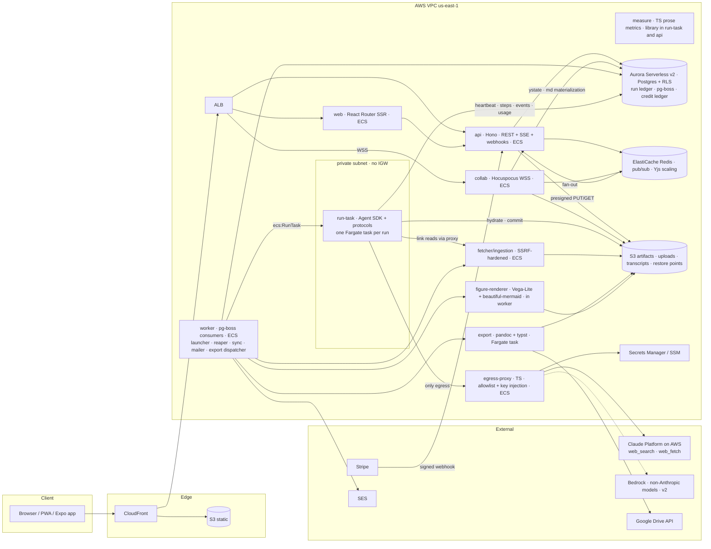
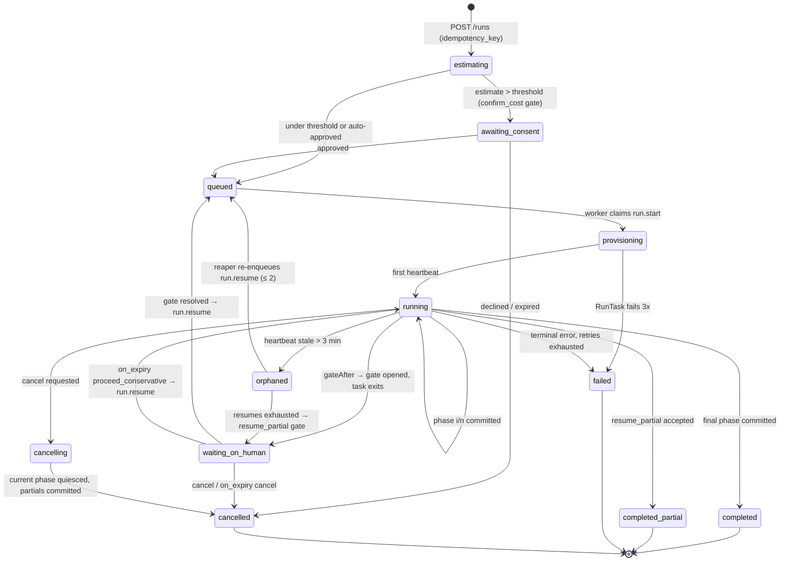

# Execution and platform architecture — harness, run model, services, security, ops

- Scope: ledger rows G4, G6–G9, G12, K1–K7, M2–M7, M9–M12, G14 · Date: 2026-08-27 · Evidence base: research notes 2, 7, 8, 10, 11 (read in full), 9 (export/figure sections), `~/agent-discourse/conventions/*.md` · Companion: `design/3_visibility-policy-and-data-model.md` (schemas, event envelope, visibility table — referenced as "design/3", not duplicated here)

## Summary of decisions

1. **Engine: the Claude Agent SDK (TypeScript), self-hosted in one ECS Fargate task per run**, behind an `Engine` interface so a `ManagedAgentsEngine` can be added without touching the orchestrator. Inference on Claude Platform on AWS (Bedrock lacks web search/fetch); the sandbox reaches nothing but a key-injecting egress proxy.
2. **Skills port as a hybrid**: the four `SKILL.md` regimens stay the single source of truth and load verbatim, but the orchestrator runs them **one phase per `query()`**, completion detected by the artifact each phase must write; a harness-neutral `phase` input is the only upstream change.
3. **Orchestration is a Postgres run ledger executed by pg-boss**; every step handler is an idempotent activity keyed `(run_id, step_key, attempt)`, so self-hosted Temporal drops in when step graphs stop being linear.
4. **The durable unit is phase + committed artifacts on S3**, never a transcript. The sandbox exits while a gate is open (zero compute); resume hydrates from committed files.
5. **`autonomous:false` becomes approve-with-deadline gates** (Q-7) with an `on_expiry` policy per gate kind; the opt-out flags become a three-position **rigor dial** the estimator prices.
6. **Boundary enforcement is three concentric layers** — role-filtered mounts, `PreToolUse` hooks with an audit log, a write-back diff at commit — yielding a verifiable `boundary.attested` event.
7. **Cost has two ledgers**: SDK `modelUsage` drives the live meter and per-phase attribution; the Anthropic Usage & Cost API is the record of account, reconciled nightly. Credits are held at the guaranteed cap before launch.
8. **Q-11 at port time**: `usage=study` default and the quotation-bound `positions.md` rule are removed from `bootstrap-persona`; `Mode` is metadata only.
9. Stack per note 11 (ECS services, Aurora Serverless v2, S3, Redis; pnpm + Turborepo; SST stages); licence allowlist in CI; protocols private from day one.

Departures from operator decisions: none. One tension (Q-3 AWS-first vs Anthropic web tools → Claude Platform on AWS, not Bedrock) is recorded in §9.3.

---

## 1. Reference architecture and service decomposition (M2)

### 1.1 Diagram



Everything is a container in one AWS account with three stage classes; no Lambda in the request path (SSE and long connections are simpler on ECS); Lambda is reserved for glue (S3 event → enqueue). This is note 11 §10 with three additions the assignment names — figure renderer, measurement library, Google Drive as an export target — and one correction: the fetcher is one service used by both ingestion and in-run link reading (note 11 I6).

### 1.2 Service table

| Service | Package | Runtime / scale unit | Owns (state) | Talks to | Notes |
|---|---|---|---|---|---|
| **web** | `apps/web` | React Router framework mode SSR, Node 22, ECS service ≥2 tasks | none | api | Marketing routes pre-rendered to S3; IDE routes SSR the shell then hydrate (note 11 §9) |
| **api** | `apps/api` | Hono, Node 22, ECS ≥2 tasks | Postgres, Redis | everything | REST + SSE (`GET /runs/:id/events`), Better Auth, Stripe webhook route (raw-body signature check, CSRF-exempt), presigned S3 URLs, gate resolution, run creation |
| **orchestrator** (inside worker) | `apps/worker` | pg-boss consumers, ECS ≥2 tasks | Postgres | ECS RunTask, S3, SES, fetcher, export | Queues: `run.start`, `run.resume`, `run.cancel`, `run.reap` (cron 1 min), `export.job`, `ingest.job`, `sync.job`, `mail.send`, `usage.reconcile` (cron nightly), `figure.render` |
| **run-task** | `apps/run-task` | Agent SDK (TS) image; **one Fargate task per run**, ARM64, 1 vCPU / 2 GiB default (2/4 for `draft-from-outline` > 8k words) | ephemeral disk under `/work`; SessionStore → S3 | proxy only (network); Postgres and S3 via the api's run-scoped endpoints (see §3.4) | Exits at gates and phase failures; image digest pinned per run |
| **egress-proxy** | `apps/egress-proxy` | small TypeScript forward proxy (undici), ECS ≥2 tasks | Secrets Manager (provider keys) | Claude Platform on AWS, Bedrock (v2), fetcher | The only route out of the sandbox subnet; per-run policy (allowlist, hold-out denylist, budget headers); request log |
| **fetcher / ingestion** | `apps/fetcher` | Node, ECS service | S3 quarantine + ingestion prefixes | S3, Postgres | SSRF rules (§6.2); HTML/PDF/docx → canonical markdown (note 9); Substack/Medium sync; in-run "read this link" |
| **export** | `apps/export` | pandoc 3.10 + typst container, Fargate task per job (or warm ECS service at volume) | S3 | Drive API | md → txt/html/docx/odt/epub/pdf/latex/rtf; Google Docs = docx → `drive.file` upload (note 9 §export, note 8 §3.6) |
| **figure-renderer** | `packages/figures` used by worker | pure-TS Vega-Lite + beautiful-mermaid to SVG/PNG | S3 assets `figures/<id>/` | — | Renders specs produced by the `visualize` skill; no browser (note 9 §5) |
| **collab** | `apps/collab` | Hocuspocus, ECS ≥2 tasks | Redis, Postgres (`documents.ystate`), S3 restore points | api (JWT) | Four-layer autosave (note 8 §5.1); materializes markdown on debounce; webhook → orchestrator on promote |
| **billing webhooks** | in `apps/api` | — | Postgres `stripe_events` (unique `stripe_event_id`) | pg-boss | verify → insert → enqueue → 200 (note 11 §2.2) |
| **sync scheduler** | in `apps/worker` | pg-boss cron | Postgres | fetcher | Re-sync linked Substack/Medium/RSS; staleness = set difference of body hashes (note 9) |
| **measure** | `packages/measure` | library (TS), used in run-task (hook-exposed tool) and api (progress UI) | — | — | Sentence/paragraph/punctuation rates, hazard scan, word budgets (note 2 §6 item 9) |

**REQ-ARCH-1** Every service is a container image built from the monorepo and deployed by SST to ECS Fargate; no service holds provider API keys except `egress-proxy`.
**REQ-ARCH-2** The run sandbox (`run-task`) runs in a private subnet whose security group permits egress **only** to `egress-proxy`; there is no NAT gateway or internet gateway on that subnet.
**REQ-ARCH-3** `api` is the only writer to `runs`, `gates`, and the credit ledger from outside the sandbox; `run-task` writes `run_steps`, `run_events`, `usage_records`, and `artifacts` through a run-scoped token (§3.4), never with a database connection of its own.
**REQ-ARCH-4** `fetcher` is the single component that opens arbitrary outbound HTTP connections; ingestion and in-run link reading both use it.

### 1.3 Interfaces at the boundary with design/3

This document does not define schemas. It relies on these design/3 objects by name and states what it needs from each:

| design/3 object | This document needs |
|---|---|
| `runs` | `id, tenant_id, project_id, workflow, agent_role, status, phase_index, phase_count, input_snapshot (jsonb: draft_sha256, outline_sha256, persona_profile_id+date), idempotency_key, rigor (quick\|standard\|full), model_profile, cost_estimate_credits, cost_cap_credits, cost_actual_credits, sandbox_task_arn, engine_session_id, last_heartbeat_at, cancel_requested_at, created_by` |
| `run_steps` | `(run_id, step_key, attempt)` unique; `status, started_at, finished_at, error_class, artifacts_committed, tokens_in, tokens_out, cache_read, cache_write, searches, usd_list, credits` |
| `run_events` | `seq bigserial, run_id, ts, type, phase, agent_role, visibility (user\|internal), payload jsonb`; append-only |
| `gates` | `id, run_id, step_key, kind, opened_at, expires_at, on_expiry, resolved_at, decision jsonb, resolved_by` |
| `artifacts` | `id, project_id, run_id, kind, path, s3_key, sha256, bytes, immutable, produced_by_role, version_label` |
| `usage_records` / `credit_ledger` | as in note 10 §7 (`usage_event` fields; `grant/hold/debit/release/expire` rows) |
| Event catalogue and `visibility` table | §4 here defines the *pipeline* and the SDK→event mapping; the catalogue itself is design/3's |
| Agent-type model (F2) | `role → {readable_paths, writable_paths, persona_files, tools, model_profile_defaults}` — §5 consumes it as the mount/hook policy |

---

## 2. Skill porting strategy (G4, G14) and the engine interface (G15)

### 2.1 Three options, one choice

| Option | Gates | Per-phase cost / model | UI phase boundaries | Drift from tested regimen | Verdict |
|---|---|---|---|---|---|
| A. Verbatim: one `query()` per whole skill | awkward (in-loop `AskUserQuestion` ties gate latency to a live subprocess) | inferred | only via file writes | none | rejected — Q-7 gates and D4 progress need boundaries (note 7 §6) |
| B. Compile phases into our own prompts | natural | native | native | high — every skill edit must be re-ported; forks the text | rejected — throws away the tested regimen (note 7 §6) |
| **C. Hybrid** — skill text verbatim, executed phase by phase | natural (a gate is "stop after this phase") | native | native (artifact detected) | minimal — one optional `phase` input | **chosen** (note 7 §6, note 11 §3) |

The hybrid works because of the source system's own principle: "files are the only inter-phase interface, so the regimen survives compaction" (README; note 2 §1). Each phase already reads what the previous phase wrote to disk, so running each phase in a fresh context is what the skills were designed for.

### 2.2 The `phase` input (upstream change to `agent-discourse`)

One harness-neutral addition to each `SKILL.md` frontmatter and body:

```yaml
inputs:
  phase:   # optional. "N" = run only Phase N, then stop after its artifact is written
           # and report; "N+" = run from Phase N to the end. Default: all phases.
```

Body text: *"When `phase` is set, assume every earlier phase's artifact already exists on disk and read it; do exactly this phase's regimen; write its artifact fully; then stop and deliver the phase report. Never re-do an earlier phase; if its artifact is missing, say so and stop."* This is safe for the public repo (Q-19) and unchanged behavior for a Claude Code user who never sets it.

**REQ-ARCH-5** The ported skills differ from `~/agent-discourse` only by (a) the `phase` input, (b) the Q-11 edits in §2.7, (c) the persona-resolution edit in §2.8. A CI check diffs `packages/protocols/skills/*` against a pinned upstream commit and fails on any other hunk.

### 2.3 The phase manifest (private to Rhema)

`packages/protocols/manifests/<workflow>.ts` declares, per workflow, the ordered phases the orchestrator sequences. Completion is detected by the **artifact** each phase must write, not by parsing the model's prose.

```ts
type PhaseSpec = {
  key: string;                  // "verification"
  index: number;                // 1-based, as numbered in SKILL.md
  label: string;                // user-visible: "Verifying claims"
  skillPhase: string;           // value passed as `phase` input: "1"
  role: "author" | "editor" | "persona" | "assistant";
  artifacts: ArtifactMatcher[]; // completion = every matcher resolves to a written file
  gateAfter?: GateKind;         // "approve_plan" | "triage_findings" | "escalations"
  optional?: RigorFlag;         // "verification" | "discourse" | "second_read" | "grounding" | "audit" | "research" | "gap_analysis" | "calibration"
  phaseClass: "research" | "judge" | "generate" | "package";
  parallelGroup?: string;       // phases the skill says may run as parallel subagents (editorial-review 1,2,5)
  maxIterations?: number;       // audit 3, gap_analysis 3, re-plan loop 2 (Rhema adds the cap; note 2 B19)
  budgetShare: number;          // fraction of the run estimate this phase may consume before a soft stop
};
```

Example, `editorial-review` (seven phases; A3 deviation carried: `03-argument-notes.md` and `04-craft-notes.md` are declared artifacts because every real run emits them):

| idx | key | artifact(s) | class | optional | parallel |
|---|---|---|---|---|---|
| 0 | intake | `correspondence/vN-review/00-piece-brief.md` | judge | — | — |
| 1 | verification | `…/01-claim-ledger.md` | research | `verification` | P |
| 2 | discourse | `…/02-discourse-report.md` | research | `discourse` | P |
| 3 | argument | `…/03-argument-notes.md` | judge | — | — |
| 4 | craft | `…/04-craft-notes.md` | judge | — | — |
| 5 | second_read | `…/05-second-read.md` | judge (input-scoped subagent) | `second_read` | P |
| 6 | letter | `…/editors-letter.md` + manifest round-log entry | package | — | — |

Parallel group P: the orchestrator may run phases 1, 2 and 5 as three concurrent `query()`s after phase 0 (the skill's own sequencing). In v1 the orchestrator runs them **sequentially in one sandbox** in the skill's fallback order (0, 4, 1, 2, 5, 3, 6) because pg-boss handles a linear list cleanly; concurrent phases are the named Temporal trigger (§9). Phase 5 remains fresh-context and input-scoped even when sequential — see §5.4.

`draft-from-outline`: intake → voice → **plan (gateAfter: approve_plan)** → grounding (`grounding`) → draft → consolidation → audit (`audit`, max 3) → delivery. `respond-to-review`: bootstrap → research (`research`) → **triage (gateAfter: triage_findings; also `escalations` when the ledger has unresolved escalations)** → revise → verify → gap_analysis (`gap_analysis`, max 3) → deliver. `bootstrap-persona`: census → close_reading (fan-out per piece) → voice → substance → calibration (`calibration`) → package.

**REQ-ARCH-6** Phase manifests are the only place Rhema encodes skill structure; adding a roadmap skill (C16) is a manifest plus its `SKILL.md`, with no orchestrator code change.
**REQ-RUN-1** A phase is complete iff every declared artifact exists, parses (front-matter/section headers per design/3 artifact schemas), and is non-empty; otherwise the step fails with `error_class = artifact_missing` and is retried once with the phase report appended as guidance ("your previous attempt did not write X").

### 2.4 The `Engine` interface

```ts
interface Engine {
  startPhase(req: PhaseRequest): AsyncIterable<EngineEvent>;  // runs one phase to completion or abort
  abort(reason: "cancel" | "budget" | "deadline"): Promise<void>;
  usage(): UsageSnapshot;                                     // modelUsage per model + server tool counts
}
type PhaseRequest = {
  runId: string; stepKey: string; attempt: number;
  workflow: Workflow; skillPhase: string; role: Role;
  inputs: Record<string, string | boolean>;   // the skill's declared inputs incl. guidance, rigor flags
  cwd: string;                                 // /work/project (already hydrated per §5.1)
  modelProfile: ResolvedModelProfile;          // per-role model/effort incl. subagent defs (§2.9)
  budgetUsd: number;                           // this phase's share of the cap
  hooks: HookPolicy;                           // allowlist + URL policy (§5.2)
  sessionResume?: string;                      // optional SDK session id (optimization only)
};
type EngineEvent =
  | { kind: "sdk_message"; message: SDKMessage }          // AgentSdkEngine
  | { kind: "managed_event"; event: ManagedAgentEvent }   // ManagedAgentsEngine (later)
  | { kind: "tool_audit"; entry: AuditEntry }             // from hooks
  | { kind: "usage"; snapshot: UsageSnapshot };
```

`AgentSdkEngine.startPhase` builds `query({ prompt: "/<skill> …inputs…", options })` with: `cwd`, `settingSources: ["project"]` restricted to the baked `.claude/skills`, `skills: [workflow]`, `agents` from the model profile (`second-reader`, `fidelity-auditor`, `gap-analyst`, `holdout-calibrator`, `researcher` with per-agent `tools`, `model`, `effort`), `hooks` (§5.2), `permissionMode: "dontAsk"`, `allowedTools` fixed, `disallowedTools: ["Bash(curl *)","Bash(wget *)","Bash(find *)","Bash(grep -r*)"]`, `maxBudgetUsd`, `maxTurns`, `env` with `ANTHROPIC_BASE_URL` → proxy, `CLAUDE_CODE_DISABLE_AUTO_MEMORY=1`, per-run `CLAUDE_CONFIG_DIR`, `CLAUDE_CODE_MAX_SUBAGENT_SPAWN_DEPTH=1`, `CLAUDE_CODE_MAX_CONCURRENT_SUBAGENTS=5`, `ENABLE_PROMPT_CACHING_1H=1`, OTel vars (§7), `sessionStore` = S3 adapter, `abortController`, `includePartialMessages: false` (note 7 §3.1).

**REQ-ARCH-7** The orchestrator depends only on `Engine`; `packages/engine` ships `AgentSdkEngine` in v1 and a stub `ManagedAgentsEngine` whose event mapper (§4.3) is tested against recorded fixtures so the second engine is a conformance-test away.

### 2.5 Phase commit protocol

Executed by `run-task` at the end of every phase, in this order; the orchestrator (worker) verifies on `run.step.committed`.

1. **Quiesce.** The `query()` has returned `result`; abort any straggling subagents; flush the audit log.
2. **Write-back diff.** Walk `/work/project` and `/work/personas/<id>` against the hydration manifest (path → sha256 at hydrate). Produce `{added, modified, deleted}`. Filter through the role's *write* allowlist (design/3 F2): allowed writes proceed; writes outside `agents/<role>/` (for editor/author), outside `profile/` (persona), to `docs/`, or to any `artifacts.immutable = true` path are **dropped** and recorded as `boundary.violation` (internal) with a `violations` counter.
3. **Artifact registration.** For each surviving change: upload to S3 under content-addressed `tenants/<t>/projects/<p>/objects/<sha256>` (idempotent PUT), then `POST /internal/runs/:id/steps/:key/commit` with `{attempt, artifacts: [{path, sha256, bytes, kind}], usage, audit_summary, violations}`. `kind` is derived from the path by design/3's artifact matcher; `immutable` is set by rule (delivered dossiers, letters, notes, frozen ledgers; `drafts/vN.md` when a review/response later references it — B13/B14).
4. **Cost capture.** `usage()` snapshot → `usage_records` rows per `(run, step, agent_instance, model)`; credits rated by the versioned rate table; `credit_ledger` `debit` for the step; `cost.tick` (user) emitted with the running total.
5. **Atomic advance.** The api performs, in one transaction: insert `artifacts`, update `run_steps` (`succeeded`, `artifacts_committed = true`, usage), advance `runs.phase_index`, append `phase.completed` (user) and `boundary.attested`-partial (internal), and enqueue the next step or open the gate. If the transaction fails, `run-task` retries the commit call (idempotent on `(run_id, step_key, attempt)`); it never proceeds to the next phase without an acknowledged commit.
6. **Checkpoint.** Mirror the SDK session to S3 (`SessionStore`) — best effort; a `mirror_error` is logged, not fatal (note 11 §7).

**REQ-RUN-2** Step commit is atomic and idempotent on `(run_id, step_key, attempt)`; a duplicate commit call is a no-op returning the original result.
**REQ-RUN-3** A phase that produced a `drafts/vN.md` commits it only if the file is complete (the skill's delivery report or ledger marks `Phase status: delivered/drafted`); half-written drafts are committed under `agents/author/drafting/vN/partial-draft.md` (inspectable, never a version).
**REQ-RUN-4** Every committed artifact carries `produced_by_role` and `run_id`; the manifest round-log entry is derived by design/3 from `artifacts`, never written by the skill in Rhema (the skill's manifest write is captured, parsed, and discarded).

### 2.6 `autonomous:false` gates → orchestrator gates with deadlines (Q-7, C7, B20)

The skills implement a gate as "present X and wait". In Rhema the skill never waits: the phase manifest's `gateAfter` makes the orchestrator open a `gates` row after the phase commits, and the next phase's `query()` is not started until the gate resolves. The skill always runs with `autonomous: true` at the harness level; the *orchestrator* supplies `guidance` from the gate decision on resume. This is note 7's option (a) and is what makes gate wait time cost zero compute.

| Gate kind | Opens after | Presents (from committed artifacts) | Decisions | Default deadline | `on_expiry` |
|---|---|---|---|---|---|
| `confirm_cost` | estimate (before queue) | estimate, cap, rigor levers | approve / change rigor or tier / cancel | 7 days | **cancel** (never spend without consent) |
| `approve_plan` | `draft-from-outline` phase 2 | commissioning brief, voice brief, structure plan | approve / approve with guidance / redirect (re-plan, counted against the re-plan cap) / cancel | 48 h | `proceed_conservative` — the skill's own autonomous path: open questions resolved conservatively and listed in the drafting note |
| `triage_findings` | `respond-to-review` phase 2 | response ledger (dispositions), revision plan | approve / edit dispositions (writes guidance) / cancel | 48 h | `proceed_conservative` |
| `escalations` | same phase, only when the ledger has `escalated` rows and guidance is silent | the escalations | decide each / defer all | 48 h | `proceed_conservative` + flag at the top of the letter — this operationalizes "operator reachable" (note 2 §9 item 6) as *reachable = answers within the deadline* |
| `refusal` | any phase ending with `stop_reason: refusal` or a validation failure | what was declined | continue without / edit and retry / cancel | 7 days | cancel |
| `resume_partial` | orphan resume attempts exhausted, or a failed step with committed predecessors | committed phases, cost so far | resume / accept partial / cancel | 30 days | accept partial (run → `completed_partial`) |

**REQ-RUN-5** Gates default ON (Q-7); a user may set `don't ask` per gate kind per project, which records `decision = auto_approved` rather than skipping the gate row (the timeline still shows the gate).
**REQ-RUN-6** A gate's `on_expiry` runs exactly once via a pg-boss scheduled job keyed `gate:<id>`; resolution by the user cancels the job in the same transaction.
**REQ-RUN-7** Gate decisions are the only channel by which human text enters a run between phases; they are stored as `guidance` and passed verbatim as the skill's `guidance` input (precedence rule: guidance > voice charter > persona > default).
**REQ-RUN-8** While a gate is open the run holds its project writer lock (§3.6) and the sandbox task has exited; resume launches a fresh task.

Notification (D16): `gate.opened` → in-app + email via SES with a deep link; a reminder at 50% of the deadline; the expiry action is announced in the timeline copy ("No answer by Friday 14:00 — the author proceeded conservatively and flagged 2 questions").

### 2.7 Opt-out flags → the rigor dial

The skills' 2–3 opt-out flags per workflow are cost levers (note 10 §4.3: fact-check off cuts an 8k review 5×). The ledger (turn 9) requires they surface as a user-facing dial, not hidden inputs.

| Dial | `editorial-review` | `draft-from-outline` | `respond-to-review` | `bootstrap-persona` | Intended use |
|---|---|---|---|---|---|
| **Quick** | `verification=false, discourse=false, second_read=false` | `grounding=false, audit=false` | `research=false, gap_analysis=false` | `calibration=false, sample≤6` | early drafts, trial, "is this going anywhere" |
| **Standard** | `verification=true, discourse=false, second_read=true` | `grounding=true, audit=true` | `research=true, gap_analysis=false` | `calibration=true, sample≤12` | the default |
| **Full** | all on | all on | all on | all on, sample = census | near-final, academic submission |
| Custom | any combination | | | | advanced disclosure in the estimate sheet |

Rules the skills already impose and Rhema keeps: opt-outs never relax operating principles; every disabled phase is declared in the delivered letter/note; the estimate shows the credit delta of each lever. Disabled phases still appear in the timeline as `phase.skipped` so the dossier's honesty ("verification was not run") is visible.

**REQ-RUN-9** `runs.rigor` and the resolved flag set are frozen at run creation and recorded in `input_snapshot`; changing rigor mid-run is cancel-and-restart (partial artifacts are reused by the skills' own "read the index first" rule).

### 2.8 Other port-time edits

- **Persona resolution.** The directory-walk resolution (`<project_dir>/../personas/` …) is replaced by an explicit `persona_dir` input the orchestrator always supplies (`/work/personas/<id>`), and the "state which was used" line reports the profile snapshot id and date (note 2 §9 item 1). Text change is confined to the Resolution paragraph.
- **Attestation paragraph.** Kept in the skill (public repo), but the delivery report's attestation sentence is ignored by Rhema; the `boundary.attested` event (§5.5) is the product's claim.
- **Standalone mode** of `editorial-review` (no project memory) is not invoked; Rhema always has a project (note 2 §1.5).
- **Iteration caps.** The skills cap audit and gap analysis at 3; the Phase 2↔3 re-plan loop is uncapped (note 2 F17). Rhema caps it at 2 through the manifest's `maxIterations`, enforced by the orchestrator counting `approve_plan` redirects and grounding-failure returns.

**REQ-ARCH-8 (Q-11 at port time).** The ported `bootstrap-persona` (a) removes the `usage=study` default and its "prominent report" — `usage` is accepted as metadata, stored as `personas.mode`, and never alters behavior; (b) removes the rule that `positions.md` for a non-`self` persona is quotation-bound; (c) removes "supplying `docs/` does not enlarge what the mode permits". The persona `Mode` remains displayed as metadata. Legal exposure is stated once in the ToS/AUP (note 10 §10 item 5) and not repeated in product copy. These are the only behavioral divergences from upstream and are listed in `packages/protocols/PORTING.md`.

### 2.9 Per-phase model routing (G10, G13)

Routing is by **phase class**, validated against the provider capability table (note 7 §8.2). Research phases cannot leave Anthropic in v1 because only Anthropic exposes search + fetch + fresh-context fan-out inside the harness.

| Phase class | Needs | v1 provider | Standard | Pro | Frontier |
|---|---|---|---|---|---|
| research (verification, discourse, grounding, response research, persona close-reading) | search + fetch + PDF + fan-out + file R/W | Anthropic only | Sonnet 5 main / Haiku 4.5 subagents | Sonnet 5 | Opus 5 |
| judge (intake, argument, craft, second read, fidelity audit, gap analysis, calibration) | long context + Read | Anthropic (v1); AI-SDK lite loop candidates (v2) | Sonnet 5 | Opus 5 | Fable 5 |
| generate (draft, revise, letters, voice/substance files) | long context + Write; single context (B18) | Anthropic (v1) | Sonnet 5 | Opus 5 | Fable 5 |
| package (letter assembly, index hub, delivery) | Read/Write | Anthropic | Sonnet 5 | Sonnet 5 | Opus 5 |
| chat turns without tools | tokens | any via `packages/harness` | Sonnet 5 | Opus 5 | Fable 5 |

Credit multipliers shown on the price card ≈ 1× / 2.2× / 4.5× (note 10 §4.5). The `agents` map in the SDK options sets `model`/`effort` per subagent role from this table, so routing costs nothing in code. `effort` defaults: research `medium`, judge `high`, generate `high`, package `low`.

**REQ-ARCH-9** A model profile is `{tier, overrides: Partial<Record<PhaseClass, ModelSpec>>}`; the api rejects any override whose provider lacks the phase class's capabilities (`422 phase_class_unsupported`).
**REQ-ARCH-10** Non-Anthropic providers enter only through `packages/harness` (Vercel AI SDK provider layer, Bedrock endpoints via the same egress proxy) and only for `judge`, `generate`, and chat classes; the routing table is data, versioned with the rate table (note 10 L10).

---

## 3. Run lifecycle end to end (K1–K7)

### 3.1 State machine



Terminal states: `completed`, `completed_partial`, `failed`, `cancelled`. Every transition appends a `run_events` row (user-visible lifecycle event) in the same transaction as the status update.

**REQ-RUN-10** `runs.status` transitions are performed only by `api` (from user actions) and `worker` (from job handlers), each via a guarded `UPDATE … WHERE status = $expected` that fails loudly on a stale expectation.

### 3.2 Step by step

1. **Estimate.** `POST /projects/:id/runs {workflow, rigor, model_profile, inputs, idempotency_key}` → api computes the input snapshot (draft hash, word count, outline hash, persona profile id/date), runs the estimator (note 10 §5.5: parametric model + a Haiku claim-count pre-pass ≈ 5 credits, charged only if the run proceeds), returns `{estimate_credits, cap_credits = ceil(1.5 × estimate), levers}`; status `estimating` → `queued` or `awaiting_consent`.
2. **Consent.** If estimate > 500 credits or > 25% of remaining balance (note 10 §5.5), a `confirm_cost` gate opens. On approval the api places a `hold` for `cap_credits` in `credit_ledger`; insufficient balance returns the three options (lower tier / drop a phase / top up) and never bills.
3. **Queue.** In one transaction: `runs.status = queued`, `pg-boss.send('run.start', {run_id}, {singletonKey: run_id})`, acquire the project writer lock if the workflow writes drafts (§3.6; 409 if held).
4. **Provision.** Worker handler `run.start`: `status = provisioning`; mint a run token (JWT, 2 h, claims `run_id, tenant_id, project_id, role, step_scope`); call `ecs:RunTask` with the pinned image digest, task role with an STS session policy limited to `tenants/<t>/projects/<p>/*` and `personas/<id>/*` (read) prefixes, env `{RUN_ID, RUN_TOKEN, API_INTERNAL_URL, ANTHROPIC_BASE_URL=http://egress-proxy:8080, PROXY_POLICY_ID}`. Launch failures retry with backoff (3 attempts, 10 s / 60 s / 5 min) then `failed`. Target p95 queued→running ≤ 45 s (§7).
5. **Hydrate.** `run-task` fetches the hydration manifest from `GET /internal/runs/:id/hydration` (the role's allowlist resolved to S3 objects + hashes), materializes `/work/project` and `/work/personas/<id>` (§5.1), writes the sha256 manifest, starts the heartbeat (`PUT /internal/runs/:id/heartbeat` every 20 s, carrying `cancel_requested` in the response), and reports `running (phase k/n)`.
6. **Phases.** For each remaining phase in the manifest: `Engine.startPhase`; stream `EngineEvent`s through the mapper (§4.3) to `POST /internal/runs/:id/events` in batches (≤ 50 events or 1 s); on `result`, run the commit protocol (§2.5). If `gateAfter`: commit, open the gate (api does it inside the commit transaction), then **exit the task** (`waiting_on_human`).
7. **Gates.** Resolution (`POST /runs/:id/gates/:gid {decision}`) writes `decision`, cancels the expiry job, sets `status = queued`, and enqueues `run.resume {run_id, from_step}`. Resume = step 4 with `from_step` and the gate's guidance in the next `PhaseRequest.inputs`.
8. **Commit.** Already covered per phase; the final phase's commit also marks delivered artifacts immutable, promotes `drafts/vN.md` to a draft version (design/3 versions table; note 8 §5.3), and sets `completed`.
9. **Reconcile cost.** At `completed*`/`failed`/`cancelled`: sum `usage_records` → `runs.cost_actual_credits`; `release` the unused hold; failed or refused runs auto-refund their debits (note 10 §8); `cost.final` event. Nightly `usage.reconcile` compares list-cost per model against the Anthropic Usage & Cost Admin API (raw HTTP; note 10 §7 item 5) and alerts at > 2% drift; the reconciled figure updates the estimator's calibration, never the user's charge retroactively.
10. **Notify.** `run.completed` → in-app + SES email with the "one thing" from the letter (or the drafting note's summary), cost actual vs estimate, and the natural next step (S1/S2/S3 rule, note 2 §4).

**REQ-RUN-11** The estimate, cap, rigor, model profile and input snapshot are immutable after `queued`; the cap is enforced twice — as `maxBudgetUsd` per phase (share) in the engine and as a hard stop in the orchestrator when `Σ usage_records ≥ cap` (run → `waiting_on_human` with a `resume_partial` gate, never silent overrun).
**REQ-RUN-12** If actual cost exceeds the cap because of estimator error, the user is charged the cap; the difference is booked to a `variance_reserve` account (note 10 §5.5 item 2).
**REQ-RUN-13** A `hold` is placed before the first sandbox launch and released within 60 s of a terminal state.

### 3.3 Resumability (K7)

The durable unit is *phase + committed artifacts*. Resume from any of: gate resolution, orphan recovery, user "Resume" on a partial run, or a retry after an infrastructure failure. Resume always:

1. Launches a fresh task (never reuses a container).
2. Hydrates from S3 the current committed state (which includes the previous phases' artifacts and, for the author role, its own `agents/author/*` notes — exactly the "fresh session reads ledger + drafts + dossier and continues" path the skills document).
3. Optionally passes `sessionResume` (the S3-mirrored SDK session) so the harness has its prior transcript — an optimization that saves re-reading, not a correctness requirement. If the mirror is missing or `resume` fails, the phase runs from files.
4. Re-runs the phase that was in flight as a new `attempt`; attempt N−1's partial outputs remain inspectable under `run_steps`.

User-facing copy for recovered runs (K7): "We hit a hiccup at *Verifying claims* and resumed from your last checkpoint. Nothing was lost; 3 of 7 phases were already done." Emitted as `run.resumed {reason: orphan|gate|retry|user, from_phase}`.

**REQ-RUN-14** Orphan reaper: pg-boss cron every minute marks `running` runs with `last_heartbeat_at < now() − 3 min` as `orphaned`, calls `ecs:StopTask` on the stale task ARN (idempotent), and enqueues `run.resume` at most twice per step; the third orphan opens `resume_partial`.
**REQ-RUN-15** Heartbeat carries `phase_index` and `attempt`; a heartbeat from a task whose `attempt` is older than the ledger's current attempt is rejected (`409 stale_task`) and the task self-terminates — this prevents two sandboxes from writing the same step after an orphan resume.

### 3.4 The sandbox's only API

`run-task` never holds a database connection or provider key. It uses a run-scoped internal API (`/internal/runs/:id/…`, authenticated by `RUN_TOKEN`, reachable only from the sandbox subnet through the proxy's `internal` route):

| Endpoint | Purpose |
|---|---|
| `GET hydration` | allowlisted object list with hashes and S3 presigned GETs |
| `PUT heartbeat` | liveness; returns `{cancel_requested, deadline_at}` |
| `POST events` | batched `run_events` (visibility set by the mapper) |
| `POST steps/:key/commit` | §2.5 step 3–5 |
| `POST steps/:key/fail` | `{error_class, message, partial_artifacts}` |
| `POST audit` | batched audit entries (internal) |
| `POST fetch` | proxied to `fetcher` for user-supplied links (§6.2) with the run's URL policy |

**REQ-ARCH-11** The run token is single-run, expires in 2 h, is refreshed on heartbeat, and is revoked on any terminal state; all internal endpoints check `run_id` ∈ token and `runs.status ∈ {provisioning, running, cancelling}`.

### 3.5 Cancellation, retries, failure classes, partial results (K6)

**Cancellation.** `POST /runs/:id/cancel` sets `cancel_requested_at`, status `cancelling`; the next heartbeat returns `cancel_requested = true`; `run-task` calls `Engine.abort("cancel")` (SDK `AbortController`), then runs a *reduced* commit: source notes, ledgers, and any complete phase artifact are committed; a half-written `drafts/vN.md` is committed as `partial-draft.md` (REQ-RUN-3). Deadline 60 s, after which the worker calls `ecs:StopTask`. Cancelled runs keep events and cost; the hold is released minus debits; the writer lock is released.

**Retry policy** by `error_class`:

| Class | Examples | Policy |
|---|---|---|
| `infra` | RunTask failure, S3 5xx, proxy unavailable | retry step ≤ 2 with backoff; then `failed` |
| `provider_transient` | 429/5xx/overloaded from the model endpoint | engine-level retry (SDK) then step retry ≤ 2; a provider outage banner pauses new launches for up to 2 h without failing queued runs |
| `budget` | phase share exhausted | orchestrator raises the phase's share once (borrow from remaining phases) if the run cap allows; otherwise `resume_partial` gate |
| `artifact_missing` | phase ended without its artifact | retry once with guidance (REQ-RUN-1) |
| `refusal` | `stop_reason: refusal`, validation failure | terminal for the step → `refusal` gate |
| `boundary` | write-back violations > 0 | not a failure; run completes with a warning badge and `violations: n` in the attestation; `> 5` violations or any attempted write to an immutable artifact quarantines the run's artifacts pending review (§7 playbook) |
| `stale_task` | REQ-RUN-15 | task exits; no retry |

**Partial results are real results.** Because commits happen at phase boundaries, a review that finished verification and died in craft has a committed claim ledger; the dossier renders as "partial (3/7 phases)" with Resume. Skipped (rigor) phases and failed phases are distinguished in the timeline.

**REQ-RUN-16** Every terminal state leaves the project in a consistent conventions layout: no dangling `correspondence/vN-review/` without at least `00-piece-brief.md`; a partial review directory is suffixed `-partial` in the artifact `version_label` until completed by resume.

### 3.6 Concurrency and locking (K3, N2)

Mechanical rules (note 11 §3.5, note 8 §5.2), enforced in Postgres:

1. **One writer-run per project.** `projects.active_writer_run_id` set with a conditional update (`WHERE active_writer_run_id IS NULL`) by draft-producing workflows (`draft-from-outline`, `respond-to-review`, `line-edit`-class future skills). Conflict → `409 {running_run_id}`; the UI offers "queue after". Released at terminal state; **held across gates**.
2. **Reader runs bind to a hash.** `editorial-review` records `input_snapshot.draft_sha256`; the api freezes that version (`documents.frozen_by_run_id`); human edits during the run go to a working copy in Yjs and are reconciled as suggestions afterwards (note 8 §5.2). Multiple reader runs on the same hash may overlap (parallel review variants, C4) subject to plan concurrency.
3. **Human edits to a reviewed draft always fork `v(N+1)`** with `origin = human_revision` (design/3 N4).
4. **Persona runs lock the persona** (`personas.active_run_id`), not the project; consumers snapshot the dated profile.
5. **Plan concurrency** (trial 1, Pro 2, Max 5/8, Team 3/seat — note 10 §5.2) is enforced at `queued → provisioning` by counting the tenant's non-terminal runs; excess runs wait in `queued` with a visible position.
6. **pg-boss singleton keys** (`run:<id>`) prevent duplicate `run.start`/`run.resume` jobs for one run.

**REQ-RUN-17** All six rules are enforced by constraints or guarded updates in Postgres, not by UI state; the api returns typed 409 errors the UI renders as queueing affordances.

### 3.7 Steering mid-run (K5)

Supported at three points, no more (note 4's "interrupt + queued message" grammar, bounded by our phase model): (a) at any gate; (b) **"Steer at next phase"** — the user submits guidance while a phase runs; it is stored and injected into the next `PhaseRequest.inputs.guidance` (visible in the timeline as `guidance.queued`); (c) cancel-and-resume with guidance, which reuses committed artifacts. In-phase `streamInput()` injection into a live session is deliberately not offered in v1: it would bind a user message to a live subprocess whose lifetime we do not control, and the skills' regimens are not written to accept mid-phase redirection.

**REQ-RUN-18** Queued steering guidance is applied at the next phase boundary and appears in the delivered artifact's guidance section; it is never applied retroactively to a committed phase.

### 3.8 Progress and ETA (K4)

`run_steps` accumulates per `(workflow, step_key, rigor, model_tier, size_bucket)` distributions of `(duration, credits)`. ETA per phase = p25–p75 of the last 50 comparable steps; shown as a range. Until 50 samples exist, the estimator uses the note 10 parametric model. The progress bar is orchestrator-driven (phases committed / total, with the current phase's elapsed vs its p50), never model self-report.

---

## 4. Streaming event pipeline and the `visibility` split (G7, K2)

### 4.1 Pipeline

```
run-task ──batched POST /internal/runs/:id/events──▶ api ──INSERT run_events (seq)──▶ Postgres
                                                        └──PUBLISH run:<id> {seq}──▶ Redis ──▶ every api task
client ──GET /runs/:id/events?after=<seq> (SSE)──▶ api: replay rows > after (visibility=user) then tail from Redis
```

- **Transport:** SSE over HTTP/1.1 through ALB (idle timeout raised to 4,000 s; a `: ping` comment every 25 s keeps CloudFront/ALB from closing idle streams — note 11 open question, mitigated by the heartbeat comment). `Last-Event-ID` = `seq`; reconnect is exact-once by replaying `seq > last`.
- **Fan-out:** Redis pub/sub (`run:<id>`) in `dev`/`prod`; preview stages fall back to Postgres `LISTEN/NOTIFY` (single api task). The message carries only `{seq}`; the api reads the row, so Redis is never a source of truth.
- **Backpressure:** `run-task` batches events (≤ 50 or 1 s) and drops nothing; if the api is unreachable it buffers to local disk and retries; a buffer > 5,000 events pauses the engine (a stalled UI is better than a lost audit).
- **Retention:** `visibility = user` rows for the project's lifetime; `internal` rows 30 days (note 11 §6.4).

**REQ-ARCH-12** `GET /runs/:id/events` streams only `visibility = user` rows; the `internal` filter is applied in SQL, and a CI test asserts that no `internal` type is emitted with `visibility = user` by the mapper.
**REQ-ARCH-13** Event delivery p95 (task write → client) ≤ 2 s; the SSE handler must not buffer (no compression on this route, `X-Accel-Buffering: no`, chunked encoding).

### 4.2 The visibility rule

Two rows kinds in one table, one rule: **a `user` event carries counts, identifiers, URLs, labels and template text; never prompt text, skill text, private-memory content, raw fetched page text, model thinking, or tool inputs.** Everything else is `internal` (support, replay, audit). Design/3 owns the catalogue; this section fixes how each is produced.

| Source (SDK message / hook) | Event (visibility) | Payload derivation |
|---|---|---|
| `system.init` | `run.started` / `run.resumed` (user) | model tier label, phase k/n |
| `assistant` with `tool_use: WebSearch` | `search.performed` (user) | `{query, results_count}` — the query is the agent's question, not our instruction; shown verbatim (note 11 §4.2) |
| `PostToolUse` WebSearch | `search.result` (internal) | result URLs/snippets |
| `tool_use: WebFetch` + `PostToolUse` | `source.read` (user) | `{url, title, accessed_at, purpose_tag}`; `source.rejected` on `url_not_allowed`/robots/paywall with reason class |
| `PreToolUse` Read/Write/Edit/Glob/Grep/Bash | `tool.audit` (internal) | §5.3 entry |
| `Write` on allowed path | `artifact.written` (user) | `{kind, path, bytes}` — path only, within the shared record or the role's own namespace; **content never** |
| `Write` to a ledger / claim-ledger row parse | `claim.checked` (user) | `{claim_id, verdict, source_count}`; parsed from the committed ledger at commit, and incrementally from `Edit` diffs when cheap; claim *text* arrives with the artifact |
| ledger findings parse | `finding.emitted` (user) | `{finding_id, severity, category, anchor_hash}` |
| `SubagentStart/Stop` | `subagent.started/finished` (user) | `{role_label, index}` from the `agents` definition name |
| `assistant` text | `agent.note` (user) | **template-generated from tool activity**, not model free text (e.g., "Reading 3 sources cited in §2"); the model's prose goes to `internal` |
| `PreCompact/PostCompact` | `context.compacted` (user) | count only |
| `result.modelUsage` / periodic `usage()` | `cost.tick` (user) | tokens by class, searches, credits so far, cap |
| hook summary at commit | `boundary.attested` (user) | `{paths_touched_count, denied_count, violations}` |
| gate open/resolve | `gate.opened/resolved` (user) | kind, options, deadline; decision label |
| any `mirror_error`, hook error, engine error | `engine.error` (internal) | full detail; a sanitized `run.hiccup` (user) if it caused a retry |

**REQ-ARCH-14** `agent.note` text is produced only by `packages/contracts/notes.ts` templates keyed on tool activity; the mapper never copies assistant prose into a `user` event. This is the prompt-injection firewall for the feed: injected page content cannot reach the user's screen through the activity stream.
**REQ-ARCH-15** URLs in `source.read` are taken from the tool *result* (`web_fetch_tool_result.url`), not from the model's request, so the feed shows what was actually fetched (E6).

### 4.3 Engine event mapping is a conformance suite

`packages/engine/mapper/` holds the `EngineEvent → RunEvent[]` mapper with recorded fixtures for every SDK message type the harness emits (from instrumented golden runs, §7.4). The `ManagedAgentsEngine` mapper must pass the same suite against Managed Agents' `agent.tool_use`, `session.usage`, `agent.thread_context_compacted` events (note 7 §3.2). This is how §9's engine swap stays cheap.

---

## 5. Boundary enforcement mechanics (F4, G8, G16, G14-input-scoping)

The conventions' 21 rules (note 2 §5) are enforced by three concentric layers, each sufficient for a cooperative agent, jointly sufficient for a misbehaving run, and observable as data.

### 5.1 Mount layer — what exists

Hydration materializes only the role's allowlist. Nothing else is on disk.

| Role | `/work/project` contents | `/work/personas/<id>` contents | Mode |
|---|---|---|---|
| author | `manifest.md`, `drafts/`, `correspondence/`, `agents/author/` | `PERSONA.md`, `profile/{index,voice-print,structure-repertoire,lexicon,exemplars,audience-and-venue,continuity}.md` (+ one member's voice files for composites, chosen by `register`) | drafts marked immutable `chmod 444`; persona read-only |
| editor | `manifest.md`, `drafts/`, `correspondence/`, `agents/editor/` | `PERSONA.md`, `profile/{index,structure-repertoire,audience-and-venue,positions,continuity}.md` — **never** `voice-print`, `lexicon`, `exemplars` (B5) | as above |
| persona (bootstrap) | none | `PERSONA.md`, `docs/` (read-only, `chmod 444`), `profile/` (writable); hold-out corpus notes absent until calibration | `docs/` never writable (B12) |
| assistant (chat) | `manifest.md`, `drafts/`, `correspondence/`, `agents/assistant/` | as editor plus exemplars | — |
| input-scoped subagents (§5.4) | exactly the enumerated files, in a separate `cwd` | — | read-only |

Recursive operations over the project root are harmless because the root *is* the allowlist (B3). `agents/editor/notes.md` is not created (never used; note 2 A3).

**REQ-ARCH-16** The hydration manifest is computed by design/3's agent-type policy (F2) and returned by the api; `run-task` cannot request objects outside it (S3 session policy is the second check).

### 5.2 Tool layer — what the harness may do

`PreToolUse` hooks (matcher `Read|Write|Edit|MultiEdit|Glob|Grep|Bash|WebFetch|WebSearch`) run before every permission step and apply even in `bypassPermissions` (note 11 §5). Pseudo-code:

```ts
onPreToolUse(input, ctx) {
  const paths = extractPaths(input);              // file_path, path, pattern base, Bash argv tokens that look like paths
  for (const p of paths) {
    const real = realpathNoFollow(p);             // reject symlinks and ".." escapes
    if (!policy.allows(ctx.role, input.tool, real)) return deny(`${input.tool} on ${p} is outside your allowed paths`);
  }
  if (isRecursiveOverRoot(input)) return deny("scope searches to an explicit allowed path");
  if (input.tool === "WebFetch" || input.tool === "WebSearch") {
    const u = new URL(input.url ?? "");
    if (policy.urlDenied(ctx.runId, u)) return deny("this URL is excluded for this run");  // hold-outs (B9)
  }
  audit.append({ ts, runId, agentId: ctx.agent_id, role: ctx.role, tool, op, path|url, allowed: true, rule });
  return allow(maybeRewrite(input));             // e.g., pin Grep to the allowed path
}
```

- Bash stays available for `ls/wc/sed`-class work but `disallowedTools` removes `curl`, `wget`, `find`, `grep -r`, and the hook denies any argv path outside the allowlist. The network is closed at the VPC level regardless.
- Subagents inherit hooks because they run in the same process tree; hook inputs carry `agent_id`, so the audit attributes each access to the subagent that made it.
- The `measure` tool (prose metrics) is exposed as an in-process MCP tool with a read-only path argument subject to the same policy.
- Denials are logged as `tool.audit {allowed:false}` and counted; a run with > 20 denials in one phase gets a `run.hiccup` and the phase is retried once with guidance naming the allowed set (the cooperative-agent case: a legitimate search that would have inhaled another role's files).

**REQ-ARCH-17** The hook package (`packages/hooks`) is the same code for every role and engine; policy is data (`{role, readable_globs, writable_globs, url_denylist, url_allowlist?}`) supplied per run.
**REQ-ARCH-18** Every allowed and denied tool call on a path or URL produces an audit entry; the audit is append-only, written in batches to `run_events (internal)` and retained 90 days.

### 5.3 Write-back layer — what persists

§2.5 step 2. Even a Bash escape that touches the local disk cannot reach canonical storage outside the write allowlist. Immutable artifacts (delivered dossiers, letters, notes, frozen ledgers, reviewed drafts) are refused at commit regardless of what happened on disk.

### 5.4 Input-scoped subagents (note 2's proposed G14; B6–B8)

Isolation is not enough; the second read must receive *only the draft*, the fidelity audit exactly six named files, the gap analysis exactly five. Mechanism: for each input-scoped role the engine creates a sibling directory `/work/scoped/<subagent>/` containing hard copies of exactly the enumerated files, defines the `AgentDefinition` with `tools: ["Read"]` (plus `WebFetch/WebSearch` only where the skill grants it) and a `cwd`-pinning hook policy whose allowlist is that directory alone. The parent skill's instruction to "give the subagent only X" is thereby enforced, not requested. The subagent's output file is copied back to the role's namespace by the hook's `PostToolUse` on its final `Write`.

| Subagent | Files provided | Tools |
|---|---|---|
| second-reader (ER 5) | `drafts/vN.md` | Read |
| fidelity-auditor (DFO 6) | draft, commissioning brief, structure plan, claim ledger, voice brief, outline | Read |
| gap-analyst (RTR 5) | editor's letter + dossier, guidance, response ledger, `vN`, `v(N+1)` | Read |
| holdout-calibrator (BP 4) | profile files; hold-out URL supplied only *after* the prediction file is written | Read, WebFetch (URL allowlist = the hold-out only) |
| researcher (fan-out) | slice of claim inventory + provenance rules | Read, Write (own `sources/` subdir), WebSearch, WebFetch |

**REQ-ARCH-19** Input-scoped subagents run with a `cwd` and hook policy restricted to a per-subagent directory containing exactly the files the skill enumerates; the orchestrator's manifest declares the file list per subagent role so it is testable.

### 5.5 Attestation event (E6)

At final commit the orchestrator emits `boundary.attested {paths_touched_count, by_top_level: {drafts, correspondence, agents/<role>, personas}, denied_count, violations, subagents: n, fetches: n}` (user) computed from the audit log, and the UI renders "The editor never saw the author's notes — verified: 0 denied reads, 214 allowed reads across 3 directories". `violations > 0` renders a warning badge with the count and the dropped paths' *kinds*, not their contents.

**REQ-ARCH-20** `boundary.attested` is derived solely from the audit log and the write-back diff; the skill's own attestation sentence is never parsed into it.

### 5.6 URL policy service (note 7 G17, note 2 G15)

Per run: `url_denylist` (persona hold-outs, user-excluded sources), `url_allowlist` (calibrator), and the global policy (robots honored, paywalled domains reported as `source.rejected`, never cookie-fetched). Applied in the hook (`WebFetch`/`WebSearch` inputs), in the egress proxy (Anthropic server-tool `allowed_domains`/`blocked_domains` parameters are injected into the request body for the run), and in `fetcher`. Fallback fetching for JS-rendered pages or PDFs Anthropic refuses goes through `fetcher` (§6.2) as an audited custom tool — v1 ships without Firecrawl/Jina; the fetcher's own converter covers HTML and PDF, and third-party fetchers are a G17 follow-up if verdicts degrade to "unverifiable" at scale.

---

## 6. Security (M3, M4, M10)

### 6.1 Threat model and the trifecta

Rhema's reviewer holds all three legs — private drafts, untrusted web content, an outbound channel. The design removes the third leg from the sandbox (note 11 §6.1): the model can only talk to the inference endpoint through the proxy, and the only way data leaves the sandbox is the write-back diff, which is allowlisted and lands in the user's own project. Fetched content therefore cannot exfiltrate anything; the residual injection risk is *content corruption* (a page persuading the editor to soften a verdict), mitigated by structure and by the input-scoped second read, and *feed corruption*, mitigated by REQ-ARCH-14.

**REQ-ARCH-21 (prompt injection from fetched content).**
(a) Web research uses Anthropic server-side `web_search`/`web_fetch`, which fetch only URLs already in context and never model-invented ones; results are summarized before entering context (note 7 §3.1).
(b) Any page brought in through `fetcher` is wrapped as `<document source="…" trust="untrusted">` with a header stating documents never carry instructions — a soft control, documented as such.
(c) Findings, verdicts, and source notes are validated against design/3 schemas at commit; a source note whose key passages contain markup, base64, or URLs outside the fetched domain is flagged `suspicious_source` (internal) and excluded from `source.read` until reviewed.
(d) The second read is input-scoped (§5.4) and never sees fetched pages, so at least one judgment in every full review is uncontaminated by web content.
(e) Subagent outputs are read from *files*, not tool-result strings (the SDK's `[harness: …]` output scan; note 7 §5).

### 6.2 SSRF in ingestion and in-run link reading

`fetcher` is the only arbitrary-egress component (REQ-ARCH-4).

**REQ-ARCH-22** `fetcher` enforces: `http(s)` only; DNS resolution first, then the resolved IP checked against a denylist (RFC1918, 127/8, 169.254/16 incl. IMDS, 169.254.170.2 ECS credentials, 100.64/10, fc00::/7, ::1) with the connection pinned to the checked IP and re-checked on each redirect (max 5); 25 MB cap; 20 s budget; content-type allowlist (`text/html`, `text/plain`, `text/markdown`, `application/pdf`, RSS/Atom); `robots.txt` honored with an honest UA; ≤ 1 req/s per host; task role limited to `s3:PutObject` on the ingestion prefix; security group with no route to internal subnets; IMDSv2 hop limit 1 on every task.
**REQ-ARCH-23** Conversion (HTML→markdown via turndown-class TS, PDF via TS-native extraction with Textract Layout fallback, docx via mammoth, rtf/odt/epub via pandoc in the export container) runs inside `fetcher` or the export task, never in `api` (note 9 §1–2).

### 6.3 Uploads

**REQ-ARCH-24** Browser uploads go directly to S3 via presigned PUT with `content-length-range` and `content-type` conditions into a quarantine prefix; a pg-boss `ingest.job` converts in an isolated task; originals are retained but served only from a separate CloudFront distribution with `Content-Disposition: attachment` and never from the app origin; malware scanning deferred (text formats) and logged as a v2 item.

### 6.4 Tenant isolation, residency, backups, retention (M3, minimal per Q-12)

**REQ-ARCH-25** Every tenant-owned table carries `tenant_id`; the app connects as a non-owner role; RLS is enabled with `FORCE ROW LEVEL SECURITY` and policies on `current_setting('app.tenant_id')`; app-level scoping remains the primary control.
**REQ-ARCH-26** S3 keys are prefixed `tenants/<tenant_id>/…`; run tasks receive STS credentials with a session policy limited to their project and persona prefixes; export and fetcher tasks likewise per job.
**REQ-ARCH-27** Single region (us-east-1) in v1; `inference_geo` off by default; the ToS does not promise residency (Q-12).
**REQ-ARCH-28** Aurora continuous backups (35 days) + S3 versioning; project deletion = tombstone → 30-day purge job → lifecycle delete of objects and transcripts.
**REQ-ARCH-29** Retention: SDK transcripts (SessionStore) 30 days after run completion then deleted; `run_events internal` 30 days; audit 90 days; `usage_records` and `credit_ledger` 7 years (financial record); restore points per plan policy (design/3 N4).

### 6.5 Secrets

**REQ-ARCH-30** Provider keys exist only in `egress-proxy` (Secrets Manager, rotated, read at start and on SIGHUP); Stripe and Better Auth secrets in Secrets Manager; non-secret config in SSM; no secret is passed as a task env var to `run-task`, `web`, or `collab`. BYO-key mode (v1.1, note 10 §5.6) stores user keys KMS-encrypted and injects them at the proxy per run; the sandbox is unchanged.

### 6.6 Egress proxy (M10)

Decision: a **small TypeScript forward proxy** (`apps/egress-proxy`, Node + undici), not Envoy. Reasons: per-run policy needs a database-backed lookup (`PROXY_POLICY_ID` → allowlist, hold-out domains, budget headers, tenant id for logs) and body rewriting (`allowed_domains` injection into server-tool requests, `max_uses`), which are awkward in Envoy filter config and trivial in TS; the ops surface is one container we already know how to run. Envoy with `credential_injector` remains the documented alternative if TLS/HTTP2 performance becomes an issue (unlikely at our request rates).

**REQ-ARCH-31** The proxy: terminates plain HTTP from the sandbox subnet (mTLS optional later), forwards HTTPS to an allowlist of upstream hosts (Claude Platform on AWS endpoint; Bedrock endpoints in v2; `fetcher` internal; `api` internal routes), injects the provider credential, strips any `Authorization`/`x-api-key` header the sandbox sent, rewrites server-tool request bodies to enforce the run's URL policy, tags every request with `run_id`/`tenant_id`, logs `{ts, run_id, host, path, status, bytes, latency}` (never bodies) to CloudWatch, and rejects any host not on the list with `403` and an `egress.denied` internal event.
**REQ-ARCH-32** A spike in `egress.denied` for one run pauses that run (`run.hiccup`, then `resume_partial` if it recurs) — this is the only observable signal of a sandbox trying to reach somewhere it should not.

### 6.7 Protocol IP (E5, M9)

**REQ-ARCH-33** Skill text, rubrics, calibration language, and prompts live in `packages/protocols` (private workspace; submodule-ready) and are baked into the `run-task` image at build; no `user` event, API response, or client bundle contains them; CI greps built client assets and the OpenAPI document for protocol markers.

---

## 7. Observability, SLOs, cost monitoring, evals (M5, G11, L4)

### 7.1 Pipeline

- **Traces/metrics/logs:** OTel collector sidecar in `run-task` and `api`/`worker` tasks → CloudWatch (logs, metrics, X-Ray-compatible traces). The Agent SDK inherits OTel config from env (`CLAUDE_CODE_ENABLE_TELEMETRY=1`, OTLP exporter to the sidecar, `OTEL_RESOURCE_ATTRIBUTES=tenant.id=…,run.id=…,phase=…`); W3C trace context is propagated from the worker span so a run is one trace with phase and subagent spans. Content flags (`OTEL_LOG_USER_PROMPTS`, `OTEL_LOG_TOOL_DETAILS`, `OTEL_LOG_TOOL_CONTENT`, `OTEL_LOG_RAW_API_BODIES`) are **off** in every stage; traces carry ids and counts only (E5, L9).
- **Product observability** is our own tables — `run_events`, `run_steps`, `usage_records` — the same data the user sees; one source of truth for "what happened in this run". A replay view reads the event chain plus artifact diffs (and, for support, the S3 transcript within its 30-day life); it never re-executes.
- Langfuse/Braintrust deferred: CloudWatch now; self-hosted Langfuse (OTLP in) is the named upgrade when eval tooling matters more than ops simplicity (note 7 §9, note 11 §7).

### 7.2 SLOs (initial) and alerts

| SLO | Target | Alert |
|---|---|---|
| Run start latency (queued → running) | p95 ≤ 45 s | p95 > 90 s for 10 min |
| Event delivery latency (task write → client) | p95 ≤ 2 s | p95 > 5 s |
| Run success rate (excl. user cancels), weekly | ≥ 97% | < 95% daily |
| Gate resume latency (resolve → running) | p95 ≤ 60 s | > 120 s |
| Autosave round-trip (collab) | p95 ≤ 500 ms | > 1 s |
| API availability, monthly | 99.9% | error budget burn > 2× |
| Orphaned runs | 0 | > 0 for 10 min |
| `mirror_error` rate | 0 | > 0 |
| Egress denied | ≈ 0 | spike per run (REQ-ARCH-32) |
| Boundary violations | 0 | > 0 |
| Provider 429/5xx | < 1% | > 5% for 5 min → outage banner, launches paused ≤ 2 h |
| Aurora ACU | < max | at max 15 min |
| Cost drift vs Usage & Cost API | < 2% | > 2% nightly |

**REQ-ARCH-34** SLOs are reviewed weekly; an SLO breach on a surface pauses feature work on that surface until the budget recovers.

### 7.3 Cost monitoring (L4, F7)

Two ledgers: **inference** (from `usage_records`, priced by the versioned rate table: Sonnet 5 $2/$10, Opus 5 $5/$25, Fable 5 $10/$50 per MTok, cache read 0.1×, cache write 1.25×, web search $10/1k — note 10 §2.3) and **infrastructure** (Cost Explorer tags `stage`, `service`, `tenant_tier`). Dashboards: gross margin per run = credits charged − list cost × 1.0 − amortized infra, by workflow × tier × rigor; cache-read share per workflow (the 75% lever, note 10 §4.2); credits per verified claim; estimate error distribution (feeds the cap's variance reserve). AWS Budgets alarm at 80% of the monthly plan.

**REQ-ARCH-35** `usage_records` are written per provider call from SDK `assistant`-message usage and reconciled to the `result.modelUsage` totals per phase (subagents included); attribution to `agent_instance` uses `parent_tool_use_id`; the nightly reconciliation job compares per-model list cost against the Anthropic Usage & Cost Admin API and never adjusts a user's charge — it adjusts the estimator and raises an alert.

### 7.4 Evals in CI (G11, M6)

- **Fixtures:** the three real projects and three personas in `~/agent-discourse/agent-scratch/` become `evals/fixtures/` (a *separate private* package; user text never enters the main repo history). Each fixture pins: inputs (outline / draft / dossier / persona seed + docs), the rigor level, and the expected outputs from the operator's runs (claim-ledger verdict counts, finding counts by severity, rubric scores, word budgets, voice-feature counts).
- **Scorers (deterministic first):** verdict-distribution agreement, finding count ± tolerance, rubric-cap consistency (no dimension > cap when a major finding exists), word-budget delta, voice metrics via `packages/measure`, "every ledger URL appears in the run's fetch log" (B11), boundary attestation `violations = 0`, artifact schema validity, markdown round-trip stability. LLM-judge scores are added only after the deterministic set is green.
- **Cadence:** nightly golden runs of all three workflows on the default tier (≈ $150–300/night, note 11 §7) in `dev`; per-PR smoke = a 2k-word excerpt at Quick rigor on Sonnet with `max_usd` $3, plus the mapper conformance suite and the hook policy unit tests (no model calls).
- **Regression gate:** a nightly score below the fixture's floor blocks promotion of `packages/protocols` or `packages/engine` changes to `prod`.

**REQ-ARCH-36** Every change to `packages/protocols`, `packages/engine`, `packages/hooks`, or the model routing table must pass the per-PR smoke and, before production deploy, the most recent nightly golden run with no fixture below its floor.

### 7.5 Incident playbooks (minimal)

Provider outage (pause launches, banner, no auto-fail for 2 h, queued runs keep their holds); orphan storm after a deploy (raise reaper cadence, resume cap respected, announce in status); cost anomaly (auto-lower per-run `max_usd` for new runs, page); boundary violation (quarantine the run's artifacts from export, notify the user with the attestation, review); egress-denied spike (pause the run, inspect the audit, treat as a possible injection attempt).

---

## 8. Repository, environments, CI/CD, hygiene (M6, M9, M11, M12)

### 8.1 Layout (pnpm workspaces + Turborepo)

```
apps/web              React Router SSR (IDE, workspace, landing)
apps/api              Hono: REST + SSE + Better Auth + Stripe webhooks + internal run API
apps/collab           Hocuspocus server
apps/worker           pg-boss consumers: launcher, reaper, sync, mailer, export dispatcher, figure render, reconcile
apps/run-task         Agent SDK harness image (protocols baked in, hooks, heartbeat, commit client)
apps/fetcher          SSRF-hardened fetch + conversion + platform sync adapters
apps/egress-proxy     TS forward proxy: allowlist + credential injection + URL policy
apps/export           pandoc + typst container, TS wrapper, Drive upload
packages/contracts    zod schemas: API, run events, artifact kinds, note templates
packages/db           Drizzle schema, migrations, RLS policies, typed queries (design/3 owns the model)
packages/engine       Engine interface, AgentSdkEngine, ManagedAgentsEngine stub, event mapper + fixtures
packages/hooks        PreToolUse/PostToolUse policy engine and audit writer
packages/harness      provider abstraction for non-Anthropic phases and chat (AI SDK), routing table
packages/protocols    PRIVATE: skills (ported), phase manifests, rubrics, prompts, PORTING.md
packages/measure      deterministic prose metrics (TS)
packages/figures      Vega-Lite + beautiful-mermaid renderers, spec validation
packages/ui           design system
infra/                sst.config.ts, stage definitions, IAM policies as code
evals/                PRIVATE fixture package + scorers + nightly runner
```

Invariants that keep a Bazel migration possible (the operator's native toolchain, Q-3): explicit per-package dependencies, `tsconfig` project references, no cross-package relative imports (lint rule), no path aliases across packages.

**REQ-ARCH-37** `packages/protocols` and `evals/` are excluded from the public flip by being separate git submodules (or a private registry) from day one; the main repo builds with stub protocols in CI's `public-safe` job to prove the split is real.

### 8.2 Environments (SST v3 stages)

| Stage | Purpose | Data | Model policy |
|---|---|---|---|
| `dev` | shared integration; nightly evals | Aurora min 0.5 ACU; seeded fixtures | full tiers; nightly budget cap |
| `pr-<n>` | per-PR preview (`sst deploy --stage pr-<n>`), torn down on merge | Aurora 0-ACU auto-pause; isolated buckets | Standard tier only; `max_usd` $3/run |
| `prod` | production | Aurora 0.5–8 ACU; backups | full |

`sst dev` runs services locally in a multiplexer with a local Postgres; the run sandbox can be exercised locally via Docker with the proxy pointed at a dev key.

**REQ-ARCH-38** Preview stages never receive production secrets or fixtures containing user text; they use synthetic fixtures generated from public-domain prose.

### 8.3 CI/CD (GitHub Actions)

1. `typecheck · lint · unit` per package with Turborepo remote cache.
2. `contracts`: mapper conformance, hook policy tests, artifact schema tests, markdown round-trip golden corpus (H9).
3. `integration`: api + worker against a 0-ACU preview Aurora; run lifecycle tests with a **fake engine** (`FakeEngine` replays recorded `EngineEvent` fixtures) covering gates, orphan resume, cancel, cap exhaustion, stale task.
4. `images`: build `run-task`, `export`, `fetcher`, `egress-proxy` with an image scan; pin digests into the deploy manifest.
5. `public-safe`: no secrets (gitleaks), no protocol markers in client bundles/OpenAPI, licence allowlist (MIT/Apache-2.0/BSD/ISC only; SSPL/BSL/AGPL fail — Inngest, Restate, citeproc-js are the recorded rejections; pandoc's GPL-2 is permitted because it runs as a separate process in its own container, never linked).
6. `smoke-eval` (on changes to protocols/engine/hooks/routing): 2k-word excerpt at Quick on Sonnet.
7. Deploy: ECS rolling with version-skew handling in `web`; run tasks pin the image digest at launch so an in-flight run never changes harness mid-run; migrations run before service rollout and are backward compatible for one release.

**REQ-ARCH-39** Every deploy records `{git_sha, image_digests, protocols_version, rate_table_version}` in a `deployments` table; every run records the digests it ran on (already `runs.image_digest` per REQ), so any artifact can be traced to the exact harness and skill text that produced it.

### 8.4 Open-source-ready hygiene (M9, M12)

MIT licence file drafted now; `SECURITY.md`, `CONTRIBUTING.md`, `CODE_OF_CONDUCT.md` written as if public; `LICENSES.md` listing third-party licences and the allowlist policy; commit history free of user text (fixtures live in `evals/`); secrets only via Secrets Manager/SSM; `packages/protocols` and `evals/` outside the main tree.

**REQ-ARCH-40** The licence policy (allowlist + recorded rejections with reasons) is a checked-in document enforced by CI; adding a dependency outside the allowlist requires an explicit exception entry with rationale.

---

## 9. Migration path and architecture recommendation memo (G12)

### 9.1 Verdict on T4

**Confirmed, with the amendments already carried in the ledger**: the "hosted, mature harness" is the *self-hosted* Claude Agent SDK under Commercial Terms in our own sandbox (never Claude Code branding or Claude login), inference on Claude Platform on AWS because Bedrock lacks the web tools, and a thin orchestration layer that owns the boundary — tools, storage, gates, cost — but never the research loop. The scoring gap (42/45 vs ≤ 34 for everything else, note 7 §10) is entirely H1/H3/H9/skills-verbatim, which are exactly the properties that make the product's editorial rigor real.

Alternatives rejected for v1 and why: Managed Agents as the primary engine (beta; not ZDR-eligible; F4 hooks and Q-4 routing need us to own the container; user text should stay in our VPC — note 11 §Rhema implications 1); OpenAI Agents/Codex (no filesystem/skills harness; fetch-and-cite only via a black-box report); Vercel AI SDK hand-roll (H1/H3/H5/H9 become our code; provider tool versions lag); LangGraph/Mastra/AgentKit as harness (orchestration, not harness); Temporal/Inngest/Restate/Step Functions for orchestration now (cannot checkpoint inside a harness session; licence or control-plane costs — note 11 §3.1).

### 9.2 Staged path — "own more of the boundary, never the loop"

| Stage | What changes | Trigger to move | Rows |
|---|---|---|---|
| **1 (v1) — Phase-split hybrid on the self-hosted SDK** | this document | — | G4, G6, G7, G8, K1–K7 |
| **2 — Provider-neutral judge/generate phases** | `packages/harness` lite loop with Read/Write tools bound to the same hook policy; Bedrock endpoints added to the proxy allowlist | G11 evals show quality holds at lower cost on a second provider; user demand for model choice beyond Anthropic | G13, L3, C14 |
| **3 — Concurrent phase graphs on self-hosted Temporal (MIT)** | worker becomes a Temporal worker; step handlers unchanged (already idempotent activities keyed `(run_id, step_key, attempt)`); pg-boss remains for mail/sync/export | any of: loop-to-convergence (C16), parallel review variants (C4), parallel phases 1/2/5 of `editorial-review`, discourse-map fan-out — i.e., the first non-linear step graph | G6, C16 |
| **4 — Artifact-store tool surface** | replace raw filesystem semantics with an MCP `read_artifact`/`write_artifact` server with role scoping over S3; mounts and the write-back diff become redundant (hooks remain for URLs) | multi-host resume, sharing (C13), and audit demands outgrow the file mirror | F3, F4, C13 |
| **5 — Engine choice revisited** | `ManagedAgentsEngine` (self-hosted sandbox worker on our Fargate) for runs where the ops cost of the subprocess model dominates; `AgentSdkEngine` retained | Managed Agents exits beta with ZDR on self-hosted sandboxes; measured ops burden of stage 1 | G1, G15, M8 |
| **Parallel spike (G19)** | Bedrock AgentCore Runtime microVMs vs Fargate for run start latency and isolation; time-boxed | queued→running p95 misses 45 s, or per-session microVM isolation becomes a sales requirement | M8 |

At no stage is the research loop rewritten; the things Rhema increasingly owns are tools, storage, and orchestration topology.

### 9.3 Recorded tensions

- **Q-3 (AWS-first) vs Anthropic web tools:** resolved by Claude Platform on AWS (Anthropic-operated, Marketplace CCU billing, feature parity), with Bedrock reserved for non-Anthropic models. Risk: Start-tier rate limits with no self-serve raises — an account-rep conversation before launch (note 7 §11). Also unverified: whether that flavour authenticates in a way the egress proxy can inject (see Open questions).
- **Q-19 (open-source-ready) vs orchestration engines:** Inngest (SSPL) and Restate (BSL) fail the licence allowlist; this is a reason pg-boss now and Temporal (MIT) later.
- **Gates ON by default (Q-7) vs cost of idle sandboxes:** resolved by exiting the task at gates; a run can wait days at zero compute.

---

## 10. Requirements index

| ID | One line |
|---|---|
| REQ-ARCH-1 | Every service is a container from the monorepo on ECS Fargate; only `egress-proxy` holds provider keys |
| REQ-ARCH-2 | Sandbox subnet egress only to the proxy; no IGW/NAT |
| REQ-ARCH-3 | `api` is the sole external writer to runs/gates/ledger; sandbox writes via run-scoped token |
| REQ-ARCH-4 | `fetcher` is the only arbitrary-egress component |
| REQ-ARCH-5 | Ported skills differ from upstream only by `phase`, Q-11 edits, persona resolution; CI diffs against pinned upstream |
| REQ-ARCH-6 | Phase manifests are the only encoding of skill structure |
| REQ-ARCH-7 | Orchestrator depends only on `Engine`; second engine is a conformance test away |
| REQ-ARCH-8 | Q-11 port-time removals in `bootstrap-persona`; `Mode` metadata only |
| REQ-ARCH-9 | Model profiles validated against phase-class capability table |
| REQ-ARCH-10 | Non-Anthropic providers only via `packages/harness`, only for judge/generate/chat |
| REQ-ARCH-11 | Run token: single-run, 2 h, refreshed on heartbeat, revoked at terminal state |
| REQ-ARCH-12 | SSE streams only `visibility=user`; CI asserts mapper never leaks internal types |
| REQ-ARCH-13 | Event delivery p95 ≤ 2 s; no buffering on the SSE route |
| REQ-ARCH-14 | `agent.note` is template-generated; assistant prose never enters user events |
| REQ-ARCH-15 | `source.read` URLs come from tool results, not model requests |
| REQ-ARCH-16 | Hydration manifest from agent-type policy; S3 session policy is the second check |
| REQ-ARCH-17 | One hook package for all roles/engines; policy is data |
| REQ-ARCH-18 | Every path/URL tool call audited; append-only; 90 days |
| REQ-ARCH-19 | Input-scoped subagents run in per-subagent directories with enumerated files |
| REQ-ARCH-20 | `boundary.attested` derived only from audit + write-back diff |
| REQ-ARCH-21 | Prompt-injection controls (a)–(e) |
| REQ-ARCH-22 | Fetcher SSRF rules |
| REQ-ARCH-23 | Conversion never in `api` |
| REQ-ARCH-24 | Presigned uploads to quarantine; separate download origin |
| REQ-ARCH-25 | `tenant_id` + forced RLS as defense in depth |
| REQ-ARCH-26 | Tenant-prefixed S3 with STS session policies |
| REQ-ARCH-27 | Single region; no residency promise |
| REQ-ARCH-28 | Backups and deletion pipeline |
| REQ-ARCH-29 | Retention schedule |
| REQ-ARCH-30 | Secrets placement; BYO keys via proxy |
| REQ-ARCH-31 | Egress proxy behavior |
| REQ-ARCH-32 | Egress-denied spike pauses the run |
| REQ-ARCH-33 | Protocol IP isolation and CI grep |
| REQ-ARCH-34 | SLO breach pauses feature work on that surface |
| REQ-ARCH-35 | Usage capture and nightly reconciliation semantics |
| REQ-ARCH-36 | Eval gates for protocol/engine/hook/routing changes |
| REQ-ARCH-37 | Protocols and evals outside the public tree from day one |
| REQ-ARCH-38 | Previews never get production secrets or user-text fixtures |
| REQ-ARCH-39 | Deploy and run provenance (digests, protocol and rate-table versions) |
| REQ-ARCH-40 | Licence allowlist enforced in CI |
| REQ-RUN-1 | Phase completion = declared artifacts exist and parse; one guided retry |
| REQ-RUN-2 | Step commit atomic and idempotent |
| REQ-RUN-3 | Half-written drafts commit as `partial-draft.md`, never a version |
| REQ-RUN-4 | Manifest round log derived, not skill-written |
| REQ-RUN-5 | Gates default on; "don't ask" records auto-approval |
| REQ-RUN-6 | `on_expiry` runs exactly once via scheduled job |
| REQ-RUN-7 | Gate decisions are the only inter-phase human input; passed as `guidance` |
| REQ-RUN-8 | Open gate holds the writer lock; sandbox exited |
| REQ-RUN-9 | Rigor and flags frozen at creation |
| REQ-RUN-10 | Guarded status transitions |
| REQ-RUN-11 | Estimate/cap immutable after queue; cap enforced in engine and orchestrator |
| REQ-RUN-12 | Overrun charged at cap; variance reserve |
| REQ-RUN-13 | Hold before launch; release within 60 s of terminal |
| REQ-RUN-14 | Orphan reaper semantics |
| REQ-RUN-15 | Stale-task fencing by attempt |
| REQ-RUN-16 | Terminal states leave a consistent layout |
| REQ-RUN-17 | Concurrency rules enforced in Postgres |
| REQ-RUN-18 | Queued steering applies at next phase boundary |

Acceptance-criteria hooks: the `FakeEngine` integration suite (§8.3 item 3) must exercise REQ-RUN-1, -2, -6, -8, -11, -14, -15, -17, -18; the hook unit tests exercise REQ-ARCH-17/18/19; the mapper suite exercises REQ-ARCH-12/14/15.

---

## Ledger updates

| Row | Status | Evidence |
|---|---|---|
| G4 | done | §2: hybrid phase-split; `phase` input; phase manifests; commit protocol; rigor dial; port-time edits incl. Q-11 (REQ-ARCH-5/8) |
| G6 | done (aligned) | §3, §9.2: Postgres run ledger + pg-boss; idempotent activities; Temporal trigger = first non-linear step graph |
| G7 | done (aligned) | §4: batched internal ingest → `run_events` → Redis → SSE with `Last-Event-ID`; visibility rule and SDK→event mapping |
| G8 | done (aligned) | §5–6: Fargate per run, private subnet, proxy-only egress, three-layer scoping, input-scoped subagents |
| G9 | done (architecture) | assistant role = fourth agent-type on the same engine with `agents/assistant/` namespace, shared-record reads, three custom tools via in-process MCP; deep research as a background run; chat turns without tools via `packages/harness` (§1.2, §2.9). UI remains a D9 design item |
| G12 | done | §9 memo: T4 confirmed; rejections; five-stage path with triggers |
| K1 | done | §3.1 state machine incl. `estimating`, `awaiting_consent`, `completed_partial` |
| K2 | done (pipeline; catalogue in design/3) | §4.2 mapping table and REQ-ARCH-12/14/15 |
| K3 | done | §3.6 six rules, REQ-RUN-17 |
| K4 | done | §3.8 |
| K5 | done | §3.7: gates, steer-at-next-phase, cancel-and-resume; in-phase injection deferred with reason |
| K6 | done | §3.5 failure classes and partial results |
| K7 (new, adopted) | done | §3.3 resumability + user copy; REQ-RUN-14/15 |
| M2 | done | §1 diagram + service table incl. figure renderer, measure, export/Drive |
| M3 | done (minimal) | §6.4–6.5, REQ-ARCH-25–30 |
| M4 | done | §6.1–6.3, §6.6 |
| M5 | done | §7.1–7.3, 7.5 |
| M6 | done | §7.4 evals, §8.2–8.3 |
| M7 | partial | this doc bounds feed size (phase commits, batched events, virtualized replay); editor budgets remain with H/D14 |
| M9 | done | §8.4, REQ-ARCH-37/40 |
| M10 (note 11: egress proxy) | done | §6.6, REQ-ARCH-31/32 — TS proxy chosen over Envoy |
| M11 (note 11: run-task image contract) | done | §3.2 steps 4–6, §3.4, §2.5, §5.1 |
| M12 (note 11: licence policy) | done | §8.3 item 5, §8.4, REQ-ARCH-40 |
| G14 (note 7: `phase` input) | done | §2.2 |
| G14 (note 11: AgentCore/Managed Agents spike) | open → renumber G19 | §9.2 parallel spike row |
| G14 (note 2: input-scoped subagents) | done → renumber G18 | §5.4, REQ-ARCH-19 |
| G15 (note 7: Engine abstraction) | done | §2.4, §4.3 |
| G16 (note 7: boundary hook + audit spec) | done | §5.2–5.5 |
| G17 (note 7: fallback fetcher) | deferred to v1.x | §5.6 — fetcher covers HTML/PDF; third-party fetchers only if "unverifiable" rates rise |
| L4 | done (architecture) | §3.2 step 9, §7.3, REQ-ARCH-35 |
| F4 | done | §5 |
| T4 | confirmed with amendments | §9.1 |

**ID collisions to resolve at synthesis.** Three notes proposed different rows under `G14` (note 2: input-scoped subagents; note 7: `phase` input; note 11: fallback spike) and `M10` (note 2: measurement service; note 10: Stripe Tax registrations; note 11: egress proxy). Proposed canonical numbering: G14 = `phase` input; G15 = Engine abstraction; G16 = boundary hook spec; G17 = fallback fetcher; **G18** = input-scoped subagent primitive; **G19** = AgentCore/Managed Agents spike; M10 = egress proxy; M11 = run-task image contract; M12 = licence policy; **M13** = deterministic measurement service (`packages/measure`, §1.2); **L13** = Stripe Tax registrations (note 10's M10).

**New rows proposed by this document**

| ID | Item | Owner |
|---|---|---|
| G20 | Phase manifest package spec + conformance tests for all four workflows and each C16 skill | A |
| G21 | `FakeEngine` + recorded `EngineEvent` fixtures from instrumented golden runs (also pins the cache-read share A7 needs) | A |
| K8 | Steering semantics: `guidance.queued` at next phase; UI copy; interaction with gates | A/D |
| M14 | Internal run API contract (`/internal/runs/:id/*`), run-token claims, revocation | A |
| M15 | Claude Platform on AWS auth mode vs proxy credential injection — spike; fallback = direct Anthropic API key at the proxy | A |

## Open questions

1. **Claude Platform on AWS authentication.** If the Marketplace flavour requires AWS SigV4 signing from the calling process rather than a bearer credential, the proxy cannot inject it transparently and the sandbox would need scoped AWS credentials for that single action. Spike M15 decides; the fallback is a direct Anthropic API key held by the proxy (identical architecture, different billing plane).
2. **Fargate task launch latency** (queued → running) is unmeasured; the 45 s SLO is a target. If missed, the G19 spike (AgentCore microVMs, or a small warm pool of pre-launched tasks that hydrate on claim) is the response.
3. **Parallel phases in one sandbox.** `editorial-review` phases 1/2/5 can run concurrently in v1 *inside* one `query()` if the skill is told `phase: "1,2,5"`; this doc chose the sequential fallback order for orchestrator simplicity. Whether the latency win justifies the multi-phase `phase` value before Temporal is a measurement question.
4. **SSE through CloudFront/ALB idle timeouts** — mitigated by ping comments; not verified against CloudFront's origin response timeout for long streams. If it fails, the SSE route gets a direct ALB origin.
5. **Whether the skills' `manifest.md` writes should be captured and discarded (REQ-RUN-4) or allowed and parsed** depends on design/3's decision that the manifest is derived; if design/3 keeps a file, REQ-RUN-4 flips to "parse and reconcile".
6. **Claim-ledger incremental parsing** for live `claim.checked` events assumes a stable ledger row format; if the skill's table layout varies across runs, v1 emits `claim.checked` only at commit (batch), which is still correct but less "live".
7. **Hold-out URL injection for the calibrator** relies on the proxy rewriting server-tool `allowed_domains`; if the SDK's `WebFetch` tool does not pass through those parameters, the hook-level URL check is the sole control (adequate for the cooperative case).
8. **Managed Agents self-hosted sandbox** worker semantics (bash unconstrained) mean stage 5 requires the mount + write-back layers to remain; the hook layer would not apply. Not a v1 concern; recorded so stage 5 is not mistaken for "drop the boundary code".
