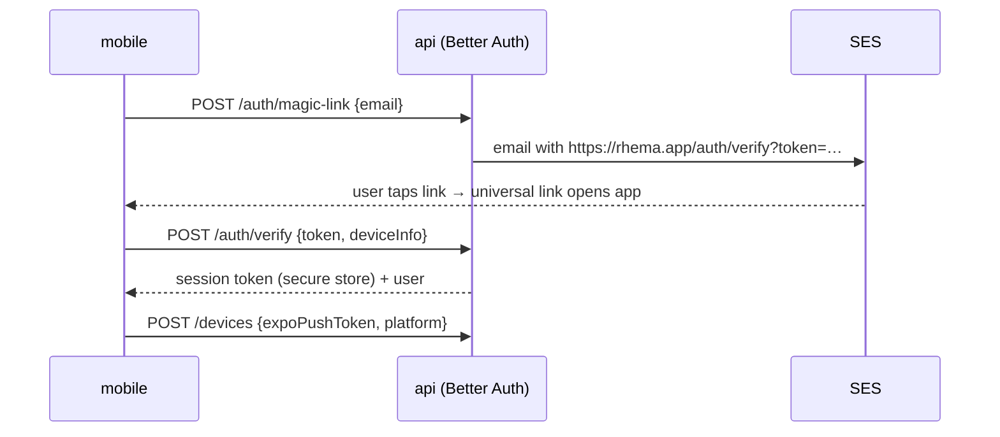

# Mobile companion — feature split, platform, screens, notifications (D19, D16-mobile)

- Scope: ledger rows **D19** (platform-independent mobile app, substantially limited feature set) and **D16** (notifications & async) as they apply to mobile; touches D2, D4, D6, D9, D12, D13, D14, C13, K1–K3, L1, M1, M2, N1–N3 · Date: 2026-08-27
- Evidence base (read fully): research/5 (Substack web-vs-app split §3.1, §8; typography §7; paper-in-a-dark-shell §6), research/4 (Codex inbox §2.2, Claude Code agent view §3.2, gate patterns §6.1, surface matrix §5), research/11 (run ledger §3, SSE/events §4, Hocuspocus §2.1, auth §2.2, mobile note in implications #11), research/6 (signup §5.2, trial §5.3), research/10 (Better Auth §L1, credit ladder, trial abuse), research/8 (Yjs/Hocuspocus autosave, version semantics), `~/agent-discourse/conventions/*.md`.
- Companion documents: **design/2** (web IDE) owns the canonical definitions of *project home*, *round timeline*, *run card*, *gate card*, *finding card*, the *disposition vocabulary* (accept / adapt / rebut / defer / escalate), the *estimate sheet*, and the *run report / walkthrough*. This document reuses those names and never redefines them; where design/2 was not yet available at writing time, the assumption is stated inline as **[assumes design/2]**.

## Summary of decisions (≤ 300 words)

1. **The app is for reading, deciding, and glancing; the web is for composing and configuring** — Substack's split restated as a rule (research/5 §3.1, §8; Q-18). Mobile v1 does: read drafts, letters, and dossiers; dispose findings; approve, wait, or decline gates; chat with the project agent; receive notifications; glance at usage. It never does run configuration, persona generation, sample ingestion, billing, or version diffs.
2. **Platform: Expo / React Native, not a PWA.** The mobile core is *actionable push notifications for gates* (Q-7 gates as approve-with-deadline, research/4 §6.1) and a share-sheet entry; both are weaker or unverified on iOS web. One TypeScript monorepo (research/11 §8) shares contracts, tokens, the findings/disposition state machine, and the API client — but **not** React components and **not** the ProseMirror editor.
3. **Light edits without porting the editor.** Mobile edits are paragraph-level patches applied *server-side* into the canonical Yjs document by a headless ProseMirror instance behind Hocuspocus (research/8 §H5; research/11 §10). Reviewed `vN` stays immutable (N3); mobile edits only the working head.
4. **Notifications (D16):** five event classes (gate opened, gate about to auto-proceed, run ready, run failed/recovered, cost threshold), three channels (push, email via SES, in-app inbox), one policy table. Push payloads carry IDs and templated strings only — never finding or draft text. Approve is never a lock-screen action; "Wait for me" is.
5. **Push transport:** Expo Push Service in MVP behind a `NotificationTransport` interface with SNS as the named swap; device tokens live in our Postgres.
6. **Offline:** read-only cache of the last N opened projects (SQLite); dispositions queue offline with version checks; gate decisions and chat require connectivity.
7. **Design system:** the same dark shell + paper page and serif reading typography as the web (research/5 §6–7), adapted to a phone measure (18 px, ≥ 45 cpl), findings as margin ticks plus a bottom sheet.
8. **Ship order:** mobile follows web v1; MVP = read + dispose + gates + notifications + usage glance + chat; light edits and "run next step with defaults" in v1.1; tablet layout and share-sheet ingestion later.

No departure from an operator decision. One thesis note: T1 (project/timeline as the spine) holds on mobile with the *inbox* rather than the timeline as the entry screen, because the phone is opened in response to a notification, not to browse.

---

## 1. What mobile is for (the job, from evidence)

*Observed.* Runs take minutes to hours of compute and hours to days of wall-clock waiting on a human (research/11 §1). Every coding-agent product treats the returning user as the primary case: Codex's Scheduled section "functions as your inbox … an unread indicator shows when a run needs your attention"; Claude Code's agent view groups sessions "Needs input / Working / Ready for review / Completed" with a one-line model summary so "the peek panel is enough" most of the time; Claude Desktop fires an OS notification when a session finishes unviewed (research/4 §2.2, §3.2). Gates everywhere are *soft* — Devin proceeds after 30 s, Jules "will eventually auto-approve the plan … on a timer" (research/4 §6.1). Substack's app is reader-first: inbox, Notes, Chat, Creator Stats, and a reduced editor that launched without draft sync, scheduling, or editing published posts (research/5 §3.1).

*Inferred.* A Rhema user's mobile moments are (a) "the review is ready — read the letter on the train," (b) "the structure plan is waiting — approve the $60 run before it auto-proceeds," (c) "triage 23 findings while waiting for coffee," (d) "ask the agent a question about §3." None of these is composing 15,000 words or configuring a rigor dial. Mobile-first is rejected (research/5 §8): the buyer sits at a desk with a long draft.

**Decision (D19).** The mobile app is a *companion*: an inbox with a reader attached. Its scope is set by the four moments above and closed against everything else.

---

## 2. Feature split (web IDE vs mobile)

Legend: ✓ full · ◐ reduced · ✗ excluded (web only). "MVP" / "v1.1" / "later" mark mobile phasing (§9).

| Capability | Web IDE (design/2) | Mobile | Phase | Rationale (evidence) |
|---|---|---|---|---|
| Read drafts `vN`, outline, editor's letter, rubric, response letter, walkthrough | ✓ | ✓ reader mode, serif paper, dark/light | MVP | The inbox use case; Substack app = reading surface (research/5 §3.1) |
| Findings list + anchored view | ✓ margin/full/clean views | ◐ list-first; tap → passage in reader; margin ticks in reader | MVP | Notion "minimal comment icons" collapse pattern below 1280 px already chosen for web (research/5 §7); phone is the limiting case |
| Dispositions accept / adapt / rebut / defer / escalate with a note | ✓ | ✓ (adapt = edit the proposed text in a sheet) | MVP | Small, high-value inputs; disposition *is* the response ledger (T2; research/5 §4.2) |
| Bulk "accept all copy-edits" | ✓ with diff preview | ✗ | — | "Never bulk-accept blind" (research/5 §4.2 rule 3); a phone cannot show the preview |
| Human gates: approve / wait-for-me / decline, with estimate | ✓ | ✓ | MVP | Q-7 + approve-with-deadline (research/4 §6.1); the mobile killer feature |
| Gate *editing* (edit the structure plan / review scope inline) | ✓ versioned document | ◐ comment on the plan only (queued guidance) | v1.1 | Warp/Antigravity plan-comment pattern (research/4 §4.2, §4.5); editing a plan document on a phone is a composing task |
| Chat with the project agent (research chat) | ✓ + promote-to-outline | ◐ text only; no promote-to-outline; no research bursts above the daily micro-grant without confirmation | MVP | Substack Chat precedent; cheap (research/5 §8); promote-to-outline is a run with a plan card (research/5 §5.2) |
| Notifications: gate waiting, run ready, failed/recovered, cost threshold | ✓ in-app + email | ✓ push + in-app inbox | MVP | D16; Codex inbox / Claude Desktop OS notification (research/4 §2.2, §3.2) |
| Usage glance (credits remaining, this month's spend, per project) | ✓ three zoom levels | ◐ read-only, two levels (account, project); no phase × role drill-down | MVP | Substack "View Creator Stats" (research/5 §3.1); T7 zoom levels belong to web (research/4 §6.5) |
| Light edits (typo, sentence) on the working draft | ✓ | ◐ paragraph-level; bold/italic/link only; never on reviewed `vN` | v1.1 | Substack app v1 editor set (research/5 §3.1); N3 immutability |
| Start runs | ✓ estimate sheet + rigor dial + phase toggles | ◐ "Run next step with defaults" from the timeline, showing the estimate, no configuration | v1.1 | Configuration surface too large (research/5 §8); estimate sheet is the single paywall location (research/6 §5.3) |
| Run configuration, rigor dial, phase opt-outs, model choice | ✓ | ✗ | — | research/5 §8 |
| Persona editing, generation, refresh; sample ingestion; Substack/Medium sync | ✓ | ✗ (persona name + staleness pill shown read-only on project) | — | Expensive, config-heavy (J-rows); research/5 §8 |
| Version diff `vN` → `vN+1` | ✓ side-by-side / inline | ✗ diff; ✓ "what changed" walkthrough + response ledger summary | MVP (walkthrough) | "Diff on a phone is unreadable; the response-ledger summary is not" (research/5 §8); D20 walkthrough (research/4 §4.2) |
| Live run feed | ✓ density toggle Summary/Normal/Verbose | ◐ Summary density only (phase cards + counters + cost tick) | MVP | Claude Code view modes (research/4 §3.8); verbose on a phone is noise |
| Cancel / pause a run | ✓ | ✓ cancel (keep partials) with confirmation | MVP | K6 partial results are real (research/11 §3.4); cancellation is a spend-stopping safety action |
| Billing, plan changes, credit purchase, exports | ✓ | ✗ ("Manage on the web") | — | App-store payment rules (§7.4); Substack keeps these on web (research/5 §8); Q-9 export-only is a desktop action |
| New project, upload outline/draft | ✓ three entry points | ✗ (later: share-sheet "Send to Rhema" creates a project with an uploaded draft) | later | Onboarding lives on web (research/6 §5.2) |
| Sharing / roles (C13) | ✓ | ◐ viewer role sees reader + findings read-only | later | Q-6 single-author first |
| Trial signup | ✓ | ✗ sign-in only (existing account) | — | §7.1 |

**Design rule that generates the table (REQ-MOBILE-1):** a capability ships on mobile only if it is (a) an *input smaller than a paragraph* (a decision, a disposition, a message) or (b) *reading*; anything that is *composition* or *configuration* stays on web. Every future request for a mobile feature is tested against this rule first.

---

## 3. Platform decision

### 3.1 Expo / React Native vs PWA

*Observed.* research/5 §8 recommends Expo/RN and flags that iOS PWA push/background limits were "not fetched this session"; research/11 (implications #11) notes that "SSE + REST from the same API serve a PWA; AppSync Events is the cheap managed pub/sub if native push is needed later." Substack's app is native (research/5 §3.1). The monorepo is already pnpm + Turborepo with `packages/contracts` (zod), `packages/ui`, and typed API (research/11 §8).

*Inferred.* The decision turns on four capabilities, ranked by how much of §1's job depends on them:

| Need | PWA (installed to home screen) | Expo / RN | Weight |
|---|---|---|---|
| Reliable push for gates with a deadline, including *notification actions* ("Wait for me") | Web Push on iOS exists only for home-screen-installed PWAs and offers no custom action buttons; delivery reliability on iOS is **unverified** in our notes and widely reported as weaker than APNs (not fetched — open question §11) | APNs/FCM native; category actions supported | high |
| Share sheet ("Send to Rhema" from Files / Mail / Safari) for later draft ingestion | Web Share Target is Android-only in practice | native on both | medium (later feature, but a platform-level door) |
| Secure token storage, biometric confirmation before approving spend | WebAuthn possible, Keychain not | Keychain / Keystore + LocalAuthentication | medium |
| App-store presence (discovery, trust, "there is an app") | none | yes; also brings review/payment rules (§7.4) | low–medium |
| Reading typography, dark/light, offline cache | equal (Service Worker + IndexedDB) | equal (SQLite) | — |
| Engineering cost | lowest: responsive routes of the web app | one more app, EAS builds, store review | favors PWA |

**Decision (REQ-MOBILE-2): Expo (managed workflow) / React Native**, one codebase for iOS and Android. The deciding factor is the gate use case: a time-boxed approval that costs $10–100 if wrong needs the most reliable, actionable notification channel a phone offers, and the operator named a "platform-independent mobile app" (Q-18). Rejected: (a) PWA — good enough for reading, not for gates; (b) responsive web IDE — the IDE is pane-based and desktop-first (design/2); (c) native Swift + Kotlin — doubles the surface for a companion app and breaks TypeScript-only (Q-3).

**Mobile web is not abandoned (REQ-MOBILE-3):** email and push deep links must never dead-end. The web app, when opened on a phone-width viewport at an IDE route, renders a *reader-only* layout (draft, letter, findings list, gate card with approve/wait) plus an "Open in the Rhema app" banner — the same screens as §5, in the web codebase. **[assumes design/2]** owns that breakpoint; this document supplies the screen inventory it should mirror. This gives Android users without the app, and anyone clicking an email, a working page.

### 3.2 Code-sharing strategy (TypeScript monorepo)

Layout additions to research/11 §8:

```
apps/mobile             Expo app (expo-router), iOS + Android
packages/contracts      (exists) zod schemas for API + events — shared verbatim
packages/api-client     NEW: typed fetch client generated from contracts; auth header,
                        retry, idempotency keys; used by web and mobile
packages/tokens         NEW: design tokens as TS constants (colors, type scale, spacing,
                        severity palette, paper themes) → web emits CSS variables,
                        mobile consumes in StyleSheet
packages/findings-core  NEW: pure-TS domain logic — disposition state machine, finding
                        ↔ passage anchor mapping (quote re-anchoring), ledger summaries,
                        gate deadline math; no DOM, no RN
packages/markdown-view  NEW: Rhema Markdown profile (H9) → mdast → renderer adapters
                        (web: existing; mobile: RN views); footnotes, citations, figures
packages/ui             (exists) web components — NOT shared with mobile
```

Rules (REQ-MOBILE-4):
1. Share **types, validation, domain logic, tokens, and the API client**. Do not share React components — `react-native-web` is rejected because the web IDE is a pane-based desktop app whose components would not survive the translation, and the mobile app's component count is small (≈ 12 screens).
2. **Never import ProseMirror/Tiptap/Yjs client code into `apps/mobile`.** The reader renders markdown from the API; edits go through the server-side patch path (§3.4).
3. `packages/contracts` is the single source of truth for every payload in this document; the mobile app pins a `contractVersion` and the API enforces a minimum app version (§7.5).
4. Event catalogue (research/11 §4.2) is consumed as-is; mobile renders only `visibility: user` events, which is all the API emits.

### 3.3 Realtime on mobile

*Observed.* The API exposes `GET /runs/:id/events?after=<seq>` with SSE and resume by `Last-Event-ID` (research/11 §4.1). React Native's `fetch` does not expose a streaming body across all Expo SDK versions without a third-party SSE library (unverified for the current SDK — open question).

**Decision (REQ-MOBILE-5):** in MVP, the mobile app **polls the same endpoint with `after=seq` every 4 s while a run screen is in the foreground**, and relies on push when backgrounded. The seq-resumable design makes polling and SSE equivalent from the API's point of view; no server change is needed. SSE (or AppSync Events, research/11 §2.1) is the v1.1 upgrade if battery or latency measurements demand it. Rejected: keeping a socket open in the background (platform-restricted, pointless with push).

### 3.4 Light edits without the editor (v1.1)

*Observed.* The canonical document is a Yjs doc served by self-hosted Hocuspocus with Postgres/S3 snapshots and `y-indexeddb` on the web client (research/8 §H5; research/11 §10). ProseMirror's model runs headless in Node. Human edits to a reviewed `vN` fork `v(N+1)` (research/8 N3; research/11 §3.5 rule 3).

**Decision (REQ-MOBILE-6):** mobile edits are **block patches applied server-side**.

1. The reader receives the working document as an ordered list of blocks `{blockId, kind, markdown, hash}` (block ids are stable node attributes in the Rhema Markdown profile, H9).
2. Tapping a paragraph opens a native `TextInput` pre-filled with the block's markdown; the toolbar offers bold, italic, link (Substack app v1 set, research/5 §3.1). Headings, lists, block quotes, footnotes, citations, and figures are read-only on mobile.
3. Save → `PATCH /documents/:docId/blocks/:blockId { baseHash, markdown }`. The `collab` service opens a server-side connection to the Yjs doc, parses the markdown block through the headless ProseMirror schema, replaces the node in a single Yjs transaction, and returns the new hash. Concurrent web edits merge through Yjs as usual; a `baseHash` mismatch returns 409 and the app reloads the block.
4. Provenance: the transaction tags the span `human/mobile` (E-row span provenance, research/5 §1.4).
5. The patch endpoint refuses documents whose head is a reviewed `vN` (`artifacts.immutable`) with a message: "This draft has been reviewed. Edit on the web to start v(N+1)." — the fork decision is a desktop action.
6. The "syncing (n)" pill (research/8 §H5) appears in the reader header; offline block edits queue in SQLite and replay in order.

Rejected: embedding Tiptap in a WebView (ships the whole editor, fights native scrolling and keyboard, duplicates autosave); a second RN-native rich-text editor (a third document model).

### 3.5 Push transport

*Observed.* research/11 does not price SNS mobile push; Expo's push service is free and abstracts APNs/FCM; Q-3/M8 carry a bias against third-party dependencies that are expensive or constrain control.

**Decision (REQ-MOBILE-7):** `expo-notifications` on the client; **Expo Push Service** as the MVP transport behind a `NotificationTransport` interface in `apps/worker` (`send(deviceTokens, payload)`, `receipts()`); **Amazon SNS mobile push** (APNs/FCM platform applications) is the named swap and is selected when any of: (a) a customer requires no third-party in the notification path, (b) Expo receipts show sustained delivery failures, (c) volume makes SNS's per-message price immaterial anyway. Device tokens are stored in our Postgres (`notification_devices`), never in Expo's dashboard. Because payloads carry no user text (§6.3), the privacy posture is the same under either transport — the swap is operational, not a data-protection decision. Rejected as MVP: SNS first (two credentials sets plus receipts handling before there is a single user; Expo's path is one worker file).

### 3.6 Offline reading

**Decision (REQ-MOBILE-8):** an LRU cache of the **last 10 opened projects** in `expo-sqlite`: document blocks, dossier (findings JSON), letters, walkthroughs, run summaries, and the inbox. Reads work offline with an "Offline · cached 2 h ago" banner. Writes:

| Action | Offline behaviour |
|---|---|
| Dispositions | queued with optimistic UI; replayed with `ledgerVersion`; 409 → conflict sheet ("this ledger was frozen when the run started — your note is kept in the run's guidance") |
| Gate decisions | **not allowed offline** — deadlines are server time; the gate card shows "Connect to decide · auto-proceeds at 14:32" |
| Chat | compose allowed; send when online |
| Block edits (v1.1) | queued, replayed in order, 409 → reload block |

Cache is wiped on sign-out and when the account's data is deleted (Q-12; research/11 §6.4 tombstone semantics).

---

## 4. Notifications (D16 as applied to mobile)

### 4.1 Event classes → channels

Derived from the event catalogue (research/11 §4.2) and gate state machine (research/11 §3.2).

| # | Class | Source event | Push | Email (SES) | In-app inbox | Default | Notes |
|---|---|---|---|---|---|---|---|
| N1 | **Gate opened** | `gate.opened` | immediate, time-sensitive | if unresolved after 15 min | yes, pinned | on | Actions: *Open*, *Wait for me* (§4.3) |
| N2 | **Gate about to auto-proceed** | scheduled at `expires_at − 10 min` | immediate | no | yes | on | Suppressed if N1 was opened in-app |
| N3 | **Run ready to read** | `run.completed` | immediate | digest (hourly) unless the user opted to immediate | yes | on | Body = one-line model summary (Claude agent view pattern, research/4 §3.2) |
| N4 | **Run failed / recovered / partial** | `run.failed`, `run.resumed` (K7), `run.cancelled` | immediate for failed; silent for recovered | yes for failed | yes | on | Partial dossier → "3/6 phases delivered · Resume" |
| N5 | **Cost threshold** | `confirm_cost` gate; `cost.tick` crossing 100 % of estimate | immediate | no | yes | on | Is a gate (L6); same card as N1 with a spend framing |
| N6 | Persona stale (T5) | staleness computed on open | none | weekly digest | yes | on | Never a push — not time-critical |
| N7 | Trial ending / credits low | billing events | none | yes (research/6 §5.3 day-12 email) | yes | on | No push: app-store rule on purchase nudges (§7.4) |
| N8 | Chat reply while backgrounded | `chat.message` | immediate | no | yes | on | Collapsed per thread |

Rules (REQ-MOBILE-9):
- Every notification deep-links to the exact object (`rhema://p/<project>/runs/<run>/gates/<gate>`, universal link `https://rhema.app/…` as fallback).
- Per-class toggles live under Settings → Notifications on both web and mobile and are one setting (server-side `notification_prefs`), not per device.
- Quiet hours (default off) delay N3/N8, never N1/N2/N5 — a gate with a deadline is precisely what the user asked to be told about (Q-7).
- Collapse key = `run_id`; a later class replaces an earlier one on the same run (a run that opened a gate then completed shows one item).

### 4.2 Delivery flow

```mermaid
sequenceDiagram
  participant RT as run-task
  participant PG as Postgres (run_events, gates)
  participant W as worker (notifier)
  participant T as NotificationTransport (Expo → APNs/FCM)
  participant M as mobile app
  participant API as api
  RT->>PG: gate.opened (visibility user), gates row expires_at
  PG-->>W: pg-boss job notify.gate_opened {gate_id}
  W->>PG: read prefs, devices, quiet hours; insert inbox_items
  W->>T: send {to: tokens, data: {kind, gate_id, run_id, project_id}, title, body}
  T-->>M: push (category GATE, actions Open / Wait for me)
  M->>API: (on open) GET /gates/:id → GateView
  M->>API: (on "Wait for me") POST /gates/:id/hold  (no auth-sensitive spend)
  W->>PG: schedule notify.gate_expiring at expires_at − 10 min
  W->>T: (if still open at +15 min) email via SES
```

### 4.3 Lock-screen actions — what is and is not allowed

*Observed.* Devin's "Wait for my approval" is the hard-gate toggle; Jules auto-approves on a timer if you navigate away (research/4 §6.1). A wrong approval costs $10–100 (Q-10).

**Decision (REQ-MOBILE-10):** notification actions are **Open** and **Wait for me** only. *Wait for me* is safe (it holds the gate — extends `expires_at` by the gate policy's hold duration, or indefinitely if the user has "Never auto-proceed" on) and is the most valuable one-tap action a phone can offer. **Approve is never a lock-screen action**: approval must happen inside the authenticated app, on the gate screen, with the estimate visible and, above a user-set spend threshold, a biometric confirmation (§7.2). Rejected: "Approve" as a notification action (no estimate visible; a pocket press starts a $60 run).

### 4.4 In-app inbox

The inbox is the app's home tab (§5.1) and mirrors web's notifications center **[assumes design/2 has one under D13/D16]**. Items are grouped **Needs you / Ready to read / Everything else**, matching the web project-home grouping (research/4 §3.8: "Needs you / Running / Ready to read / Done"). Read state syncs across devices via the server (`inbox_items.read_at`), so reading on the phone clears the web badge.

---

## 5. Screen inventory and wireframes

Twelve screens. Navigation: bottom tabs **Inbox · Projects · Chat · Usage** (four, per platform convention), with a stack per tab. Phone widths shown at 390 pt; tablet layout is "later" (§9).

| # | Screen | Route | Reads | Writes | Phase |
|---|---|---|---|---|---|
| S1 | Inbox (home) | `/inbox` | inbox_items, gates, runs | read_at | MVP |
| S2 | Projects list | `/projects` | projects grouped (Needs you / Running / Ready / Idle), persona pill | — | MVP |
| S3 | Project timeline | `/p/:id` | round log, runs, artifacts, persona staleness | cancel run | MVP |
| S4 | Run detail (live) | `/p/:id/runs/:rid` | phase cards, counters, cost tick, walkthrough | cancel | MVP |
| S5 | Reader | `/p/:id/docs/:docId` | blocks, findings ticks, footnotes | block patch (v1.1) | MVP |
| S6 | Findings list | `/p/:id/reviews/:revId` | findings (filter severity/phase/disposition) | — | MVP |
| S7 | Finding sheet (bottom sheet over S5/S6) | modal | finding, evidence URL, proposed text | disposition + note | MVP |
| S8 | Gate approval | `/p/:id/runs/:rid/gates/:gid` | plan/scope/triage summary, estimate, deadline | approve / hold / decline; comment (v1.1) | MVP |
| S9 | Chat | `/chat` (project picker) and `/p/:id/chat` | thread | message | MVP |
| S10 | Usage glance | `/usage` | credits, month spend, per-project | — | MVP |
| S11 | Settings | `/settings` | prefs, theme, devices | notification prefs, paper theme, sign out | MVP |
| S12 | Sign-in / forced-update / offline interstitials | `/auth`, `/update` | — | — | MVP |

### 5.1 S1 — Inbox (home)

```
┌──────────────────────────────────────┐
│ Rhema                         ◔ 1,340│  ← credits glance (tap → S10)
│──────────────────────────────────────│
│ NEEDS YOU                            │
│ ┌──────────────────────────────────┐ │
│ │ ⏳ Approve structure plan        │ │
│ │ After Bureaucracy · draft v1     │ │
│ │ est. 41–58 credits · auto in 22m │ │
│ │ [ Open ]            [ Wait ▷ ]   │ │
│ └──────────────────────────────────┘ │
│ ┌──────────────────────────────────┐ │
│ │ ◆ 23 findings to triage          │ │
│ │ Structure of Pol. Difference · v2│ │
│ │ 4 blocking · 11 major · 8 minor  │ │
│ └──────────────────────────────────┘ │
│ READY TO READ                        │
│ ┌──────────────────────────────────┐ │
│ │ ✉ Editor's letter for v2         │ │
│ │ "Argument holds; §4 evidence     │ │
│ │  thin; two claims unverified."   │ │
│ │ 2 h ago · 71 claims · 66 verified│ │
│ └──────────────────────────────────┘ │
│ EVERYTHING ELSE                      │
│  ○ Persona "sjs-academic" is stale   │
│  ○ Review of v1 cancelled (partial)  │
│──────────────────────────────────────│
│  ▣ Inbox   ▤ Projects  ✎ Chat  ◔ Use │
└──────────────────────────────────────┘
```

Interaction spec:
1. Cards render from `inbox_items` joined to the live gate/run; a gate card shows a **live countdown** computed from `expires_at` (server time offset corrected on each sync).
2. **Wait** calls `POST /gates/:id/hold`; the card changes to "Held · waiting for you" with no countdown.
3. Pull-to-refresh; background fetch on notification receipt updates badges.
4. Swipe-left archives (sets `read_at`), never deletes.

### 5.2 S3 — Project timeline

Reuses design/2's round timeline vertically **[assumes design/2: rounds = outline → v1 → review → response → v2 …, each with run cards]**.

```
┌──────────────────────────────────────┐
│ ‹ Projects   After Bureaucracy    ⋯  │
│ Essay · persona sjs-substack ● fresh │
│──────────────────────────────────────│
│ ● Outline            2 Aug           │
│ │  outline.md · 7 sections           │
│ ● Draft v1           3 Aug  ✓ 38 cr  │
│ │  drafting note · read ›            │
│ ● Review of v1       4 Aug  ✓ 61 cr  │
│ │  editor's letter · 23 findings ›   │
│ │  claim ledger 71/66 · second read  │
│ ● Response + v2      running 3/5     │
│ │  ▮▮▮░░ revising · 12 of 23 moves   │
│ │  cost so far 19 cr · est. 30–44    │
│ │  [ Cancel run ]                    │
│ ○ Next: Review of v2                 │
│    [ Run with defaults · est 55–70 ] │  ← v1.1
│──────────────────────────────────────│
│  ▣ Inbox   ▤ Projects  ✎ Chat  ◔ Use │
└──────────────────────────────────────┘
```

Interaction spec:
1. Each artifact row opens the reader (S5); each run row opens run detail (S4).
2. The persona pill is read-only; tapping it shows the staleness explanation and "Refresh on the web" (T5; research/12 amendment in ledger change log).
3. **Cancel run** confirms with the partial-results sentence from K6: "Phases completed so far are kept; you will not be charged for work not done."
4. "Run with defaults" (v1.1) opens the estimate sheet (the single paywall location, research/6 §5.3 #6) with no configuration; if credits are insufficient the primary button reads "Add credits on the web" (§7.4).

### 5.3 S5 — Reader with anchored findings

```
┌──────────────────────────────────────┐
│ ‹ Timeline    v2 · reviewed     Aa ☾ │
│  synced ✓                      ⚑ 23  │  ← findings count → S6
│──────────────────────────────────────│
│                                      │
│   III. The error of the             │
│   bureaucratic imagination         │
│                                      │
│   The claim that institutions     ▎ │  ← margin tick (major)
│   think is older than Douglas's      │
│   book; it appears already in        │
│   Durkheim's treatment of …          │
│                                      │
│   What the bureaucratic reading   ▍ │  ← tick (blocking)
│   misses is that rules do not        │
│   exhaust the conduct they …         │
│                                      │
│   ¹ Mary Douglas, How Institutions   │
│     Think (1986), ch. 1.             │
│                                      │
│──────────────────────────────────────│
│ ◀ prev finding  ·  3 of 23  ·  next ▶│
└──────────────────────────────────────┘
```

Interaction spec:
1. Paper column fills the width minus 20 pt gutters; a 6 pt right-edge tick per finding, colored by severity, height = passage extent (Word "Simple Markup" margin line, research/5 §4.2 rule 2).
2. Tap a tick or a highlighted passage → S7 bottom sheet at half height; the passage scrolls to remain visible above the sheet.
3. Bottom bar steps through findings in document order; long-press → filter by severity.
4. `Aa` opens the size stepper (three steps, ±2 px) and paper theme (Auto / Dark / Light — Substack's trio, research/5 §7). `☾` toggles the shell theme.
5. Footnotes render inline at the block's end on tap (no popovers on touch), citations as `[n]` linking to the bibliography section.
6. Reviewed `vN` shows "reviewed · read-only" in the header; the working head shows "working" and (v1.1) enables tap-to-edit.

### 5.4 S7 — Finding sheet and dispositions

```
┌──────────────────────────────────────┐
│ ▔▔▔▔                                 │
│ ◆ Blocking · fact-check · 2nd read ✓ │
│ "…it appears already in Durkheim's   │
│  treatment of collective represen-   │
│  tations."                           │
│                                      │
│ The attribution is to Durkheim 1912; │
│ the fetched text supports 'collec-   │
│ tive representations' but not the    │
│ claim that institutions 'think'.     │
│ ↗ source: archive.org/…/durkheim     │
│                                      │
│ Proposed edit ▸ (show)               │
│                                      │
│ [Accept] [Adapt] [Rebut] [Defer] [⇧] │
│ Note (optional) ________________     │
└──────────────────────────────────────┘
```

Interaction spec (REQ-MOBILE-11):
1. Header chips: severity, phase of origin, and whether the second read confirmed it (research/5 §4.2; T3 "fresh-context second read becomes visible as a feature").
2. **Accept** records the disposition; if a proposed edit exists it is applied at revision time by the respond-to-review run, never immediately by the app (the agent writes `v(N+1)`; N2 locking).
3. **Adapt** opens the proposed text in an editable field (Word's editable suggestion box precedent, research/5 §4.2); the edited text is stored on the ledger row as the author's adaptation.
4. **Rebut** and **Defer** require a note ≥ 1 sentence (the response ledger needs a reason; conventions: the editor sees the author's response memo).
5. **⇧ Escalate** marks the finding for the desktop ("needs the full editor") and appears in the web IDE's Needs-you list.
6. Dispositions are reversible until the triage-ledger gate is approved (the ledger is "frozen per round" per `project-memory.md`); after that the sheet is read-only with the recorded disposition.
7. Offline: queued (§3.6).

### 5.5 S8 — Gate approval

```
┌──────────────────────────────────────┐
│ ‹ Back      Structure plan · v1      │
│──────────────────────────────────────│
│ Auto-proceeds in 21:40   [Wait for me]│
│                                      │
│ The author-agent proposes 6 sections │
│ (≈ 4,800 words) opening on the       │
│ Douglas misreading, closing on …     │
│                                      │
│ ▸ I. The received view    ~700 w     │
│ ▸ II. What Douglas said   ~800 w     │
│ ▸ III. The error …        ~900 w     │
│ ▸ …                                   │
│                                      │
│ Persona: sjs-substack (profile 2 Aug)│
│ Rigor: Standard · fact-check on      │
│ Estimate: 41–58 credits              │
│ Guaranteed cap: 87 credits (1.5×)    │
│ Balance after: ≥ 1,253               │
│                                      │
│ [ Approve and continue ]             │
│ [ Decline — stop this run ]          │
│ Comment for the agent (v1.1) ______  │
└──────────────────────────────────────┘
```

Interaction spec (REQ-MOBILE-12):
1. Three gate kinds share the screen with different bodies **[assumes design/2's three named gates: structure plan, review scope, triage ledger]**: structure plan (section list), review scope (phases on/off, venue bar — read-only on mobile), triage ledger (disposition tally with "Review dispositions ›" → S6).
2. **Approve** above the user's spend threshold (default 50 credits) requires biometric or device passcode (§7.2). The button label always contains the estimate's upper bound.
3. **Wait for me** = hold; **Decline** = cancel run with partials kept; both confirm.
4. The estimate block shows the same fields as the web estimate sheet (estimate range, guaranteed 1.5× cap, balance after) so the number the user approves on the phone is the number the web would show (L6; research/10 credit ladder).
5. The `confirm_cost` gate (N5) uses this screen with body "This run has reached 100 % of its estimate (58 credits). Continue to the cap (87)?"
6. Expired gate: the screen states what happened ("Auto-proceeded at 14:32 per your gate policy") and links to the run.

### 5.6 S9 — Chat

```
┌──────────────────────────────────────┐
│ ‹ After Bureaucracy · Research chat  │
│──────────────────────────────────────│
│ You  Is there a 1912 passage where   │
│      Durkheim says institutions      │
│      think?                          │
│ Agent  Not in those words. In *Forms*│
│      he says collective represen-    │
│      tations "…" (bk. 2, ch. 7).     │
│      Fetched: archive.org/…  ↗       │
│      ▸ 2 searches · 1 source · 3 cr  │
│──────────────────────────────────────│
│ [ Ask about this draft ▾ ] ________ ➤│
│  daily research allowance: 4 of 5    │
└──────────────────────────────────────┘
```

Interaction spec (REQ-MOBILE-13):
1. Same thread as the web project chat (D9); messages sync via the API; the agent's tool activity renders as a collapsed "2 searches · 1 source · 3 cr" line (Summary density, research/4 §3.8).
2. A message that would trigger web research beyond the daily micro-grant (research/6 §5.3 #4) shows an inline estimate chip ("~3 credits — send?") before sending — the same plan-before-run convention (research/5 §5.2 #1).
3. No "Promote to outline", no slash commands that start runs; the `/review` style verbs are web-only in MVP (v1.1 exposes "run next step" from the timeline only).
4. Attachments: none in MVP (share-sheet ingestion is "later").

### 5.7 S10 — Usage glance

```
┌──────────────────────────────────────┐
│ Usage                                │
│──────────────────────────────────────│
│ Pro · renews 14 Sep                  │
│ ▮▮▮▮▮▮▮░░░  1,340 of 2,000 credits   │
│ Overage: Never (change on the web)   │
│                                      │
│ THIS MONTH BY PROJECT                │
│ After Bureaucracy          312 cr    │
│ Structure of Pol. Diff.    248 cr    │
│ Persona refresh (sjs-acad)  96 cr    │
│                                      │
│ RECENT RUNS                          │
│ Review of v2 · 61 cr · 38 min  ›     │
│ Draft v1 · 38 cr · 22 min      ›     │
│                                      │
│ Manage plan and credits on the web.  │
└──────────────────────────────────────┘
```

Two zoom levels (account, project → run list); the run row opens S4's run report (cost, timings, unmet targets). No phase × role drill-down and no raw tokens (research/4 §6.5). No prices, no purchase buttons (§7.4).

### 5.8 S4 — Run detail (live, Summary density)

Phase cards with live counters from `phase.*`, `claim.checked`, `finding.emitted`, `source.read`, `cost.tick`, `subagent.started` (research/11 §4.2): "Fact-check · 41 claims · 33 verified · 2 contradicted", "Second read · in progress", "Cost so far 19 cr · est. 30–44 · cap 66". `boundary.attested` renders as the trust chip "Boundaries held ✓" (E6). Completed runs show the walkthrough (≤ 200 words, D20) first and the run report below.

---

## 6. Design-system adaptation (D14 on a phone)

*Observed.* research/5 §6–7 fixes the web numbers: dark shell in the Cursor/Devin idiom; paper page with a serif preset (Lora / Source Serif 4 / Literata) at 17 px, line-height 1.55, 68 ch target, 45 ch minimum, Substack heading ratios (2 / 1.625 / 1.375 / 1.125), Auto / Dark / Light + size stepper, dark paper ≈ `#141311`–`#1a1917` with text `#e8e4dc`, severity colors ≥ 4.5:1; Substack app supports dark mode (research/5 §3.1).

**Decisions (REQ-MOBILE-14):**

| Token | Web (research/5 §7) | Mobile | Why |
|---|---|---|---|
| Shell background | dark, monochrome, 13–14 px sans | same palette from `packages/tokens`; system sans (SF / Roboto) at 15–17 pt for tap targets | platform type conventions; 44 pt touch targets |
| Paper background | `#141311` dark / paper-white light | identical; paper follows the app theme by default and can be pinned per project (D21 policy), setting synced from web | one policy, two clients |
| Body serif | 17 px, lh 1.55 | **18 px** default (16 / 18 / 20 stepper), lh 1.5; respects Dynamic Type / font scale up to 200 % (WCAG 1.4.8) | phone reading distance is closer but screens are smaller; iA's "size depends on reading distance" |
| Measure | 68 ch target, 45 ch min | width − 40 pt ≈ 48–55 ch at 18 px on a 390 pt phone; **the reader refuses to drop below 45 ch** — on small phones the size stepper's largest step is disabled | keeps research/5's minimum |
| Headings | 2 / 1.625 / 1.375 / 1.125 em | same ratios; h1 capped at 1.75 em on phones | long titles wrap badly at 2 em on 350 pt |
| Findings gutter | 240–320 px at ≥ 1280 px; ticks + drawer below | 6 pt ticks + bottom sheet | Notion minimal icons pattern |
| Severity palette | ≥ 4.5:1 on both papers | same tokens; ticks additionally differ in width (blocking 4 pt, major 3 pt, minor 2 pt) | color-blind safe without labels |
| Motion | streaming text and phase progress only | same; sheet transitions at platform defaults; `reduceMotion` honored | research/5 §6 |
| Density | keyboard-first, dense | thumb-first: primary actions in the bottom 40 % of the screen | mobile ergonomics |

Fonts ship in the app bundle (no runtime download): the serif preset chosen by D14 for the web and the system sans. No font picker beyond the two presets (Substack proves acceptance, research/5 §3.3).

Empty states: Inbox empty = "Nothing needs you. Runs you start on the web will show up here." Projects empty = "Create your first project on the web — mobile is for reading and deciding." The copy states the split rather than hiding it.

---

## 7. Auth, session, security, app store, release cadence

### 7.1 Auth and session

*Observed.* Better Auth self-hosted in our Postgres with email + Google + Apple at launch, organizations plugin later, passkeys later (research/10 L1; research/11 §2.2). Web signup is Google + magic link, no password, verification deferred to the first credit-bearing run (research/6 §5.2).

**Decisions (REQ-MOBILE-15):**
1. Mobile offers **Sign in with Google, Sign in with Apple, and email magic link**; no signup on mobile in MVP (accounts are created on the web where the showcase project and trial live). Apple sign-in is included because App Store Review requires it when other third-party sign-ins are offered (guideline 4.8 — not fetched this session; verify before submission).
2. Magic links open the app via universal links / app links (`https://rhema.app/auth/verify?token=…`) with the web page as fallback; the token is single-use and 10-minute bound.
3. Sessions: Better Auth session token stored in **Keychain / Keystore via `expo-secure-store`**, never AsyncStorage; refresh on app foreground; server-side session list (Settings → Devices) with remote revoke, shared with the web.
4. Sign-out wipes SQLite cache and secure store; server revokes the device token from `notification_devices`.



### 7.2 Spend-sensitive actions

**REQ-MOBILE-16:** approving a gate whose estimate upper bound exceeds the user's threshold (default 50 credits, settable 0–∞ on web and mobile) requires `LocalAuthentication` (Face ID / fingerprint / passcode) immediately before the request; the API additionally requires a fresh session (≤ 12 h since last interactive auth) for approvals ≥ 200 credits and returns 401-step-up otherwise. Rationale: the only irreversible actions in Rhema are spend and overwrite (research/4 §5 matrix, "permission prompts"); mobile makes spend one tap away.

### 7.3 Data protection on device

- Push payloads: IDs + templated strings; project titles are included by default and can be suppressed with "Private notifications" (body becomes "A run needs your attention") — Q-12 posture, no over-promising.
- Cache: small, per-account, wiped on sign-out; not encrypted beyond OS file protection in MVP (open question §11 on SQLCipher).
- No screenshots block, no jailbreak detection (over-engineering for a companion reader).
- Transport: TLS to CloudFront/ALB; no certificate pinning in MVP (breaks on CDN cert rotation; revisit only on customer demand).
- The app never holds provider keys or protocol text (E5): everything it renders is `visibility: user` output.

### 7.4 App-store considerations

*Observed.* Substack keeps billing and plan changes on the web (research/5 §8). App-store rules on in-app references to external purchasing differ by store and jurisdiction and change frequently (not fetched — see §11).

**Decisions (REQ-MOBILE-17):**
1. **No in-app purchases, no price display, no purchase links** in MVP. The usage screen shows balances and the sentence "Manage plan and credits on the web" without a tappable URL. This is the most conservative posture across both stores and avoids the 15–30 % commission on a product whose margin is ≈ 52 % (research/10 ladder).
2. The app must be fully usable for reading, deciding, chatting, and notifications with an existing account, so that review does not classify it as a shell — it is a functional client of a paid web service (the "reader app" style). Revisit purchase links per jurisdiction once counsel signs off.
3. Account deletion: Apple requires in-app account deletion if the app supports account creation; since MVP has no in-app signup, a "Delete account on the web" link suffices — re-check if signup is added.
4. Privacy nutrition labels / Data Safety: data linked to identity = email, user content (drafts read), usage data; no tracking SDKs; no third-party analytics SDK in the app (product analytics C11 go through our API).
5. Content: no user-generated public content, no publishing (Q-9), which keeps the app out of UGC-moderation requirements.

### 7.5 Release cadence and compatibility

**REQ-MOBILE-18:**
- **EAS Build** for store binaries; **EAS Update** (OTA) for JS-only changes that do not change the app's purpose; store release **monthly**, OTA **weekly** or on demand for fixes. TestFlight / internal testing track receives every web release's companion build.
- API compatibility: the app sends `X-Rhema-App: ios/1.4.0 contract/7`; the API publishes `minAppVersion` and `minContract`; below the minimum the app shows the forced-update screen (S12) and keeps the cached reader available.
- Feature flags served from the API gate v1.1 features (light edits, run-with-defaults) so the store build can ship before the server path is enabled.
- Preview stages (research/11 §8) get a dev-client build pointed at `pr-<n>` via a URL scheme; runs in previews use capped models.

---

## 8. Data contracts (mobile-facing, in `packages/contracts`)

```ts
type Severity = "blocking" | "major" | "minor" | "note";
type Disposition = "accept" | "adapt" | "rebut" | "defer" | "escalate";

type InboxItem = {
  id: string; kind: "gate" | "run_ready" | "run_failed" | "run_partial" | "persona_stale" | "billing" | "chat";
  projectId: string; projectTitle: string; runId?: string; gateId?: string;
  title: string; summary: string;            // model one-liner for runs; templated for gates
  createdAt: string; readAt?: string; expiresAt?: string;
};

type GateView = {
  id: string; runId: string; kind: "approve_plan" | "review_scope" | "triage_findings" | "confirm_cost";
  openedAt: string; expiresAt?: string; held: boolean; policy: "auto_proceed" | "wait";
  body: { sections?: { title: string; targetWords: number }[]; phases?: { key: string; on: boolean }[];
          triage?: { accept: number; adapt: number; rebut: number; defer: number; escalate: number; undecided: number } };
  estimate: { lowCredits: number; highCredits: number; capCredits: number; balanceAfterMin: number };
  persona?: { id: string; profileDate: string; staleness: "fresh" | "seed-changed" | "samples-changed" | "aged" | "never-built" };
  rigor: "low" | "standard" | "elite";
};

type FindingView = {
  id: string; reviewId: string; severity: Severity; phase: "fact-check" | "discourse" | "craft" | "second-read" | "reconcile";
  confirmedBySecondRead?: boolean; rejectedByReconciliation?: boolean;
  anchor: { blockId: string; quote: string; start?: number; end?: number; stale: boolean };
  body: string; evidenceUrl?: string; proposedText?: string;
  disposition?: { value: Disposition; note?: string; adaptedText?: string; at: string; frozen: boolean };
};

type DocumentView = {
  docId: string; projectId: string; version: string; immutable: boolean; head: boolean;
  blocks: { blockId: string; kind: "heading" | "paragraph" | "quote" | "list" | "footnote" | "figure" | "citation-list"; level?: number; markdown: string; hash: string }[];
  ledgerVersion: number;
};

type DispositionInput = { findingId: string; ledgerVersion: number; value: Disposition; note?: string; adaptedText?: string; idempotencyKey: string };
type BlockPatch = { docId: string; blockId: string; baseHash: string; markdown: string; idempotencyKey: string };
type NotificationDevice = { id: string; platform: "ios" | "android"; token: string; transport: "expo" | "sns"; lastSeenAt: string };
```

Endpoints used by mobile (all existing REST from research/11 §10 unless marked NEW): `GET /inbox` NEW, `GET /projects`, `GET /projects/:id/timeline`, `GET /runs/:id`, `GET /runs/:id/events?after=`, `GET /gates/:id`, `POST /gates/:id/{approve|hold|decline}`, `GET /reviews/:id/findings`, `POST /findings/:id/disposition`, `GET /documents/:id` (block view) NEW, `PATCH /documents/:id/blocks/:blockId` NEW (v1.1), `GET /projects/:id/chat`, `POST /projects/:id/chat`, `GET /usage/summary`, `POST/DELETE /devices` NEW, `GET/PUT /me/notification-prefs` NEW.

---

## 9. MVP vs later

| Phase | Ships | Exit criterion |
|---|---|---|
| **Mobile MVP** (after web v1) | S1–S12 as read/decide surfaces: inbox, projects, timeline, run detail (Summary), reader with ticks, findings list + disposition sheet, gate approval with hold/decline and biometric step-up, chat (text), usage glance, settings, sign-in (Google/Apple/magic link), push N1–N5 + N8, email fallbacks, offline read cache + queued dispositions, forced-update | A user who receives a gate push can approve/hold within 3 taps; a dossier of 23 findings can be fully dispositioned on the phone and the web shows the same ledger |
| **v1.1** | Light block edits (§3.4); "Run next step with defaults" from the timeline with the estimate sheet; comment on a gate plan (queued guidance); SSE or AppSync Events if polling proves costly; feature flags flipped server-side | Edits from the phone appear in the web editor within 2 s with `human/mobile` provenance |
| **Later** | Tablet layout (two-pane: findings list + reader; the web reader breakpoint may cover this); share-sheet "Send to Rhema" creating a project from a `.docx/.pdf/.md`; viewer-role read-only for shared projects (C13); Android/iOS home-screen widget "Needs you: 2"; private-notification defaults for teams; SNS transport if triggered (§3.5) | — |
| **Never (by REQ-MOBILE-1)** | Run configuration, rigor dial, persona generation/refresh, sample ingestion and sync, version diffs, bulk accept, billing/purchase, export, project creation from scratch | — |

---

## 10. Requirements register

| ID | Requirement | Acceptance hook |
|---|---|---|
| REQ-MOBILE-1 | Mobile scope rule: only sub-paragraph inputs and reading; composition/configuration stays on web | Feature-review checklist item |
| REQ-MOBILE-2 | Expo/React Native app, one codebase, iOS + Android | Builds from `apps/mobile` on EAS for both platforms |
| REQ-MOBILE-3 | Web renders a reader-only layout with app banner for IDE routes at phone widths; no dead-end deep links | Open every notification link on a phone browser: draft/letter/findings/gate readable |
| REQ-MOBILE-4 | Shared packages: contracts, api-client, tokens, findings-core, markdown-view; no React components, no ProseMirror/Yjs in mobile | Lint rule fails on forbidden imports |
| REQ-MOBILE-5 | Foreground polling of `/runs/:id/events?after=seq` at 4 s; push when backgrounded | Run screen reflects a `phase.completed` within 5 s |
| REQ-MOBILE-6 | Block-patch edit path via headless ProseMirror behind Hocuspocus; 409 on base-hash mismatch; refuses immutable heads | Patch from mobile → Yjs update visible on web; edit on reviewed vN returns the fork message |
| REQ-MOBILE-7 | `NotificationTransport` interface; Expo Push MVP; SNS swap; tokens in our Postgres | Swapping transport touches one worker module |
| REQ-MOBILE-8 | Offline LRU cache (10 projects, SQLite); queued dispositions; gates and chat online-only; wipe on sign-out | Airplane-mode test: read + dispose; gate shows "connect to decide" |
| REQ-MOBILE-9 | Notification classes N1–N8 with channel policy, deep links, per-class prefs, quiet hours excluding gates, collapse by run | Policy table implemented as data; unit tests per class |
| REQ-MOBILE-10 | Lock-screen actions = Open + Wait for me; no Approve action | Notification category definition |
| REQ-MOBILE-11 | Finding sheet dispositions incl. adapt-in-place, required notes for rebut/defer, escalate, reversible until ledger freeze | Ledger row written with device provenance |
| REQ-MOBILE-12 | Gate screen: three kinds + confirm_cost; estimate fields identical to web; approve/hold/decline; expired-state copy | Same numbers as web estimate sheet for the same run |
| REQ-MOBILE-13 | Chat: shared thread, Summary-density tool lines, estimate chip before research beyond daily grant, no run-starting verbs in MVP | Sending a research question over the grant shows the chip |
| REQ-MOBILE-14 | Design tokens from `packages/tokens`; 18 px serif default with stepper and Dynamic Type; ≥ 45 ch measure; tick widths by severity; paper theme synced | Visual regression snapshots dark/light |
| REQ-MOBILE-15 | Google + Apple + magic link sign-in; Keychain/Keystore sessions; device list with remote revoke | Revoke on web signs the phone out within one foreground |
| REQ-MOBILE-16 | Biometric step-up above spend threshold; server step-up ≥ 200 credits | Approval without fresh auth returns 401-step-up |
| REQ-MOBILE-17 | No IAP, no prices, no purchase links; "manage on the web" copy; no third-party analytics SDKs | Store-review checklist |
| REQ-MOBILE-18 | EAS Build monthly, EAS Update weekly; `minAppVersion`/`minContract` enforcement with forced-update screen keeping cached reading | Old build against new API shows S12 |
| REQ-MOBILE-19 | Inbox read state and notification prefs are server-side and shared with web | Reading on phone clears web badge |
| REQ-MOBILE-20 | Push payloads contain IDs and templated text only; "private notifications" option hides titles | Payload schema test |
| REQ-MOBILE-21 | Cancel run from timeline/run detail with K6 partial-results copy | Cancelled run keeps committed phases |
| REQ-MOBILE-22 | Usage glance: two zoom levels, no tokens, no prices | Screen contains no currency symbols |

---

## Ledger updates

| Row | Proposed status | Evidence |
|---|---|---|
| D19 | **done (design)** | This document: split table §2, platform §3, screens §5, phasing §9; Expo/RN chosen over PWA with the gate-notification argument |
| D16 | **done for mobile; web half owned by design/2** | §4 classes, channels, delivery flow, lock-screen policy; inbox as home |
| D13 | in-progress → notification prefs and device list are shared server-side settings (§4.1, §7.1) | REQ-MOBILE-15, -19 |
| D14 | in-progress → mobile adaptation table (§6) added to the design system | REQ-MOBILE-14 |
| D6 | in-progress → phone rendering of anchored findings (ticks + sheet) specified (§5.3–5.4) | REQ-MOBILE-11 |
| C7 / Q-7 | confirmed → "Wait for me" as the safe remote action; approve only in-app with step-up (§4.3, §7.2) | REQ-MOBILE-10, -16 |
| M2 | in-progress → new endpoints (`/inbox`, block view, block patch, `/devices`, prefs) and a `NotificationTransport` in `apps/worker` (§3.5, §8) | REQ-MOBILE-6, -7 |
| M6 | in-progress → `apps/mobile` + four shared packages (§3.2); EAS in CI (§7.5) | REQ-MOBILE-4, -18 |
| N2 / N3 | confirmed → mobile respects immutability by refusing patches on reviewed heads (§3.4) | REQ-MOBILE-6 |
| C13 | open → viewer role on mobile deferred to "later" (§9) | — |

**Proposed new rows**

| ID | Item | Owner |
|---|---|---|
| D22 | **Web reader breakpoint**: reader-only layout for IDE routes below ~768 px with app banner; mirrors the mobile screen inventory (REQ-MOBILE-3) | D |
| M13 | **Block-patch service**: headless ProseMirror behind Hocuspocus applying markdown block replacements into the Yjs doc with hash checks and provenance marks; also useful for future API/CLI clients | A |
| M14 | **Notification service**: `inbox_items`, `notification_devices`, `notification_prefs`, transport interface, class policy table, SES fallbacks, quiet hours | A |
| L11 | **Spend step-up policy**: user threshold + server-enforced fresh-auth threshold for gate approvals on any client | P/A |
| M15 | **App-store compliance review**: sign-in-with-Apple requirement, external-purchase link rules per jurisdiction, account-deletion rule, privacy labels — checked against live guidelines before first submission | P |

## Open questions

1. **iOS Web Push capabilities** (installed-PWA only, no action buttons, reliability) were not fetched in any research note; the Expo decision rests on the gate use case and Q-18's wording. If a later fetch shows iOS Web Push with actions and reliable delivery, the PWA path becomes viable for Android-first markets — the decision would still favor native for share-sheet and Keychain, but with less margin.
2. **App-store external-purchase rules** (Apple guideline 3.1.x post-2025 US injunction; Google's user-choice billing) change often and differ by jurisdiction; §7.4's "no links, no prices" is the conservative default pending counsel (M15).
3. **Sign in with Apple requirement** (guideline 4.8) and **account-deletion rule** (5.1.1(v)) are from memory, not fetched; verify (M15).
4. **Streaming `fetch` in the current Expo SDK** — if reliable, replace polling with SSE in v1.1 without API changes.
5. **Expo Push receipts and delivery SLAs** vs SNS — measure in TestFlight before committing the transport for launch; the interface makes the swap cheap either way.
6. **SQLite encryption** (SQLCipher via `expo-sqlite`?) for the offline cache — decide with Q-12's "reasonable posture"; MVP relies on OS file protection.
7. **Gate deadline defaults** (structure plan / review scope / triage) are owned by design/2 and C7; this document assumes minutes-to-hours, not 30 s, per research/4 §4.6 #7, and a per-gate "Never auto-proceed" preference. The triage-ledger gate in particular should probably default to *wait* rather than auto-proceed with agent-proposed dispositions — flagged for design/2.
8. **Block ids in the Rhema Markdown profile (H9)** — the block-patch path needs stable node ids that survive markdown round-trip; confirm H9 includes them (an `{#id}` attribute or a hidden node attr).
9. **Tablet**: whether the web reader breakpoint (D22) is enough for iPad, or the RN app needs a two-pane layout — decide after MVP usage data.
