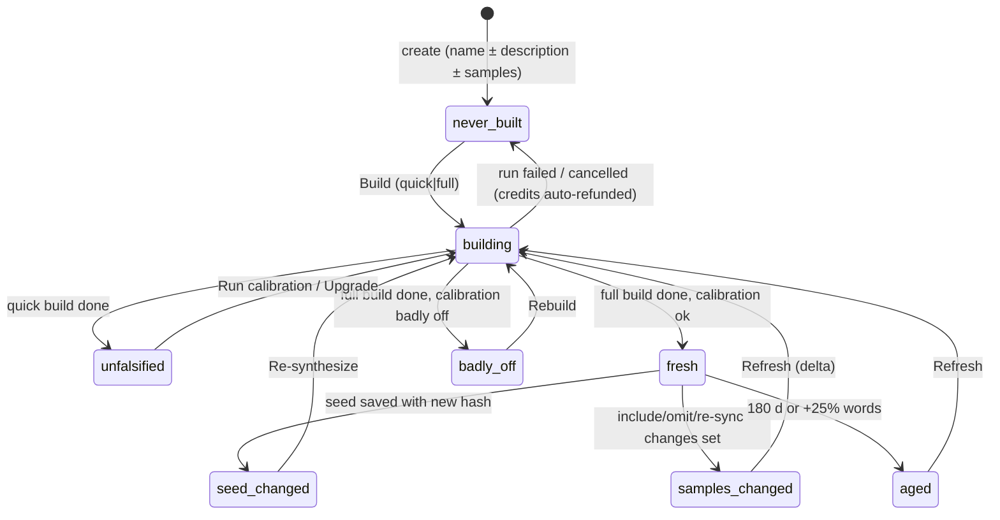

# Personas and writing-sample ingestion — UX design

- Scope: ledger rows **D10, D11, I4, E4, J1–J8** (productized) · touches D2, D4, D8, D12, F6, K1, K7, L6, L11, C9/Q-11 · Date: 2026-08-27
- Evidence base (read in full): `docs/research/12_skills-genres-personas.md` (§3.1–3.8), `9_ingestion-export-visualization.md` (§2–§6), `2_source-system-extraction.md` (§1.4, §2.2, §5, §9), `5_writing-products-and-substack.md` (§1.3, §8), `10_pricing-billing-auth.md` (§4.4, §5.4–5.5); `~/agent-discourse/conventions/personas.md`; the operator's real `sjs-substack` profile (`index.md`, `calibration.md`, `voice-print.md`, `provenance.md`, `PERSONA.md`); `skills/bootstrap-persona/SKILL.md` Phases 0, 4, 5.
- Companion designs referenced by path: `docs/design/2_*` (IDE shell + design system: tokens, status-pill component, run card, sheet/drawer primitives) and `docs/design/3_*` (data model: `Persona`, `PersonaProfile`, `Sample`, `Connection`, `DiscoveredItem`, `Run`). Where this document needs a type it states the shape it assumes; design/3 is authoritative for names.

## Summary of decisions (≤300 words)

1. **A persona is called a "Voice" in the UI** and lives in a workspace-level **Voices** library with three groups: *Your voices*, *House styles* (platform-provided, read-only, forkable), and — later — *Shared with you*. Projects default to no voice ⚑; the projects list groups by voice with *Unfiled* first ⚑, refined with a flat toggle.
2. **Creation collects three optional things — a description, samples, and a tier —** and requires only a name plus at least one of description/samples (J3 ⚑). Two priced tiers: **Quick Voice** (seed + ≤3 samples, minutes, ≈60–150 credits, always *Untested*) and **Full Profile** (census → gate → close-reads → calibration; ≈300–1,500 credits at 50k words by quality tier). Upgrade is monotone.
3. **Staleness is one pill with seven states computed from four stored facts** (seed hash excluding the build note, sample-set hash, age/growth, calibration status — T5 as amended). The pill's panel is a *diff of inputs* with a priced action; **partial refresh is the default action**, full rebuild is never the only option; nothing ever blocks (Q-20 presumption held).
4. **The profile viewer leads with the Calibration report** (trust feature), then Exemplars, Positions & continuity, Structure; **voice measures are inspectable behind an "Advanced" disclosure, read-only**; corpus notes, hold-out identity (until calibrated), and measurement method are hidden. The only edit affordance on any derived file is *"Correct this in your description"* — corrections go to the seed (E4, B15/B16).
5. **Samples are a connection-and-items model**: upload / paste / URL / Substack / Medium / RSS / Ghost / WordPress / Google Docs / Notion / export-zip, normalized to canonical Markdown with a per-file quality verdict; include/omit per item ⚑, re-sync ⚑, change detection by normalized-body hash; paid posts route to the official export zip; never cookies.
6. **Voice ↔ project: free until v1 exists, soft-locked after**, with *Fork under another voice* and *Adopt refreshed profile* (re-seed the charter, with a diff) as the two escape hatches. Composites: schema now, no creation UI in MVP; a `register` selector ships because leaf voices already have registers.
7. **One line of text at creation**, not a modal, carries the AUP/impersonation notice; `Mode` is an optional metadata chip defaulting to *My own writing* (Q-11).

## 0. Vocabulary and framing

**"Voice", not "persona".** The source system's word is *persona*; every competitor a writer has seen calls the feature *voice* (Grammarly "voice profile", Sudowrite "in your voice", Jasper "Brand Voice" — note 5 §1.3). The founding prompt's word is kept in the data model (`Persona`) and in this document's requirement IDs; the UI says **Voice**. The one place *persona* is a better word — a house style that is nobody's voice — is covered by the group label *House styles*.

**A voice is a run-bearing object.** Unlike a Grammarly profile that "updates continuously as you write," a Rhema voice is built by an expensive run (note 12 §3.1; Q-10 scale) and is therefore a *dated observation* (`conventions/personas.md` §Provenance). Every surface below is designed around that fact: the user must always be able to see *what the profile was built from*, *what has changed since*, and *what it would cost to catch up*. That is T5, and this document is its UI.

**What the user is.** The user is the author (note 2 §3). Nothing in the profile is a secret *from* them; the visibility policy in §2.4 hides things for simplicity, for the hold-out's integrity, and for method IP — never because the observations are about someone else.

## 1. The Voices library (D10 — IA)

### 1.1 Placement in the shell

`Voices` is a first-level workspace destination alongside `Projects`, `Usage`, `Settings` (D1; design/2 nav). URL scheme: `/voices`, `/voices/:id`, `/voices/:id/{description|samples|profile|runs}`, `/voices/new`. A voice is also reachable from any project header chip (§4.3).

### 1.2 List page

```
┌ Voices ───────────────────────────────────────────────────────── [+ New voice] ┐
│ Search voices…                                     Sort: Recently used ▾        │
│                                                                                  │
│ YOUR VOICES (2)                                                                  │
│ ┌──────────────────────────────┐ ┌──────────────────────────────┐              │
│ │ S. J. Sebastian · Substack   │ │ Steven J. Vitali · Academic  │              │
│ │ ● Voice profile current      │ │ ◐ No voice profile           │              │
│ │ 10 samples · Substack (linked)│ │ 6 samples · uploads (PDF)    │              │
│ │ 3 projects · built Aug 20    │ │ 0 projects                   │              │
│ └──────────────────────────────┘ └──────────────────────────────┘              │
│                                                                                  │
│ HOUSE STYLES (4)                           provided by Rhema · read-only · fork │
│ ┌────────────────────┐ ┌────────────────────┐ ┌────────────────────┐            │
│ │ Google developer   │ │ Diátaxis type-fit  │ │ Op-ed page (US     │  …         │
│ │ docs (CC-BY 4.0)   │ │                    │ │ national dailies)  │            │
│ │ ● current · rules  │ │ ● current · rules  │ │ ● current · venue  │            │
│ └────────────────────┘ └────────────────────┘ └────────────────────┘            │
└──────────────────────────────────────────────────────────────────────────────────┘
```

Card contents, in order: display name and byline · **status pill** (§3) · sample count and source summary · projects using it and last-built date. Cards do not show credits spent (that is the detail page's Runs tab; D12's "no token-soup" policy applies to cards).

Grouping is fixed, not user-configurable, because the three groups have different affordances: *Your voices* are editable and buildable; *House styles* are read-only with a status pill the platform maintains (note 12 §3.6: refreshed on the same four-input model on a schedule) and a single action, **Fork to my voices**, which copies the seed and links the same samples as read-only references; *Shared with you* (Team, Q-6) appears only when non-empty.

*Alternatives rejected.* A single flat list with a "Type" filter — rejected because the house styles would pollute "recently used" for a user with two voices, which is the common case (note 2: the operator has three). Grouping by `Mode` (self/consented/house/study) — rejected: Q-11 makes Mode metadata, and a group header would make it look like policy.

### 1.3 Empty state

First visit with no voices:

```
┌────────────────────────────────────────────────────────────────┐
│           Your writing has a voice. Teach Rhema yours.          │
│                                                                  │
│  Link a Substack or upload a few pieces you've written; Rhema   │
│  measures how you build sentences, sections, and arguments and   │
│  holds every draft to it.                                        │
│                                                                  │
│      [ Create a voice ]      or start from a house style ↓       │
└────────────────────────────────────────────────────────────────┘
  HOUSE STYLES … (cards as above)
```

The copy commits to the honest limit ("measures … holds drafts to it"), not "writes like you" (`conventions/personas.md` §The honest limit; note 12 §3.8).

### 1.4 The create flow

Entry: `+ New voice` or the persona picker's *Create new…* (§4.1). One sheet (design/2 sheet primitive), three sections, all optional except the name:

```
┌ New voice ────────────────────────────────────────────────────────────────────┐
│ Name  [ S. J. Sebastian — Substack            ]   Byline (optional) [        ]  │
│                                                                                 │
│ 1 · Describe it (optional)                                                      │
│ ┌─────────────────────────────────────────────────────────────────────────────┐ │
│ │ Philosophy and the history of ideas, applied to AI. Begins from a           │ │
│ │ conceptual error, replaces it with a more exact model… Never: listicles,    │ │
│ │ exclamation points, hedge stacks.                                           │ │
│ └─────────────────────────────────────────────────────────────────────────────┘ │
│   Leave this blank and Rhema drafts one from your samples for you to correct.   │
│                                                                                 │
│ 2 · Add writing samples (optional)                                              │
│   [ Link a publication ▾ ]  [ Upload files ]  [ Paste text ]  [ Add a URL ]     │
│   ┌ Drop .docx .pdf .md .txt .rtf .odt .epub .html here ────────────────────┐   │
│   └─────────────────────────────────────────────────────────────────────────┘   │
│                                                                                 │
│ 3 · How much to build now                                                       │
│   (•) Quick Voice        ≈ 90 credits · a few minutes · untested                │
│       Reads up to 3 samples. Good enough to draft against today.                │
│   ( ) Full Profile       ≈ 620–1,450 credits · 20–60 min · calibrated           │
│       Reads the whole corpus, measures it, and tests itself on a held-out piece.│
│   ( ) Just save the description — build later                                   │
│                                                                                 │
│ This voice is  [ my own writing ▾ ]                                             │
│ Build voices only from writing you have the right to use; Rhema must not be     │
│ used to pass generated text off as a real person's own. Terms →                 │
│                                                                                 │
│                                              [ Cancel ]  [ Create and build ]   │
└─────────────────────────────────────────────────────────────────────────────────┘
```

**Interaction spec — create.**

1. Name is required; byline defaults to the name. Description and samples are each optional; the sheet enforces *at least one* of the two only when a build is requested (a bare seed "is used as-is" — `conventions/personas.md` §The simplest thing that works).
2. Adding samples inside the sheet runs *discovery and ingestion only* (§2.3), which is free of model cost except PDF reconstruction; the sheet shows live counts ("10 posts found · 26,100 words · 2 paywalled").
3. The tier radio recomputes its estimate from the L11 estimate service (note 10 §4.4: bootstrap cost is linear in corpus words) whenever the sample set changes. Quick Voice is disabled with a reason when zero samples are attached ("needs at least one sample"); Full Profile is disabled below 4 samples ("needs at least 4 pieces to hold one out for testing" — bootstrap Phase 0.5 reserves one hold-out; two at ≥10).
4. `Create and build` creates the `Persona` (status `never-built`), attaches the samples, and — unless *Just save* — starts a `persona.bootstrap` run with `tier ∈ {quick, full}` (design/3 run kinds; note 12 §3.1). The user lands on the detail page with the run card streaming (§2.5).
5. The Mode chip (`my own writing` / `a house style` / `another writer, with permission` / `for study`) is metadata only; no option changes what runs (Q-11; note 2 §9.11 records that the ported skill disables the restrictive-default behaviour). Default `self`.
6. The notice line is plain body text with a link; it is never a checkbox or modal (note 12 §3.7).

**Trial:** one voice, Quick Voice only, Standard quality (note 10 §5.2 Trial row). The Full Profile radio renders with a lock and "Available on Pro" — the paywall is placed on the tier, not on the feature (note 6 pattern: paywall at the estimate sheet).

### 1.5 Cost tiers as product objects (J8)

| | Quick Voice | Full Profile |
|---|---|---|
| Reads | ≤3 samples, ≤2,000 words each (longer samples are truncated to their first 2,000 words with a badge) | census of all attached samples; ≤12 read closely by default (`sample` cap adjustable at the gate) |
| Runs | seed (if blank, agent-drafted from samples) + mini voice print on ≤3 notes; **no census, no hold-out, no positions/continuity** | the six phases (note 12 §3.1) |
| Produces | seed · exemplars · lexicon · a low-confidence voice print | full profile + calibration report |
| Pill after build | **Untested voice** | **Voice profile current** |
| Estimate | ≈ 60–150 credits (Standard) — L11 formula: `base 40 + 0.012 × words` on Standard, ×2.2 Pro, ×4.5 Frontier | ≈ 310 / 760 / 1,510 credits at 50k words (note 10 §5.4 price card), linear in words read closely |
| Time | minutes | 20–60 min (per-piece close-reads fan out in parallel) |

The upgrade path is monotone: Quick Voice's three corpus notes are reused by Full Profile (note 12 §3.3). The Upgrade action is the *Refresh* action with `scope: full` (§3.4).

**REQ-PERSONA-1** The workspace exposes a `Voices` destination with three fixed groups (Your voices / House styles / Shared with you); House styles are read-only and forkable. *AC: forking creates an editable copy whose seed cites the source and whose pill reads `never-built` until the user builds.*
**REQ-PERSONA-2** Voice creation requires only a name; description and samples are optional; a build requires at least one of them. *AC: submitting name-only with "Just save" creates a `never-built` voice.*
**REQ-PERSONA-3** Two build tiers (Quick Voice, Full Profile) with live credit estimates and a guaranteed 1.5× cap (note 10 §5.5); Full Profile requires ≥4 samples. *AC: estimate updates within 500 ms of a sample-set change.*
**REQ-PERSONA-4** A blank description is agent-drafted during the build and displayed marked *Drafted by Rhema — correct it* until the user edits it (J3). *AC: the seed record carries `authored_by: agent|user`; first user edit flips it.*
**REQ-PERSONA-5** Trial accounts may create one voice, Quick Voice only, Standard quality.

## 2. Voice detail page (D10, D11, E4, J6)

### 2.1 Layout

```
┌ ← Voices   S. J. Sebastian · Substack            ● Voice profile current  [Use in project ▾] [⋯] ┐
│ Overview · Description · Samples (10) · Profile · Runs                                             │
├────────────────────────────────────────────────────────────────────────────────────────────────────┤
│ OVERVIEW                                                                                           │
│ ┌ The voice in one paragraph ───────────────────────────┐ ┌ Status ──────────────────────────────┐│
│ │ Philosophical essays that begin by naming a           │ │ ● Voice profile current              ││
│ │ conceptual error… (from profile/index.md)             │ │ Built Aug 20 · 10 of 10 pieces read  ││
│ └───────────────────────────────────────────────────────┘ │ Tested on 2 held-out pieces          ││
│ ┌ Calibration verdict ──────────────────────────────────┐ │ Refresh due ~Feb 20, 2027 or at      ││
│ │ Prose machinery: mostly right (10/14 measures within  │ │ 13 pieces                            ││
│ │ one band). Content: wrong — do not trust it to predict│ └──────────────────────────────────────┘│
│ │ what you would argue.              See full report →  │ ┌ Projects using this voice (3) ──────┐│
│ └───────────────────────────────────────────────────────┘ │ The Politics of Visibility  v2 ·    ││
│ ┌ Things Rhema asked you to decide (3) ─────────────────┐ │   profile Aug 20  ● current         ││
│ │ ☐ Endings: fact, question, or challenge?               │ │ Structure of Political Difference   ││
│ │ ☐ Em dashes: policy or accident?                       │ │   v4 · profile Aug 20               ││
│ │ ☐ After Bureaucracy vs Narcissistic Injury tension     │ └──────────────────────────────────────┘│
│ └───────────────────────────────────────────────────────┘                                          │
└────────────────────────────────────────────────────────────────────────────────────────────────────┘
```

Overview is composed from `profile/index.md`'s sections (the hub — note 2 §2.2 #27: "render as the persona detail page") plus the agent-appended build note's *decisions* list (note 2 §2.2 #25: split the mixed-authorship file). The "Things to decide" checklist is exactly the skill's Phase 5 report item "anything the human should decide"; ticking an item opens the Description tab with the relevant paragraph focused; the checklist persists per build.

### 2.2 Description tab — the seed editor

The seed is the one human-authored, authoritative artifact (`conventions/personas.md`; B15). The tab is a single plain-Markdown editor (the paper surface from design/2 in its compact variant; no WYSIWYG blocks needed) with three structured fields above it and one read-only card below it.

```
┌ Description ───────────────────────────────────────────────────────────────────┐
│ Byline  [ S. J. Sebastian ]   This voice is [ my own writing ▾ ]  Registers [essay, long-form ▾]│
│ ┌─────────────────────────────────────────────────────────────────────────────┐ │
│ │ Philosophy, cultural commentary, and the history of ideas…                  │ │
│ │                                                                             │ │
│ │ **Never:** listicles, tables, exclamation points, hedge stacks.             │ │
│ └─────────────────────────────────────────────────────────────────────────────┘ │
│ Saved · Edited since last build → pill: "Description changed"   [Re-synthesize ≈ 140 cr]│
│                                                                                 │
│ ┌ Notes from the last build (Aug 20) · read-only ────────────────────────────┐ │
│ │ Profile built from the live archive: all 10 essays read (the seed listed   │ │
│ │ 7)… Three things for you to decide: 1. Endings… 2. Em dashes… 3. Tension…  │ │
│ └─────────────────────────────────────────────────────────────────────────────┘ │
└─────────────────────────────────────────────────────────────────────────────────┘
```

**Rules.**

1. **What counts as a seed change** (J9): `seed_hash = sha256(NFC(trim(description_markdown)) ‖ byline ‖ registers)`. Excluded: Mode (metadata), the corpus pointer (a *sample-set* change), the build note (agent-authored), and the source system's hand-maintained "known essays" / "pieces in progress" lists, which are **derived** in Rhema (projects using this voice; the census) and never stored in the seed. This is the "exclude the agent-appended build note" rule from note 12 §3.2, made precise.
2. **The build note is a separate object**, displayed read-only under the editor, one per build, superseded (not appended) by the next build. The skill's "append a marked note to `PERSONA.md`" becomes a write to `persona_build_notes` (design/3) — the file mirror handed to the harness re-renders seed + latest note into `PERSONA.md` at run start (F3 mirror).
3. **Autosave** as everywhere (N1); the hash is recomputed on save; the pill changes live to `seed-changed` with the priced *Re-synthesize* action (§3.4), never a blocking prompt.
4. **"Correct this in your description"** deep-links from the Profile tab (§2.4) insert a quoted observation as a Markdown blockquote at the cursor with a prompt line ("The profile measured X; if that is deliberate, say so here"). The convention's rule that corrections "belong in `PERSONA.md`" becomes the *only* correction path in the UI (E4; B16).
5. **Registers** is a small tag field (free text, suggestions from the profile's `structure-repertoire.md`). It exists so the `register` run input (§4.5) has values to pick from; it is part of the seed hash because it changes routing.

### 2.3 Samples tab — the samples manager (D11, I4)

The tab has two panes: **Sources** (connections) on the left, **Items** on the right, with the corpus summary line on top. It is the census the skill takes at Phase 0 (SKILL.md Phase 0.3), made persistent and interactive; the run's census gate (§2.5) is this same view with a proposal overlaid.

```
┌ Samples ─ 10 included · 26,134 words · 2 paywalled (omitted) · 1 unreadable ─ [Re-sync all] [+ Add ▾] ┐
│ SOURCES                 │ ITEMS                                    Filter: All ▾   Sort: Date ▾ │
│ ▸ sjsebastian.substack  │ ☑ The Constitution of Reason        Aug 6   10,350 w  ● clean         │
│   Linked · synced 2h ago│ ☑ What the Model Cannot Give Itself Jul 17   2,814 w  ◐ reconstructed ⓘ│
│   11 found · 10 incl.   │ ☑ The Narcissistic Injury of AI     Jun 4    1,096 w  ● clean         │
│   [Re-sync] [Settings]  │ ☑ The Structure of Political Diff.  May 1    6,675 w  ● clean         │
│ ▸ Uploads               │ ☐ Distinction After the Human       Feb 20   1,094 w  ● clean  ★ held out│
│   6 files · 5 incl.     │ ☑ After Bureaucracy                 Feb 14   1,457 w  ● clean         │
│ ▸ Pasted text           │ ☑ Against the Sentimental Critics   Feb 6      920 w  ● clean         │
│   1 item                │ ☐ Coming soon                       May '22      0 w  ○ empty  skipped │
│                         │ ─ Uploads ────────────────────────────────────────────────────────────  │
│ [+ Link publication]    │ ☑ kant-studien-manuscript.pdf       —        9,800 w  ◐ reconstructed ⓘ│
│ [+ Upload files]        │ ☐ seminar-paper-2019.pdf            —          —      ✕ unreadable ⓘ  │
│ [+ Paste text]          │ ☑ visibility-draft.docx             —        5,100 w  ● clean         │
│ [+ Add URL]             │ ☑ old-essay.md                      2024-03    1,900 w  ● clean         │
│                         │                                                                          │
│                         │ Changed since profile: +1 added, 1 changed → pill "2 samples changed"   │
└─────────────────────────┴──────────────────────────────────────────────────────────────────────────┘
```

**Sources (Connections).** One row per `Connection` (note 9 §3.3: provider adapter `discover / fetch / changeKey`; uploads and pastes are connections with no `discover()`). Provider set at MVP and the auth each needs:

| Provider | Handle the user gives | Discovery | Bodies | Change key | Paid/private content |
|---|---|---|---|---|---|
| Substack (public) | publication URL | `/api/v1/archive` (title, date, wordcount, `audience`) | `/api/v1/posts/{slug}` `body_html`; `/feed` fallback | `updated_at` → then body hash | `audience ≠ everyone` → item shown **Paywalled — import your export** (never cookies; note 9 §3.1) |
| Substack export zip | file | `posts.csv` | `posts/<id>.<slug>.html`; images fetched from live URLs | file hash | the *only* lossless path for paid posts |
| Medium | `@user` or profile URL | RSS (recent window only) | `content:encoded` | `guid` + body hash | export zip for the archive |
| Medium export zip | file | `posts/*.html` | same | file hash | — |
| Ghost | site URL + Content API key | Content API posts | `html` | `updated_at` | `visibility ≠ public` shown as private |
| WordPress | site URL | `/wp-json/wp/v2/posts` | `content.rendered` | `modified` | API may be disabled → error state with instructions |
| RSS/Atom | feed URL | items | `content:encoded`/`content` | `guid` + `pubDate` | — |
| Single URL | URL | one item | Readability | `ETag`/`Last-Modified` | paywalled → `partial` verdict |
| Google Docs | Picker (`drive.file`) | picked files | `.docx` export → docx path | Drive `modifiedTime` | — |
| Notion | export zip | `.md` files | as-is | file hash | API connection later (note 9 §2.2) |
| Upload | files | — | per-format pipeline | file hash | — |
| Paste | text/HTML | — | sanitize → turndown | content hash | — |

**Items.** Each `DiscoveredItem` row: include checkbox ⚑ · title · date · word count · **quality verdict** (`clean` ● / `reconstructed` ◐ / `partial` ◑ / `unreadable` ✕ / `empty` ○) with a hover explaining the notes (`quality_notes[]`, note 9 §4) · role badges (`★ held out` after calibration; `new`, `changed`, `removed from source`). Clicking a row opens the sample preview (§2.3.2).

**Interaction spec — link a publication.**

1. User picks a provider and enters a handle. Rhema validates (SSRF guard: deny private ranges, ≤5 redirects, size caps — note 9 §3.3/M4) and runs `discover()`; nothing is fetched yet. The sheet shows "N pieces found · ~W words · P paywalled · oldest/newest".
2. Default inclusion: free items `included`; paid/unknown `omitted` with the *import your export* call-to-action (note 9 §5.1). The user may flip any checkbox before confirming.
3. **Confirm** fetches included items, normalizes them (note 9 §4 spec), stores `Sample` version 1 per item, and shows progress per row. Fetch rate ≤1 req/s with an honest user-agent; robots respected (note 9 §3.1).
4. Sync schedule: manual by default; *Settings* offers **daily auto-sync** for linked publications (note 9 §5.3). Auto-sync never fetches items the user has omitted, and never changes inclusion of new items without showing them as `new` (a new post is `included` by default only if the connection's "auto-include new posts" setting is on — off by default, because inclusion changes the corpus set and hence the pill).

**Interaction spec — re-sync ⚑.**

1. Re-run `discover()`; diff by `external_id`: new → `new` row (highlighted); missing → `removed_remote` (kept, badged, still included unless the user omits); changed change-key → conditional re-fetch → re-normalize → if `content_sha256` differs, `Sample` version n+1 and the row badges `changed`.
2. The corpus summary line and the pill update from the new `{sample_id → content_sha256}` set (note 9 §5.5). Provider timestamp bumps that do not change the body change nothing (note 9 §5.4).
3. A sync failure (403, feed gone, API disabled) marks the connection `error` with the provider's message verbatim and a one-line remedy; items keep their last good version.

**Interaction spec — upload.**

1. Multi-file drop or picker; accepted: `.md .txt .docx .doc .pages .rtf .odt .epub .html .pdf` and images/scans (`.png .jpg .tiff`); per-file cap 25 MB, 200k words after conversion; ≤50 files per batch.
2. Each file goes down the pipeline for its format (note 9 §2.2): structured formats convert immediately and free; PDFs run `unpdf` + heuristics + an LLM reconstruction pass (a *tiny* metered cost — shown as "≈ 4 credits" on the row before it runs; scans add Textract). The **visual-PDF quality tier** (≈130k tokens for a 56-page paper) is offered only from the conversion-warning drawer, with its estimate.
3. Re-uploading a file with the same name creates version n+1 by hash (note 9 §5.6).
4. Unreadable files stay in the list with `✕ unreadable` and are auto-omitted; they still count against coverage in the census ("6 files, 5 readable") — the skill's honesty rule (SKILL.md Phase 0.3).

**2.3.1 Conversion warnings.** Any verdict other than `clean` renders an ⓘ that opens a drawer:

```
┌ what-the-model-cannot-give-itself · reconstructed ───────────────────────────┐
│ • Footnotes re-attached heuristically (pp. 3–28) — check placement            │
│ • One table could not be recovered (p. 14)                                    │
│ • Running heads stripped: "S. J. SEBASTIAN"                                   │
│ [ Check side by side ]   [ Re-convert with visual PDF reading ≈ 180 credits ] │
│ [ Omit this sample ]                                                          │
└───────────────────────────────────────────────────────────────────────────────┘
```

*Check side by side* opens the source page (pdf.js render) beside the Markdown so the user can spot-check footnote placement (note 9 §2.3 "side-by-side checker"). This is the only place a raw source is shown; it exists because "a silently mangled PDF would poison a voice-print" (note 9 §1).

**2.3.2 Sample preview.** Read-only paper view of the canonical Markdown with its front-matter rendered as a header (title, date, source URL, fetched-at, quality, word count) and version history ("v2 fetched Aug 27 · body changed"). No editing: samples are the corpus, and an edited sample is a different piece. A user who wants to fix a conversion uses *Re-convert* or uploads a corrected file (new version).

**2.3.3 Hold-out identity.** Until a calibration has run, hold-out selection is invisible in the Samples tab (B9: "hide hold-out identity from the UI until calibration"). The census gate (§2.5) tells the user *how many* pieces are reserved and their *dates*, not their titles. After calibration, the `★ held out` badge appears and links to the calibration report.

**2.3.4 Empty state.**

```
┌ No samples yet ───────────────────────────────────────────────────────────────┐
│ Rhema learns a voice from finished writing. Link where you publish, or upload  │
│ a few pieces — PDFs, Word files, Markdown, or pasted text all work.            │
│  [ Link a publication ]  [ Upload files ]  [ Paste text ]                      │
│ Nothing is read until you say so; linking shows what's there first.            │
└───────────────────────────────────────────────────────────────────────────────┘
```

**REQ-INGEST-1** Samples are modeled as `Connection → DiscoveredItem → Sample(version)`; uploads and pastes are connections without discovery (note 9 §5).
**REQ-INGEST-2** Providers at MVP: Substack (public + export zip), Medium (RSS + export zip), Ghost, WordPress, RSS/Atom, single URL, Google Docs (Picker, `drive.file`), Notion export zip, upload, paste. *AC: each implements `discover/fetch/changeKey` behind one interface.*
**REQ-INGEST-3** Discovery never fetches bodies; the user confirms inclusion first; the discovery sheet shows counts and word totals.
**REQ-INGEST-4** Per-item include/omit ⚑; omitting a fetched item retains bytes and removes it from the corpus set.
**REQ-INGEST-5** Paid/private items are never fetched with credentials; they render an *import your export* path (Substack/Medium zips) — no cookie prompt anywhere in the product.
**REQ-INGEST-6** Re-sync ⚑ (manual; optional daily) diffs by external id; new/changed/removed states are rendered; change detection is by normalized-body hash, not provider timestamp.
**REQ-INGEST-7** Every sample carries a quality verdict (`clean/reconstructed/partial/unreadable/empty`) and notes; non-clean verdicts open a warning drawer with *Check side by side*, *Re-convert (priced)*, *Omit*.
**REQ-INGEST-8** Accepted upload formats: md, txt, docx, doc, pages, rtf, odt, epub, html, pdf, png/jpg/tiff; caps 25 MB/file, 200k words/sample, 50 files/batch; unreadable files remain listed, auto-omitted, and counted against coverage.
**REQ-INGEST-9** PDF conversion shows its small credit estimate per file before running; the visual-PDF tier is opt-in from the warning drawer with an estimate and cap.
**REQ-INGEST-10** Canonical Markdown per note 9 §4 (front-matter with source, hashes, quality; `[^n]` footnotes; content-addressed images; no body H1). Sample preview renders it read-only with version history.
**REQ-INGEST-11** Sync errors surface the provider's message verbatim plus a remedy; last good versions are retained.
**REQ-INGEST-12** SSRF guard, redirect and size limits, honest user-agent, ≤1 req/s per host, robots respected.
**REQ-INGEST-13** Hold-out identity is hidden until a calibration has completed; afterwards it is badged and linked.
**REQ-INGEST-14** Deleting a voice deletes its samples, raw bytes, and derived profile within the stated window (note 9 §6); samples linked read-only into a forked house style are references, not copies.

### 2.4 Profile tab — the viewer and its visibility policy (E4, J6)

The profile is derived, regenerable, and never edited in place (B16). The tab is a left rail of sections in a deliberate order, with the first section chosen for trust rather than utility.

| Order | Section (UI label) | Source file | Visibility | Why |
|---|---|---|---|---|
| 1 | **Calibration report** | `calibration.md` | **Surfaced** | The honesty artifact: "prose right, mind wrong" sets expectations better than any marketing (note 2 §2.2 #35; note 12 §3.8). No competitor has it. |
| 2 | **Exemplars** | `exemplars.md` | Surfaced | ≤12 quotes ≤40 words from the user's own work with what each demonstrates — the most legible "what Rhema learned" display. |
| 3 | **Positions & open tensions** | `positions.md` | Surfaced | "What you've argued", with citations; open tensions are a trust feature and an editor input. |
| 4 | **Continuity** | `continuity.md` | Surfaced | Chronology, threads, settled ground; what the editor checks against. |
| 5 | **Structure** | `structure-repertoire.md` | Surfaced (collapsed) | Length regimes, registers, openings/endings, title grammar — users recognise themselves here and it feeds the Registers field. |
| 6 | **Audience & venue** | `audience-and-venue.md` | Surfaced (collapsed) | Short; mostly derivable from the link. |
| 7 | **Voice measures** *(Advanced)* | `voice-print.md` | **Inspectable** behind a disclosure; read-only | see argument below |
| 8 | **Lexicon** *(Advanced)* | `lexicon.md` | Inspectable | Signature terms and avoided words; useful to power users; noisy for most. |
| — | Corpus notes | `corpus/*.md` | **Hidden** | Distillation the "notes, not corpora" rule exists for; per-piece; no user action follows from them. Exposed only as the per-sample "what the profile noted" one-liner in the sample preview. |
| — | Provenance | `provenance.md` | Hidden as a file; **rendered** as the Samples census + the pill's facts | It is data, not prose (F6). |
| — | Hub | `index.md` | Rendered as Overview | Same. |
| — | Hold-out identity before calibration | — | Hidden | B9. |
| — | Measurement method | the `Method` column of the voice print; the measurement service's rules | Hidden | E5: the *how* is the IP; the *numbers* are the user's. |

**The voice-print argument.** Should the raw rates (em dashes per 1k words, negation-then-correction per 1k, triads, short-sentence share) be user-facing? Three considerations. *For hiding:* they are noisy (the real profile's own review corrected six corpus-level figures and notes that sentence statistics are "splitter-dependent" — note 2 §8), they invite users to game their own voice, and the method is secret-sauce-adjacent (E5). *For showing:* the user is the author and these are observations about their own work (note 2 §3); the calibration report *already* shows a measured table (prediction vs actual per feature) and would be unintelligible without the concept; Grammarly's editable element card proves users like seeing a profile's parts (note 5 §1.3); and `line-edit` will tell the user "3 em-dashes over your ration" (note 12 §2.3) — a ration the user must be able to look up. *Decision:* **inspectable, read-only, behind "Advanced", with the Method column removed and ranges shown beside means** ("Em dash 2.3 per 1k words, range 0–9.4 across pieces"). Rows carry the single affordance *Correct this in your description →* (§2.2 rule 4). Rations and the anti-signature list are shown because they are what drafting is held to. Nothing here is editable; an inline edit would be exactly the "profile lying about its provenance" failure the convention warns about (note 2 §9.3).

**Calibration report layout.**

```
┌ Calibration report · tested Aug 20 on 2 held-out pieces ──────────────────────┐
│ Verdict: prose machinery mostly right; content wrong.                          │
│ Trust it for how a sentence should sound and how a piece is shaped.            │
│ Do not trust it to predict what you would argue.                               │
│                                                                                 │
│ ┌ Prediction (written before reading) ─┐ ┌ The real opening ──────────────────┐│
│ │ The reaction to artificial            │ │ (first 520 words of the held-out  ││
│ │ intelligence is usually described…    │ │ piece, from your sample)          ││
│ └───────────────────────────────────────┘ └────────────────────────────────────┘│
│ Measured, side by side                                            10 / 14 within one band│
│  Feature                 Target   Prediction   Real   Verdict                   │
│  Sentence median         15.5     12           16     ran short                 │
│  Em dash / 1k            2.4      0.0          6.4    under-produced badly       │
│  …                                                                              │
│ Corrections made to the profile (3)  ▸                                          │
│ Blind check (fresh reader picked the real one; reasons quoted)  ▸               │
└─────────────────────────────────────────────────────────────────────────────────┘
```

The measured table is the one place raw rates appear outside Advanced; it is there because the comparison is the point. Quick Voice profiles show this section as an empty state: "Untested. This voice has never predicted a piece it hadn't read. [Run calibration ≈ 120 credits] — needs 4+ samples."

**REQ-PERSONA-6** Profile sections render in the fixed order Calibration → Exemplars → Positions → Continuity → Structure → Audience → (Advanced) Voice measures → Lexicon; corpus notes, provenance-as-file, hub-as-file, pre-calibration hold-out identity, and measurement method are not user-facing.
**REQ-PERSONA-7** No derived section is editable; each observation offers only *Correct this in your description*, which inserts a quoted prompt into the seed editor.
**REQ-PERSONA-8** The Voice measures table hides the Method column and shows per-piece ranges beside corpus values; rations and the anti-signature list are shown.
**REQ-PERSONA-9** The Calibration report shows prediction and real opening side by side, the measured comparison, corrections, and the blind-check reasons; for untested voices it shows an empty state with a priced *Run calibration* action.
**REQ-PERSONA-10** The Overview renders the hub paragraph, the status card, the calibration verdict summary, the projects list with each project's profile snapshot date, and the build note's decisions as a persistent checklist.

### 2.5 Runs tab — history and spend

Persona runs are ordinary `Run`s (K1; design/3) of kinds `persona.bootstrap`, `persona.refresh` (with `scope`), `persona.calibrate`, `persona.compose`. The tab is the same run list component design/2 uses in projects, filtered to this voice, so the user learns one grammar (note 4 carried forward: "one run grammar everywhere").

```
┌ Runs ── total spent on this voice: 1,940 credits ($19.40) ────────────────────┐
│ ● Refresh (2 pieces)        Aug 27  · 12 min · 310 cr   Needs input: census    │
│ ✓ Calibration only          Aug 21  · 6 min  · 120 cr   10/14 within band       │
│ ✓ Full Profile              Aug 20  · 41 min · 1,510 cr 10 read · 2 held out    │
└────────────────────────────────────────────────────────────────────────────────┘
```

A run card expands to the phase list with per-phase credits (resolve/census → close-reads ×N → voice print → positions → calibration → package), the sample list it used, and *what changed* (sections re-synthesized; corrections logged). Tokens live behind the "advanced" disclosure as everywhere (L5 ⚑). The **census gate** is the one human gate (note 12 §3.1), rendered as the standard gate card (design/2) over the Samples view:

```
┌ Census · waiting for you (auto-proceeds in 23 h) ──────────────────────────────┐
│ 11 pieces found · 10 will be read closely · 2 reserved for testing (Feb, Jun)   │
│ Excluded: "Coming soon" (empty). Unreadable: seminar-paper-2019.pdf.            │
│ Estimate ≈ 1,340 credits · cap 2,010 · ~40 min                                  │
│ Sample cap [12 ▾]  Calibration [on ▾]  Quality [Pro ▾]                          │
│ [ Adjust samples ]                              [ Proceed ]  [ Cancel run ]     │
└────────────────────────────────────────────────────────────────────────────────┘
```

Approve-with-deadline semantics (brief; Q-7): the deadline default is 24 h; on expiry the run proceeds with the proposed sample *within the cap the user already accepted at launch* — proceeding never spends beyond consented money. Adjusting samples in the gate is the same include/omit UI (§2.3) and re-estimates live.

**REQ-PERSONA-11** Persona runs use the platform run model and run-card component; the Runs tab shows per-run credits, duration, phase breakdown, samples used, and what changed; a per-voice spend total is shown.
**REQ-PERSONA-12** The census gate shows counts, exclusions, reserved hold-out count and dates (not titles), the estimate and cap, and the three knobs (sample cap, calibration on/off with the skill's warning, quality tier); it is approve-with-deadline (24 h) and never exceeds the consented cap.

## 3. The status pill and its explanation panel (J2, T5, F6)

### 3.1 Inputs (stored facts; staleness is computed, never stored as an opinion)

```ts
type PersonaProfileSnapshot = {
  built_at: string;                 // ISO
  seed_hash: string;                // §2.2 rule 1
  sample_set: Record<SampleId, ContentSha256>;   // included items at build, with body hashes
  corpus_words_at_build: number;
  calibration_status: 'tested' | 'untested' | 'tested-badly-off';
  tier: 'quick' | 'full';
};
type PersonaNow = { seed_hash: string; included: Record<SampleId, ContentSha256>; corpus_words: number; run_in_progress?: RunId };
```

### 3.2 States (first match wins)

| # | State | Condition | Pill text | Tone (design/2 token) | Primary action | Est. cost class |
|---|---|---|---|---|---|---|
| 1 | `never-built` | no snapshot | **No voice profile** | neutral | Build (Quick / Full) | C2–C3 / C4 |
| 2 | `building` | `run_in_progress` | **Building · phase 3 of 6** | info, animated | Open run | — |
| 3 | `seed-changed` | `seed_hash` differs | **Description changed** | attention | Re-synthesize | C2 |
| 4 | `samples-changed` | symmetric difference of sample sets non-empty, or any hash differs | **N samples changed** | attention | Refresh (delta) | C2–C3 (linear in changed words) |
| 5 | `aged` | `now − built_at > 180 d` **or** `corpus_words / corpus_words_at_build > 1.25` | **Profile from Aug 20 · corpus +30%** | attention | Refresh | C2–C3 |
| 6 | `unfalsified` | `calibration_status = untested` | **Untested voice** | muted-attention | Run calibration | C2 |
| 7 | `badly-off` | `calibration_status = tested-badly-off` | **Tested — badly off** | warning | Rebuild (full) | C4 |
| 8 | `fresh` | none of the above | **Voice profile current** | success | — | — |

Note 12 §3.2 lists seven states; this adds `badly-off` as an eighth because the skill's Phase 4 explicitly produces it ("if the hold-out reveals the profile is badly off, say so in `index.md`") and its remedy differs (a full rebuild, not a delta). Ordering rationale: input-changed states outrank age (they name a cause the user can act on cheaply); `unfalsified` sits below them because a changed input makes the old calibration moot anyway; `badly-off` outranks `unfalsified` because it is a stronger statement.

Several conditions may hold at once; the pill shows the first, and the panel lists all of them (a seed edit *and* two changed samples is common — the panel offers one combined Refresh whose estimate covers both).

### 3.3 The explanation panel (diff of inputs)

Clicking the pill anywhere opens a popover (design/2 popover primitive; on narrow viewports, a drawer):

```
┌ ● 2 samples changed ─────────────────────────────────────────────────────────┐
│ Since the profile was built (Aug 20):                                        │
│   Description        unchanged                                               │
│   Samples            +1 added  "The Constitution of Reason" (10,350 w)       │
│                      1 changed "After Bureaucracy" (body edited Aug 25)      │
│                      0 removed                                               │
│   Corpus             26,134 → 36,484 words (+40%)  ⚠ over the 25% rule       │
│   Age                7 days                                                  │
│   Calibration        tested Aug 20 · 10/14 within one band                   │
│                                                                              │
│ The profile is still usable. Drafts made now will note it was built from     │
│ an older sample set.                                                          │
│                                                                              │
│ [ Refresh — read 2 pieces, re-synthesize, re-test  ≈ 310 cr · ~12 min ]      │
│ [ Rebuild everything  ≈ 1,510 cr ]   [ Open samples ]                        │
└──────────────────────────────────────────────────────────────────────────────┘
```

Every row is one of the four facts. The panel never says "stale" without saying *which input moved and by how much*; that is the whole of T5's "diff-of-inputs explanation". The reassurance line is the convention's rule verbatim in product voice ("a stale profile is still usable; the consuming skill states its date").

### 3.4 Actions: partial vs full

| Action | Run kind | What runs | Reuses | Estimate formula (L11) |
|---|---|---|---|---|
| **Re-synthesize** | `persona.refresh` `scope: synth` | Phases 2–5 over existing corpus notes; calibration re-run only if a hold-out exists | all corpus notes | `synth_base(tier)` ≈ 15–25% of a full build |
| **Refresh** | `persona.refresh` `scope: delta` | census delta → close-read *new and changed* pieces only → Phases 2–5 → calibrate on the newest unread piece | unchanged corpus notes | `synth_base + per_piece(tier) × changed_pieces` |
| **Run calibration** | `persona.calibrate` | Phase 4 alone (reserve newest unread as hold-out, predict, read, compare, correct) | everything | ≈ C2; requires ≥1 included piece not yet read |
| **Rebuild everything** | `persona.bootstrap` | all six phases | nothing (corpus notes are kept for audit but re-derived) | full price card |
| **Upgrade to Full Profile** | `persona.refresh` `scope: full-from-quick` | census → gate → close-read all not-yet-noted pieces → Phases 2–5 → calibrate | Quick Voice's ≤3 notes | full price card minus the reused notes |

Partial refresh is cheap precisely because corpus notes are persisted and immutable per content hash (note 12 §3.2; note 2 §5.1 persist table). The panel always shows the cheapest sufficient action first and the full rebuild second; it never shows only the expensive one.

### 3.5 Where the pill appears

1. Voice card in the library (§1.2) and the detail page header (§2.1).
2. **Project header chip** — `◐ S. J. Sebastian · Substack · profile Aug 20`. The project's pill compares the *project's* profile snapshot (the manifest's "date of the profile used"; design/3 `Project.persona_profile_snapshot_id`) against the voice's *current* profile **and** the voice's own staleness, yielding two extra project-only states:

| Project-level state | Condition | Chip text | Action |
|---|---|---|---|
| `newer-profile-available` | voice has a newer snapshot than the project uses | **Newer profile available (Aug 27)** | Adopt refreshed profile (§4.4) |
| `voice-stale` | project uses the voice's latest snapshot, but the voice itself is not `fresh` | (the voice's pill text) | Refresh voice → then adopt |
| (in sync) | project snapshot = latest and voice `fresh` | **Voice current** | — |

3. **Run launch sheet** (D4/D12 estimate sheet): a one-line "Voice: S. J. Sebastian · profile Aug 20 · ● current" with the same popover; if not current, an inline secondary button *Refresh first (≈310 cr)* that chains the two runs. The run is never blocked; the delivered drafting note records the profile date, exactly as the skill does today.
4. **Mobile**: read-only pill and panel; no actions (note 5 §8: persona generation is web-only).

**REQ-PERSONA-13** Staleness is computed at read time from the four stored facts; no "stale" flag is persisted.
**REQ-PERSONA-14** One pill, eight states with the precedence in §3.2, tone tokens from design/2, and identical rendering in library, detail header, project chip, and run sheet.
**REQ-PERSONA-15** The pill's panel lists all four facts with concrete deltas (names of added/changed/removed samples, word counts, age, calibration result) and offers the cheapest sufficient action first with a credit estimate and cap, plus the full rebuild.
**REQ-PERSONA-16** Refresh runs close-read only pieces whose content hash has no persisted corpus note; re-synthesize runs read no pieces. *AC: refresh estimate for one changed 1,500-word piece is < 30% of a full build's.*
**REQ-PERSONA-17** A non-fresh voice never blocks a run; the run sheet offers an optional chained refresh and the delivered artifact records the profile date.
**REQ-PERSONA-18** Projects show a chip comparing their profile snapshot to the voice's latest; `newer-profile-available` offers *Adopt refreshed profile*.
**REQ-PERSONA-19** House-style voices show the same pill, maintained by the platform on a schedule; users see it read-only.

## 4. Voice ↔ project linking (J5; D2 ⚑ grouping)

### 4.1 Picker at project creation

The new-project flow (D2; design/2) has a *Voice* field defaulting to **No voice** ⚑ (founding prompt: "the default location for new projects should be the persona-less case"). The picker:

```
Voice   [ No voice ▾ ]
        ┌───────────────────────────────────────────────┐
        │ ● No voice — an ad-hoc voice from this piece   │  ← default
        │ ─ Your voices ─────────────────────────────────│
        │ ● S. J. Sebastian · Substack   ● current       │
        │ ● Steven J. Vitali · Academic  ◐ no profile    │
        │ ─ House styles ────────────────────────────────│
        │ ● Op-ed page (US national dailies)             │
        │ ─────────────────────────────────────────────── │
        │ + Create a voice…                              │
        └───────────────────────────────────────────────┘
        Picking a voice also sets the genre's venue bar and length norms.
```

Rows show the pill. Picking a `never-built` voice is allowed (the skill uses a bare seed "as-is") with a hint: "Rhema will draft from the description only — build a profile for measured voice." Picking the protocol (genre) and the voice are separate fields; a house *venue* voice suggests a protocol (Op-ed page → `op-ed`) but does not force it (note 12 §3.6: venue personas are the protocol's `venue_bar` made concrete).

An *Unfiled* project's ad-hoc voice is derived by the run from the piece and labeled ad-hoc in the drafting note (convention §Resolution) — nothing persists as a persona, so there is no pill.

### 4.2 Grouping projects by voice ⚑ — keep, with one refinement

The founding prompt asks that projects "by default also be organized by persona." **Kept**, refined:

- Default view of `/projects` is **grouped by voice**, with **Unfiled** as the first group (it is where new projects land), then the user's voices by recent use, then house styles used, each group collapsible and remembering its state.
- A **Flat / By voice** toggle exists because a user with one voice sees a single group header that is pure noise; the toggle default flips to *Flat* automatically while the user has ≤1 voice and ≤1 project outside Unfiled (the state the operator's own workspace would be in at day one), and the user's explicit choice sticks thereafter.
- Group headers carry the voice's pill and a *N projects use an older profile* count when applicable, which is the workspace-level entry to the adopt flow.

*Alternative rejected:* voices as folders the user drags projects into. A project's voice is a run input recorded in the manifest, not a location; drag-to-folder would imply the change policy below does not exist.

### 4.3 The change policy — free before v1, soft-locked after

*Grounding (note 12 §3.4).* The precedence rule `human guidance > voice charter > persona > model default` means the persona's influence is transcribed into the per-piece voice charter at the first response round; switching the persona later would make new text answer to a different prior while the charter protects the old one — the "switches register mid-piece" defect by construction, and a homogenization exposure (respond-to-review README, via note 12). The operator's lean (⚑, J5) was "not allow this to change after the first draft is generated." Note 12 argues, and this design adopts, a **soft lock**: the same protection with two named escape hatches for the two legitimate needs (wrong voice attached; profile refreshed).

| Project state | Change voice | Fork under another voice | Adopt refreshed profile |
|---|---|---|---|
| S0/S1 (no draft) | **allowed** freely from the project header chip; manifest updated | n/a | n/a |
| S2 v1 exists, unreviewed | **soft-locked**: the chip's *Change voice…* opens the fork sheet instead | allowed | allowed (charter not yet seeded — this is just a snapshot update) |
| S3+ (reviewed / responded) | soft-locked | allowed | allowed, with charter re-seed diff |

**Interaction spec — soft lock.** From the project header chip after v1 exists:

```
┌ Change the voice of "The Politics of Visibility"? ─────────────────────────────┐
│ This project's first draft was written against S. J. Sebastian · Substack, and  │
│ its voice charter was seeded from that profile at the first response round.     │
│ Changing the voice underneath a draft makes later rounds write against one      │
│ prior while the charter protects another.                                       │
│                                                                                 │
│ What do you want to do?                                                         │
│ (•) Fork this project under another voice — re-run from the outline             │
│     Voice [ Steven J. Vitali · Academic ▾ ]   Estimate ≈ 1,830 cr (draft)       │
│ ( ) This project has the wrong voice attached and no draft I want to keep       │
│     → archives v1 and its correspondence; the project returns to outline-only    │
│                                                     [ Cancel ]  [ Continue ]    │
└─────────────────────────────────────────────────────────────────────────────────┘
```

1. **Fork** creates a new project (title suffixed "— under <voice>") sharing the outline artifact (copied, since the outline is the user's document and the drafting note refers to it — note 2 §4.4.4), with the new voice set, at state S1; the estimate sheet for `draft-from-outline` opens. The original is untouched.
2. **Wrong voice attached** is the explicit "I attached the wrong persona" case (note 12 §3.4 c). It is *destructive by design* (drafts under the wrong voice are not worth keeping) and therefore two-step: the second step lists what will be archived. Archived, not deleted (K-rows: everything durable is append-only).
3. There is no third option that silently changes the manifest.

### 4.4 Adopt refreshed profile

Entry: project chip `newer-profile-available`, the group header count, or the voice's Overview projects list.

```
┌ Adopt the refreshed profile in "The Politics of Visibility"? ──────────────────┐
│ Current: profile Aug 20 · Refreshed: Aug 27 (2 pieces added; 3 corrections)     │
│                                                                                 │
│ Next runs will load the refreshed profile.                                      │
│ ☐ Also re-seed the voice charter from the refreshed profile                     │
│   Charter diff (Strengths and register lines that would change) ▸               │
│   Your guidance and protected passages are kept — guidance outranks the charter.│
│                                                       [ Cancel ]  [ Adopt ]     │
└─────────────────────────────────────────────────────────────────────────────────┘
```

1. Default is snapshot-only: update `Project.persona_profile_snapshot_id`; the manifest's profile date changes; nothing else moves. The charter is re-seeded "only on explicit request, with a diff" (note 12 §3.4 b).
2. With the checkbox: a C0 run (`charter.reseed`) rewrites the charter's persona-derived lines, appends to its round log, and shows the diff before commit. Human guidance entries in the charter are never touched (precedence rule).
3. Adopting is recorded as a round-log event (`actor: user`), so the next review/response can state which profile it ran against.

### 4.5 Composite voices: schema now, minimal UI (J4)

Design/3 models `Persona.members[]`, `register_map`, and the constraints in B17 (members are leaves; mode = most restrictive; no voice files at composite level). **What ships in MVP UI:**

1. **No creation of composites.** No *Compose* button; the data model exists so the operator's `all-steven-vitali` and later features are not a migration.
2. **A `Register` selector on run launch** for any voice whose profile records more than one register (the real profile records five and names register selection as "the weak point" — `index.md` Known gaps). The selector's values come from the seed's Registers field (§2.2) and the structure repertoire. This is the `register` input the skills already take, and it is what a composite's routing UI would resolve *to* — so v1.x composites reuse it unchanged.
3. **Imported composites render** (for the source-system migration path) as a read-only card labeled *Composed from A, B*, pickable in the project picker; picking one makes `Register` required and its options are the members' names. Positions and continuity display the union with member tags.
4. Sibling voices show a *See also* line on the Overview ("Same author, different register: Steven J. Vitali · Academic") from the seed's sibling pointer — cheap, and it keeps the "one writer, several personas" rule visible.

*Alternative rejected:* shipping Compose in MVP because it is "cheap and expected" (convention). It is cheap to *run*, but it requires two Full Profiles first (two C4 runs), and the operator has never exercised it (note 2 §8 F14). Wrong order.

### 4.6 Where the notice line also appears

The §1.4 notice appears once, at creation. It is **not** repeated on the picker, the run sheet, or the seed editor. Changing Mode later (Description tab) re-shows the same line inline for that session. That is the whole of the Q-11 posture: metadata plus pass-through language, no friction.

**REQ-PERSONA-20** New projects default to *No voice* ⚑; the picker lists Your voices and House styles with pills, allows `never-built` voices with a hint, and offers *Create a voice…* inline.
**REQ-PERSONA-21** `/projects` groups by voice with Unfiled first ⚑; a Flat/By-voice toggle defaults to Flat while the user has ≤1 voice and ≤1 filed project, then persists the user's choice.
**REQ-PERSONA-22** Voice is freely changeable until `drafts/v1` exists; afterwards the change affordance opens the fork/wrong-voice sheet; no path silently rewrites the manifest's voice.
**REQ-PERSONA-23** *Fork under another voice* creates a new project at S1 with a copied outline and the new voice, and opens the draft estimate sheet.
**REQ-PERSONA-24** *Adopt refreshed profile* updates the project's profile snapshot; charter re-seed is opt-in with a diff; guidance lines are never modified; the adoption is logged in the round log.
**REQ-PERSONA-25** Composite personas exist in the schema with B17 constraints; MVP UI renders imported composites read-only and pickable with a required Register; no compose action is exposed.
**REQ-PERSONA-26** A Register selector appears on run launch for voices with >1 recorded register; its value is passed as the skills' `register` input and recorded in the run.
**REQ-PERSONA-27** The AUP/impersonation notice is one line of body text with a Terms link, shown at creation and on Mode change only; Mode defaults to *my own writing* and gates nothing.

## 5. States, empty states, and error states (consolidated)

### 5.1 Voice lifecycle



A failed build returns the voice to its *previous* state (a failed refresh leaves the old profile in place, not `never-built`): the profile is replaced atomically at Phase 5 (package), never partially.

### 5.2 Empty and edge states

| Surface | Condition | Copy / behaviour |
|---|---|---|
| Library | no voices | §1.3 |
| Samples tab | no samples | §2.3.4 |
| Samples tab | connection with 0 discoverable items | "Nothing found at this address. If your posts are paid, import your export instead. [How]" |
| Samples tab | all items paywalled | discovery sheet leads with the export path; Confirm disabled until ≥1 included |
| Profile tab | `never-built` | "No profile yet. [Build Quick Voice ≈ 90 cr] [Build Full Profile ≈ …]" with a three-line preview of what each section will contain |
| Profile tab | `building` | skeleton sections filling in as phases complete (each phase writes its file — note 2 §1.4), so the user watches the profile arrive |
| Calibration | Quick Voice | untested empty state with priced action and the 4-sample rule |
| Runs tab | none | "No builds yet." |
| Project chip | `No voice` | chip reads *No voice · ad-hoc*, opens the picker (pre-v1) or the fork sheet (post-v1) |
| Run sheet | voice `never-built` | "Drafting from the description only." + optional chained Quick Voice build |
| Any | insufficient credits for the chosen action | the platform's insufficient-balance sheet (note 10 §5.5 #5): switch to Standard, reduce sample cap, top up — never silently bill |

### 5.3 Error states

| Error | Rendering |
|---|---|
| Provider blocked / 403 / robots disallow | connection `error`; row shows provider message verbatim + "Import your export instead" |
| PDF unreadable | ✕ verdict, auto-omit, counted in coverage; drawer offers visual tier or omit |
| Build failed mid-run | run card `failed` with the phase reached; partial corpus notes retained and reused by the next attempt (they are content-hash keyed); credits for incomplete phases refunded |
| Hold-out leak detected (a subagent fetched the hold-out URL — B9 audit) | calibration marked invalid; pill `unfalsified`; Runs tab shows "Calibration voided: hold-out was read early"; free re-calibration offered |
| Sample removed at source after build | `removed_remote` badge; still in the corpus set until omitted; pill unaffected |

## 6. Data the UI assumes (for design/3 alignment)

```ts
type Persona = {
  id: string; workspace_id: string; kind: 'leaf' | 'composite';
  display_name: string; byline: string; mode: 'self'|'consented'|'house'|'study';
  provenance: 'user' | 'platform' | 'fork';        // platform = house style
  seed_markdown: string; seed_authored_by: 'user'|'agent'; registers: string[];
  seed_hash: string;                                // recomputed on save (§2.2.1)
  members?: string[]; register_map?: Record<string,string>;   // composite only
  current_profile_id?: string;
};
type PersonaProfile = PersonaProfileSnapshot & {
  id: string; persona_id: string; run_id: string;
  sections: Record<'index'|'voice_print'|'structure'|'lexicon'|'exemplars'|'positions'|'continuity'|'audience'|'calibration'|'provenance', string>;
  corpus_notes: Record<ContentSha256, string>;      // hidden from UI; keyed by content hash for reuse
  build_note: { decisions: string[]; body: string };
  holdouts: { sample_id: string; revealed: boolean }[];
};
type Connection = { id: string; persona_id: string; provider: Provider; handle: string; auth_ref?: string;
  status: 'connected'|'syncing'|'error'|'needs_reauth'; last_sync_at?: string; schedule: 'manual'|'daily'; auto_include_new: boolean; error?: string };
type DiscoveredItem = { id: string; connection_id: string; external_id: string; title: string; date?: string; url?: string;
  word_count?: number; access: 'free'|'paid'|'private'|'unknown'; remote_change_key?: string;
  state: 'new'|'included'|'omitted'|'removed_remote'|'failed'; current_sample_id?: string };
type Sample = { id: string; item_id: string; version: number; content_sha256: string; original_sha256: string;
  quality: 'clean'|'reconstructed'|'partial'|'unreadable'|'empty'; quality_notes: string[]; markdown_ref: string; word_count: number };
type Project = { /* … */ persona_id?: string; persona_profile_snapshot_id?: string; register?: string };
```

## 7. Requirements index

REQ-PERSONA-1…27 and REQ-INGEST-1…14 are defined inline above. Cross-cutting acceptance hooks:

- **AC-P-A (pill parity):** for any voice, the pill state rendered in library, detail, project chip, and run sheet is computed by one function over one snapshot and is byte-identical.
- **AC-P-B (no silent spend):** no action in this document starts a metered run without an estimate and cap visible in the same surface.
- **AC-P-C (seed authority):** no write path exists from the Profile tab to any derived section; the only mutation is a seed edit.
- **AC-I-A (hash discipline):** two syncs of an unchanged body produce zero new `Sample` versions even when the provider's `updated_at` moved.
- **AC-I-B (paywall discipline):** the product contains no input for a platform session cookie.

## Ledger updates

| Row | Status | Evidence |
|---|---|---|
| D10 | done (design) | §1–§4: library IA, detail page (seed editor, samples manager, profile viewer, runs), pill + panel, linking + change policy |
| D11 | done (design) | §2.3: upload/paste/URL/link providers, discovery, include/omit, re-sync, quality verdicts, conversion warnings, paid-post path, empty/error states |
| I4 | done (UX) | §2.3 connection/item states, re-sync spec, hash-based change detection → §3 pill |
| E4 | done (decision) | §2.4 table + voice-print argument: Calibration/Exemplars/Positions/Continuity/Structure/Audience surfaced; Voice measures + Lexicon inspectable read-only (Advanced); corpus notes, provenance-as-file, hold-out identity pre-calibration, method hidden; corrections only via seed |
| J1 | done (productized) | §2.5 run kinds and census gate; §1.4 inputs collected |
| J2 | done (productized) | §3: eight states (adds `badly-off`), diff-of-inputs panel, partial vs full actions, project-level states |
| J3 | done (productized) | §1.4 optional description; §2.2 agent-drafted seed marked; corrections path; J9 hash rule specified |
| J4 | done (productized) | §4.5 minimal composite UI; register selector |
| J5 | done (productized) | §4.1–4.4 picker, grouping refinement, soft lock, fork, adopt |
| J6 | done (productized) | §2.4 calibration report first |
| J7 | done (productized) | §1.2 House styles group, fork action, platform-maintained pill |
| J8 | done (productized) | §1.5 tiers with estimate formulas |
| T5 | confirmed (amended) | §3 implements four inputs / one pill / diff / priced action / never blocking |
| C9 / Q-11 | done (UI) | §1.4, §4.6 one-line notice; Mode metadata |
| F6 | input delivered | §3.1 snapshot type; §6 |
| K7 | input delivered | `persona.calibrate`, `persona.refresh{scope}`, `charter.reseed` as phase-subset runs |
| D2 | input delivered | §4.2 grouping refinement |

**Proposed new rows**

| ID | Item | Owner |
|---|---|---|
| J11 | Estimate formulas for persona runs (`synth_base`, `per_piece` by tier) calibrated from telemetry; the L11 service must expose them for the panel | A |
| J12 | Hold-out leak audit: per-run URL denylist + post-run check that voids calibration (§5.3) | A |
| J13 | `charter.reseed` C0 run and its diff renderer (§4.4) | A/D |
| I8 | Substack/Medium export-zip importers as file providers (note 9 I7) — required by the paid-post path in §2.3 | A |
| I9 | Connection auth storage (Ghost key, Google Picker token) and `needs_reauth` handling | A |
| D22 | Project header voice chip and its project-level states (§3.5) — cross-links D3/D4 | D |

## Open questions

1. **`badly-off` threshold.** The skill leaves "badly off" to judgment. The UI needs a rule: proposed *fewer than half of measured features within one band, or the blind check picked the prediction as the author's*. Needs operator confirmation before it becomes a computed state.
2. **Quick Voice truncation.** Truncating a 10k-word sample to 2,000 words for Quick Voice biases the mini voice print toward openings. Alternative: sample three 700-word windows. Cheap to test once the measurement service exists (M10).
3. **Auto-proceed on the census gate.** Proceeding after 24 h spends consented credits without a second confirmation. If the operator prefers, persona gates could be the one class that *waits indefinitely* (they are never on a project's critical path).
4. **Group-by-voice auto-default.** The ≤1-voice heuristic in §4.2 is a guess at the operator's ⚑ intent; confirm.
5. **House-style sourcing register (J10)** is unchanged from note 12 §3.6 and not designed here beyond the group and fork affordances.
6. **Mobile**: §3.5 gives mobile a read-only pill; whether the *Adopt refreshed profile* snapshot-only action (no cost) should be allowed on mobile is open.
7. **Design/2 and design/3 were not available at writing time**; component names (sheet, popover, run card, gate card, tone tokens) and type names in §6 are assumptions to reconcile at synthesis.
