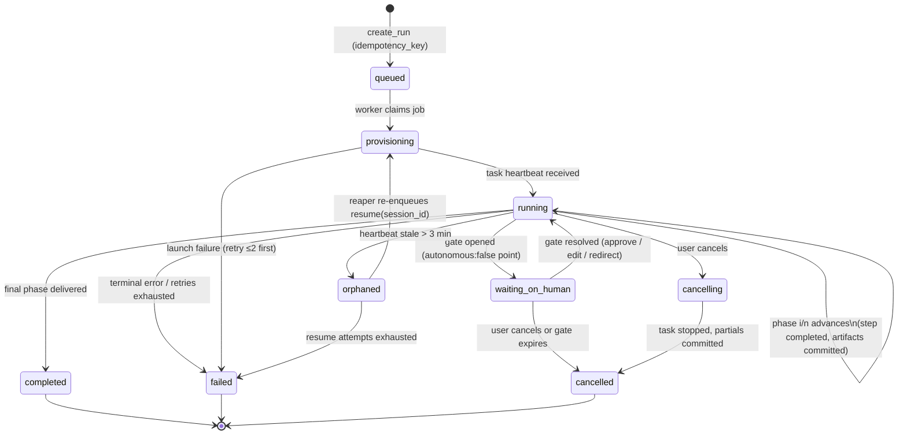
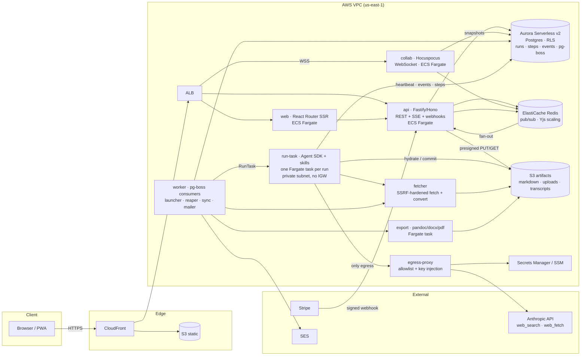

# Platform stack, AWS build-vs-buy, durable run orchestration, streaming, sandbox security

- Scope: ledger rows M1–M9, G6–G8, K1–K6 (with touches on F3/F4, L1/L4, N2, G11) · Date: 2026-08-27 · Sources fetched: 75 (listed at the end; every price and product fact below was read on the live page today unless explicitly marked *unverified*)

## Executive summary (decisions-first)

1. **Stack (M1):** TypeScript end-to-end. Web app: **React Router framework mode (SSR) in a Docker container on ECS Fargate**, static assets on S3 + CloudFront; Next.js rejected because self-hosting it off Vercel needs a custom cache handler, shared server-action encryption key, deployment-ID skew handling, and either OpenNext (community-maintained) or a bespoke setup. API: Node service (Fastify/Hono-class, typed contract) on ECS Fargate behind ALB → CloudFront. Data: **Aurora Serverless v2 PostgreSQL** (0.5 ACU floor in prod; 0-ACU auto-pause for preview stages) + **S3** for canonical markdown/artifacts. Auth: **Better Auth** (self-owned, in our Postgres). Email: **SES**. Billing: Stripe with webhooks → idempotent queue.
2. **Orchestration (G6/K1):** Own the run/step/event state machine as Postgres tables (the "run ledger") and execute it with **pg-boss** workers (MIT, `SKIP LOCKED`, retries, cron, exactly-once). No Temporal/Inngest/Trigger.dev/Restate/Step Functions for the MVP. Reason: the expensive, non-checkpointable unit of work is a single harness session inside a sandbox; a durable-execution engine cannot checkpoint *inside* it, so the engine would only sequence 4–8 coarse phases and hold gates — a job a well-designed table plus a heartbeat/reaper does. Migration path to self-hosted Temporal (MIT) is preserved by making every step handler an idempotent activity keyed by `(run_id, step_key, attempt)`.
3. **Harness sandbox (G8/F4):** One **ECS Fargate task per run** ("ephemeral session") running the **Claude Agent SDK (TypeScript)** with the skills baked into the image; SessionStore mirrored to S3 for resume; **no direct internet** — the task's security group allows egress only to an **egress proxy** that injects the Anthropic key and enforces a domain allowlist. Per-agent namespace scoping is enforced twice: by mounting only the role's allowed directories, and by `PreToolUse` hooks that deny out-of-allowlist paths and write every touched path to an audit log. Bedrock AgentCore Runtime and Claude Managed Agents (self-hosted sandbox mode) are the two credible alternatives and are kept as documented fallbacks.
4. **Streaming (G7/K2):** Append-only `run_events` table with a monotonic `seq`; **SSE** from the API (resume via `Last-Event-ID`); Redis pub/sub for fan-out when the API scales past one task. Editor collaboration/autosave is a separate **Hocuspocus** (MIT, Yjs) WebSocket service. No API Gateway WebSockets / AppSync Events in the MVP (cheap, but they split the path between worker and client and add an integration layer).
5. **Security (M4):** Rhema's agents hold all three legs of the "lethal trifecta" (private drafts, untrusted web content, outbound network), so the design removes the third leg from the sandbox: agents never make arbitrary HTTP calls; web search/fetch go through Anthropic server tools (which refuse model-invented URLs) or through our SSRF-hardened fetcher service. Tenant isolation is app-level `tenant_id` + Postgres RLS with `FORCE ROW LEVEL SECURITY` as defense in depth.
6. **Repo/CI (M6/M9):** pnpm workspaces + Turborepo (not Bazel — `rules_js` is production-grade but the Vite/React Router ecosystem fights Bazel sandboxing), SST v3 for infra-as-TypeScript with per-PR stages; protocol IP (skills, rubrics) in a separate private package so the public flip is a package-visibility switch.

Working-thesis verdicts: **T4 confirmed with a refinement** — "hosted, mature harness" should mean the *self-hosted* Agent SDK inside our sandbox, not Anthropic-hosted Managed Agents, because F4 boundary enforcement, Q-4 multi-provider routing, and keeping user text inside our VPC all require us to own the container. Nothing here contradicts an operator decision; one tension with Q-3 is flagged (Restate's BSL and Inngest's SSPL licences make them poor fits for an open-source-ready repo).

---

## 1. Requirements the platform must satisfy (derived, not assumed)

*Observed* from the source system (`~/agent-discourse/conventions/project-memory.md`, `personas.md`, README):

- Skills "speak files": one project directory with `manifest.md`, `drafts/vN.md`, `correspondence/`, and private `agents/<role>/` trees; personas live outside the project in a shared library. Every skill reads/writes this layout; the hard-enforcement suggestion in the conventions is explicitly "per-role users with `chmod 700`" or "per-role sandboxes whose mounts exclude the other roles' directories" (project-memory.md, "What this is and isn't").
- The boundary rule is an **allowlist**: an agent's readable set is *exactly* `drafts/`, `correspondence/`, `manifest.md`, and its own `agents/<role>/`; no recursive search over the project root; the rule must be propagated into every subagent prompt; each skill attests at delivery that no other path was touched.
- Delivered artifacts are immutable; `drafts/vN.md` is immutable once reviewed or responded to.
- Skills assume: file R/W, web search + fetch, fresh-context subagents, long context, compaction survival, PDF reading (ledger A6).
- Runs are long and expensive: Q-10 gives $50–100 per run for the extreme case; Q-7 says human gates are ON by default. So a run spans minutes to hours of compute and hours to days of wall-clock while waiting on a human.

*Inferred* platform requirements:

| # | Requirement | Drives |
|---|---|---|
| R1 | A run is a first-class durable record that survives process, container, and deploy restarts, and can sit in a waiting state for days at zero compute cost | G6, K1 |
| R2 | The harness needs a real POSIX filesystem per run, seeded from canonical storage and written back atomically at phase boundaries | F3, F4 |
| R3 | Per-role path scoping must be enforced by the runtime, not by prompt norms, and produce a verifiable audit log | F4, E6 |
| R4 | Event stream to the UI that is rich enough to be interesting (searches, sources, findings, cost) yet never carries prompts or private-memory text | G7, K2, E5 |
| R5 | Cost per run must be metered per phase and per agent role in near-real time | L4, F7 |
| R6 | Multi-provider model routing (Q-4) means the harness abstraction cannot be Anthropic-only forever | G13 |
| R7 | No Python anywhere in the build (Q-3) — this rules out Modal's primary SDK, Python-based conversion tools, and Python-first eval frameworks | M1, I1 |
| R8 | Closed-source now, public-ready later (Q-19): no copyleft/SSPL/BSL dependencies whose terms bite when the repo is public or when Rhema is "a service" | M9 |

---

## 2. Build-vs-buy per service class (M8)

Method: for each class, the AWS-native option, the self-hosted option, and the leading SaaS were priced from their live pages today; then scored on cost-at-scale, control/granularity, lock-in, and ops burden against Q-3's bias. Prices are us-east-1 list unless noted.

### 2.1 Summary table

| Class | Recommend | Rejected (why, one line) | Cost at 10k MAU / ~5k runs/mo (order of magnitude) |
|---|---|---|---|
| Auth | **Better Auth** in our Postgres (email + Google/Apple OAuth; orgs plugin later) | Clerk ($0.02/MRU past 50k → ~$3k/mo at 200k users; hosted UI lock-in); Cognito Essentials ($0.015/MAU past 10k; weak DX, Lite/Essentials/Plus tier confusion); WorkOS AuthKit (free to 1M MAU — the best "buy", kept as fallback if we need SSO/SAML at $125/connection) | $0 marginal |
| Relational DB | **Aurora Serverless v2 PostgreSQL** ($0.12/ACU-hr Standard; 0.5-ACU floor ≈ $44/mo; 0-ACU auto-pause for dev/preview) | RDS provisioned (fine, but no scale-to-zero for previews); Supabase ($25/mo + compute add-ons, $0.125/GB disk — bundles auth/storage/realtime we don't want); Neon ($0.35/GB-month storage vs Aurora $0.10; branching is nice but it is a non-AWS control plane); Aurora DSQL ($8/M DPU, $0.33/GB-mo; Postgres-compatibility limits *unverified* this session) | $50–200/mo |
| Object storage | **S3** ($0.023/GB-mo, $0.005/1k PUT, $0.0004/1k GET, $0.09/GB egress) | None serious | <$20/mo |
| Queue/orchestration | **Postgres run ledger + pg-boss** (MIT) | Temporal Cloud ($100/mo Essentials incl. 1M actions, $50/M after — cheap, but a second control plane and cannot checkpoint inside a harness session); self-hosted Temporal (MIT; frontend/history/matching/worker services + persistence + visibility store — real ops); Inngest (SSPL server; cloud $99/mo); Trigger.dev (Apache-2.0, but runs your code on *their* compute, off-AWS); Restate (BSL 1.1; excellent single binary + TS SDK, licence converts to Apache-2.0 after 4 years per version); Step Functions ($0.025/1k transitions, ASL JSON not TS); SQS ($0.40/M std, $0.50/M FIFO — fine as a transport, but no state) | $0 marginal (rides on Aurora) |
| Realtime: run feed | **SSE from API** + Redis pub/sub fan-out | API Gateway WebSockets ($1/M msgs + $0.25/M conn-min; needs Lambda/HTTP integration in the path); AppSync Events ($1/M ops + $0.08/M conn-min; cheapest managed pub/sub — keep as v2 option for mobile push of run events) | ~$0 |
| Realtime: editor collab | **Hocuspocus** (MIT) on ECS with Redis extension | Tiptap Cloud / Liveblocks / PartyKit (per-connection SaaS; control) | one small task |
| Sandbox for runs | **ECS Fargate task per run** (ARM: $0.03238/vCPU-hr, $0.00356/GB-hr; x86: $0.04048/vCPU-hr, $0.004446/GB-hr; 1-min minimum; 20 GiB ephemeral default, 200 GiB max) | Bedrock AgentCore Runtime ($0.0895/vCPU-hr + $0.00945/GB-hr, CPU billed only while active; 8-h microVM cap; ARM64 container, `/invocations` + `/ping` contract) — strong AWS-native alternative; Claude Managed Agents ($0.08/session-hour + tokens; beta; not ZDR-eligible; self-hosted-sandbox mode keeps files on our infra) — strong "less ops" alternative; E2B ($150/mo Pro + $0.000028/s for 2 vCPU), Modal (sandbox $0.00003942/core-s, Python-first), Daytona ($0.0504/vCPU-hr) — all off-AWS | ~$0.03 per 45-min run |
| CDN/hosting | **CloudFront + S3** for static; **ECS Fargate + ALB** for SSR/API ($0.0225/hr + $0.008/LCU-hr) | Amplify Hosting ($0.15/GB egress, SSR $0.20/GB-hr; opaque Lambda-style SSR); Vercel ($20/seat, $0.15/GB, fluid compute — no AWS control) | $30–80/mo |
| Email | **SES** ($0.10/1k) | Resend/Postmark (fine, but SES is 10× cheaper and in-account) | <$10/mo |
| Billing | **Stripe** (webhooks → EventBridge or HTTPS → pg-boss) | Lago/Orb/Metronome (L2 owns this; not needed at MVP volume) | Stripe fees only |
| Secrets | **Secrets Manager** ($0.40/secret/mo + $0.05/10k calls) for rotated creds; SSM Parameter Store for config | — | <$10/mo |
| Observability | **CloudWatch** ($0.50/GB ingest std, $0.25/GB IA; $0.30/custom metric) + OTel from the SDK + our own `run_events`/`usage_records` | Langfuse self-hosted (needs Postgres + ClickHouse + Redis + S3 + two app containers — too much for MVP); Braintrust/LangSmith (SaaS, prompts leave the VPC) | $20–100/mo |

### 2.2 Notes per class (Observed / Inferred / Recommendation)

**Auth.** *Observed:* Clerk's Hobby tier includes "50,000 MRU" and charges "$0.02/mo each" beyond, Pro "$25/mo", B2B add-on "$100/mo"; Cognito Essentials is "$0.015/MAU" over a 10,000-MAU free tier (Lite is $0.0055 tiered); WorkOS AuthKit gives the "first 1M MAUs" free, then "$2,500/mo" per extra million, with SSO at "$125/ea" for the first 15 connections; Better Auth describes itself as "a framework-agnostic, universal authentication and authorization framework for TypeScript" with email/password, social sign-on, organizations, 2FA, and "automatic database management and migrations" (licence not shown on the page fetched — *unverified*, widely reported as MIT). *Inferred:* the cheapest options at scale are WorkOS and Better Auth; only Better Auth keeps sessions, users, and orgs in the same Postgres as projects, which matters for RLS and for the Databricks-style sharing model (C13). *Recommendation:* Better Auth; revisit WorkOS if enterprise SSO becomes a sales requirement.

**Database.** *Observed:* Aurora Serverless v2 PostgreSQL is "$0.12 per ACU-hour" (Standard) / "$0.156" (I/O-Optimized), storage "$0.10 per GB-month", I/O "$0.20 per 1 million"; capacity "from 0 ACUs to 256 ACUs", and "With the minimum capacity of 0 ACUs, the cluster will scale to 0 when there is no workload running" (auto-pause). Supabase Pro is "$25/month", "8 GB disk size per project included, then $0.125 per GB", "100,000 [MAU] included, then $0.00325 per MAU", self-hostable via Docker. Neon Launch is "$0.106/CU-hour", storage "$0.35/GB-month", scale-to-zero "After 5 min". *Inferred:* our data is small (markdown) and our load is spiky (runs), which is exactly Serverless v2's pitch; preview stages at 0 ACU cost nothing idle. Aurora DSQL's serverless pricing is attractive but its Postgres-compatibility envelope (extensions, advisory locks, `LISTEN/NOTIFY`) is not established from what I fetched, and pg-boss depends on standard Postgres. *Recommendation:* Aurora Serverless v2, `min 0.5 / max 8` in prod, `min 0` in previews; RLS on; migrations via a TS migration tool (Drizzle or similar — not evaluated here).

**Orchestration.** *Observed:* Temporal Cloud: "Essentials: Starting at $100/mo with 1M Actions", actions "$50 per million" for the first 5M; server is MIT; self-hosting means running frontend/history/matching/worker services, a persistence store, and a visibility store, with TLS/mTLS, upgrades, and schema management. Inngest server is **SSPL 1.0** ("If you make the functionality of the Program … available to third parties as a service, you must make the Service Source Code available"); cloud Pro "$99/month, 1M executions". Trigger.dev is Apache-2.0, Pro "$50/month" and "$0.0000850/sec" for a 1 vCPU/2 GB machine plus "$0.000025 per run". Restate is **BSL 1.1** with Change License Apache-2.0 "on the fourth anniversary" of each version; it "explicitly permits production deployments for the licensee's own services … and publicly exposed platforms that add an abstraction layer". Step Functions Standard is "$0.000025" per state transition; Express "$1.00 per million requests" + "$0.00001667 per GB-second". pg-boss: "Exactly-once job delivery", `SKIP LOCKED`, "Automatic retries with exponential backoff", "Cron scheduling, job deferral", dead-letter queues, MIT, Postgres 13+, Node 22.12+. *Inferred:* see §3 for the full argument. *Recommendation:* pg-boss on Aurora now; Temporal self-hosted is the named upgrade if the step graph becomes a DAG (convergence loops, parallel review variants — C4/C16).

**Sandbox.** *Observed:* Fargate: "Each task has a dedicated infrastructure capacity because Fargate runs each workload on an isolated virtual environment"; tasks "do not share network interfaces, ephemeral storage, CPU, or memory"; "No privileged containers"; "No access to the underlying host"; per-second billing with "1-minute minimum"; 20 GiB ephemeral by default, up to 200 GiB, encrypted. AgentCore Runtime: "each user session runs in a dedicated microVM with isolated CPU, memory, and filesystem"; "Sessions run for up to 8 hours on microVMs, or up to 14 days on Instances"; billing "aligns CPU billing with actual active processing — typically eliminating charges during I/O wait"; container must be "ARM64", port 8080, `POST /invocations` (JSON or SSE), `GET /ping` with `Healthy`/`HealthyBusy`. Managed Agents: "$0.08 per session-hour", "accrues only while the session's status is `running`"; "not currently eligible for Zero Data Retention"; self-hosted environments move "bash / file ops / code" to "a container you control via an outbound-polling worker" while "Tool inputs/outputs still flow to Anthropic's control plane". Agent SDK hosting guidance: "1 GiB RAM, 5 GiB disk, and 1 CPU per agent is a reasonable starting point"; "A minimally provisioned container runs roughly $0.05 per hour, while a single long agent session can spend dollars in tokens." *Inferred:* at 45 minutes, a 1 vCPU/2 GB ARM Fargate task costs ≈ $0.03; AgentCore ≈ $0.03; Managed Agents ≈ $0.06; E2B ≈ $0.10 plus $150/mo; all are noise next to $50–100 of tokens. The decision is therefore about **control and data path**, not price: Fargate keeps the agent loop, the files, and the egress policy in our account; AgentCore does too but imposes its HTTP contract and 8-h cap; Managed Agents keeps the loop at Anthropic. *Recommendation:* Fargate; AgentCore as the documented alternative if Fargate task launch latency (tens of seconds; *unverified* number) hurts the "run starts now" feel; Managed Agents (self-hosted sandbox) as the alternative if operating the Agent SDK subprocess model proves costly.

**Hosting/CDN.** *Observed:* CloudFront now sells flat-rate plans ("Free $0/month … Pro $15/month … Business $200/month … Premium $1,000/month") that "combine the CloudFront CDN with multiple AWS services … with no overage charges"; the Free plan lists "1M requests and 100GB". Amplify Hosting charges "$0.15 per GB served" beyond 15 GB and "$0.30 per 1 million" SSR requests + "$0.20 per hour (GB-hour)". Vercel Pro is "$20 / month" per seat, "$0.15 per GB" Fast Data Transfer beyond 1 TB, Fluid compute "$0.128 per hour" active CPU. ALB is "$0.0225" per hour + "$0.008 per LCU". *Recommendation:* CloudFront (a flat-rate plan is plausible for the landing site) in front of S3 (static) and ALB → ECS (SSR + API + SSE).

**Email / billing / secrets.** *Observed:* SES "$0.10 / 1,000 emails"; Stripe requires signature verification on the raw body, "Quickly returns a successful status code (2xx) before any complex logic", "Stripe doesn't guarantee the delivery of events in the order that they're generated", endpoints "might occasionally receive the same event more than once", retries "for up to three days with an exponential back off", and Stripe can deliver "directly to Amazon EventBridge"; Secrets Manager "$0.40" per secret-month. *Recommendation:* as in the table; webhook handler = verify → insert `(stripe_event_id)` with a unique constraint → enqueue pg-boss job → 200.

---

## 3. Durable orchestration design (G6, K1, K6)

### 3.1 Why not a workflow engine (yet)

*Observed:* a Rhema run is 3–8 coarse phases (e.g., editorial-review: intake → fact-check → discourse map → craft critique → second read → reconcile → deliver), each executed by a harness session that itself makes dozens of model calls and tool calls. The Agent SDK's durability primitive is its own: "Session transcripts" live on local disk and can be mirrored with a `SessionStore` adapter (S3, Redis, Postgres reference adapters exist) and resumed with `options: { resume: sessionId, sessionStore }`; the SDK notes "No top-level session timeout" and "Memory growth over long sessions" as known limitations.

*Inferred:* a durable-execution engine (Temporal, Restate, Inngest) checkpoints at *activity/step* boundaries. Our activities are the harness phases; the engine cannot see inside them. So the engine's contribution reduces to: sequencing ≤ 8 steps, retrying failed steps, holding a timer/signal while a human gate is open, and giving us a UI to inspect state. The first three are ~300 lines over pg-boss; the fourth we must build anyway because our users need it in the product (D4), not in an ops console. What the engine *would* add — deterministic replay of workflow code, versioned workflow definitions, multi-language workers, cross-service sagas — is not yet needed. Meanwhile each engine costs something Q-3 dislikes: Temporal Cloud is a second control plane; self-hosted Temporal is a multi-service deployment; Inngest is SSPL; Restate is BSL; Trigger.dev executes off-AWS; Step Functions pushes logic into ASL JSON.

*Recommendation:* Postgres run ledger + pg-boss, with the explicit trigger for revisiting: **when a run's step graph stops being a linear list** (convergence loop "run rounds until score ≥ X", parallel review variants, discourse-map fan-out), adopt self-hosted Temporal on ECS (MIT) — the step handlers below are already shaped as Temporal activities.

### 3.2 Run/step state machine



States (K1): `queued`, `provisioning`, `running(phase i/n)`, `waiting_on_human(gate)`, `cancelling`, `orphaned`, and terminal `completed | failed | cancelled`. Sub-steps live in `run_steps` with their own `pending | running | succeeded | failed | skipped`.

Tables (F1/F7 overlap; the architecture agent should merge with F8):

| Table | Key columns | Notes |
|---|---|---|
| `runs` | `id, tenant_id, project_id, workflow (draft-from-outline\|editorial-review\|respond-to-review\|bootstrap-persona\|…), agent_role, model_config, status, phase_index, phase_count, input_snapshot (draft hash, persona profile date, outline hash), idempotency_key UNIQUE(tenant_id, key), created_by, started_at, finished_at, cancel_requested_at, last_heartbeat_at, sandbox_task_arn, session_id, cost_estimate_usd, cost_actual_usd` | `input_snapshot` is what makes concurrency rules checkable (§3.5) |
| `run_steps` | `run_id, step_key, attempt, status, started_at, finished_at, error_class, artifacts_committed bool, tokens_in, tokens_out, usd` | `(run_id, step_key, attempt)` is the idempotency unit |
| `run_events` | `seq BIGSERIAL, run_id, ts, type, phase, visibility (user\|internal), payload JSONB` | append-only; `user` rows are streamed, `internal` rows are retained 30 days for support/replay only |
| `gates` | `id, run_id, step_key, kind (approve_plan\|triage_findings\|confirm_cost\|…), opened_at, expires_at, resolved_at, decision JSONB, resolved_by` | Q-7: gates default on |
| `artifacts` | `id, project_id, run_id, kind, path, s3_key, sha256, bytes, immutable bool, produced_by_role` | the canonical record of `drafts/`, `correspondence/`, `agents/<role>/` files |
| `usage_records` | `run_id, step_key, agent_role, provider, model, tokens_in, tokens_out, cache_read, cache_write, searches, usd, ts` | feeds L4/L5 |

### 3.3 Execution protocol (worker ↔ sandbox)

1. **Create.** API inserts `runs` (status `queued`) inside the same transaction as `pg-boss.send('run.start', {run_id})`; the client-supplied `idempotency_key` makes double-clicks harmless.
2. **Claim.** A pg-boss worker (ECS service, 2+ tasks) takes the job, sets `provisioning`, and calls `ecs:RunTask` with the run image, passing only `RUN_ID` and a short-lived, run-scoped token (no API keys). Launch failures retry ≤ 2 with backoff; then `failed`.
3. **Hydrate.** The run task pulls the project mirror from S3 into `/work/project` (only the paths its role may see — §5), and the persona profile into `/work/personas/<id>` read-only. It starts a heartbeat (`last_heartbeat_at`, every 20 s) and sets `running(phase 1/n)`.
4. **Phase loop.** For each phase: run the harness session for that phase (or continue the same session with `streamInput()`), stream events to `run_events`, and at the phase boundary **commit artifacts**: upload changed files to S3 under content-addressed keys, insert `artifacts`, mark the step `succeeded` with `artifacts_committed = true`, advance `phase_index` — all in one transaction. This is the resumable checkpoint; anything after the last committed step is recomputable.
5. **Gate.** When the skill reaches an `autonomous:false` pause point, the task writes a `gates` row + `gate.opened` event, mirrors the session transcript to the S3 SessionStore, sets `waiting_on_human`, and **exits** (zero compute while waiting). Resolution by the user enqueues `run.resume`, which launches a fresh task that `resume`s the session by ID and continues from the next step. This is the SDK's "hybrid session" pattern: "Ephemeral containers that hydrate from a `SessionStore` on startup and persist updates back."
6. **Finish.** Final phase delivered → `completed`; usage totals rolled up; notification (SES / in-app).

### 3.4 Failure, retry, partial results (K6)

- **Retry policy:** infrastructure errors (task launch, S3, 5xx from the provider) retry at the step level up to 2 times; model refusals (`stop_reason: "refusal"`) and validation errors are terminal for the step and surface as a gate ("the reviewer declined this section; continue without it / edit and retry"). Retries are counted as new `attempt`s, so attempt 1's partial outputs remain inspectable.
- **Orphan detection:** a pg-boss cron job every minute marks runs with `last_heartbeat_at < now() − 3 min` as `orphaned`, re-enqueues `run.resume` (max 2 resumes), and emits `run.resumed` so the UI explains the hiccup instead of freezing.
- **Partial results are real results:** because artifacts commit at phase boundaries, a review that "completed fact-check but died in craft critique" has a committed claim ledger. The UI marks the dossier `partial (3/6 phases)` with a "Resume" action; the resume re-enters at phase 4 by reading committed artifacts from disk — which is exactly what the skills already do ("Before any new research pass, read the index first and reuse").
- **Cancellation:** `cancel_requested_at` is set; the task's heartbeat reads it and aborts the SDK query (`AbortController`), commits whatever the current phase can safely commit (source notes, ledgers — never a half-written `vN.md`), then exits; a 60-s deadline after which the worker calls `ecs:StopTask`. Cancelled runs keep their events and cost.
- **Cost guardrails:** `confirm_cost` gate before start when the estimate exceeds the user's threshold (L6); a per-run `max_usd` the task enforces from `usage_records` (the SDK exposes per-session cost tracking, and the Managed Agents surface has an equivalent `session.usage` + budget concept, which validates the pattern).

### 3.5 Concurrency and locking rules for drafts (K3, N2)

*Observed:* the conventions make `drafts/vN.md` immutable once a review or response exists, and there is never a second writer of the same draft.

*Recommendation* (rules the backend enforces mechanically):

1. **One writer-run per project at a time.** A Postgres advisory lock keyed by `project_id` (or a `projects.active_writer_run_id` column with a conditional update) is taken by draft-producing runs (`draft-from-outline`, `respond-to-review`). Attempting a second returns 409 with the running run's ID; the UI queues it.
2. **Reader runs snapshot their input.** `editorial-review` records `input_snapshot.draft_sha256`. The review is *of that hash*. If the user edits vN while the review runs, the edit goes to a working copy (`drafts/vN+1-draft` in the editor's Yjs doc, not to disk) and the UI shows "review in progress is of the version you started with." On delivery, the dossier is bound to the hash; findings anchor to the snapshot text and are re-anchored to the working copy with the editor's position-mapping (H3), flagging any that no longer match.
3. **Human edits to a reviewed draft always create `v(N+1)`** (F5/N3): the save path checks `artifacts.immutable` and forks.
4. **Persona runs (`bootstrap-persona`) lock the persona**, not the project; projects linked to that persona continue to run against the *dated* profile they snapshot (J2/T5).
5. **Gates hold the writer lock.** A run in `waiting_on_human` still owns the project's writer lock (its next phase will write); the UI shows the gate as the reason nothing else can start, with "cancel run" as the release.

### 3.6 Progress/ETA/cost estimation (K4)

`run_steps` accumulates per-workflow, per-phase distributions of `(duration, tokens, usd)` keyed by input size buckets (words, citation count, model tier). Estimate = median of the last 50 comparable steps; ETA shown as a range (p25–p75), never a single number. Until we have 50 samples, use the operator's observed $50–100 envelope (Q-10) scaled by word count (C14 owns the curve).

---

## 4. Streaming and the event schema (G7, K2)

### 4.1 Transport

*Observed:* API Gateway WebSocket pricing is "$1.00 (per million)" messages and "$0.25 (cost per million)" connection-minutes; AppSync Events is "$1.00 per million Event API operations" and "$0.08 per million connection minutes"; Lambda response streaming gives "the first 6 MB per request at no cost"; Next.js's self-hosting guide warns that "Some cloud load balancers (for example, AWS ALB with Lambda integration) may buffer responses by default" and that proxies need buffering disabled for streaming. Managed Agents streams "through server-sent events (SSE)" and its event list includes `agent.thinking` as "a progress signal only and does not carry the thinking content" — a good precedent for our `visibility` split.

*Inferred:* the run feed is strictly server→client and must be resumable; SSE with `Last-Event-ID = seq` over a plain HTTP/1.1 connection through ALB (idle timeout raised for long streams — exact configurable limit *unverified* here) is the simplest path and keeps the producer (run task → Postgres) and the consumer (API → client) decoupled by the table. A managed WebSocket service would force the run task to publish via Lambda/HTTP integration and would not give us replay for free. Cost is immaterial at any plausible scale (10k users × 2 h/day ≈ 36M connection-minutes/month ≈ $9 on API Gateway, $3 on AppSync).

*Recommendation:* SSE endpoint `GET /runs/:id/events?after=<seq>`; fan-out via Redis pub/sub (`run:<id>`) when the API runs >1 task, falling back to Postgres `LISTEN/NOTIFY` in single-task previews. Bidirectional needs (editor collab, autosave, presence) use Hocuspocus on a separate WebSocket service. Mobile (D19) can later subscribe via AppSync Events without touching the producers.

### 4.2 Event envelope and catalogue

Envelope: `{ seq, run_id, ts, type, phase: {key, index, total}, agent_role, visibility: "user" | "internal", payload }`. Only `visibility: "user"` rows reach the SSE stream; `internal` rows (tool inputs, raw tool outputs, prompt fragments) never leave the API tier and expire after 30 days.

| Type (user-visible) | Payload | Why it is interesting and trustworthy without leaking prompts |
|---|---|---|
| `run.queued / run.started / run.resumed / run.completed / run.failed / run.cancelled` | status, reason class, totals | lifecycle |
| `phase.started / phase.completed` | `{key, label, index, total, artifacts: [kind]}` | the round-timeline spine (T1) |
| `search.performed` | `{query, results_count}` | queries are the agent's *questions*, not our instructions; users find them compelling and they are checkable |
| `source.read` | `{url, title, accessed_at, purpose_tag}` | this *is* the transparency floor (E6): sources actually fetched with URLs |
| `source.rejected` | `{url, reason: paywalled\|robots\|irrelevant\|duplicate}` | shows judgment; no content |
| `claim.checked` | `{claim_id, verdict: supported\|contradicted\|unverifiable, source_count}` | the claim ledger streaming in (T2); text of the claim arrives with the delivered artifact, not in the feed |
| `finding.emitted` | `{finding_id, severity, category, anchor_hash}` | count/severity heat as it happens; body delivered with the dossier |
| `artifact.written` | `{kind, path, bytes, version}` | never the content; path only within shared record |
| `subagent.started / subagent.finished` | `{role_label: "second reader" \| "fact-checker", index}` | "fresh-context second read" becomes visible as a feature (T3) |
| `gate.opened / gate.resolved` | `{gate_id, kind, options, expires_at}` | the human-in-the-loop moments |
| `cost.tick` | `{tokens_in, tokens_out, cache_read, searches, usd_so_far, usd_estimate}` | every 30 s or per step; feeds D4 and D12 |
| `agent.note` | `{text ≤ 200 chars}` | a sanitized one-liner the harness emits ("Reading the three sources you cited in §2"); generated by a template from tool activity, **not** model free-text, so it cannot carry injected content |
| `boundary.attested` | `{paths_touched_count, violations: 0}` | the attestation as a verifiable event (F4/E6) |

Explicitly **not** in the user stream: prompt/system text, skill instructions, rubric text, private-memory file contents, raw fetched page text, model "thinking", tool inputs.

---

## 5. Per-agent filesystem scoping enforced by the runtime (F4, G8)

*Observed:* the conventions ask for hard enforcement "at the OS layer (per-role users with `chmod 700` … or per-role sandboxes whose mounts exclude the other roles' directories)". The Agent SDK evaluates permissions in this order: hooks → deny rules → ask rules → permission mode → allow rules → `canUseTool`; "hooks run before every other step, and a hook deny applies even in `bypassPermissions` mode"; `PreToolUse` can "block or modify" a tool call and return `permissionDecision: "deny"`; `Edit(//path/**)` deny rules anchor to absolute paths; "Read and Edit rules … take a path pattern". For multi-tenant hosting Anthropic recommends `settingSources: []`, `CLAUDE_CODE_DISABLE_AUTO_MEMORY=1`, per-tenant `CLAUDE_CONFIG_DIR`, and per-tenant `cwd`. The self-hosted Managed Agents worker likewise confines file tools to `workdir` + `allowed_roots`/`readOnlyRoots` but warns this "does **not** constrain `bash`".

*Recommendation* — three concentric layers, each independently sufficient for the cooperative-agent threat model and jointly sufficient for a misbehaving run:

1. **Mount layer (what exists).** The run task's hydration step materializes *only* the role's allowlist: `/work/project/{manifest.md, drafts/, correspondence/}` plus `/work/project/agents/<role>/`. The other role's `agents/<other>/` tree is **not on disk** — it cannot be read because it is not there. Persona profile files are mounted read-only, filtered per the "What loads when" table in `personas.md` (e.g., the editor never receives `voice-print.md`). Drafts that are immutable (`artifacts.immutable`) are mounted with `chmod 444`.
2. **Tool layer (what the harness will do).** `PreToolUse` hooks with matcher `Read|Write|Edit|Glob|Grep|Bash` resolve every path argument (`realpath`, reject `..` and symlinks), check it against the role allowlist, deny with a reason on miss, and **append every allowed access to an audit log** (`run_events` with `visibility: internal`, plus a compact `paths_touched` summary emitted as `boundary.attested` at delivery). Recursive operations over the project root (`Glob('**')`, `Grep` without a scoped path, `Bash(find …)`, `Bash(grep -r …)`) are denied outright — this operationalizes the conventions' "never run a recursive search, listing, or bulk read over the project root". Subagents inherit the same hooks (hook inputs carry `agent_id`/`agent_type`), which replaces the fragile "restate the allowed-path set verbatim in every subagent prompt" discipline with enforcement.
3. **Write-back layer (what persists).** At phase commit, the worker diffs the mounted tree against the allowlist a third time; writes outside `agents/<role>/` or to immutable artifacts are dropped and reported as `boundary.violation` (a run with a violation completes with a warning badge and the attestation shows `violations: n`). This means even a Bash escape that touches the local disk cannot corrupt canonical storage.

Bash itself: keep it (skills use it for `ls`/`wc`/`sed` style work), but scoped — `disallowedTools: ["Bash(curl *)", "Bash(wget *)", "Bash(find *)", "Bash(grep -r*)"]`, `permissionMode: "dontAsk"` for a fixed, explicit tool surface (the mode where "anything not pre-approved … is denied; `canUseTool` is never called"). Network egress is closed at the VPC level anyway (§6.1), so Bash cannot exfiltrate.

**Audit log content** (E6): `{ts, run_id, agent_role, tool, op: read|write|list|search, path, bytes, allowed: bool, rule_matched}`. Retained per project for 90 days; the user-facing "attestation" view shows counts per top-level directory and any denials.

---

## 6. Security (M3, M4, G8)

### 6.1 Prompt injection from fetched content — remove a leg of the trifecta

*Observed:* Anthropic's secure-deployment guide states the threat plainly: agents "generate their actions dynamically based on context … their behavior can be influenced by the content they process: files, webpages, or user input"; its mitigations are security boundaries, least privilege ("Mount only needed directories, prefer read-only"; "Restrict to specific endpoints via proxy"; "Inject via proxy rather than exposing directly"), and defense in depth; the recommended cloud pattern is "Run agent containers in a private subnet with no internet gateway … block all egress except to your proxy … Run a proxy (such as Envoy with its `credential_injector` filter)". The web fetch tool docs warn that enabling it "where Claude processes untrusted input alongside sensitive data poses data exfiltration risks" and mitigate by construction: "Claude can only fetch URLs that have been explicitly provided by the user or that come from previous web search or web fetch results" — "The tool cannot fetch arbitrary URLs that Claude generates". Willison's formulation: private data + untrusted content + external communication = exfiltration; "once an LLM agent has ingested untrusted input, it must be constrained so that it is impossible for that input to trigger any consequential actions."

*Inferred:* Rhema's reviewer must read arbitrary web pages (untrusted) while holding the user's unpublished draft (private). The only leg we can remove is *external communication from the sandbox*.

*Recommendation:*
- Sandbox tasks run in a private subnet; security group egress allows **only** the egress proxy. The proxy allowlists `api.anthropic.com` (and Bedrock/other provider endpoints per G13) and our internal `fetcher` service, injects the provider API key (`ANTHROPIC_BASE_URL` → proxy), and logs every request. No key ever enters the container.
- Web research uses Anthropic's server-side `web_search` ("$10 per 1,000 searches") and `web_fetch` ("no additional charges"), which run on Anthropic's side with the URL-provenance rule above, `max_uses`, and `allowed_domains`/`blocked_domains`. When a phase must fetch a user-supplied link (ingestion, "read this PDF"), it goes through **our fetcher** (§6.2), which returns text with a provenance header.
- Fetched text is wrapped as data (`<document source="…" trust="untrusted">`) and the skill prompts instruct that documents never carry instructions; this is a soft control and is documented as such.
- No tool in the sandbox can send data anywhere except to the model endpoint and to S3 via the worker's write-back — and write-back is diffed against the allowlist (§5.3). Output to the user is a file, not an HTTP call.
- Findings, claim verdicts, and source notes are **structured outputs** validated by schema before persistence; a source note whose "key passages" contain markup or URLs outside the fetched domain is flagged.

### 6.2 SSRF in link ingestion (I2/I4 boundary)

*Observed:* IMDSv2 "uses session-oriented requests" with a `PUT` token, "The `PUT` request must include a header that specifies the time to live", and "`PUT` requests are rejected if they contain an X-Forwarded-For header"; the hop limit defaults to 1. ECS/Fargate task credentials are served from `169.254.170.2`.

*Recommendation:* the fetcher is its own ECS service with (a) no task role permissions beyond `s3:PutObject` to the ingestion prefix; (b) DNS resolution done first, then the *resolved IP* checked against a denylist (RFC1918, 127/8, 169.254/16, 100.64/10, fc00::/7, ::1, and the IMDS/ECS-credentials addresses), re-checked on every redirect hop (max 5), with the connection pinned to the checked IP; (c) `http(s)` schemes only, 25 MB cap, 20-s budget, content-type allowlist (`text/html`, `text/plain`, `application/pdf`, `text/markdown`, RSS/Atom); (d) `robots.txt` honoured (the conventions require "Respect access"); (e) security group with no route to internal subnets. Conversion (HTML → markdown, PDF text) runs in the fetcher, in-process, TypeScript only (R7).

### 6.3 Upload safety (I1)

Browser → **S3 presigned PUT** with content-length and content-type conditions; objects land in a quarantine prefix; a pg-boss job converts them in an isolated Fargate task (pandoc is a static binary — acceptable under "no Python"; `mammoth` for `.docx`, `pdf.js` for PDFs; both TS-accessible) into canonical markdown (I3); originals are retained but never served from the app origin (serve via a separate CloudFront distribution with `Content-Disposition: attachment`). Malware scanning is deferred (text formats), noted as a v2 item.

### 6.4 Tenant isolation, data residency, backups, retention

- **Postgres:** every table carries `tenant_id`; the app connects as a non-owner role; RLS is enabled with `FORCE ROW LEVEL SECURITY` (the docs note "Table owners normally bypass row security" unless forced) and policies bound to `current_setting('app.tenant_id')`. RLS is defense in depth behind application-level scoping, not the primary control; the docs' caveats (referential-integrity bypass, snapshot races in sub-selects) are acknowledged.
- **S3:** key prefix `tenants/<tenant_id>/projects/<project_id>/…`; run tasks receive STS credentials scoped by session policy to their project prefix (mechanism is standard; not fetched this session — *unverified detail*).
- **Residency:** single region (us-east-1) for MVP; Q-12 says do not over-promise. Anthropic's `inference_geo: "us"` costs a 1.1× multiplier and is off by default.
- **Backups:** Aurora automated backups (continuous) + S3 versioning on artifact buckets; project deletion = tombstone → 30-day purge job → S3 lifecycle delete.
- **Retention:** `run_events` internal rows 30 days; audit paths 90 days; transcripts (SessionStore) 30 days after run completion, then deleted — they are the most sensitive object we hold.

### 6.5 Secrets and keys

Provider keys live only in the egress proxy's task (Secrets Manager, rotated); the web/API tier never sees them. Stripe webhook secrets and Better Auth secrets in Secrets Manager; non-secret config in SSM Parameter Store. BYO-key mode (L7), if adopted, stores the user key encrypted with KMS and injects it at the proxy per-run — same path, no code in the sandbox changes.

### 6.6 Protocol IP (E5, M9)

Skill text, rubrics, calibration language, and prompts live in `packages/protocols` (private npm workspace, separate git submodule or subtree if the main repo goes public). They are baked into the run image at build time. Nothing in `run_events(visibility=user)`, API responses, or client bundles contains them; the "public-safe" CI check greps built client assets for protocol markers.

---

## 7. Observability, SLOs, cost monitoring (M5, G11)

*Observed:* the Agent SDK "inherits OpenTelemetry configuration from the environment" (`CLAUDE_CODE_ENABLE_TELEMETRY=1`, OTLP exporters), and "Prompt text and tool inputs are not included in exports by default"; the SDK emits `mirror_error` when SessionStore writes fail and advises "Alert on these if store durability matters". CloudWatch Logs ingest is "$0.50 per GB" (Infrequent Access "$0.25"), custom metrics "$0.30 per metric" for the first 10k. Langfuse self-hosting requires "Postgres … ClickHouse … Redis/Valkey … S3/Blob Storage" plus web and worker containers.

*Recommendation:*
- **Pipeline:** OTel collector sidecar in the run task and API tasks → CloudWatch (logs, metrics) + X-Ray-compatible traces; product-level observability comes from our own tables (`run_events`, `run_steps`, `usage_records`), which are the same data the user sees — one source of truth for "what happened in this run."
- **SLOs (initial):** run start latency (queued → running) p95 ≤ 45 s; event delivery latency (task write → client) p95 ≤ 2 s; run success rate (excluding user cancels) ≥ 97 % weekly; gate resume latency p95 ≤ 60 s; autosave round-trip p95 ≤ 500 ms; API availability 99.9 % monthly. Error budgets reviewed weekly; an SLO breach pauses feature work on that surface.
- **Alerts:** orphaned runs > 0 for 10 min; `mirror_error` rate > 0; egress-proxy denied requests spike (possible injection attempt or misconfig); boundary violations > 0; provider 429/5xx rate; Aurora ACU at max for 15 min.
- **Cost monitoring:** two ledgers — *inference* (from `usage_records`, priced with a provider price table versioned in the repo; Sonnet 5 is $2/$10 per MTok, Opus 5 $5/$25, Fable 5 $10/$50, cache reads 0.1×, web search $10/1k) and *infrastructure* (AWS Cost Explorer tags: `stage`, `service`, `tenant_tier`). Gross margin per run = price charged − inference − amortized infra; dashboarded per workflow and model tier (C11, L3). AWS Budgets alarms at 80 % of monthly plan.
- **Evals (G11):** nightly replay of the three real projects in `agent-scratch/` as golden fixtures through each workflow on the default model, scoring with the rubric outputs (claim-verdict agreement, finding count by severity, fidelity-audit pass) — budgeted at roughly 3 workflows × $50–100 ≈ $150–300/night, so nightly not per-PR; per-PR runs a smoke on a 2k-word excerpt with a cheaper model.
- **Incident playbooks (minimal set):** provider outage (queue runs, show banner, no auto-fail for 2 h); orphan storm after a deploy (reaper cadence, resume cap); cost anomaly (auto-lower per-run `max_usd`, page); boundary violation (quarantine run artifacts, notify).

---

## 8. Repo, CI/CD, preview environments (M6, M9)

*Observed:* Turborepo "schedules your tasks for maximum speed", caches so "your CI never needs to do the same work twice", supports "npm, yarn or pnpm", with a remote cache (self-hosting details not on the page fetched — *unverified*). `rules_js` mirrors "pnpm's lock file into starlark code", is Apache-2.0, is "lazy: only fetches/installs npm packages needed", and documents that "ESM imports escape the runfiles tree and the sandbox due to #362"; Aspect's own docs site now sits behind a login. SST v3 lets an app be "defined in code — in a single `sst.config.ts` file", provides Postgres, Bucket, Lambda, ECS (`Service` on Fargate, with API Gateway/ALB/NLB fronting, autoscaling, Spot "around 50% discount", x86/arm64) and Cron components, and supports "pull request previews via `sst deploy --stage`"; `sst dev` runs services locally in a multiplexer.

*Recommendation:*
- **Monorepo: pnpm workspaces + Turborepo.** Bazel is the operator's home turf, and `rules_js`/`rules_ts` are production-grade, but the frontend toolchain (Vite, React Router's build, Tiptap, Yjs) assumes a conventional `node_modules` and fights Bazel's sandbox; with agent-driven implementation (Q-2) the ecosystem-default path minimizes friction. Preserve the option: every package declares explicit dependencies, no path aliases across packages, `tsconfig` project references, and a lint rule forbidding cross-package relative imports — the invariants Bazel would need.
- **Layout:**
  ```
  apps/web            React Router SSR app (IDE, workspace, landing)
  apps/api            Fastify/Hono API + SSE + webhooks
  apps/collab         Hocuspocus server
  apps/worker         pg-boss consumers: run launcher, reaper, sync scheduler, mailer
  apps/run-task       Agent SDK harness image (skills baked in)
  apps/fetcher        SSRF-hardened URL fetch + conversion
  apps/egress-proxy   allowlist + credential injection
  packages/db         schema, migrations, RLS policies, typed queries
  packages/contracts  API + event schemas (zod), shared types
  packages/protocols  PRIVATE: skills, rubrics, prompts (submodule-ready)
  packages/harness    provider abstraction (Anthropic first; G13 seam)
  packages/ui         design system
  infra/              sst.config.ts, stages
  evals/              golden fixtures + scorers
  ```
- **CI (GitHub Actions):** typecheck/lint/unit per package with Turborepo remote cache; integration tests against a 0-ACU preview Aurora; container build for `run-task` with an image-scan; `public-safe` check (no secrets, no protocol markers in client bundles, licence allowlist: MIT/Apache-2.0/BSD/ISC only — this is where SSPL/BSL would have failed).
- **Preview environments:** `sst deploy --stage pr-<n>` creating web/api/worker services + a 0-ACU Aurora + isolated buckets, torn down on merge; runs in previews use a capped model (Haiku/Sonnet) and `max_usd`.
- **Deploy:** ECS rolling deploys with `deploymentId`-style version skew handling in the web app; run tasks pin the image digest at launch so an in-flight run never changes harness mid-run.
- **Open-source-ready hygiene (M9):** MIT/Apache licence file drafted now; `SECURITY.md`, `CONTRIBUTING.md` written as if public; secrets only via Secrets Manager/SSM; `packages/protocols` excluded by `.gitmodules` or a private registry; commit history free of fixtures containing user text (the three real projects stay in `evals/` as a *separate private* fixture package).

---

## 9. Frontend framework on AWS without Vercel (M1)

*Observed:* React Router's deployment page (v8.3.0 current) provides "Node.js with Docker" templates that "Deploy to: AWS ECS, Google Cloud Run, Azure Container Apps…" and states "When deploying to static hosting, you can deploy React Router the same as any other single page application". TanStack Start is "in Release Candidate stage … feature-complete and its API is considered stable"; SST deploys it on Lambda via Nitro's `aws-lambda` preset with streaming. Next.js self-hosting (16.3.3 docs, updated 2026-08-25) requires, for multi-instance deployments, a shared `NEXT_SERVER_ACTIONS_ENCRYPTION_KEY`, a `deploymentId` for version skew, a custom `cacheHandler` for ISR/`use cache` with `refreshTags()` for tag coordination, and proxies with buffering disabled; OpenNext (maintained by "the SST community") targets Lambda, Lambda@Edge, Cloudflare Workers, and ECS.

*Inferred:* Rhema is an authenticated, stateful IDE plus a mostly static landing/pricing site. It needs SSR for the landing (SEO, first paint) and a fast SPA-like shell for the IDE with long-lived SSE/WebSocket connections — a workload for which Next.js's ISR/caching machinery is dead weight and its self-hosting caveats are pure cost. React Router framework mode gives SSR + client routing in one Docker container with no framework-specific cache infrastructure; TanStack Start is the most type-safe option but still RC.

*Recommendation:* React Router framework mode (SSR) in a container on ECS Fargate; landing/pricing/docs pre-rendered to static and served from S3 + CloudFront; IDE routes SSR the shell then hydrate. Rejected: Next.js (self-hosting tax; OpenNext community dependency), TanStack Start (RC; revisit at v1 — its server functions are attractive for the typed API). Not a hard commitment: the choice is reversible before implementation and the architecture agent may override on editor-integration grounds (H-series).

---

## 10. Reference architecture and service decomposition (M2)



| Service | Runtime | Scale unit | State | Notes |
|---|---|---|---|---|
| web | React Router SSR, Node 22 | ECS service, 2+ tasks | none | static pre-render for marketing routes |
| api | Fastify/Hono, Node 22 | ECS service, 2+ tasks | Postgres, Redis | REST + SSE; Stripe webhook route exempt from CSRF; sticky-free (SSE resumes via seq) |
| collab | Hocuspocus | ECS service | Redis + Postgres snapshots | per-document rooms; auth via short-lived JWT from api |
| worker | pg-boss consumers | ECS service, 2+ tasks | Postgres | run launcher, orphan reaper (cron 1 min), persona/sample sync scheduler, mailer, export dispatcher |
| run-task | Agent SDK (TS) image with `packages/protocols` | one Fargate task per run (1 vCPU / 2 GB ARM default; 2/4 for long drafts) | ephemeral disk; SessionStore → S3 | exits at gates; resumed by worker |
| egress-proxy | Envoy or a small TS proxy | ECS service | Secrets Manager | only route out of the sandbox subnet |
| fetcher | Node service | ECS service | S3 | SSRF controls (§6.2); also serves ingestion (I2) |
| export | pandoc + TS wrapper | Fargate task per job | S3 | C15 |
| billing webhooks | inside api | — | Postgres (`stripe_events` dedupe) | or EventBridge destination → pg-boss |
| sync scheduler | inside worker | — | Postgres | re-sync linked Substack/Medium (I4) |

Everything is a container in one account with three stages (`dev`, `pr-<n>`, `prod`); no Lambda in the request path (streaming and long connections are simpler on ECS), Lambda reserved for glue (S3 event → enqueue).

---

## Rhema implications (numbered, tied to ledger rows / theses)

1. **T4 refined (G1–G9):** run the Claude Agent SDK ourselves inside a per-run Fargate sandbox; do not start on Anthropic-hosted Managed Agents. Reasons: F4 enforcement needs our hooks and mounts; Q-4 multi-provider needs the harness seam in our code (`packages/harness`); Managed Agents is beta and "not currently eligible for Zero Data Retention"; user drafts should stay in our VPC. Keep Managed Agents' self-hosted-sandbox mode as the fallback that preserves the data path while outsourcing the loop.
2. **G6/K1:** the run ledger (tables in §3.2) is the durable orchestration layer; pg-boss executes it. Temporal is the named v2 upgrade with an explicit trigger (non-linear step graphs from C4/C16).
3. **K6:** phase-boundary artifact commits make partial results first-class; the UI's "partial dossier — resume" affordance (D4/D6) follows directly.
4. **K3/N2/D17:** the concurrency rules in §3.5 (one writer-run per project; reader runs bind to a draft hash; human edits to reviewed drafts fork `v(N+1)`) are the mechanical version of the conventions' immutability rules and should be stated as requirements in the spec.
5. **K2/D4/E6:** the event catalogue in §4.2 is the contract between backend and the activity feed; `source.read`, `claim.checked`, `subagent.started`, and `boundary.attested` are the events that make the feed *trustworthy*, `search.performed` and `cost.tick` the ones that make it *interesting*; nothing in it exposes protocol IP (E5).
6. **F4/E6:** the three-layer scoping (mounts, hooks, write-back diff) turns the conventions' normative attestation into a verifiable one; the "attestation" the skills already emit becomes an event backed by an audit log.
7. **M4:** removing outbound network from the sandbox is the single most important security decision; it is what lets Rhema run a reviewer over arbitrary web content next to an unpublished manuscript.
8. **L4/F7:** `usage_records` per `(run, step, agent_role, provider, model)` is populated from SDK cost tracking at step commit and from `cost.tick` in flight; this is the attribution pipeline D12 renders.
9. **M6/Q-2/Q-19:** pnpm + Turborepo + SST stages; `packages/protocols` private from day one so flipping public is a visibility switch, and the licence allowlist in CI would have rejected Inngest (SSPL) and Restate (BSL).
10. **M1/H:** React Router SSR on ECS is the frontend recommendation, explicitly reversible before H8's editor decision; the architecture must not depend on Next.js-only features.
11. **D19 (mobile):** SSE + REST from the same API serve a PWA; AppSync Events is the cheap managed pub/sub if native push is needed later.
12. **G13/Q-4:** the egress proxy allowlist and `packages/harness` are the two seams where a second provider plugs in; Bedrock endpoints are reachable through the same proxy without touching the sandbox.

## Ledger updates

| Row | Proposed status | Evidence (one line) |
|---|---|---|
| M1 | done (recommendation) | §2, §9: TS + React Router SSR on ECS, Aurora Serverless v2, S3, pg-boss, Fargate sandboxes, CloudFront; alternatives priced from live pages |
| M2 | done | §10 decomposition table + mermaid |
| M3 | done (minimal, per Q-12) | §6.4 tenant isolation (RLS FORCE), residency, backups, retention |
| M4 | done | §6.1–6.3: egress-only-to-proxy sandbox, server-tool URL provenance, SSRF fetcher rules, presigned uploads |
| M5 | done (initial SLOs) | §7 |
| M6 | done | §8 monorepo, CI, previews via SST stages, nightly evals |
| M7 | open | not in scope here; note that SSE seq + phase commits bound feed size; editor perf belongs to H |
| M8 | done | §2.1 table with prices and rejections |
| M9 | done | §8 hygiene list; licence allowlist |
| G6 | done | §3 run ledger + pg-boss; Temporal upgrade trigger |
| G7 | done | §4 SSE + Redis fan-out; Hocuspocus for collab |
| G8 | done | §5 + §6 |
| K1 | done | §3.2 state machine |
| K2 | done | §4.2 catalogue |
| K3 | done | §3.5 |
| K4 | done (model) | §3.6; depends on C14 for the curve |
| K5 | in-progress | Steering is possible only at gates or by cancel-and-resume with guidance in this design; mid-phase redirect requires `streamInput()` into a live session — feasible (SDK supports it) but deferred to D4/K5 owners |
| K6 | done | §3.4 |
| F4 | done (design) | §5 |
| L1 | done (recommendation) | Better Auth; WorkOS fallback; Clerk/Cognito rejected with prices |
| L4 | in-progress | `usage_records` shape in §3.2/§7; pricing table versioning proposed |
| G11 | in-progress | §7 observability + eval cadence; tracing tool choice deferred (CloudWatch now) |
| T4 | confirmed with refinement | §Rhema implications 1 |

**New rows proposed:**

| ID | Item | Owner |
|---|---|---|
| M10 | Egress proxy service: allowlist, credential injection, per-tenant policies, request logging; Envoy `credential_injector` vs small TS proxy | A |
| M11 | Run-task image contract: hydration allowlist per role, hooks package, heartbeat, phase-commit protocol, SessionStore→S3 adapter | A |
| M12 | Licence policy: allowlist (MIT/Apache-2.0/BSD/ISC), CI check, list of rejected components and why (SSPL, BSL) | A/P |
| K7 | Orphan reaper + resume semantics, including user-facing copy for "we recovered your run" | A/D |
| G14 | Fallback evaluation spike: Bedrock AgentCore Runtime vs Managed Agents self-hosted sandbox, measured on run start latency and ops effort (time-boxed) | A |
| I6 | Fetcher service spec (SSRF rules, conversion matrix, robots policy) shared by ingestion and in-run link reading | A |

## Open questions / unverified

- **Fargate task launch latency** (queued → running) is not quantified from a source this session; it decides whether "Start review" feels instant. G14 spike.
- **ALB idle-timeout ceiling and SSE behaviour through CloudFront** were not fetched; long-lived SSE may need a direct ALB origin path or periodic heartbeat comments.
- **Better Auth licence and Postgres/Drizzle adapter details** — only the introduction page was read.
- **Turborepo remote-cache self-hosting** — not on the page fetched; if unavailable, use a self-hosted cache implementation or skip remote cache initially.
- **Aurora DSQL Postgres-compatibility** (advisory locks, `LISTEN/NOTIFY`, extensions) — not verified; DSQL rejected on that uncertainty plus pg-boss's standard-Postgres requirement.
- **Temporal TypeScript SDK sandboxing/determinism** — index page only; irrelevant to the MVP decision but matters for the v2 migration claim.
- **Firecracker under Fargate** — AWS documents Fargate tasks as "an isolated virtual environment"; Firecracker's site names Lambda (and third parties) but not Fargate. Commonly reported; not verified here.
- **OWASP Top 10 for LLM 2025/2026** — only the archived 2023 page rendered; the injection guidance here rests on Anthropic's secure-deployment doc and Willison's essay instead.
- **STS session-policy scoping for per-run S3 credentials** — standard mechanism, not fetched.
- **Whether the skills strictly need Bash.** If A1/A6 find they do not, remove the Bash tool from the sandbox entirely and the tool-layer story simplifies further.
- **Does Q-4's "curated model choice" include non-Anthropic models in v1?** If yes, `packages/harness` needs a second loop implementation before launch, because the Agent SDK is Anthropic-only (reachable via Bedrock).
- **Modal's TypeScript SDK availability** — pricing page silent; rejected on off-AWS grounds regardless.

## Sources (numbered; URL · title · accessed 2026-08-27 · used for)

1. https://temporal.io/pricing · Temporal Cloud pricing · plans ($100/$500), $50/M actions, storage rates, $1,000 credits
2. https://docs.temporal.io/cloud/pricing · Temporal Cloud pricing docs · definition of Actions
3. https://github.com/temporalio/temporal · Temporal server repo · MIT licence
4. https://docs.temporal.io/self-hosted-guide · Self-hosted guide · components, ops surface
5. https://docs.temporal.io/develop/typescript · TypeScript SDK index · feature list (sandbox details not on page)
6. https://www.inngest.com/pricing · Inngest pricing · Hobby/Pro ($99), executions, self-hostable
7. https://www.inngest.com/docs/self-hosting · Inngest self-hosting · Postgres/Redis, support caveats
8. https://raw.githubusercontent.com/inngest/inngest/main/LICENSE.md · Inngest licence · SSPL 1.0, §13 service clause
9. https://trigger.dev/pricing · Trigger.dev pricing · tiers, per-second compute, Apache-2.0
10. https://restate.dev/ · Restate site · durable execution, TS SDK, single binary, Restate Cloud
11. https://github.com/restatedev/restate · Restate repo · deployment options
12. https://raw.githubusercontent.com/restatedev/restate/main/LICENSE · Restate licence · BSL 1.1, 4-year change to Apache-2.0, permitted uses
13. https://aws.amazon.com/step-functions/pricing/ · Step Functions pricing · $0.000025/transition, Express rates
14. https://aws.amazon.com/sqs/pricing/ · SQS pricing · 1M free requests, 64 KB rule (per-million rates not rendered)
15. https://www.amazonaws.cn/en/sqs/pricing/ and search results (cloudburn.io, hykell.com) · SQS per-million rates · $0.40 std / $0.50 FIFO (secondary; labelled)
16. https://github.com/timgit/pg-boss · pg-boss · features, MIT, Postgres 13+, Node 22.12+
17. https://aws.amazon.com/api-gateway/pricing/ · API Gateway pricing · WebSocket $1/M msgs, $0.25/M conn-min
18. https://aws.amazon.com/appsync/pricing/ · AppSync pricing · Events $1/M ops, $0.08/M conn-min
19. https://aws.amazon.com/lambda/pricing/ · Lambda pricing · $0.20/M, GB-s, streaming 6 MB free
20. https://aws.amazon.com/eventbridge/pricing/ · EventBridge pricing · $1/M events, scheduler, pipes
21. https://aws.amazon.com/fargate/pricing/ · Fargate pricing · per-vCPU-second and per-GB-second, Spot, 1-min minimum
22. https://docs.aws.amazon.com/AmazonECS/latest/developerguide/fargate-security-considerations.html · Fargate security · isolated virtual environment, no privileged, no host access
23. https://docs.aws.amazon.com/AmazonECS/latest/developerguide/fargate-task-storage.html · Fargate ephemeral storage · 20–200 GiB, encryption
24. https://docs.aws.amazon.com/AmazonECS/latest/developerguide/ecs-exec.html · ECS Exec · break-glass access, `run-task` flags
25. https://firecracker-microvm.github.io/ · Firecracker · KVM isolation, <125 ms boot, Apache-2.0
26. https://aws.amazon.com/bedrock/agentcore/pricing/ · AgentCore pricing · $0.0895/vCPU-hr, $0.00945/GB-hr, tool prices
27. https://docs.aws.amazon.com/bedrock-agentcore/latest/devguide/agents-tools-runtime.html · AgentCore Runtime · microVM per session, 8 h/14 d, CPU billed while active
28. https://docs.aws.amazon.com/bedrock-agentcore/latest/devguide/runtime-service-contract.html · Runtime service contract · protocols and ports
29. https://docs.aws.amazon.com/bedrock-agentcore/latest/devguide/runtime-http-protocol-contract.html · HTTP contract · ARM64, `/invocations`, `/ping`, `HealthyBusy`
30. https://e2b.dev/pricing · E2B pricing · $150/mo Pro, per-second CPU/RAM, session caps
31. https://modal.com/pricing · Modal pricing · sandbox per-core rates, tiers
32. https://www.daytona.io/pricing · Daytona pricing · $0.0504/vCPU-hr, per-second
33. https://platform.claude.com/docs/en/managed-agents/overview · Managed Agents overview · concepts, beta, ZDR ineligibility, self-hosted sandboxes
34. https://platform.claude.com/docs/en/managed-agents/reference · Managed Agents reference · event catalogue (`agent.thinking` as progress signal), rate limits, branding
35. https://platform.claude.com/docs/en/about-claude/pricing · Anthropic pricing · model rates, cache multipliers, web search $10/1k, Managed Agents $0.08/session-hr
36. https://platform.claude.com/docs/en/agents-and-tools/tool-use/web-fetch-tool · Web fetch tool · URL-provenance rule, exfiltration warning, domain filters, no extra charge
37. https://platform.claude.com/docs/en/agents-and-tools/tool-use/web-search-tool · Web search tool · $10/1k, `max_uses`, domain filters
38. https://code.claude.com/docs/en/agent-sdk/overview · Agent SDK overview · capabilities, commercial terms, no claude.ai login for third parties
39. https://code.claude.com/docs/en/agent-sdk/hosting · Hosting the Agent SDK · subprocess model, session patterns, SessionStore, multi-tenant isolation, resources, cost
40. https://code.claude.com/docs/en/agent-sdk/secure-deployment · Secure deployment · threat model, isolation table, egress proxy, credential injection, filesystem mounts
41. https://code.claude.com/docs/en/agent-sdk/permissions · Permissions · evaluation order, deny rules, `dontAsk`, path-scoped Read/Edit rules
42. https://code.claude.com/docs/en/agent-sdk/hooks · Hooks · `PreToolUse` deny/modify, matchers, audit use cases, subagent ids
43. https://code.claude.com/docs/en/sandboxing · Claude Code sandboxing · OS-level sandbox (Seatbelt/bubblewrap), scope (partially read)
44. Local: bundled `claude-api` skill docs `shared/managed-agents-environments.md`, `shared/managed-agents-self-hosted-sandboxes.md` (Anthropic, read from disk) · self-hosted worker, `allowed_roots`, bash not confined
45. https://simonwillison.net/2025/Jun/16/the-lethal-trifecta/ · The lethal trifecta · three-capability model and mitigation principle
46. https://owasp.org/www-project-top-10-for-large-language-model-applications/ · OWASP LLM Top 10 (archive page) · LLM01 definition only; 2025/2026 lists not rendered
47. https://docs.aws.amazon.com/AWSEC2/latest/UserGuide/configuring-instance-metadata-service.html · IMDSv2 · PUT token, TTL, hop limit, X-Forwarded-For rejection
48. https://www.postgresql.org/docs/current/ddl-rowsecurity.html · Postgres RLS · default-deny, owner bypass, FORCE, caveats
49. https://aws.amazon.com/rds/aurora/pricing/ · Aurora pricing · $0.12/$0.156 per ACU-hr, storage, I/O
50. https://docs.aws.amazon.com/AmazonRDS/latest/AuroraUserGuide/aurora-serverless-v2.how-it-works.html · Aurora Serverless v2 · 0–256 ACU, auto-pause, scaling
51. https://aws.amazon.com/rds/aurora/dsql/pricing/ · Aurora DSQL pricing · $8/M DPU, $0.33/GB-mo, free tier
52. https://supabase.com/pricing · Supabase pricing · tiers, MAU, disk, compute add-ons, self-host
53. https://neon.com/pricing · Neon pricing · CU-hour, $0.35/GB-mo, scale-to-zero, branches
54. https://aws.amazon.com/s3/pricing/ · S3 pricing · storage, requests, egress
55. https://aws.amazon.com/cognito/pricing/ · Cognito pricing · Lite/Essentials/Plus per-MAU
56. https://clerk.com/pricing · Clerk pricing · 50k MRU free, $0.02/MRU, Pro $25
57. https://workos.com/pricing · WorkOS pricing · 1M MAU free, SSO per connection
58. https://www.better-auth.com/docs/introduction · Better Auth intro · TS, framework-agnostic, features
59. https://aws.amazon.com/ses/pricing/ · SES pricing · $0.10/1k
60. https://docs.stripe.com/webhooks · Stripe webhooks · signature, idempotency, ordering, retries, EventBridge destination
61. https://aws.amazon.com/secrets-manager/pricing/ · Secrets Manager pricing · $0.40/secret, $0.05/10k calls
62. https://aws.amazon.com/cloudfront/pricing/ · CloudFront pricing · flat-rate plans
63. https://aws.amazon.com/amplify/pricing/ · Amplify Hosting pricing · egress, SSR rates
64. https://vercel.com/pricing · Vercel pricing · $20/seat, Fluid compute, $0.15/GB
65. https://aws.amazon.com/elasticloadbalancing/pricing/ · ALB pricing · $0.0225/hr, $0.008/LCU
66. https://aws.amazon.com/cloudwatch/pricing/ · CloudWatch pricing · $0.50/GB ingest, metrics
67. https://langfuse.com/self-hosting · Langfuse self-hosting · required components, EE features
68. https://tiptap.dev/docs/hocuspocus/introduction and https://github.com/ueberdosis/hocuspocus · Hocuspocus · Yjs WebSocket backend, Redis scaling, MIT, extensions
69. https://reactrouter.com/start/framework/deploying · React Router deploying · Docker/ECS templates, SPA mode
70. https://tanstack.com/start/latest/docs/framework/react/overview · TanStack Start · RC status, features
71. https://nextjs.org/docs/app/guides/self-hosting · Next.js self-hosting · cache handler, encryption key, deploymentId, streaming caveats
72. https://opennext.js.org/aws · OpenNext · targets (Lambda, Lambda@Edge, ECS), SST-community maintained
73. https://sst.dev/docs/ , https://sst.dev/docs/start/aws/tanstack , https://sst.dev/docs/component/aws/service · SST v3 · components, stages/previews, Service on Fargate
74. https://turborepo.dev/docs · Turborepo · task graph, caching, package managers
75. https://github.com/aspect-build/rules_js · rules_js · pnpm lockfile mirroring, Apache-2.0, ESM sandbox caveat (#362)
