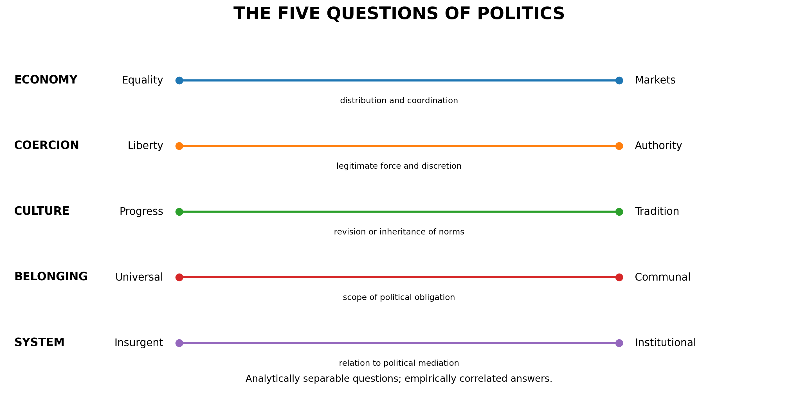
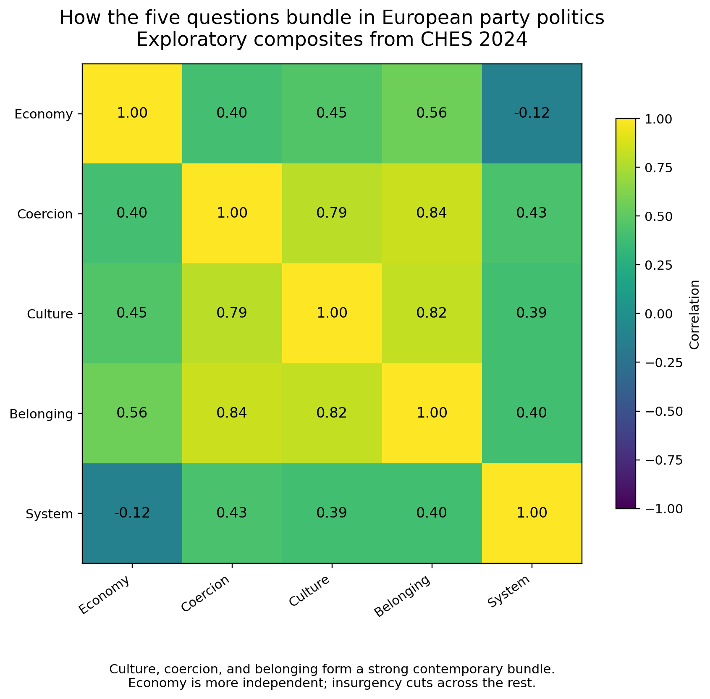
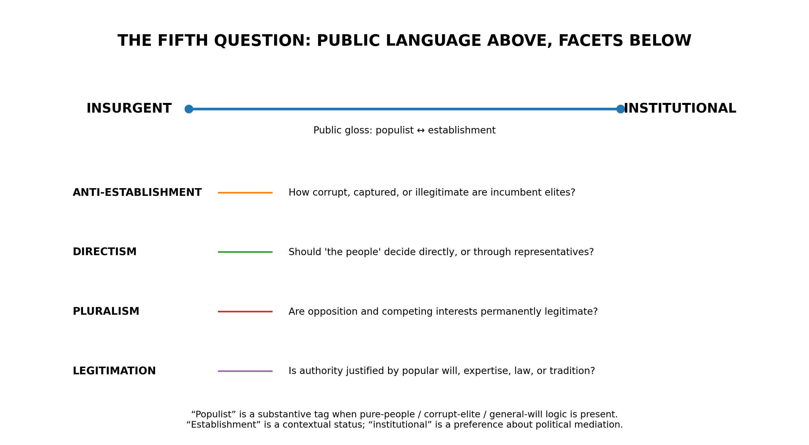
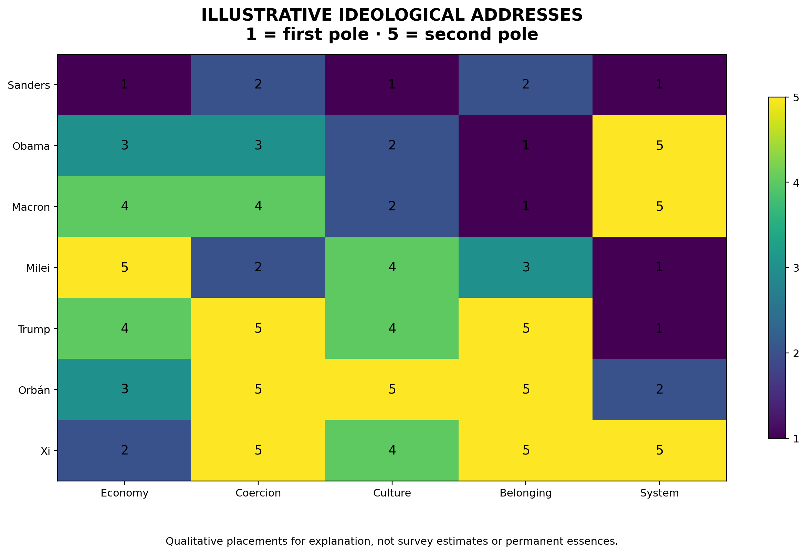
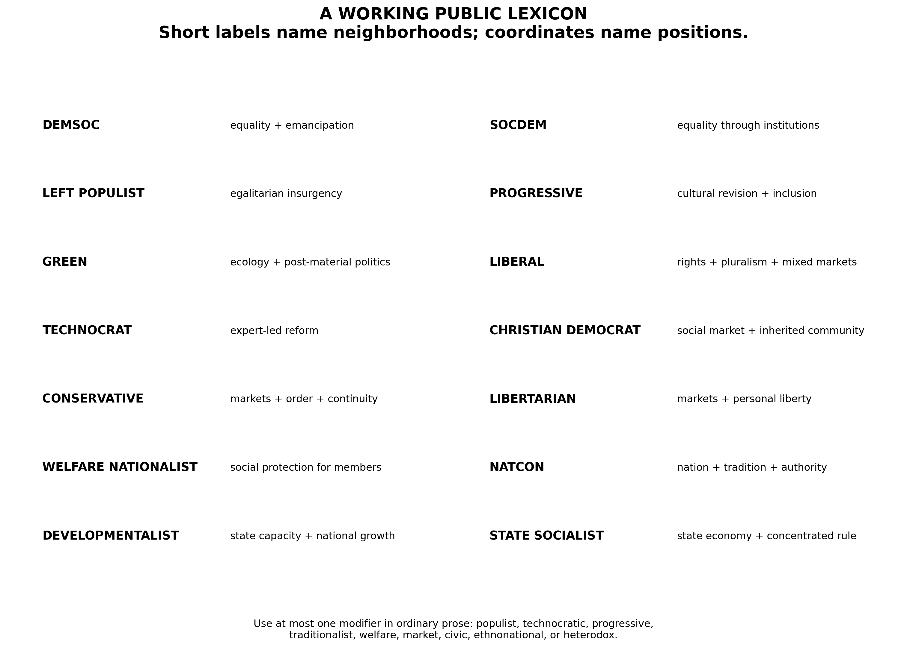

# Politics Has Five Questions

## Toward a vocabulary of ideological disagreement beyond left and right

The left–right spectrum is not false. It is a compression. Its error begins when the compression is mistaken for the thing compressed.

Donald Trump and Javier Milei are both called right-wing populists. Yet one offers national restoration through executive force, border control, tariffs, and state protection; the other came to power promising to take a chainsaw to the state. Bernie Sanders and Trump can both speak of a betrayed people ruled by a corrupt elite, but almost every substantive answer they give—to property, hierarchy, identity, punishment, religion, labor, and membership—pulls in another direction. Barack Obama and Emmanuel Macron are easily grouped together as establishment liberals, though they differ significantly in their relation to markets, administrative authority, and the welfare state.

The conventional spectrum notices that these people belong to opposing coalitions. It does not tell us what the coalitions are made of.

This is not a small defect. Our political vocabulary determines which similarities we can perceive, which disagreements we can name, and which alliances appear natural. To describe every movement as left, center, or right is to take several recurring conflicts—over economic power, coercion, social inheritance, political belonging, and the mediation of authority—and project them onto one line. The result is useful in the way a compressed image is useful. It is portable, recognizable, and rapidly transmitted. It is also lossy.

The task is not to abolish left and right. They are among the most durable and efficient heuristics in modern politics. Voters use them to infer large bundles of positions from a few cues, even though the cues and their meaning differ across people and countries.[^1] The task is to build a vocabulary capable of decompressing them.

What follows is an attempt: five questions, a coordinate system, and a small public lexicon for the ideological families that recur within it.

The aim is not political neutrality. It is political resolution.

---

## I. From Essences to Arrangements

Political ideologies are often treated as substances. Liberalism, socialism, conservatism, nationalism, and populism appear as bounded things, each possessing an essence that can be stated in a paragraph and applied to every historical instance.

In practice they behave more like arrangements.

Michael Freeden’s morphological theory begins from this fact. Ideologies draw from a common field of contested political concepts—liberty, equality, authority, community, democracy, order—and give them determinate meaning by placing them into characteristic configurations.[^2] Liberty means something different when equality is made its condition than when property is made its condition. Community means something different when organized around citizenship than when organized around ancestry. Democracy means something different when understood as plural contestation than when understood as the undivided will of a people.

An ideology, on this view, is not one answer. It is an arrangement of answers.

This also explains why ideological families have both reality and indeterminacy. Social democrats across countries share enough history and conceptual structure to constitute a recognizable family, but no checklist supplies necessary and sufficient conditions for every member. The party-family literature has long struggled with precisely this problem: parties can be classified by origin, organization, international affiliation, name, policy, or ideology, and the boundaries do not always coincide.[^3] Even expert surveys that assign parties to standard families warn that some belong plausibly to more than one.

The correct metaphor is therefore not taxonomy in the biological sense. Ideologies are not species. They are neighborhoods in a space whose streets are themselves historically constructed.

That distinction matters for the naming problem. The first version of this framework made the classic taxonomist’s mistake: it optimized for exhaustive classification at the expense of language. Five binary dimensions yield thirty-two logical vertices. It is possible to give each one a precise name. It is also possible to make the result unusable. A phrase such as *universalist-institutional emancipatory egalitarianism* identifies a point with admirable fidelity and no political life whatsoever.

A vocabulary succeeds only when people can think with it.

The solution is to separate two functions that ordinary ideological labels are forced to perform at once:

1. **Coordinates describe a position.**
2. **Family names identify a neighborhood.**

Coordinates are exact enough for analysis. Names are short enough for speech.

---

## II. Not Five Natural Dimensions

Before presenting the five questions, one claim must be disowned.

These are not five perfectly orthogonal dimensions discovered in nature. Political attitudes do not arrive in independent boxes. They form coalitions, inherit institutions, respond to events, and become socially sorted. Economic and cultural positions often correlate. So do traditionalism, nationalism, punitive authority, and hostility to immigration. At other times and places, the bundles loosen or reverse.

The literature is clear on at least two points. First, one dimension is often insufficient: economic and cultural attitudes can be separated both conceptually and empirically.[^4] Second, no universal factor structure settles politics once and for all. Different groups and party systems attach different meanings to the economic and cultural divides, while globalization, populism, environmentalism, religion, and regime conflict can produce additional cross-cutting lines.

The five questions should therefore be understood as **analytically separable**, not empirically independent.

A useful test is counterfactual: can a person change their answer to one question without logically changing their answer to the others?

A person can support redistribution while opposing censorship. Another can favor markets and a powerful police state. A third can be culturally traditional but universalist in religious obligation. A fourth can be economically egalitarian and intensely nationalist. A fifth can share the policies of an established party while believing that its institutions have become irredeemably corrupt.

Each combination exists because each question asks about a different object.

The empirical bundles remain important. Using the 2024 Chapel Hill Expert Survey, which asked 609 political scientists to assess 279 European parties across a wide range of policy and ideological measures, I constructed exploratory composites corresponding to the five questions.[^5] The exercise is illustrative rather than definitive: the choice of variables is contestable, expert assessments are not ground truth, and Europe is not the world. But the pattern is revealing.

Culture, coercion, and belonging formed a strong contemporary bundle, correlating at roughly .78 to .82. Economy was related but more independent, with correlations of roughly .39 to .56. The insurgent or anti-establishment measures cut across the others more sharply, including a slight negative relationship with market economics.

This is exactly what the framework should predict. The questions are distinct enough to separate; history is powerful enough to bind their answers together.

The point is not that politics secretly has five axes. The point is that political disagreement repeatedly returns to at least five different questions, and that a one-dimensional vocabulary cannot tell us which one is doing the work.

---

## III. The Five Questions

### 1. Economy: Equality ↔ Markets

**How should production, risk, opportunity, and material security be organized?**

At one pole, economic freedom is made meaningful through solidarity: redistribution, social insurance, public provision, labor power, and protection against domination by wealth. At the other, prosperity and freedom are made possible through markets: property, competition, enterprise, private choice, and differentiated reward.

The axis is not “government against freedom.” Government can create markets, protect monopolies, discipline labor, subsidize capital, or distribute wealth upward. Nor is it a measure of whether a system actually produces equality or competition. It records the governing ideal: whether economic coordination should lean toward public obligation and egalitarian protection or toward private choice and market allocation.

The words at the poles are necessarily imperfect. Equality and markets can coexist; solidarity can be voluntary; enterprise can be social. The scale identifies a recurrent tension, not a logical contradiction.

### 2. Coercion: Liberty ↔ Authority

**How much force, discretion, discipline, and paternalism may political order legitimately employ?**

This includes policing, surveillance, punishment, public-health mandates, censorship, emergency power, judicial constraint, privacy, due process, decentralization, and the moral authority of the state.

It is not a disguised measure of government size. A large welfare state can remain strongly civil-libertarian. A state that privatizes its economy can expand prisons, borders, surveillance, military power, and executive discretion. Market liberalism and political liberty are historically associated, but neither logically entails the other.

The deepest dispute is over where domination is most feared. The liberty pole fears concentrated coercive power. The authority pole fears disorder, predation, fragmentation, and the incapacity to act.

### 3. Culture: Progress ↔ Tradition

**Should inherited social norms be revised in the name of autonomy and inclusion, or preserved as accumulated moral knowledge and social continuity?**

This is the domain of family, religion, gender, sexuality, education, custom, symbolism, and the authority of inherited forms.

The distinction is not moral seriousness against permissiveness. Progressives treat emancipation, recognition, and self-authorship as moral imperatives. Traditionalists treat continuity, restraint, duty, family, and inherited wisdom as moral imperatives. Each side accuses the other of failing to perceive a form of harm: exclusion and domination on one side, dissolution and deracination on the other.

Culture must also be separated from coercion. A traditionalist can oppose using the state to enforce traditional morality. A progressive can favor aggressive administrative, professional, or legal enforcement of progressive norms. What one believes society should honor is not identical to how one believes it may compel.

### 4. Belonging: Universal ↔ Communal

**How wide is the primary circle of political obligation?**

The universal pole begins from equal moral standing across borders and inherited identities. It emphasizes human rights, plural citizenship, porous membership, and obligations that do not depend on nationality, religion, or descent.

The communal pole begins from special duties among members of bounded communities. It emphasizes reciprocity, shared history, social trust, sovereignty, and the proposition that solidarity requires a *we* capable of sustaining it.

The academic literature often calls this the cosmopolitan–communitarian divide, especially in work on globalization, integration, borders, and sovereignty.[^6] But communitarianism is not a synonym for ethnic nationalism. A bounded political community may be civic, constitutional, linguistic, religious, cultural, local, or ethnonational. These require secondary tags.

Nor is universalism simply kindness. Universal schemes can become abstract, imperial, or inattentive to the institutions that make solidarity possible. Communal schemes can become exclusionary, coercive, or racialized. The axis concerns the scope and basis of obligation, not the moral quality of the person holding it.

### 5. System: Insurgent ↔ Institutional

**Should political will pass primarily through inherited institutions and mediating organizations, or should those structures be disrupted in the name of a more direct mandate?**

This is the most difficult axis, because ordinary political language bundles several different things into the word *populism*.

An insurgent orientation distrusts entrenched parties, professional gatekeepers, bureaucracies, media, experts, and incumbent elites. It values disruption, responsiveness, outsider status, direct mandate, and the recovery of power from a captured system.

An institutional orientation values durable parties, courts, civil services, legislatures, professional expertise, bargaining, procedure, and continuity. It treats mediation not simply as obstruction but as the form through which plural societies remain governable.

For public communication, the familiar gloss is:

> **Populist ↔ Establishment**

That language should be retained. It already exists in the culture, it names a conflict people recognize, and it captures a real dimension that can cut across left and right. Research on anti-establishment orientations finds precisely such a cross-cutting structure, while contemporary expert surveys separately measure anti-elite rhetoric and preferences for direct popular decision.[^7]

But the familiar language cannot be the source of truth.

---

## IV. What Populism Contains

Cas Mudde’s influential definition treats populism as a “thin-centered” ideology that divides society between a pure people and a corrupt elite and demands that politics express the people’s general will.[^8] This contains at least three claims:

1. **Anti-establishment:** incumbent elites are corrupt or illegitimate.
2. **Moral dualism:** the people and the elite form opposed moral camps.
3. **Directism:** legitimate rule should express an identifiable popular will.

A fourth claim often follows:

4. **Unitarism:** the legitimate people possess a coherent common interest, while durable opposition appears as obstruction, corruption, or betrayal.

These claims frequently travel together. They do not always.

A movement can be anti-establishment without claiming exclusive representation of “the people.” It can demand referendums while accepting pluralism. It can be led by outsiders who favor strong constitutional constraints. It can enter government, construct an extensive party-state, and continue to speak in insurgent language. Conversely, a technocratic movement can be profoundly nonpluralist while despising populist rhetoric.

This is why **Pluralist ↔ Unitary** was an attractive candidate for the fifth axis. It names a genuine and deeper conflict. Daniele Caramani’s comparison of populism and technocracy shows that both can imagine society’s general interest as unitary, unmediated, and relatively unaccountable; they differ principally over whether that interest is discovered through popular will or expert reason.[^9]

But pluralism and unitarism are not the best public replacement for populism and establishment.

They are too abstract for first contact. They also sit too close to questions of regime type. A framework intended to clarify ordinary ideological disagreement should not require the reader to learn a specialist concept before recognizing the conflict under discussion.

The correct solution is hierarchical.

The public axis remains **Insurgent ↔ Institutional**, with **Populist ↔ Establishment** as its familiar, deliberately approximate gloss. Underneath it, a rigorous profile records four facets:

- **Anti-establishment orientation:** how captured or illegitimate are incumbent elites?
- **Directism:** should citizens decide directly or through representatives?
- **Pluralism:** are opposition and competing interests permanently legitimate?
- **Legitimation:** is authority justified by popular will, expertise, law, tradition, or some combination?

This preserves cultural legibility without confusing shorthand for analysis.

It also forces three linguistic distinctions:

- **Populist** is a substantive tag: it should be used when pure-people, corrupt-elite, and general-will logic is actually present.
- **Establishment** is a contextual status: it describes an actor’s location within an existing system.
- **Institutional** is an ideological preference: it describes trust in political mediation, procedure, and durable organizations.

A president can remain populist. An outsider can be institutionalist. A bureaucracy can be insurgently reorganized. A technocrat can be anti-establishment. The facets explain what the single word conceals.

---

## V. Coordinates Before Categories

Each actor receives a five-number address in a fixed order:

> **Economy · Coercion · Culture · Belonging · System**

Use a one-to-five scale:

| Score | Meaning |
|---:|---|
| 1 | strongly toward the first pole |
| 2 | moderately toward the first pole |
| 3 | mixed, conditional, centrist, divided, or unclear |
| 4 | moderately toward the second pole |
| 5 | strongly toward the second pole |

Thus:

> **2 · 4 · 1 · 2 · 5**

means economically equality-leaning, authority-leaning, culturally progressive, universal-leaning, and institutional.

The address is not complete without four pieces of metadata:

- **Salience:** how central is each question to the actor?
- **Confidence:** how strong and consistent is the evidence?
- **Time:** what campaign, governing period, or historical moment is being scored?
- **Object:** are we scoring a person, party, government, electorate, manifesto, or argument?

These distinctions are not bureaucratic ornament. They prevent category errors.

A party may be moderate on immigration because its position is genuinely balanced, because its factions cancel one another, because it speaks ambiguously, or because the issue is irrelevant to its project. Those are politically different facts. The Chapel Hill survey accordingly records position, salience, internal dissent, and deliberate blurring separately.[^5]

The same actor may also require three profiles:

1. **Rhetoric**
2. **Program**
3. **Practice**

A leader can campaign as an insurgent, govern through institutions, and use unitary rhetoric. A nominally market-oriented party can construct protectionist policy. A progressive institution can defend pluralism in law while enforcing conformity in professional life.

An ideological address should describe what is being measured, not synthesize contradictions into false coherence.

Most important: never compute a master score.

There is no meaningful arithmetic by which a 2 in Economy and a 4 in Culture average into a political 3. Such a number would recreate the left–right spectrum under a veneer of precision. Distance can be measured, but it must remain decomposable:

> These actors are close on Culture and Belonging, moderately separated on System, and opposed on Economy and Coercion.

The purpose of the coordinates is not to decide who is “really” farther left or right. It is to make the object of disagreement visible.

---

## VI. The Names We Need

A coordinate string cannot become an affiliation. People do not say that they are a 2–3–1–2–4. Political identities require names, histories, symbols, and communities.

But the names must be disciplined.

The periodic-table fantasy—one unique label for every possible combination—should be abandoned. Some logical vertices correspond to durable ideological traditions. Others are rare, unstable, internally contradictory, or simply unnamed. Even where a combination is common, its historical name may foreground one dimension and leave the others implicit.

The public vocabulary should therefore consist of **prototype families**.

A prototype is not a checklist. It is a recognizable center of gravity. An actor can sit near two prototypes, occupy the edge of one, or combine a family with a modifier. This is how ordinary ideological language already works, and how the strongest theory of ideological morphology suggests it must work.

The following lexicon is not exhaustive. It is designed to cover the most recurring and politically consequential neighborhoods while remaining speakable.

### Demsoc

Strong economic equality joined to cultural emancipation, democratic participation, and broad human solidarity.

The term is short for democratic socialist, but its relevant distinction from state socialism is not merely electoral procedure. The demsoc insists that economic hierarchy itself limits effective freedom while rejecting one-party or bureaucratic ownership of political life.

### Socdem

An equality-leaning mixed economy pursued through labor institutions, welfare states, parliamentary bargaining, and gradual reform.

The socdem is less defined by insurgency than the left populist and less committed to replacing capitalism than the democ. Its characteristic wager is that markets can be politically embedded and social power organized without abolishing either pluralism or enterprise.

### Left Populist

Economic egalitarianism joined to an insurgent account of political power: ordinary people against concentrated wealth, captured parties, or ruling elites.

Bernie Sanders and Jean-Luc Mélenchon occupy different locations within this neighborhood, especially on belonging, sovereignty, culture, and institutional practice. The shared label identifies the coalition they construct, not an identical address.

### Progressive

Cultural revision, inclusion, recognition, and universal citizenship placed near the center of political identity.

“Progressive” is less complete than “socdem” or “liberal”; it often leaves economics, coercion, and institutional form open. That incompleteness is not a reason to discard it. It is a reason to show the coordinates after using it.

### Green

Ecological limits, intergenerational obligation, post-material values, and often decentralized or participatory politics.

Green is the clearest proof that the five-axis core is not the whole of politics. Ecology cannot be reduced cleanly to economy or culture. It should be represented by an optional environmental module rather than distorted to fit the core.

### Liberal

Civil rights, pluralism, universal citizenship, institutional restraint, and a mixed or market-leaning economy.

The word carries different meanings across countries. In the United States it often implies a center-left economic position; in Europe it often implies stronger market orientation. The coordinate address does not eliminate this ambiguity, but makes it manageable.

### Technocrat

Political legitimacy grounded in expertise, administrative competence, optimization, and the capacity to execute.

Technocracy is more a mode of legitimation than a complete ideology. It therefore works best as either a short neighborhood label or a modifier: *technocratic liberal*, *technocratic developmentalist*. Emmanuel Macron is closer to the former; high-capacity developmental states to the latter.

### Christian Democrat

A social-market economy embedded in family, community, subsidiarity, moral obligation, and inherited institutions.

Christian democracy resists the assumption that economic solidarity belongs naturally to cultural progressivism. It historically combines welfare provision and labor accommodation with religious or communitarian social thought.

### Conservative

Institutional continuity, inherited norms, social order, and a mixed or market-oriented economy.

Conservatism should not be collapsed into natcon. Its central disposition is not necessarily insurgent or unitary. The conservative often distrusts abstract reconstruction itself, including reconstruction undertaken in the name of the nation.

### Libertarian

Market coordination and strong limits on coercive authority.

Culture and belonging remain open. A libertarian may be cosmopolitan or nationalist, culturally progressive or traditional, institutionally constitutionalist or populist. Javier Milei is best understood not as the essence of libertarianism but as a populist, culturally mixed or traditionalist variant.

### Welfare Nationalist

Economic protection and social provision bounded primarily by national membership.

This family demonstrates why left and right fail. It can be egalitarian within the community, exclusionary at its boundary, paternalist in government, traditional in culture, and insurgent in rhetoric. Viktor Orbán’s political economy is nearer this neighborhood than the language of laissez-faire conservatism would suggest.

### Natcon

National conservatism: bounded political identity, inherited moral order, authority, and national restoration.

Natcon is a genuinely useful abbreviation because it distinguishes the contemporary national-conservative synthesis from generic conservatism. The family can be market-oriented or protectionist, populist or increasingly institutional, civic or ethnocultural. Donald Trump, Giorgia Meloni, Jair Bolsonaro, and Narendra Modi are not interchangeable, but the label identifies a real shared neighborhood.

### Developmentalist

Economic modernization through coordinated state capacity, industrial policy, infrastructure, and long-horizon national strategy.

Developmentalism can be democratic or authoritarian, market-using or state-owned, technocratic or party-led. Its central concept is not equality or market purity but collective transformation through capable institutions.

### State Socialist

State- or party-directed economic coordination joined to concentrated political authority.

This is not a synonym for every socialist project. The name exists precisely to preserve the distinction between economic egalitarianism, public ownership, democratic socialism, and the institutional concentration characteristic of party-states.

---

## VII. A Grammar, Not a Catalogue

The lexicon becomes more expressive through a small set of modifiers:

- **Populist**
- **Technocratic**
- **Progressive**
- **Traditionalist**
- **Welfare**
- **Market**
- **Civic**
- **Ethnonational**
- **Heterodox**

Use at most one modifier in ordinary prose.

- populist libertarian
- technocratic liberal
- progressive socdem
- market conservative
- civic natcon
- ethnonational natcon
- welfare nationalist
- heterodox populist

When a third word seems necessary, stop naming and show the coordinates.

This rule is more important than it appears. Labels gain explanatory power by excluding detail. Once a label attempts to encode all five dimensions, it becomes a coordinate string written in Latin.

The short family name should answer:

> **What tradition or neighborhood is this actor nearest?**

The coordinates should answer:

> **Where, exactly, does the actor depart from the prototype?**

The tags should answer:

> **What politically decisive feature is not captured by either?**

The result is a three-layer description:

> **Trump is a populist natcon: market-leaning, authority-oriented, culturally traditional, strongly communal, and insurgent, with unitary and personalist features.**

> **Obama is a liberal: economically mixed, moderately authority-accepting, culturally progressive, universal, and strongly institutional.**

> **Milei is a populist libertarian: radically market-oriented, comparatively anti-statist, culturally traditional in important respects, neither fully universal nor nationalist, and highly insurgent.**

> **Orbán is a welfare nationalist: economically mixed, authority-oriented, traditional, strongly communal, and populist in legitimation despite governing through a consolidated institutional apparatus.**

Each sentence says more than a position on a line while remaining possible to remember.

---

## VIII. What Left and Right Still Do

A multidimensional framework is tempted to declare victory over left and right. That would be premature.

Left and right persist because they solve a real coordination problem. Citizens cannot independently reconstruct every party’s position on every dispute. Coalitions need names. Media need contrasts. Political identities need inherited narratives. A one-word cue compresses policies, values, social groups, historical loyalties, and expectations about alliance.

Recent research describes left–right inference in exactly these terms: people use a small number of predictive cues to place parties, though more politically sophisticated voters draw from a broader set of policies, values, and constituencies.[^1]

The spectrum is therefore not merely a philosophical error imposed on politics. It is an adaptation to limited attention.

Its weakness is historical contingency. The bundles move.

Free trade has migrated between coalitions. Opposition to centralized state power has moved between left and right depending on which institutions hold power. Nationalism has appeared in anti-colonial, socialist, liberal, fascist, and conservative forms. Cultural permissiveness can coexist with economic hierarchy; welfare provision can coexist with exclusion; anti-elite rhetoric can unite actors whose conceptions of the people are morally opposed.

Left and right tell us which bundle currently travels together. The five questions tell us what is inside it.

This is why the new vocabulary should not compete with the old at the same level. It should sit beneath it.

> **Left and right are coalition names. The five questions are explanatory coordinates.**

The distinction is analogous to the difference between a file name and its contents. The file name is useful. The mistake is believing that opening it will reveal only one thing.

---

## IX. Families Are Historical; Coordinates Are Portable

Pew Research Center’s 2026 American political typology illustrates both the promise and the limit of cluster-based naming. Using responses to thirty questions, Pew identified nine groups with memorable names such as *Leftward Progressives*, *Loyal Liberals*, *Order and Opportunity Left*, *Unconventional Right*, and *Faith First Conservatives*.[^10]

These groups are valuable because they describe actual clusters in a particular electorate at a particular time. They are not universal ideological species. A typology rerun in another country—or after a war, recession, migration crisis, religious revival, or technological transformation—would find different coalitions and require different names.

The same is true of party families. Christian democracy arose from a specific relation among Catholic social thought, mass organization, class conflict, democracy, and the modern state. Social democracy was transformed by labor movements, industrialization, parliamentary incorporation, and the experience of governing capitalism. Natcon is not simply conservatism with a higher nationalism score; it is a contemporary project formed against globalization, migration, supranational institutions, and progressive cultural power.

Names contain history. Coordinates abstract from it.

A rigorous taxonomy needs both.

Without coordinates, historical labels become ambiguous and tribal. Without historical labels, coordinates become sterile and socially unintelligible. Political language requires a union of morphology and measurement: a concept of ideology as structured arrangement, and a public vocabulary inherited from the arrangements that have actually acquired institutions, constituencies, and memory.

---

## X. What the Framework Does Not Solve

A taxonomy becomes untrustworthy when it hides its exclusions.

### Regime type

The five questions do not by themselves tell us whether an actor accepts competitive elections, opposition rights, independent courts, press freedom, civil society, or peaceful transfer of power.

Regime commitment should be recorded separately:

- **Liberal-democratic**
- **Majoritarian-democratic**
- **Competitive-authoritarian**
- **Closed-authoritarian**

This is necessary because an institutional actor can be authoritarian and an insurgent actor democratic. A party-state may possess formidable institutions. A constitutional reformer may oppose the incumbent establishment. The system axis describes political mediation, not democratic virtue.

### Ecology

Environmentalism deserves an optional module:

> **Growth ↔ Ecology**

Green politics contains a theory of limits, time, nature, and intergenerational obligation that cannot be reduced to redistribution or progressive culture.

### Foreign policy

Use a separate module for:

> **Restraint ↔ Intervention**

This should not be inferred from nationalism, authority, or institutionalism. Universalists can be anti-war or humanitarian interventionists. Nationalists can be isolationist or expansionist.

### Centralization

Coercion captures some preference for concentrated authority, but federalism, subsidiarity, municipalism, and separatism require their own institutional tag.

### Religion and the basis of belonging

Communal politics may be civic, religious, cultural, linguistic, or ethnonational. Those are not morally or politically equivalent.

### State capacity

A preference for authority is not the possession of capacity. Governments can be coercive and incompetent, ambitious and hollow, pluralist and effective. Capability is an empirical property, not an ideological coordinate.

The five questions are a core language, not a theory of everything.

---

## XI. Rules of Use

A public taxonomy must govern its own application.

### 1. Classify commitments and conduct, not aesthetics

Use evidence in roughly this order:

1. enacted policy and governing practice;
2. manifestos, legislation, and detailed programs;
3. repeated specific commitments;
4. appointments, coalitions, and institutional design;
5. general rhetoric;
6. isolated quotations, vibes, and cultural association.

### 2. Separate position from salience

Two parties can hold the same position while one organizes its entire identity around it and the other barely mentions it.

### 3. Permit uncertainty

A 3 can mean moderation, conditionality, internal division, strategic ambiguity, or insufficient evidence. Record which.

### 4. Date every profile

Ideologies move. Parties transform. Insurgents become incumbents. Market reformers become protectionists. Democratic movements acquire authoritarian practices.

### 5. Do not infer one axis from another

Traditional does not entail authoritarian. Market does not entail libertarian. Communal does not entail ethnonational. Progressive does not entail universal. Populist does not entail anti-democratic.

The entire framework exists to prevent those inferences.

### 6. Classify arguments, not only identities

A single person can make an equality-oriented economic argument, a liberty-oriented speech argument, a traditional cultural argument, a universal moral argument, and an institutional constitutional argument.

The taxonomy is at its best when it illuminates the claim under dispute rather than merely assigning a type to the claimant.

### 7. Use charitable pole definitions

Every pole names a political good and a characteristic fear.

| Pole | Good pursued | Failure feared |
|---|---|---|
| Equality | solidarity and security | domination by wealth |
| Markets | choice and enterprise | domination by bureaucracy |
| Liberty | autonomy and due process | coercive concentration |
| Authority | order and protection | disorder and incapacity |
| Progress | inclusion and emancipation | inherited domination |
| Tradition | continuity and inheritance | dissolution and amnesia |
| Universal | equal concern | arbitrary exclusion |
| Communal | belonging and reciprocity | abstraction and social disintegration |
| Insurgent | responsiveness and renewal | capture and oligarchy |
| Institutional | continuity and mediation | arbitrary will and instability |

The symmetry is not an assertion that every application is morally equal. It is a condition of understanding why intelligent people can be drawn toward either pole.

---

## XII. A Better Grammar of Disagreement

The test of the framework is whether it changes ordinary sentences.

Instead of:

> The party moved to the right.

say:

> The party became more authority-oriented and communal while remaining economically centrist.

Instead of:

> Sanders and Trump are both populists.

say:

> Sanders and Trump share an insurgent account of elite failure, but construct different peoples and oppose one another on economy, culture, belonging, and coercion.

Instead of:

> She is socially liberal but fiscally conservative.

say:

> She is market-oriented, culturally progressive, civil-libertarian, universal, and institutional.

Instead of:

> The movement is authoritarian.

ask:

> Is it culturally traditional, coercively authority-oriented, politically unitary, institutionally centralized, or hostile to democratic competition? These can reinforce one another, but they are not the same claim.

Instead of:

> The center is disappearing.

ask:

> On which questions? Economic moderation can coexist with cultural polarization, institutional consensus with anti-establishment revolt, or cross-cutting positions that no major party represents.

This is not semantic fastidiousness. Political coalitions are built and broken by the differences that blurred language conceals.

A welfare nationalist and a market nationalist may agree on borders and culture while disagreeing about the economic obligations of membership. A progressive liberal and a progressive statist may agree on social ends while disagreeing over coercive means. A libertarian and a conservative may share an economic program while opposing one another on state power. A socdem and a Christian democrat may support similar social provision from different moral premises.

Once named, these disagreements become available for argument rather than tribal inference.

---

## XIII. The Wager

A political vocabulary is an instrument of perception.

The left–right spectrum allowed mass democratic politics to compress conflict into a form ordinary citizens, parties, and institutions could carry. Its survival is evidence of its utility. But the same compression now obscures political combinations that have become increasingly consequential: market radicals allied with cultural traditionalists; welfare states bounded by nationalism; progressive administrations comfortable with coercion; anti-establishment movements of both left and right; technocrats and populists united in their impatience with mediation.

We do not need a more complicated compass. We need a grammar.

The five questions are not a final map of political reality. They are a disciplined refusal to confuse one disagreement with another:

- Who should control economic life?
- When may order override autonomy?
- Which inherited norms deserve continuity?
- To whom do we owe special political obligation?
- Through what structures should collective will become power?

The family names make the answers speakable. The coordinates keep the names honest. The modifiers identify what neither can contain. Regime tags preserve the difference between ideology and the rules under which ideology is allowed to compete.

Left and right will remain. They should remain. They name the coalitions history has given us.

But a coalition is not a principle, and a label is not an explanation.

The purpose of the taxonomy is therefore not to place every person into the correct box. It is to make it harder for us to argue about five different things while pretending that there is only one.

> **Coordinates before categories. Questions before camps.**

Not political neutrality.

Political precision.

---

## References

[^1]: *Heuristic Inference and the Left-Right*, Cambridge University Press, 2026. https://www.cambridge.org/core/elements/heuristic-inference-and-the-leftright/39EF6253D53389377D079AE9AD0D0340

[^2]: Michael Freeden, *Ideologies and Political Theory: A Conceptual Approach*; and “The Morphological Analysis of Ideology.” https://academic.oup.com/book/3196 and https://academic.oup.com/edited-volume/34324/chapter-abstract/291329165

[^3]: Peter Mair and Cas Mudde, “The Party Family and Its Study,” *Annual Review of Political Science* 1 (1998). https://www.annualreviews.org/content/journals/10.1146/annurev.polisci.1.1.211

[^4]: See “Not so simple: The multidimensional nature and diverse origins of political ideology,” and “One-dimensional, multidimensional, or non-dimensional? Ideological structure in mass and elite opinion.” https://www.cambridge.org/core/product/51695765E8D4425D429BED2D6F48C462 and https://www.cambridge.org/core/journals/european-journal-of-political-research/article/onedimensional-multidimensional-or-nondimensional-ideological-structure-in-mass-and-elite-opinion/78C953E1B5CC289B183AC549621DB14D

[^5]: Chapel Hill Expert Survey, 2024 dataset and codebook. https://www.chesdata.eu/ches-europe and https://www.chesdata.eu/s/CHES-2024-Codebook-er9d.pdf

[^6]: “Critical junctures and the crystallization of cosmopolitanism and communitarianism,” *European Political Science Review*. https://www.cambridge.org/core/journals/european-political-science-review/article/critical-junctures-and-the-crystallization-of-cosmopolitanism-and-communitarianism/57A4E048277B7259CD4C046E89ECACBA

[^7]: Joseph Uscinski et al., “American Politics in Two Dimensions: Partisan and Ideological Identities versus Anti-Establishment Orientations,” *American Journal of Political Science* 65, no. 4 (2021). https://scholarship.miami.edu/esploro/outputs/journalArticle/American-Politics-in-Two-Dimensions-Partisan/991031660574802976

[^8]: Cas Mudde, “Populism in the Twenty-First Century.” https://amc.sas.upenn.edu/cas-mudde-populism-twenty-first-century

[^9]: Daniele Caramani, “Will vs. Reason: The Populist and Technocratic Forms of Political Representation and Their Critique to Party Government,” *American Political Science Review* 111, no. 1 (2017). https://www.cambridge.org/core/journals/american-political-science-review/article/abs/will-vs-reason-the-populist-and-technocratic-forms-of-political-representation-and-their-critique-to-party-government/58444AC41CD6B6A4116F12CFF2585E15

[^10]: Pew Research Center, “Beyond Red vs. Blue: The Political Typology,” June 10, 2026. https://www.pewresearch.org/politics/2026/06/10/beyond-red-vs-blue-the-political-typology/
