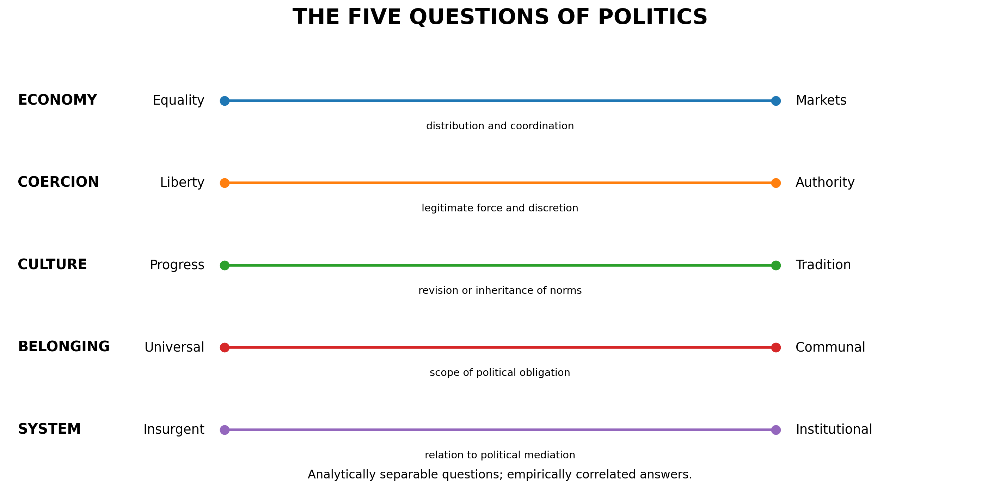
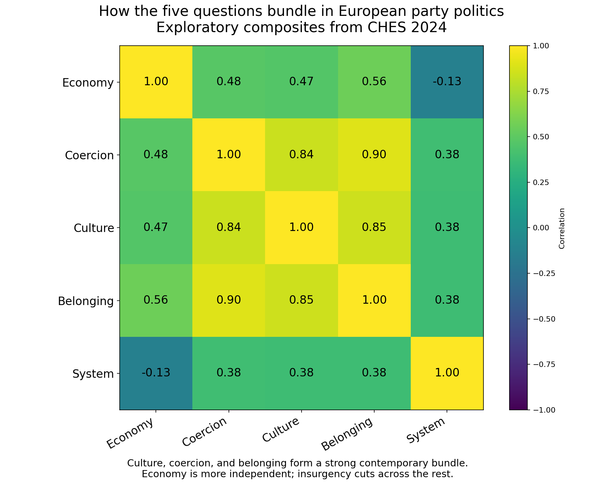
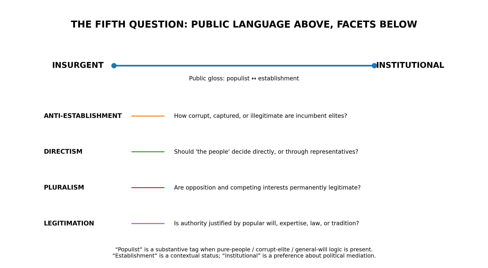
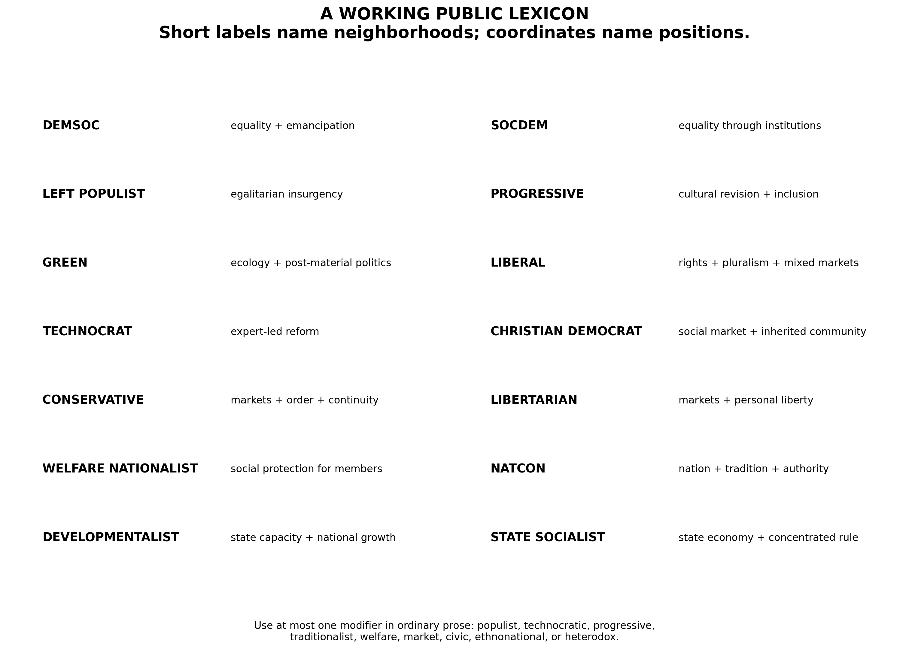
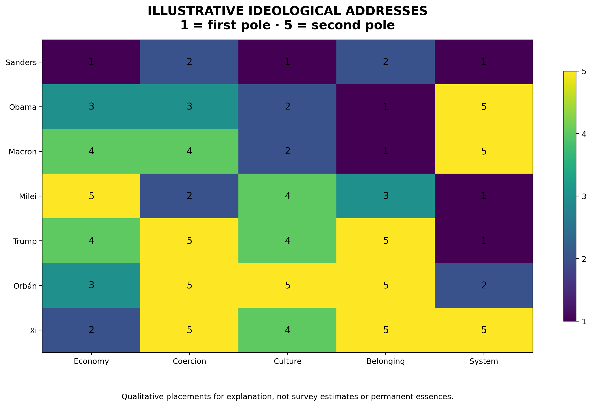

# The Structure of Political Difference

## Toward a grammar of ideological disagreement beyond left and right

The left–right spectrum is not false. It is a compression. Its error begins when the compression is mistaken for the thing compressed.

The stranger fact is that American politics keeps producing alliances the line cannot parse. A democratic socialist from Vermont and a national-conservative Republican from Missouri co-sponsor a bill to cap credit-card interest rates. The progressive chair of the Federal Trade Commission draws her most conspicuous praise from the populist right. A decade earlier, libertarian Republicans and progressive Democrats came within a dozen votes of defunding the bulk collection of Americans’ phone records, against the unified opposition of both parties’ leaderships and the White House. In each case the spectrum’s farthest-apart actors converge, and its nearest neighbors, the institutional center-left and center-right, stand together against them. Commentators reach for horseshoe theory: the ends of the line bend until they touch. The metaphor concedes the failure while keeping the ruler.

The conventional spectrum registers these actors as opposites. It cannot say what they agree about, and so it files their agreement as paradox.

This is not a small defect. Our political vocabulary determines which similarities we can perceive, which disagreements we can name, and which alliances appear natural. To describe every movement as left, center, or right is to take several recurring conflicts (over economic power, coercion, social inheritance, political belonging, and the mediation of authority) and project them onto one line. The result is useful in the way a compressed image is useful. It is portable, recognizable, and rapidly transmitted. It is also lossy.

The task is not to abolish left and right. They are among the most durable and efficient heuristics in modern politics. Voters use them to infer large bundles of positions from a few cues, even though the cues and their meaning differ across people and countries.[1] The task is to build a vocabulary capable of decompressing them.

What follows is an attempt: five questions, a coordinate system, and a small public lexicon for the ideological families that recur within it.

The aim is not political neutrality. It is political resolution.

*Figure 1. The five questions and their poles.*

---

## I. From Essences to Arrangements

Political ideologies are often treated as substances. Liberalism, socialism, conservatism, nationalism, and populism appear as bounded things, each possessing an essence that can be stated in a paragraph and applied to every historical instance.

In practice they behave more like arrangements.

Michael Freeden’s morphological theory begins from this fact. Ideologies draw from a common field of contested political concepts (liberty, equality, authority, community, democracy, order) and give them determinate meaning by placing them into characteristic configurations.[2] Liberty means something different when equality is made its condition than when property is made its condition. Community means something different when organized around citizenship than when organized around ancestry. Democracy means something different when understood as plural contestation than when understood as the undivided will of a people.

An ideology, on this view, is not one answer. It is an arrangement of answers.

This also explains why ideological families have both reality and indeterminacy. Social democrats across countries share enough history and conceptual structure to constitute a recognizable family, but no checklist supplies necessary and sufficient conditions for every member. The party-family literature has long struggled with precisely this problem: parties can be classified by origin, by transnational affiliation, by policy and ideology, or by name, and the boundaries do not always coincide.[3] Even expert surveys that assign parties to standard families warn that some belong plausibly to more than one.

The correct metaphor is therefore not taxonomy in the biological sense. Ideologies are not species. They are neighborhoods in a space whose streets are themselves historically constructed.

That distinction matters for the naming problem. The first version of this framework made the classic taxonomist’s mistake: it optimized for exhaustive classification at the expense of language. Five binary dimensions yield thirty-two logical vertices. It is possible to give each one a precise name. It is also possible to make the result unusable. A phrase such as *universalist-institutional emancipatory egalitarianism* identifies a point with admirable fidelity and no political life whatsoever.

A vocabulary succeeds only when people can think with it.

The solution (and it, rather than the axes, is what this essay is actually proposing) is to separate two functions that ordinary ideological labels are forced to perform at once. **Coordinates describe a position. Family names identify a neighborhood.** Coordinates are exact enough for analysis. Names are short enough for speech. Ordinary labels fail because they are made to do both jobs with one word.

What that separation buys will become concrete later, but a single sentence can serve as a promissory note: *Obama is a liberal—economically mixed, moderately authority-accepting, culturally progressive, universal, and strongly institutional.* The name places him in a tradition; the coordinates say where he sits in it. Neither could do the work alone.

---

## II. The Five Questions

Two warnings before the questions. First, these are not five natural dimensions discovered in politics. They are recurrent disagreements, and the framework that follows is a convention proposed, not a geometry uncovered. Second, and the essay owes this concession to its own first section, the pole-words below are themselves contested concepts. On Freeden’s account, “liberty” and “equality” have no ideology-independent meanings; a framework that fixes them, including this one, is performing a decontestation of its own. The axes are historical artifacts, revisable exactly as the family names are. What follows is a proposal about which fixings are useful, not a claim to have escaped the condition it describes.

### 1. Economy: Equality ↔ Markets

**How should production, risk, opportunity, and material security be organized?**

At one pole, economic freedom is made meaningful through solidarity: redistribution, social insurance, public provision, labor power, and protection against domination by wealth. At the other, prosperity and freedom are made possible through markets: property, competition, enterprise, private choice, and differentiated reward.

The axis is not “government against freedom.” Government can create markets, protect monopolies, discipline labor, subsidize capital, or distribute wealth upward. Nor is it a measure of whether a system actually produces equality or competition. It records the governing ideal: whether economic coordination should lean toward public obligation and egalitarian protection or toward private choice and market allocation.

The words at the poles are necessarily imperfect. Equality and markets can coexist; solidarity can be voluntary; enterprise can be social. The scale identifies a recurrent tension, not a logical contradiction.

### 2. Coercion: Liberty ↔ Authority

**How much force, discretion, discipline, and paternalism may political order legitimately employ?**

This includes policing, surveillance, punishment, public-health mandates, censorship, emergency power, judicial constraint, privacy, due process, decentralization, and the moral authority of the state.

A large welfare state can remain strongly civil-libertarian. A state that privatizes its economy can expand prisons, borders, surveillance, military power, and executive discretion. Coercion, in other words, is not a disguised measure of government size: market liberalism and political liberty are historically associated, but neither logically entails the other.

The deepest dispute is over where domination is most feared. The liberty pole fears concentrated coercive power. The authority pole fears disorder, predation, fragmentation, and the incapacity to act.

### 3. Culture: Progress ↔ Tradition

**Should inherited social norms be revised in the name of autonomy and inclusion, or preserved as accumulated moral knowledge and social continuity?**

This is the domain of family, religion, gender, sexuality, education, custom, symbolism, and the authority of inherited forms.

Neither pole owns moral seriousness. Progressives treat emancipation, recognition, and self-authorship as moral imperatives. Traditionalists treat continuity, restraint, duty, family, and inherited wisdom as moral imperatives. Each side accuses the other of failing to perceive a form of harm: exclusion and domination on one side, dissolution and deracination on the other.

Culture must also be separated from coercion. A traditionalist can oppose using the state to enforce traditional morality. A progressive can favor aggressive administrative, professional, or legal enforcement of progressive norms. What one believes society should honor is not identical to how one believes it may compel.

### 4. Belonging: Universal ↔ Communal

**How wide is the primary circle of political obligation?**

The universal pole begins from equal moral standing across borders and inherited identities. It emphasizes human rights, plural citizenship, porous membership, and obligations that do not depend on nationality, religion, or descent.

The communal pole begins from special duties among members of bounded communities. It emphasizes reciprocity, shared history, social trust, sovereignty, and the proposition that solidarity requires a *we* capable of sustaining it.

The academic literature often calls this the cosmopolitan–communitarian divide, especially in work on globalization, integration, borders, and sovereignty.[4] But communitarianism is not a synonym for ethnic nationalism. A bounded political community may be civic, constitutional, linguistic, religious, cultural, local, or ethnonational. These require secondary tags.

Universalism, for its part, is not simply kindness. Universal schemes can become abstract, imperial, or inattentive to the institutions that make solidarity possible. Communal schemes can become exclusionary, coercive, or racialized. The axis concerns the scope and basis of obligation, not the moral quality of the person holding it.

### 5. System: Insurgent ↔ Institutional

**Should political will pass primarily through inherited institutions and mediating organizations, or should those structures be disrupted in the name of a more direct mandate?**

This is the most difficult axis, because ordinary political language bundles several different things into the word *populism*: a bundle Section V will take apart.

An insurgent orientation distrusts entrenched parties, professional gatekeepers, bureaucracies, media, experts, and incumbent elites. It values disruption, responsiveness, outsider status, direct mandate, and the recovery of power from a captured system.

An institutional orientation values durable parties, courts, civil services, legislatures, professional expertise, bargaining, procedure, and continuity. It treats mediation not simply as obstruction but as the form through which plural societies remain governable.

For public communication, the familiar gloss is:

> **Populist ↔ Establishment**

That language should be retained. It already exists in the culture, it names a conflict people recognize, and it captures a real dimension that can cut across left and right. Research on anti-establishment orientations finds precisely such a cross-cutting structure, though it should be said that the dimension those researchers measure carries conspiracist and antisocial freight that the charitable pole definition used here deliberately strips away; that normative reconstruction is this essay’s, not theirs.[5] Contemporary expert surveys, meanwhile, separately measure anti-elite rhetoric and preferences for direct popular decision.

Note, before going on, that being insurgent is not the same as being populist, and neither is a synonym for anti-democratic. The distinctions are the subject of Section V.

---

## III. The Price of Speech

The framework just proposed has a number, and the number is a claim the argument has so far only assumed. Why five questions—and why these five?

Multi-axis correctives to the spectrum are nearly as old as the complaint against it. The lineage runs from the Nolan chart through the Political Compass to the open-source 8values test and its axis-multiplying successors. The convergence with 8values in particular should be stated plainly: it measures four axes (Equality against Markets, Liberty against Authority, Tradition against Progress, Nation against Globe), and three of them carry, verbatim, the pole names used here.[6] The convergence is better read as evidence than as embarrassment. Independent attempts to decompress the spectrum keep finding the same questions, because these are the questions politics keeps returning to.

But the overlap must be named, because the difference lies in what is done with the answers. A test scores people: it asks its taker a battery of questions and returns a self. That is the wrong form for a political vocabulary. The objects that need describing are claims, laws, manifestos, parties, and governments—things that argue and act in public—not the private souls of quiz-takers. And a test has no discipline for its names. 8values contains, in embryo, this essay’s central move: after computing your coordinates it names your “closest match” ideology (coordinates first, family second) and then disowns the naming layer as “much less accurate than the values and axes,” advising users not to take it too seriously.[6] The disclaimer is the tell. The naming layer is not noise to be apologized for; it is where political language actually lives. What the test tradition lacks is not axes. It is a semantics for the names, which is what the rest of this essay builds.

The deeper challenge comes from the positions flanking any such framework. On one side stands the pragmatic defense of the single line: Bryan Caplan’s argument that the spectrum earns its keep because it tracks the political identities and conflicts that actually exist. On the other stand the eliminativists: Hyrum and Verlan Lewis, whose *The Myth of Left and Right* is the strongest published version of this essay’s own opening move (left and right are tribal bundles, not philosophies), and also its standing refutation.[7] If bundling is the sin, the Lewises ask, why re-bundle at any scale? “There is more than one issue in politics.” Keep issues unbundled, as biology keeps species: “Why not just say ‘anti-market’ instead of ‘left-wing’?”

The objection deserves its full strength: each of the five questions is itself a bundle. Economy compresses trade, taxation, redistribution, regulation, property, and labor. A protectionist tax-cutter has no true Economy score, only a lossy 3. Five axes, on this reading, is not decompression but a bigger, better-defended reification.

The answer is that compression is not the sin; compression is the price of speech. A vocabulary that refuses to bundle at all already exists: it is called a policy database, and no one can think in it. The choice is never whether to compress but where compression stops paying. One line pays for mass coordination and bankrupts analysis. Fifty issues pay for precision and bankrupt conversation. The claim of this essay is that five is roughly where the marginal distinction stops covering its cost in speech: a pragmatic optimum, not a fact of nature, and therefore a claim that owes its criteria.

A question earns a core axis, on the account proposed here, when it passes three tests: it has recurred across polities and centuries rather than decades; its answers form and break coalitions rather than merely sorting opinions; and it cannot be inferred from the other axes. The five questions pass all three. The exclusions show the tests doing real work. Ecology is a genuine political question with its own theory of limits, time, and intergenerational obligation, and it cannot be reduced to economy or culture, but as mass politics it is two generations old, and its stable place in coalition-building is still being negotiated. It fails the first test, so it gets a module (Growth against Ecology), not because it matters less but because the historical record has not yet taught us where it settles. Foreign policy fails the second: restraint and intervention have divided every family from within (universalists split into doves and humanitarian hawks, nationalists into isolationists and expansionists), cutting across the families without ever forming durable ones of its own. It, too, is a module: Restraint against Intervention.

Five, then, is a defended budget, not a discovery. Anyone who thinks a sixth question passes the three tests is invited to argue it in: that is what it means for a framework to be a convention rather than a geometry.

---

## IV. Separable but Bound

If the five questions are analytically separable, they are certainly not empirically independent. Political attitudes do not arrive in independent boxes. They form coalitions, inherit institutions, respond to events, and become socially sorted. The literature is clear on at least two points: one dimension is often insufficient, since economic and cultural attitudes can be separated both conceptually and empirically; and no universal factor structure settles politics once and for all.[8]

A useful test of separability is counterfactual: can a person change their answer to one question without logically changing their answer to the others?

A person can support redistribution while opposing censorship. Another can favor markets and a powerful police state. A third can be culturally traditional but universalist in religious obligation. A fourth can be economically egalitarian and intensely nationalist. A fifth can share the policies of an established party while believing that its institutions have become irredeemably corrupt.

Each combination exists because each question asks about a different object.

The empirical bundles remain important, and here precision matters, because the data below were built by the tradition this essay is trying to decompress. The 2024 Chapel Hill Expert Survey, completed by 609 political scientists assessing 279 European parties, is organized around a two-dimensional model: economic left–right, plus the dimension Hooghe, Marks, and Wilson named GAL/TAN (green/alternative/libertarian against traditionalism/authority/nationalism).[9][10] TAN welds together three of this essay’s questions by design: culture, coercion, and belonging. And Herbert Kitschelt supplied the standard explanation for why the weld holds: postindustrial party competition runs along a left-libertarian/right-authoritarian diagonal in that two-dimensional space.[11]

I constructed exploratory composites from the 2024 survey corresponding to the five questions; the variables are listed with the references so that the exercise can be checked.[9] Among European parties, culture, coercion, and belonging correlate pairwise at .84 to .90. Economy is related but more independent, at .47 to .56. The anti-establishment measures cut across everything else, including a slight negative correlation with market economics.

*Figure 2. Correlations among exploratory five-question composites, 2024 Chapel Hill Expert Survey. The composites are the author’s, not an official CHES construct; variable definitions are given in the references.[9]*

Read naively, the strong bundle is an argument that three of the five questions are one question. Read with the survey’s history in view, it is partly the dataset’s own architecture faithfully reflected back: an instrument built around GAL/TAN will find GAL/TAN. So the exercise cannot show what a naive reading would want it to show, and no such claim is made here. The questions did not arrive independent, and history binds their answers together.

What the exercise can show is where the weld is failing. Milei joins radically market-oriented, anti-statist economics to cultural traditionalism and insurgency, off Kitschelt’s diagonal. The welfare nationalists of Europe are egalitarian toward members and exclusionary at the boundary, off the diagonal in the other direction. The framework’s empirical claim is not that politics secretly has five factor-analytic axes. It is that the reigning two-dimensional settlement welds together questions that current politics is visibly unwelding, and a vocabulary should be able to describe the unwelding while it happens.

That claim is falsifiable. If no politically consequential actors occupied the off-diagonal cells (if traditionalists were reliably authoritarian, nationalist, and anti-market; if egalitarians were reliably universalist and progressive), the extra questions would be idle machinery, and the two-dimensional compression would deserve to keep its monopoly. The cases just named, like the alliances of this essay’s opening, are the evidence that the cells are occupied, and increasingly by winners.

---

## V. What Populism Contains

Cas Mudde’s influential definition treats populism as a “thin-centred” ideology that divides society between a pure people and a corrupt elite and demands that politics express the people’s general will.[12] This contains at least three claims:

1. **Anti-establishment:** incumbent elites are corrupt or illegitimate.
2. **Moral dualism:** the people and the elite form opposed moral camps.
3. **Directism** (a term coined here for the purpose): legitimate rule should express an identifiable popular will.

A fourth claim often follows:

4. **Unitarism:** the legitimate people possess a coherent common interest, while durable opposition appears as obstruction, corruption, or betrayal.

The sharpest development of this fourth claim belongs to Jan-Werner Müller, for whom anti-pluralism is populism’s defining criterion: populists claim that they, and they alone, represent the people, a moral monopoly of representation that survives every electoral arithmetic.[13]

These claims frequently travel together. They do not always.

A movement can be anti-establishment without claiming exclusive representation of “the people.” It can demand referendums while accepting pluralism. It can be led by outsiders who favor strong constitutional constraints. It can enter government, construct an extensive party-state, and continue to speak in insurgent language. Conversely, a technocratic movement can be profoundly nonpluralist while despising populist rhetoric.

This is why **Pluralist ↔ Unitary** was an attractive candidate for the fifth axis. It names a genuine and deeper conflict. Daniele Caramani’s comparison of populism and technocracy shows that both can imagine society’s general interest as unitary, unmediated, and relatively unaccountable; they differ principally over whether that interest is discovered through popular will or expert reason.[14]

But pluralism and unitarism are not the best public replacement for populism and establishment. They are too abstract for first contact, and they sit too close to questions of regime type. A framework intended to clarify ordinary ideological disagreement should not require the reader to learn a specialist concept before recognizing the conflict under discussion.

The correct solution is hierarchical.

*Figure 3. The System axis: a public gloss over four analytic facets.*

The public axis remains **Insurgent ↔ Institutional**, with **Populist ↔ Establishment** as its familiar, deliberately approximate gloss. Underneath it, a rigorous profile records four facets: anti-establishment orientation (how captured or illegitimate are incumbent elites?); directism (should citizens decide directly or through representatives?); pluralism (are opposition and competing interests permanently legitimate?); and legitimation (is authority justified by popular will, expertise, law, tradition, or some combination?). None of these facets is an invention (political science already measures populist, pluralist, and elitist attitudes as separate scales[15]), but assembling them under a public gloss, rather than a score, is the point of the architecture.

It preserves cultural legibility without confusing shorthand for analysis. And it forces three linguistic distinctions:

- **Populist** is a substantive tag: it should be used when pure-people, corrupt-elite, and general-will logic is actually present.
- **Establishment** is a contextual status: it describes an actor’s location within an existing system.
- **Institutional** is an ideological preference: it describes trust in political mediation, procedure, and durable organizations.

A president can remain populist. An outsider can be institutionalist. A bureaucracy can be insurgently reorganized. A technocrat can be anti-establishment. The facets explain what the single word conceals.

---

## VI. Coordinates Before Categories

Each actor receives a five-number address in a fixed order:

> **Economy · Coercion · Culture · Belonging · System**

The scale runs one to five: one and two toward the first pole, four and five toward the second, three for the mixed, conditional, divided, or unclear middle. Thus **2 · 4 · 1 · 2 · 5** means economically equality-leaning, authority-leaning, culturally progressive, universal-leaning, and institutional.

One rule of interpretation before anything else: coordinates describe commitments and conduct, not souls. The natural first question (*what’s my number?*) is the quiz tradition’s question, and it is the wrong one. The objects worth scoring are arguments, programs, parties, and governments; a person is scored, if at all, only as the author of positions taken in public.

The address is not complete without four pieces of metadata: **salience** (how central is each question to the actor?), **confidence** (how strong and consistent is the evidence?), **time** (what campaign, governing period, or historical moment is being scored?), and **object** (a person, party, government, electorate, manifesto, or argument?). These distinctions prevent category errors. A party may be moderate on immigration because its position is genuinely balanced, because its factions cancel one another, because it speaks ambiguously, or because the issue is irrelevant to its project. Those are politically different facts, and the Chapel Hill survey accordingly records position, salience, internal dissent, and deliberate blurring separately.[9]

The same actor may also require three profiles: **rhetoric**, **program**, and **practice**. A leader can campaign as an insurgent, govern through institutions, and use unitary rhetoric. A nominally market-oriented party can construct protectionist policy. A progressive institution can defend pluralism in law while enforcing conformity in professional life. An ideological address should describe what is being measured, not synthesize contradictions into false coherence.

Most important: never compute a master score.

There is no meaningful arithmetic by which a 2 in Economy and a 4 in Culture average into a political 3. Such a number would recreate the left–right spectrum under a veneer of precision. Distance can be measured, but it must remain decomposable:

> These actors are close on Culture and Belonging, moderately separated on System, and opposed on Economy and Coercion.

The purpose of the coordinates is not to decide who is “really” farther left or right. It is to make the object of disagreement visible.

---

## VII. The Discipline of Names

A coordinate string cannot become an affiliation. People do not say that they are a 2 · 3 · 1 · 2 · 4. Political identities require names, histories, symbols, and communities.

But the names must be disciplined. The periodic-table fantasy (one unique label for every possible combination) should be abandoned. Some logical vertices correspond to durable ideological traditions; others are rare, unstable, internally contradictory, or simply unnamed. The public vocabulary should therefore consist of **prototype families**.

A prototype is not a checklist. It is a recognizable center of gravity. An actor can sit near two prototypes, occupy the edge of one, or combine a family with a modifier. This is how ordinary ideological language already works, and political science has a name for the semantics: radial categories, organized around a central case, with members related by resemblance rather than by necessary and sufficient conditions.[16]

Consider the families that do the most argumentative work.

The **socdem** and the **demsoc** are a minimal pair the single spectrum cannot even express. The socdem pursues an equality-leaning mixed economy through labor institutions, welfare states, parliamentary bargaining, and gradual reform; the characteristic wager is that markets can be politically embedded without abolishing either pluralism or enterprise. The demsoc insists that economic hierarchy itself limits effective freedom, while rejecting, against state socialism, any one-party or bureaucratic ownership of political life. The difference is a matter of depth on Economy and of destination; on a left–right line the two names collapse into a smear.

The **welfare nationalist** demonstrates why left and right fail. Economic protection and social provision, bounded primarily by national membership: egalitarian within the community, exclusionary at its boundary, frequently paternalist in government, traditional in culture, and insurgent in rhetoric. Political science has studied the phenomenon for three decades under the name welfare chauvinism;[17] the family name used here is chosen to say what the position is for rather than only what it is against. Viktor Orbán’s Hungary sat near this neighborhood for sixteen years, with the caveat that its provision was workfare-flavored and flat-taxed: “welfare” in this family means provision bounded by membership, not redistributive generosity.

The **natcon** (national conservative) names the contemporary synthesis of bounded political identity, inherited moral order, authority, and national restoration, and is useful precisely because it distinguishes that synthesis from generic conservatism. The family can be market-oriented or protectionist, populist or increasingly institutional, civic or ethnocultural. Donald Trump, Giorgia Meloni, Jair Bolsonaro, and Narendra Modi are not interchangeable (Modi’s Hindu-nationalist project has a religious specificity the label flattens, which is what the secondary tags are for), but the label identifies a real shared neighborhood.

The **libertarian** joins market coordination to strong limits on coercive authority, leaving culture and belonging open: a libertarian may be cosmopolitan or nationalist, culturally progressive or traditional, constitutionalist or populist. Javier Milei is best understood not as the essence of libertarianism but as a populist, culturally mixed or traditionalist variant.

Two more families will be needed for the profiles below. The **liberal** combines civil rights, pluralism, universal citizenship, institutional restraint, and a mixed or market-leaning economy—a word that means center-left economics in the United States and stronger market orientation in Europe; the coordinates make the ambiguity manageable rather than eliminating it. The **technocrat** grounds legitimacy in expertise, administrative competence, and the capacity to execute—more a mode of legitimation than a complete ideology, and best used as a modifier: *technocratic liberal*, *technocratic developmentalist*.

The fuller lexicon (left populist, progressive, green, Christian democrat, conservative, developmentalist, state socialist) is drawn in the figure and defined in a companion reference sheet; the essay needs only the families that argue in it.

*Figure 4. The prototype families as neighborhoods in the five-question space.*

---

## VIII. A Grammar, Not a Catalogue

The lexicon becomes expressive through a small set of modifiers (populist, technocratic, progressive, traditionalist, welfare, market, civic, ethnonational, heterodox), used at most one at a time in ordinary prose: *populist libertarian*, *technocratic liberal*, *civic natcon*, *welfare nationalist*. When a third word seems necessary, stop naming and show the coordinates. This rule is more important than it appears. Labels gain explanatory power by excluding detail. Once a label attempts to encode all five dimensions, it becomes a coordinate string written in Latin.

The three layers divide the labor. The family name answers: what tradition or neighborhood is this actor nearest? The coordinates answer: where, exactly, does the actor depart from the prototype? The tags answer: what politically decisive feature is not captured by either?

The profiles that follow are illustrations of the grammar, not verdicts. Each is dated, each is disputable, and one of them (deliberately, because his case is the hardest) gets the full treatment the rules of use demand.

**Sanders** (in the Senate, 2007–; presidential campaigns 2016 and 2020) gives Section VII’s minimal pair a live case: a demsoc in self-description and a socdem in program, strongly egalitarian in economy, liberty-leaning on coercion, culturally progressive, universal-leaning in belonging, and insurgent toward the establishments of both parties. The word *socialist* files him with the last profile on this list; the coordinates make them adjacent on one question and opposed on the other four.

**Obama** (in office 2009–2017) is a liberal: economically mixed, moderately authority-accepting, culturally progressive, universal, and strongly institutional.

**Macron** (in office 2017–) is a technocratic liberal: market-leaning in economy, authority-leaning in coercion (emergency powers folded into ordinary law), culturally progressive with a republican inflection, universalist in belonging (Europe, not the nation, as the operative project), and maximally institutional in preference despite an insurgent route to power that left neither of France’s governing parties in the 2017 runoff. Section V’s aside (an outsider can be institutionalist) governs a nuclear state.

**Milei** (in office 2023–) is a populist libertarian: radically market-oriented, comparatively anti-statist, culturally traditional in important respects, neither fully universal nor nationalist, and highly insurgent.

**Trump** (second term, 2025–2026) is a populist natcon: authority-oriented, culturally traditional, strongly communal, and insurgent, with unitary and personalist features—and, on Economy, the best current argument for splitting rhetoric from practice. The rhetoric is market: deregulation, tax cuts, the language of enterprise. The practice is protectionist and state-directive: after the Supreme Court struck down the IEEPA tariffs in February 2026, the tariff program continued under other statutory authorities, with sectoral rates of 10 to 50 percent across metals, autos, lumber, and furniture (up to 100 percent on patented pharmaceuticals), a weighted average applied rate near 12 percent, and an estimated tax increase of roughly $900 per household in a single year.[18] *Market-rhetorical, protectionist-statist in practice* is not a complication the framework tolerates; it is what the framework is for.

**Orbán** (in office 2010–2026) was a welfare nationalist: economically mixed, authority-oriented, traditional, strongly communal, and populist in legitimation even while governing through a consolidated institutional apparatus—until April 2026, when an insurgent opposition won a two-thirds parliamentary majority and ended the sixteen-year system at the ballot box.[19] The fall carries its own System-axis lesson: institutional consolidation is a preference and a practice, not a guarantee, and insurgency is a position available against any incumbent, including a formerly insurgent one.

**Xi Jinping** (general secretary 2012–) is a state socialist in lineage and a party-state technocrat in operation: state-directive in economy, strongly authority-oriented, increasingly traditionalist in culture, communal-nationalist in belonging, and maximally institutional. The profile shows why Section XI’s regime tag is non-negotiable: institutional describes the depth of mediation, not its democratic character.

Each sentence says more than a position on a line while remaining possible to remember. And each now carries a date, because one of them had to be rewritten within months of its first drafting. The rules of use below are not ornaments.

*Figure 5. The seven illustrative three-layer profiles, dated as of mid-2026.*

---

## IX. The Persistence of Left and Right

A multidimensional framework is tempted to declare victory over left and right. That would be premature.

Left and right persist because they solve a real coordination problem. Citizens cannot independently reconstruct every party’s position on every dispute. Coalitions need names. Media need contrasts. Political identities need inherited narratives. A one-word cue compresses policies, values, social groups, historical loyalties, and expectations about alliance. Recent research describes left–right inference in exactly these terms: people use a small number of predictive cues to place parties, though more politically sophisticated voters draw from a broader set of policies, values, and constituencies.[1] The spectrum is therefore not merely a philosophical error imposed on politics. It is an adaptation to limited attention.

There is also a deeper defense than coordination, and it deserves a named opponent rather than silence. Norberto Bobbio argued that left and right endure because they track a real and permanent divide: attitudes toward equality (a horizontal, egalitarian conception of society against a vertical, inegalitarian one).[20] If Bobbio is right, the five questions are one question wearing five masks, and this essay has multiplied entities without necessity. The framework’s answer is its cases. Equality-monism cannot score the welfare nationalist without remainder: egalitarian toward members, inegalitarian at the boundary is not a point on an equality line but an answer to two different questions—how much equality, and among whom. It cannot place Milei, whose radical anti-egalitarianism in economics arrives fused with an insurgent, anti-elite politics that speaks in the register Bobbio assigns to the left. The difficulty is not that Bobbio’s divide is unreal. It is that “equality” decomposes on contact: equality of what (economy), enforced how (coercion), against which inheritances (culture), among whom (belonging), decided by whom (system). Bobbio’s one question was five questions all along.

The spectrum’s weakness is historical contingency. The bundles move. Free trade has migrated between coalitions. Opposition to centralized state power has moved between left and right depending on which institutions hold power. Nationalism has appeared in anti-colonial, socialist, liberal, fascist, and conservative forms. Left and right tell us which bundle currently travels together. The five questions tell us what is inside it.

This is why the new vocabulary should not compete with the old at the same level. It should sit beneath it.

> **Left and right are coalition names. The five questions are explanatory coordinates.**

The distinction is analogous to the difference between a file name and its contents. The file name is useful. The mistake is believing that opening it will reveal only one thing.

And this settles who the vocabulary is for. Not, primarily, voters: mass publics show little stable ideological structure of any dimensionality (the same survey research this essay leans on finds citizens’ attitudes far less constrained than elites’[8]), and a five-number address with metadata is no folk instrument. Pretending otherwise would repeat the quiz tradition’s mistake in a more demanding key, and it is part of why two decades of multi-axis tests have decorated the internet without displacing the spectrum: they addressed the wrong user. The vocabulary is for the people who produce political language (writers, analysts, editors, the arguing class), whose distinctions reach everyone else through the same cue-giving mechanism by which party positions reach voters in the first place.[1] The spectrum keeps the coordination job. The grammar works upstream, where the cues are written.

---

## X. The Historicity of Families

Pew Research Center’s 2026 American political typology illustrates both the promise and the limit of cluster-based naming. Using responses to thirty questions, Pew identified nine groups with memorable names such as *Leftward Progressives*, *Loyal Liberals*, *Order and Opportunity Left*, *Unconventional Right*, and *Faith First Conservatives*.[21] These groups are valuable because they describe actual clusters in a particular electorate at a particular time. They are not universal ideological species. A typology rerun in another country (or after a war, recession, migration crisis, religious revival, or technological transformation) would find different coalitions and require different names.

The same is true of party families. Christian democracy arose from a specific relation among Catholic social thought, mass organization, class conflict, democracy, and the modern state. Social democracy was transformed by labor movements, industrialization, parliamentary incorporation, and the experience of governing capitalism. Natcon is not simply conservatism with a higher nationalism score; it is a contemporary project formed against globalization, migration, supranational institutions, and progressive cultural power.

Names contain history. Coordinates abstract from it. A rigorous vocabulary needs both: without coordinates, historical labels become ambiguous and tribal; without historical labels, coordinates become sterile and socially unintelligible.

---

## XI. What the Framework Does Not Solve

A taxonomy becomes untrustworthy when it hides its exclusions.

The most important exclusion is regime type. The five questions do not by themselves tell us whether an actor accepts competitive elections, opposition rights, independent courts, press freedom, civil society, or peaceful transfer of power. That commitment should be recorded as a separate, non-negotiable tag (liberal-democratic, majoritarian-democratic, competitive-authoritarian, closed-authoritarian), because an institutional actor can be authoritarian and an insurgent actor democratic; a party-state may possess formidable institutions; a constitutional reformer may oppose the incumbent establishment. The System axis describes political mediation, not democratic virtue.

The remaining exclusions have already appeared or can be stated briefly. Ecology and foreign policy are modules, for the reasons Section III gave. Centralization (federalism, subsidiarity, municipalism, separatism) needs its own institutional tag, as does the basis of belonging (civic, religious, linguistic, ethnonational: not morally or politically equivalent). And a preference for authority is not the possession of capacity: governments can be coercive and incompetent, ambitious and hollow, pluralist and effective. Capability is an empirical property, not an ideological coordinate. The five questions are a core language, not a theory of everything.

---

## XII. The Use and Abuse of a Vocabulary

A public taxonomy must govern its own application, and most of its discipline fits in one paragraph. Classify commitments and conduct, not aesthetics: enacted policy and governing practice outrank manifestos, manifestos outrank repeated commitments, and isolated quotations, vibes, and cultural association rank last. Separate position from salience: two parties can hold the same position while one organizes its identity around it and the other barely mentions it. Permit uncertainty: a 3 can mean moderation, conditionality, internal division, strategic ambiguity, or insufficient evidence; say which. Date every profile: ideologies move, parties transform, insurgents become incumbents, and the Orbán profile above had to be rewritten within months. And classify arguments, not only identities: a single person can make an equality-oriented economic argument, a liberty-oriented speech argument, a traditional cultural argument, a universal moral argument, and an institutional constitutional argument. The taxonomy is at its best when it illuminates the claim under dispute rather than merely assigning a type to the claimant.

One rule deserves its own paragraph. **Do not infer one axis from another.** Traditional does not entail authoritarian. Market does not entail libertarian. Communal does not entail ethnonational. Progressive does not entail universal. Populist does not entail anti-democratic. The entire framework exists to prevent those inferences.

Finally, use charitable pole definitions. Every pole names a political good and a characteristic fear:

| Pole | Good pursued | Failure feared |
|---|---|---|
| Equality | solidarity and security | domination by wealth |
| Markets | choice and enterprise | domination by bureaucracy |
| Liberty | autonomy and due process | coercive concentration |
| Authority | order and protection | disorder and incapacity |
| Progress | inclusion and emancipation | inherited domination |
| Tradition | continuity and inheritance | dissolution and amnesia |
| Universal | equal concern | arbitrary exclusion |
| Communal | belonging and reciprocity | abstraction and social disintegration |
| Insurgent | responsiveness and renewal | capture and oligarchy |
| Institutional | continuity and mediation | arbitrary will and instability |

The symmetry is not an assertion that every application is morally equal, nor that each fear is equally well founded in every decade. It is the minimum charity required to understand why intelligent people can be drawn toward either pole, and it is a precondition of the whole exercise, because a taxonomy whose poles are compliments and insults is a weapon, not a vocabulary.[22]

---

## XIII. A Better Grammar of Disagreement

The test of the framework is whether it changes ordinary sentences.

Instead of:

> The party moved to the right.

say:

> The party became more authority-oriented and communal while remaining economically centrist.

Instead of:

> Sanders and Trump are both populists.

say:

> Sanders and Trump share an insurgent account of elite failure, but construct different peoples and oppose one another on economy, culture, belonging, and coercion.

Instead of:

> She is socially liberal but fiscally conservative.

say:

> She is market-oriented, culturally progressive, civil-libertarian, universal, and institutional.

Instead of:

> The movement is authoritarian.

ask:

> Is it culturally traditional, coercively authority-oriented, politically unitary, institutionally centralized, or hostile to democratic competition? These can reinforce one another, but they are not the same claim.

Instead of:

> The center is disappearing.

ask:

> On which questions? Economic moderation can coexist with cultural polarization, institutional consensus with anti-establishment revolt, or cross-cutting positions that no major party represents.

Political coalitions are built and broken by the differences that blurred language conceals. A welfare nationalist and a market nationalist may agree on borders and culture while disagreeing about the economic obligations of membership. A progressive liberal and a progressive statist may agree on social ends while disagreeing over coercive means. A libertarian and a conservative may share an economic program while opposing one another on state power. A socdem and a Christian democrat may support similar social provision from different moral premises.

Once named, these disagreements become available for argument rather than tribal inference.

---

## XIV. An Instrument of Perception

A political vocabulary is an instrument of perception.

The left–right spectrum allowed mass democratic politics to compress conflict into a form ordinary citizens, parties, and institutions could carry. Its survival is evidence of its utility. But the same compression now obscures the combinations that increasingly decide elections: market radicals allied with cultural traditionalists; welfare states bounded by nationalism; technocrats and populists united in their impatience with mediation.

We do not need a more complicated compass. We need a grammar.

The five questions are not a final map of political reality. They are a disciplined refusal to confuse one disagreement with another:

- Who should control economic life?
- When may order override autonomy?
- Which inherited norms deserve continuity?
- To whom do we owe special political obligation?
- Through what structures should collective will become power?

The family names make the answers speakable. The coordinates keep the names honest. The modifiers identify what neither can contain. Regime tags preserve the difference between ideology and the rules under which ideology is allowed to compete.

Left and right will remain. They should remain. They name the coalitions history has given us. But a coalition is not a principle, and a label is not an explanation.

The purpose of the taxonomy is therefore not to place every person into the correct box. It is to make it harder for us to argue about five different things while pretending that there is only one.

> **Coordinates before categories. Questions before camps.**

Not political neutrality.

Political precision.

---

## References

[1] Seonghui Lee, Lie Philip Santoso, and Randolph Stevenson, *Heuristic Inference and the Left-Right: An Experimental Analysis of How Voters Form Their Left-Right Images of Parties*, Cambridge Elements in Experimental Political Science (Cambridge University Press, 2026). https://www.cambridge.org/core/elements/heuristic-inference-and-the-leftright/39EF6253D53389377D079AE9AD0D0340

[2] Michael Freeden, *Ideologies and Political Theory: A Conceptual Approach* (Oxford: Clarendon Press); and “The Morphological Analysis of Ideology,” in *The Oxford Handbook of Political Ideologies*. https://academic.oup.com/book/3196 and https://academic.oup.com/edited-volume/34324/chapter-abstract/291329165

[3] Peter Mair and Cas Mudde, “The Party Family and Its Study,” *Annual Review of Political Science* 1 (1998): 211–229. https://www.annualreviews.org/content/journals/10.1146/annurev.polisci.1.1.211

[4] Pieter de Wilde, Peter Egge Langsæther, and colleagues, “Critical junctures and the crystallization of cosmopolitanism and communitarianism,” *European Political Science Review* 15, no. 2 (2023): 157–176. https://www.cambridge.org/core/journals/european-political-science-review/article/critical-junctures-and-the-crystallization-of-cosmopolitanism-and-communitarianism/57A4E048277B7259CD4C046E89ECACBA

[5] Joseph Uscinski et al., “American Politics in Two Dimensions: Partisan and Ideological Identities versus Anti-Establishment Orientations,” *American Journal of Political Science* 65, no. 4 (2021). https://scholarship.miami.edu/esploro/outputs/journalArticle/American-Politics-in-Two-Dimensions-Partisan/991031660574802976

[6] 8values, an open-source four-axis political survey. https://8values.github.io/ — axes: Economic (Equality–Markets), Diplomatic (Nation–Globe), Civil (Liberty–Authority), Society (Tradition–Progress); the “closest match” disclaimer quoted in the text appears on the results page.

[7] Hyrum Lewis and Verlan Lewis, *The Myth of Left and Right: How the Political Spectrum Misleads and Harms America* (Oxford University Press, 2023); the quotations in the text are from the Caplan–Lewis exchange, “The Myth of Left and Right: The Last Word,” Bet On It. https://www.betonit.ai/p/the-myth-of-left-and-right-the-last

[8] Stanley Feldman and Leonie Huddy, “Not so simple: The multidimensional nature and diverse origins of political ideology,” *Behavioral and Brain Sciences* (2014), https://www.cambridge.org/core/product/51695765E8D4425D429BED2D6F48C462; and Philippe Mongrain and Stefaan Walgrave, “One-dimensional, multidimensional, or non-dimensional? Ideological structure in mass and elite opinion,” *European Journal of Political Research* (2026), https://www.cambridge.org/core/journals/european-journal-of-political-research/article/onedimensional-multidimensional-or-nondimensional-ideological-structure-in-mass-and-elite-opinion/78C953E1B5CC289B183AC549621DB14D

[9] Chapel Hill Expert Survey, 2024 dataset and codebook. https://www.chesdata.eu/ches-europe and https://www.chesdata.eu/s/CHES-2024-Codebook-er9d.pdf. The exploratory composites in Section IV are z-scored means of the following variables, with pairwise Pearson correlations computed over all 279 parties: Economy = lrecon, redistribution, deregulation, spendvtax; Coercion = civlib_laworder, executive_power; Culture = galtan, womens_rights, lgbtq_rights, samesex_marriage, religious_principles; Belonging = nationalism, immigrate_policy, multiculturalism, ethnic_minorities; System = anti_elite_salience, people_v_elite.

[10] Liesbet Hooghe, Gary Marks, and Carole J. Wilson, “Does Left/Right Structure Party Positions on European Integration?,” *Comparative Political Studies* 35, no. 8 (2002): 965–989. https://journals.sagepub.com/doi/10.1177/001041402236310

[11] Herbert Kitschelt, *The Transformation of European Social Democracy* (Cambridge University Press, 1994).

[12] Cas Mudde, “The Populist Zeitgeist,” *Government and Opposition* 39, no. 4 (2004): 541–563, https://www.cambridge.org/core/journals/government-and-opposition/article/populist-zeitgeist/2CD34F8B25C4FFF4F322316833DB94B7; the definition is restated in Mudde, “Populism in the Twenty-First Century,” https://amc.sas.upenn.edu/cas-mudde-populism-twenty-first-century

[13] Jan-Werner Müller, *What Is Populism?* (University of Pennsylvania Press, 2016).

[14] Daniele Caramani, “Will vs. Reason: The Populist and Technocratic Forms of Political Representation and Their Critique to Party Government,” *American Political Science Review* 111, no. 1 (2017). https://www.cambridge.org/core/journals/american-political-science-review/article/abs/will-vs-reason-the-populist-and-technocratic-forms-of-political-representation-and-their-critique-to-party-government/58444AC41CD6B6A4116F12CFF2585E15

[15] Agnes Akkerman, Cas Mudde, and Andrej Zaslove, “How Populist Are the People? Measuring Populist Attitudes in Voters,” *Comparative Political Studies* 47, no. 9 (2014). https://journals.sagepub.com/doi/10.1177/0010414013512600

[16] David Collier and James E. Mahon Jr., “Conceptual ‘Stretching’ Revisited: Adapting Categories in Comparative Analysis,” *American Political Science Review* 87, no. 4 (1993): 845–855. https://www.cambridge.org/core/journals/american-political-science-review/article/abs/conceptual-stretching-revisited-adapting-categories-in-comparative-analysis/52A5DA1F2B8A9516A45C04F5B165E1C5

[17] Jørgen Goul Andersen and Tor Bjørklund, “Structural Changes and New Cleavages: The Progress Parties in Denmark and Norway,” *Acta Sociologica* 33, no. 3 (1990): 195–217. https://journals.sagepub.com/doi/10.1177/000169939003300303

[18] Tax Foundation, “Tariff Tracker: 2026 Trump Tariffs & Trade War by the Numbers” (accessed July 2026). https://taxfoundation.org/research/all/federal/trump-tariffs-trade-war/

[19] Al Jazeera, “Peter Magyar wins Hungary election, unseating Viktor Orban after 16 years,” April 12, 2026. https://www.aljazeera.com/news/2026/4/12/hungary-election-early-results-show-magyars-tisza-ahead-of-orbans-fidesz

[20] Norberto Bobbio, *Left and Right: The Significance of a Political Distinction*, trans. Allan Cameron (Cambridge: Polity Press, 1996).

[21] Pew Research Center, “Beyond Red vs. Blue: The Political Typology,” June 10, 2026. https://www.pewresearch.org/politics/2026/06/10/beyond-red-vs-blue-the-political-typology/

[22] The charitable-poles method—stating each position as a good pursued and a failure feared—is indebted to Arnold Kling, *The Three Languages of Politics: Talking Across the Political Divides* (Cato Institute, 2017), whose three “languages” are rhetorical heuristics of tribes; the poles here are positional coordinates of claims, but the steelmanning posture is his.
